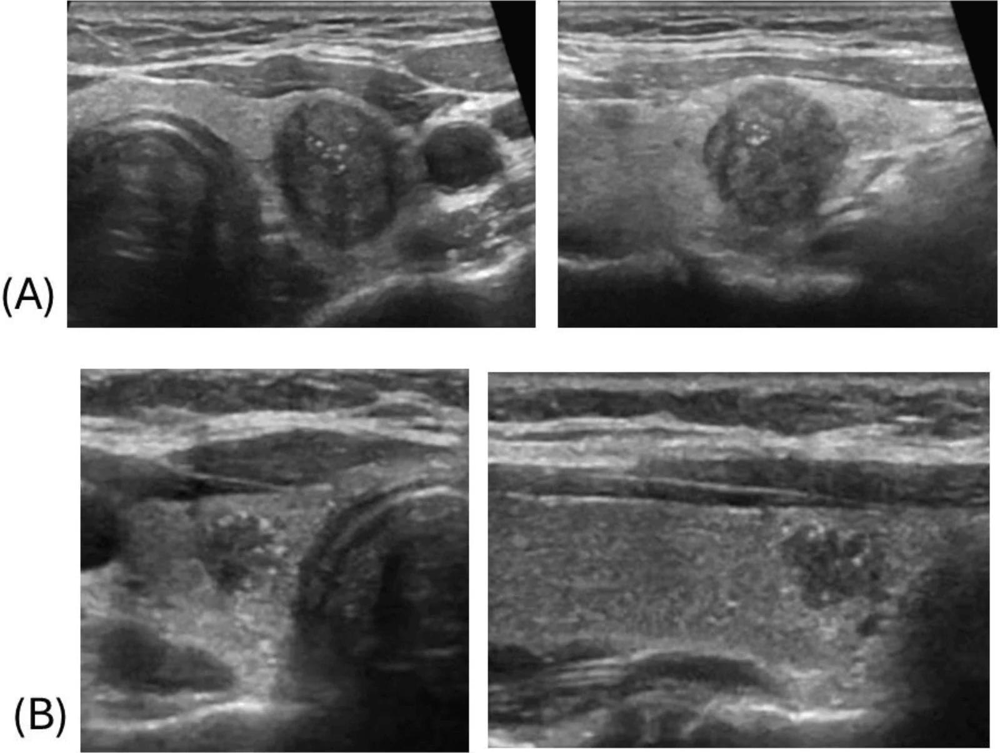
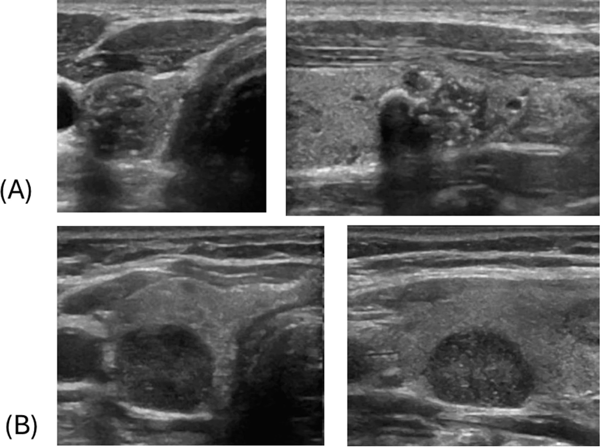
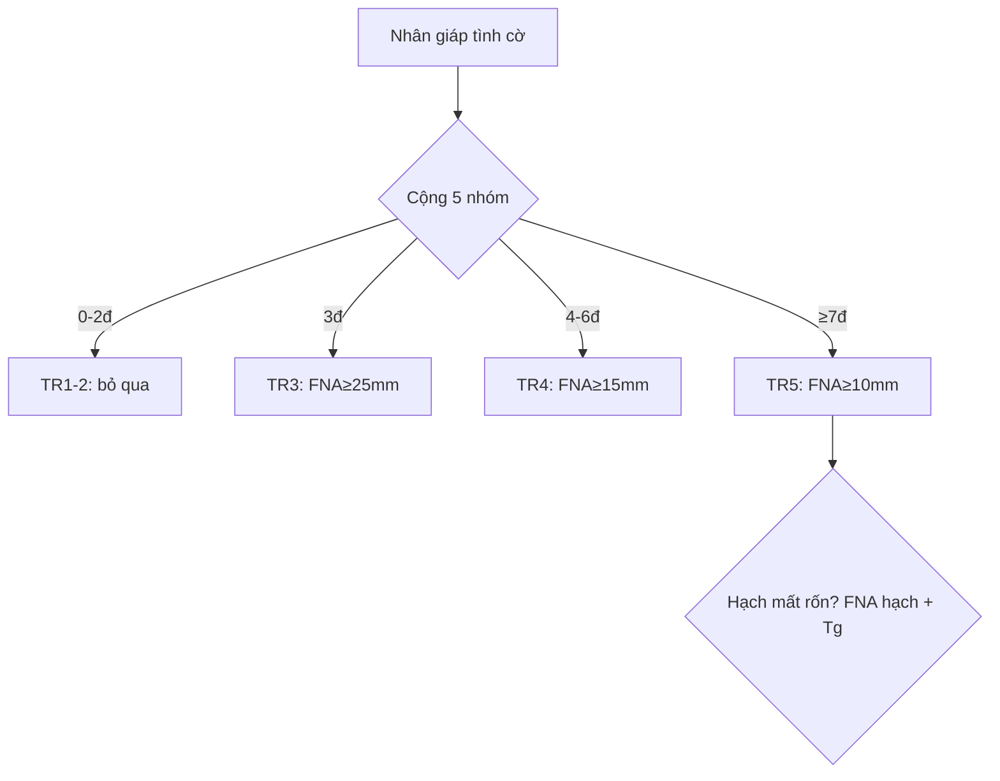

# 230 — Tuyến giáp ACR TI-RADS & hạch cổ / Thyroid TI-RADS

**Tags:** `pattern:nhan-giap` `vung:tuyen-giap` `score:TI-RADS` `incidentaloma:nhan-giap`
**Mức chắc chắn (certainty):** tổng hợp y văn (literature synthesis) — nhóm tự biên từ y văn mở, chưa gắn ca nguyên văn đơn lẻ.

## 1. Tổng quan — xơ xuyên mặt phẳng + thể cát vs keo + đen hơn cơ

- **Cao hơn rộng (taller-than-wide, Trước-Sau/Ngang > 1):** nhân lành (keo, nang) dẹt theo mặt phẳng mô + xẹp khi ấn đầu dò; **ung thư nhú (PTC)** xơ hóa mô đệm (desmoplasia) xâm lấn xuyên mặt phẳng theo trục trước-sau — TẠI SAO 3 điểm.
- **Chấm tăng âm ≤ 1 mm (punctate, 3đ) = thể cát (psammoma)** từ hoại tử nhú ung thư, nhỏ hơn bước sóng nên không bóng lưng; **đuôi sao chổi > 1 mm (0đ) = đa âm keo cô đặc** lành tính.
- **Rất giảm âm (3đ) = đen hơn cả cơ trước giáp (strap: ức-giáp, ức-móng)** — đặc hiệu > 90%; giảm âm thường (2đ) chỉ đen hơn nhu mô giáp.

## 2. Mẫu hình + gamut nhân giáp & hạch cổ (Gamut)

- **Bọt biển/nang/toàn keo + đuôi sao chổi:** TR1 — bỏ qua.
- **Đặc + đồng âm + bờ nhẵn + không vôi:** TR2–3 — theo dõi/FNA theo mm.
- **Đặc + giảm âm + cao-rộng + đa cung + vi vôi:** TR5 — FNA + mổ.
- **Nhân nhỏ + hạch mất rốn/vi vôi:** di căn — FNA hạch + Tg rửa (bỏ ngưỡng mm!).

## 3. Bảng cộng điểm 5 nhóm + ma trận 4 thực thể

| Nhóm (4 nhóm đầu chọn 1, vôi cộng dồn) | Mức điểm |
|---|---|
| Thành phần: nang 0 / **bọt biển 0 (DỪNG, không cộng thêm!)** / hỗn hợp 1 / đặc 2 | 0–2 |
| Hồi âm: trống 0 / tăng-đồng 1 / giảm 2 / **rất giảm 3** | 0–3 |
| Hình: rộng-cao 0 / **cao-rộng 3** | 0 / 3 |
| Bờ: nhẵn/không rõ 0 / đa cung-không đều 2 / **xâm lấn 3** | 0–3 |
| Vôi (CỘNG DỒN tất cả): đuôi sao > 1 mm 0 / thô 1 / viền 2 / **chấm ≤ 1 mm 3** | 0–6 |

| Thực thể (entity) | Hình ảnh | Chốt vào (rule-in) | Chốt loại (rule-out) | Gợi ý xác nhận |
|---|---|---|---|---|
| PTC (TR5) | **Đặc + rất giảm + cao-rộng + đa cung/xâm lấn + vi vôi (≥ 7đ)** | **≥ 7đ + mô bệnh (~35% ác)** | Bọt biển → TR1 | FNA ≥ 10 mm + mổ |
| Nang thể (TR3) | **Đặc + đồng âm + nhẵn + viền dày, 3đ** | **3đ + FNA ≥ 25 mm** | Vi vôi → TR5 | FNA theo mm |
| Keo lành (TR1) | **Bọt biển/nang + đuôi sao > 1 mm** | **Spongiform = DỪNG** | Cao-rộng → TR5 | Bỏ qua |
| Giả nhân Hashimoto | **Tăng âm bờ đều + da báo + không khối (White Knight)** | **Không hiệu ứng khối** | Có khối → nhân thật | **Cấm FNA** |
| Hạch di căn PTC | **Tròn (D/N < 2) + mất rốn + vi vôi/nang + mạch vỏ** | **Tg rửa cao + VI/III–IV** | Rốn mỡ + bầu dục → phản ứng | FNA hạch + Tg (bỏ ngưỡng mm!) |

*Giảm âm + bờ không đều + chấm tăng âm. Nguồn: Abougazia et al., Cureus 2026 Fig. 4, CC BY 4.0.*

*Rất giảm âm + vi vôi, PTC xác nhận. Nguồn: Abougazia et al., Fig. 6, CC BY 4.0.*

## 4. Protocol + ngưỡng FNA/theo dõi + flowchart

- TR1–2: không FNA/theo dõi. TR3: FNA ≥ 25 mm, theo dõi ≥ 15 mm (1-3-5 năm). TR4: FNA ≥ 15 mm, theo dõi ≥ 10 mm (1-2-3-5 năm). TR5: FNA ≥ 10 mm, theo dõi ≥ 5 mm (hàng năm 5 năm). Tối đa 2 nhân FNA.

## 5. Cạm bẫy

- **Hạch di căn + nhân 5–8 mm** chờ đủ 10 mm = trễ — FNA cả hạch (Tg rửa) + nhân ngay.
- **TR5 < 10 mm sát rãnh khí-thực quản** (dây quặt ngược) — không theo dõi chủ động, FNA/mổ sớm.
- **Thực quản cổ trái giả nhân vôi** — nuốt nước bọt thấy nhu động là thực quản!
- **Bỏ sót hạch VI trung tâm** sau mổ giáp — siêu âm VI + Tg máu theo dõi tái phát.

## 6. Tự lượng giá — Blind Quiz

**Ca 1 — Nhân giáp giảm âm bờ không đều + chấm sáng. Chấm điểm.**

- Hỏi: cộng mấy điểm? TR mấy? Bước tiếp?

<b>Bấm để hiện đáp án</b>

- Dấu hiệu (findings): đặc (2) + giảm âm (2) + bờ không đều (2) + chấm ≤ 1 mm (3) = **9đ → TR5**.
- Chẩn đoán (diagnosis): **nghi PTC cao (~35% ác)** — FNA + mổ (mô bệnh xác nhận).
- Nguồn: Abougazia et al., Fig. 4, CC BY 4.0.

**Ca 2 — Nhân 7 mm TR5 + hạch VI mất rốn + vi vôi:** chờ 10 mm không? *(Bảng mục 3 + mục 5.)*

<b>Bấm để hiện đáp án</b>

- **Không chờ:** FNA hạch + Tg rửa + FNA nhân ngay (bỏ ngưỡng mm khi hạch di căn!).

**Ca 3 — Da báo + tăng âm bờ đều + không khối, TPO (+):** nhân thật hay giả nhân? Chọc không? *(Bảng mục 3.)*

<b>Bấm để hiện đáp án</b>

- **Giả nhân Hashimoto (White Knight):** cấm FNA — theo dõi giáp.

## Bài liên quan chéo
- [200 – Tổng quan Thần kinh](../200-tong-quan-he-than-kinh/lesson.md)
- [235 – Thái dương & xoang](../235-xuong-thai-duong-xoang/lesson.md) (đầu-mặt-cổ)
- [231 – Hạch cổ (dự kiến viết sau)]

> Không dùng để chẩn đoán độc lập khi chưa có người hướng dẫn.
