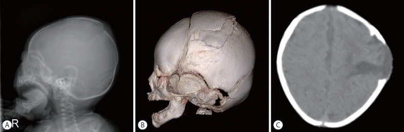
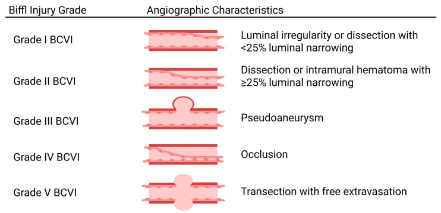
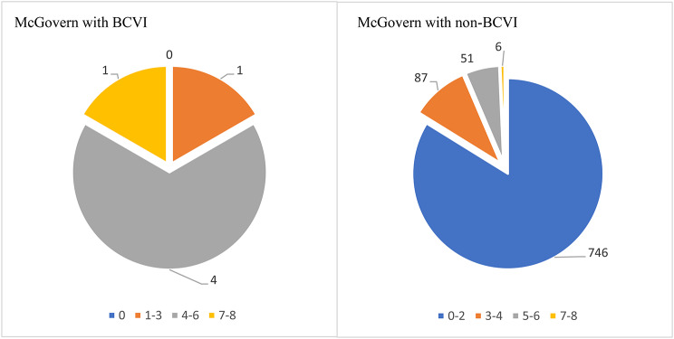
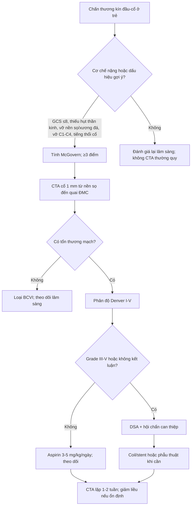
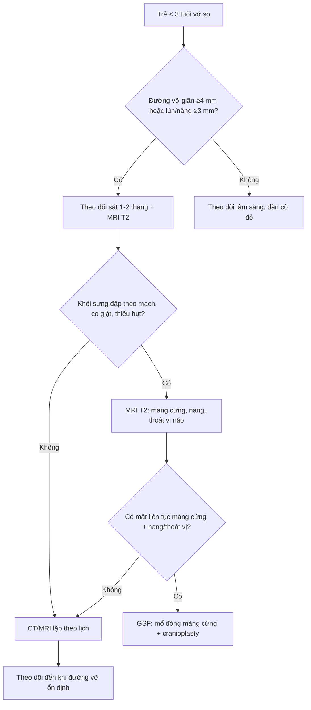
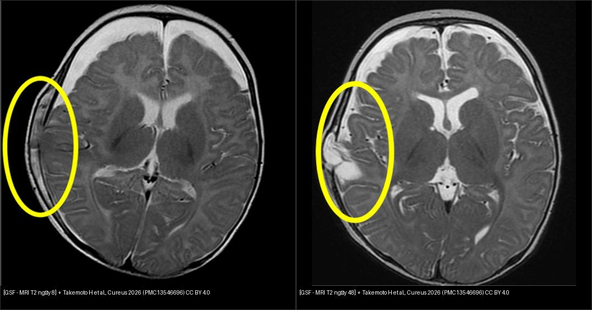
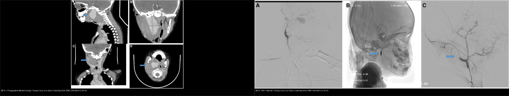

# 231 — Tổn thương mạch máu não do chấn thương (BCVI) & vỡ sọ tiến triển ở trẻ: Denver, McGovern, CTA/MRA & thời điểm mổ / Pediatric blunt cerebrovascular injury (BCVI) & growing skull fracture

**Tags:** `pattern:chan-thuong-mach-mau` `pattern:boc-tach-dong-mach` `pattern:gia-phinh` `pattern:vo-so-tien-trien` `vung:co` `vung:so-nao` `score:Denver-Biffl` `score:McGovern` `protocol:CTA-co` `protocol:MRA-co` `protocol:theo-doi`
**Mức chắc chắn (certainty):** ca nguyên văn (verbatim case) — trục bài là **ca vỡ sọ tiến triển ở bé gái 3 tháng** của Takemoto H et al., *Cureus* 2026 (PMC13546696, CC BY) và **ca giả phình động mạch cảnh trong ở bé trai 5 tuổi** của Farooq Z et al., *Eur Heart J Case Rep* 2025 (PMC12451687, CC BY); các số liệu dịch tễ – ngưỡng sàng lọc – phân độ là tổng hợp y văn, ghi nguồn từng số ở `sources.md`.

## 1. Tổng quan bệnh học – cơ chế hình ảnh

- **BCVI (blunt cerebrovascular injury)** là tổn thương **động mạch cảnh hoặc động mạch đốt sống do chấn thương kín**, gồm **rách nội mạc, bóc tách (dissection), máu tụ trong thành, giả phình (pseudoaneurysm), huyết khối/tắc mạch, đứt rách hoàn toàn**. Đây là nguyên nhân **đột quỵ thiếu máu não có thể phòng được** ở trẻ chấn thương nặng.
- **TẠI SAO dễ bỏ sót:** tổn thương nằm ở **đoạn mạch cổ – nền sọ**, triệu chứng có thể **xuất hiện muộn sau nhiều giờ đến ngày**; trẻ lại thường **hôn mê, đa chấn thương, hoặc bị che lấp bởi chấn thương sọ não**. Trong đoàn hệ 956 trẻ chấn thương kín, **6 ca BCVI (0,6%)** và **cả 6 đều có thiếu hụt thần kinh khu trú lúc nhập viện** — nhưng không được dùng dấu này để loại trừ, vì y văn vẫn ghi nhận ca không triệu chứng.
- **TẠI SAO trẻ khác người lớn:** mạch máu trẻ **đàn hồi hơn, đường kính nhỏ**, sọ mỏng và **nền sọ/cột sống cổ chưa cốt hóa hoàn toàn** → lực tăng–giảm tốc dễ gây **bóc tách đoạn xa hoặc tổn thương trong lỗ cảnh/lỗ đốt sống**. **Chấn thương sọ não/ xuất huyết nội sọ** đi kèm tới **67%** ca BCVI; **vỡ nền sọ** (đặc biệt **ống cảnh, xương đá**) là yếu tố liên quan mạnh (**17–68%** các nghiên cứu).
- **Vỡ sọ tiến triển (growing skull fracture — GSF)** là biến chứng muộn đặc thù của trẻ nhỏ: **đường vỡ sọ + rách màng cứng (dural tear) + dính màng nhện**, sau đó **nhịp đập của não và dịch não tủy** đẩy mô não/màng não qua khe vỡ, **ngăn cản tạo xương và gây tiêu xương**, làm đường vỡ **rộng dần**. Kết quả là **nang màng não – não (leptomeningocele/leptomeningeal cyst)** lồi dưới da.
- **Dịch tễ – ngưỡng định lượng:**
  - **BCVI trẻ em:** **0,03–0,6%** chấn thương kín; trong đoàn hệ 956 trẻ, **0,6% (6/956)**, **70% được chụp CTA**, và mô hình sàng lọc **McGovern ≥ 3 điểm** có **Se 100%, Sp 83,8%, PPV 4,0%, NPV 100%, AUC 0,960** — nếu áp dụng hồi cứu có thể **giảm 77,5% CTA** (668 → 150).
  - **GSF:** **0,05–1,6%** các ca vỡ sọ; **> 90% xảy ra ở trẻ < 3 tuổi**; **xương đỉnh** hay gặp nhất, rồi **xương chẩm, xương trán**. Dấu hiệu sớm: **khối sưng da đầu đập theo mạch, to lên khi trẻ khóc**, đau đầu, co giật, thiếu hụt thần kinh.
  - **Ca GSF nguyên văn:** bé gái **3 tháng**, ngã cầu thang, **GCS 9**, đường vỡ **7–8 mm**; **MRI ngày 8** nghi rách màng cứng/thoát vị não sớm, **CT ngày 27 không thấy đường vỡ rộng thêm**, **MRI ngày 48** xác định **mất liên tục màng cứng + nang + thoát vị não**; **mổ ngày 75**, MRI ngày 119 nang nhỏ lại, theo dõi **2 năm** không di chứng.
- **TẠI SAO CT có thể "âm tính giả" trong GSF:** CT cửa sổ xương chỉ thấy **thay đổi xương**; trong giai đoạn đầu, **rách màng cứng, thoát vị não, nang dịch** có thể tiến triển **trước khi xương tiêu đủ để thấy đường vỡ rộng**. **MRI T2** thấy rõ **mất liên tục màng cứng, nang dịch, mô não thoát vị** — đây là lý do ca trên cần **MRI theo dõi có chọn lọc** dù CT chưa đổi.

*Bé gái 3 tháng: (A) X-quang sọ nghiêng, (B) CT 3D và (C) CT trục — đường vỡ giãn rộng xương đỉnh trái, kèm **khối lồi màng não (leptomeningocele)** qua khe vỡ. Nguồn: Choi JI, Kim SD, J Korean Neurosurg Soc 2022 (PMC9082117), CC BY-NC 4.0 — nguyên bản.*

## 2. Mẫu hình + chẩn đoán phân biệt theo mạch và theo vị trí (Gamut)

- **BCVI theo mạch:** **động mạch cảnh trong (ICA)** — đoạn cổ, lỗ cảnh, xương đá; **động mạch đốt sống (VA)** — đoạn V2 trong lỗ ngang, V3 quanh C1–C2, V4 nội sọ. **Động mạch cảnh** thường liên quan **vỡ nền sọ/xương đá**; **động mạch đốt sống** liên quan **gãy/trật cột sống cổ, chấn thương vùng chẩm – cổ**.
- **BCVI theo hình thái (Denver/Biffl I–V):** I — bất thường lòng mạch/hẹp **< 25%**; II — bóc tách/máu tụ trong thành hẹp **≥ 25%**; III — **giả phình**; IV — **tắc hoàn toàn**; V — **đứt rách, thoát thuốc tự do**. **Grade càng cao → nguy cơ đột quỵ càng tăng**; grade I–II chiếm **50–75%** ca.
- **Dấu hiệu lâm sàng gợi ý (không chỉ dựa vào GCS):** **thiếu hụt thần kinh khu trú**, **GCS < 8**, **đồng tử không đều (anisocoria)**, **tiếng thổi vùng cổ**, **bầm quanh mắt (raccoon eyes)**, **máu tụ sau tai (Battle sign)**, **hemotympanum**, **rò dịch não tủy**, **đau cột sống cổ giữa**, **vỡ sọ/nền sọ/mặt/cột sống cổ**. Cơ chế hay gặp: **tai nạn ô tô (5,9–60%)**, **xe đạp/người đi bộ bị đâm (7,5–23,5%)**, **ngã (5,9–24,2%)**, **bóp cổ (0,9–5,6% có BCVI)**.
- **GSF theo vị trí:** thường **xương đỉnh** (nơi mỏng, hay va đập), sau đó **chẩm, trán**. Phân biệt với **nang màng não – tủy bẩm sinh**, **u bì trong xương (intradiploic epidermoid)**, **nang xương (bone cyst)**, **thoát vị màng não qua khuyết sọ bẩm sinh**.
- **Gamut "khối vùng cổ/đầu đập theo mạch":** **giả phình động mạch cảnh** (sau chấn thương/nhiễm trùng), **u thể cảnh (carotid body tumor)**, **nang khe mang**, **áp-xe/cụm hạch**, **tuyến giáp**, **dị dạng mạch máu**. **GSF** là khối **dưới da vùng đường vỡ**, **đập theo mạch**, **to lên khi khóc**, không phải khối mạch thật.

## 3. Bảng so sánh phân biệt (ma trận đối chiếu)

| Thực thể (entity) | Hình ảnh điển hình | Chốt vào (rule-in) | Chốt loại (rule-out) | Gợi ý xác nhận |
|---|---|---|---|---|
| **BCVI grade I–II (bóc tách/hẹp)** | CTA: **bất thường lòng mạch, vạt nội mạc (intimal flap), hẹp < 25% (I) hoặc ≥ 25% (II)**; không có túi phình | **Vạt nội mạc/hẹp lòng mạch trên CTA sau chấn thương kín** | **Lòng mạch bình thường, không vạt, không hẹp** → loại BCVI | CTA cổ 1 mm; MRA khi ổn định; DSA nếu không chắc |
| **BCVI grade III (giả phình)** | CTA/DSA: **túi thuốc cản quang nằm ngoài lòng mạch, cổ túi rõ**, có thể kèm máu tụ cạnh mạch | **Túi phình sau chấn thương + cổ túi** | **Bất thường lòng mạch không tạo túi** → grade I/II; **khối đặc ngấm mạnh kiểu u** → nghĩ u thể cảnh | CTA + DSA; theo dõi kích thước; can thiệp khi **to lên/chảy máu/đột quỵ** |
| **BCVI grade IV–V (tắc/đứt)** | **Không thấy thuốc trong đoạn mạch (IV)** hoặc **thoát thuốc tự do (V)**; có thể kèm nhồi máu não | **Tắc đoạn mạch + bối cảnh chấn thương**; **thoát thuốc tự do = V** | **Co thắt mạch do chấn thương** (thường hồi phục, không có vạt/tắc cố định) | DSA; đánh giá tuần hoàn bàng hệ; cân nhắc can thiệp |
| **Vỡ sọ tiến triển (GSF)** | **Đường vỡ rộng dần**, bờ **xơ cứng/không đều**, **nang dịch lồi dưới da**, **mô não thoát vị**; MRI T2 thấy **mất liên tục màng cứng** | **Trẻ < 3 tuổi + vỡ sọ + khối da đầu đập theo mạch + đường vỡ rộng trên CT/MRI** | **Đường khớp sọ bình thường** hoặc **khuyết xương bẩm sinh** không có màng cứng rách | CT cửa sổ xương + **MRI T2**; theo dõi 1–2 tháng |
| **Nang màng não – tủy (leptomeningeal cyst)** | Nang dịch **thông với khoang dưới nhện**, nằm trong khuyết xương, **màng cứng mất liên tục** | **Nang + mất liên tục màng cứng + đường vỡ sọ** | **Nang không thông với dịch não tủy**, màng cứng liên tục → nang khác | MRI T2/CSF flow; mổ xác định |
| **U bì/nang trong xương (intradiploic)** | Khuyết xương **bờ đều, vỏ xương liên tục**, có thể **vôi hóa**, không có màng cứng rách | **Tổn thương trong xương, bờ đều, không liên quan đường vỡ** | **Đường vỡ xuyên vỏ + khối mô mềm** → GSF | CT cửa sổ xương; MRI mô mềm |
| **Đường khớp sọ bình thường** | **Sutura**: bờ xơ cứng, đối xứng, **vỏ xương liên tục**, không di lệch | **Đường khớp giải phẫu + không mô mềm bất thường** | **Đường giảm đậm độ cắt qua vỏ xương, không đối xứng** → vỡ | CT 3D, so sánh bên đối diện |

### Đọc Denver đúng cách
- **Denver/Biffl là thang mô tả tổn thương mạch**, không phải thang lâm sàng. **Grade I–II** có thể chỉ theo dõi/kháng kết tập; **grade III** là **giả phình** — nguy cơ vỡ/to lên; **grade IV–V** nguy cơ đột quỵ/tử vong cao, cần **DSA và can thiệp** khi thích hợp.
- **Không suy ra grade từ triệu chứng.** Trẻ có thể **GCS 15, không thiếu hụt** mà vẫn có **bóc tách grade I–II**; ngược lại **GCS thấp** thường do chấn thương sọ não phối hợp, không phải do BCVI.

*Denver/Biffl: I — bất thường lòng mạch/hẹp < 25%; II — bóc tách/máu tụ trong thành hẹp ≥ 25%; III — giả phình; IV — tắc; V — đứt rách/thoát thuốc tự do. Nguồn: Murillo A et al., J Clin Med 2026 (PMC13257469), CC BY 4.0.*

## 4. Protocol chụp + hệ phân độ/điểm chuẩn hóa

- **Sàng lọc BCVI ở trẻ — không dùng tiêu chí người lớn một cách máy móc:**
  - **McGovern (khuyến nghị cao ở trẻ):** **GCS ≤ 8 (1 điểm)**, **thiếu hụt thần kinh khu trú (2)**, **vỡ ống cảnh (2)**, **vỡ xương đá thái dương (3)**, **nhồi máu não trên CT (3)**, **cơ chế nặng (2)**; **≥ 3 điểm → chụp mạch máu**. Lưu ý: tiêu chí **vỡ xương đá 3 điểm** gây **nhiều dương tính giả** (trong đoàn hệ 956 trẻ, chỉ **2/6** ca BCVI có vỡ xương đá, nhưng **53** ca không BCVI cũng có).
  - **Memphis:** **Se 88–91,7%, Sp 71,1–77,5%** — nhạy nhất nhưng kém đặc hiệu, dễ tăng CTA.
  - **Utah:** đặc hiệu cao nhưng **bỏ sót > 50%** BCVI → không dùng một mình.
  - **A+ (2025):** gồm **vỡ xương thái dương, xương bướm, trần ổ mắt** và **tổn thương dây chằng C1–C4**; cần thêm dữ liệu tiến cứu.

*Trong 6 ca BCVI: 1 ca **3 điểm**, 4 ca **5–6 điểm**, 1 ca **7–8 điểm**. Ở 890 ca không BCVI: **746 ca 0–2 điểm**, 87 ca 3–4, 51 ca 5–6, 6 ca 7–8. Vì vậy **PPV chỉ 4,0%** dù **NPV 100%** — McGovern dùng để **loại trừ**, không để khẳng định. Nguồn: Krüger L et al., BMC Emerg Med 2026 (PMC13374070), CC BY 4.0.*

- **CTA là lựa chọn đầu tay khi cấp cứu:** **lát 1 mm**, từ **nền sọ đến quỹ đạo trên** (hoặc toàn bộ cổ đến quai ĐMC), **bơm thuốc cản quang theo bolus tracking**, tái tạo MPR/3D. **CTA so với DSA: Se 66–98%, Sp 92–100%**. **MRA** không bức xạ nhưng **kém hơn CTA** (Se **50%** với cảnh, **47%** với đốt sống) và cần trẻ hợp tác/sedation → dùng khi **đã ổn định**, không phải lúc cấp cứu.
- **DSA** là **chuẩn vàng**, chỉ định khi **CTA không kết luận**, nghi **grade III–V**, hoặc **can thiệp nội mạch** (coil/stent).
- **Điều trị BCVI:**
  - **Kháng kết tập tiểu cầu** là lựa chọn phổ biến: **aspirin 3–5 mg/kg/ngày, tối đa 81 mg** (liều dự phòng thứ phát); **clopidogrel** thay thế hoặc phối hợp khi **đặt stent**.
  - **Chống đông** (heparin/LMWH) là lựa chọn thay thế; quyết định dựa trên **grade, nguy cơ chảy máu nội sọ, chấn thương tạng**.
  - **Theo dõi hình ảnh:** CTA lặp **1–2 tuần sau xuất viện** (hoặc sớm hơn nếu xấu); **ổn định/giảm → giảm liều**, **nặng lên → tăng điều trị/can thiệp**.
  - **Can thiệp nội mạch** khi **giả phình to lên, huyết khối, tắc mạch có triệu chứng, hoặc thất bại điều trị nội khoa**; **không thay thế** điều trị nội khoa ở grade thấp.
- **GSF — protocol chẩn đoán và theo dõi:**
  - **CT sọ cửa sổ xương** lúc chấn thương; đo **độ giãn đường vỡ (mm)** và **di lệch/lún (mm)**.
  - **MRI T2 (và T1/FLAIR)** khi **trẻ < 3 tuổi + vỡ sọ + sưng da đầu lớn + đường vỡ giãn ≥ 4 mm và/hoặc lún/nâng ≥ 3 mm + tổn thương não dưới đường vỡ** — nhóm nguy cơ cao GSF. Một nghiên cứu hồi cứu **190 nhũ nhi** gợi ý theo dõi sát các ca **di lệch > 4 mm** và/hoặc **lún/nâng > 3 mm**.
  - **Theo dõi lâm sàng 1–2 tháng** sau vỡ sọ ở trẻ nhỏ; **MRI lặp** nếu CT không giải thích được khối sưng/không thấy đường vỡ rộng nhưng lâm sàng nghi ngờ.
  - **Điều trị:** **đóng kín màng cứng (watertight dural closure)** + **cranioplasty**; lấy bỏ **nang màng não và mô não hoại tử**; ghép **cân đùi/màng cứng nhân tạo**; tái tạo xương bằng **xương tự thân** hoặc vật liệu nhân tạo khi khuyết lớn. **Mổ chương trình khi trẻ ổn định**, không chờ thêm nếu có **thoát vị não tiến triển**.

*Trái: MRI T2 ngày 8 — nghi rách màng cứng, thoát vị não sớm, chưa có nang rõ. Phải: MRI T2 ngày 48 — **mất liên tục màng cứng + nang dịch + thoát vị não** rõ, xác định GSF; CT ngày 27 không thấy đường vỡ rộng. Nguồn: Takemoto H et al., Cureus 2026 (PMC13546696), CC BY 4.0. Ảnh ghép letterbox.*

## 5. Biến thể bình thường và cạm bẫy

- **Cạm bẫy 1 — "CT không thấy đường vỡ rộng nên không phải GSF":** ca nguyên văn cho thấy **MRI ngày 48 đã có nang + thoát vị não trong khi CT ngày 27 không thấy đường vỡ rộng**. Ở trẻ nguy cơ cao, **MRI T2 theo dõi** có thể phát hiện sớm hơn CT.
- **Cạm bẫy 2 — bỏ sót BCVI vì GCS 15/không thiếu hụt:** BCVI grade thấp có thể **không triệu chứng**, nhưng **nguy cơ đột quỵ ở trẻ 0–11 tuổi với grade thấp lên tới 2–6,2%** — không được xem là "lành".
- **Cạm bẫy 3 — McGovern dương tính giả vì vỡ xương đá:** tiêu chí **vỡ xương đá 3 điểm** khiến nhiều trẻ không BCVI vẫn ≥ 3 điểm; cần **đọc CTA thay vì tin điểm số tuyệt đối**.
- **Cạm bẫy 4 — nhầm đường khớp sọ với vỡ sọ:** đường khớp có **vỏ xương liên tục, bờ xơ cứng, đối xứng**; đường vỡ **cắt qua vỏ xương**, có thể **di lệch**, kèm **mô mềm sưng**. Ở trẻ nhỏ, **khớp sọ rộng sinh lý** cũng dễ nhầm.
- **Cạm bẫy 5 — nhầm GSF với u bì/nang xương:** u bì trong xương thường **bờ đều, vỏ xương liên tục, có vôi hóa**, **không có màng cứng rách**. Chỉ **MRI** mới phân biệt chắc.
- **Cạm bẫy 6 — bỏ qua chấn thương cột sống cổ:** BCVI và **gãy/trật cột sống cổ** thường đi cùng; phải đánh giá cột sống cổ theo **NEXUS/Canadian C-Spine Rule** (bài 202) trước khi kết luận.
- **Cạm bẫy 7 — kháng đông ở trẻ có chấn thương sọ:** phải **kiểm soát chảy máu ngoài sọ/tạng** trước; cân nhắc **aspirin** thay vì kháng đông khi nguy cơ chảy máu cao; quyết định **đa chuyên khoa**.
- **Biến thể bình thường:** **lỗ đỉnh (parietal foramina)**, **khớp sọ rộng**, **mạch máu lõm trên xương**, **bể dịch dưới màng cứng lành ở nhũ nhi** — không có đường vỡ xuyên vỏ, không mô mềm thoát vị.

## 6. Tự lượng giá — Blind Quiz ngay trên trang tĩnh

**Ca 1 — Bé gái 3 tháng, ngã cầu thang, GCS 9, sưng thái dương phải 12 × 8,5 cm. Ảnh dưới là X-quang sọ nghiêng, CT 3D và CT trục.**

- Câu hỏi: Mô tả đường vỡ và khối lồi? Chẩn đoán? Bước tiếp theo?

<b>Bấm để hiện đáp án (findings + chẩn đoán)</b>

- **Findings:** **đường vỡ giãn rộng xương đỉnh trái**, bờ không đều; **khối lồi màng não (leptomeningocele)** qua khe vỡ; không có di lệch đường giữa đáng kể.
- **Chẩn đoán:** **vỡ sọ tiến triển (GSF)** — tam chứng **vỡ sọ + rách màng cứng + thoát vị màng não/não**; ở trẻ < 3 tuổi, khối sưng **đập theo mạch** và **to lên khi khóc** là dấu lâm sàng kinh điển.
- **Xử trí:** **MRI T2** đánh giá màng cứng/nang/thoát vị; **hội chẩn ngoại thần kinh**; **đóng kín màng cứng + cranioplasty** khi xác định. Không chọc dò khối lồi.
- **Nguồn ảnh:** Choi JI, Kim SD, J Korean Neurosurg Soc 2022 (PMC9082117), CC BY-NC 4.0.

**Ca 2 — Cùng bệnh nhi. MRI T2 ngày 8 nghi rách màng cứng; CT ngày 27 không thấy đường vỡ rộng; MRI ngày 48 (ảnh phải) có gì?**

- Câu hỏi: Tại sao CT ngày 27 "âm tính" vẫn không loại trừ GSF? MRI ngày 48 thay đổi gì? Khi nào mổ?

<b>Bấm để hiện đáp án (findings + chẩn đoán)</b>

- **Findings:** ngày 8 — **nghi rách màng cứng + thoát vị não sớm**, chưa có nang rõ; ngày 48 — **mất liên tục màng cứng + nang dịch + thoát vị não** tại đúng vị trí đường vỡ.
- **Vì sao CT âm:** CT chỉ thấy **xương**; **rách màng cứng/nang/thoát vị** có thể tiến triển **trước khi xương tiêu đủ** để đường vỡ rộng thêm. Vì vậy **CT bình thường không loại trừ GSF** ở trẻ nguy cơ cao.
- **Xử trí:** **mổ chương trình** (đóng màng cứng + cranioplasty) khi trẻ ổn định; ca này mổ **ngày 75**, MRI ngày 119 nang nhỏ lại, theo dõi 2 năm không di chứng.
- **Nguồn ảnh:** Takemoto H et al., Cureus 2026 (PMC13546696), CC BY 4.0. Ảnh ghép letterbox.

**Ca 3 — Bé trai 5 tuổi, khối vùng cổ phải đập theo mạch 3 tháng, sốt từng đợt, tiền sử chấn thương cổ nhẹ. CTA và DSA dưới đây.**

- Câu hỏi: Chẩn đoán? Denver grade? Vì sao không chỉ theo dõi? Điều trị?

<b>Bấm để hiện đáp án (findings + chẩn đoán)</b>

- **Findings:** CTA cổ — **túi thuốc cản quang xuất phát từ động mạch cảnh trong phải**, kèm **máu tụ cạnh hầu**; DSA — **giả phình (pseudoaneurysm)** đoạn cổ ICA, sau đó **nút coil** và kiểm tra **tắc hoàn toàn túi phình, tuần hoàn bàng hệ tốt**.
- **Chẩn đoán:** **BCVI grade III (giả phình động mạch cảnh trong)** — có thể sau chấn thương nhẹ hoặc nhiễm trùng (ca này có cả tiền sử viêm họng tái diễn và chấn thương cổ).
- **Vì sao can thiệp:** giả phình **to lên** có nguy cơ **vỡ, chảy máu đường thở/miệng, đột quỵ**; ca này có **khối chèn ép đường thở** nên cần xử lý. **Nút coil nội mạch** bảo tồn tuần hoàn bàng hệ; theo dõi sau thủ thuật.
- **Nguồn ảnh:** Farooq Z et al., Eur Heart J Case Rep 2025 (PMC12451687), CC BY 4.0. Ảnh ghép letterbox.

**Ca 4 — Trẻ 10 tuổi sau tai nạn xe máy, CTA thấy hẹp lòng động mạch cảnh trong khoảng 40%, không có túi phình, không tắc.**

- Câu hỏi: Đây là grade mấy? Nguy cơ? Hướng điều trị và theo dõi?

<b>Bấm để hiện đáp án (findings + chẩn đoán)</b>

- **Findings:** **bóc tách/máu tụ trong thành gây hẹp ≥ 25%**, không giả phình, không tắc → **Denver/Biffl grade II**.
- **Nguy cơ:** grade thấp nhưng **không phải lành** — ở trẻ **0–11 tuổi**, grade thấp có thể có **đột quỵ 2–6,2%**; cần **kháng kết tập tiểu cầu** (aspirin **3–5 mg/kg/ngày, tối đa 81 mg**) nếu không có chống chỉ định, và **CTA lặp 1–2 tuần**.
- **Theo dõi:** nếu **ổn định/giảm** → giảm liều; nếu **nặng lên** → DSA/can thiệp. Không dùng MRA thay CTA trong giai đoạn cấp.
- **Nguồn ảnh:** Murillo A et al., J Clin Med 2026 (PMC13257469), CC BY 4.0.

## Bài liên quan chéo
- [224 – Chấn thương sọ não ở trẻ: Marshall/Rotterdam & DAI](../224-chan-thuong-so-nao-nhi/lesson.md)
- [232 – Chấn thương đầu nhẹ & concussion ở trẻ](../232-chan-thuong-dau-nhe-concussion-o-tre/lesson.md)
- [202 – Quy tắc chụp cột sống cổ cấp cứu NEXUS/Canadian](../202-quy-tac-chup-cot-song-co-cap-cuu-nexus-canadian/lesson.md)
- [221 – Chấn thương cột sống](../221-chan-thuong-cot-song/lesson.md)
- [662 – Bóc tách động mạch cổ ở trẻ](../662-boc-tach-dong-mach-co-o-tre/lesson.md)
- [920 – Nút mạch chảy máu tiêu hóa](../920-vascular-embolization-gi-bleed/lesson.md)

## Ảnh
- Nguồn, giấy phép từng ảnh: `images/CREDITS.md`.
- Ảnh CC BY-NC (PMC9082117) **giữ nguyên bản, không crop/ghép**; composite chỉ dùng ảnh CC BY 4.0.

> Không dùng để chẩn đoán độc lập khi chưa có người hướng dẫn.
