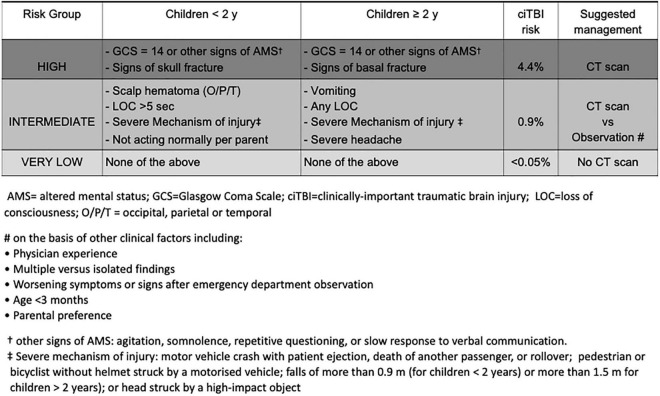
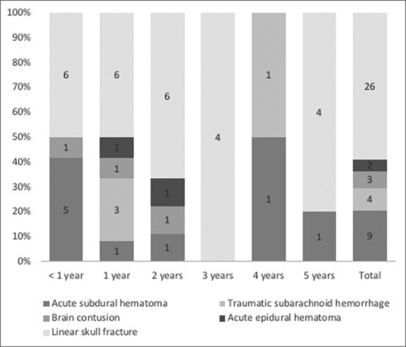
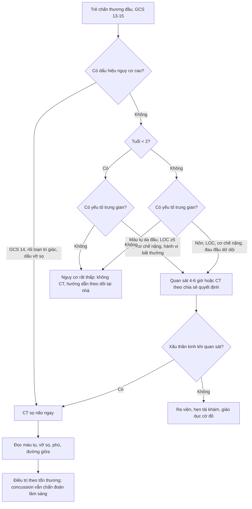
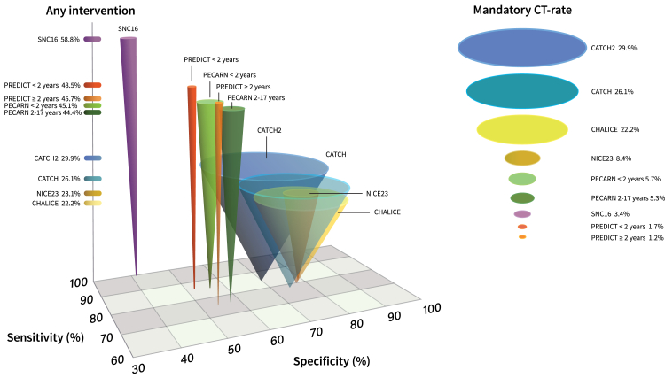
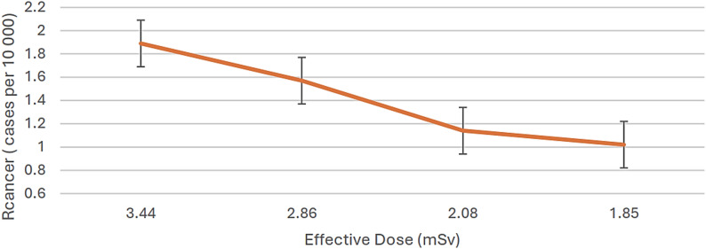
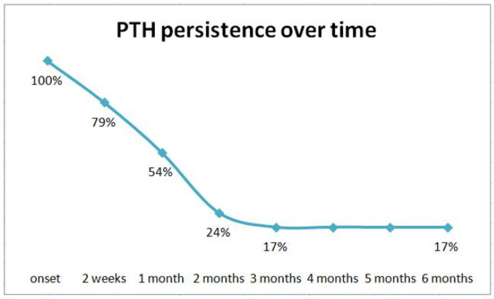
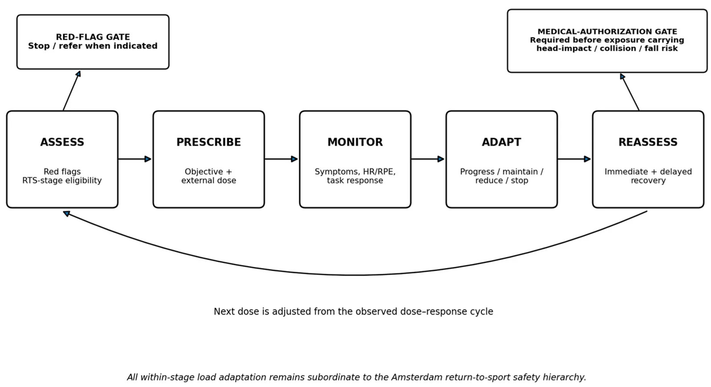

# 232 — Chấn thương đầu nhẹ & chấn động não (concussion) ở trẻ: PECARN, quan sát 4–6 giờ & quay lại học/thể thao / Pediatric mild head injury & concussion: PECARN, observation, return-to-learn and return-to-sport

**Tags:** `pattern:chan-thuong-dau-nhe` `pattern:concussion` `pattern:roi-loan-chuc-nang` `vung:nao-nhi` `score:PECARN` `score:CATCH` `score:CHALICE` `protocol:CT-so-nao` `protocol:quan-sat-lam-sang` `protocol:quay-lai-hoc-the-thao`
**Mức chắc chắn (certainty):** tổng hợp y văn (literature synthesis) — bài tự biên từ các nghiên cứu đoàn hệ lớn (PECARN, CATCH, CHALICE), đoàn hệ thực hành 3.012 trẻ của Wickbom 2025 và các ca minh họa trong quiz; số liệu định lượng ghi kèm nguồn ở `sources.md`.

## 1. Tổng quan bệnh học – cơ chế hình ảnh

- **Chấn thương đầu nhẹ (mild head injury)** là chấn thương kín đầu ở trẻ có **Glasgow Coma Scale (GCS) 13–15**, không có dấu thần kinh khu trú nặng. Trong nhóm này, **chấn động não (concussion)** là một **hội chứng lâm sàng do lực cơ học truyền vào đầu** gây rối loạn chức năng não thoáng qua — **không phải một tổn thương cấu trúc nhìn thấy trên CT/MRI thường quy**.
- **Sinh lý bệnh (pathophysiology):** lực tăng–giảm tốc và/hoặc lực xoay làm **mất cân bằng ion (ion flux)**, giải phóng glutamate, tăng chuyển hóa glucose rồi **giảm tưới máu – giảm chuyển hóa kéo dài vài ngày đến vài tuần**. Chính "khủng hoảng năng lượng" này giải thích **triệu chứng kéo dài dù ảnh không có gì**, và giải thích tại sao **nghỉ ngơi tuyệt đối quá lâu lại làm chậm hồi phục**.
- **TẠI SAO trẻ khác người lớn:** đầu trẻ **to và nặng tương đối**, cơ cổ yếu, **myelin chưa hoàn chỉnh** → cùng một lực sinh **lực cắt (shear) lớn hơn**, dễ tổn thương sợi trục lan tỏa (diffuse axonal injury — DAI) và dễ có **phù não lan tỏa** hơn máu tụ khu trú. Sọ mỏng, dẻo, khớp sọ chưa liền → **vỡ sọ giãn khớp (diastatic fracture)** và **vỡ sọ tiến triển (growing skull fracture)** là biến chứng đặc thù ở trẻ nhỏ (bài 231).
- **TẠI SAO CT bình thường KHÔNG loại trừ concussion:** CT không cản quang đo **đậm độ Hounsfield (HU)** — máu tụ cấp **40–70 HU** (cục máu co rút có thể **50–90 HU**), dịch não tủy **0–15 HU**, nhu mô não **30–40 HU**, mỡ **≈ −100 HU**. CT rất giỏi phát hiện **máu, vỡ xương, phù não lớn, khối choán chỗ**, nhưng **không thấy rối loạn chức năng vi mô** của concussion. MRI thường quy cũng thường bình thường; **SWI** chỉ nhạy với **vi xuất huyết**, **DWI/ADC** nhạy với **thiếu máu/nhồi máu cấp**, còn **DTI/fMRI** vẫn là công cụ nghiên cứu, **chưa dùng để chẩn đoán**.
- **Ngưỡng định lượng nằm lòng:**
  - **PECARN** phân tầng nguy cơ **theo tuổi < 2 và ≥ 2 tuổi**; nguy cơ **chấn thương não quan trọng trên lâm sàng (clinically important TBI — ciTBI)** khoảng **0,9%** toàn nhóm, **4,4%** nhóm nguy cơ cao, **0,9%** nhóm trung gian và **< 0,05%** nhóm nguy cơ rất thấp.
  - **Chỉ 0,1–0,2%** trẻ chấn thương đầu nhẹ cần **can thiệp ngoại khoa**; khoảng **90% CT** ở chấn thương đầu nhẹ là **bình thường**.
  - Đoàn hệ thực hành **2.405 trẻ 0–5 tuổi** (Nhật Bản): **66,2% được chụp CT**, chỉ **1,9% có bất thường** (xuất huyết nội sọ **0,8%**, vỡ sọ **1,1%**), **không ca nào cần mổ** — minh họa rõ cho việc **lạm dụng CT**.
  - **Một CT đầu ở trẻ 0–10 tuổi ≈ 2 mSv**; nguy cơ ung thư não do bức xạ ước tính **1/4.000–1/10.000 mỗi lần chụp**, cao hơn ở trẻ nhỏ vì mô đang phân chia và tuổi thọ còn dài.
  - **Đau đầu sau chấn thương (post-traumatic headache — PTH)** ở trẻ: **100% lúc khởi phát, 79% ở 2 tuần, 54% ở 1 tháng, 24% ở 2 tháng, 17% ở 3–6 tháng** (n = 24–25, theo dõi 6 tháng).

*Bảng PECARN: nhóm nguy cơ cao (GCS 14 hoặc dấu hiệu rối loạn tri giác, dấu vỡ sọ) → CT; nhóm trung gian → CT hoặc quan sát; nhóm rất thấp → không CT. Nguồn: Cicogna A et al., Front Pediatr 2022 (PMC9132372), CC BY 4.0 — nguyên bản.*

## 2. Mẫu hình + chẩn đoán phân biệt theo cơ chế và tuổi (Gamut)

- **Mẫu hình cốt lõi:** trẻ **tỉnh táo (GCS 15)**, không dấu thần kinh khu trú, **CT không cản quang bình thường**, nhưng có **đau đầu, chóng mặt, buồn nôn, mệt, khó tập trung, rối loạn giấc ngủ, thay đổi cảm xúc** sau va đập. Đây là **concussion**, chẩn đoán **bằng lâm sàng**, không bằng hình ảnh.
- **Gamut theo bệnh cảnh "đầu nhẹ nhưng ảnh có bất thường":**
  1. **Vỡ sọ tuyến tính (linear skull fracture)** — đường giảm đậm độ/xương gián đoạn, **không di lệch**; thường lành, nhưng ở trẻ < 3 tuổi phải theo dõi **vỡ sọ tiến triển**.
  2. **Máu tụ ngoài màng cứng (epidural hematoma — EDH)** — hình **thấu kính**, dừng ở đường khớp sọ, có thể kèm **"khoảng tỉnh" (lucid interval)** rồi xấu nhanh.
  3. **Máu tụ dưới màng cứng (subdural hematoma — SDH)** — hình **liềm**, vượt khớp sọ; ở nhũ nhi phải nghĩ **chấn thương do bị hành hạ (abusive head trauma)** nếu cơ chế không tương xứng.
  4. **Đụng dập não (contusion)** — ổ tăng đậm độ dính vỏ, thường **cực trán/thái dương**, có thể tiến triển trong 24–48 giờ.
  5. **Xuất huyết dưới nhện chấn thương (traumatic SAH)** — tăng đậm độ trong rãnh/bể nền.
- **Gamut "giống concussion nhưng không phải":** **căng cơ cổ/chấn thương cột sống cổ**, **đau đầu migraine** (tiền sử, không liên quan va đập), **mất nước/sốt siêu vi**, **rối loạn giấc ngủ – lo âu**, **hạ đường huyết**, **ngộ độc (rượu/thuốc)**, **động kinh sau chấn thương**, **bệnh lý mạch máu (DVA, dị dạng)**. Ở trẻ chưa nói được, **thay đổi hành vi, bú kém, quấy khóc** là "tương đương" triệu chứng.
- **Phân kiểu hình (subtype) để điều trị:** **nhức đầu**, **tiền đình – thị giác (chóng mặt, rối loạn điều tiết mắt)**, **nhận thức – mệt mỏi**, **giấc ngủ**, **cảm xúc**. Cùng chẩn đoán concussion nhưng **phác đồ khác nhau** — đây là điểm hay bị bỏ qua khi chỉ ghi "chấn động não".

*Trong 45 ca có bất thường CT ở 2.405 trẻ chấn thương đầu nhẹ: **vỡ sọ tuyến tính** là nhóm thường gặp nhất, sau đó đụng dập, SDH, tSAH, EDH; không ca nào cần mổ. Nguồn: Michiwaki Y et al., Surg Neurol Int 2021 (PMC8326105), CC BY-NC-SA 4.0 — nguyên bản, không chỉnh sửa.*

## 3. Bảng so sánh phân biệt (ma trận đối chiếu)

| Thực thể (entity) | Hình ảnh điển hình | Chốt vào (rule-in) | Chốt loại (rule-out) | Gợi ý xác nhận |
|---|---|---|---|---|
| **Concussion** | CT/MRI thường quy **bình thường**; không có máu tụ, không di lệch đường giữa | **Cơ chế va đập + triệu chứng thần kinh chức năng (đau đầu, chóng mặt, khó tập trung, rối loạn giấc ngủ) + GCS 15 + CT bình thường** | **Không có triệu chứng sau va đập** → không gọi concussion; **có dấu thần kinh khu trú/GCS < 15** → không còn là "nhẹ" | Khám lâm sàng + SCAT6 (≥ 13 tuổi) / Child SCAT6 (8–12 tuổi); không dùng CT để chẩn đoán |
| **Vỡ sọ tuyến tính** | Đường giảm đậm độ xuyên vỏ xương, **không di lệch**, không dừng ở khớp | **Đường vỡ rõ trên cửa sổ xương + sưng da đầu tại chỗ** | **Đường khớp sọ bình thường** (không có vỏ xương liên tục bị phá vỡ) → không gọi vỡ | CT lát mỏng ≤ 1 mm, cửa sổ xương; theo dõi nếu < 3 tuổi |
| **EDH** | Khối **thấu kính**, tăng đậm độ, **dừng ở khớp sọ**, ± vỡ xương trên đó | **Hình thấu kính + dừng ở khớp + khoảng tỉnh** | **Hình liềm/vượt khớp** → SDH; **tăng đậm độ dọc liềm đơn thuần** → giả (falx) | CT 1 mm; đo thể tích/dày/MLS; mổ khi > 30 cm³, dày > 15 mm hoặc MLS > 5 mm |
| **SDH / contusion** | SDH **hình liềm, vượt khớp**; contusion **ổ tăng đậm độ dính vỏ**, coup/contrecoup | **Máu ngoài trục vượt khớp** hoặc **ổ dính vỏ + cơ chế va đập** | **Không có máu/xương bất thường + triệu chứng chức năng đơn thuần** → concussion | CT; MRI T2*/SWI nếu nghi DAI; luôn hỏi cơ chế ở nhũ nhi |
| **Chấn thương cột sống cổ** | X-quang/CT cột sống cổ: gãy, trật, phù mô mềm trước sống | **Đau cổ giữa + hạn chế vận động + cơ chế tăng tốc/giảm tốc** | **Khám cổ bình thường + không đau giữa + cử động tốt** (theo NEXUS/CCR) | CT/XR cột sống cổ theo NEXUS/Canadian C-Spine Rule (bài 202) |
| **PTH kéo dài** | Không có tổn thương cấu trúc; đau đầu tái diễn | **Đau đầu sau chấn thương > 4 tuần ở trẻ** + không có cờ đỏ | **Đau đầu do nguyên nhân khác (migraine, viêm xoang, tăng áp lực nội sọ)** | Khám thần kinh + nhật ký đau đầu; MRI chỉ khi có cờ đỏ |
| **Hội chứng va đập lần hai (second impact syndrome)** | Phù não lan tỏa, mất phân biệt xám–trắng, thoát vị | **Va đập lần hai khi chưa hồi phục hoàn toàn + xấu thần kinh nhanh** | **Hồi phục hoàn toàn trước khi trở lại thể thao** → không có nguy cơ này | Cấp cứu: CT + theo dõi ICP; phòng ngừa bằng **không trở lại cùng ngày** |

### Đọc đúng "CT bình thường" và "PECARN âm"
- **CT bình thường không phải giấy chứng nhận không có concussion.** PECARN được thiết kế để **loại trừ ciTBI cần can thiệp**, không phải để chẩn đoán concussion.
- **PECARN "rất thấp nguy cơ"** nghĩa là **nguy cơ ciTBI < 0,05%**, nhưng vẫn cần **hướng dẫn theo dõi tại nhà** và **tái khám nếu xuất hiện cờ đỏ**.
- **Không áp dụng máy móc PECARN** cho trẻ **đang dùng thuốc chống đông, có shunt não, rối loạn đông máu, nghi bị hành hạ, hoặc cơ chế bệnh sử không đáng tin** — nhóm này cần ngưỡng chụp thấp hơn.

## 4. Protocol chụp + hệ phân độ/điểm chuẩn hóa

- **Ai cần CT?** Dùng **PECARN** làm công cụ chính, chia **< 2 tuổi** và **≥ 2 tuổi**:
  - **Nguy cơ cao → CT ngay:** **GCS 14** hoặc có **dấu hiệu rối loạn tri giác** (kích thích, lơ mơ, hỏi lặp lại, đáp ứng chậm); **dấu vỡ sọ** (sờ thấy lún, di lệch, hở).
  - **Nguy cơ trung gian → CT hoặc quan sát 4–6 giờ:** < 2 tuổi có **máu tụ da đầu vùng chẩm/đỉnh/thái dương**, **mất ý thức (LOC) ≥ 5 giây**, **cơ chế nặng**, **không hành xử bình thường theo cha mẹ**; ≥ 2 tuổi có **nôn**, **LOC bất kỳ**, **cơ chế nặng**, **đau đầu dữ dội**.
  - **Nguy cơ rất thấp → không CT:** không có tiêu chí nào trên.
- **Cơ chế nặng (severe mechanism)** theo PECARN: **tai nạn ô tô có văng người ra ngoài, có người chết, hoặc xe lật**; **người đi bộ/đi xe đạp không đội mũ bảo hiểm bị xe cơ giới đâm**; **ngã > 0,9 m (< 2 tuổi) hoặc > 1,5 m (≥ 2 tuổi)**; **đầu bị vật nặng tốc độ cao đập**.
- **Quan sát có cấu trúc:** **4–6 giờ** tại khoa cấp cứu với **khám thần kinh lặp lại**; ở nhóm trung gian, quan sát an toàn giúp **giảm 25–50% CT** mà không tăng ca bỏ sót. Đoàn hệ 42.412 trẻ: nhóm được quan sát có **tỷ lệ CT 30%** so với **35%** ở nhóm không quan sát.
- **Kỹ thuật CT:** **không cản quang**, lát mỏng **≤ 1 mm** tái tạo đa bình diện, **cửa sổ xương**; tối ưu liều theo **ALARA**, tránh chụp lại không cần thiết. **Rapid MRI (1–16 phút, đa số < 6 phút)** là lựa chọn không bức xạ ở trung tâm có điều kiện, nhưng **kém nhạy hơn CT với vỡ sọ đơn thuần và tSAH nhỏ**.
- **Không chụp CT thường quy để theo dõi concussion.** Chỉ chụp lại khi **xấu thần kinh, đau đầu tăng dần, nôn tái diễn, co giật, dấu thần kinh mới, hoặc nghi biến chứng muộn** (vỡ sọ tiến triển, tụ máu muộn).
- **Công cụ lâm sàng:** **SCAT6** cho **≥ 13 tuổi**, **Child SCAT6** cho **8–12 tuổi**; **SCOAT6/Child SCOAT6** cho đánh giá toàn diện sau 72 giờ. Ở trẻ < 8 tuổi, dựa vào **quan sát hành vi + báo cáo cha mẹ/giáo viên**.
- **Quay lại học – quay lại thể thao (Amsterdam 2023):**
  - **Nghỉ tương đối 24–48 giờ** (không nằm yên tuyệt đối kéo dài), sau đó **tăng dần hoạt động** dưới ngưỡng gây triệu chứng.
  - **Quay lại học trước khi quay lại thể thao hoàn toàn**; áp dụng **giảm tải nhận thức, nghỉ giải lao, giảm thời gian nhìn màn hình, hỗ trợ học tập**.
  - **6 bước quay lại thể thao**, mỗi bước **≥ 24 giờ**: (1) hoạt động giới hạn triệu chứng → (2) tập aerobic → (3) bài tập riêng môn → (4) tập không va chạm → (5) tập va chạm đầy đủ → (6) trở lại thi đấu. **Không trở lại thi đấu trong cùng ngày**.
  - **Triệu chứng kéo dài > 4 tuần ở trẻ** = **triệu chứng dai dẳng sau concussion (persisting symptoms)**; cần **đánh giá đa chuyên khoa** (thần kinh, mắt – tiền đình, phục hồi chức năng, tâm lý), không chỉ "chờ đợi".

*Mô hình "nón" so sánh độ nhạy – độ đặc hiệu – tỷ lệ CT bắt buộc của PECARN, CATCH, CHALICE, NICE23, PREDICT, SNC16. PECARN ≥ 2 tuổi có tỷ lệ CT bắt buộc thấp nhưng độ nhạy thực hành chỉ **74,1%** trong đoàn hệ này; CHALICE đặc hiệu cao nhất **78,3%**; SNC16 nhạy **100%** nhưng đặc hiệu thấp **41,6%**. Nguồn: Wickbom F et al., EClinicalMedicine 2025 (PMC12447897), CC BY 4.0.*

*Quan hệ liều hiệu dụng – nguy cơ ung thư trọn đời (số ca/10.000): **1,9/10.000 ở 3,44 mSv** và **1,0/10.000 ở 1,85 mSv**. Đây là lý do phải "chỉ định đúng", không phải "chụp cho yên tâm". Nguồn: Abouelmagd K et al., Int J Emerg Med 2026 (PMC13335041), CC BY-NC-ND 4.0 — nguyên bản, không chỉnh sửa.*

## 5. Biến thể bình thường và cạm bẫy

- **Biến thể bình thường dễ nhầm vỡ sọ:** **đường khớp sọ** (sutura) có vỏ xương liên tục, bờ xơ cứng, đối xứng; **khớp giả (wormian bone)**; **mạch máu lõm (vascular groove)**; **bể dịch dưới màng cứng lành (benign enlargement of subarachnoid spaces)** ở nhũ nhi — không có đường vỡ thật, không máu tụ.
- **Cạm bẫy 1 — "CT bình thường nên không sao":** bỏ sót concussion và **không hướng dẫn theo dõi**. Trẻ có thể xấu đi sau 24–48 giờ vì **máu tụ tiến triển** hoặc **phù não**; phải dặn **cờ đỏ** và tái khám.
- **Cạm bẫy 2 — "PECARN âm nên không cần khám lại":** PECARN có **giá trị dự báo âm rất cao** nhưng **không tuyệt đối**; trong đoàn hệ thực hành, PECARN ≥ 2 tuổi bỏ sót **1/2 ca cần mổ** khi áp dụng ngoài quần thể gốc. Luôn **khám lặp lại** và dùng **phán đoán lâm sàng**.
- **Cạm bẫy 3 — tuổi sát 2 tuổi:** trẻ **25 tháng** có thể dương tính với tiêu chí của nhánh **< 2 tuổi** nhưng bị áp nhầm nhánh ≥ 2 tuổi; nếu ca không điển hình, **xem cả hai nhánh**.
- **Cạm bẫy 4 — nôn đơn độc:** nôn một lần ở trẻ tỉnh táo, không yếu tố khác thường **không đủ** để chụp CT; nôn tái diễn + đau đầu tăng + GCS giảm mới đáng lo.
- **Cạm bẫy 5 — bỏ sót cột sống cổ:** cơ chế tăng–giảm tốc có thể gây **chấn thương cột sống cổ không triệu chứng**; đánh giá theo **NEXUS/Canadian C-Spine Rule** trước khi cho về.
- **Cạm bẫy 6 — nghỉ ngơi quá mức:** khuyến cáo cũ "nằm yên trong phòng tối đến hết triệu chứng" **làm chậm hồi phục**; hiện tại là **nghỉ tương đối 24–48 giờ rồi tăng dần**.
- **Cạm bẫy 7 — trở lại thể thao quá sớm:** **second impact syndrome** hiếm nhưng có thể gây phù não lan tỏa và tử vong; **không cho trở lại cùng ngày**, kể cả khi "thấy bình thường".
- **Cạm bẫy 8 — dùng CT để trấn an cha mẹ:** giải thích **nguy cơ bức xạ bằng số** (2 mSv; 1/4.000–1/10.000) và **lợi ích của quan sát**; quyết định chia sẻ giúp giảm chụp mà không tăng lo lắng.

## 6. Tự lượng giá — Blind Quiz ngay trên trang tĩnh

**Ca 1 — Bé trai 3 tuổi, ngã cầu thang 3 bậc, không mất ý thức, không nôn, GCS 15, khám thần kinh bình thường.**

- Câu hỏi: Bé thuộc nhóm nguy cơ nào? Có cần CT không? Nếu cho về, dặn dò gì?

<b>Bấm để hiện đáp án (findings + chẩn đoán)</b>

- **Findings:** không có tiêu chí nguy cơ cao (GCS 15, không rối loạn tri giác, không dấu vỡ sọ), không có tiêu chí trung gian (không nôn, không LOC, cơ chế không nặng, đau đầu không dữ dội) → **nhóm nguy cơ rất thấp**, nguy cơ ciTBI **< 0,05%**.
- **Chẩn đoán/xử trí:** **không CT**; hướng dẫn **theo dõi tại nhà**, dặn **cờ đỏ** (nôn tái diễn, đau đầu tăng, lơ mơ, co giật, yếu tay chân, chảy dịch mũi/tai, bầm sau tai/mắt gấu trúc), tái khám ngay nếu có.
- **Nguồn ảnh:** Cicogna A et al., Front Pediatr 2022 (PMC9132372), CC BY 4.0.

**Ca 2 — Bé gái 4 tuổi, ngã xe đạp không đội mũ, GCS 15, nôn 1 lần, đau đầu nhẹ; cha mẹ đòi chụp CT "cho chắc".**

- Câu hỏi: Tỷ lệ bất thường CT trong quần thể này là bao nhiêu? Có yếu tố nào khiến ca này không còn "rất thấp"? Nên xử trí thế nào?

<b>Bấm để hiện đáp án (findings + chẩn đoán)</b>

- **Findings:** trong **2.405 trẻ 0–5 tuổi** chấn thương đầu nhẹ, **66,2% được chụp CT**, chỉ **1,9% có bất thường** (xuất huyết **0,8%**, vỡ sọ **1,1%**), **không ca nào cần mổ**. Ca này có **nôn** và **cơ chế nặng** (xe đạp không mũ bị đâm/ngã) → thuộc **nhóm trung gian**, không phải rất thấp.
- **Chẩn đoán/xử trí:** **quan sát 4–6 giờ** với khám thần kinh lặp lại; nếu tỉnh táo, hết nôn, không đau đầu tăng → **không CT**, cho về với hướng dẫn. Nếu xấu đi → CT. Giải thích cha mẹ bằng **nguy cơ bức xạ 2 mSv** và **tỷ lệ bất thường ~2%**.
- **Nguồn ảnh:** Michiwaki Y et al., Surg Neurol Int 2021 (PMC8326105), CC BY-NC-SA 4.0.

**Ca 3 — Nam 14 tuổi, concussion do va chạm khi chơi bóng 6 tuần trước, vẫn đau đầu khi học bài và mất ngủ.**

- Câu hỏi: Đây có phải "bình thường" không? Tỷ lệ còn đau đầu ở 3–6 tháng là bao nhiêu? Cần làm gì tiếp?

<b>Bấm để hiện đáp án (findings + chẩn đoán)</b>

- **Findings:** PTH sau chấn thương đầu nhẹ gặp **100% lúc khởi phát**, giảm còn **79% ở 2 tuần, 54% ở 1 tháng, 24% ở 2 tháng, 17% ở 3–6 tháng**. Ca này đã **> 4 tuần** → **triệu chứng dai dẳng sau concussion**, không phải "giả bệnh".
- **Chẩn đoán/xử trí:** đánh giá lại **thần kinh, mắt – tiền đình, giấc ngủ, sức khỏe tâm thần**; điều trị **đa mô thức** (giáo dục, vận động dưới ngưỡng triệu chứng, vệ sinh giấc ngủ, phục hồi chức năng tiền đình/thị giác, hỗ trợ tâm lý). **Không chụp CT/MRI lặp lại** nếu không có cờ đỏ.
- **Nguồn ảnh:** Dondi A et al., Children (Basel) 2023 (PMC10047862), CC BY 4.0.

**Ca 4 — Vận động viên 16 tuổi, hết đau đầu sau 3 ngày, muốn thi đấu lại ngay cuối tuần.**

- Câu hỏi: Có được trở lại thi đấu ngay không? Nêu các bước và điều kiện dừng.

<b>Bấm để hiện đáp án (findings + chẩn đoán)</b>

- **Findings/nguyên tắc:** **không trở lại thi đấu trong cùng ngày**; cần **quay lại học** trước, rồi **6 bước tăng dần**, mỗi bước **≥ 24 giờ**, chỉ tiến bước khi **không tái phát triệu chứng**. Nếu triệu chứng quay lại → **lùi một bước** và đánh giá lại.
- **Cờ đỏ cần dừng:** đau đầu tăng dần, chóng mặt nặng, nhìn mờ, lú lẫn, buồn nôn/nôn, mất thăng bằng, yếu/ngứa ran.
- **Nguồn ảnh:** Kakavas G et al., Healthcare (Basel) 2026 (PMC13564861), CC BY 4.0.

## Bài liên quan chéo
- [224 – Chấn thương sọ não ở trẻ: Marshall/Rotterdam & DAI](../224-chan-thuong-so-nao-nhi/lesson.md)
- [231 – Tổn thương mạch máu não do chấn thương & vỡ sọ tiến triển](../231-ton-thuong-mach-mau-nao-chan-thuong-va-vo-so-tien-trien/lesson.md)
- [202 – Quy tắc chụp cột sống cổ cấp cứu NEXUS/Canadian](../202-quy-tac-chup-cot-song-co-cap-cuu-nexus-canadian/lesson.md)
- [218 – Thoát vị não & úng thủy](../218-thoat-vi-nao-ung-thuy/lesson.md)
- [227 – Đau đầu sét đánh](../227-dau-dau-set-danh-thunderclap/lesson.md)

## Ảnh
- Nguồn, giấy phép từng ảnh: `images/CREDITS.md`.
- Ảnh CC BY-NC-ND (PMC13335041) **giữ nguyên bản, không crop/ghép**.

> Không dùng để chẩn đoán độc lập khi chưa có người hướng dẫn.
