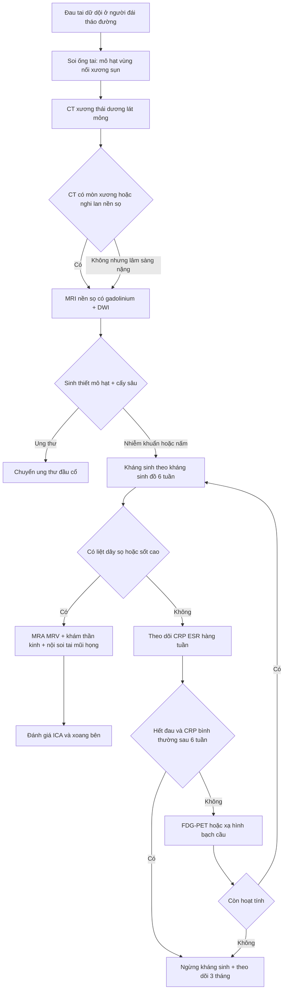
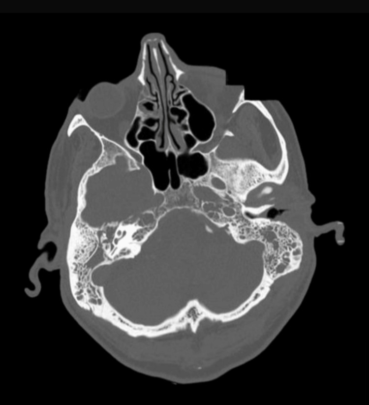
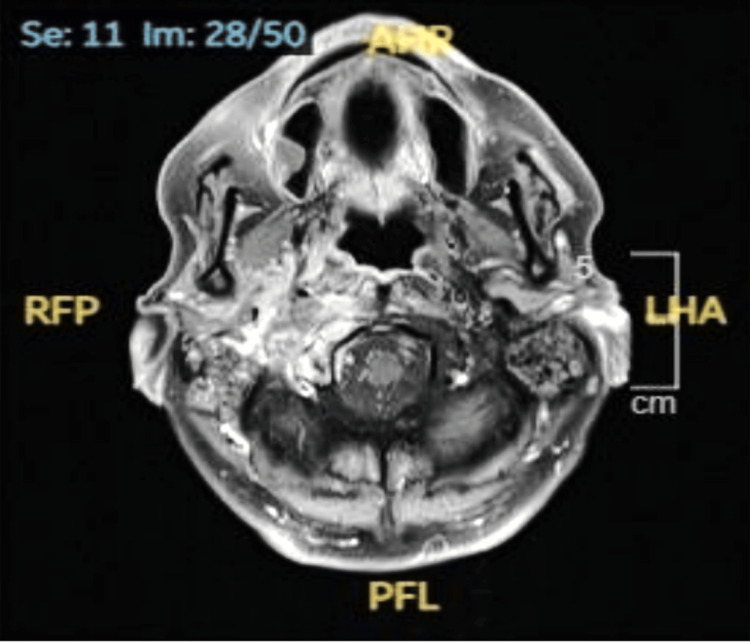
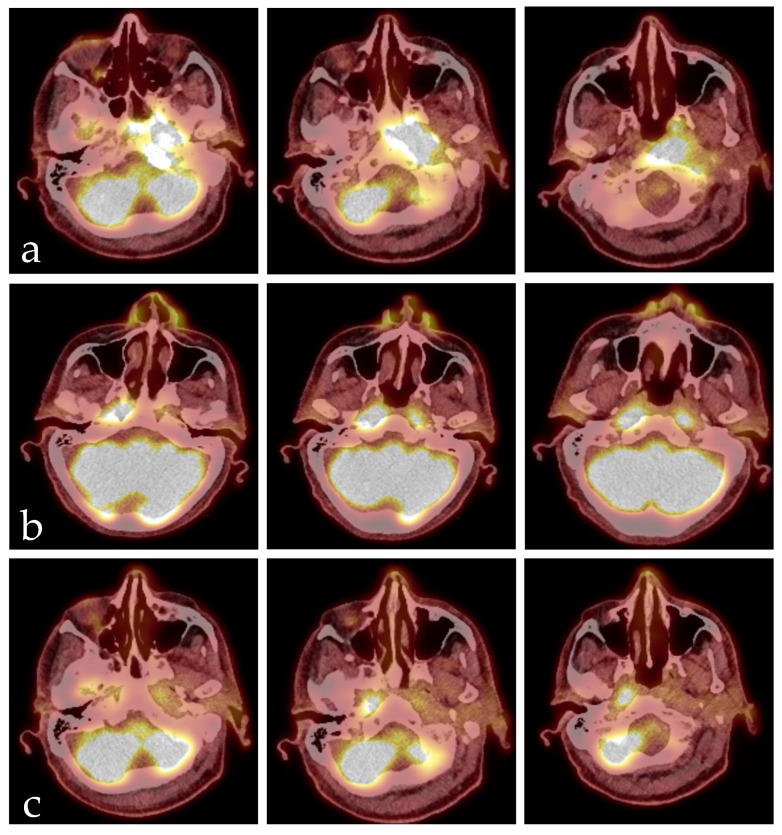

# 233 — Viêm tai ngoài ác tính & viêm xương nền sọ / Necrotizing (malignant) otitis externa & skull base osteomyelitis

**Tags:** `pattern:viem-xuong-nen-so` `pattern:mo-xuong` `pattern:liet-day-than-kinh-so` `vung:ong-tai-ngoai` `vung:xuong-thai-duong` `vung:nen-so` `score:CN-palsy` `protocol:CT-xuong-thai-duong` `protocol:MRI-T1-fat-sat` `protocol:PET-FDG`
**Mức chắc chắn (certainty):** tổng hợp y văn (literature synthesis) — gom đoàn hệ 36 tai (Costa MB & Onishi ET, *Int Arch Otorhinolaryngol* 2023, PMC10593509), 37 bệnh nhân theo phác đồ 6 tuần (Dhariwal A et al., *J Int Adv Otol* 2023, PMC10331632), 30 bệnh nhân theo dõi dài (Arslan IB et al., *Eur Arch Otorhinolaryngol* 2023, PMC9759449), ca nguyên văn CC BY 4.0 (Mahadevaswamy Susheela MK et al., *Cureus* 2025, PMC12584588) và phân tích gộp FDG-PET (Laidlaw M et al., *Tomography* 2026, PMC13030614).

## 1. Tổng quan bệnh học – cơ chế hình ảnh: nhiễm trùng "ăn" từ ống tai vào nền sọ

- **Viêm tai ngoài ác tính (necrotizing otitis externa — NOE; tên cũ "malignant otitis externa")** là nhiễm trùng **xâm lấn** khởi đầu ở **ống tai ngoài (external auditory canal — EAC)**, lan qua xương–sụn tới **xương thái dương và nền sọ**. Tên "ác tính" chỉ mức độ nặng, **không phải ung thư**.
- **TẠI SAO người đái tháo đường dễ mắc:** tăng đường huyết gây **bệnh vi mạch (microangiopathy)** + suy giảm miễn dịch tại chỗ → thiếu máu nuôi, giảm bạch cầu tới ổ viêm, da ống tai teo–khô–nứt. *Pseudomonas aeruginosa* bám vào **vùng nối xương–sụn** qua các **khe Santorini** rồi lan theo mô liên kết và các lỗ mạch máu của xương nền sọ.
- **Đường lan quyết định dây thần kinh nào liệt:** ống tai → **xương chũm** → **lỗ trâm chũm (stylomastoid foramen)** cho **dây VII**; tiếp tới **lỗ cảnh (jugular foramen)** cho **IX–XI**; **ống thần kinh hạ thiệt (hypoglossal canal)** cho **XII**; lên **clivus** và **xoang hang**. Vì vậy liệt nhiều dây sọ liên tiếp là dấu hiệu **lan nền sọ**, không phải "biến chứng ngẫu nhiên".
- **TẠI SAO hình ảnh đi trước/sau lâm sàng:**
  - **CT cửa sổ xương** chỉ thấy **mòn vỏ xương** khi đã mất khoáng đáng kể — **CT bình thường KHÔNG loại trừ** viêm xương nền sọ (đã có ca **CT âm tính, MRI chẩn đoán** — Wu M et al., *BMJ Case Rep* 2025, PMC12580850).
  - **MRI** phản ánh **thay thế tủy xương**: tủy mỡ bình thường **sáng trên T1W**; khi bị viêm, mỡ bị thay bằng **dịch/tế bào viêm** → **T1W tối hơn cơ/đĩa đệm, T2W sáng, ngấm thuốc sau tiêm**. Mô mềm quanh nền sọ dày, thấm thuốc; **thâm nhiễm mỡ sau lồi cầu (retrocondylar fat infiltration)** là dấu sớm.
  - **DWI/ADC:** ổ áp-xe giảm khuếch tán (ADC thấp); mô hạt viêm giảm nhẹ hơn.
  - **FDG-PET/CT** đo **hoạt tính chuyển hóa**, không đo mật độ xương — dùng để **theo dõi đáp ứng** vì CT/MRI có thể còn bất thường rất lâu sau khi khỏi nhiễm.
- **Ngưỡng định lượng trụ cột (đọc nhanh trước khi chọn ảnh):**
  - **Tuổi trung bình:** 68,5 (Costa) / 82 (Dhariwal) / 73 (CSBO Queensland).
  - **Đái tháo đường:** 97% (Costa) / 54% ĐTĐ hoặc suy giảm miễn dịch khác (Dhariwal).
  - **Tác nhân:** *P. aeruginosa* 50% (Costa) / 68% (Dhariwal); **35%** chủng kháng ciprofloxacin.
  - **Liệt dây thần kinh sọ:** 35%.
  - **CT:** 94% được chụp; dày mô mềm ống tai 91%; **mòn xương ống tai 59%** (thành trước–dưới, phần trong).
  - **MRI:** 41% được chụp; thâm nhiễm mô mềm sau lồi cầu/dưới thái dương 79%; khoang nhai 57%.
  - **Tái phát:** 32% (11 đợt/8 bệnh nhân), trung bình **100 ngày** sau ngừng kháng sinh.
  - **Tử vong:** 9% (Costa) / 23,3% (Arslan) / 31,8% (CSBO Queensland).
  - **Chữa khỏi với phác đồ 6 tuần:** 86% (32/37).
  - **FDG-PET theo dõi đáp ứng:** Se 95,2%, Sp 89,1%, LR+ 8,7, LR− 0,05 (8 nghiên cứu, 154 tổn thương).

## 2. Mẫu hình + chẩn đoán phân biệt theo vị trí (Gamut)

- **Giới hạn ở ống tai ngoài:** viêm tai ngoài nặng do vi khuẩn, **viêm tai ngoài do nấm (otomycosis)**, chàm/viêm da tiếp xúc, **ung thư biểu mô vảy ống tai (SCC)** — thể loét, chắc, đau kéo dài.
- **Ống tai + xương chũm:** **viêm xương chũm kết dính (coalescent mastoiditis)**, **cholesteatoma** ăn xương, NOE lan ra sau.
- **Nền sọ bên (lateral skull base):** NOE/SBO do tai — tổn thương **quanh lồi cầu, bờ trước xương đá, lỗ cảnh**.
- **Nền sọ giữa (central skull base):** **viêm xương nền sọ giữa (central SBO)** — clivus, xương chẩm; thường **không có nguồn tai**, tác nhân **S. aureus** (kể cả MRSA), người không ĐTĐ; dễ nhầm **ung thư vòm (NPC)**, **di căn/xương tủy**, **chordoma**, **IgG4**, **lao**.
- **Theo biến chứng thần kinh–mạch máu:**
  - **Liệt VII** đơn thuần (sớm); **hội chứng Vernet** (IX–XI), **Collet–Sicard** (IX–XII), **Villaret** (IX–XII + giao cảm).
  - **Huyết khối xoang bên/tĩnh mạch cảnh trong**, **hẹp/tắc động mạch cảnh trong (ICA)** do viêm bao quanh — biến chứng nặng, có thể gây nhồi máu não (Toufga Z et al., *Cureus* 2026, PMC13384415).
  - **Viêm màng não, áp-xe nội sọ** (đường lan trực tiếp).
- **Kẻ giả danh lâm sàng:** đau khớp thái dương–hàm, đau dây V, viêm tuyến mang tai, viêm mô tế bào vùng cổ — bệnh nhân được điều trị "viêm tai ngoài thường" nhiều tuần trước khi chẩn đoán.
- **Mnemonic "DEEP":** **D**iabetes (ĐTĐ/giảm miễn dịch), **E**AC granulation (mô hạt ống tai), **E**rosion (mòn xương nền sọ), **P**seudomonas + **P**alsy dây sọ.

## 3. Bảng so sánh phân biệt (ma trận đối chiếu)

| Thực thể (entity) | Hình ảnh điển hình | Chốt vào (rule-in) | Chốt loại (rule-out) | Gợi ý xác nhận |
|---|---|---|---|---|
| **NOE/SBO do tai** | CT: dày mô mềm ống tai + mòn xương ống tai/bờ trước xương đá; MRI T1FS sau tiêm: thấm thuốc quanh lồi cầu, clivus, khoang nhai | **ĐTĐ + đau tai dữ dội kéo dài + mô hạt ống tai + mòn xương nền sọ** | Mô hạt **không mòn xương**, đau đáp ứng 1 tuần kháng sinh thường → viêm tai ngoài đơn thuần | Nuôi cấy sâu + sinh thiết + CT/MRI |
| **SCC ống tai** | CT: **khối mô mềm trong ống tai**, mòn xương **không đối xứng**; MRI: khối ngấm thuốc, **DWI hạn chế**, có thể hạch cổ | **Khối chắc/loét + mô bệnh ác tính** | Tổn thương **mềm, đối xứng, đáp ứng kháng sinh** → viêm | **Sinh thiết bắt buộc** |
| **NPC / ung thư vòm** | MRI: khối **xoang Rosenmüller**, lan nền sọ, hạch cổ; PET dương tính | **Khối vòm + hạch cổ + EBV** | Niêm mạc vòm **bình thường, đối xứng** → ít nghĩ NPC | Nội soi + sinh thiết vòm |
| **Viêm xương nền sọ giữa (central SBO)** | MRI: **clivus/xương chẩm T1 tối, ngấm thuốc**, mô mềm trước clivus; CT có thể **bình thường** | **Đau cổ/vùng chẩm + CRP cao + MRI dương tính** | **CT bình thường không loại trừ**; cần MRI | MRI + cấy máu/sinh thiết xương |
| **Cholesteatoma biến chứng** | CT: **mòn scutum, chuỗi xương con**, khối mềm thượng nhĩ; **non-EPI DWI sáng** | **Khối keratin + mòn xương đặc trưng** | **DWI âm** + mô hạt → không cholesteatoma | MRI non-EPI DWI |
| **NOE do nấm** | Giống NOE vi khuẩn; có thể **xâm lấn mạnh, liệt nhiều dây**; nuôi cấy nấm dương | **Suy giảm miễn dịch nặng + cấy nấm + không đáp ứng kháng sinh** | Cấy nấm **âm** và đáp ứng kháng sinh → vi khuẩn | Cấy nấm + PCR/giải phẫu bệnh |
| **IgG4 nền sọ** | MRI: dày mô mềm **đối xứng**, ngấm thuốc đồng nhất, có thể kèm viêm tụy/tuyến nước bọt | **IgG4 huyết thanh cao + mô bệnh tương ứng** | **IgG4 bình thường, tổn thương một bên** → ít nghĩ | Sinh thiết + IgG4 |
| **Di căn/xương tủy nền sọ** | CT: tiêu xương nhiều ổ; MRI: thay tủy **nhiều vị trí**, không thấm mô mềm kiểu viêm | **Tiền sử ung thư + nhiều ổ + tăng canxi** | Một ổ viêm **khu trú, thấm thuốc mô mềm** → viêm | MRI toàn thân/PET + mô bệnh |

## 4. Protocol chụp + phác đồ điều trị & theo dõi

- **CT xương thái dương (temporal bone CT):** lát **0,6–1 mm**, tái tạo **axial + coronal**, cửa sổ **xương + mô mềm**; tìm **dày mô mềm ống tai**, **mòn thành trước–dưới ống tai**, mòn bờ trước xương đá, vách xoang chũm, lỗ cảnh. CT **không cản quang** là đủ cho xương; thêm cản quang khi tìm áp-xe.
- **MRI nền sọ (bắt buộc khi nghi lan nền sọ hoặc CT âm tính):** **1,5 hoặc 3 T**; **T1W axial**, **T2W fat-sat**, **DWI/ADC**, **T1W fat-sat sau gadolinium** (axial + coronal + sagittal); FOV phủ **từ xoang bướm tới C2**. Đọc: **tủy xương T1 tối**, mô mềm quanh lồi cầu/clivus, **khoang nhai**, **xoang hang**, **ICA**, **xoang bên**; thêm **MRA/MRV** khi có triệu chứng mạch máu hoặc liệt dây thấp.
- **FDG-PET/CT (hoặc xạ hình bạch cầu):** chỉ định khi cần **quyết định ngừng kháng sinh** hoặc nghi tái phát; **SUVmax tỉ lệ tổn thương/nền (LBR) ngưỡng 4,1** cho độ chính xác **100%** trong loạt 17 ca (Hurstel M et al., *J Otolaryngol Head Neck Surg* 2024, PMC11487542); xạ hình bạch cầu 4 giờ với ngưỡng **1,19** đạt **88%**.
- **Xét nghiệm:** **CRP + ESR hàng tuần** (CRP trung bình lúc nhập **40,6 mg/L**, ESR **58,7 mm** trong loạt Costa); công thức máu, HbA1c, chức năng thận (liều ciprofloxacin/ceftazidime).
- **Vi sinh + mô bệnh:** **cấy mủ sâu/ống tai** (không chỉ ngoáy nông), **sinh thiết mô hạt BẮT BUỘC** để loại SCC và tìm nấm/lao. Sinh thiết xương khi cấy nông âm.
- **Điều trị kháng sinh (khung định lượng):**
  - **6 tuần** là mốc tối thiểu; phác đồ chuẩn hóa: **3 tuần ceftazidime tĩnh mạch + ciprofloxacin uống**, sau đó **3 tuần ciprofloxacin uống** → chữa khỏi **86%** (32/37) trong phác đồ 6 tuần (Dhariwal 2023).
  - Phác đồ khác: **ceftazidime TM tối thiểu 6 tuần**, hoặc **ciprofloxacin 750 mg mỗi 12 giờ** ở ca nhẹ–trung bình điều trị ngoại trú; **kháng sinh theo kháng sinh đồ**, không dùng đơn trị ciprofloxacin khi tỷ lệ kháng **35%**.
  - **Kiểm soát đường huyết chặt**, làm sạch ống tai, giảm đau; **oxy cao áp (HBO)** là hỗ trợ, không thay kháng sinh.
  - **Ngoại khoa:** hạn chế ở **sinh thiết/lấy mủ**, cắt xương chũm khi có ổ mủ/cholesteatoma; không "mổ rộng" nền sọ.
- **Tiêu chuẩn ngừng kháng sinh:** **hết đau tai**, **ống tai khô–hết mô hạt**, **CRP/ESR về bình thường**, và **hình ảnh không tiến triển**; nếu còn nghi ngờ → **FDG-PET** (LR− 0,05 giúp loại trừ nhiễm tồn dư). Theo dõi tiếp **3 tháng** vì tái phát trung bình **100 ngày**.

- **Phân tầng theo vị trí tổn thương:** **ống tai đơn thuần** → điều trị ngoại trú được nếu không liệt dây, không dấu nền sọ; **lan nền sọ bên** → nhập viện, kháng sinh TM; **nền sọ giữa/clivus** → cân nhắc **S. aureus/MRSA**, tìm ổ nhiễm ngoài tai, tiên lượng nặng hơn (tử vong **31,8%**, di chứng **45,5%** trong loạt CSBO Queensland).

## 5. Biến thể bình thường và cạm bẫy

- **Mô hạt ở vùng nối xương–sụn** là dấu hiệu kinh điển nhưng **không đặc hiệu** — viêm tai ngoài nặng cũng có; chốt là **mòn xương + bối cảnh ĐTĐ + không đáp ứng điều trị thường**.
- **CT âm tính không loại trừ:** mòn xương chỉ thấy khi mất khoáng đủ nhiều; **MRI là cửa chốt** khi lâm sàng nghi (đã có ca CT bình thường, MRI phát hiện viêm xương chẩm — PMC12580850).
- **Hình ảnh tồn dư sau khỏi:** CT/MRI có thể còn dày xương, thấm thuốc **nhiều tháng**; đừng kéo dài kháng sinh chỉ vì "ảnh còn xấu" — dùng **lâm sàng + CRP/ESR + PET**.
- **PET dương tính giả** do viêm mô hạt/hậu xạ; luôn đối chiếu lâm sàng và so sánh **hai thời điểm** (SUV giảm mới có ý nghĩa).
- **Không chỉ nghĩ Pseudomonas:** **nấm** (Scedosporium/Aspergillus) ở người suy giảm miễn dịch, **S. aureus/MRSA** ở nền sọ giữa; cấy nấm chỉ dương ở **72%** ca được điều trị phối hợp kháng nấm (125 ca, Vofo G et al., *Eur Arch Otorhinolaryngol* 2026, PMC12904872) → **âm tính không loại trừ**.
- **Bỏ sót SCC vì "đã có chẩn đoán NOE":** mọi ca đều **sinh thiết**; tổn thương không đáp ứng sau **2–3 tuần** phải sinh thiết lại.
- **Liệt dây VII đơn thuần ở người trẻ/không ĐTĐ:** nghĩ **viêm xương nền sọ giữa**, **cholesteatoma**, **ung thư**, **Bell's palsy** — không mặc định NOE.
- **Satisfaction of search:** thấy mòn xương rồi bỏ sót **huyết khối xoang/ICA**, **áp-xe nội sọ**, **liệt dây thấp**; luôn khám 12 dây và đọc mạch máu.

## 6. Tự lượng giá — Blind Quiz

**Ca 1 — Nam 67 tuổi, ĐTĐ type 2 kiểm soát kém, đau tai phải dữ dội 6 tuần, chảy mủ, đã dùng kháng sinh uống không đỡ. CT xương thái dương.**

- Câu hỏi: (1) Bất thường xương ở đâu? (2) Vì sao CT này quan trọng hơn "dày mô mềm ống tai"? (3) Bước tiếp theo?

<b>Bấm để hiện đáp án (findings + chẩn đoán)</b>

- **Dấu hiệu:** mất vỏ xương và **tiêu xương đỉnh xương đá/nền sọ bên phải**, kèm dày mô mềm quanh ống tai ngoài; đối chiếu bên trái bình thường.
- **Chẩn đoán:** **viêm tai ngoài ác tính (NOE) lan nền sọ** — CT chứng minh mòn xương, không còn là "viêm tai ngoài thường".
- **Bước tiếp:** **MRI nền sọ có gadolinium + DWI**, **sinh thiết mô hạt** (loại SCC), **cấy sâu**, nhập viện kháng sinh TM ít nhất **6 tuần**, kiểm soát đường huyết.
- **Nguồn ảnh:** Mahadevaswamy Susheela MK et al., *Cureus* 2025, PMC12584588 Fig. 1, CC BY 4.0.

**Ca 2 — Cùng bệnh nhân, liệt dây VII và dây thấp, sốt. MRI đầu có gadolinium.**

- Câu hỏi: (1) Mô tả tổn thương mô mềm và xương? (2) Vì sao phải khám đủ 12 dây thần kinh? (3) Cần thêm chuỗi xung nào để tìm biến chứng mạch máu?

<b>Bấm để hiện đáp án (findings + chẩn đoán)</b>

- **Dấu hiệu:** **dày và ngấm thuốc mô mềm quanh ống tai ngoài/xương chũm phải**, **viêm xương chũm**, **ổ áp-xe nhỏ trong xương chũm**, và **thay đổi tủy xương nền sọ** (tín hiệu bất thường, ngấm thuốc).
- **Chẩn đoán:** **NOE có biến chứng viêm xương nền sọ + áp-xe xương chũm**, đủ tiêu chuẩn nhập viện kháng sinh TM kéo dài.
- **Vì sao khám 12 dây:** liệt VII → IX–XI → XII theo đường lan giải phẫu; phát hiện liệt dây thấp đổi tiên lượng và chỉ định **MRA/MRV**.
- **Chuỗi xung cần thêm:** **MRA/MRV** (hẹp/tắc ICA, huyết khối xoang bên), **DWI/ADC** (áp-xe), **T1 fat-sat sau tiêm** toàn nền sọ.
- **Nguồn ảnh:** Mahadevaswamy Susheela MK et al., *Cureus* 2025, PMC12584588 Fig. 2, CC BY 4.0.

**Ca 3 — Bệnh nhân viêm xương nền sọ giữa/clivus, FDG-PET/CT ba thời điểm: lúc chẩn đoán (a), sau 6 tuần kháng sinh (b), hai tháng sau ngừng kháng sinh (c).**

- Câu hỏi: (1) Hoạt tính thay đổi thế nào? (2) Vì sao không dừng kháng sinh chỉ dựa vào một lần chụp? (3) Khi nào dùng PET để quyết định ngừng?

<b>Bấm để hiện đáp án (findings + chẩn đoán)</b>

- **Dấu hiệu:** (a) **tăng tích tụ mạnh ở vòm mũi họng trái và nền sọ/clivus**; (b) sau 6 tuần kháng sinh, tổn thương **nhỏ đi rõ** nhưng **xuất hiện ổ tích tụ mới ở vòm phải**; (c) hai tháng sau ngừng kháng sinh chỉ còn **tồn dư nhẹ**.
- **Chẩn đoán:** viêm xương nền sọ giữa do vi khuẩn, đáp ứng một phần rồi thoái triển; ổ mới ở (b) là **bẫy "tái phát giả"** do viêm mô hạt — cần đối chiếu lâm sàng/CRP.
- **Vì sao không dừng theo một lần chụp:** cả CT và MRI đều có thể còn bất thường sau khỏi; **FDG-PET** có **LR− 0,05** nên hữu ích để **loại trừ nhiễm tồn dư**, nhưng vẫn cần **hai thời điểm** và lâm sàng.
- **Ngưỡng tham khảo:** SUVmax tỉ lệ tổn thương/nền **4,1** (độ chính xác 100% trong loạt 17 ca) — dùng như xu hướng, không phải ngưỡng tuyệt đối.
- **Nguồn ảnh:** Stocker M et al., *Diseases* 2026, PMC13115020 Fig. 1, CC BY 4.0.

## Bài liên quan chéo
- [237 – Biến chứng thần kinh sọ của viêm tai: Gradenigo, liệt VII, viêm mê nhĩ](../237-bien-chung-than-kinh-so-viem-tai-gradenigo/lesson.md) (liệt dây VII và biến chứng viêm tai)
- [236 – Viêm tai xương chũm & biến chứng nội sọ](../236-viem-tai-xuong-chum-bien-chung-noi-so/lesson.md) (huyết khối xoang, áp-xe nội sọ)
- [720 – Xương đá & cholesteatoma](../720-temporal-bone-cholesteatoma/lesson.md) (mòn xương, non-EPI DWI)
- [730 – Nhiễm trùng khoang cổ sâu](../730-deep-neck-infections/lesson.md) (lan theo khoang nguy hiểm)
- [750 – Hạch cổ & NI-RADS](../750-cervical-lymph-nodes-nirads/lesson.md) (hạch cổ kèm khối vòm/ống tai)
- [700 – Tổng quan Đầu Mặt Cổ](../700-head-neck-overview/lesson.md)

> Không dùng để chẩn đoán độc lập khi chưa có người hướng dẫn.
