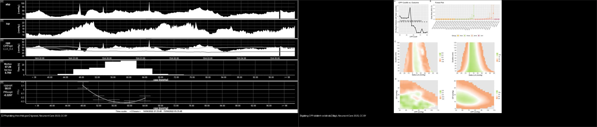
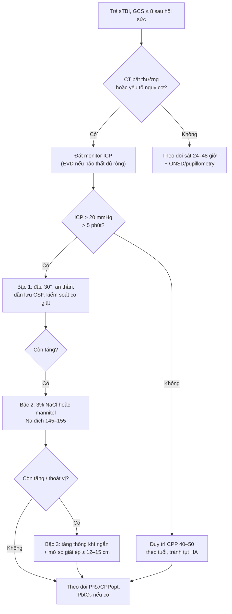
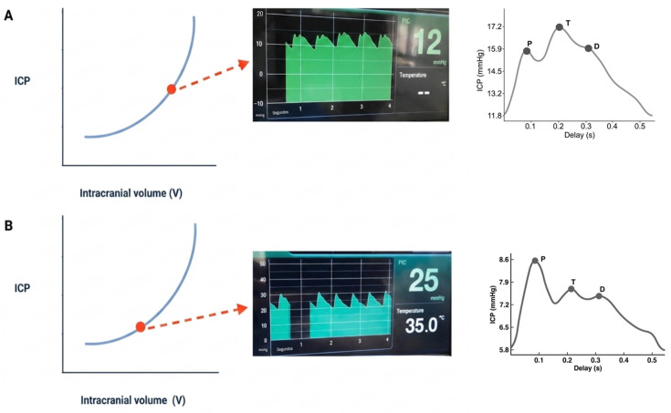
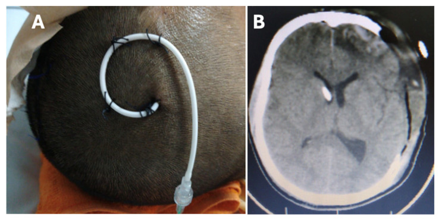
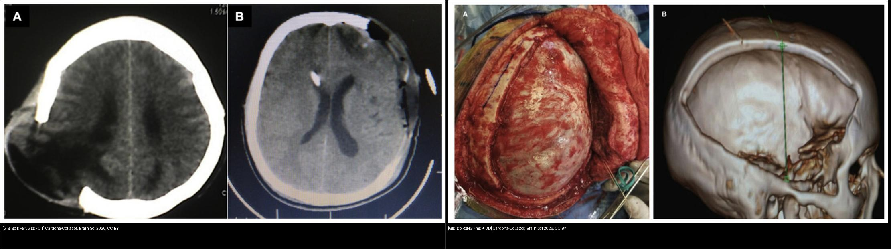
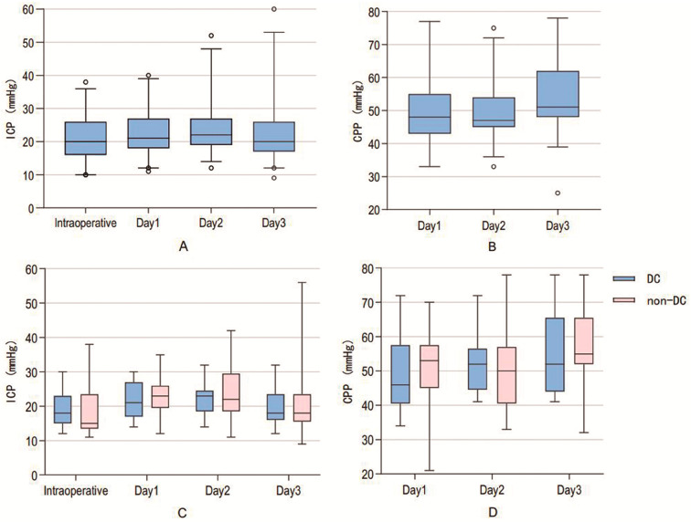
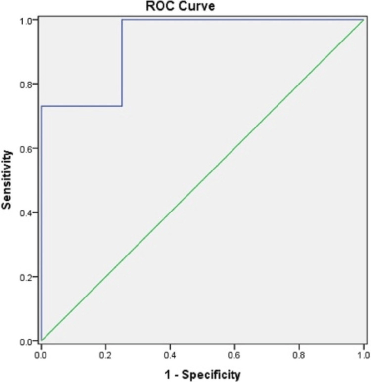
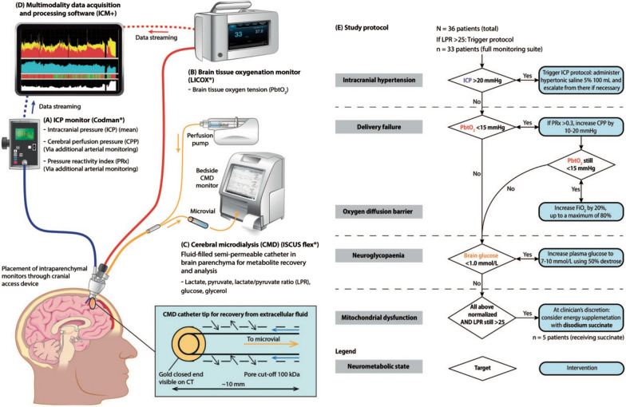

# 234 — Tăng áp lực nội sọ (ICP) & theo dõi đa phương thức ở trẻ chấn thương sọ não: EVD, dung dịch ưu trương, mở sọ giải ép, ngưỡng CPP theo tuổi / Intracranial pressure monitoring & multimodal neuromonitoring in pediatric TBI

**Tags:** `pattern:tang-ap-luc-noi-so` `pattern:thoat-vi-nao` `vung:nao-nhi` `score:ICP-CPP` `score:GCS` `protocol:EVD` `protocol:do-ICP` `protocol:MRI-nao-nhi` `protocol:sieu-am-ONSD`
**Mức chắc chắn (certainty):** tổng hợp y văn (literature synthesis) — nhóm tự biên từ y văn mở có số liệu (KidsBrainIT, STARSHIP, hướng dẫn PBTF 2019 qua bài tổng quan, RCT/đoàn hệ dung dịch ưu trương, đoàn hệ giải ép sọ), ghép **4 cửa Argon**. **Ca trong quiz là ca nguyên văn (verbatim case)** chép đúng mô tả hình ảnh gốc.

## 1. Tổng quan bệnh học – cơ chế hình ảnh

- **Áp lực nội sọ (intracranial pressure, ICP)** là áp lực trong khoang sọ kín. Bình thường ở trẻ **≈ 5–10 mmHg** (nhũ nhi thấp hơn), **ngưỡng can thiệp 20 mmHg kéo dài > 5 phút** (hướng dẫn PBTF 2019 dùng cho trẻ). **Áp lực tưới máu não (cerebral perfusion pressure, CPP) = MAP − ICP**, mục tiêu tối thiểu **40–50 mmHg** (nhũ nhi ~40, trẻ lớn 50–60) — **hạ huyết áp nguy hiểm hơn tăng ICP đơn thuần** vì tổn thương não thứ phát do thiếu máu.
- **TẠI SAO tăng thể tích lại làm ICP tăng theo cấp số nhân:** khoang sọ là hộp cứng; ban đầu **dịch não tủy (CSF) và máu tĩnh mạch bị đẩy ra** (dự trữ bù trừ, compliance cao) → ICP gần như không đổi. Khi cạn dự trữ, **mỗi mL thêm vào làm ICP tăng vọt** (đường cong thể tích–áp lực hình chữ J). Vì vậy **ICP 18 mmHg có thể đã là "cạn bù trừ"**, còn ICP 25 mmHg ở người còn dự trữ có thể chịu được lâu hơn → **phải đọc HÌNH DẠNG SÓNG, không chỉ con số**.
- **TẠI SAO đọc được trên CT:** máu tụ cấp **40–70 HU**, nhu mô **30–40 HU**, dịch não tủy **0–15 HU**, phù làm **giảm 2–3 HU/giờ**; dấu gián tiếp của tăng ICP là **xóa rãnh/bể nền, xẹp não thất, lệch đường giữa (midline shift), thoát vị**. **CT bình thường KHÔNG loại trừ tăng ICP** (nhất là tăng ICP "sóng" ở trẻ có compliance kém).
- **TẠI SAO cần theo dõi đa phương thức (multimodal):** mỗi dụng cụ đo một mặt khác nhau — **EVD** đo ICP toàn cục + dẫn lưu CSF trị liệu; **đầu dò nhu mô** đo ICP khu trú, ít biến chứng hơn nhưng **không dẫn lưu được**; **PbtO₂** đo oxy mô não; **siêu âm đường kính bao thần kinh thị (ONSD)** đo không xâm lấn; **pupillometry tự động (NPi)**, **NIRS**, **TCD**, **EEG liên tục**; **PRx/CPPopt** đo tự điều hòa.
- **Ngưỡng định lượng nằm lòng:**
  - **ICP > 20 mmHg** liên quan kết cục xấu ở trẻ; **vùng CPP "an toàn" 56–89 mmHg** khi còn tự điều hòa và **ICP < 20 mmHg**; **ICP > 20 mmHg làm xấu kết cục BẤT KỂ mức CPP** (Kempen et al., *Neurocrit Care* 2025, PMC12819434 — KidsBrainIT, n = 104, GOS 6 tháng).
  - **CPP ≤ 50 mmHg** là ngưỡng gây hại rõ; **trên 90 mmHg** chỉ có **xu hướng** xấu (Bögli et al., *Neurocrit Care* 2025, PMC12819438 — STARSHIP, n = 135). **Không tìm thấy "trần" tự điều hòa rõ** — PRx chỉ tăng > 0,2 khi CPP **> 100 mmHg**.
  - **Giải ép sọ ở trẻ: tử vong 17,0% (mổ) vs 26,4% (không mổ), p = 0,239** — **không giảm tử vong** nhưng **PCPC lúc ra viện tốt hơn (p = 0,029)**, 3 tháng chỉ xu hướng (p = 0,057) (Xu et al., *Children* 2025, PMC12562694 — 53 cặp ghép).
  - **Mổ giải ép "sớm ≤ 2 giờ" có tử vong CAO hơn (37,5% vs 15,8%; aOR 2,89; KTC 1,43–5,85)** vì chọn bệnh nặng hơn — nhưng **người sống sót thở máy và nằm viện NGẮN hơn** (Hojeij et al., *Sci Rep* 2026, PMC12820072 — 598 ca/9.495 sTBI).
  - **Dung dịch ưu trương: 3% NaCl vs 20% mannitol — tử vong 7,1% vs 11,0%, KHÁC BIỆT KHÔNG có ý nghĩa sau hiệu chỉnh** (Chong et al., *JAMA Netw Open* 2025, PMC11897838 — 445 trẻ, 28 PICU).
  - **PbtO₂: mục tiêu > 10 mmHg (mức chứng cứ III)**; **thiếu oxy mô < 5 mmHg > 1 giờ hoặc < 10 mmHg > 2 giờ** liên quan kết cục xấu (Agrawal et al., *Neurocrit Care* 2024, PMC10861621 — tổng quan).
  - **ONSD ở trẻ có não úng thủy: ngưỡng 5,5 mm dự báo ICP ≥ 20 mmHg, Se 100%, Sp 75%, PPV 95%, AUC 0,934**, tương quan **r = 0,879** (Dhawal et al., *Cureus* 2025, PMC12477087 — 52 trẻ 2 tháng–10 tuổi).
  - **Chỉ 21,4% trẻ sTBI được đặt monitor ICP (151/706)**; trong số đó **49,7% có ICP tăng**; tử vong **13,2% (không monitor) vs 8,0% (ICP tăng) vs 4,0% (ICP bình thường)**, p = 0,037 (Yeo et al., *Neurotrauma Rep* 2025, PMC12528845).

## 2. Mẫu hình + chẩn đoán phân biệt theo cơ chế (Gamut)

- **Tăng ICP do khối choán chỗ (mass lesion):** máu tụ ngoài/dưới màng cứng, đụng dập lớn, u, áp-xe — **lệch đường giữa + xẹp não thất bên cùng bên + xóa bể nền**. Xử trí: **lấy khối trước**, giải ép chỉ hỗ trợ.
- **Tăng ICP do phù lan tỏa (diffuse swelling):** sau ngạt/thiếu oxy, hội chứng đáp ứng viêm toàn thân, DKA — **xóa rãnh hai bên, não thất khe, mất phân biệt xám–trắng**; ICP tăng nhưng không có khối khu trú.
- **Tăng ICP do ứ dịch não tủy (hydrocephalus):** giãn não thất, **temporal horn > 2 mm**, bể nền mất; sau xuất huyết não thất, viêm màng não, u hố sau.
- **Tăng ICP do ứ máu tĩnh mạch:** huyết khối xoang dọc trên, chèn ép tĩnh mạch cảnh — **giãn não thất + phù lan tỏa**, cần MRV.
- **Tăng ICP "giả" (pseudotumor/idiopathic intracranial hypertension):** não thất bình thường hoặc khe, **ONSD giãn, đĩa thị phù**, không có khối — điều trị nội khoa, không giải ép.
- **Tăng ICP do tụt MAP (không phải do ICP):** CPP thấp nhưng ICP bình thường — **điều trị huyết áp trước**, đây là cạm bẫy hay gặp khi chỉ nhìn ICP.
- **Mnemonic "M-V-C-V":** **M**ass, **V**olume (edema), **C**SF (hydrocephalus), **V**enous (sinus thrombosis) — cộng thêm **P**ressure giả (pseudotumor).

## 3. Bảng so sánh phân biệt (ma trận đối chiếu)

| Thực thể (entity) | Hình ảnh / dữ liệu điển hình | Chốt vào (rule-in) | Chốt loại (rule-out) | Gợi ý xác nhận |
|---|---|---|---|---|
| **Tăng ICP do khối choán chỗ** | Máu tụ/u/áp-xe + **lệch đường giữa**, xẹp não thất cùng bên | **Khối khu trú + lệch đường giữa > 5 mm** | Không khối + phù lan tỏa hai bên → thể phù | CT ≤ 1 mm; đo thể tích khối |
| **Phù não lan tỏa** | **Xóa rãnh/bể hai bên, não thất khe**, mất phân biệt xám–trắng | **Xóa bể nền + não thất khe hai bên** | Còn bể, không lệch → ICP có thể bình thường | CT lặp lại 6–12 giờ; ICP thật |
| **Não úng thủy** | Giãn não thất, **sừng thời > 2 mm**, bể nền mất | **Giãn não thất + sừng thời giãn** | Não thất bình thường → không ứ CSF | Siêu âm thóp (nhũ nhi), MRI |
| **Huyết khối xoang tĩnh mạch** | Giãn não thất + phù; **khuyết thuốc xoang** trên CTV/MRV | **Khuyết thuốc xoang dọc trên/ngang** | Xoang thông tốt → loại trừ | CTV/MRV; D-dimer |
| **Tăng ICP không xâm lấn (ONSD)** | **ONSD ≥ 5,5 mm** (trẻ 2–10 tuổi), giãn bao thần kinh thị | **ONSD ≥ 5,5 mm + ICP ≥ 20 mmHg (Se 100%)** | ONSD bình thường **KHÔNG loại trừ** ICP tăng từng cơn | Siêu âm mắt 2 bên, 3 mm sau củng mạc |
| **Tăng ICP "giả" (IIH)** | Não thất khe/bình thường, **đĩa thị phù, ONSD giãn**, không khối | **Đĩa thị phù hai bên + não thất bình thường + không khối** | Có khối/giãn não thất → nguyên nhân thực thể | MRI + MRV + chọc dò dịch não tủy |

*Trái: **CPPopt tính động theo thời gian thực** — đường CPPopt và giới hạn tự điều hòa dưới (LLA) thay đổi liên tục trong 8 giờ ghi (Agrawal S et al., *Neurocrit Care* 2023, CC BY 4.0). Phải: **ngưỡng CPP cố định so với kết cục** — chỉ vùng CPP thấp cho thấy liên quan rõ, trên 90 mmHg chỉ là xu hướng (Bögli SY et al., *Neurocrit Care* 2025, CC BY 4.0).*

## 4. Protocol theo dõi + phân tầng + xử trí

### 4.1 Chỉ định đặt monitor ICP (không có "một ngưỡng cho mọi trẻ")
- **GCS ≤ 8 sau hồi sức** + **CT bất thường** (máu tụ, đụng dập, phù, xẹp não thất) → **đặt monitor**.
- **GCS ≤ 8 + CT bình thường** nhưng có **yếu tố nguy cơ** (tụt huyết áp, thiếu oxy, cơ chế năng lượng cao, co giật) → **cân nhắc**.
- **Không đặt thường quy** khi **GCS 9–15** và CT bình thường; nhưng **theo dõi sát 24–48 giờ** vì phù tiến triển muộn.
- **Lưu ý thực hành:** chỉ **21,4%** trẻ sTBI trong đoàn hệ đa quốc gia được đặt monitor — mô hình lâm sàng dự báo ICP tăng chỉ đạt **AUC 73,7%, Se 56%**, **không đủ để thay thế monitor** (Yeo 2025).

### 4.2 Chọn dụng cụ
| Dụng cụ | Đo gì | Ưu | Nhược / biến chứng |
|---|---|---|---|
| **EVD (dẫn lưu não thất ngoài)** | ICP **toàn cục** + dẫn lưu CSF | Chuẩn vàng; **vừa đo vừa điều trị**; hiệu chuẩn in vivo | Khó đặt khi não thất khe; **nhiễm khuẩn 3–9%** (aSAH người lớn 12–14%/EVD); chảy máu; đọc ngắt quãng |
| **Đầu dò nhu mô** | ICP **khu trú** | Dễ đặt, ít nhiễm khuẩn hơn | **Không dẫn lưu được**; trôi số 5–7 ngày; sai lệch theo vị trí đầu dò |
| **PbtO₂** | Oxy mô não | Phát hiện thiếu oxy **dù ICP bình thường** | Xâm lấn, không có trị số chuẩn ở trẻ |
| **Microdialysis** | Glucose, lactate/pyruvate | Phát hiện **khủng hoảng chuyển hóa** | Chỉ trong nghiên cứu ở trẻ |
| **ONSD (siêu âm)** | ICP **gián tiếp** | Không xâm lấn, tại giường, lặp lại nhanh | **Phụ thuộc người làm**; ONSD thay đổi theo tuổi; **không thay thế monitor** |
| **Pupillometry (NPi)** | Phản xạ thân não | Khách quan, dự báo ICP tăng và đáp ứng osmotherapy | Cần thêm dữ liệu trẻ em |
| **TCD / NIRS** | Vận tốc dòng / oxy vùng | Chỉ số tự điều hòa không xâm lấn | Nhiễu do máu tụ, xương dày |

### 4.3 Ngưỡng và mục tiêu
- **ICP:** điều trị khi **> 20 mmHg kéo dài > 5 phút**; **ICP > 20 mmHg làm xấu kết cục bất kể CPP** (KidsBrainIT).
- **CPP:** **tối thiểu 40–50 mmHg**; vùng an toàn **56–89 mmHg** khi tự điều hòa còn tốt; **CPP ≤ 50 mmHg có hại**; **> 90 mmHg không có lợi rõ** và có xu hướng xấu.
- **CPPopt/PRx:** PRx là **hệ số tương quan trượt 5 phút giữa MAP và ICP**, cập nhật mỗi phút; **PRx âm/0 = tự điều hòa tốt**; **PRx dương = tự điều hòa mất**. CPPopt là CPP tại đáy chữ U của PRx — **thay đổi theo thời gian**, không phải hằng số.
- **PbtO₂:** mục tiêu **> 10 mmHg** (mức III); cân nhắc ngưỡng cao hơn (**20 mmHg**) vì dưới 20 mmHg thường được coi là thiếu máu mô.
- **Nhiệt độ, Na, glucose, CO₂:** tránh **hạ Na < 135 mmol/L**, **đường huyết < 4 mmol/L**, **PaCO₂ thấp kéo dài** (gây co mạch).

### 4.4 Xử trí theo bậc (khi ICP tăng)
1. **Tư thế:** đầu cao **30°**, cổ thẳng (không xoay), nới đai cổ.
2. **An thần/giảm đau** đủ sâu, **tránh tụt huyết áp**; kiểm soát **co giật** (EEG nếu hôn mê).
3. **Dẫn lưu CSF qua EVD** (nếu có) — giảm ICP nhanh, nhưng **không dùng như biện pháp duy nhất ở giai đoạn cạn bù trừ**.
4. **Dung dịch ưu trương:** **3% NaCl** (bolus **3–5 mL/kg**, hoặc truyền liên tục) hoặc **20% mannitol 0,25–1 g/kg**; **hiệu quả tương đương** về tử vong/kết cục (Chong 2025); **Na mục tiêu 145–155 mmol/L**; theo dõi **Na, osmolality, chức năng thận**.
5. **Tăng thông khí ngắn hạn** (PaCO₂ 30–35 mmHg) **chỉ khi thoát vị cấp**, không kéo dài.
6. **Mở sọ giải ép (decompressive craniectomy):** khi **ICP kháng trị** với điều trị nội khoa tối ưu; **vạt xương trước–thái dương–đỉnh ≥ 12–15 cm đường kính trước–sau**, **mở màng cứng hình sao/chữ C**, **vá màng cứng không căng**; **giải ép nửa vời → thoát vị qua vết mổ ("fungus cerebri"), nhồi máu vỏ não** (Cardona-Collazos et al., *Brain Sci* 2026, PMC13204066).
7. **Kiểm soát nguyên nhân:** lấy máu tụ, dẫn lưu não thất, xử trí huyết khối xoang.

### 4.5 Flowchart

## 5. Biến thể bình thường và cạm bẫy

- **Cạm bẫy #1 — "ICP 18 mmHg là an toàn".** Trên đường cong thể tích–áp lực, **ICP "bình thường" nhưng sóng P2 > P1** đã là **cạn dự trữ bù trừ** — ca trong hình của Cardona-Collazos có **ICP 12 mmHg nhưng P2 > P1**, và ca khác **ICP 25 mmHg nhưng sóng ba pha bình thường**. **Đọc hình dạng sóng** (P1 xung động, P2 sóng thủy triều, P3 sóng đôi) cùng con số.
- **Cạm bẫy #2 — tối ưu ICP mà bỏ CPP.** Giảm ICP bằng cách hạ huyết áp hoặc tăng thông khí mạnh có thể **làm CPP tụt < 40 mmHg** → nhồi máu thêm. **Luôn tính CPP = MAP − ICP** trước và sau mỗi can thiệp.
- **Cạm bẫy #3 — "mổ giải ép sớm luôn tốt hơn".** Dữ liệu toàn quốc cho thấy nhóm mổ **≤ 2 giờ có tử vong gấp ~2,9 lần** — vì đó là nhóm bệnh nặng nhất (confounding by indication). **Không dùng số này để trì hoãn mổ** ở bệnh nhân đang thoát vị.
- **Cạm bẫy #4 — giải ép quá hẹp.** Vạt xương **< 12 cm** không đủ tăng thể tích → **thoát vị qua vết mổ, nhồi máu vỏ não, tụ dịch dưới màng cứng**; **mở màng cứng đường thẳng nhỏ** cũng hạn chế giãn não.
- **Cạm bẫy #5 — tin tuyệt đối ONSD.** ONSD **bình thường không loại trừ** tăng ICP từng cơn; ONSD **khác theo tuổi** (trung bình **4,31 mm < 2 tuổi** vs **5,35 mm > 2 tuổi**) và **phụ thuộc người đo**; ngưỡng **5,5 mm** chỉ áp dụng cho nhóm nghiên cứu (trẻ 2–10 tuổi có não úng thủy).
- **Cạm bẫy #6 — EVD "đặt rồi để đó".** **Nhiễm khuẩn EVD 3–9%** (người lớn aSAH **12–14%/EVD**), tăng theo **số lần đặt lại** và **tần suất lấy dịch não tủy**; **rút sớm khi không còn chỉ định**. **Rút nhanh vs rút từ từ**: tỉ lệ đặt shunt não thất–phúc mạc **32,1% vs 28,1%** (RR 0,85; p = 0,56), nhiễm khuẩn tương đương, nhưng **rút nhanh giảm 2,7 ngày ICU và 3,6 ngày nằm viện** (Ebel et al., *Neurocrit Care* 2023, PMC10499951).
- **Cạm bẫy #7 — bỏ sót thương tổn ngoài sọ.** Trong 706 trẻ sTBI, **13,2% tử vong ở nhóm KHÔNG được monitor** — một phần vì bỏ sót bệnh nặng hoặc do chọn lọc; **đừng dùng "không đặt monitor" như dấu hiệu "bệnh nhẹ"**.
- **Biến thể bình thường:** **giãn khoang dưới nhện do teo não** (người lớn, không phải tăng ICP); **não thất hơi giãn ở trẻ sinh non**; **sóng ICP có P1 cao đơn thuần** (không phải cạn bù trừ).

## 6. Tự lượng giá — Blind Quiz ngay trên trang tĩnh

**Ca 1 — Trẻ sTBI, đã mở sọ giải ép; đầu dò ICP ghi 12 mmHg nhưng sóng có P2 > P1.**

- Câu hỏi: Con số 12 mmHg có nghĩa là "an toàn" không? Sóng P2 > P1 nói gì về dự trữ bù trừ?

<b>Bấm để hiện đáp án (findings + chẩn đoán)</b>

- **Findings:** (A) **ICP 12 mmHg nhưng P2 > P1** → điểm nằm **cao trên đường cong thể tích–áp lực** (đã cạn dự trữ); (B) **ICP 25 mmHg nhưng sóng ba pha P1 > P2** → còn dự trữ.
- **Kết luận:** **số ICP một mình không đủ**; **hình dạng sóng phản ánh compliance**. P1 = xung động, P2 = thủy triều, P3 = đôi.
- **Xử trí:** theo dõi sát, tránh thêm thể tích (dịch, PaCO₂), cân nhắc can thiệp sớm **trước khi ICP vượt 20 mmHg**.
- **Nguồn:** Cardona-Collazos S et al., *Brain Sci* 2026, PMC13204066, CC BY 4.0 (Fig 1, phỏng theo tài liệu [16]).

**Ca 2 — Trẻ 8 tuổi, EVD vừa đặt; kiểm tra vị trí trên CT.**

- Câu hỏi: Đầu catheter nên nằm ở đâu? Điểm vào chuẩn là gì? Biến chứng nhiễm khuẩn tăng theo yếu tố nào?

<b>Bấm để hiện đáp án</b>

- **Findings:** (A) catheter **luồn dưới da, cố định bằng chỉ, ra da vùng trán**, nối hệ kín; (B) CT — catheter đi qua **điểm Kocher (trước 10–11 cm trên đường giữa, 3 cm ra ngoài đường giữa)**, **đầu nằm trong sừng trán não thất bên**.
- **Chốt:** **đầu catheter trong não thất + không đi qua nhu mô quá dài**; hệ kín, không rò.
- **Nhiễm khuẩn:** **3–9%**; tăng theo **thời gian lưu, số lần đặt lại, tần suất lấy dịch**; **rút nhanh an toàn** (giảm 2,7 ngày ICU).
- **Nguồn:** Cardona-Collazos S et al., *Brain Sci* 2026, PMC13204066, CC BY 4.0 (Fig 9).

**Ca 3 — Cùng bệnh nhân sau giải ép: một bên giải ép đủ, một bên không đủ.**

- Câu hỏi: Dấu hiệu nào cho thấy giải ép **không đủ**? Kích thước vạt xương tối thiểu?

<b>Bấm để hiện đáp án</b>

- **Findings:** (trái) **thoát vị não qua vết mổ ("fungus cerebri") + nhồi máu vỏ não** ở bệnh nhân mở sọ hẹp; (phải) **vạt xương trước–thái dương–đỉnh rộng ≥ 12–15 cm** + mở màng cứng hình sao, giải ép đủ cả nền trán và sàn thái dương.
- **Chốt:** **giải ép nửa vời = biến chứng** (nhồi máu, tụ dịch dưới màng cứng, thoát vị qua vết mổ).
- **Kỹ thuật:** **vá màng cứng không căng**, đủ rộng để não giãn ra ngoài.
- **Nguồn:** Cardona-Collazos S et al., *Brain Sci* 2026, PMC13204066, CC BY 4.0 (Fig 4, 5).

**Ca 4 — Trẻ sTBI được mổ giải ép; biểu đồ ICP và CPP trước/sau mổ.**

- Câu hỏi: Giải ép có làm giảm tử vong không? Lợi ích nào được chứng minh?

<b>Bấm để hiện đáp án</b>

- **Findings:** ICP giảm và CPP tăng sau mổ (A, B); so sánh **DC vs không DC** (C, D) cho thấy **ICP/CPP tương đương** giữa hai nhóm.
- **Kết cục (n = 53 cặp ghép):** **tử vong 17,0% vs 26,4%, p = 0,239** — **không giảm tử vong**; **PCPC lúc ra viện tốt hơn (p = 0,029)**; 3 tháng chỉ xu hướng (p = 0,057).
- **Bài học:** giải ép là **biện pháp cứu não, không phải cứu sống ngay**; tư vấn gia đình cần nói rõ.
- **Nguồn:** Xu J et al., *Children* 2025, PMC12562694, CC BY 4.0 (Fig 2).

**Ca 5 — Trẻ 5 tuổi nghi tăng ICP, không có monitor xâm lấn; siêu âm mắt.**

- Câu hỏi: Ngưỡng ONSD nào được dùng? Độ nhạy/độ đặc hiệu? Có thay thế được monitor không?

<b>Bấm để hiện đáp án</b>

- **Findings:** ROC — **ngưỡng 5,5 mm** dự báo **ICP ≥ 20 mmHg** với **Se 100%, Sp 75%, PPV 95%, AUC 0,934**; tương quan **r = 0,879** với ICP xâm lấn.
- **Bối cảnh:** 52 trẻ **2 tháng–10 tuổi có não úng thủy**; ONSD trước mổ **5,75 ± 1,6 mm** giảm còn **4,3 ± 0,89 mm** sau mổ.
- **Cạm bẫy:** ONSD **thay đổi theo tuổi** (**4,31 mm < 2 tuổi** vs **5,35 mm > 2 tuổi**) và **phụ thuộc người đo** → **không thay thế monitor** khi có chỉ định.
- **Nguồn:** Dhawal M et al., *Cureus* 2025, PMC12477087, CC BY 4.0 (Fig 3).

**Ca 6 — Trẻ sTBI, đặt 3 đầu dò nhu mô; phát hiện ICP bình thường nhưng PbtO₂ thấp.**

- Câu hỏi: Vì sao theo dõi PbtO₂ khi ICP đã bình thường? Ngưỡng PbtO₂ mục tiêu? Khi nào tăng FiO₂?

<b>Bấm để hiện đáp án</b>

- **Findings:** sơ đồ đặt **3 đầu dò qua một cổng sọ** (ICP, PbtO₂, microdialysis) + thuật toán: **ICP > 20 → 3% NaCl 5 mL/100 mL**; **PbtO₂ < 15 mmHg → tăng FiO₂ 10–20% (tối đa 80%)**; **glucose não < 0,1 mmol/L → tăng glucose**; **LPR > 25 → succinate**.
- **Vì sao:** **thiếu oxy mô có thể xảy ra dù ICP bình thường**; **PbtO₂ < 5 mmHg > 1 giờ hoặc < 10 mmHg > 2 giờ** liên quan kết cục xấu.
- **Mục tiêu:** **PbtO₂ > 10 mmHg (mức III)**; nhiều trung tâm dùng **> 20 mmHg**.
- **Nguồn:** Agrawal S et al., *Neurocrit Care* 2024, PMC10861621, CC BY 4.0 (Fig 2).

## Bài liên quan chéo
- [200 – Tổng quan hệ Thần kinh](../200-tong-quan-he-than-kinh/lesson.md)
- [224 – Chấn thương sọ não ở trẻ (Marshall/Rotterdam, DAI, EDH vs SDH)](../224-chan-thuong-so-nao-nhi/lesson.md)
- [218 – Thoát vị não & úng thủy](../218-thoat-vi-nao-ung-thuy/lesson.md)
- [216 – Dị dạng mạch & huyết khối xoang (CVST)](../216-di-dang-mach-CVST/lesson.md)
- [201 – Protocol sọ não](../201-protocol-so-nao/lesson.md)
- [650 – Siêu âm thóp sơ sinh & xuất huyết vùng mầm](../650-than-kinh-nhi-xuat-huyet-mam-va-u-ho-sau/lesson.md)

## Ảnh
- Tên file: `234_slug_Modality_SourceID.jpg`. Nguồn + giấy phép từng ảnh trong `images/CREDITS.md`.
- Toàn bộ ảnh dùng ở đây là **CC BY 4.0** → được phép ghép; ảnh ghép letterbox giữ nguyên tỉ lệ.
- Không có ảnh nào phải dẫn link vì paywall.

> Không dùng để chẩn đoán độc lập khi chưa có người hướng dẫn.
