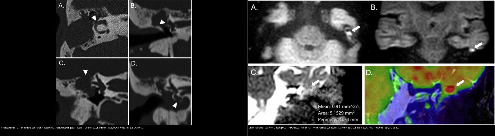
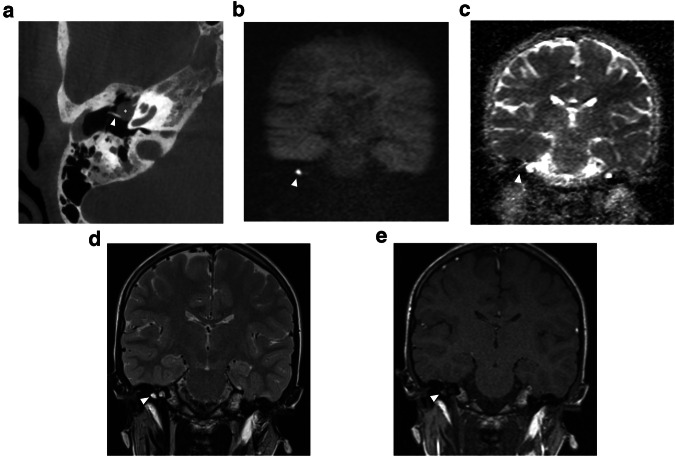
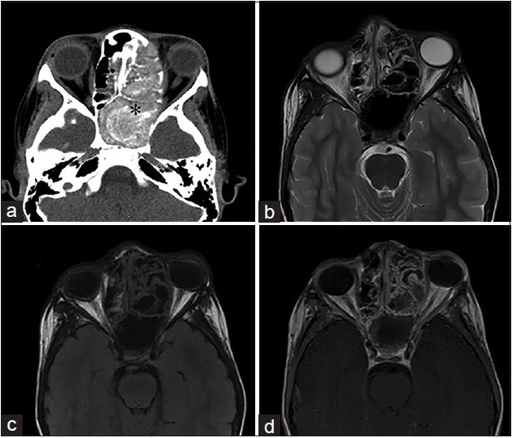
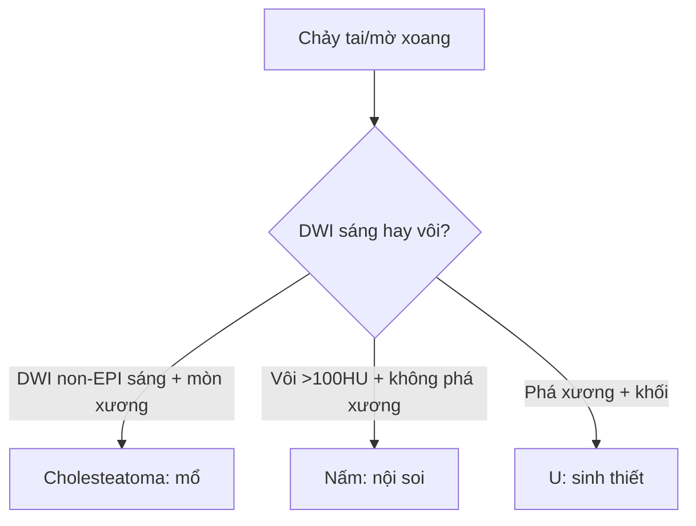
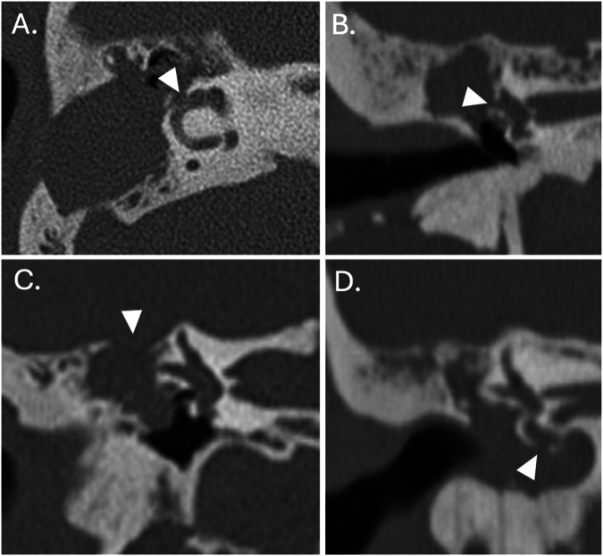
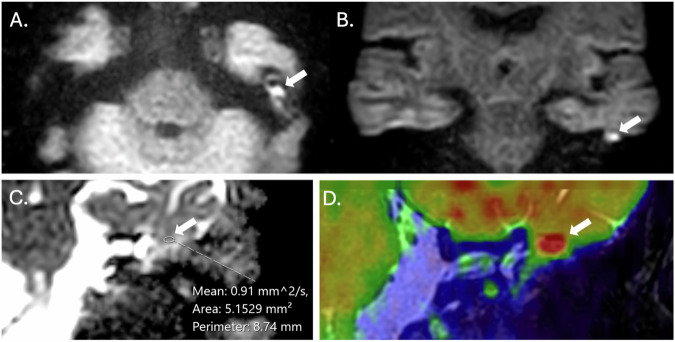
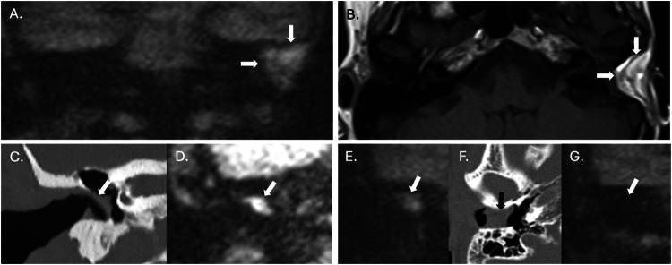

# 235 — Xương thái dương & xoang: cholesteatoma DWI + nấm vs u / Temporal & Sinuses

**Tags:** `pattern:xuong-thai-duong-xoang` `vung:dau-mat-co` `protocol:MRI-non-EPI`
**Mức chắc chắn (certainty):** tổng hợp y văn (literature synthesis) — nhóm tự biên từ y văn mở, chưa gắn ca nguyên văn đơn lẻ.

## 1. Tổng quan — keratin giữ nước khuếch tán + nấm vôi hóa

- Cholesteatoma: biểu mô sừng (keratin) tích tụ tai giữa-thượng nhĩ — TẠI SAO **DWI non-EPI sáng từ ≥ 2–3 mm**: keratin đặc hạn chế khuếch tán (**ADC điển hình ~0,7–1,0 ×10⁻³ mm²/s**; ca Fig. 4 đo được **0,91 mm²/s**), trong khi mô hạt/viêm (granulation) DWI tối (non-EPI tránh méo ảnh nền sọ so với EPI).
- Viêm xoang nấm (fungal): vón canxi + kim loại nặng trong chất nhầy dị ứng — TẠI SAO tăng tỷ trọng **> 100 HU + vôi** trong xoang mờ: oxalate canxi + sắt/mangan của sợi nấm.
- U xoang (K vảy, esthesioneuroblastoma): phá xương + khối mô mềm lan hốc mắt/nền sọ, không vôi kiểu nấm.

## 2. Gamut chảy tai + mờ xoang (Gamut)

- **Thượng nhĩ + mòn xương con + DWI non-EPI sáng:** cholesteatoma — mổ tiệt căn + bít.
- **Mờ xoang + vôi > 100 HU + không phá xương:** nấm — nội soi + dọn xoang.
- **Khối xoang + phá xương + lan hốc mắt:** u — sinh thiết + PET + mổ/xạ.
- **Viêm tai xương chũm + biến chứng nội sọ:** áp-xe/tắc xoang — CT + MRI cấp cứu.

## 3. Bảng so sánh phân biệt (ma trận đối chiếu)

| Thực thể (entity) | Hình ảnh điển hình | Chốt vào (rule-in) | Chốt loại (rule-out) | Gợi ý xác nhận |
|---|---|---|---|---|
| Cholesteatoma | **Thượng nhĩ + mòn xương + DWI non-EPI sáng ≥ 2–3 mm** | **DWI sáng + mòn xương con** | DWI tối → mô hạt | CT xương + mổ (theo dõi DWI sau mổ) |
| Nấm xoang | **Mờ xoang + vôi > 100 HU + không phá xương + dị ứng** | **Vôi + IgE/đa polyp** | Phá xương + khối → u | Nội soi + mô bệnh |
| U xoang | **Khối + phá xương + lan hốc mắt/nền sọ** | **Phá xương + mô mềm** | Vôi + không phá → nấm | Sinh thiết + PET |
| Viêm tai biến chứng | **Mờ xương chũm + khuyết tegmen + áp-xe/TM tắc** | **Khuyết xương + sốt + thần kinh** | Không khuyết → viêm đơn thuần | CT + MRI + KS/mổ cấp cứu |

*Trái: CT xương thái dương — mòn xương con / thành ngoài / hồi luu (mũi tên nhọn). Phải: DWI non-EPI sáng (A, B) + **ADC 0,91 mm²/s** (C) + hợp nhất màu (D). Nguồn: Touska P & Connor SEJ, Eur Radiol 2025, PMC11913933 Fig. 3 + 4, CC BY 4.0.*

*Khối tròn trong tai giữa trước-trên (dấu hoa thị) cạnh cán xương búa: (a) CBCT; (b) DWI b1000 hạn chế khuếch tán; (c) ADC tối; (d) T2; (e) T1 sau cản quang. Nguồn: Vangrinsven G et al., Insights Imaging 2024, PMC11306902 Fig. 1, CC BY 4.0.*

*Mycetoma — CT (a) cửa sổ mô mềm + (b) cửa sổ xương: xoang hàm phải mờ hoàn toàn có **mảnh vôi trong tổn thương** (mũi tên) + viêm xương phản ứng; (c) T2 khối giảm tín hiệu. Nguồn: Gavito-Higuera J et al., J Clin Imaging Sci 2016, PMC4926542 Fig. 3, CC BY-NC-SA 4.0.*

*Viêm xoang nấm dị ứng — (a) CT không cản quang: mờ xoang sàng-bướm trái với **vật chất tăng tỷ trọng trong lòng** + giãn/xương lại xoang (dấu hoa thị); (b) T2 + (c) T1: mucin tín hiệu thấp (do kim loại + đạm cao/nước tự do thấp); (d) T1 sau tiêm: niêm mạc viêm ngấm nhưng KHÔNG ngấm lòng xoang. Nguồn: Gavito-Higuera J et al., J Clin Imaging Sci 2016, PMC4926542 Fig. 4, CC BY-NC-SA 4.0.*

## 4. Protocol

- **CT xương thái dương lát mỏng 0,5 mm + MRI DWI non-EPI** (theo dõi tồn dư/tái phát cholesteatoma ≥ 2–3 mm); **CT xoang + nội soi** khi mờ xoang.

## 5. Cạm bẫy

- **DWI EPI méo ảnh nền sọ** giả âm/dương cholesteatoma nhỏ — non-EPI + ngưỡng 2–3 mm.
- **Mỡ/vật liệu ghép sau mổ cũng sáng trên DWI** (giả cholesteatoma) — luôn đọc kèm **T1W** (mỡ sáng) + ADC (mỡ ADC cao) để loại; đừng mổ lại vì một ổ sáng DWI đơn thuần (Ca 3).
- **Mô hạt sau mổ DWI tối** tưởng khỏi hẳn — theo dõi DWI định kỳ 1–2 năm.
- **Nấm xâm lấn (mucor) đái tháo đường** phá xương như u — cấp cứu nội soi + amphotericin, đừng chờ sinh thiết.

## 6. Tự lượng giá — Blind Quiz

**Ca 1 — Nam thanh niên chảy tai thối + thượng nhĩ mờ + mòn đe. Đọc CT xương thái dương trước.**

- Hỏi: mũi tên nhọn chỉ gì? Mòn xương con/thành ngoài/ồi luu gợi gì? Bước tiếp theo?

<b>Bấm để hiện đáp án (findings + chẩn đoán)</b>

- Dấu hiệu (findings): khối mô mềm vùng thượng nhĩ + **mòn xương con / thành ngoài ống tai / hồi luu** (mũi tên nhọn, các panel A–D).
- Chẩn đoán (diagnosis): **cholesteatoma** — mòn xương + khối thượng nhĩ là chốt vào; xác nhận bằng **DWI non-EPI** (xem Ca 2) và mổ tiệt căn.
- Nguồn: Touska P & Connor SEJ, Eur Radiol 2025, PMC11913933 Fig. 3, CC BY 4.0.

**Ca 2 — Cùng bệnh nhân, MRI DWI non-EPI sáng. Đo ADC trước khi mở đáp án.**

- Hỏi: DWI sáng nghĩa gì? ADC bao nhiêu? Cholesteatoma hay mô hạt/phân bì mỡ?

<b>Bấm để hiện đáp án (findings + chẩn đoán)</b>

- Dấu hiệu (findings): **ổ sáng trên DWI non-EPI** (A, B) + **ADC trung bình 0,91 mm²/s** (C) + hợp nhất màu (D) — keratin đặc hạn chế khuếch tán.
- Chẩn đoán (diagnosis): **cholesteatoma** — DWI sáng ≥ 2–3 mm + ADC thấp; mô hạt/viêm DWI tối. Đối chiếu CT (Ca 1) để lập bản đồ mòn xương trước mổ.
- Nguồn: Touska P & Connor SEJ, Eur Radiol 2025, PMC11913933 Fig. 4, CC BY 4.0.

**Ca 3 — Sau mổ, DWI non-EPI vẫn có ổ sáng lớn trong xương chũm. Tái phát? (cạm bẫy)**

- Hỏi: ổ sáng DWI có chắc là cholesteatoma tồn dư? Cần đối chiếu gì?

<b>Bấm để hiện đáp án (findings + chẩn đoán)</b>

- Dấu hiệu (findings): ổ tăng tín hiệu lớn trên HASTE DWI (A) nhưng **T1W (B) cho thấy đây là mỡ của vật liệu ghép (fat graft)**, không phải cholesteatoma.
- Chẩn đoán (diagnosis): **giả cholesteatoma — mỡ/vật liệu ghép cũng sáng trên DWI**; đọc T1W (và ADC) để loại. DWI non-EPI **không dùng một mình** trong theo dõi sau mổ.
- Nguồn: Touska P & Connor SEJ, Eur Radiol 2025, PMC11913933 Fig. 7, CC BY 4.0.

**Ca 4 — Bệnh nhân mờ xoang hàm, có mảnh tăng tỷ trọng trong lòng. Nấm hay u?**

- Hỏi: mũi tên chỉ gì? Có phá xương không? Chẩn đoán và hướng xử trí?

<b>Bấm để hiện đáp án (findings + chẩn đoán)</b>

- Dấu hiệu (findings): xoang hàm phải mờ hoàn toàn với **mảnh vôi trong tổn thương** (a, b) + viêm xương phản ứng; T2 khối giảm tín hiệu (c).
- Chẩn đoán (diagnosis): **mycetoma (bóng nấm) — viêm xoang nấm không xâm lấn**; không phá xương kiểu u → nội soi dọn xoang + mô bệnh.
- Nguồn: Gavito-Higuera J et al., J Clin Imaging Sci 2016, PMC4926542 Fig. 3, CC BY-NC-SA 4.0.

**Ca 5 — Trẻ 11 tuổi sưng mắt trái, CT thấy vật chất tăng tỷ trọng trong xoang sàng-bướm:**

<b>Bấm để hiện đáp án (findings + chẩn đoán)</b>

- Dấu hiệu (findings): (a) CT không cản quang — mờ xoang sàng-bướm trái với **vật chất tăng tỷ trọng trong lòng** + giãn/xương lại xoang; (b) T2 + (c) T1 — **mucin tín hiệu thấp** (kim loại + đạm cao/nước tự do thấp); (d) T1 sau tiêm — niêm mạc viêm ngấm, lòng xoang không ngấm.
- Chẩn đoán (diagnosis): **viêm xoang nấm dị ứng (allergic fungal sinusitis)** — vôi/tăng tỷ trọng > 100 HU + không phá xương; "không ngấm lòng xoang" giúp loại u. Xử trí: nội soi dọn xoang + corticoid.
- Nguồn: Gavito-Higuera J et al., J Clin Imaging Sci 2016, PMC4926542 Fig. 4, CC BY-NC-SA 4.0.

**Ca 6 — Trẻ có bất thường tai giữa, DWI hạn chế khuếch tán (đọc theo chuỗi a→e):**

<b>Bấm để hiện đáp án (findings + chẩn đoán)</b>

- Dấu hiệu (findings): khối đặc trong tai giữa **trước-trên** (dấu hoa thị) cạnh cán xương búa — CBCT (a); **DWI hạn chế khuếch tán (b)** + **ADC tối (c)**; T2 (d); T1 sau tiêm (e).
- Chẩn đoán (diagnosis): **cholesteatoma bẩm sinh** (khối sau màng nhĩ nguyên vẹn + hạn chế khuếch tán) — phân biệt viêm tai tiết dịch (DWI tối); mổ bảo tồn xương con khi có thể.
- Nguồn: Vangrinsven G et al., Insights Imaging 2024, PMC11306902 Fig. 1, CC BY 4.0.

## Bài liên quan chéo
- [200 – Tổng quan Thần kinh](../200-tong-quan-he-than-kinh/lesson.md)
- [217 – Ngoài trục CPA](../217-ngoai-truc-CPA/lesson.md) (lan nền sọ-hố sau)
- [230 – Tuyến giáp & hạch cổ](../230-tuyen-giap-hach-co/lesson.md) (đầu-mặt-cổ)
- [720 – Xương thái dương & cholesteatoma](../720-temporal-bone-cholesteatoma/lesson.md) (chi tiết chuỗi xung)
- [715 – Viêm xoang & nấm xâm lấn](../715-rhinosinusitis-fungal/lesson.md) (nấm xoang cấp/mạn)

> Không dùng để chẩn đoán độc lập khi chưa có người hướng dẫn.
