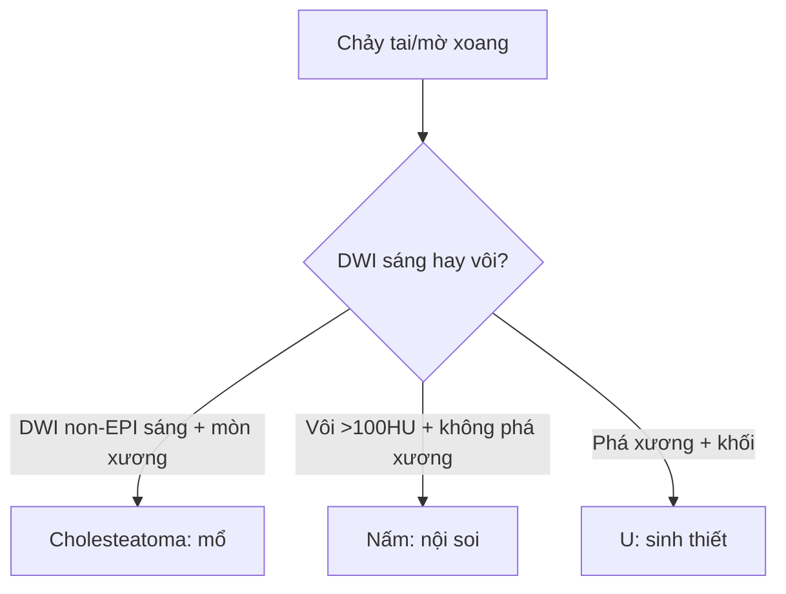

# 235 — Xương thái dương & xoang: cholesteatoma DWI + nấm vs u / Temporal & Sinuses

**Tags:** `pattern:xuong-thai-duong-xoang` `vung:dau-mat-co` `protocol:MRI-non-EPI`
**Mức chắc chắn (certainty):** tổng hợp y văn (literature synthesis) — nhóm tự biên từ y văn mở, chưa gắn ca nguyên văn đơn lẻ.

## 1. Tổng quan — keratin giữ nước khuếch tán + nấm vôi hóa

- Cholesteatoma: biểu mô sừng (keratin) tích tụ tai giữa-thượng nhĩ — TẠI SAO **DWI non-EPI sáng từ ≥ 2–3 mm**: keratin đặc hạn chế khuếch tán, trong khi mô hạt/viêm (granulation) DWI tối (non-EPI tránh méo ảnh nền sọ so với EPI).
- Viêm xoang nấm (fungal): vón canxi + kim loại nặng trong chất nhầy dị ứng — TẠI SAO tăng tỷ trọng **> 100 HU + vôi** trong xoang mờ: oxalate canxi + sắt/mangan của sợi nấm.
- U xoang (K vảy, esthesioneuroblastoma): phá xương + khối mô mềm lan hốc mắt/nền sọ, không vôi kiểu nấm.

## 2. Gamut chảy tai + mờ xoang (Gamut)

- **Thượng nhĩ + mòn xương con + DWI non-EPI sáng:** cholesteatoma — mổ tiệt căn + bít.
- **Mờ xoang + vôi > 100 HU + không phá xương:** nấm — nội soi + dọn xoang.
- **Khối xoang + phá xương + lan hốc mắt:** u — sinh thiết + PET + mổ/xạ.
- **Viêm tai xương chũm + biến chứng nội sọ:** áp-xe/tắc xoang — CT + MRI cấp cứu.

## 3. Bảng so sánh phân biệt (ma trận đối chiếu)

| Thực thể (entity) | Hình ảnh điển hình | Chốt vào (rule-in) | Chốt loại (rule-out) | Gợi ý xác nhận |
|---|---|---|---|---|
| Cholesteatoma | **Thượng nhĩ + mòn xương + DWI non-EPI sáng ≥ 2–3 mm** | **DWI sáng + mòn xương con** | DWI tối → mô hạt | CT xương + mổ (theo dõi DWI sau mổ) |
| Nấm xoang | **Mờ xoang + vôi > 100 HU + không phá xương + dị ứng** | **Vôi + IgE/đa polyp** | Phá xương + khối → u | Nội soi + mô bệnh |
| U xoang | **Khối + phá xương + lan hốc mắt/nền sọ** | **Phá xương + mô mềm** | Vôi + không phá → nấm | Sinh thiết + PET |
| Viêm tai biến chứng | **Mờ xương chũm + khuyết tegmen + áp-xe/TM tắc** | **Khuyết xương + sốt + thần kinh** | Không khuyết → viêm đơn thuần | CT + MRI + KS/mổ cấp cứu |

## 4. Protocol

- **CT xương thái dương lát mỏng 0,5 mm + MRI DWI non-EPI** (theo dõi tồn dư/tái phát cholesteatoma ≥ 2–3 mm); **CT xoang + nội soi** khi mờ xoang.

## 5. Cạm bẫy

- **DWI EPI méo ảnh nền sọ** giả âm/dương cholesteatoma nhỏ — non-EPI + ngưỡng 2–3 mm.
- **Mô hạt sau mổ DWI tối** tưởng khỏi hẳn — theo dõi DWI định kỳ 1–2 năm.
- **Nấm xâm lấn (mucor) đái tháo đường** phá xương như u — cấp cứu nội soi + amphotericin, đừng chờ sinh thiết.

## 6. Tự lượng giá — Blind Quiz

**Ca 1 — Chảy tai thối + thượng nhĩ mờ + mòn đe, DWI non-EPI sáng 5 mm:** cholesteatoma hay mô hạt? *(Bảng mục 3.)*

<b>Bấm để hiện đáp án</b>

- **Cholesteatoma:** DWI sáng ≥ 2–3 mm + mòn xương — mổ tiệt căn (mô hạt DWI tối).

**Ca 2 — Mờ xoang hàm + vôi 150 HU + không phá xương + hen/polyp:** nấm hay u? *(Bảng mục 3.)*

<b>Bấm để hiện đáp án</b>

- **Viêm xoang nấm dị ứng:** vôi > 100 HU + không phá xương — nội soi + corticoid.

**Ca 3 — Khối xoang sàng + phá bản giấy + lồi mắt:** bước tiếp? *(Bảng mục 3.)*

<b>Bấm để hiện đáp án</b>

- **Nghi u xoang:** sinh thiết + PET + hội chẩn mổ/xạ (không phải nấm khi phá xương + khối).

## Bài liên quan chéo
- [200 – Tổng quan Thần kinh](../200-tong-quan-he-than-kinh/lesson.md)
- [217 – Ngoài trục CPA](../217-ngoai-truc-CPA/lesson.md) (lan nền sọ-hố sau)
- [230 – Tuyến giáp & hạch cổ](../230-tuyen-giap-hach-co/lesson.md) (đầu-mặt-cổ)

> Không dùng để chẩn đoán độc lập khi chưa có người hướng dẫn.
