# 236 — Viêm tai xương chũm & biến chứng nội sọ: huyết khối xoang, áp-xe não / Acute mastoiditis & otogenic intracranial complications

**Tags:** `pattern:viem-xuong-chum` `pattern:bien-chung-noi-so` `pattern:huyet-khoi-xoang-tinh-mach` `pattern:apxe-nao` `vung:xuong-thai-duong` `score:CAM` `protocol:CT-xuong-thai-duong` `protocol:MRI-MRV`
**Mức chắc chắn (certainty):** tổng hợp y văn (literature synthesis) — gom ca nguyên văn CC BY + số liệu cohort (Reale *Ital J Pediatr* 2025; Sabitova *Children* 2026; Sofer *Eur Arch Otorhinolaryngol* 2026; tổng quan Bizdu-Branovici *Medicina* 2026).

## 1. Tổng quan — mòn xương chũm dẫn đường cho 3 đường lan nội sọ

- **Viêm tai xương chũm cấp (acute mastoiditis — AM)** là biến chứng hay gặp nhất của viêm tai giữa cấp (acute otitis media — AOM): **1,2–6,1/100.000 trẻ 0–14 tuổi/năm** (Reale 2025), tổng hợp khác **1,2–1,6/100.000 người/năm** (Sabitova 2026); Israel theo registry **7,78/100.000 trẻ-năm**. Chẩn đoán AM là **lâm sàng** (sưng–đỏ–đau vùng sau tai hoặc vành tai nhô ra ở trẻ đang/có AOM trong 4 tuần), không dựa đơn thuần vào hình ảnh.
- **Viêm xương chũm thể kết dính (coalescent mastoiditis):** viêm mủ phá các vách xương mảnh giữa các tế bào chũm → **CT cửa sổ xương mất vách xương**, có thể mòn **vách xoang sigma, mảnh tegmen (trần sào bào), vách xoang bên**. TẠI SAO mòn xương lại quyết định: **chỉ cần một điểm mòn mỏng là đủ mở đường cho mủ/vi khuẩn lan trực tiếp** ra màng não và xoang tĩnh mạch lân cận — đây là cơ chế của ***toàn bộ*** biến chứng nội sọ.
- **Biến chứng được gọi là CAM (complicated acute mastoiditis)** khi có bằng chứng viêm màng não, viêm xương, áp-xe (chũm/nội sọ), huyết khối xoang tĩnh mạch (CVST) và/hoặc liệt dây VI–VII. Cohort Florence 2016–2023 (**n = 85**, 60% nam, tuổi trung vị **4 tuổi**): **20% (17/85) là CAM**. Tỷ lệ biến chứng trong y văn rất dao động **1,9–35%** (Sabitova), do khác tiêu chuẩn chọn và mức chậm chuyển tuyến.
- **CRP là chỉ báo hữu ích:** điểm cắt **12 mg/dL**, trên ngưỡng này nguy cơ CAM tăng (OR **1,082**; 95%CI 1,008–1,162; p = 0,029) — cao hơn hẳn ở nhóm CAM (p = 0,043), trong khi WBC/neutrophil **không** khác biệt.
- **Cơ chế hình ảnh từng chuỗi (vật lý):**
  - **CT không cản quang cửa sổ xương:** mờ các tế bào chũm do dịch/mủ (đậm độ mô mềm ~10–40 HU) + **mất vách xương mảnh** = coalescent. Đây là chuỗi **nhạy nhất để lập bản đồ xương**.
  - **Mủ (pus) hạn chế khuếch tán:** dịch đặc, đầy tế bào viêm + protein + mảnh hoại tử làm **giảm chuyển động Brown của nước** → **DWI sáng, ADC tối** — đây là dấu hiệu chốt **áp-xe não** (khác phù vasogenic: DWI tối/ADC sáng).
  - **Huyết khối xoang tĩnh mạch (thrombus):** tín hiệu T1/T2 **tiến triển theo tuổi cục máu** (oxy- → deoxy- → methemoglobin nội bào T1 sáng → methemoglobin ngoại bào T1&T2 sáng → hemosiderin T1/T2 tối). **MRV** (time-of-flight hoặc sau gadolinium) là chuỗi xác nhận: **khuyết thuốc (filling defect) trong lòng xoang**; CE-MRI thấy **ngấm màng não/huyết khối quanh xoang**.
  - **Viêm màng não – tụ mủ:** ngấm màng não (leptomeningeal), tụ dịch ngoài trục **hình liềm/vành khăn** — MRI sau gadolinium nhạy hơn CT rõ rệt.

## 2. Mẫu hình + chẩn đoán phân biệt theo vị trí (Gamut)

- **Tại chỗ (intratemporal):** viêm mê nhĩ (labyrinthitis — chóng mặt + nghe kém), liệt dây VII, **viêm đỉnh xương đá (petrous apicitis / Gradenigo: viêm xương chũm + liệt dây VI + đau sau ổ mắt)**.
- **Ngoài sọ–cạnh xương chũm:** **áp-xe dưới màng xương (subperiosteal abscess)** — hay gặp nhất; **áp-xe Bezold** (lan xuống cơ ức-đòn-chũm), **áp-xe Citelli** (vùng chẩm–hành tá tràng), **viêm xương chũm** (osteomyelitis).
- **Nội sọ (đích của bài này):** viêm màng não (meningitis), **tụ mủ ngoài màng cứng/dưới màng cứng (epidural/subdural empyema)**, **áp-xe não** (thùy thái dương / tiểu não — theo đường lan mòn tegmen hoặc xoang sigma), **huyết khối xoang sigma–ngang và tĩnh mạch cảnh trong (otogenic lateral sinus thrombosis — OLST)**.
- **Gợi nhớ "MADE":** **M**eningitis — **A**bscess (brain/epidural/subdural) — **D**ural sinus thrombosis — **E**xtratemporal/mastoid abscess. Mọi CAM phải trả lời 4 câu này.

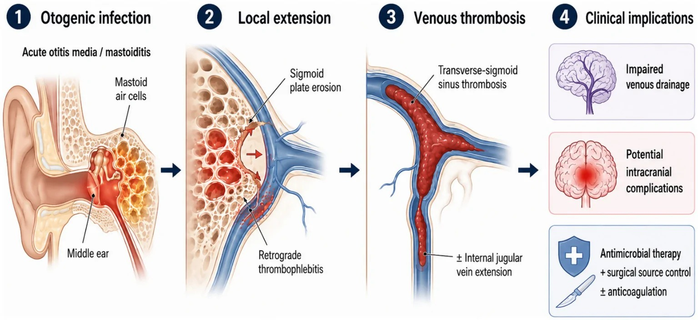
*Sơ đồ đề xuất đường lan của huyết khối xoang ngang–sigma do tai (otogenic): từ AOM → viêm xương chũm → **mòn vách xoang sigma hoặc huyết khối lan ngược (retrograde thrombophlebitis)** → huyết khối xoang ngang–sigma, có thể lan xuống tĩnh mạch cảnh trong → giảm dẫn lưu tĩnh mạch. Nguồn: Arias Rodríguez FD et al., Front Med 2026, PMC13546992 Fig. 5, CC BY 4.0.*

## 3. Bảng so sánh phân biệt (ma trận đối chiếu)

| Thực thể (entity) | Hình ảnh điển hình | Chốt vào (rule-in) | Chốt loại (rule-out) | Gợi ý xác nhận |
|---|---|---|---|---|
| Mờ chũm KHÔNG viêm tai chũm (subclinical opacification) | Mờ tế bào chũm **không mòn vách**, ở trẻ có AOM, không sưng sau tai | Mờ chũm **kèm AOM** nhưng lâm sàng không có sưng/đỏ/đau sau tai | **Có mòn vách + lâm sàng sau tai** → là AM thật | Lâm sàng là chốt; không điều trị mờ chũm đơn thuần |
| Viêm tai xương chũm cấp (coalescent AM) | Mờ chũm + **mất vách xương mảnh**, tai giữa mờ | **Sưng–đỏ–đau sau tai (77,6% ca) + mờ chũm** | Không mòn xương + không triệu chứng tại chỗ → theo dõi AOM | CT cửa sổ xương |
| Áp-xe dưới màng xương | Khối mô mềm vùng sau tai, có thể đẩy vành tai ra trước | **Khối mô mềm sau tai + mòn vỏ xương chũm** | Không có khối mô mềm → viêm chũm đơn thuần | CT; dẫn lưu nếu khối lớn |
| Huyết khối xoang sigma–ngang (OLST) | **Khuyết thuốc lòng xoang** trên CT cản quang/MRV; tín hiệu huyết khối T1/T2 theo tuổi máu | **Khuyết thuốc MRV + mòn vách xoang sigma** | Dòng chảy đối xứng, không khuyết → loại | MRI + MRV (chuẩn); theo dõi 3–6 tháng |
| Áp-xe não nội sọ | Khối **DWI sáng / ADC tối**, viền ngấm thì muộn, phù quanh | **DWI sáng + ADC tối (mủ) + viền ngấm** | DWI tối/ADC sáng = phù/khối u, không phải mủ | MRI + DWI; chọc/cắt lấy mủ |
| Viêm màng não nội sọ | Ngấm màng não, tụ mủ dưới màng cứng hình liềm | **Ngấm màng não lan + sốt + cứng gáy** | Chỉ mờ chũm, không ngấm màng não | MRI sau gadolinium + DNT |

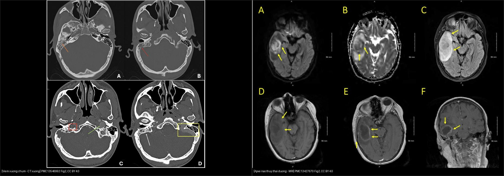
*Trái: CT cửa sổ xương — mờ tế bào chũm phải (cam), mòn vách xoang sigma (đỏ), khuyết thuốc tĩnh mạch cảnh trong (ô đỏ). Phải: MRI — DWI/ADC hạn chế khuếch tán thùy thái dương phải (A,B), FLAIR phù (C), T1 sau gadolinium viền ngấm ổ áp-xe (E,F). Nguồn: Arias Rodríguez FD et al., Front Med 2026, PMC13546992 Fig. 2; Yahya T et al., Cureus 2026, PMC13427670 Fig. 2 — CC BY 4.0. Ảnh ghép letterbox, giữ nguyên tỷ lệ.*

### Ba đích nội sọ cần khảo sát riêng (đọc có hệ thống)
- **Đường tegmen (trần sào bào/hang chũm)** → mòn lên trên → tụ mủ ngoài màng cứng / áp-xe thùy thái dương (như ca Yahya 2026).
- **Đường vách xoang sigma** → huyết khối xoang bên → lan tĩnh mạch cảnh trong (ca Arias Rodríguez 2026: khuyết thuốc kéo dài xuống tĩnh mạch cảnh trong).
- **Đường qua bóng cảnh (jugular bulb)** hoặc xương đá → viêm mê nhĩ, liệt dây VII, Gradenigo.

## 4. Protocol chụp + phân độ & khi nào can thiệp

- **Bước 1 — CT xương thái dương lát mỏng 0,5–1 mm (bone window) + CT cản quang:** đánh giá mờ chũm, mòn vách xoang sigma/tegmen, khuyết thuốc tĩnh mạch cảnh trong, khối mô mềm sau tai. Là chuỗi đầu tay vì nhanh, rẻ, đánh giá xương tốt.
- **Bước 2 — MRI + MRV (khi nghi nội sọ hoặc CT không giải thích):** T1/T2, FLAIR, **DWI/ADC** (áp-xe), T1 sau gadolinium (viêm màng não/tụ mủ), **MRV** (huyết khối xoang). MRI/MRV là chuỗi **nhiều thông tin nhất** để xác định huyết khối và theo dõi.
- **Theo dõi:** MRI/MRV lặp lại khoảng **3–6 tháng** để xem huyết khối tiêu/tái thông (recanalization); chụp sớm nếu xấu thêm.
- **Điều trị (số liệu để cân nhắc):**
  - **Kháng sinh tĩnh mạch (IVAT):** ở CAM kéo dài **28,5 ± 10,7 ngày** (so với AM ngắn hơn, p < 0,001); khởi đầu ceftriaxone, điều chỉnh theo cấy. Khoảng **52,9%** đã dùng kháng sinh ở nhà trước khi nhập viện (trung bình **4,7 ngày**).
  - **Phẫu thuật:** 14/85 ca (16,5%); trong CAM tới **76,5%** (13/17) so với AM **1,5%** (1/68). Chỉ định hay gặp: áp-xe chũm (41,2%), huyết khối xoang (29,4%), áp-xe ngoài màng cứng (5,9%), liệt dây VII (5,9%). Thủ thuật: chích rạch màng nhĩ (myringotomy) cho AM; **atticoantrotomy/mastoidectomy** cho thể nặng (Sabitova: myringotomy 96,5% ca đơn thuần vs atticoantrotomy 60,5% ca biến chứng; mastoidectomy 10,5% ca biến chứng).
  - **Chống đông cho OLST:** dùng **chọn lọc** (không đại trà), LMWH; thời gian trong y văn **~8–48 tuần** (ca CVST ở Reale: **96,2 ± 22,7 ngày**). Cân nhắc khi huyết khối lan rộng, tăng áp lực nội sọ, phù gai, đe dọa dẫn lưu tĩnh mạch; nhưng không có quy chuẩn thống nhất.
  - **Corticoid** kèm khi nghi viêm màng não (14/85 ca trong cohort).
  - **Nguyên tắc:** nguồn mủ ở tai phải được kiểm soát (dẫn lưu/mổ) song song với kháng sinh và (chọn lọc) chống đông — **đa chuyên khoa**.

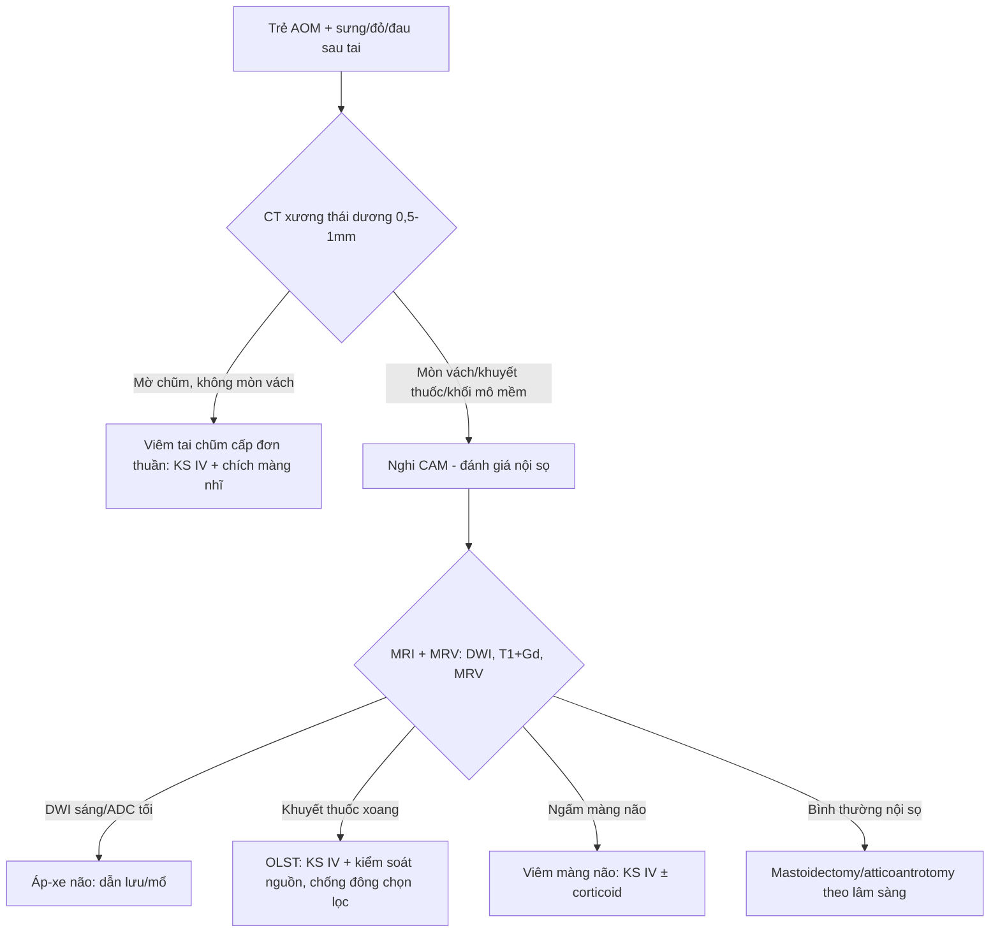

## 5. Biến thể bình thường & cạm bẫy

- **"Viêm xương chũm ẩn" (masked mastoiditis):** người già/suy giảm miễn dịch có thể **soi tai bình thường** nhưng đã mòn xương đá + áp-xe não (ca 86 tuổi, PMC13080951) — nội soi bình thường **không loại trừ**; phải chụp khi có dấu thần kinh.
- **Mờ tế bào chũm "sinh lý" ở trẻ AOM** rất hay gặp và **không đồng nghĩa viêm xương chũm** — chốt bằng lâm sàng (sưng/đỏ/đau sau tai); đừng mổ một hình mờ đơn thuần.
- **Bất đối xứng xoang ngang trên MRV (giả huyết khối):** một bên xoang ngang giảm sản/teo **là biến thể bình thường** — cần đối chiếu chuỗi T1/T2 huyết khối + CE-MRI trước khi gọi huyết khối.
- **CT bình thường không loại trừ huyết khối nội sọ** — nếu lâm sàng nghi, chuyển thẳng MRI/MRV.
- **Cholesteatoma cũng gây mòn xương + áp-xe** (xem [235](../235-xuong-thai-duong-xoang/lesson.md), [720](../720-temporal-bone-cholesteatoma/lesson.md)) — mòn xương thượng nhĩ + DWI sáng keratin khác mủ (ADC keratin ~0,7–1,0; mủ cũng thấp) → phân biệt bằng vị trí + lâm sàng mạn.
- **Bỏ sót theo "satisfaction of search":** khi đã thấy mờ chũm, dễ quên **quét hết xoang tĩnh mạch và thùy thái dương/tiểu não** — luôn trả lời đủ 4 mục MADE.

## 6. Tự lượng giá — Blind Quiz

**Ca 1 — Nam 32 tuổi, chảy mủ tai phải 3 tuần, điều trị amoxicillin–clavulanate không đỡ, sưng đỏ sau tai. Đọc CT xương thái dương trước.**

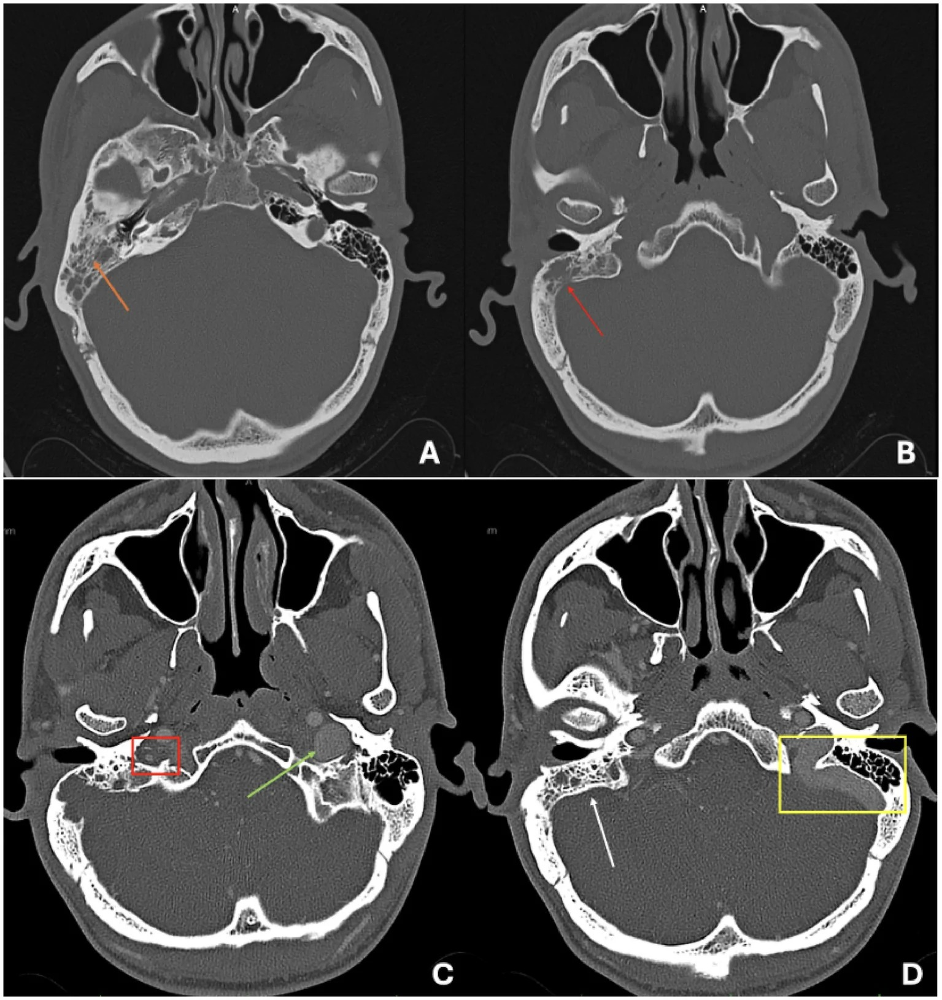

- Hỏi: (A) có gì trong tế bào chũm? (B) vách xoang sigma ra sao? (C,D) có gì bất thường? Nghĩ gì tiếp theo?

<b>Bấm để hiện đáp án (findings + chẩn đoán)</b>

- Dấu hiệu (findings): (A) mờ tế bào chũm phải do mô mềm (mũi tên cam); (B) **mòn vách xoang sigma phải** (mũi tên đỏ); (C,D) **khuyết thuốc (filling defect) trong tĩnh mạch cảnh trong phải** + thay đổi mô mềm quanh xương chũm.
- Chẩn đoán (diagnosis): **viêm tai xương chũm cấp biến chứng (CAM) — huyết khối xoang sigma–ngang lan tĩnh mạch cảnh trong**. Bước tiếp theo: **MRI + MRV** xác nhận huyết khối và loại trừ áp-xe; cấy mủ; kháng sinh IV.
- Đối chiếu MRI/MRV cùng bệnh nhân (T2 + T1 sau gadolinium + MRV) — huyết khối không ngấm thuốc, lòng xoang trống trên MRV:

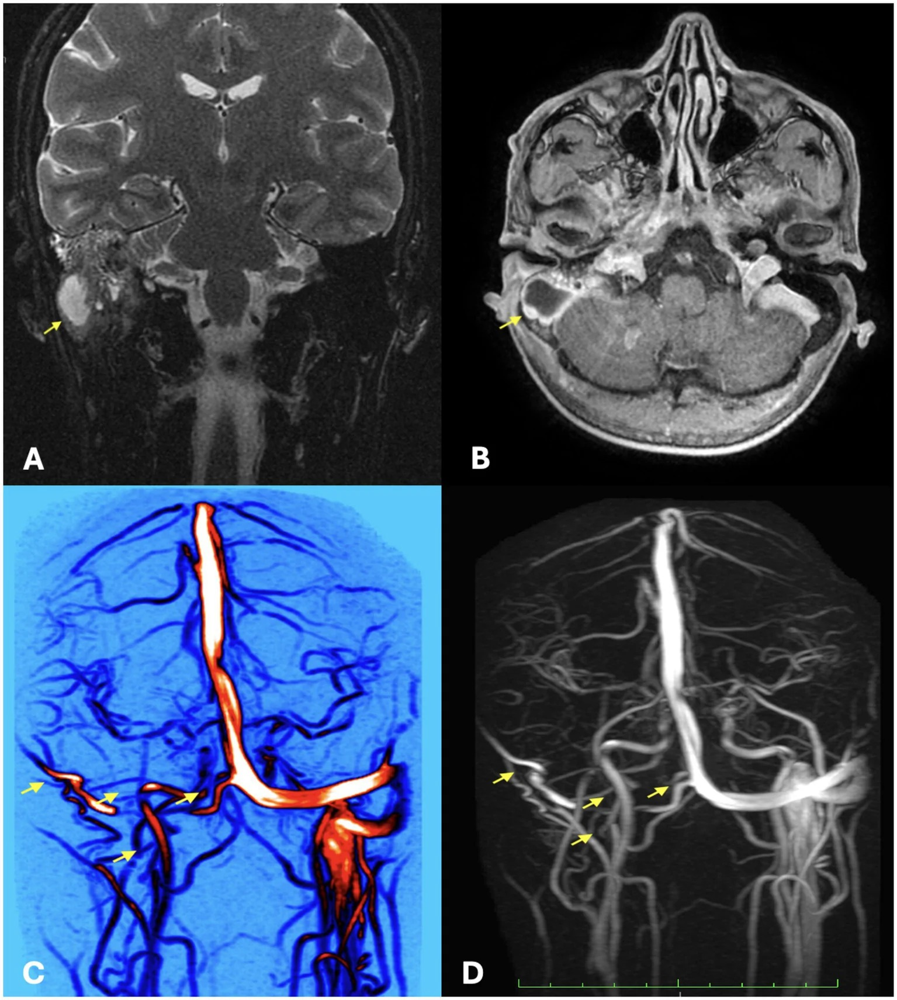

- Nguồn: Arias Rodríguez FD et al., Front Med 2026, PMC13546992 Fig. 2 & 3, CC BY 4.0.

**Ca 2 — Nữ 43 tuổi, rối loạn hành vi cấp sau đợt viêm tai giữa. Đọc MRI trước khi mô tả.**

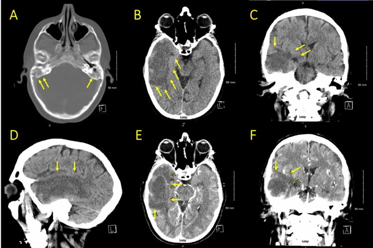

- Hỏi: tổn thương ở đâu? DWI/ADC nói gì về bản chất (mủ hay phù)? Có phải biến chứng của viêm tai không?

<b>Bấm để hiện đáp án (findings + chẩn đoán)</b>

- Dấu hiệu (findings) trên CT: (A) mờ tế bào chũm hai bên (nặng hơn bên phải) + mờ khoang tai giữa phải; (B–D) vùng giảm đậm độ mờ (ill-defined hypodensity) thùy thái dương phải.
- Đối chiếu MRI cùng bệnh nhân:

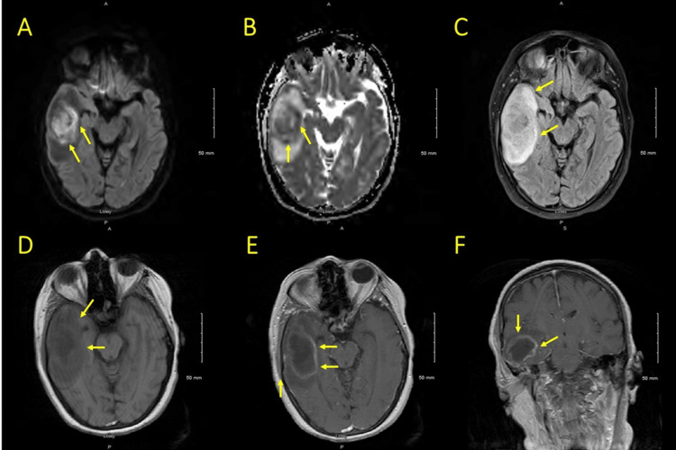

- Dấu hiệu trên MRI: (A,B) **DWI sáng + ADC tối** vùng thùy thái dương phải = hạn chế khuếch tán; (C) FLAIR tăng tín hiệu (phù mạch); (D) T1 trước tiêm; (E,F) **viền ngấm mô tả ổ áp-xe (rim-enhancing)**.
- Chẩn đoán (diagnosis): **áp-xe não thùy thái dương do lan nội sọ của viêm tai xương chũm**. **DWI sáng/ADC tối = mủ (áp-xe)** — phân biệt phù vasogenic (DWI tối/ADC sáng). Xử trí: kháng sinh IV + **dẫn lưu áp-xe + mastoidectomy**.
- Nguồn: Yahya T et al., Cureus 2026, PMC13427670 Fig. 1 & 2, CC BY 4.0.

**Ca 3 — Bệnh nhân cholesteatoma có ổ áp-xe vùng chẩm, mở rộng từ xương chũm. Đọc MRI T1 sau tiêm.**

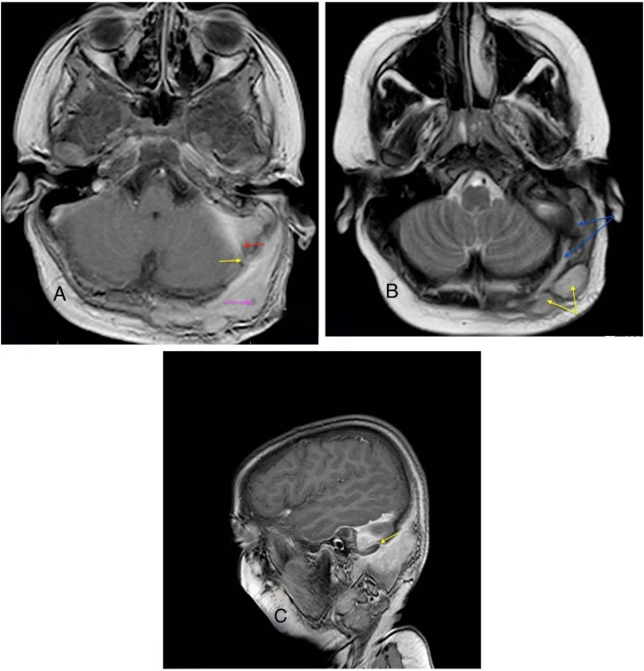

- Hỏi: mũi tên đỏ chỉ gì? Ổ áp-xe vùng chẩm nối với chũm bằng đường nào? Dấu hiệu nào chốt huyết khối xoang?

<b>Bấm để hiện đáp án (findings + chẩn đoán)</b>

- Dấu hiệu (findings): (A) T1 sau tiêm — **huyết khối xoang sigma (mũi tên đỏ)** + áp-xe da đầu (mũi tên hồng) **nối với ổ chũm qua tĩnh mạch xuyên (mũi tên vàng)**; (B) T2 — **đường rò mủ dài từ khoang chũm ra mô mềm vùng chẩm** nối nhiều ổ áp-xe; (C) T1 xoay dọc thấy thông thương. Đối chiếu CT trước đó:

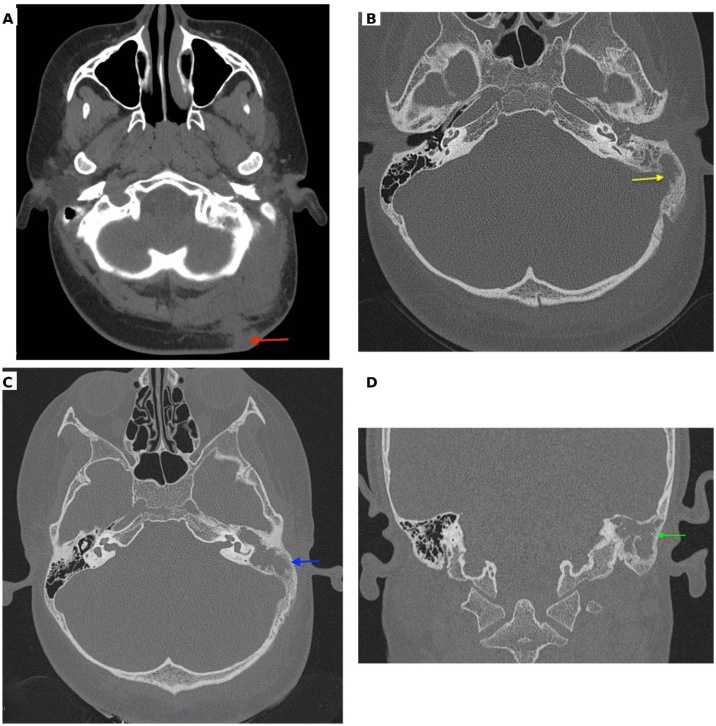

- Dấu hiệu trên CT: (A) khối mô mềm vùng chẩm; (B) **tổn thương trong xương chũm có mòn vách xoang sigma (mũi tên vàng)**; (C,D) vỏ xương nơi khác còn nguyên.
- Chẩn đoán (diagnosis): **huyết khối xoang sigma (OLST) + áp-xe da đầu theo tĩnh mạch xuyên (emissary vein)** do cholesteatoma. Chốt trên T1 sau tiêm: **huyết khối xoang = khuyết/thrombus trong lòng xoang**; xem thêm [720](../720-temporal-bone-cholesteatoma/lesson.md).
- Nguồn: Saha KL & Bhowmik B, Braz J Otorhinolaryngol 2026, PMC13213788 Fig. 2 & 3, CC BY 4.0.

**Ca 4 — Ông 86 tuổi, triệu chứng hô hấp trên không đặc hiệu, soi tai BÌNH THƯỜNG, 4 ngày sau hôn mê. Đọc CT cửa sổ xương.**

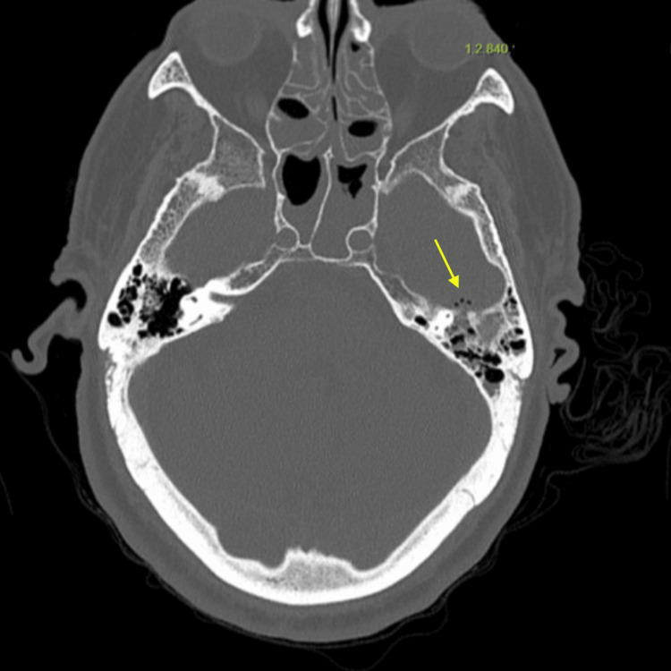

- Hỏi: CT xương thấy gì dù soi tai bình thường? Có bằng chứng lan nội sọ chưa? Nghĩ gì về "viêm xương chũm ẩn"?

<b>Bấm để hiện đáp án (findings + chẩn đoán)</b>

- Dấu hiệu (findings): **mờ tế bào chũm và tai giữa bên trái + mòn vỏ xương đá trước (mũi tên vàng)** — tức đã có phá xương dù nội soi không thấy viêm tai rõ.
- Chẩn đoán (diagnosis): **viêm xương chũm ẩn (masked mastoiditis)** đã lan nội sọ (MRI xác nhận áp-xe vùng nền thái dương + tụ mủ dưới màng cứng). Bài học: **soi tai bình thường không loại trừ** — người già/suy giảm miễn dịch cần chụp khi có dấu thần kinh.
- Nguồn: Bandera-Flores CM et al., Cureus 2026, PMC13080951 Fig. 1, CC BY 4.0.

**Ca 5 — Bệnh nhân trên (Ca 4) sau khi chuyển nặng. Đọc MRI sau gadolinium, tìm tổn thương ngoài trục.**

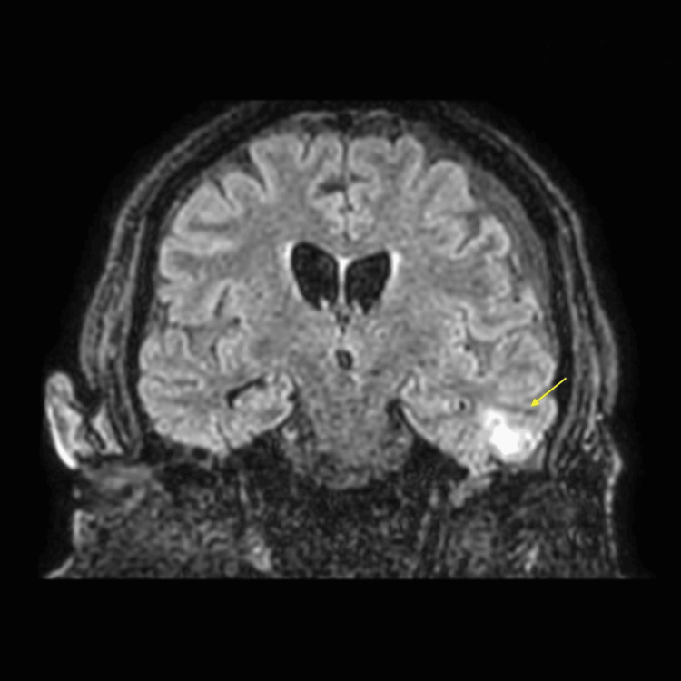

- Hỏi: có mấy loại tổn thương ngoài trục? Đâu là tụ mủ dưới màng cứng, đâu là áp-xe? Nguồn lan?

<b>Bấm để hiện đáp án (findings + chẩn đoán)</b>

- Dấu hiệu (findings): **tụ dịch dưới màng cứng trán–thái dương trái** + **áp-xe vùng nền thái dương trái** với phù nhẹ quanh, kèm viêm xương chũm hai bên và mòn xương đá trái.
- Chẩn đoán (diagnosis): **biến chứng nội sọ do lan từ viêm xương chũm (tụ mủ dưới màng cứng + áp-xe nền thái dương)**. Xử trí: kháng sinh IV + corticoid + dẫn lưu xương chũm, hồi sức — vẫn còn di chứng nhận thức khi ra viện.
- Nguồn: Bandera-Flores CM et al., Cureus 2026, PMC13080951 Fig. 3, CC BY 4.0.

**Ca 6 — Trẻ 4 tuổi sốt, nôn, đau tai không đỡ dù amoxicillin; sau đó đau đầu, cứng gáy, ngủ gà. Đọc MRI.**

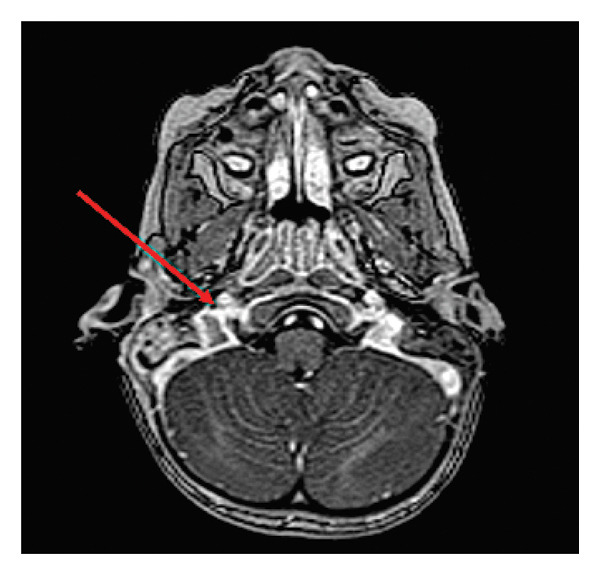

<b>Bấm để hiện đáp án (findings + chẩn đoán)</b>

- Dấu hiệu (findings): **huyết khối xoang tĩnh mạch bên phải lan tĩnh mạch cảnh trong** (mũi tên), kèm viêm xương chũm (otomastoiditis) có lan ngoài màng cứng. Đối chiếu chuỗi T2 dọc xoang sigma:

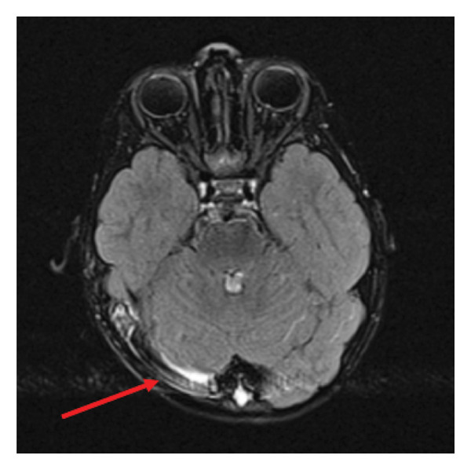

- Dấu hiệu trên chuỗi dọc: **tụ dịch mảnh (lamellar collection) dọc xoang sigma phải** — tương ứng tụ mủ ngoài màng cứng cạnh xoang.
- Chẩn đoán (diagnosis): **viêm xương chũm ở trẻ biến chứng huyết khối xoang tĩnh mạch não (CVST)** — chống đông + **mastoidectomy + đặt ống thông màng nhĩ**; hồi phục tốt. Chốt: **sốt + bệnh cảnh thần kinh ở trẻ viêm tai = chụp MRI/MRV**.
- Nguồn: Dejhalla E et al., Case Rep Pediatr 2026, PMC12793773 Fig. 2 & 3, CC BY 4.0.

**Ca 7 — Đối chiếu cuối: bên trái hay bên phải là gì? Nhãn bệnh giấu đi.**

<b>Bấm để hiện đáp án (findings + chẩn đoán)</b>

- Trái: **viêm xương chũm** trên CT cửa sổ xương — mờ tế bào chũm, mòn vách xoang sigma, khuyết thuốc tĩnh mạch cảnh trong (Arias Rodríguez FD et al., Front Med 2026, PMC13546992 Fig. 2, CC BY 4.0).
- Phải: **áp-xe não thùy thái dương** trên MRI — DWI sáng/ADC tối, viền ngấm (Yahya T et al., Cureus 2026, PMC13427670 Fig. 2, CC BY 4.0).
- Chốt: **cùng một chuỗi bệnh (viêm tai → mòn xương → lan nội sọ)**, hai mức độ hình ảnh; "đọc CT tìm mòn xương, đọc MRI tìm mủ/huyết khối".

## Bài liên quan chéo
- [235 – Xương thái dương & xoang: cholesteatoma DWI + nấm vs u](../235-xuong-thai-duong-xoang/lesson.md) (mòn xương thượng nhĩ ≠ mòn chũm do viêm)
- [720 – Xương đá, viêm tai & cholesteatoma](../720-temporal-bone-cholesteatoma/lesson.md) (chi tiết chuỗi xung tai)
- [217 – Ngoài trục CPA](../217-ngoai-truc-CPA/lesson.md) (lan nền sọ–hố sau)
- [214 – Nhiễm trùng TKTW](../214-nhiem-trung-tktw/lesson.md) (áp-xe não, viêm màng não)
- [213 – U não](../213-u-nao/lesson.md) (DDx DWI sáng/viền ngấm)
- [224 – Chấn thương sọ não ở trẻ](../224-chan-thuong-so-nao-nhi/lesson.md) (tụ dịch ngoài trục)
- [200 – Tổng quan Thần kinh](../200-tong-quan-he-than-kinh/lesson.md)

> Không dùng để chẩn đoán độc lập khi chưa có người hướng dẫn.
