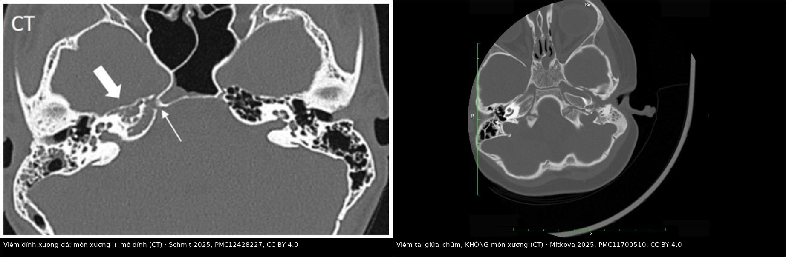
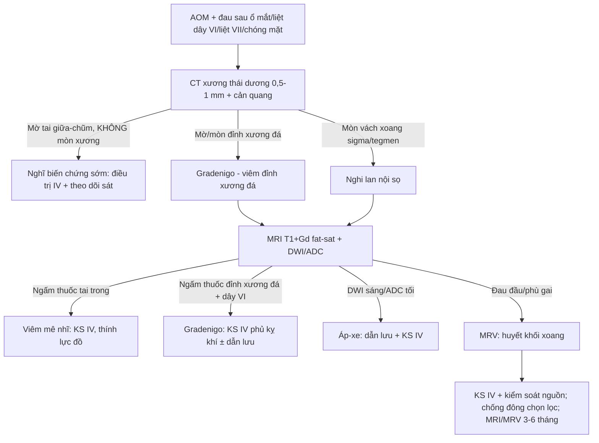
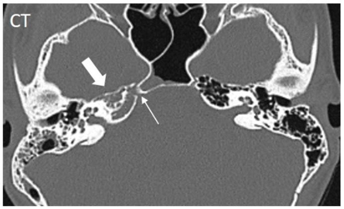
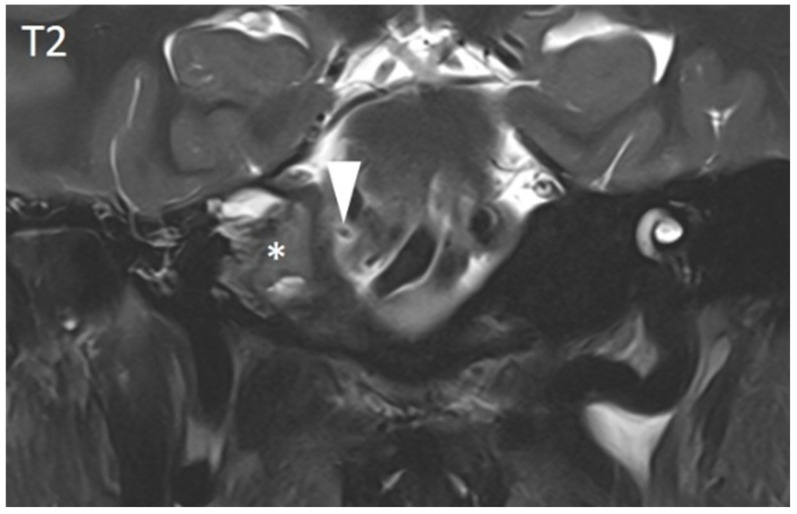
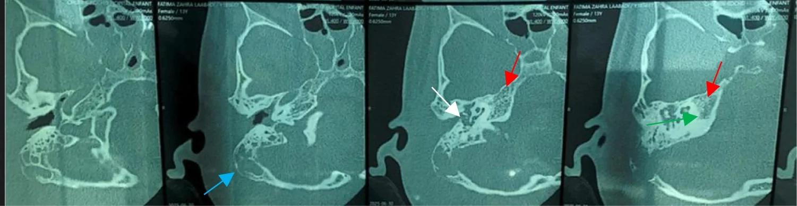
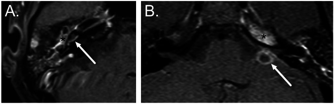
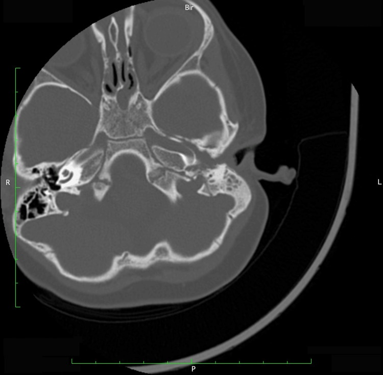
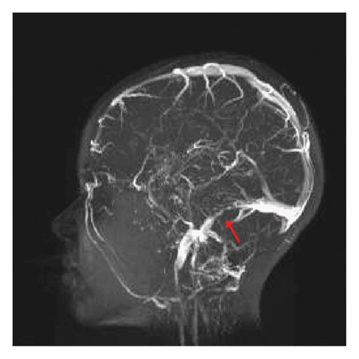
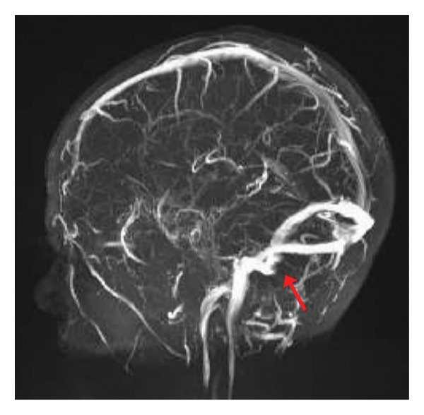

# 237 — Biến chứng thần kinh sọ của viêm tai: Gradenigo, liệt dây VII, viêm mê nhĩ / Cranial nerve complications of otitis media

**Tags:** `pattern:gradenigo` `pattern:liet-day-VII` `pattern:viem-me-nhi` `pattern:bien-chung-viem-tai` `vung:xuong-da` `score:House-Brackmann` `protocol:CT-xuong-thai-duong` `protocol:MRI-T1-Gd`
**Mức chắc chắn (certainty):** tổng hợp y văn (literature synthesis) — gom số liệu từ tổng quan hệ thống 65 ca Gradenigo ở trẻ (Schmit et al., PMC12428227), khuyến cáo ESR Essentials 2026 (Hirvonen et al., PMC12712113), ca nguyên văn CC BY/CC BY-SA và cohort huyết khối xoang do tai.

## 1. Tổng quan — vì sao viêm tai giữa lại liệt dây thần kinh sọ

- **Viêm tai giữa cấp (acute otitis media — AOM)** thường tự khỏi, nhưng **biến chứng chỉ gặp ở < 1% ca** (Hirvonen et al. 2025, PMC12712113). Khi có **sốt tăng, đau sau tai, sưng sau tai, đau đầu hoặc dấu thần kinh**, đó là **AOM biến chứng (complicated AOM)** và phải chụp ngay.
- **Đường lan giải phẫu quyết định dây thần kinh nào bị liệt:**
  - **Tai giữa → đỉnh xương đá (petrous apex)** qua các tế bào khí quanh mê đạo (perilabyrinthine air cells). Viêm đỉnh xương đá (**petrous apicitis**) là tổn thương **đặc hiệu của hội chứng Gradenigo**. Ước tính **1/50.000 trẻ bị AOM** (Harris et al. 2026, PMC12976808).
  - **Dây VI (abducens)** đi qua **ống Dorello (Dorello's canal)** — khe xương–dây chằng giữa đỉnh xương đá và **dây chằng đá–bướm (petrosphenoid/Gruber ligament)** — cùng xoang đá dưới trước khi vào xoang hang. Chỉ một ổ viêm phù ở đỉnh xương đá là đủ chèn ép dây VI → **song thị ngang, mắt không ra ngoài được**.
  - **Dây V1–V2** nằm sát đỉnh xương đá/xoang hang → **đau sâu sau ổ mắt** (đau theo phân bố V1–V2). Đây là nửa "đau" của tam chứng Gradenigo.
  - **Dây VII** chạy trong ống mặt (facial canal), **đoạn mê đạo là hẹp nhất** → viêm/phù trong AOM gây **liệt mặt ngoại biên**; tỷ lệ **0,004–0,005% ca AOM** (Mitkova et al. 2025, PMC11700510).
  - **Dây VIII** (ốc tai–tiền đình) qua **cửa sổ bầu dục/cửa sổ tròn** → **viêm mê nhĩ (labyrinthitis)**: chóng mặt + nghe kém tiếp âm. Viêm tai giữa là nguyên nhân kinh điển của **viêm mê nhĩ do vi khuẩn (tympanogenic labyrinthitis)**.
- **Bốn câu hỏi bắt buộc khi AOM có dấu thần kinh:** (1) đỉnh xương đá có viêm/mòn xương không? (2) có huyết khối xoang bên–sigma không? (3) có áp-xe nội sọ/ngoài trục không? (4) có lan xoang hang/động mạch cảnh trong không? — đó là các đích chết người, không chỉ là "viêm tai nặng".
- **Vì sao CT và MRI bổ sung nhau (vật lý):**
  - **CT xương thái dương lát mỏng:** xương đặc có **HU rất cao**, mô viêm ứ dịch trong tế bào khí chỉ **~10–40 HU** → tương phản mạnh, thấy rõ **mờ tế bào khí, mòn vách xương, mòn vỏ xương đá**. CT là chuỗi tốt nhất để **lập bản đồ xương** và lên kế hoạch mổ.
  - **MRI T1 sau gadolinium:** viêm làm **tăng tính thấm mao mạch** → **ngấm thuốc màng não/mô xương đá/tai trong**; đây là dấu **hoạt tính** mà CT không thấy. MRI cũng thấy **dây VI trong ống Dorello** và **lan ngoài trục**.
  - **DWI/ADC:** mủ đặc (áp-xe) và **keratin của cholesteatoma** đều **hạn chế khuếch tán** (DWI sáng, ADC thấp); viêm phù thông thường **không** hạn chế mạnh. Vì vậy DWI dùng để **phân biệt áp-xe/cholesteatoma với viêm mô** — không dùng một mình để chẩn đoán.
- **Ngưỡng và con số cần nhớ (Gradenigo ở trẻ, Schmit et al. 2025, PMC12428227):**
  - **65 bệnh nhi**, tuổi trung bình **8,0** (IQR 5,0–11,5); **tam chứng đầy đủ chỉ 22%**, thể **không đầy đủ 74%**, **3% không có triệu chứng điển hình nào** lúc vào.
  - Thời gian từ khởi phát triệu chứng đến nhập viện **trung vị 14 ngày** (IQR 9–21); **45% đã dùng kháng sinh trước đó** → bệnh cảnh bị "làm mờ".
  - **MRI:** viêm đỉnh xương đá **84%**; **CT:** mờ đỉnh xương đá/tiêu xương **49%**, viêm chũm **45%**.
  - **Cấy tìm được vi khuẩn 41%**, hay gặp nhất **Fusobacterium necrophorum** (gợi ý đường lan kỵ khí từ vòm–tai).
  - **Điều trị:** kháng sinh **88%**, phẫu thuật **72%** (chích rạch màng nhĩ 77%, đặt ống thông khí 70%, khoét chũm 68%); **kháng sinh nội trú trung vị 21 ngày** (IQR 10–35), **ngoại trú 26 ngày** (IQR 14–42).
  - **Kết cục:** cải thiện **98%**, khỏi hoàn toàn **73%**, biến chứng **29%**, **tử vong 2% (1 ca)**.

## 2. Mẫu hình + chẩn đoán phân biệt theo dây thần kinh (Gamut)

- **Dây VI đơn độc + đau sau ổ mắt + viêm tai:** **hội chứng Gradenigo** do viêm đỉnh xương đá. Nếu kèm **sốt, li bì, cứng gáy** → đã lan màng não/áp-xe; nếu kèm **phù gai, đau đầu dữ dội** → nghĩ **huyết khối xoang/tăng áp lực nội sọ**.
- **Dây VII đơn độc trong AOM:** **liệt mặt do viêm tai (otogenic facial palsy)** — thường do phù ống mặt, **không có mòn xương**; nhưng phải loại trừ **viêm chũm đồng thời/áp-xe** trước khi gọi là "Bell's palsy".
- **Dây VIII (chóng mặt + nghe kém):** **viêm mê nhĩ (labyrinthitis)**; phân biệt **nhồi máu động mạch tiểu não trước dưới (AICA)** — AICA có thêm dấu thân não (thất điều, liệt dây V/VII, hội chứng Horner), khởi phát đột ngột, **DWI não dương tính**.
- **Nhiều dây cùng lúc (III, IV, V1, VI) + lồi mắt, phù kết mạc:** **huyết khối xoang hang (cavernous sinus thrombosis)** — lan từ viêm tai/xoang bướm, là cấp cứu.
- **Dây IX–XII + đau cổ/sưng cổ:** lan xuống **lỗ cảnh (jugular foramen)** hoặc **huyết khối tĩnh mạch cảnh trong (Lemierre)** — xem [238](../238-lemierre-huyet-khoi-tm-canh-trong/lesson.md).
- **Không có viêm tai nhưng liệt dây VI tiến triển:** nghĩ **u nền sọ/nasopharyngeal carcinoma xâm lấn đỉnh xương đá**, **u màng não**, hoặc **tăng áp lực nội sọ** — không được gán cho "viêm tai cũ".
- **Gợi nhớ "6-5-7-8" theo chiều từ trong ra ngoài:** **VI** (Dorello) → **V** (xoang hang/Meckel) → **VII** (ống mặt) → **VIII** (tai trong); khiếm khuyết càng nhiều dây càng phải nghĩ lan rộng ngoài xương đá.

## 3. Bảng so sánh phân biệt (ma trận đối chiếu)

| Thực thể (entity) | Hình ảnh điển hình | Chốt vào (rule-in) | Chốt loại (rule-out) | Gợi ý xác nhận |
|---|---|---|---|---|
| Viêm đỉnh xương đá / Gradenigo | CT: mờ đỉnh xương đá, **mòn vách/vỏ xương**; MRI T1+C: **ngấm thuốc đỉnh xương đá**, có thể thấy dây VI trong ống Dorello | **AOM + đau sau ổ mắt + liệt dây VI cùng bên**; MRI ngấm thuốc đỉnh xương đá | Đỉnh xương đá **T1 sáng, không ngấm thuốc, không mòn xương** → u hạt cholesterol | CT 0,5–1 mm + MRI T1+C fat-sat; hỏi kỹ đau sâu sau mắt |
| Liệt mặt do viêm tai (otogenic VII) | CT: mờ tai giữa/chũm, **không mòn xương ống mặt**; MRI T1+C: ngấm thuốc dây VII/ống mặt | **Liệt mặt ngoại biên cùng bên AOM**, khởi phát trong đợt viêm | Liệt mặt **không kèm bệnh tai**, kéo dài nhiều tuần, không cải thiện → nghĩ u/tổn thương thân não | Khám House-Brackmann + MRI có/không cản quang nếu không điển hình |
| Viêm mê nhĩ (labyrinthitis) | T1+C: **ngấm thuốc ốc tai/tiền đình/ống bán khuyên**; FLAIR tăng tín hiệu dịch tai trong; CT thường bình thường sớm | **Chóng mặt + nghe kém tiếp âm trong AOM/viêm màng não**, ngấm thuốc tai trong | T1+C tai trong **bình thường** + DWI não có ổ nhồi máu → AICA, không phải viêm mê nhĩ | MRI T1+C + DWI não; thính lực đồ |
| U hạt cholesterol đỉnh xương đá | **T1 sáng, T2 sáng, không ngấm thuốc**, bờ xương rõ, không mòn vỏ | **T1 sáng đồng nhất + không ngấm thuốc + không viêm** | **Ngấm thuốc + mòn xương + sốt/đau** → viêm đỉnh xương đá | MRI T1/T2 không cản quang, so sánh hai bên |
| Cholesteatoma đỉnh xương đá | **T1 thấp, T2 cao, DWI sáng/ADC thấp**, mòn xương mở rộng, thường có bệnh tai mạn | **DWI hạn chế khuếch tán + mòn xương + tiền sử cholesteatoma** | DWI **không hạn chế** + ngấm thuốc → viêm, không phải cholesteatoma | DWI không EPI + CT xương; mô bệnh khi mổ |
| Huyết khối xoang hang | MRI T1+C: **khuyết thuốc xoang hang**, ngấm màng não; có thể giãn xoang, lồi mắt | **Nhiều dây III–VI + lồi mắt/phù kết mạc + sốt** | Chỉ liệt VI đơn độc, không có dấu ổ mắt → nghĩ Gradenigo | MRI + MRV; cấy máu; kháng sinh IV khẩn |
| U nền sọ / NPC (nasopharyngeal carcinoma) xâm lấn | CT: **mòn xương ác tính bờ rộng**, khối mô mềm; MRI: khối ngấm thuốc, **hẹp lỗ mạch/thần kinh** | Liệt dây VI **tiến triển, không đau tai**, có khối vòm/nền sọ | Có **AOM rõ + đỉnh xương đá ngấm thuốc lan tỏa** → viêm | MRI nền sọ + sinh thiết vòm nếu nghi |

*Trái: viêm đỉnh xương đá — mờ đỉnh, tiêu vách xương (mũi tên trắng đậm), thấy đường đi dây VI trong ống Dorello (mũi tên mảnh). Phải: viêm tai giữa–chũm đơn thuần — mờ tế bào chũm nhưng **không mòn vỏ xương**. Nguồn: Schmit et al. 2025, PMC12428227 Fig. 3; Mitkova et al. 2025, PMC11700510 Fig. 2 — CC BY 4.0. Ảnh ghép letterbox, giữ nguyên tỷ lệ.*

### Đọc Gradenigo theo trình tự "xương → màng → mạch → mủ"
1. **Xương (CT):** đỉnh xương đá có mờ/tiêu vách không? Vỏ xương quanh ống Dorello có mòn không? Tai giữa/chũm có mờ không?
2. **Màng não (MRI T1+C):** ngấm thuốc lan vào đỉnh xương đá, màng não nền sọ, hay tụ mủ ngoài trục?
3. **Mạch (MRV/CTA):** xoang sigma–ngang có khuyết thuốc? Động mạch cảnh trong trong xoang hang có bất thường?
4. **Mủ (DWI/ADC):** có ổ hạn chế khuếch tán (áp-xe) — đặc biệt thùy thái dương/tiểu não?

## 4. Protocol chụp + phân độ House-Brackmann + theo dõi sau huyết khối xoang

### 4.1. Protocol
- **Bước 1 — CT xương thái dương:** lát **0,5–1 mm**, **hai cửa sổ (xương + mô mềm)**, dựng **3 bình diện**, **tiêm cản quang iod thì tĩnh mạch** theo khuyến cáo ESR (Hirvonen et al. 2025, PMC12712113). Đánh giá mờ chũm/tai giữa, **mòn vách xoang sigma, tegmen, vỏ đỉnh xương đá**.
- **Bước 2 — MRI sọ + xương thái dương:** T1, T2, FLAIR, **DWI/ADC**, **T1 sau gadolinium có bão hòa mỡ**. Mục đích: phát hiện **viêm mê nhĩ, viêm đỉnh xương đá, áp-xe, viêm màng não** và đánh giá dây thần kinh.
- **Bước 3 — MRV (và CTA/MRA khi nghi mạch):** khi có đau đầu, phù gai, liệt nhiều dây, hoặc nghi huyết khối xoang. **MRV là chuỗi theo dõi tái thông** tốt nhất.
- **Không chụp ở AOM không biến chứng** (khuyến cáo ESR, mức chứng cứ cao): hình ảnh chỉ dành cho ca có dấu hiệu cảnh báo.

### 4.2. Phân độ liệt mặt House-Brackmann (dùng để theo dõi dây VII)

| Độ | Mô tả ngắn | Ý nghĩa thực hành |
|---|---|---|
| I | Chức năng bình thường | Không liệt |
| II | Liệt nhẹ, nhắm mắt kín, bất đối xứng chỉ khi cười | Theo dõi ngoại trú |
| III | Khác biệt rõ, **nhắm mắt kín với gắng sức** | Cần khám tai + MRI nếu không cải thiện |
| IV | **Không nhắm kín mắt**, mất nếp trán, miệng lệch | Bảo vệ giác mạc, kháng sinh IV |
| V | Chỉ còn cử động rất nhẹ | Cân nhắc giải ép/thăm dò thần kinh |
| VI | Liệt hoàn toàn | Nguy cơ loét giác mạc; xử trí tích cực |

- Ca trẻ 2 tuổi trong y văn: **House-Brackmann IV**, CT chỉ mờ tai giữa–chũm **không mòn xương**, điều trị **meropenem 40 mg/kg/ngày + methylprednisolone 1 mg/kg/ngày** và chích rạch màng nhĩ, hồi phục (Mitkova et al. 2025, PMC11700510).
- **Nguyên tắc:** kháng sinh phủ kỵ khí + **dẫn lưu nguồn mủ**; corticoid **không thay thế** kháng sinh và còn tranh luận; **giải ép dây VII** chỉ chọn lọc, không thường quy.

### 4.3. Theo dõi sau huyết khối xoang do tai (otogenic CVST)
- Cohort trẻ **10 ca** (Nobacht et al. 2026, PMC13179244): huyết khối **TM cảnh trong 80%**, **xoang sigma 60%**, **xoang hang 30%**; kháng sinh **trung vị 42,5 ngày**, chống đông **46 ngày**, phẫu thuật **90%**; **tái thông 78%** trên hình ảnh theo dõi.
- Ca trẻ 8 tuổi (Harris et al. 2026, PMC12976808): viêm đỉnh xương đá + huyết khối sigma–ngang **lan TM cảnh trong**, **phù gai hai bên**, liệt dây VI; điều trị kháng sinh + **rivaroxaban** + **acetazolamide** vì tăng áp lực nội sọ, khoét chũm + giải ép xoang sigma. **MRV sau 5 tháng:** huyết khối còn lại giảm, **hẹp mức độ trung bình đoạn xa xoang sigma** (sẹo sau viêm/mổ), TM cảnh trong thông.
- **Lịch theo dõi thực hành:** MRI/MRV lặp **3–6 tháng** sau đợt cấp (hoặc sớm hơn nếu xấu đi); khám **đáy mắt + thị trường** mỗi lần vì **phù gai/liệt VI tồn dư có thể là tăng áp lực nội sọ**, không phải "viêm dây VI tái phát".
- **Chống đông:** chọn lọc, không có phác đồ thống nhất; thời gian trong y văn **~8–48 tuần**, cá thể hóa theo lan huyết khối, nguy cơ chảy máu và tình trạng nhiễm khuẩn.

## 5. Biến thể bình thường và cạm bẫy

- **Chờ đủ tam chứng Gradenigo = bỏ sót 74% ca.** Thể không đầy đủ (chỉ đau tai + liệt VI, hoặc chỉ đau sâu sau mắt) là phổ biến; **hỏi trực tiếp "có nhìn một thành hai không?"** và khám **dây VI** ở mọi ca AOM có đau đầu/đau sâu.
- **CT sớm có thể bình thường.** Viêm đỉnh xương đá mới khởi phát có thể chỉ mờ nhẹ; nếu lâm sàng mạnh, **MRI T1+C** là bước tiếp theo (nhạy hơn với viêm tủy xương/ngấm thuốc).
- **Bất đối xứng khí hóa đỉnh xương đá là biến thể bình thường.** Một bên đỉnh xương đá "trắng" do **thiếu khí hóa**, không phải mờ bệnh lý — phải tìm **mòn vỏ xương, ngấm thuốc, dấu lâm sàng** trước khi gọi viêm.
- **U hạt cholesterol (cholesterol granuloma) T1 sáng** dễ bị đọc là "xuất huyết/ác tính"; nó **không ngấm thuốc, không mòn vỏ, không sốt** — đừng mổ nhầm.
- **Cholesteatoma cũng hạn chế khuếch tán** (DWI sáng) và gây mòn xương — **không đồng nghĩa áp-xe**. Phân biệt bằng vị trí, bệnh tai mạn, ngấm thuốc và mô bệnh.
- **"Liệt mặt Bell's" ở trẻ có viêm tai:** nếu **không chụp** sẽ bỏ sót viêm chũm/áp-xe. Ngược lại, **liệt mặt không kèm bệnh tai, tiến triển kéo dài** phải MRI tìm u thân não/tuyến mang tai.
- **Sau huyết khối xoang, phù gai và liệt VI có thể tồn tại dù huyết khối đã tái thông** — đó là **tăng áp lực nội sọ do hẹp xoang/hấp thu dịch rối loạn**, cần đo áp lực/điều trị acetazolamide, không phải "viêm dây VI dai dẳng".
- **Satisfaction of search:** thấy mờ chũm rồi dừng lại. Luôn trả lời đủ **4 câu hỏi** ở mục 1 (đỉnh xương đá, xoang, áp-xe, xoang hang).

## 6. Tự lượng giá — Blind Quiz

**Ca 1 — Bệnh nhi chảy mủ tai phải 2 tuần, đau sâu sau mắt phải, nhìn đôi khi nhìn sang phải. Đọc CT xương thái dương trước.**

- Hỏi: (A) đỉnh xương đá có gì bất thường? (B) mũi tên mảnh chỉ cấu trúc nào? (C) giải thích vì sao bệnh nhân nhìn đôi.

<b>Bấm để hiện đáp án (findings + chẩn đoán)</b>

- Dấu hiệu (findings): **tiêu vách xương và mờ đỉnh xương đá phải** (mũi tên trắng đậm); mũi tên mảnh chỉ **đường đi của dây VI trong ống Dorello** ngay sát ổ viêm.
- Chẩn đoán (diagnosis): **viêm đỉnh xương đá (petrous apicitis) — hội chứng Gradenigo** với liệt dây VI. Cơ chế: viêm phù trong ống Dorello chèn ép dây VI → song thị ngang.
- Đối chiếu MRI cùng bệnh nhi (T1 sau gadolinium + T2):

- Trên MRI: **ngấm thuốc/viêm giả u ở đỉnh xương đá** (dấu sao), **dây VI** (đầu mũi tên) nằm sát vùng viêm trên chuỗi T2.
- Nguồn: Schmit et al., Diagnostics 2025, PMC12428227 Fig. 3 & 4, CC BY 4.0.

**Ca 2 — Bé gái 13 tuổi, sốt, đau tai phải, vành tai nhô ra; sau đó xuất hiện nhìn đôi. Đọc 4 lát CT xương thái dương.**

- Hỏi: mũi tên xanh, trắng, xanh lá, đỏ chỉ gì? Có bằng chứng viêm đỉnh xương đá chưa? Cần làm gì tiếp?

<b>Bấm để hiện đáp án (findings + chẩn đoán)</b>

- Dấu hiệu (findings): **mờ hoàn toàn tai giữa** (mũi tên trắng), **tiêu vỏ xương ngoài chũm** (mũi tên xanh) = viêm xương, **chuỗi xương con còn nguyên** (mũi tên xanh lá), **mờ đỉnh xương đá** (mũi tên đỏ).
- Chẩn đoán (diagnosis): **viêm tai xương chũm có biến chứng + viêm đỉnh xương đá (Gradenigo)**. Cần **MRI + MRV** để đánh giá lan nội sọ/huyết khối, **kháng sinh IV phủ kỵ khí** và **dẫn lưu chũm**.
- Nguồn: Saout Arrih B et al., Int J Surg Case Rep 2026, PMC13045984 Fig. 4, CC BY-SA 4.0 (giữ nguyên ảnh, không ghép).

**Ca 3 — Bệnh nhân AOM, chóng mặt dữ dội; một ca khác AOM + liệt VI. Đọc hai ảnh MRI T1 sau tiêm A và B.**

- Hỏi: ổ ngấm thuốc ở A nằm ở đâu, khác gì với B? Dấu hiệu nào quyết định "viêm mê nhĩ" thay vì "viêm đỉnh xương đá"?

<b>Bấm để hiện đáp án (findings + chẩn đoán)</b>

- Dấu hiệu (findings): **A** — ngấm thuốc tai giữa (dấu sao) lan vào **ốc tai** (mũi tên) = **viêm mê nhĩ (labyrinthitis)**. **B** — ngấm thuốc lan **vào đỉnh xương đá** (dấu sao) kèm **áp-xe nội sọ cạnh bờ đá** (mũi tên) = **viêm đỉnh xương đá có biến chứng**.
- Chẩn đoán (diagnosis): cùng một đường lan từ tai giữa nhưng **đích khác nhau**: viêm mê nhĩ (chóng mặt, nghe kém) vs Gradenigo/áp-xe (liệt VI, đau sâu). Điều trị khác nhau: viêm mê nhĩ chủ yếu kháng sinh + theo dõi thính lực; viêm đỉnh xương đá/áp-xe cần **dẫn lưu**.
- Nguồn: Hirvonen et al., Eur Radiol 2025 (ESR Essentials), PMC12712113 Fig. 4, CC BY 4.0.

**Ca 4 — Trẻ 2 tuổi, liệt mặt trái trong đợt viêm tai giữa; House-Brackmann IV. Đọc CT sọ trước khi kết luận "Bell's palsy".**

- Hỏi: có mòn xương không? Có viêm chũm không? Vì sao vẫn phải điều trị tích cực dù không thấy mòn xương?

<b>Bấm để hiện đáp án (findings + chẩn đoán)</b>

- Dấu hiệu (findings): **mờ tai giữa và toàn bộ tế bào chũm trái**, **không mòn vách xương** tai giữa/ống tai ngoài.
- Chẩn đoán (diagnosis): **liệt mặt ngoại biên do viêm tai giữa cấp (otogenic facial palsy)**. Không mòn xương **không loại trừ** viêm chũm hoạt động; cơ chế là **phù trong ống mặt hẹp**. Điều trị: kháng sinh IV phủ kỵ khí, chích rạch màng nhĩ, bảo vệ giác mạc; theo dõi House-Brackmann.
- Nguồn: Mitkova M et al., Cureus 2025, PMC11700510 Fig. 2, CC BY 4.0.

**Ca 5 — Trẻ 8 tuổi, đau đầu + nhìn đôi + phù gai hai bên sau đợt viêm tai. Đọc MRV lúc nhập viện, rồi so với MRV sau 5 tháng.**

- Hỏi: xoang nào bị tắc? Có bằng chứng huyết khối lan xuống cổ không? Theo dõi bằng chuỗi nào?

<b>Bấm để hiện đáp án (findings + chẩn đoán)</b>

- Dấu hiệu (findings): **mất tín hiệu/khuyết thuốc xoang sigma–ngang phải**, huyết khối **lan xuống đoạn gần tĩnh mạch cảnh trong** (mũi tên đỏ).
- Chẩn đoán (diagnosis): **huyết khối xoang tĩnh mạch não do tai (otogenic CVST)**, biến chứng của viêm đỉnh xương đá. Phù gai hai bên = **tăng áp lực nội sọ**; cần **acetazolamide**, kháng sinh IV, kiểm soát nguồn mủ và **chống đông chọn lọc**.
- Đối chiếu sau 5 tháng:

- Sau 5 tháng: **huyết khối tồn dư giảm**, **hẹp trung bình đoạn xa xoang sigma** (mũi tên) do sẹo sau viêm/mổ; **TM cảnh trong thông**. Bài học: **theo dõi MRV 3–6 tháng**, đừng nhầm hẹp sẹo với huyết khối mới.
- Nguồn: Harris MJ et al., Case Rep Pediatr 2026, PMC12976808 Fig. 3 & 4, CC BY 4.0.

## Bài liên quan chéo
- [236 – Viêm tai xương chũm & biến chứng nội sọ](../236-viem-tai-xuong-chum-bien-chung-noi-so/lesson.md) (nền tảng viêm chũm, OLST, áp-xe não)
- [233 – Viêm tai ngoài ác tính & viêm xương nền sọ](../233-viem-tai-ngoai-ac-tinh-nen-so/lesson.md) (liệt nhiều dây sọ do lan nền sọ)
- [238 – Hội chứng Lemierre & huyết khối TM cảnh trong](../238-lemierre-huyet-khoi-tm-canh-trong/lesson.md) (lan xuống cổ, dây IX–XII)
- [235 – Xương thái dương & xoang: cholesteatoma](../235-xuong-thai-duong-xoang/lesson.md) (DWI sáng do keratin)
- [720 – Xương đá, viêm tai & cholesteatoma](../720-temporal-bone-cholesteatoma/lesson.md)
- [217 – Ngoài trục CPA](../217-ngoai-truc-CPA/lesson.md) (khối góc cầu–tiểu não, DDx liệt dây VI)
- [214 – Nhiễm trùng TKTW](../214-nhiem-trung-tktw/lesson.md) (áp-xe, viêm màng não)
- [200 – Tổng quan Thần kinh](../200-tong-quan-he-than-kinh/lesson.md)

> Không dùng để chẩn đoán độc lập khi chưa có người hướng dẫn.
