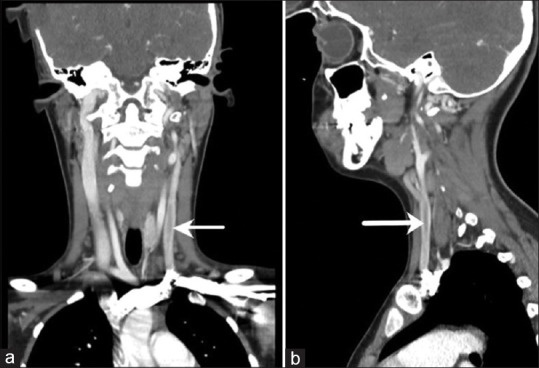
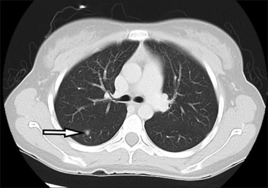
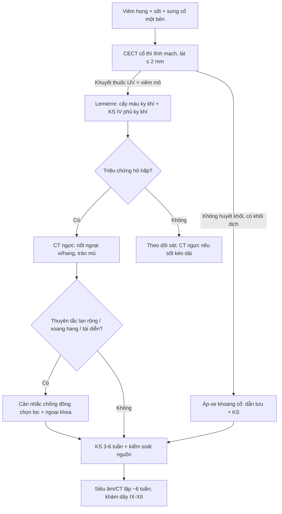
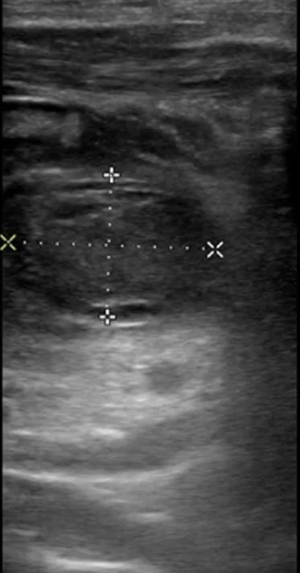
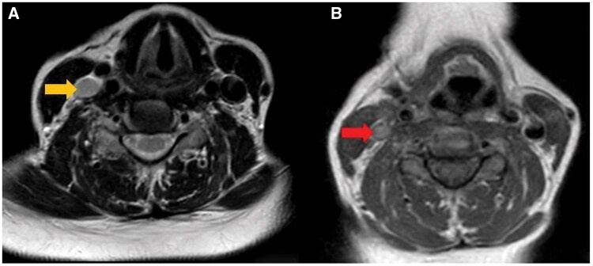
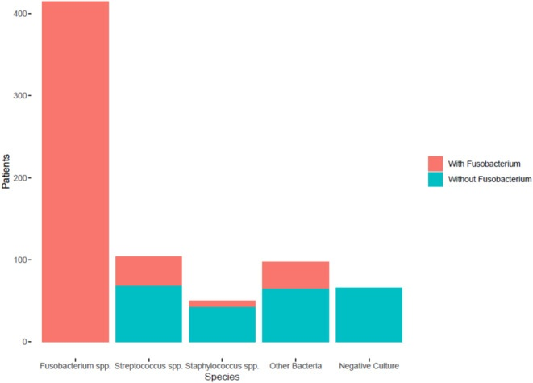

# 238 — Hội chứng Lemierre & huyết khối tĩnh mạch cảnh trong nhiễm khuẩn / Lemierre syndrome & septic internal jugular vein thrombophlebitis

**Tags:** `pattern:huyet-khoi-tm-canh-trong` `pattern:thuyen-tac-phoi-nhiem-khuan` `pattern:apxe-khoang-co` `vung:co` `vung:phoi` `protocol:CT-co-can-quang` `protocol:MRV` `protocol:CT-nguc`
**Mức chắc chắn (certainty):** tổng hợp y văn (literature synthesis) — gom số liệu từ các nguồn open access dưới đây + ca nguyên văn CC BY/CC BY-NC-ND.
- Phân tích individual patient data **712 ca**: Frehner et al., PMC12460448.
- Phân tích **321 ca** về chống đông: Tsuda et al., PMC13317357.
- Meta-analysis **394 ca**: Gore 2020, PMC7394644.
- Tổng quan nhi khoa: Lavalle et al., PMC10974575.

## 1. Tổng quan — từ viêm họng đến huyết khối tĩnh mạch cảnh trong và thuyên tắc phổi

- **Hội chứng Lemierre (Lemierre syndrome)** là **nhiễm khuẩn huyết kỵ khí sau viêm họng**, đặc trưng bởi **viêm tắc tĩnh mạch cảnh trong nhiễm khuẩn (septic thrombophlebitis of the internal jugular vein — IJV)** và **thuyên tắc mủ đi xa**, hay gặp nhất là **phổi**.
- **Dịch tễ:** khoảng **3,6 ca/triệu dân/năm** (Lavalle et al. 2024, PMC10974575); tuổi trung bình **~20–21**, trung vị **25 tuổi** (IQR 17–45) trong phân tích 321 ca (Tsuda et al. 2026, PMC13317357). Bệnh cảnh điển hình: **thanh thiếu niên/người trẻ khỏe mạnh, viêm họng 1–3 tuần trước, sốt cao, sưng/đau một bên cổ**.
- **Sinh lý bệnh (vì sao tạo huyết khối):**
  1. **Fusobacterium necrophorum** — trực khuẩn Gram âm kỵ khí, thường trú ở họng miệng — tăng sinh sau viêm họng/viêm amidan, phá hàng rào niêm mạc.
  2. Vi khuẩn lan qua **khoang bên hầu (parapharyngeal space)** vào **tĩnh mạch cảnh trong**, gây **viêm nội mạc + huyết khối**; huyết khối trở thành **ổ nhiễm khuẩn** liên tục thả mảnh mủ.
  3. **Độc tố leukotoxin và endotoxin**, cùng khả năng gây **ngưng kết tiểu cầu**, của *F. necrophorum* làm dễ huyết khối và hoại tử mô.
  4. Mảnh mủ theo dòng máu về **phổi** → **thuyên tắc phổi nhiễm khuẩn (septic pulmonary embolism)**, áp-xe phổi, tràn mủ màng phổi; có thể lên **não (3,0%)**, xương, khớp, gan.
- **Định nghĩa thực hành (dùng trong nghiên cứu Tsuda):** (1) có **nhiễm trùng hầu họng trước đó** + (2) **viêm tắc IJV hoặc thuyên tắc phổi nhiễm khuẩn** xác nhận bằng hình ảnh/mô học. Định nghĩa này giúp không bỏ sót thể **"Lemierre-like" do tụ cầu/liên cầu**.
- **Vì sao hình ảnh là chốt (vật lý):**
  - **CT cản quang cổ:** lòng mạch bình thường **ngấm thuốc đồng nhất**; huyết khối là **vùng giảm đậm độ (filling defect)** trong lòng tĩnh mạch, thành mạch **ngấm thuốc**, mỡ quanh **tăng đậm độ** do viêm. Đây là **tiêu chuẩn vàng** theo y văn nhi (Lavalle et al. 2024).
  - **Siêu âm tại giường:** huyết khối **tăng âm trong lòng mạch**, tĩnh mạch **không xẹp khi ép**, mất tín hiệu Doppler; đo được kích thước (ca dưới đây: **1,22 × 1,80 cm**). Hạn chế: đoạn sau xương đòn/xương hàm không thấy rõ.
  - **MRI:** mất **flow void** bình thường trên T2; tín hiệu huyết khối thay đổi theo tuổi máu; T1 sau tiêm thấy **viền ngấm thuốc quanh huyết khối** và viêm mô quanh. **MRV** xác nhận vị trí/lan và theo dõi tái thông.
  - **CT ngực:** thuyên tắc phổi nhiễm khuẩn điển hình là **nốt/mảng ngoại vi hai bên, hình nêm, có thể hoại tử tạo hang**, kèm tràn dịch/tràn mủ màng phổi. Dấu **"mạch nuôi" (feeding vessel)** gợi ý nhưng **không đặc hiệu**.
- **Con số dịch tễ – tiên lượng cần nhớ:**
  - **Tử vong 4,1% (16/394)** trong meta-analysis 1990–2017 (Gore 2020, PMC7394644).
  - Tổng quan nhi ghi **2–4%** dù đã có kháng sinh (Lavalle et al. 2024).
  - **Thuyên tắc phổi nhiễm khuẩn 148/394 (37,6%)**, **thuyên tắc não 12/394 (3,0%)**, **viêm màng não 2,0%** (Gore 2020). Con số thuyên tắc phổi **khác lớn** giữa các nguồn: **91%** trong 712 ca IPD (Frehner et al. 2025, PMC12460448) — do khác **tiêu chuẩn chọn ca và mức độ tìm tổn thương trên CT ngực**, không phải mâu thuẫn sinh học.
  - **Vi khuẩn (712 ca, 574 ca cấy dương):** **Fusobacterium spp. 415 ca (72,3%)**, tụ cầu/liên cầu **108 ca**, vi khuẩn khác **51 ca** (Frehner et al. 2025). **Không phát hiện vi khuẩn ở 138/712 ca (19,4%)** — đừng loại trừ chỉ vì cấy âm.
  - **Khác biệt theo tác nhân (Frehner et al. 2025):** *Fusobacterium* gặp ở người trẻ (**69% ca 16–30 tuổi**), **huyết khối IJV 63%**, **thuyên tắc phổi 91%**; tụ cầu/liên cầu gặp ở người lớn hơn (**30% ca > 45 tuổi**), **huyết khối IJV 94%** nhưng **thuyên tắc phổi chỉ 69%**.

## 2. Mẫu hình + chẩn đoán phân biệt theo đường vào (Gamut)

- **Đường hầu họng kinh điển (Fusobacterium):** viêm họng/viêm amidan → **áp-xe quanh amidan/khoang bên hầu** → huyết khối IJV → thuyên tắc phổi. Trẻ vị thành niên, sốt cao, cổ một bên.
- **Thể "Lemierre-like" do tụ cầu/liên cầu:** người lớn hơn, ổ nhiễm nguyên phát ở da/răng/xoang; **huyết khối IJV rõ hơn, thuyên tắc phổi ít hơn** (Frehner et al. 2025).
- **Đường do catheter (catheter-associated IJV thrombosis):** không có viêm họng; thường **không nhiễm khuẩn huyết**, nhưng có thể nhiễm khuẩn catheter → phải phân biệt bằng **cấy đầu catheter + lâm sàng nhiễm trùng**.
- **Đường răng (odontogenic):** áp-xe quanh chóp/răng khôn → khoang dưới hàm/bên hầu → IJV. Hay gặp ở người lớn, vi khuẩn hỗn hợp kỵ khí.
- **Đường tai (otogenic):** viêm tai–chũm → huyết khối **xoang sigma–ngang** rồi lan xuống IJV; bệnh cảnh khác với Lemierre kinh điển, xem [236](../236-viem-tai-xuong-chum-bien-chung-noi-so/lesson.md) và [237](../237-bien-chung-than-kinh-so-viem-tai-gradenigo/lesson.md).
- **Không nhiễm khuẩn (bland thrombosis):** ung thư đầu–cổ chèn ép, hội chứng tăng đông/Trousseau, sau xạ — **không sốt, không thuyên tắc mủ**; điều trị khác hoàn toàn.
- **Lao hạch cổ (TB lymphadenitis):** diễn tiến mạn, hạch hoại tử trung tâm, vôi hóa; **không có huyết khối IJV cấp**.
- **Viêm mô hoại tử cổ (cervical necrotizing fasciitis):** khí trong mô, lan nhanh, độc tính nặng; **có thể đồng thời** với Lemierre — tìm khí/ dịch trung thất.
- **Thuyên tắc phổi nhiễm khuẩn từ tim phải (endocarditis):** có tổn thương van tim, yếu tố nguy cơ tiêm chích; **không có huyết khối IJV**.
- **Gợi nhớ "SORE THROAT → NECK → LUNG":** đau họng kéo dài → sưng cổ một bên → nốt phổi ngoại vi/có hang. Khi đủ chuỗi này, **đừng chờ cấy máu** mới điều trị.

## 3. Bảng so sánh phân biệt (ma trận đối chiếu)

| Thực thể (entity) | Hình ảnh điển hình | Chốt vào (rule-in) | Chốt loại (rule-out) | Gợi ý xác nhận |
|---|---|---|---|---|
| Lemierre kinh điển (Fusobacterium) | CT cổ: **khuyết thuốc IJV**, thành ngấm thuốc, viêm mô quanh; CT ngực: **nốt ngoại vi ± hang** | **Viêm họng trước đó + sốt + sưng cổ một bên + huyết khối IJV**; cấy kỵ khí dương | Huyết khối **không sốt, không viêm quanh**, có yếu tố ung thư/dây catheter → bland thrombosis | CECT cổ thì tĩnh mạch + cấy máu kỵ khí + CT ngực |
| Lemierre-like (tụ cầu/liên cầu) | Huyết khối IJV rõ, ổ nhiễm nguyên phát ở da/răng; thuyên tắc phổi ít hơn | **Ổ nhiễm ngoài hầu họng + huyết khối IJV + cấy Gram dương** | Cấy chỉ có *Fusobacterium* đơn thuần, bệnh cảnh điển hình → thể kinh điển | Cấy máu + dịch ổ nguyên phát; cân nhắc MRSA |
| Huyết khối IJV do catheter | Khuyết thuốc quanh đầu catheter, **không viêm mô lan tỏa** | **Catheter cùng bên + không sốt/không thuyên tắc mủ** | **Sốt cao + nốt phổi ngoại vi + viêm khoang cổ** → Lemierre | Siêu âm/CT; cấy máu + đầu catheter |
| Áp-xe khoang bên hầu (chưa huyết khối) | Khối dịch **hoại tử trung tâm**, viền ngấm, đẩy thành hầu; IJV có thể còn thông | **Khối áp-xe + đẩy thành hầu + sốt** | IJV **có khuyết thuốc lòng mạch** → đã có huyết khối, không chỉ áp-xe | CT/MRI cổ; chọc hút/dẫn lưu |
| Lao hạch cổ | Hạch **hoại tử trung tâm, vôi hóa**, chuỗi cổ; không huyết khối | **Diễn tiến nhiều tuần, vôi hóa, không nhiễm khuẩn huyết cấp** | Sốt cấp + huyết khối IJV + nốt phổi → Lemierre | CT ngực, IGRA, sinh thiết hạch |
| Huyết khối IJV do ung thư/tăng đông | Khuyết thuốc IJV, **không viêm mô, không khí**, có khối nền sọ/cổ | **Khối ác tính cùng bên + không sốt** | **Sốt + viêm mô + thuyên tắc mủ** → nhiễm khuẩn | MRI/CT có cản quang, xét nghiệm tăng đông, sinh thiết |
| Thuyên tắc phổi nhiễm khuẩn do viêm nội tâm mạc | Nốt/mảng phổi ngoại vi hai bên ± hang; **van tim bất thường** | **Cấy máu dương + siêu âm tim có vegetation** | **Huyết khối IJV + viêm họng** → Lemierre | Siêu âm tim, cấy máu nhiều lần |

*CT cổ cản quang (coronal + sagittal): **khuyết thuốc trong lòng tĩnh mạch cảnh trong trái** (mũi tên), thành mạch ngấm thuốc. Nguồn: Pedraza Gonzalez L et al., J Family Med Prim Care 2026, PMC13387702 Fig. 1, **CC BY-NC-ND 4.0** (ảnh dùng nguyên bản, không crop/ghép).*

*CT ngực cửa sổ phổi: **nốt ngoại vi nhỏ ở đáy phổi phải** (mũi tên), gợi ý thuyên tắc mủ; chưa có hang. Nguồn: Pedraza Gonzalez L et al., J Family Med Prim Care 2026, PMC13387702 Fig. 2, **CC BY-NC-ND 4.0** (ảnh dùng nguyên bản, không crop/ghép).*

### Đọc "chuỗi Lemierre" trên hình ảnh
1. **Ổ nguyên phát:** amidan/khoang bên hầu/răng/tai — có áp-xe, khí, viêm mô không?
2. **Tĩnh mạch:** IJV có **giãn, thành ngấm thuốc, khuyết thuốc** không? Có lan lên **xoang sigma/xoang hang** không?
3. **Phổi:** nốt/mảng **ngoại vi, hai bên, hình nêm, có hang**; tràn dịch/tràn mủ màng phổi.
4. **Di căn khác:** não (áp-xe), gan/lách, khớp, xương — khám lâm sàng và chụp khi có triệu chứng.

## 4. Protocol chụp + điều trị & theo dõi

### 4.1. Protocol
- **CECT cổ–ngực:** cản quang iod **thì tĩnh mạch**, lát **≤ 2 mm**, từ **nền sọ đến quai động mạch chủ**; dựng đa bình diện. Đây là chuỗi đầu tay khi nghi Lemierre (Lavalle et al. 2024).
- **Siêu âm tại giường:** khi bệnh nhân không ổn định/không tiện CT; đánh giá IJV đoạn cổ thấp, đo kích thước huyết khối, Doppler. **Không thay thế CT** để đánh giá lan khoang sâu/trung thất.
- **MRI cổ + MRV:** khi cần phân biệt mô mềm, đánh giá xoang hang, hoặc theo dõi tái thông; **DWI** giúp phân biệt áp-xe với phù.
- **CT ngực:** chỉ định khi có triệu chứng hô hấp/sốt kéo dài hoặc tầm soát thuyên tắc phổi; **X-quang có thể bình thường sớm**.
- **Xét nghiệm:** **cấy máu kỵ khí trước kháng sinh** (nhiều lần), cấy mủ ổ nguyên phát, PCR 16S khi cấy âm; **siêu âm tim** nếu có tiếng thổi/nguy cơ viêm nội tâm mạc.

### 4.2. Điều trị (số liệu để cân nhắc)
- **Kháng sinh tĩnh mạch phủ kỵ khí:** ví dụ **ceftriaxone + metronidazole** hoặc **piperacillin–tazobactam**; thời gian **3–6 tuần** (Lavalle et al. 2024), trung bình **33,7 ngày** (14–60) trong meta-analysis (Gore 2020).
- **Kiểm soát nguồn:** dẫn lưu **áp-xe quanh amidan/khoang bên hầu**; cắt amidan khi cần; **hiếm khi** thắt/cắt đoạn IJV nếu thuyên tắc mủ liên tục không kiểm soát.
- **Chống đông — KHÔNG thường quy:**
  - Phân tích **321 ca** (Tsuda et al. 2026, PMC13317357): huyết khối **tiến triển 7,18% (15/209)** khi có chống đông vs **18,8% (21/112)** khi không; **OR 0,34 (95%CI 0,16–0,70)**.
  - Nhưng **không khác biệt** về **thuyên tắc phổi mới** (OR 0,45; 0,18–1,13), **chảy máu nặng** (OR 1,50; 0,44–5,08) hay **tử vong 30 ngày** (2,2% vs 1,8%; OR 0,83; 0,13–5,15).
  - Meta-analysis 394 ca: chống đông **không** cải thiện tái thông (OR 1,6; 0,3–9,4) hay tử vong (OR 0,6; 0,1–2,9) (Gore 2020).
  - **Kết luận thực hành:** cân nhắc **chọn lọc** khi huyết khối **lan rộng/lan xoang hang**, thuyên tắc phổi tái diễn hoặc tăng đông; **không dùng đại trà** khi huyết khối khu trú IJV.
- **Theo dõi:** khám cổ + siêu âm/CT lặp **~6 tuần** (trung bình **51,8 ngày**, 3–365 ngày — Gore 2020); CT ngực lặp nếu sốt dai dẳng; đánh giá **di chứng thần kinh sọ** (IX–XII) và hội chứng sau nhiễm khuẩn.

## 5. Biến thể bình thường và cạm bẫy

- **Không phân lập được vi khuẩn không loại trừ Lemierre:** chỉ **574/712 ca (80,6%)** có vi khuẩn mọc (Frehner et al. 2025); **kháng sinh trước đó** làm sạch cấy. Dùng PCR/16S hoặc cấy mủ sâu.
- **Siêu âm âm tính vì huyết khối ở đoạn sau xương đòn/xương hàm** — nếu nghi cao, **CECT cổ** là bắt buộc.
- **Nốt phổi ngoại vi ở người trẻ dễ bị đọc là "di căn" hoặc "lao"**: bối cảnh **sốt + đau họng + sưng cổ** định hướng thuyên tắc mủ; hỏi thêm **yếu tố nguy cơ ung thư** trước khi sinh thiết.
- **Huyết khối IJV "vô khuẩn" do catheter/ung thư** không điều trị như Lemierre: tìm **khối ác tính, yếu tố tăng đông**, tránh kháng sinh kéo dài vô ích.
- **Không bỏ sót lan trung thất:** đau ngực, khó thở, khí trong trung thất → **viêm trung thất hoại tử** (cấp cứu ngoại khoa), không chỉ "thuyên tắc phổi".
- **Fusobacterium là hệ vi khuẩn miệng bình thường:** một lần cấy dương ở bệnh nhân không phù hợp lâm sàng có thể là **nhiễm bẩn**; chẩn đoán cần **hội chứng lâm sàng + hình ảnh**.
- **Trẻ em:** bệnh cảnh có thể **không điển hình** (chỉ sốt + đau cổ); tổng quan nhi ghi nhận **chống đông được dùng ở ~63,7% ca nhi** nhưng bằng chứng còn yếu (Lavalle et al. 2024).
- **Sau điều trị, huyết khối có thể tồn tại vài tháng** dù lâm sàng tốt — không tự động kéo dài kháng sinh chỉ vì hình ảnh chưa sạch.

## 6. Tự lượng giá — Blind Quiz

**Ca 1 — Nữ 58 tuổi, sưng cổ một bên 2 ngày, sốt. Siêu âm tại giường trước khi chụp CT.**

- Hỏi: cấu trúc hình ống bị tổn thương là gì? Trong lòng có gì? Đo như thế nào? Bước tiếp theo?

<b>Bấm để hiện đáp án (findings + chẩn đoán)</b>

- Dấu hiệu (findings): **tĩnh mạch cảnh trong giãn**, lòng mạch có **khối tăng âm (huyết khối)**, đo được **1,22 × 1,80 cm**; tĩnh mạch không xẹp khi ép.
- Chẩn đoán (diagnosis): **huyết khối tĩnh mạch cảnh trong** — trong bối cảnh sốt + sưng cổ, nghĩ **Lemierre**. Cần **CECT cổ** để đánh giá lan khoang sâu/trung thất và **cấy máu kỵ khí**.
- Nguồn: Hotton MF et al., Clin Pract Cases Emerg Med 2026, PMC13518029 Image 1, CC BY 4.0.

**Ca 2 — Nữ 17 tuổi, đau họng và đau cổ một bên 3 ngày, sốt. Đọc CT cổ và CT ngực.**

- Hỏi: (A) bất thường trong lòng tĩnh mạch? (B) nốt ở phổi nằm đâu, hình dạng? Chẩn đoán liên kết hai ổ?

<b>Bấm để hiện đáp án (findings + chẩn đoán)</b>

- Dấu hiệu (findings): **khuyết thuốc (filling defect) trong tĩnh mạch cảnh trong trái**, lan từ tĩnh mạch sau hàm/mặt; **nốt ngoại vi nhỏ ở đáy phổi phải**, chưa có hang.
- Chẩn đoán (diagnosis): **hội chứng Lemierre** — viêm tắc IJV nhiễm khuẩn + **thuyên tắc phổi nhiễm khuẩn**. Điều trị: kháng sinh IV phủ kỵ khí **3–6 tuần**, dẫn lưu ổ nguyên phát nếu có, cân nhắc chống đông **chọn lọc**.
- Nguồn: Pedraza Gonzalez L et al., J Family Med Prim Care 2026, PMC13387702 Fig. 1 & 2, CC BY-NC-ND 4.0. Điều trị trong ca: **4 tuần beta-lactam + metronidazole, không chống đông**, hồi phục hoàn toàn.

**Ca 3 — Nữ 41 tuổi, 4 ngày sau căng da thái dương: sưng–đau vùng thái dương, há miệng hạn chế, khó nuốt, KHÔNG sốt. Đọc MRI cổ.**

- Hỏi: tĩnh mạch nào bị viêm tắc? Đường lan từ đâu đến đâu? Vì sao phải khám kỹ khoang cổ sâu?

<b>Bấm để hiện đáp án (findings + chẩn đoán)</b>

- Dấu hiệu (findings): **mất flow void/tín hiệu bất thường trong tĩnh mạch thái dương giữa** (mũi tên vàng) và **tĩnh mạch cảnh trong**, kèm viêm mô lan nhiều khoang cổ; T1 sau tiêm thấy thành mạch ngấm thuốc (mũi tên đỏ).
- Chẩn đoán (diagnosis): **viêm tắc tĩnh mạch thái dương giữa lan vào hệ cảnh trong — Lemierre sau thủ thuật**. Đây là biến thể **đường vào do thủ thuật**, nhắc rằng Lemierre không chỉ sau viêm họng.
- Nguồn: Aytaç A & Yanık Keyik B, BJR Case Rep 2026, PMC13075948 Fig. 3, CC BY 4.0.

**Ca 4 — Biểu đồ vi khuẩn phân lập trong 712 ca Lemierre. Nhìn biểu đồ trước, đừng đọc chú giải vội.**

- Hỏi: tác nhân chiếm ưu thế là gì? Nhóm nào hay gặp ở người trẻ? Vì sao tỷ lệ huyết khối IJV và thuyên tắc phổi khác nhau giữa các nhóm?

<b>Bấm để hiện đáp án (findings + chẩn đoán)</b>

- Dấu hiệu (findings): cột lớn nhất là **Fusobacterium spp.** (~415 ca), sau đó **Streptococcus/Staphylococcus** (~108) và nhóm khác; **574/712 ca có vi khuẩn mọc**.
- Chẩn đoán (diagnosis): **Lemierre do Fusobacterium** hay gặp ở **16–30 tuổi**, với **huyết khối IJV 63%** và **thuyên tắc phổi 91%**; thể do tụ cầu/liên cầu gặp ở người **> 45 tuổi**, huyết khối IJV **94%** nhưng thuyên tắc phổi **69%**. Đừng mặc định "Lemierre = chỉ Fusobacterium".
- Nguồn: Frehner M et al., Infection 2025, PMC12460448 Fig. 1, CC BY 4.0.

## Bài liên quan chéo
- [236 – Viêm tai xương chũm & biến chứng nội sọ](../236-viem-tai-xuong-chum-bien-chung-noi-so/lesson.md) (huyết khối xoang do tai)
- [237 – Biến chứng thần kinh sọ của viêm tai](../237-bien-chung-than-kinh-so-viem-tai-gradenigo/lesson.md) (Gradenigo, liệt VII, viêm mê nhĩ)
- [730 – Nhiễm trùng khoang cổ sâu](../730-deep-neck-infections/lesson.md) (áp-xe khoang bên hầu, viêm trung thất)
- [163 – Pylephlebitis & huyết khối tĩnh mạch mạc treo](../163-pylephlebitis-huyet-khoi-tm-mac-treo/lesson.md) (huyết khối nhiễm khuẩn ổ bụng)
- [016 – Nốt phổi đơn độc có tiền sử ung thư](../016-not-phoi-tien-su-ung-thu/lesson.md) (nốt ngoại vi: di căn vs nhiễm trùng)
- [214 – Nhiễm trùng TKTW](../214-nhiem-trung-tktw/lesson.md) (áp-xe não do thuyên tắc mủ)
- [700 – Tổng quan Đầu Cổ](../700-head-neck-overview/lesson.md)

> Không dùng để chẩn đoán độc lập khi chưa có người hướng dẫn.
