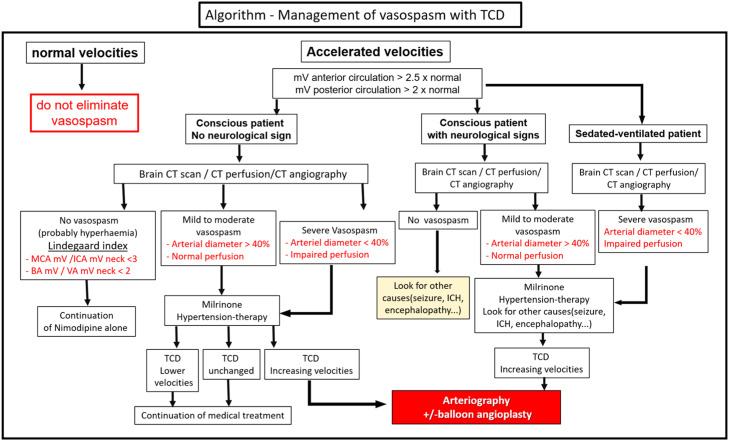
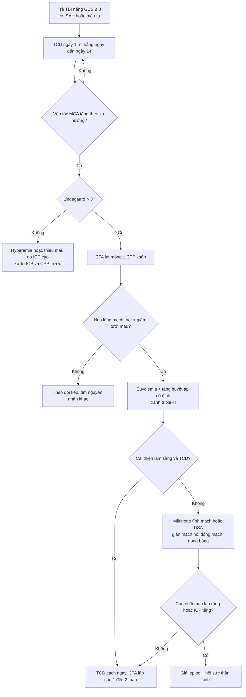
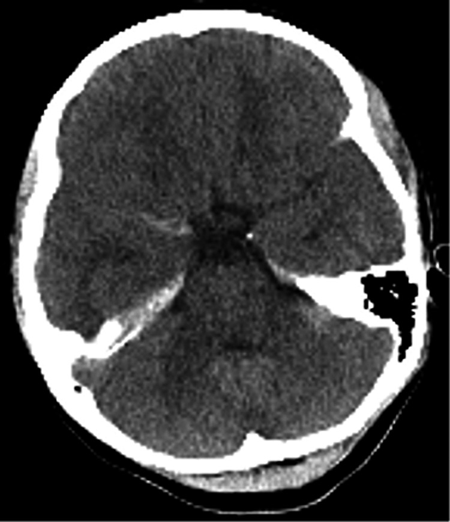
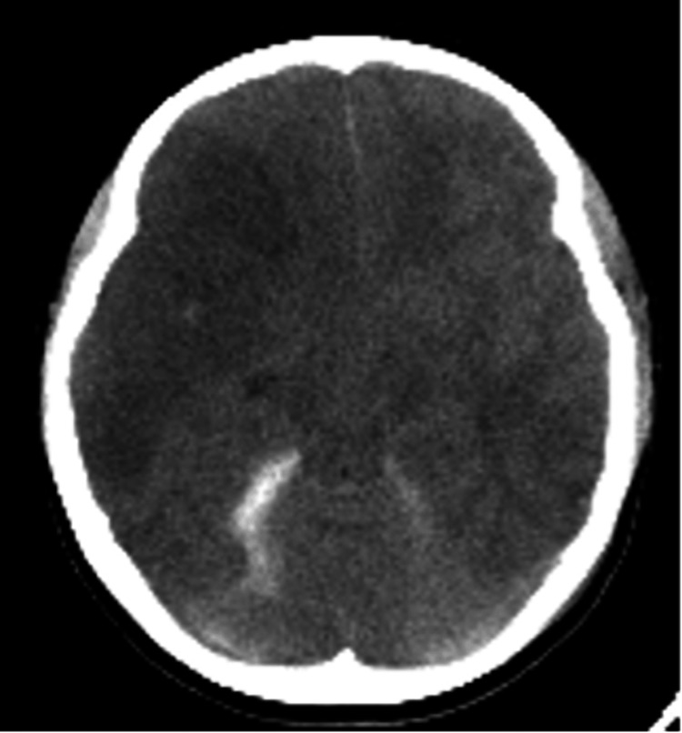
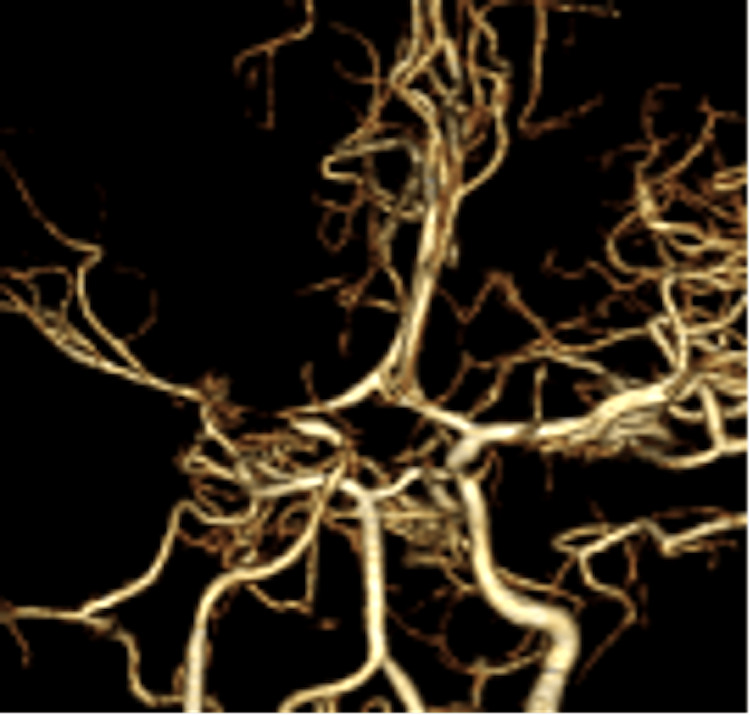
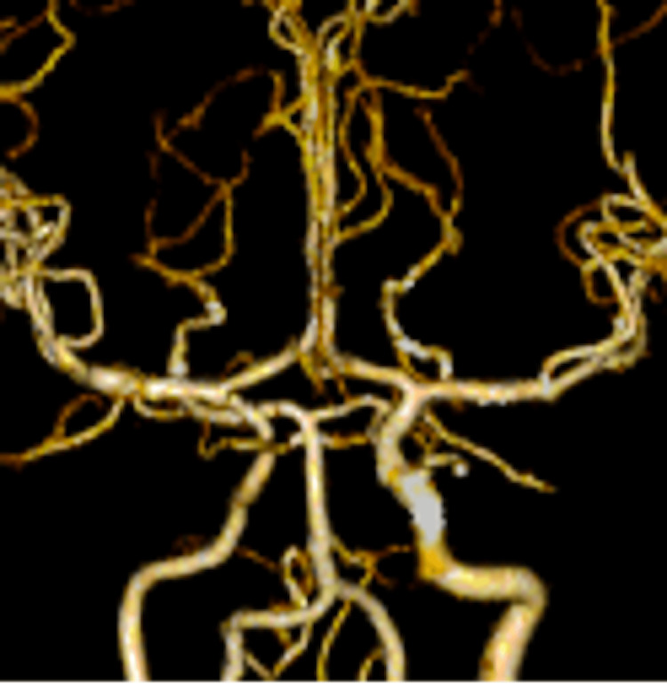

# 239 — Co thắt mạch não sau chấn thương sọ não ở trẻ / Post-traumatic cerebral vasospasm in children

**Tags:** `pattern:co-mach-nao` `vung:nao-nhi` `vung:nao` `protocol:TCD-nao-nhi` `protocol:CTA-nao` `protocol:CTP-nao`
**Mức chắc chắn (certainty):** tổng hợp y văn (literature synthesis) — số liệu lấy từ tổng quan PTV 2025 (PMC12572897), tổng quan co thắt sau tSAH 2026 (PMC13515500), loạt ca nicardipine nội tủy ở trẻ (PMC12149007); ca trong quiz là **ca nguyên văn** 12 tuổi (PMC10944334) giữ đúng mốc ngày – ICP – can thiệp của bài gốc.

> **Bài này là "chuyện sau chẩn đoán" của [653 – PRES & RCVS ở trẻ em](../653-pres-rcvs-tre-em/lesson.md) và [676 – RCVS ở trẻ em: điều trị](../676-rcvs-tre-em-dieu-tri/lesson.md).** 676 dạy phân biệt RCVS với co thắt sau aSAH; bài này dạy thể thứ ba hay bị quên: **co thắt sau chấn thương sọ não (post-traumatic vasospasm, PTV)** — cùng hình ảnh "mạch hẹp", nhưng **mốc thời gian, cơ chế và cách xử trí khác hẳn**.

## 1. Tổng quan — vì sao mạch hẹp sau chấn thương, và vì sao trẻ khó đọc hơn người lớn

- **Định nghĩa:** PTV = **hẹp lòng động mạch não lớn, khởi phát sau chấn thương sọ não (traumatic brain injury, TBI), có thể hồi phục**, gây **thiếu máu não muộn (delayed cerebral ischemia, DCI)**. DCI theo AHA = **suy giảm thần kinh khu trú hoặc giảm ≥ 2 điểm GCS kéo dài ≥ 1 giờ**, không giải thích được bằng nguyên nhân khác.
- **Vì sao mạch hẹp (cơ chế — TẠI SAO hình ảnh trông như vậy):**
  - **Máu trong khoang dưới nhện (traumatic subarachnoid hemorrhage, tSAH):** hồng cầu vỡ giải phóng **oxyhemoglobin** bắt giữ **nitric oxide (NO)** → mất giãn mạch nội mô; tăng **endothelin-1**, IL-6, IL-1β, TNF-α → co cơ trơn thành mạch. Đây là phần **dùng chung với aSAH**.
  - **Cơ học (khác aSAH):** **kéo giãn thành mạch do lực va đập/sóng xung kích (blast)** → co thắt **dù không có máu dưới nhện**. Vì vậy **không thấy tSAH không loại trừ PTV** (37,9% có tSAH so với 31,3% không có, p = 0,34).
  - **lan tỏa vỏ não giảm khử cực (cortical spreading depolarization)** + rối loạn tự điều hòa → nhu cầu oxy tăng trong khi tưới máu không tăng theo.
- **Vì sao TCD thấy "vận tốc tăng" chứ không thấy "mạch hẹp":** theo phương trình liên tục, **vận tốc ∝ lưu lượng / tiết diện lòng mạch**; lòng mạch giảm một nửa đường kính → tiết diện giảm 4 lần → vận tốc tăng ~4 lần nếu lưu lượng giữ nguyên. TCD **không nhìn thấy thành mạch**, chỉ đo vận tốc — nên **tăng vận tốc do tăng lưu lượng (hyperemia) cho hình ảnh y hệt**.
- **Ngưỡng định lượng nằm lòng (đọc bài là phải nhớ số):**
  - **Tỷ lệ mắc PTV:** người lớn **25–60%** TBI; **trẻ em 18–45%**; khác nhau theo công cụ: **TCD 19–68%** so với **chụp mạch 18,6–41%**.
  - **Theo độ nặng ở trẻ (69 trẻ):** **GCS ≤ 8 → 33,5%**; **GCS 9–12 → 8,5%**.
  - **tSAH** có ở **33–60%** chấn thương trung bình–nặng; **DCI sau tSAH ~17%**; DCI nói chung sau TBI **2,1–12%**.
  - **TCD:** **MFV (mean flow velocity) động mạch não giữa > 120 cm/s + Lindegaard > 3** = co thắt **trung bình**; **MFV > 200 cm/s** = **nặng**; **Lindegaard > 6** = nặng; hệ số **thân nền/đốt sống (BA/VA) > 2** = co thắt sau.
  - **CTA** so với DSA: **độ chính xác 90%, dương tính giả 5%, độ nhạy tới 91%, độ đặc hiệu ~95%** (giảm ở mạch xa).
  - **NIRS:** **rSO₂ giảm ≥ 14,7%** so với nền → gợi ý thiếu máu do co thắt; **qEEG** đổi trước suy giảm lâm sàng **> 24 giờ**.
- **Mốc thời gian — chỗ hay đặt sai ngưỡng theo dõi:**
  - **Sau tSAH:** bắt đầu **ngày 1–2**, **đỉnh ngày 5–7** (sớm hơn aSAH).
  - **Sau aSAH:** bắt đầu **ngày 3–5**, hẹp tối đa **ngày 5–14**, hồi phục **2–4 tuần**.
  - **Trẻ em:** PTV thường xuất hiện **2–6 ngày sau chấn thương**, đôi khi **sau ngày thứ 6** → cửa sổ theo dõi phải dài hơn trực giác "vài ngày đầu".
  - **Tuần hoàn trước kéo dài hơn tuần hoàn sau** (cả trẻ và người lớn).
  - **Thể tích máu dưới nhện KHÔNG tương quan với PTV**: thang Fisher **không dùng để tiên đoán** PTV (khác aSAH) — đừng suy từ "máu ít" ra "không co thắt".
- **Vì sao trẻ khác người lớn (3 điểm quyết định cách đọc):**
  1. **Vận tốc dòng nền ở trẻ cao hơn người lớn** → áp ngưỡng người lớn (> 120 cm/s) **chẩn đoán quá tay**; **chưa có giá trị Lindegaard nào được thẩm định ở trẻ**.
  2. **Đồng thuận Delphi về TCD ở hồi sức nhi** khuyến cáo dùng **xu hướng vận tốc theo ngày** hơn là một con số tuyệt đối.
  3. **An thần kéo dài** (chỉ 11% ca TBI ngừng an thần trong 24 giờ đầu) → **mất dấu hiệu lâm sàng**; nhiều ca chỉ lộ ra khi **ICP tăng** hoặc đã **nhồi máu trên CT**.

## 2. Mẫu hình + chẩn đoán phân biệt theo cơ chế và vị trí (Gamut)

**Theo cơ chế khởi phát (3 nhóm — cách phân loại dùng trong tổng quan PTV 2025):**
- **PTV liên quan tSAH:** gần giống aSAH, **sớm hơn** (ngày 1–2, đỉnh 5–7); máu lan **trên lồi não (convexity)** chứ không dồn bể nền.
- **PTV sau máu tụ khác** (đụng dập, máu tụ dưới màng cứng, ngoài màng cứng, máu trong nhu mô): xảy ra **sớm hơn** aSAH.
- **PTV sau chấn thương do sóng xung kích (blast)**: cơ chế **cơ học thuần**, có thể **không có máu dưới nhện**.

**Theo mạch bị ảnh hưởng:** MCA (dễ thấy nhất trên TCD, thân M1 ở độ sâu 45–55 mm) > ICA nội sọ > thân nền; ACA/PCA **kém tin cậy** trên TCD.

**Gamut "mạch hẹp sau chấn thương" — 4 câu hỏi phải trả lời trước khi gọi là PTV:**
1. **Hẹp có thật không?** (ảnh nguồn, hai bên, cùng thì — không chỉ dựng 3D).
2. **Hẹp có hồi phục không?** (chụp lại sau 1–2 tuần là chốt của "co thắt").
3. **Có tăng lưu lượng toàn thể không?** (Lindegaard < 3 = hyperemia, không phải co thắt).
4. **Có nguyên nhân khác gây thiếu máu không?** (ICP cao/CPP thấp, tụt huyết áp, thiếu máu, tắc mạch do chấn thương).

## 3. Bảng so sánh phân biệt (ma trận đối chiếu)

| Thực thể (entity) | Hình ảnh điển hình | Chốt vào (rule-in) | Chốt loại (rule-out) | Gợi ý xác nhận |
|---|---|---|---|---|
| **PTV sau tSAH** | Hẹp từng đoạn MCA/ICA, **khởi phát ngày 1–2, đỉnh ngày 5–7**, máu trên lồi não, có thể kèm nhồi máu theo lãnh thổ muộn | **TCD tăng vận tốc theo xu hướng + Lindegaard > 3 + CTA hẹp + hồi phục khi chụp lại** | Hẹp **không đổi** sau 2–4 tuần → nghĩ xơ vữa/bóc tách, không phải co thắt | TCD hằng ngày ngày 1–14; CTA/CTP khi vận tốc tăng; DSA là chuẩn |
| **PTV sau máu tụ khác** (đụng dập, SDH, EDH) | Hẹp **sớm hơn**, cùng bên khối máu tụ hoặc lan tỏa; ổ nhồi máu muộn | **Khối máu tụ + hẹp cùng bên + không có bể nền dày** | Không hẹp khi chụp lại, vận tốc bình thường → loại | CTA mạch máu + MRI/DWI nhu mô |
| **Hyperemia sau TBI** | Vận tốc **tăng đều cả trong lẫn ngoài sọ**, mạch **không hẹp** trên CTA, não **phù/tăng tưới** | **Lindegaard < 3 + CTA lòng mạch bình thường** | **Lindegaard > 3 + hẹp lòng thật** → không phải hyperemia | TCD + CTA cùng ngày; theo dõi ICP |
| **Thiếu máu do ICP cao/CPP thấp** | Nhồi máu **lan tỏa hoặc theo vùng ranh giới (watershed)**, mạch **không hẹp** | **ICP tăng + CPP = MAP − ICP thấp (ca dưới: ICP 40 → CPP 30) + hạ huyết áp** | Có hẹp lòng khu trú + vận tốc tăng → phải xét co thắt phối hợp | Monitor ICP/CPP; CTP; đáp ứng với nâng huyết áp |
| **Co thắt sau aSAH** | Hẹp **bể nền**, khởi phát **ngày 3–5**, đỉnh **5–14**, có **túi phình** | **Túi phình + máu bể nền (modified Fisher cao) + mốc ngày 4–14** | Không có phình + máu chỉ trên lồi não → nghĩ PTV | CTA/DSA; điểm modified Fisher |
| **RCVS** | "Chuỗi hạt" **nhiều ổ, không theo lãnh thổ**, **hồi phục < 12 tuần** | **Đau đầu sét đánh tái diễn ≥ 3 cơn + không chấn thương + hồi phục** | **Có chấn thương + khởi phát trong 48 giờ + sedated** → PTV | MRA/CTA lặp; RCVS2 ≥ 5 |
| **Bóc tách/giả phình do chấn thương** | Hẹp **hình nón/đuôi chuột**, **lưỡi nội mạc/hai lòng**, giả phình **giữ hình** khi chụp lại | **Vạt nội mạc + giả phình + không hồi phục** | Hẹp trơn đều, hồi phục → co thắt | CTA lát mỏng 0,6–1 mm; DSA; HR-vwMRI |
| **Giả hẹp do dựng ảnh/artifact** | Hẹp **chỉ trên ảnh dựng 3D (VR/MIP)**, mất khi xem ảnh nguồn; tại chỗ chia nhánh | **Ảnh nguồn bình thường + hai bên đối xứng** | **Hẹp thấy trên ảnh nguồn + trên ≥ 2 kỹ thuật** → thật | Luôn đọc ảnh nguồn; so MIP với MPR |

*Sơ đồ gợi ý của tổng quan PTV 2025: từ vận tốc bình thường (**không loại trừ co thắt**) → vận tốc tăng → phân nhánh theo **Lindegaard**, **triệu chứng**, **đường kính mạch trên CTA** → milrinone/kiểm soát huyết áp → DSA ± nong bóng. Giấy phép CC BY-NC-ND 4.0, giữ nguyên bản.*

## 4. Protocol chụp + hệ phân độ và ngưỡng điều trị

**Theo dõi (protocol):**
- **TCD:** đặt từ **ngày 1**, lặp **hằng ngày (hoặc cách ngày) đến ngày 14** ở trẻ **GCS ≤ 8** hoặc có **tSAH/máu tụ ngoài trục**; ghi **MFV, PSV, chỉ số mạch đập (PI), Lindegaard**, và **xu hướng** (quan trọng hơn trị số tuyệt đối ở trẻ).
- **CTA:** lát **0,625–1 mm**, từ nền sọ đến đỉnh; chụp khi **TCD tăng theo xu hướng**, **GCS giảm không giải thích**, **ICP tăng**, hoặc trước khi quyết định can thiệp. **CTA ngày đầu bình thường KHÔNG loại trừ** — phải chụp lại.
- **CT tưới máu (CTP):** phân biệt **co thắt còn bù (Tmax kéo dài, CBV bình thường)** với **nhồi máu đã hình thành (CBV giảm)** — quyết định có can thiệp hay không.
- **DSA:** chuẩn tham chiếu, và **điều trị được luôn** (giãn mạch nội động mạch, nong bóng).
- **Theo dõi bổ trợ:** **NIRS** (rSO₂ giảm ≥ 14,7%), **qEEG** (mất biến thiên alpha, giảm tỉ lệ alpha/delta trước lâm sàng > 24 giờ), **PbtO₂** khi có đầu dò.

**Điều trị (ngưỡng và con số):**
- **Không dùng triple-H** (tăng thể tích–tăng huyết áp–pha loãng máu): làm nặng **phù não** ở TBI; chỉ giữ **đủ thể tích (euvolemia) + tăng huyết áp có đích**.
- **Nimodipine:** chuẩn ở aSAH (**21 ngày**), nhưng ở **tSAH bằng chứng trái chiều**: gộp **4 thử nghiệm, 1.074 bệnh nhân** → kết cục xấu **39% so với 40%** (OR 0,88; 95% CI 0,51–1,54), tử vong **26% so với 27%** (OR 0,95; 0,71–1,26); **HIT 4 (n = 577) âm tính**. Tác hại chính: **tụt huyết áp** làm giảm CPP.
- **Milrinone (ức chế PDE3):** nội động mạch **8 mg/động mạch** → đường kính mạch tăng **53% ± 37%**; liều **5 mg/động mạch** (1/14 ca cần lặp); truyền tĩnh mạch trong loạt 94 ca aSAH giảm nhu cầu nong bóng.
- **Nimodipine + milrinone tĩnh mạch** so với nimodipine + triple-H (RCT **n = 30**, tSAH nhẹ–trung bình): **oxy hóa não tốt hơn, GCS ngày 14 cao hơn, thời gian ICU/viện ngắn hơn** — nhưng cỡ mẫu nhỏ, chưa đủ để thành chuẩn.
- **Nicardipine nội tủy (off-label, loạt ca nhi):** **4 mg mỗi 8 giờ × 5 ngày** qua EVD ở 3 bệnh nhân **16–17 tuổi** (SAH **không do chấn thương**); vận tốc đỉnh MCA giảm trung bình **−144 cm/s** (trung vị −82; ca nặng nhất **414 → 124 cm/s**), không ca nào ICP > 20 cm H₂O. **Đây là báo cáo ca, không phải chuẩn.**
- **Block hạch sao (stellate ganglion block):** **C6–C7**, dưới siêu âm, bupivacaine/ropivacaine; tác dụng **12–24 giờ**; bằng chứng chỉ từ nghiên cứu nhỏ **n = 15 và 20** ở aSAH.
- **Giải ép sọ** khi có **nhồi máu lan rộng + ICP tăng** (ca dưới đây mổ giải ép **2 lần**: ngày 7 bên phải, ngày 8 bên trái).

## 5. Biến thể bình thường và cạm bẫy

- **"Không thấy gì trên CTA ngày đầu" là cạm bẫy chết người:** ca dưới đây chụp **CTA ngày 2 hoàn toàn bình thường**, đến **ngày 9** mới lộ **hẹp nặng MCA phải** — trong khi **nhồi máu đã có từ ngày 7**. Co thắt là **quá trình động**, không phải ảnh tĩnh.
- **Nhồi máu trên CT không đồng nghĩa với co thắt:** nhồi máu là **hậu quả**; phải chứng minh **hẹp lòng mạch** trước khi gọi PTV. Trong ca dưới, **ICP 40 mmHg và CPP 30 mmHg** cũng đủ gây nhồi máu — hai cơ chế **cộng hưởng**.
- **Đừng suy từ "máu dưới nhện ít" ra "không co thắt":** Fisher **không** tiên đoán PTV; PTV xảy ra cả khi **không có tSAH**.
- **Hyperemia ở trẻ bị gọi nhầm là co thắt:** trẻ có vận tốc nền cao; nếu **Lindegaard < 3** và **CTA lòng mạch bình thường** → không phải co thắt. Không tăng liều thuốc giãn mạch chỉ vì "vận tốc 130 cm/s".
- **Ảnh dựng 3D (VR/MIP) tạo hẹp giả** tại chỗ chia nhánh và chỗ mạch đi vuông góc mặt cắt — luôn **đọc ảnh nguồn (MPR)** và so **hai bên** trước khi kết luận.
- **An thần che dấu:** khi bệnh nhân **sedated**, dấu hiệu duy nhất có thể là **ICP tăng** — đừng chờ "liệt nửa người".
- **TCD bình thường không loại trừ** (cửa sổ xương kém, mạch xa, vận tốc giảm vì CPP thấp): dùng **xu hướng** + CTA/CTP khi nghi ngờ.
- **Không áp Lindegaard của người lớn cho trẻ như một ngưỡng chốt** — chưa được thẩm định; dùng như **xu hướng phụ trợ**.

## 6. Tự lượng giá — Blind Quiz

**Ca 1 — Bé gái 12 tuổi, tai nạn xe đạp, GCS 3, đồng tử giãn. CT sọ ngày 1:**

- Gợi ý lâm sàng: **GCS 3**, huyết áp **140/50 mmHg**, ICP ban đầu **4 mmHg**.
- Câu hỏi: (1) Mô tả tổn thương chính? (2) Có dấu hiệu nào của **co thắt mạch** trên phim này không? (3) Nguy cơ nào phải theo dõi trong 1–2 tuần tới?

<b>Bấm để hiện đáp án (findings + chẩn đoán)</b>

- **Dấu hiệu:** đụng dập thùy thái dương phải, **máu tụ dưới màng cứng cạnh lều**, **máu dưới nhện trong rãnh Sylvius**; **không** máu trong nhu mô, **không** phù não lúc này.
- **Không có dấu hiệu co thắt** trên CT không cản quang — co thắt **không thấy được** nếu không chụp mạch (CTA/MRA/DSA) hoặc TCD.
- **Nguy cơ:** với **GCS ≤ 8**, tỷ lệ PTV ở trẻ **~33,5%** (so với **8,5%** ở GCS 9–12); đỉnh **ngày 5–7**. Phải **TCD hằng ngày** và **chụp mạch lặp** nếu có dấu hiệu.
- Nguồn ảnh: Tanikawa D et al., Cureus 2024, **PMC10944334**, Fig. 1, CC BY 4.0.

**Ca 2 — Cùng bệnh nhân, ngày 7: ICP tăng vọt 40 mmHg. CT sọ:**

- Câu hỏi: (1) Vùng giảm tỷ trọng nằm ở lãnh thổ nào? (2) Vì sao **ICP tăng** lại là dấu hiệu của biến chứng mạch máu? (3) Tính CPP và nêu 2 nguyên nhân gây nhồi máu ở ca này.

<b>Bấm để hiện đáp án</b>

- **Dấu hiệu:** giảm tỷ trọng **lan rộng lãnh thổ động mạch não giữa (MCA) phải** + vùng hồi thẳng trái → **nhồi máu**.
- **ICP tăng là dấu hiệu gián tiếp:** bệnh nhân **sedated, GCS 3** → không có dấu hiệu thần kinh khu trú; **phù do nhồi máu** làm ICP tăng. Trong bài gốc, **ICP 40 mmHg**, **CPP = MAP − ICP = 30 mmHg**.
- **Hai nguyên nhân cộng hưởng:** (a) **co thắt mạch** (chứng minh bằng CTA ngày 9); (b) **giảm áp lực tưới máu** do ICP cao/CPP thấp. Vì vậy **không được quy hết cho co thắt** rồi bỏ qua kiểm soát ICP.
- Nguồn ảnh: Tanikawa D et al., Cureus 2024, **PMC10944334**, Fig. 3, CC BY 4.0.

**Ca 3 — Ngày 9 và ngày 29: hai lần CTA dựng 3D, cùng bệnh nhân.**

- Câu hỏi: (1) So sánh hai ảnh — bên nào hẹp, đoạn nào? (2) Dấu hiệu này **chốt** điều gì? (3) Nếu bệnh nhân chỉ được chụp **một lần** vào ngày 29, kết luận nào sẽ SAI?

<b>Bấm để hiện đáp án</b>

- **Ngày 9:** **hẹp nặng MCA phải** (đoạn M1–M2) — nhánh mạch mất dần tín hiệu so với bên đối diện. **Ngày 29:** MCA phải **gần như trở lại bình thường**.
- **Chốt:** đây là **hẹp CÓ HỒI PHỤC** → xác lập bản chất **co thắt (spasm)**, không phải xơ vữa/bóc tách (những thứ **không tự mở** trong 20 ngày).
- **Nếu chỉ chụp ngày 29:** sẽ thấy mạch **bình thường** và **kết luận sai là "không có co thắt"** — dù bệnh nhân đã **nhồi máu não** vì nó. Bài học: **một lần chụp âm không loại trừ PTV**.
- Nguồn ảnh: Tanikawa D et al., Cureus 2024, **PMC10944334**, Fig. 7 và Fig. 8, CC BY 4.0.

> **Phản biện (critique):** ca này **không chứng minh nhân quả tuyệt đối** giữa co thắt và nhồi máu — vì **ICP 40/CPP 30** cùng tồn tại; bài gốc cũng thừa nhận điều đó. Giá trị của ca nằm ở **chuỗi thời gian**: CTA ngày 2 âm → nhồi máu ngày 7 → hẹp nặng ngày 9 → hồi phục ngày 29, tức **co thắt thật và muộn hơn trực giác**.

## Bài liên quan chéo
- [200 – Tổng quan Hệ Thần kinh](../200-tong-quan-he-than-kinh/lesson.md)
- [234 – Tăng áp lực nội sọ & theo dõi đa phương thức ở trẻ TBI](../234-tang-ap-luc-noi-so-theo-doi-da-phuong-thuc-nhi/lesson.md)
- [224 – Chấn thương sọ não ở trẻ: Marshall, tSAH, DAI](../224-chan-thuong-so-nao-nhi/lesson.md)
- [231 – Tổn thương mạch máu não do chấn thương (BCVI) & vỡ sọ tiến triển](../231-ton-thuong-mach-mau-nao-chan-thuong-va-vo-so-tien-trien/lesson.md)
- [653 – PRES & RCVS ở trẻ em](../653-pres-rcvs-tre-em/lesson.md)
- [676 – RCVS ở trẻ em: điều trị & theo dõi](../676-rcvs-tre-em-dieu-tri/lesson.md)
- [219 – PRES & RCVS (người lớn)](../219-pres-rcvs/lesson.md)
- [212 – Xuất huyết nội sọ & diễn tiến hemoglobin](../212-xuat-huyet-so-nao/lesson.md)

> Không dùng để chẩn đoán độc lập khi chưa có người hướng dẫn.
