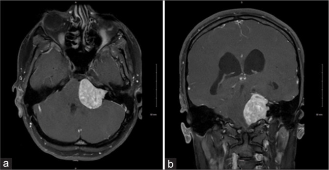
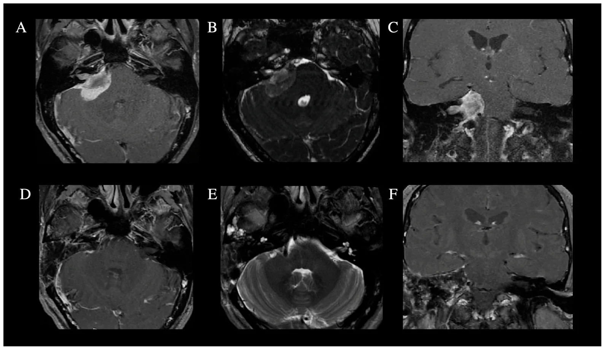
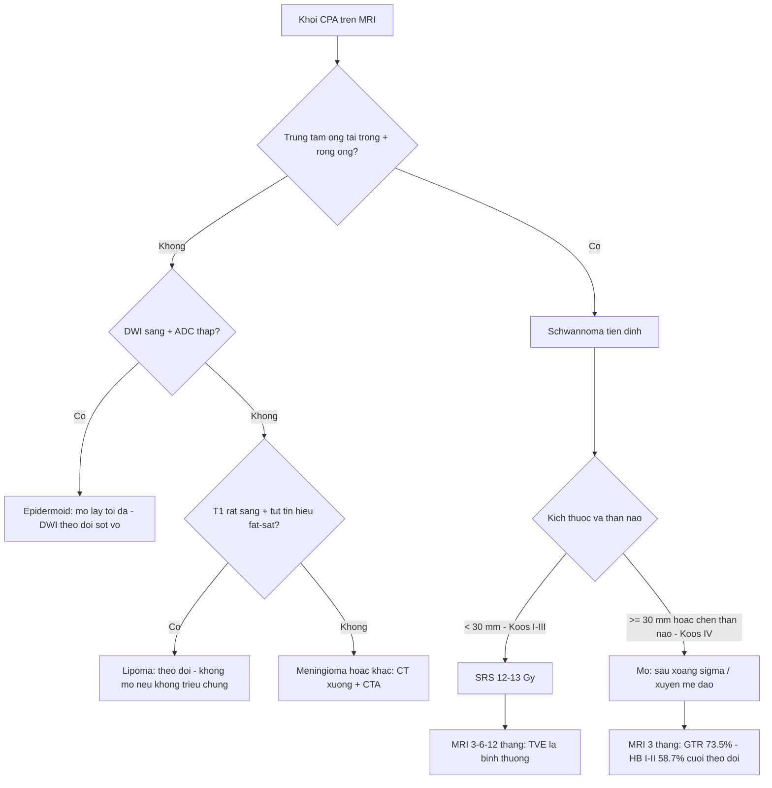
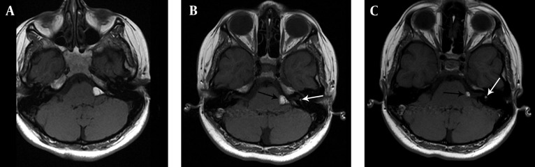
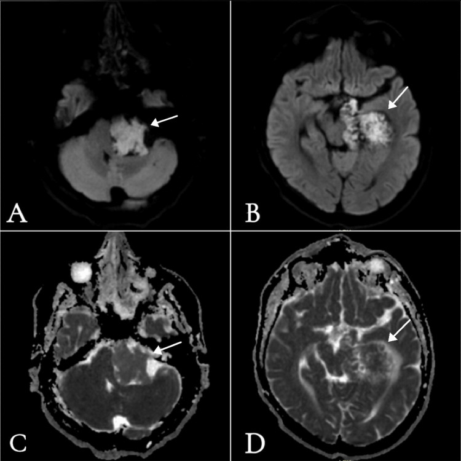

# 240 — Phân độ Hannover & chọn SRS hay mổ schwannoma tiền đình + khối CPA ít gặp / Hannover grading and SRS vs microsurgery for vestibular schwannoma and uncommon CPA masses

**Tags:** `pattern:ngoai-truc-CPA` `vung:goc-cau-tieu-nao` `score:Hannover` `score:Koos` `protocol:MRI-CISS-DWI` `protocol:SRS`
**Mức chắc chắn (certainty):** tổng hợp y văn (literature synthesis) — số liệu từ 4 nghiên cứu mở 2024–2026 (PMC13447026, PMC13380556, PMC13607616, PMC13124958) + ca minh họa; chưa có ca nguyên văn của nhóm.

## 1. Tổng quan — từ "khối CPA" đến "chọn đường điều trị"

- **Bệnh học:** schwannoma tiền đình (vestibular schwannoma, VS) xuất phát từ **tế bào Schwann nhánh tiền đình dây VIII**, thường ở **vùng chuyển tiếp thần kinh đệm–Schwann (Obersteiner)** trong ống tai trong → lớn dần ra góc cầu-tiểu não. VS chiếm **80–90% u CPA**; tỷ lệ mới mắc **3–5,2/100.000 người-năm**; tốc độ lớn trung bình **1–2 mm/năm** (đa số chậm, một số không lớn).
- **TẠI SAO hình ảnh quyết định:** triệu chứng (điếc một bên, ù tai, chóng mặt) không tương quan kích thước; **vị trí trong ống tai trong, mức chạm/chèn thân não, thể tích** mới quyết định SRS hay mổ. Phân độ **Hannover (Samii)** và **Koos** là ngôn ngữ chung để so kết cục.
- **TẠI SAO tín hiệu MRI như vậy:** VS là mô đặc tế bào → **T1 đồng/tối nhẹ so với nhu mô não, T2 sáng vừa**, ngấm thuốc **mạnh và đồng nhất** (trừ thể nang/hoại tử); không hạn chế khuếch tán (DWI không sáng như epidermoid). **Rộng ống tai trong** + khối "kem ốc quế" (ice-cream cone) là dấu hiệu định vị.
- **TẠI SAO SRS kiểm soát u:** bức xạ gây tổn thương DNA tế bào Schwann → ngừng phân chia; **thể tích không giảm ngay**, thường **phình nhẹ 1–3 mm trong 6–18 tháng đầu** (pseudoprogression/TVE — tumor volume expansion) rồi teo dần. Vì vậy **không đánh giá thất bại sớm bằng kích thước**.
- **Ngưỡng định lượng cốt lõi:**
  - **Hannover T1** trong ống tai trong; **T2** lan CPA **≤ 20 mm**; **T3** **> 20 mm** chạm thân não; **T4** chèn ép thân não — **T4a** chèn ép **không** chèn não thất IV, **T4b** đẩy lệch thân não **+ chèn não thất IV** (định nghĩa vận hành theo Shawarba 2026, dựa trên Hannover).
  - **Koos I** trong ống tai; **II–III** vào CPA, chạm thân não; **IV** chèn/đẩy thân não.
  - **SRS** chọn khi u **< 30 mm** (Koos I–III), liều biên **12–13 Gy**; **mổ** khi **≥ 30 mm**, chèn thân não có triệu chứng, thể nang lớn, hoặc u lớn gây não úng thủy.

## 2. Mẫu hình + chẩn đoán phân biệt theo khoang (gamut)

- **Trung tâm ống tai trong (IAC):** VS (phổ biến nhất, làm rộng ống), schwannoma dây VII, meningioma lan vào ống, lipoma trong ống.
- **Bể CPA (cistern):** **epidermoid** (thứ ba sau VS/meningioma, ~40% u epidermoid nội sọ nằm ở CPA), **nang màng nhện**, meningioma mặt sau xương đá, schwannoma dây V/IX–XI.
- **CPA + xương:** meningioma **dày xương (hyperostosis)**, di căn xương đá, chondrosarcoma, cholesteatoma bẩm sinh.
- **Mạch máu:** phình/giả phình động mạch thân nền–động mạch tiểu não, AVM/dAVF màng cứng, **động mạch lạc chỗ (vascular loop)** chèn dây VII (co giật nửa mặt).
- **Theo bối cảnh:** **NF2** → VS hai bên + schwannoma dây khác + meningioma (đừng dừng sau khi thấy u đầu tiên); trẻ em → schwannoma "phổ nhi" thường lớn, có thể liên quan NF2 (ca Koos IV dưới đây).

## 3. Bảng so sánh phân biệt (ma trận đối chiếu)

| Thực thể (entity) | Hình ảnh điển hình | Chốt vào (rule-in) | Chốt loại (rule-out) | Gợi ý xác nhận |
|---|---|---|---|---|
| Schwannoma tiền đình (VS) | Khối **trung tâm ống tai trong**, làm **rộng ống**, "kem ốc quế"; T1 đồng/tối, T2 sáng vừa, ngấm **mạnh đồng nhất**; thể lớn có nang | **Rộng ống tai trong + khối từ ống lan ra + ngấm mạnh** | Đuôi màng cứng rộng, dày xương, không rộng ống → meningioma | MRI T1CE lát mỏng ≤ 3 mm + CISS/FIESTA; theo dõi 6–12 tháng |
| Meningioma mặt sau xương đá | **Bám màng cứng rộng**, **đuôi màng cứng**, dày xương, vôi hóa; T2 đồng, ngấm đồng nhất; **ống tai trong không rộng** (nhưng có thể lan vào) | **Đuôi màng cứng + dày xương + bờ rộng nền** | Rộng ống tai + khối trong ống → VS | CT xương đá; MRI T1CE; **không sinh thiết mù** trước khi đánh giá mạch |
| Epidermoid CPA | Giống DNT trên T1/T2, **bờ múi khế (festooned)**, bọc quanh dây thần kinh/mạch; **DWI sáng, ADC thấp** | **DWI sáng + ADC thấp so với DNT** (ADC epidermoid ~1,20–1,32 × 10⁻³ mm²/s) | ADC bằng DNT + không hạn chế → nang màng nhện | DWI + ADC; CT thấy mòn xương mỏng |
| Lipoma CPA | **T1 rất sáng**, **mất tín hiệu khi fat-sat**, không ngấm; CT **−100 đến −182 HU** | **T1 sáng + tụt tín hiệu fat-sat + HU âm** | T1 sáng không tụt fat-sat → máu/melanin/dermoid | CT không cản quang + MRI T1 fat-sat |
| Nang màng nhện | Giống DNT **mọi chuỗi xung**, không ngấm, **DWI tối**, đè xương mỏng | **Theo DNT tuyệt đối + DWI không sáng + không ngấm** | DWI sáng → epidermoid | MRI + CT; theo dõi nếu không chèn ép |
| Di căn/ phình mạch CPA | Di căn: phù não rộng, phá xương, ngấm không đều; phình: **flow void**, vôi hóa viền, đau/SAH | **Phù não + phá xương** (di căn); **flow void + đau đột ngột** (phình) | Bờ nhẵn, không phù, không flow void → u lành | CTA/MRA trước mọi can thiệp; PET/CT nếu nghi di căn |

*Schwannoma tiền đình trái **Koos IV** (a: axial, b: coronal T1 sau tiêm): khối lớn ngấm thuốc, **chèn ép thân não**, làm mất góc cầu-tiểu não — đây là nhóm **mổ là ưu tiên**, không phải SRS đơn thuần. Nguồn: Garner R et al., Surg Neurol Int 2026, PMC13157902 Fig. 1, CC BY-NC-SA 4.0.*

*Meningioma mặt sau xương đá: (A–C) trước mổ — khối bám màng cứng, **đuôi màng cứng dọc xương đá**, lan vào ống tai trong; (D–F) sau mổ đường xuyên mê đạo. Khác VS: **bờ rộng nền, không lấy ống tai trong làm tâm**. Nguồn: Erginoglu U et al., Cancers (Basel) 2026, PMC13564978 Fig. 2, CC BY 4.0.*

## 4. Protocol chụp + phân độ + quyết định SRS hay mổ

**Protocol MRI (1,5–3 T):**
- **T1 sau tiêm lát mỏng ≤ 3 mm** (khảo sát ống tai trong + toàn u), **T2 3D nặng T2 (CISS/FIESTA/DRIVE)** để thấy dây VII–VIII, mạch, khe DNT; **DWI + ADC** bắt buộc khi nghi epidermoid/nang; **FLAIR** để loại nang màng nhện; **CT xương đá** khi nghi meningioma/dày xương/ phình vôi hóa.
- **Đo:** đường kính lớn nhất **mm** (phần ngoài ống), **thể tích cm³** (công thức ellipsoid) — vì thể tích dự báo kiểm soát tốt hơn đường kính; ghi **vị trí so với thân não và não thất IV**.

**Phân độ Hannover (Samii) — dùng để chọn đường:**

| Hannover | Định nghĩa | Thái độ |
|---|---|---|
| T1 | Hoàn toàn trong ống tai trong | Theo dõi / SRS nếu tiến triển |
| T2 | Lan CPA **≤ 20 mm**, chưa chạm thân não | SRS hoặc theo dõi |
| T3 | **> 20 mm**, chạm thân não, chưa chèn ép | SRS nếu **< 30 mm**; mổ nếu lớn/nang |
| T4a | Chèn ép thân não, **không** chèn não thất IV | Mổ (hoặc SRS chọn lọc nếu < 30 mm) |
| T4b | Đẩy lệch thân não **+ chèn não thất IV** | **Mổ**; đánh giá não úng thủy trước |

**Kết cục SRS (160 bệnh nhân, liều biên 12–13 Gy, theo dõi trung vị 96 tháng):**

| Nhóm | Kiểm soát u | PFS 10 năm | Giữ thính lực 5 năm (GR I–II) | Liệt dây V mới | Não úng thủy cần shunt |
|---|---|---|---|---|---|
| Koos I (n=20) | 100% | 100% | **91,7%** | 0% | 0% |
| Koos II–III (n=107) | 98,9% | 97,4% | **36,0%** | 0,9% | 5,6% |
| Koos IV (n=33) | 96,6% | 96,6% | **53,6%** | 6,1% | **27,3%** |

- **SRS:** kiểm soát tổng **98,1%**; **TVE (phình giả) 45,0% / 95,3% / 75,8%** theo Koos I / II–III / IV → **không chụp lại quá sớm để "bắt" thất bại**; lịch **3–6–12 tháng, sau đó hằng năm**; liều biên **12–13 Gy**, hạn chế liều ốc tai/thân não.
- **Mổ (Koos IV, 139 bệnh nhân, đường sau xoang sigma):** đường kính ngoài ống trung bình **33,6 ± 6,1 mm**; **GTR 73,5%**, bán phần 25,0%, một phần 1,5%; **dây VII tốt (HB I–II) cuối theo dõi 58,7%** (ngay sau mổ chỉ 36,0% — nhiều ca hồi phục); **rò DNT 4,3%**, liệt dây VI 2,9%; thính lực: điếc hoàn toàn tăng từ 13,0% lên **57,3%**.
- **Chọn đường mổ:** sau xoang sigma (giữ thính lực, u mặt sau ống tai), xuyên mê đạo (thính lực không dùng được, u lan vào ống), hố sọ giữa (u nhỏ trong ống, giữ thính lực); giám sát **EMG dây VII + ABR** trong mổ.

## 5. Biến thể bình thường và cạm bẫy

- **TVE sau SRS (pseudoprogression):** u **to lên 1–3 mm trong 6–18 tháng** là phản ứng viêm/hoại tử, gặp tới **95,3%** ở Koos II–III → **không mổ lại/cấy lại ngay**; chờ 12–24 tháng, đánh giá thể tích.
- **VS thể nang vs epidermoid:** cả hai có T1 tối/T2 sáng; **chỉ DWI/ADC phân biệt** (epidermoid sáng, ADC ~1,2 × 10⁻³; VS không hạn chế). Cắt nhầm epidermoid bằng đường mổ u đặc → sót vỏ, viêm màng vô khuẩn.
- **Lipoma CPA:** T1 sáng dễ nhầm máu/melanin/dermoid; **fat-sat + CT HU âm** là chốt. **Không sinh thiết/cắt** lipoma không triệu chứng (dính dây thần kinh, nguy cơ tổn thương).
- **Bất đối xứng ống tai trong:** ngấm nhẹ dây thần kinh trong ống có thể bình thường; luôn so bên đối diện và tìm **dấu hiệu phối hợp** (rộng ống, khối kèm theo, mất cân xứng dịch trong ống) trước khi gọi bệnh lý.
- **Meningioma lan vào ống tai trong:** 57,1% ca meningioma mặt sau xương đá có lan ống — đừng chỉ dựa "rộng ống = VS"; tìm **đuôi màng cứng, dày xương, bờ rộng**.
- **Sót u thứ hai ở NF2:** thấy VS một bên vẫn phải quét **toàn bộ trục thần kinh** (VS đối diện, schwannoma dây V, meningioma, ependymoma) — lỗi "satisfaction of search" điển hình.
- **Ngấm sau mổ:** nốt ngấm viền ở hố mổ 3–6 tháng đầu thường là mô xơ/viêm, không phải sót u; so sánh T1CE + T2, chờ 6–12 tháng.

## 6. Tự lượng giá — Blind Quiz

**Ca 1 — Nam 20 tuổi, điếc trái 1 năm, ù tai, mất thăng bằng khi đi tối. MRI dưới.**

- Gợi ý: không có bệnh da, không nghe kém bên phải.
- Câu hỏi: Khối ở đâu, kích thước tương đối? Hannover/Koos mấy? Vì sao không chọn SRS đơn thuần?

<b>Bấm để hiện đáp án (findings + chẩn đoán)</b>

- Dấu hiệu: khối lớn **trung tâm ống tai trong trái**, lan rộng ra bể CPA, ngấm thuốc mạnh, **chèn ép và đẩy lệch thân não**; không thấy đuôi màng cứng.
- Chẩn đoán: **schwannoma tiền đình Koos IV** (tương ứng Hannover T4a–T4b); nhóm này **mổ** là ưu tiên vì chèn thân não, nguy cơ não úng thủy (**27,3%** sau SRS ở Koos IV).
- Vì sao: SRS hiệu quả kiểm soát u (**96,6%** ở Koos IV) nhưng không giải ép thân não và nguy cơ não úng thủy/phù nề cao; mổ cho **GTR 73,5%**, dây VII tốt **58,7%** cuối theo dõi.
- Nguồn ảnh: Garner R et al., Surg Neurol Int 2026, PMC13157902 Fig. 1, CC BY-NC-SA 4.0.

**Ca 2 — Nữ 45 tuổi, tình cờ phát hiện khối CPA trái, không triệu chứng. MRI T1 không cản quang (A–C).**

- Câu hỏi: Tín hiệu T1 nói gì? Cần thêm chuỗi xung/CT nào để chốt? Có nên mổ?

<b>Bấm để hiện đáp án (findings + chẩn đoán)</b>

- Dấu hiệu: **khối T1 rất sáng** ở CPA và trong ống tai trong trái (mũi tên), bờ đa cung; không có phù não.
- Chẩn đoán: **lipoma CPA/trong ống tai** — chốt bằng **fat-sat (tín hiệu tụt)** và **CT: −100 đến −182 HU**. Không phải máu (không có vòng hemoglobin), không phải dermoid (không có thành phần nang/mỡ hỗn hợp điển hình).
- Xử trí: **theo dõi** nếu không triệu chứng; mổ chỉ khi chèn ép/dây VII–VIII nặng vì lipoma dính thần kinh.
- Nguồn ảnh: Buyukkaya R et al., Iran J Radiol 2014, PMC4090636 Fig. 2, CC BY 4.0.

**Ca 3 — Nam 35 tuổi, điếc trái tiến triển 1 năm, không ù tai. MRI có DWI/ADC (A–D).**

- Câu hỏi: Vì sao DWI sáng? Phân biệt với nang màng nhện và VS? Điều trị khác gì?

<b>Bấm để hiện đáp án (findings + chẩn đoán)</b>

- Dấu hiệu: khối CPA trái **DWI sáng rực** (A, B) và **ADC thấp** (C, D) so với DNT; T1/T2 giống dịch, bờ múi khế, bọc quanh mạch.
- Chẩn đoán: **epidermoid CPA** — chất sừng/cholesterol hạn chế khuếch tán; ADC ~**1,20 × 10⁻³ mm²/s** (SS-EPI) thấp hơn DNT (~3 × 10⁻³).
- Điều trị: **mổ lấy tối đa vỏ** (không đáp ứng xạ/hoá); sót vỏ → tái phát + viêm màng vô khuẩn; theo dõi DWI sau mổ.
- Cạm bẫy: DWI sáng một phần do **T2 shine-through**, nên luôn đọc kèm ADC, không chỉ nhìn DWI.
- Nguồn ảnh: Alosaimi A et al., Cureus 2025, PMC12186845 Fig. 2, CC BY 4.0.

**Ca 4 — Bệnh nhân VS 18 mm, Koos II, thính lực còn tốt, được SRS 13 Gy. 9 tháng sau MRI thấy u to thêm 2 mm.**

<b>Bấm để hiện đáp án (findings + chẩn đoán)</b>

- Chẩn đoán: **TVE sau SRS (pseudoprogression)**, không phải thất bại — gặp tới **95,3%** ở Koos II–III; đỉnh 6–18 tháng.
- Xử trí: **theo dõi tiếp 6–12 tháng** bằng MRI thể tích; chỉ can thiệp khi u tiếp tục lớn **sau 18–24 tháng** hoặc xuất hiện triệu chứng mới.
- Vì sao: SRS không làm u teo ngay; kiểm soát 10 năm **97,4%** ở nhóm này.

## Bài liên quan chéo
- [217 – Ngoài trục & góc cầu-tiểu não: meningioma, schwannoma, epidermoid](../217-ngoai-truc-CPA/lesson.md)
- [235 – Xương thái dương & xoang](../235-xuong-thai-duong-xoang/lesson.md)
- [216 – Dị dạng mạch CVST](../216-di-dang-mach-CVST/lesson.md)
- [213 – U não](../213-u-nao/lesson.md)
- [377 – U thần kinh đám rối & MPNST trong NF1](../377-u-than-kinh-dang-dam-roi-va-mpnst-nf1/lesson.md)
- [200 – Tổng quan hệ Thần kinh](../200-tong-quan-he-than-kinh/lesson.md)

## Ảnh
- 4 ảnh trong `images/`, nguồn + giấy phép từng ảnh ở `images/CREDITS.md`.
- Không dùng ảnh từ AuntMinnie (chỉ dẫn link).

> Không dùng để chẩn đoán độc lập khi chưa có người hướng dẫn.
