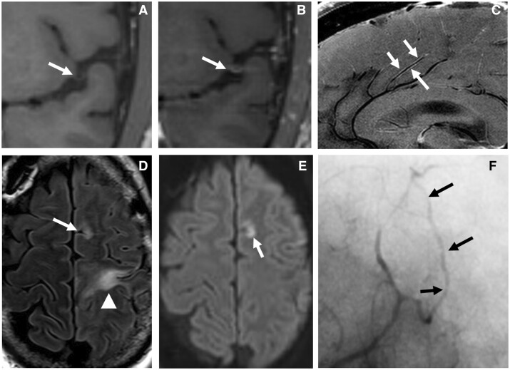
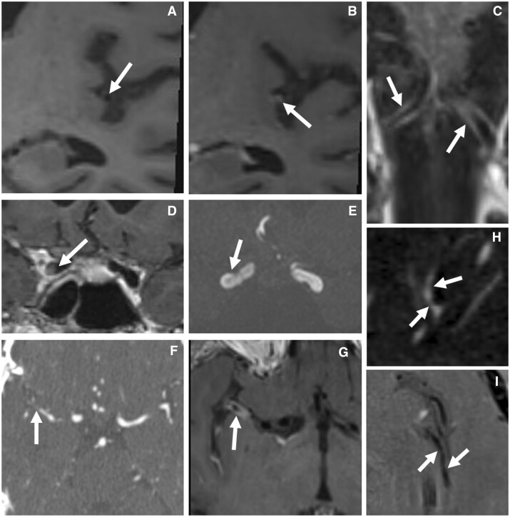
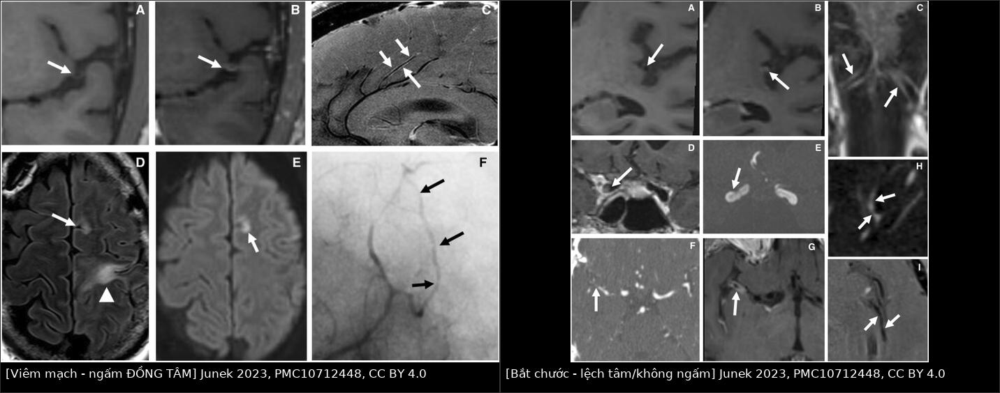
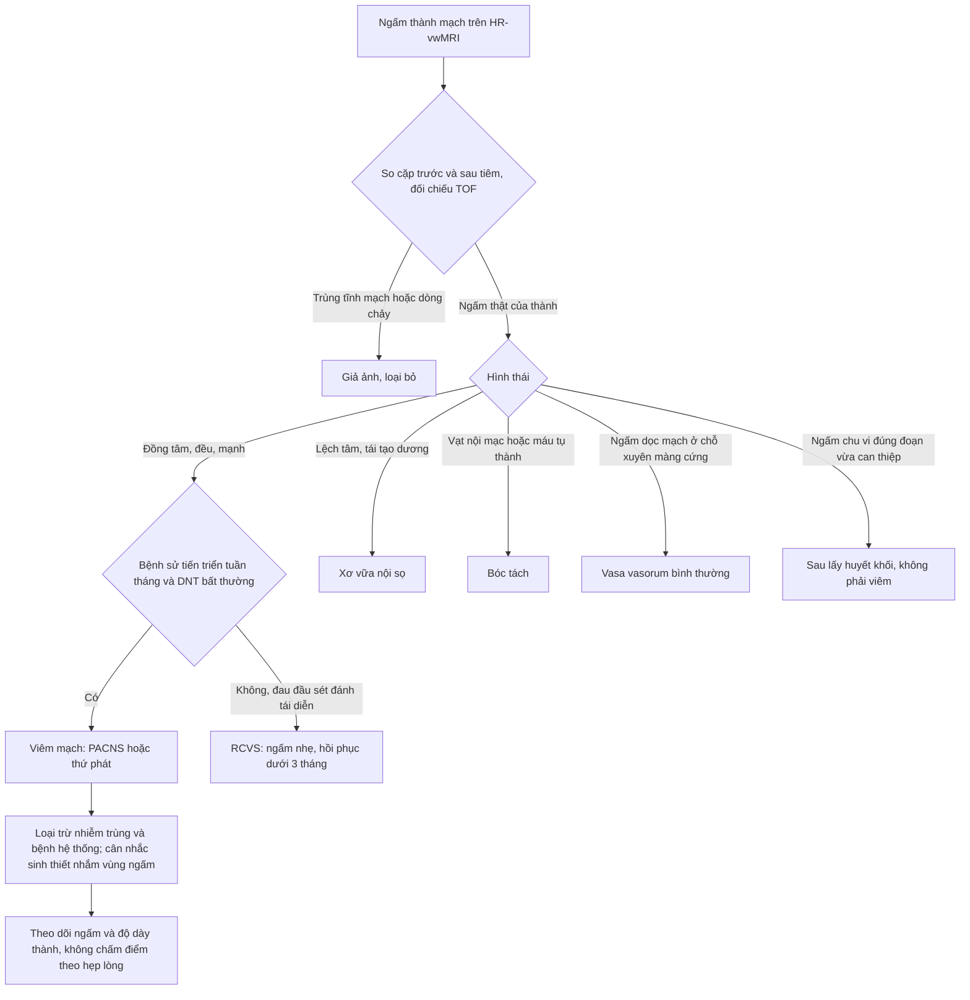
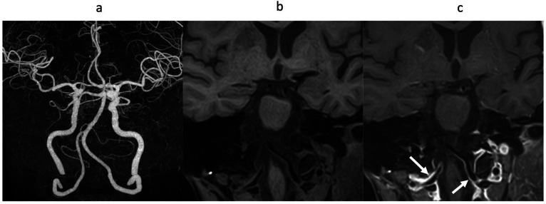
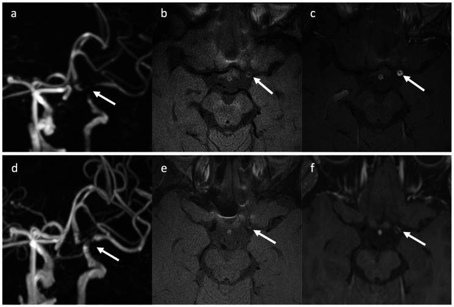

# 241 — Đọc HR-vwMRI thành mạch nội sọ: ngấm ĐỒNG TÂM vs LỆCH TÂM — viêm mạch, xơ vữa, RCVS, moyamoya / Reading high-resolution vessel wall MRI: concentric vs eccentric enhancement

**Tags:** `pattern:ngam-thanh-mach` `pattern:viem-mach-nao` `vung:mach-nao` `vung:nao` `score:VWE-0-3` `protocol:HR-vwMRI`
**Mức chắc chắn (certainty):** tổng hợp y văn (literature synthesis) — kỹ thuật + số liệu từ 4 bài mở (PMC10552670, PMC10712448, PMC13517854, PMC13044975); **các ca trong quiz là ca nguyên văn (verbatim case)** chép đúng tuổi – giới – chú thích hình gốc.

## 1. Tổng quan — đọc được thành mạch vì vật lý nào, và ngấm nghĩa là gì (TẠI SAO)

- **Vì sao phải 3T + "máu đen":** thành động mạch nội sọ **dày 0,2–0,3 mm**, chỉ bằng **~1/10 đường kính lòng** (M1 và thân nền tới **3 mm**); muốn thấy thành phải có **độ phân giải trong mặt phẳng 0,25–0,5 mm** và **triệt tín hiệu dòng chảy** (black-blood). 3T cho SNR gấp đôi 1,5T → điều kiện bắt buộc để đọc thành mạch. Khuyến cáo **ASNR VWISG** chọn voxel **2,0 × 0,4 × 0,4 mm**, FOV **10–13 cm** (2D), lát **2 mm**; 3D dùng chuỗi **TSE biến góc lật** (SPACE/SAMPL) + **fat-sat**, che phủ toàn não, không dùng ECG-gating vì TR biến thiên theo nhịp tim làm mất tương phản T1 (PMC10552670).
- **TẠI SAO thành ngấm thuốc:** gadolinium không tự vào thành mạch — nó **rò từ mao mạch nuôi thành (vasa vasorum) ở lớp áo ngoài** khi **tính thấm nội mô tăng**. Viêm → phù thành → **T2 tăng tín hiệu** (gặp **94%** ca đang hoạt động lâm sàng, nhưng vẫn **56%** ca "không hoạt động"); mô bệnh học chứng minh viêm hoạt động ở **44%** ca được coi là "không hoạt động" → **HR-vwMRI phản ánh mô bệnh tốt hơn lâm sàng** (PMC10552670).
- **TẠI SAO RCVS co mạch mà KHÔNG ngấm:** cơ chế là **co – xếp gấp tế bào cơ trơn** làm thành dày chu vi, **không có viêm** trên mô bệnh học → **ngấm rất nhẹ hoặc không ngấm**. Đây là **chốt cơ chế** phân biệt với viêm mạch (PMC10552670).
- **TẠI SAO xơ vữa ngấm LỆCH TÂM:** mảng xơ vữa là **lõi lipid + nắp xơ** khu trú một phía, kèm **tái tạo dương (positive remodeling)** — thành dày ra để giữ lòng; ngấm do **tân mạch trong mảng**, không phải viêm lan toả chu vi.
- **Ngưỡng định lượng nằm lòng:**
  - **Độ dày thành bất thường:** bình thường **0,2–0,3 mm**; loạt 19 ca nghi bệnh mạch viêm: **trung vị 2,2 mm** (IQR 1,8–2,8; khoảng 1,4–3,8) — tức **dày gấp ~7–10 lần** (PMC13517854).
  - **Thang ngấm thành mạch (VWE grade) 0–3:** 0 = không ngấm; 1 = nhẹ; 2 = vừa; 3 = mạnh (thang thứ tự, **không** phải tỷ số định lượng — không chuẩn hoá theo cuống tuyến yên) (PMC13517854).
  - **Hình thái:** đồng tâm thuần **15/19 (78,9%)** ở nhóm nghi bệnh mạch viêm; **3/13 ca viêm mạch TKTW có thể LỆCH TÂM** (PMC10552670) → **lệch tâm không loại trừ viêm mạch**.
  - **Phân bố:** MCA **17/19 (89,5%)**, ICA **13/19 (68,4%)**, PCA 6/19, V4 5/19, thân nền 3/19 (PMC13517854).
  - **Theo dõi (trung vị 391 ngày, 17 ca):** VWE grade **giảm ở 13/17 (76,5%)**, không ca nào tăng; độ dày thành tối đa **2,0 → 1,4 mm**; nhưng **hẹp lòng chỉ giảm 7/17, ổn định 10/17** → **ngấm mất trước, hẹp lòng ở lại** (PMC13517854).
  - **Ý nghĩa huyết động:** hẹp lệch tâm + ngấm mạnh ở chạc ICA/M1 kèm **TTP trễ ~2 giây** ở lãnh thổ MCA cùng bên = **hẹp có ý nghĩa huyết động**, không chỉ "đẹp hình" (PMC13517854).
  - **Cửa sổ corticoid:** khả năng phát hiện ngấm thành **giảm sau 2 ngày** dùng corticoid → **chụp trước hoặc ngay khi bắt đầu** điều trị (PMC10552670).

## 2. Mẫu hình + chẩn đoán phân biệt theo hình thái ngấm (Gamut)

- **ĐỒNG TÂM – ĐỀU – NGẤM MẠNH (bờ trong nhẵn) → nghĩ VIÊM:**
  - **PACNS** (viêm mạch TKTW nguyên phát) và **viêm mạch thứ phát**: lupus (NPSLE), Behçet, ANCA, IgG4, **nhiễm trùng** (VZV, lao, nấm), **do xạ** (ngấm tồn tại nhiều năm).
  - **Iatrogenic:** **sau lấy huyết khối cơ học** — ngấm chu vi do tổn thương nội mô, **KHÔNG phải viêm mạch** (PMC10712448, Hình 2G).
- **ĐỒNG TÂM nhưng NGẤM NHẸ/KHÔNG NGẤM → nghĩ CO MẠCH:**
  - **RCVS** (co mạch não có hồi phục): hẹp đa ổ "chuỗi hạt" + **không ngấm**, hồi phục **< 3 tháng**.
  - **Co mạch sau SAH phình mạch** (đỉnh ngày 4–14) — ngấm thành mạch không phải bản chất.
- **LỆCH TÂM – NGẤM KHU TRÚ – TÁI TẠO DƯƠNG → nghĩ XƠ VỮA NỘI SỌ (ICAD):** mảng ở một phía, nắp xơ ngấm nhẹ, lõi lipid T2 tối; ngấm mạnh = mảng "nóng" (dễ gây nhồi máu).
- **CÓ CẤU TRÚC TRONG THÀNH → nghĩ BÓC TÁCH:** **vạt nội mạc** hoặc **máu tụ thành mạch** (T1 sáng trong vài ngày đến 2 tháng).
- **HẸP ĐOẠN TẬN ICA HAI BÊN + "VANISHING MCA" + tuần hoàn bàng hệ nền sọ → MOYAMOYA:** ngấm thành mạch **≥ cuống tuyến yên** gặp **76,5%** ca có thiếu máu não và **23,5%** ca không thiếu máu; **đường kính ngoài mạch nhỏ lại** (khác tái tạo dương của xơ vữa).
- **NGẤM Ở ĐÚNG CHỖ MẠCH XUYÊN MÀNG CỨNG (V3–V4 ĐM đốt sống, ICA hang/trên lều) → VASA VASORUM bình thường**, không phải viêm.
- **Mnemonic đọc nhanh:** **"NHẴN – ĐỀU – MẠNH = VIÊM"**; **"LỆCH – GỒ – TÁI TẠO = VỮA XƠ"**; **"HẸP NHIỀU Ổ – KHÔNG NGẤM – HỒI PHỤC = RCVS"**.

## 3. Bảng so sánh phân biệt (ma trận đối chiếu)

| Thực thể (entity) | Hình ảnh điển hình trên HR-vwMRI | Chốt vào (rule-in) | Chốt loại (rule-out) | Gợi ý xác nhận |
|---|---|---|---|---|
| **Viêm mạch / PACNS** | Dày + ngấm **đồng tâm, đều, mạnh** (VWE 2–3), nhiều đoạn nhiều mạch; T2 thành tăng; kèm nhồi máu nhiều lãnh thổ | **Đồng tâm + ngấm mạnh + thời gian tiến triển tuần–tháng + DNT bất thường** | **Không ngấm + hồi phục < 3 tháng** → RCVS; **lệch tâm + tái tạo dương** → xơ vữa | DNT, loại trừ nguyên nhân hệ thống/nhiễm; **sinh thiết não** (nhắm vùng ngấm: Se **89%** vs **50%** nếu mù) |
| **RCVS** | Co mạch đa ổ "chuỗi hạt", thành dày chu vi nhưng **ngấm nhẹ/không** | **Đau đầu sét đánh tái diễn + không/ngấm nhẹ + hồi phục < 3 tháng** | **Ngấm mạnh đồng tâm, tiến triển** → viêm mạch | MRA/CTA lặp 2–3 tuần; tránh corticoid |
| **Xơ vữa nội sọ (ICAD)** | **Lệch tâm**, mảng một phía, **tái tạo dương**, nắp xơ ngấm nhẹ, lõi lipid T2 tối | **Lệch tâm + tái tạo dương + yếu tố nguy cơ (THA, ĐTĐ, hút thuốc)** | **Đồng tâm đều + ngấm mạnh + trẻ, không yếu tố nguy cơ** → viêm | HR-vwMRI + TOF; đôi khi **xơ vữa vẫn đồng tâm** → đọc cùng bối cảnh |
| **Bóc tách nội sọ** | **Vạt nội mạc** hoặc **máu tụ thành mạch** (T1 sáng), thường **một mạch**, có thể giả phình | **Vạt/máu tụ trong thành + khởi phát đau cổ/cổ gáy** | **Không có vạt, nhiều mạch đối xứng** → RCVS/viêm | HR-vwMRI T1 không tiêm + CTA/MRA; theo dõi tín hiệu máu |
| **Moyamoya** | Hẹp/occlusion tận ICA **hai bên**, **"vanishing MCA"**, đường kính ngoài nhỏ, "khói thuốc" | **Hẹp tận ICA hai bên + bàng hệ nền sọ + ngấm thành mạch** | **Tái tạo dương, một mảng khu trú** → xơ vữa | MRA/DSA; HR-vwMRI phân biệt tái tạo âm |
| **Vasa vasorum / lão hoá** | Ngấm **dọc mạch liên tục từ ngoài sọ vào**, đúng chỗ xuyên màng cứng; thường **hai bên, đối xứng** | **Đúng vị trí giải phẫu + không hẹp lòng + không triệu chứng tương ứng** | **Ngấm khu trú + dày thành + hẹp lòng** → bệnh thật | So sánh bên đối diện, nhiều bình diện, đối chiếu TOF |
| **Sau lấy huyết khối / can thiệp** | Ngấm chu vi lan toả tại đoạn vừa can thiệp, có thể kèm khuyết đầy do dòng chảy | **Tiền sử can thiệp đúng đoạn đó trong vài ngày** | **Ngấm ở đoạn KHÔNG can thiệp, nhiều mạch** → viêm | So phim trước can thiệp; đọc cùng bệnh sử |
| **Co mạch sau SAH** | Co mạch **quanh túi phình đã vỡ**, cùng bên, đỉnh ngày 4–14 | **SAH bể nền + co mạch tương ứng lượng máu** | **SAH lồi + co mạch đa ổ không tương ứng** → RCVS | CT/DSA; xanthochromia DNT |

*HR-vwMRI T1 SPACE: (A) trước và (B) sau gadolinium — **ngấm ĐỒNG TÂM** thành mạch (mũi tên); (C) 7T: ngấm lan toả các nhánh động mạch quanh thể chai ở ca **PACNS có sinh thiết**; (D) FLAIR tổn thương nhu mô nhiều tuổi; (E) DWI ổ nhồi máu cấp; (F) DSA "chuỗi hạt" nhánh xa ĐM não trước. Nguồn: Junek M et al., Rheumatol Adv Pract 2023 (PMC10712448), CC BY 4.0.*

*Các "bẫy" của HR-vwMRI: (A–B) **xơ vữa M2 lệch tâm** trước/sau gadolinium; (C) **ngấm vasa vasorum** đoạn V4 gần; (D–G) sau **lấy huyết khối**: khuyết đầy do dòng chảy (D) nhưng TOF thông (E), CTA tắc M1 xa (F), **ngấm chu vi do can thiệp** (G); (H–I) **RCVS**: hẹp đa ổ trên CTA (H) nhưng **KHÔNG ngấm** trên HR-vwMRI (I). Nguồn: Junek M et al., Rheumatol Adv Pract 2023 (PMC10712448), CC BY 4.0.*

*Ảnh ghép letterbox giữ nguyên tỷ lệ: **trái** — viêm mạch TKTW, ngấm **ĐỒNG TÂM** đều cả chu vi; **phải** — các bắt chước: xơ vữa **LỆCH TÂM**, vasa vasorum, ngấm sau lấy huyết khối, RCVS **KHÔNG ngấm**. Nguồn: Junek M et al., Rheumatol Adv Pract 2023 (PMC10712448), Hình 1 và 2 — CC BY 4.0; ghép bằng `tools/make_composite.py`.*

## 4. Protocol chụp + thang điểm & thuật toán đọc

- **Máy & chuỗi:** **3T** + cuộn đầu; **3D T1 SPACE fat-sat black-blood TRƯỚC và SAU gadolinium với thông số y hệt**; không trừ ảnh (so khớp trực tiếp trước/sau); phủ toàn não; voxel mục tiêu **0,4 × 0,4 × 2,0 mm** (ASNR VWISG); 2D bổ trợ khi cần độ phân giải trong mặt phẳng **0,25–0,5 mm** cho một đoạn ngắn.
- **Thuốc:** gadolinium **0,1 mmol/kg** tĩnh mạch; **chụp TRƯỚC corticoid** — nếu đã dùng corticoid, giá trị đọc giảm rõ sau **2 ngày**.
- **Đọc theo 3 bước bắt buộc:**
  1. **Xác nhận ngấm thật:** so cặp ảnh trước/sau ở **≥ 2 bình diện**, đối chiếu TOF cùng đoạn; loại **tĩnh mạch**, **dịch não tủy**, **dòng chảy** (dùng xung ức chế dòng như MSDE khi có túi phình).
  2. **Mô tả hình thái:** đồng tâm / lệch tâm / hỗn hợp / không xác định; đo **độ dày thành tối đa một phía** (mm) + ghi **đoạn mạch**; cho **điểm VWE 0–3**.
  3. **Đặt vào bối cảnh:** bệnh sử (sét đánh vs tiến triển), DNT, TOF/CTA/DSA, **tưới máu** (TTP trễ ≥ 2 giây = có ý nghĩa huyết động).
- **Theo dõi:** lặp HR-vwMRI **8–12 tuần** sau khi bắt đầu điều trị, rồi **3–6 tháng**; đánh giá **ngấm + độ dày** là chỉ số hoạt động, **không** lấy hẹp lòng làm chỉ số đáp ứng.

## 5. Biến thể bình thường và cạm bẫy

- **Ngấm do lão hoá (biến thể bình thường):** nữ 71 tuổi, CTA không hẹp, 3D-T1 không tiêm không thấy tín hiệu thành, **sau tiêm ngấm thành hai ĐM đốt sống liên tục từ đoạn ngoài sọ** — đừng gọi là viêm mạch (PMC10552670, Hình 1).

*(a) CTA không hẹp; (b) 3D-T1 trước tiêm không thấy tín hiệu thành; (c) sau tiêm: ngấm thành hai ĐM đốt sống **liên tục từ ngoài sọ vào** (mũi tên) — biến thể lão hoá/vasa vasorum, không phải viêm. Nguồn: Gomyo M et al., Magn Reson Med Sci 2023 (PMC10552670), CC BY-NC-ND 4.0 — giữ nguyên bản, không cắt/ghép.*

- **Vasa vasorum ở chỗ xuyên màng cứng:** V3–V4 ĐM đốt sống và ICA hang/trên lều **luôn** có thể ngấm — đọc đối xứng hai bên và đúng vị trí giải phẫu (PMC10712448).
- **Nhiễm tĩnh mạch / dòng chảy:** dễ "thấy ngấm" ở túi phình; dùng **MSDE** hoặc xung ức chế dòng, so nhiều bình diện (PMC10552670, Hình 8).
- **Sau lấy huyết khối:** ngấm chu vi **do can thiệp**, có thể kèm khuyết đầy giả do dòng chảy — **không** chẩn đoán viêm mạch (PMC10712448).
- **Corticoid trước chụp:** ngấm có thể **mất trong 2 ngày** → HR-vwMRI âm tính giả; luôn hỏi giờ dùng corticoid đầu tiên.
- **Lệch tâm không loại trừ viêm mạch:** **3/13** ca viêm mạch TKTW có dày/ngấm lệch tâm; ngược lại **xơ vữa có thể đồng tâm** → không bao giờ chốt chỉ bằng hình thái.
- **"Không thấy ngấm" ≠ "không viêm":** bệnh mạch **nhỏ** nằm dưới độ phân giải (thành 0,2–0,3 mm) → HR-vwMRI bình thường vẫn phải **sinh thiết** nếu lâm sàng mạnh.
- **Hẹp lòng tồn tại sau khi ngấm đã mất:** đây là **xơ hoá**, không phải bệnh đang hoạt động — đọc cùng bài [242](../242-pacns-duy-tri-theo-doi/lesson.md).

## 6. Tự lượng giá — Blind Quiz

**Ca 1 — Nữ, đau đầu tiến triển + thiếu hụt thần kinh khu trú tái diễn. Nhìn hai ảnh A–B trước khi mở đáp án.**

- Câu hỏi: (1) Mô tả hình thái và cường độ ngấm ở A–B. (2) Ba chẩn đoán phân biệt? (3) Dấu hiệu nào **chốt loại** RCVS?

<b>Bấm để hiện đáp án (findings + chẩn đoán)</b>

- **Dấu hiệu:** thành mạch dày **đồng tâm, đều, ngấm mạnh** sau gadolinium (B, mũi tên); trước tiêm (A) không có tín hiệu tương ứng. Kèm nhồi máu nhiều tuổi trên FLAIR (D) và ổ cấp trên DWI (E).
- **Chẩn đoán:** **viêm mạch TKTW** (PACNS hoặc thứ phát) — ngấm đồng tâm phản ánh viêm xuyên thành làm tăng tính thấm nội mô.
- **Ba phân biệt:** viêm mạch, RCVS, xơ vữa nội sọ.
- **Chốt loại RCVS:** bệnh sử **sét đánh tái diễn**, **không/ngấm rất nhẹ**, hẹp **hồi phục < 3 tháng**; ca này ngấm mạnh + tiến triển → không phải RCVS.
- **Nguồn:** Junek M et al., Rheumatol Adv Pract 2023 (PMC10712448), Hình 1 — CC BY 4.0.

**Ca 2 — Cùng bộ ảnh "bắt chước": chỉ nhìn để trả lời, rồi mở đáp án.**

- Câu hỏi: (1) A–B là gì, vì sao **không** phải viêm? (2) H–I chẩn đoán gì và dấu hiệu chốt? (3) G là gì?

<b>Bấm để hiện đáp án (findings + chẩn đoán)</b>

- **A–B:** dày + ngấm **LỆCH TÂM** ở M2 = **mảng xơ vữa** (lõi lipid/nắp xơ một phía, tái tạo dương) — không phải viêm lan toả chu vi.
- **H–I:** **RCVS** — hẹp đa ổ trên CTA (H) nhưng **không ngấm** trên HR-vwMRI (I); chốt là **co mạch không viêm + hồi phục**.
- **G:** **ngấm chu vi sau lấy huyết khối** do tổn thương nội mô — bẫy iatrogenic.
- **Nguồn:** Junek M et al., Rheumatol Adv Pract 2023 (PMC10712448), Hình 2 — CC BY 4.0.

**Ca 3 — Nữ 62 tuổi, hẹp nặng đoạn tận ICA trái; chụp trước và sau điều trị corticoid.**

- Câu hỏi: (1) Mô tả b và c. (2) Vì sao phải chụp **trước** corticoid? (3) Sau điều trị, cái gì cải thiện?

<b>Bấm để hiện đáp án (findings + chẩn đoán)</b>

- **Dấu hiệu:** (a) TOF hẹp nặng tận ICA trái; (b, c) **dày thành đồng tâm + ngấm mạnh**; (d–f) sau corticoid: **giảm ngấm, giảm dày thành**.
- **Chẩn đoán:** **viêm mạch** — ngấm giảm sau ức chế miễn dịch xác nhận thành phần viêm.
- **Vì sao chụp sớm:** ngấm thành mạch **giảm khả năng phát hiện sau 2 ngày** corticoid → chụp muộn dễ âm tính giả.
- **Cải thiện:** **ngấm và độ dày thành**; **hẹp lòng có thể còn** (xơ hoá) — không đánh giá đáp ứng bằng đường kính lòng.
- **Nguồn:** Gomyo M et al., Magn Reson Med Sci 2023 (PMC10552670), Hình 4 — CC BY-NC-ND 4.0, giữ nguyên bản.

## Bài liên quan chéo
- [229 – PACNS vs RCVS: hai bệnh chồng lấp, điều trị ngược nhau](../229-pacns-vs-rcvs/lesson.md)
- [219 – PRES & RCVS](../219-pres-rcvs/lesson.md)
- [242 – PACNS: điều trị duy trì & theo dõi tái phát](../242-pacns-duy-tri-theo-doi/lesson.md)
- [248 – Bóc tách động mạch cổ & giả phình](../248-can-thiep-noi-mach-gia-phinh-boc-tach-dong-mach-co-dot-song/lesson.md)
- [652 – Đột quỵ mạch máu não nhi: moyamoya & viêm mạch](../652-dot-quy-mach-mau-nao-nhi-moyamoya-viem-mach/lesson.md)

> Không dùng để chẩn đoán độc lập khi chưa có người hướng dẫn.
