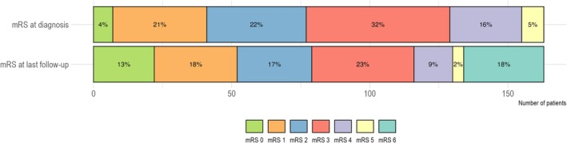
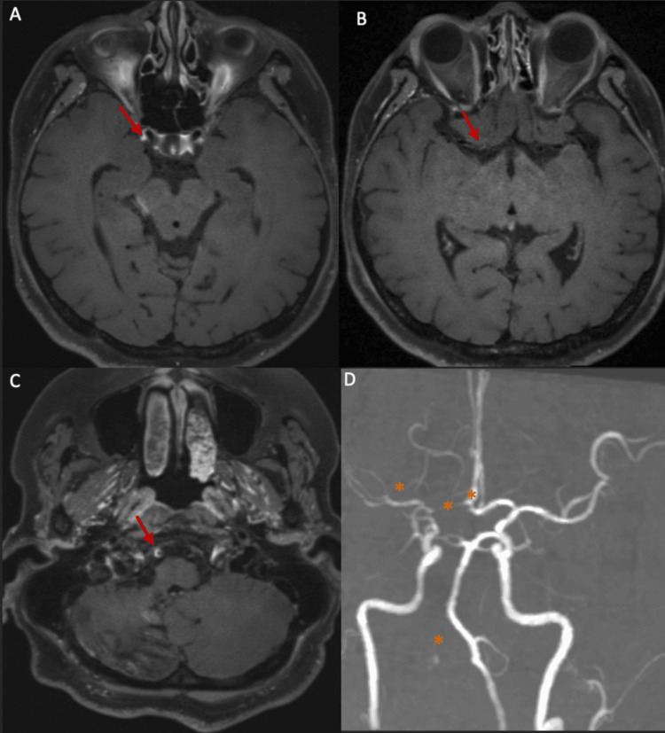
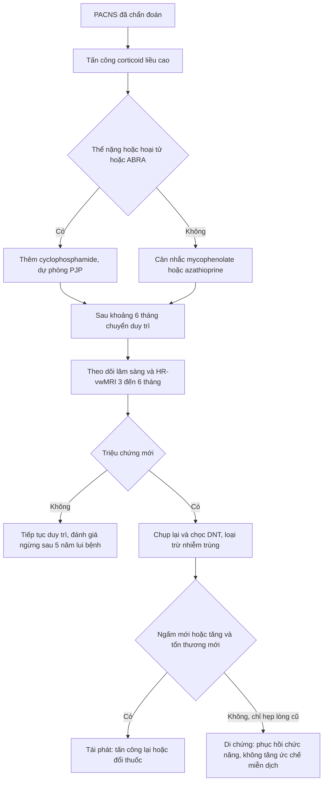
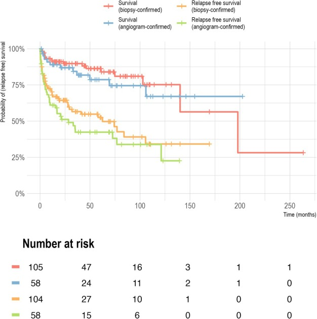

# 242 — PACNS: điều trị duy trì, lịch theo dõi tái phát & khi nào ngừng thuốc / PACNS long-term care: maintenance therapy, relapse surveillance and when to stop

**Tags:** `pattern:viem-mach-nao` `vung:mach-nao` `vung:nao` `score:mRS` `protocol:HR-vwMRI` `protocol:theo-doi-mien-dich`
**Mức chắc chắn (certainty):** tổng hợp y văn (literature synthesis) — số liệu từ 3 nguồn mở chính (PMC12542311 cohort 163 ca, PMC10712448 review thực hành, PMC13052826 tổng quan) + 1 ca nguyên văn (PMC13044975) cho quiz.

## 1. Tổng quan — vì sao PACNS phải duy trì thuốc lâu, và theo dõi bằng gì (TẠI SAO)

- **Bệnh học:** PACNS là viêm mạch **mạch nhỏ và vừa** giới hạn ở não – tủy – màng não, không có bệnh hệ thống. Ba thể mô bệnh: **u hạt 32–61%**, **lympho 24–79%**, **hoại tử 14–42%**. Thâm nhiễm chủ yếu **tế bào T nhớ CD45R0+**, kèm **tăng IL-17 trong dịch não tủy** và dấu ấn **tế bào B/plasma trong DNT** — tức là **có "ổ nhớ" miễn dịch tại chỗ**, giải thích vì sao bệnh tái phát dù lâm sàng đã lặng.
- **TẠI SAO không dùng IL-17/DNT để theo dõi:** IL-17 trong DNT **tăng cả khi bệnh hoạt động và khi lui bệnh** → **không phải chỉ số theo dõi**; DNT chỉ có giá trị **loại trừ nhiễm trùng/tái phát khi có triệu chứng mới**.
- **TẠI SAO hình ảnh theo dõi được:** ngấm thành mạch phản ánh **tính thấm nội mô do viêm**, không phải mô xơ. **50–75%** bệnh nhân có thay đổi ngấm **tương ứng hoạt động bệnh** trên MR-vwMRI; ngược lại **đường kính lòng mạch không giảm dù viêm đã hết** (xơ hoá) → **hẹp lòng cố định KHÔNG phải "thất bại điều trị"**.
- **Ngưỡng định lượng nằm lòng:**
  - **Tái phát:** **82/163 (50%)**, **trung vị 18 tháng** (đoàn hệ Đức 13 trung tâm, theo dõi trung vị 42 tháng); đoàn hệ khác **58/191 (30%)** trong trung vị 19 tháng. Tỷ lệ **sống không tái phát dài hạn chỉ 21–66%**.
  - **Kết cục:** tử vong **29/163 (18%)** (y văn **8–28%**: 8–23% ở tổng quan, 11–28% ở review thực hành — thường trong năm đầu); **mRS 3–6 ở 52%**; **70,4%** có khiếm khuyết chức năng tồn tại.
  - **Yếu tố tiên lượng xấu:** tuổi (**HR 1,96/10 tuổi** cho tử vong), **thời gian từ khởi phát đến chẩn đoán (HR 1,01/tháng)**, thể **hoại tử (HR 10,2)**, **mRS lúc chẩn đoán cao (OR 4,43)**.
  - **Hiệu quả thuốc:** so với **không điều trị**, **cyclophosphamide đơn trị HR 0,44 (0,22–0,86)** và **corticoid + cyclophosphamide HR 0,47 (0,24–0,92)** cho tái phát; **corticoid đơn trị HR 0,92 (0,49–1,75) — không có ý nghĩa**.
  - **Thực hành phác đồ:** tấn công **methylprednisolone 500–1.000 mg/ngày × 3–5 ngày** (nếu nặng), rồi **prednisone 1 mg/kg (40–60 mg/ngày) trong 4 tuần** rồi giảm liều chậm; **giai đoạn tấn công ~6 tháng**; sau đó **duy trì bằng azathioprine hoặc mycophenolate**; **methotrexate không ưu tiên vì thấm vào não kém**; **tránh IVIG** (nguy cơ huyết khối). **Thời gian duy trì: 5 năm đến suốt đời**, chưa có bằng chứng chọn độ dài.
  - **Theo dõi hình ảnh:** chụp lại **8–12 tuần** sau bắt đầu tấn công, **3–6 tháng** sau đó, rồi **mỗi 3–6 tháng**; MRI/MRA + HR-vwMRI là lựa chọn ưu tiên vì đọc được **lòng mạch + thành mạch + nhu mô** cùng lúc.
  - **Sinh thiết:** độ nhạy **≤ 75%**; nếu **nhắm đúng vùng bất thường trên HR-vwMRI** độ nhạy lên **89%**, còn sinh thiết "mù" thùy thái dương/trán không ưu thế chỉ **50%**.

## 2. Mẫu hình + chẩn đoán phân biệt khi bệnh nhân ĐANG duy trì có triệu chứng mới (Gamut)

- **1. Tái phát hoạt động:** đau đầu/cognitive mới + **ngấm thành mạch mới hoặc tăng** + **nhồi máu ở lãnh thổ MỚI**; thường sau khi giảm liều hoặc ngừng thuốc.
- **2. Di chứng cố định (pseudorelapse):** nhồi máu cũ, **hẹp lòng cố định**, động kinh, trầm cảm — **không ngấm mới**, không tổn thương mới.
- **3. Nhiễm trùng cơ hội:** **Pneumocystis jirovecii** (phải dự phòng khi tấn công nặng), CMV, lao, nấm, *Listeria* — sốt + tăng tế bào DNT; **đừng tăng ức chế miễn dịch**.
- **4. Biến chứng thuốc:** cyclophosphamide (viêm bàng quang xuất huyết, vô sinh, ức chế tủy), corticoid (đái tháo đường, loãng xương, nhiễm trùng), azathioprine (viêm tụy, ức chế tủy), mycophenolate (tiêu hoá).
- **5. Bắt chước mạch máu mới:** **RCVS do thuốc** (serotonin, calcineurin inhibitor), **xơ vữa tiến triển** ở người lớn tuổi — hẹp mới nhưng **không ngấm** hoặc **lệch tâm**.
- **6. Ung thư:** **u lympho nội mạch (intravascular lymphoma)** — sốt, tổn thương lan toả, chỉ chẩn đoán được bằng mô bệnh; đây là lý do không được "tăng corticoid mù".
- **Mnemonic "R-D-I-D-A-U":** **R**elapse · **D**amage · **I**nfection · **D**rug toxicity · **A**therosclerosis/RCVS · **U**nknown malignancy.

## 3. Bảng so sánh phân biệt (ma trận đối chiếu)

| Tình huống | Hình ảnh / xét nghiệm điển hình | Chốt vào (rule-in) | Chốt loại (rule-out) | Gợi ý xác nhận |
|---|---|---|---|---|
| **Tái phát hoạt động** | **Ngấm thành mạch MỚI/tăng** (VWE tăng ≥ 1 bậc), nhồi máu **lãnh thổ mới**, có thể tăng tế bào/protein DNT | **Tổn thương mới + ngấm tăng + bệnh sử giảm liều** | **Chỉ hẹp lòng cũ, không ngấm mới, không tổn thương mới** → di chứng | MRI/MRA + HR-vwMRI, DNT loại trừ nhiễm |
| **Di chứng cố định** | Ổ nhồi máu cũ, **hẹp lòng ổn định**, teo não, không ngấm mới | **Hình ảnh không đổi qua ≥ 2 lần chụp + triệu chứng khớp tổn thương cũ** | **Ngấm mới/tăng, tổn thương mới** → tái phát | So phim cũ từng lát; phục hồi chức năng |
| **Nhiễm trùng cơ hội** | Đám mờ phổi/PJP, ổ áp-xe não, tăng tế bào DNT ưu thế lympho/trung tính, CRP tăng | **Sốt + ức chế miễn dịch + cấy/PCR dương** | **Không sốt, không ổ nhiễm, đáp ứng với ức chế miễn dịch** | CT ngực, cấy máu/đờm, BAL, PCR DNT |
| **RCVS do thuốc** | Hẹp đa ổ "chuỗi hạt", **không ngấm**, hồi phục **< 3 tháng** sau ngừng thuốc | **Yếu tố khởi phát mới + không ngấm + hồi phục** | **Ngấm đồng tâm mạnh, tiến triển** → viêm | MRA lặp 2–3 tuần; ngừng thuốc nghi ngờ |
| **Xơ vữa tiến triển** | **Lệch tâm**, tái tạo dương, canxi hoá, ngấm mảng | **Yếu tố nguy cơ + lệch tâm + không tăng tế bào DNT** | **Đồng tâm đều + ngấm mạnh + trẻ** → viêm | HR-vwMRI, TOF, kiểm soát yếu tố nguy cơ |
| **U lympho nội mạch** | Tổn thương lan toả, ngấm nhu mô/màng não, **không đáp ứng corticoid kéo dài** | **Sốt + LDH cao + tế bào ác tính trong DNT/tủy** | **Đáp ứng nhanh corticoid, tổn thương mạch điển hình** → PACNS | Sinh thiết não/tủy xương; PET/CT |

*Kaplan–Meier: sống còn và **sống không tái phát** ở 163 bệnh nhân PACNS, phân theo phương thức chẩn đoán (sinh thiết 64% vs chụp mạch 36%). Đường cong **không đi ngang** — tái phát tiếp tục tích luỹ trong nhiều năm, nền tảng của chỉ định **duy trì dài hạn**. Nguồn: Fisse AL et al., Ann Neurol 2025 (PMC12542311), CC BY 4.0.*

### Ảnh theo dõi thực tế: ngấm giảm nhưng hẹp lòng còn

*Nữ 44 tuổi, PACNS sau corticoid liều cao + azathioprine: (A–B) **ngấm và dày thành đồng tâm GIẢM** so với lần trước; (C–D) **hẹp lòng V4 phải và M1 phải vẫn còn, ngấm tồn dư**, không có lãnh thổ mới. Đây là **đáp ứng điều trị** — không phải thất bại. Nguồn: Ali M et al., Cureus 2026 (PMC13044975), CC BY 4.0.*

## 4. Protocol điều trị – theo dõi + thuật toán

- **Tấn công (induction):**
  - Nặng (ổ nhồi máu lớn, bệnh não, động kinh, thiếu hụt đe doạ chức năng): **methylprednisolone TM 500–1.000 mg/ngày × 3–5 ngày**, sau đó **prednisone 1 mg/kg (40–60 mg/ngày) × 4 tuần**, rồi giảm chậm.
  - **Thêm thuốc thứ hai ngay từ đầu**: **cyclophosphamide** là lựa chọn mặc định ở thể nặng; **dự phòng *Pneumocystis*** khi tấn công mạnh.
  - Nhẹ: corticoid uống ± **mycophenolate/azathioprine/cyclophosphamide**; **methotrexate không ưu tiên** (thấm não kém).
- **Chuyển duy trì:** sau **~6 tháng** tấn công → **azathioprine hoặc mycophenolate** (ưu tiên), giảm corticoid dần; **không dùng IVIG** (nguy cơ huyết khối).
- **Theo dõi:**
  - Lâm sàng sớm (**2–4 tuần** lần đầu), rồi mỗi **3 tháng**.
  - **MRI/MRA + HR-vwMRI: 8–12 tuần** sau bắt đầu tấn công, **3–6 tháng** sau đó, rồi **mỗi 3–6 tháng**; đọc **ngấm + độ dày thành** là chỉ số hoạt động.
  - Xét nghiệm độc tính: **công thức máu, men gan, creatinin, tổng phân tích nước tiểu** (cyclophosphamide), **lipase** (azathioprine), **HbA1c/loãng xương** (corticoid).
  - **DNT chỉ khi có triệu chứng mới** hoặc nghi nhiễm — không dùng IL-17 để theo dõi.
- **Khi nào ngừng:** chỉ cân nhắc **≥ 5 năm lui bệnh liên tục** + **không ngấm thành mạch** + **không tổn thương mới** + thể **đơn pha, không tái phát**; ngược lại (đã tái phát, thể hoại tử/ABRA, còn ngấm) → **duy trì kéo dài/suốt đời**. Không có thử nghiệm lâm sàng nào xác định độ dài tối ưu.

## 5. Biến thể bình thường và cạm bẫy

- **Đọc hẹp lòng cố định là "không đáp ứng":** sau viêm, thành mạch **xơ hoá** — hẹp lòng có thể **không đổi hoặc chỉ giảm 7/17 ca** dù ngấm đã giảm; tăng thuốc chỉ vì "hẹp còn" là **tăng ức chế miễn dịch oan**.
- **Corticoid che dấu hoạt động:** ngấm thành mạch **giảm khả năng phát hiện sau 2 ngày** dùng corticoid → chụp trong đợt tấn công mà đã dùng thuốc 3–5 ngày thì dễ **âm tính giả**, không kết luận "hết bệnh".
- **Tăng tế bào DNT không đồng nghĩa tái phát:** ưu tiên **loại trừ nhiễm trùng** (PJP, lao, nấm) trước khi tăng ức chế miễn dịch; DNT trong PACNS có thể **tăng tế bào nhẹ mạn tính**.
- **Kháng kết tập tiểu cầu không có chỉ định thường quy:** chỉ dùng khi có chỉ định khác (rung nhĩ, dự phòng thứ phát do xơ vữa) — không phải "điều trị PACNS".
- **Đừng nhầm đáp ứng với khỏi bệnh:** ngấm giảm là **đáp ứng**, nhưng bệnh có thể tái phát sau nhiều năm (**trung vị 18 tháng, đuôi dài**) → lịch theo dõi không được cắt ngắn sau 1 năm.
- **Rituximab không phải first-line:** cơ chế hấp dẫn (tế bào B/plasma trong DNT) nhưng bằng chứng chỉ ở ca kháng trị; **TNF-α inhibitor** cũng chỉ cho ca kháng trị.

## 6. Tự lượng giá — Blind Quiz

**Ca 1 — Nhìn biểu đồ phác đồ theo thời gian, trả lời trước khi mở đáp án.**

- Câu hỏi: (1) Phác đồ phổ biến nhất **lúc khởi đầu**? (2) Ở **6 tháng**? (3) Ở **5 năm**? (4) Điều này nói gì về chiến lược duy trì?

<b>Bấm để hiện đáp án</b>

- **Khởi đầu:** **corticoid đơn trị 45%**, **corticoid + cyclophosphamide 22%**.
- **6 tháng:** **cyclophosphamide đơn trị 26%** và **corticoid + cyclophosphamide 24%** — tức là giai đoạn **tấn công bằng cyclophosphamide**.
- **5 năm:** **37% không còn thuốc ức chế miễn dịch**, **35% dùng thuốc khác ngoài corticoid/cyclophosphamide** (azathioprine, mycophenolate, rituximab…).
- **Ý nghĩa:** thực hành là **tấn công ngắn → duy trì bằng thuốc dung nạp tốt hơn → một phần ba bệnh nhân ngừng được thuốc**; nhưng chọn ai ngừng vẫn là quyết định cá thể hoá.
- **Nguồn:** Fisse AL et al., Ann Neurol 2025 (PMC12542311), Hình 3 — CC BY 4.0.

**Ca 2 — Cùng bộ đường cong Kaplan–Meier: đọc trước, mở sau.**

- Câu hỏi: Vì sao phải duy trì thuốc **nhiều năm** thay vì 6–12 tháng?

<b>Bấm để hiện đáp án</b>

- Đường **sống không tái phát** tiếp tục giảm dần theo thời gian, **không đạt plateau** — tái phát **50% (82/163)**, **trung vị 18 tháng**, có ca muộn sau nhiều năm.
- Vì vậy **"lui bệnh 1 năm" không đồng nghĩa "khỏi"**; thời gian duy trì thực hành **5 năm đến suốt đời**, tuỳ thể bệnh và lần tái phát.
- **Nguồn:** Fisse AL et al., Ann Neurol 2025 (PMC12542311), Hình 2 — CC BY 4.0.

**Ca 3 — Nữ 44 tuổi, PACNS (sinh thiết bị từ chối), sau corticoid liều cao + azathioprine. Chụp lại sau ~1 tháng điều trị.**

- Câu hỏi: (1) Ngấm thay đổi thế nào? (2) Hẹp lòng còn — có phải thất bại điều trị? (3) Bước tiếp theo?

<b>Bấm để hiện đáp án</b>

- **Ngấm + dày thành GIẢM** so với lần trước (A–B) → **đáp ứng điều trị**.
- **Hẹp lòng V4/M1 vẫn còn, ngấm tồn dư, không lãnh thổ mới** (C–D) → **không phải thất bại**; hẹp là di chứng xơ hoá, không dùng đường kính lòng để quyết định tăng thuốc.
- **Bước tiếp:** tiếp tục **azathioprine + giảm prednisone chậm**, theo dõi lâm sàng + HR-vwMRI **3–6 tháng**; cảnh giác nhiễm trùng cơ hội; bệnh nhân vẫn **mRS 4** → cần phục hồi chức năng.
- **Nguồn:** Ali M et al., Cureus 2026 (PMC13044975), Hình 7 — CC BY 4.0.

## Bài liên quan chéo
- [229 – PACNS vs RCVS: chẩn đoán phân biệt cốt lõi](../229-pacns-vs-rcvs/lesson.md)
- [241 – Đọc HR-vwMRI thành mạch nội sọ](../241-hr-vwmri-doc-ngam-thanh-mach/lesson.md)
- [219 – PRES & RCVS](../219-pres-rcvs/lesson.md)
- [203 – Neuro-Behçet & Behçet mạch máu lớn](../203-neuro-behcet-va-mach-mau-lon/lesson.md)

> Không dùng để chẩn đoán độc lập khi chưa có người hướng dẫn.
