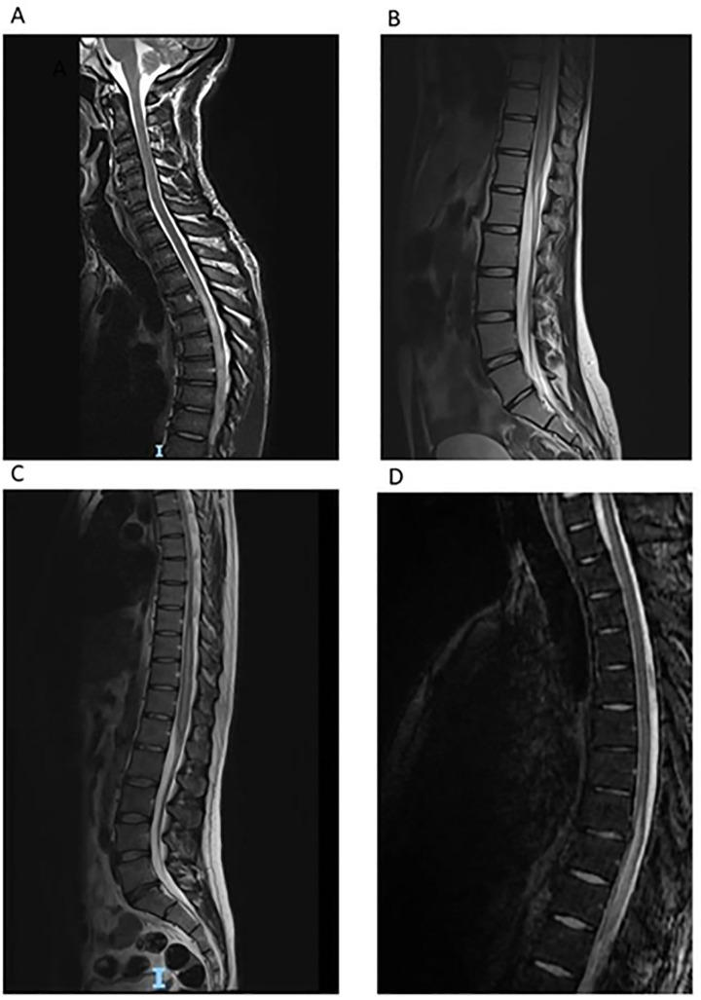
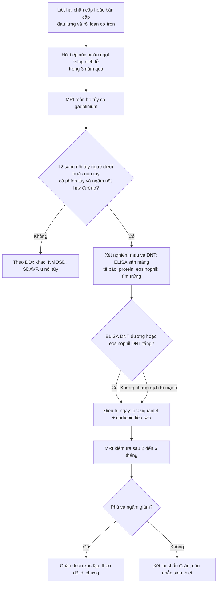
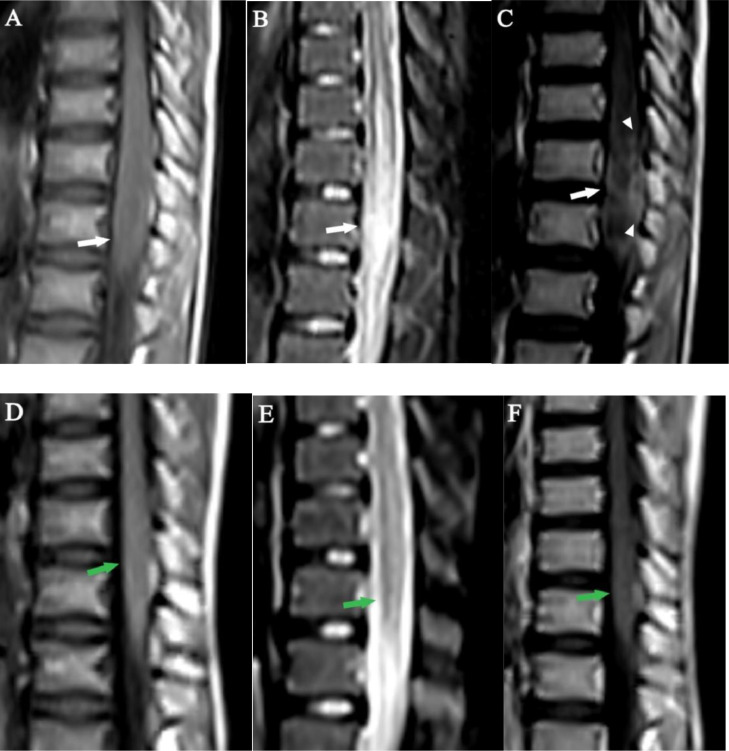
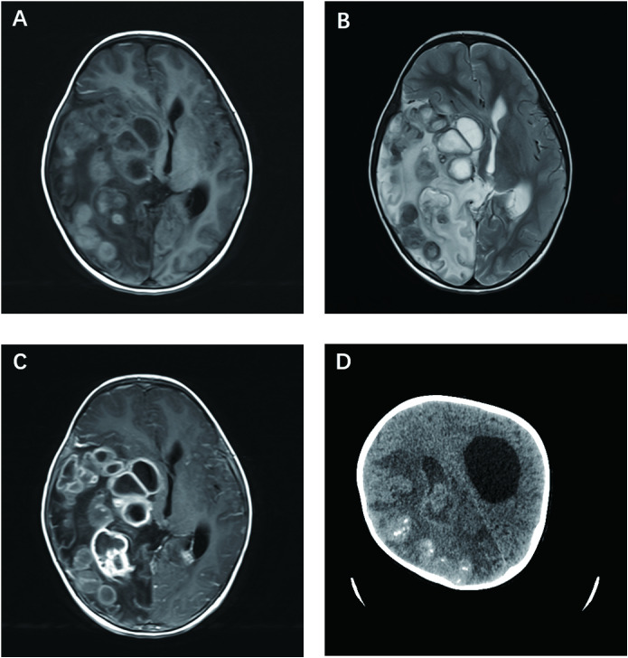

# 243 — Sán máng thần kinh (neuroschistosomiasis): tủy sống & não / Neuroschistosomiasis

**Tags:** `pattern:viem-tuy` `pattern:khang-ngam-vong` `vung:tuy-song` `vung:nao` `protocol:MRI-tuy-co-gadolinium` `protocol:MRI-nao-tuong-phan`
**Mức chắc chắn (certainty):** tổng hợp y văn (literature synthesis) — số liệu từ loạt 4 ca tại trung tâm tham chiếu London (PMC7904161), tổng quan hệ thống 118 ca tủy (PMC12956659), 2 ca tủy ở trẻ có dấu "cuống lá" (PMC11295448) và ca não ở trẻ 3 tuổi (PMC11652511). Ba ca trong quiz là **ca nguyên văn**, giữ đúng tuổi – dấu hiệu – điều trị của bài gốc.

> **Bài này nối tiếp [214 – Nhiễm trùng hệ thần kinh trung ương](../214-nhiem-trung-tktw/lesson.md)** (sán lợn, lao, toxoplasma) và **[226 – Tủy mềm không do chấn thương](../226-tuy-mem-khong-chan-thuong-nhoi-mau-sdavf-nmo-xa/lesson.md)** (nhồi máu tủy, SDAVF, NMO). Sán máng là nguyên nhân **chữa khỏi được** trong nhóm "viêm tủy" — nhưng chỉ khi được nghĩ tới **trước** khi tủy đã tổn thương không hồi phục.

## 1. Tổng quan — trứng sán tới tủy bằng đường nào, và vì sao hình ảnh trông như u

- **Bệnh học:** sán máng (schistosome) là sán lá sống trong máu; trứng **không thoát ra được** (kẹt trong mô) gây **viêm u hạt quanh trứng (periovular granuloma)** — đây là cơ chế chính của bệnh, không phải con sán trưởng thành. **S. mansoni** và **S. haematobium** → **tủy sống**; **S. japonicum** → **não** (trứng nhỏ, tròn nên dễ đi lạc lên não).
- **Vì sao tủy, và vì sao vùng nón/tủy ngực dưới (TẠI SAO hình ảnh khu trú):**
  - Trứng đi theo **đám rối tĩnh mạch Batson** (vanless paravertebral venous plexus) theo dòng **ngược chiều** xuống tủy ngực dưới–nón tủy; một số do sán trưởng thành lạc chỗ đẻ trứng tại chỗ.
  - Vùng này được nuôi bởi **động mạch tủy trước qua động mạch Adamkiewicz** (xuất phát **T9–L2**), **ít tuần hoàn bàng hệ** → trứng dễ lắng và tổn thương dễ lan.
  - Vì vậy: **hội chứng tủy ngực dưới – nón tủy – đuôi ngựa** là kiểu trình bệnh điển hình.
- **Vì sao MRI trông như u (cơ chế tín hiệu):**
  - **T2/STIR sáng nội tủy** = **phù (edema)** do viêm + ứ dịch ngoại bào; **phình tủy** vì tổn thương choán chỗ.
  - **T1 sau tiêm: ngấm thuốc dạng nốt và/hoặc đường** = các **u hạt quanh trứng** phá vỡ hàng rào máu–tủy; tập trung **ngoại vi** quanh một **đường sáng trung tâm** trên T2 → dấu **"cuống lá" (arborized pattern)**.
  - **T1 không tiêm: giảm tín hiệu** (phù), ranh giới mờ — **không có vôi hóa** (khác sán lợn).
- **Ngưỡng định lượng nằm lòng:**
  - **Tần suất:** **1–4%** người nhiễm sán máng có biểu hiện thần kinh; trứng trong tủy **0,3–13%** ca nhiễm; **~800 ca** được báo cáo từ năm 1930.
  - **Dịch tễ:** **90%** ca thần kinh ở châu Phi cận Sahara; loạt tổng quan 118 ca: **79% nam**, tuổi trung vị **25** (2–65 tuổi), **60%** tổn thương **ngực–thắt lưng/nón tủy**, **18%** chỉ ở nón tủy.
  - **Dịch não tủy (DNT):** protein tăng ở **~90%**; **eosinophil trong DNT chỉ gặp ở ~40–50%**; tế bào tăng kiểu lympho.
  - **Trễ chẩn đoán:** loạt London **16–74 ngày** (trung bình **42,15 ngày**) từ khám đến praziquantel; ca Mozambique **6 năm**; tổng quan 118 ca: **1 tháng – 1 năm**.
  - **Kết cục:** tổng quan 118 ca **90%** đạt **mRS ≤ 2**; loạt London chỉ **1/4 ca hồi phục hoàn toàn**; Lambertucci **5/23 (21,7%)** hồi phục hoàn toàn — **trễ chẩn đoán = di chứng vĩnh viễn**.
  - **Điều trị:** praziquantel **40–60 mg/kg/ngày**, **1–5 ngày** (thể thần kinh dùng liều cao/đợt dài hơn), tỷ lệ khỏi sán chung **70–90%**; **corticoid liều cao giảm dần chậm** (có ca taper **66 ngày**, có ca **1 năm**).

## 2. Mẫu hình + chẩn đoán phân biệt theo vị trí (Gamut)

**A. Tủy sống (thể thường gặp nhất — 3 kiểu lâm sàng: thể tủy, thể tủy–rễ, hội chứng nón–đuôi ngựa):**
- **Mẫu hình chốt:** **tăng T2/STIR nội tủy vùng ngực dưới/nón tủy + phình tủy + ngấm thuốc nốt–đường**, có thể lan lên tủy ngực giữa; **dày rễ đuôi ngựa**.
- Gamut "tăng T2 nội tủy": **sán máng tủy**, **viêm tủy cắt ngang/NMOSD/MOGAD**, **dò động–tĩnh mạch màng cứng (SDAVF)**, **u nội tủy (ependymoma, astrocytoma)**, **nhồi máu tủy (động mạch tủy trước)**, **tủy mềm do xạ**, **sarcoid**, **lymphoma**.

**B. Não (thể giả u — pseudotumoral encephalic schistosomiasis, PES; và thể bệnh não cấp):**
- **Mẫu hình:** một hoặc nhiều **khối ngấm thuốc vòng/dạng chùm nho**, phù quanh nhiều, có thể **vôi hóa**; hoặc **tổn thương dạng nang lớn nhiều vách** (ca trẻ 3 tuổi dưới đây).
- Gamut "khối ngấm vòng ở vùng dịch tễ": **sán máng não**, **sán lợn (neurocysticercosis)**, **lao u hạt (tuberculoma)**, **áp-xe não**, **toxoplasmosis**, **di căn**, **glioma**.

**C. Câu hỏi lọc bắt buộc trước mọi ca "viêm tủy" không rõ nguyên nhân:**
1. **Có tiếp xúc nước ngọt** (tắm, lội, bơi, chèo thuyền, làm ruộng) ở vùng dịch tễ **trong 3 năm qua**? (ca chậm nhất **29 tháng** sau tiếp xúc).
2. **Có tăng bạch cầu ái toan máu?** (chỉ **3/4** ca trong loạt London — **không có không loại trừ**).
3. **Đã chụp toàn bộ tủy có gadolinium chưa?** (tổn thương có thể ở **ngực dưới** trong khi triệu chứng "thắt lưng").

## 3. Bảng so sánh phân biệt (ma trận đối chiếu)

| Thực thể (entity) | Hình ảnh điển hình | Chốt vào (rule-in) | Chốt loại (rule-out) | Gợi ý xác nhận |
|---|---|---|---|---|
| **Sán máng tủy (spinal schistosomiasis)** | T2 sáng nội tủy **ngực dưới/nón tủy**, phình tủy, **ngấm nốt–đường ngoại vi ("cuống lá")**, dày rễ đuôi ngựa | **Dịch tễ nước ngọt + T2 sáng nón tủy + ngấm dạng nốt/đường + ELISA DNT dương** | **Không có phù/ngấm khi chụp lại sau điều trị** → xét lại chẩn đoán | MRI toàn tủy có gadolinium; ELISA huyết thanh **và** DNT; tìm trứng (phân/nước tiểu/rectal snip) |
| **NMOSD / viêm tủy cắt ngang** | **LETM ≥ 3 đốt**, tổn thương **trung tâm ("H-sign")**, ± area postrema, ± dây thị | **AQP4/MOG dương + LETM + viêm dây thị** | Ngấm **dạng nốt rời rạc** + dịch tễ nước ngọt + ELISA sán dương → loại | AQP4/MOG; MRI não; đáp ứng corticoid **không** đủ để chốt |
| **SDAVF (dò động–tĩnh mạch màng cứng)** | **Flow void** quanh tủy, phù lan **dài** từ nón tủy lên, tủy **không phình nhiều**, ngấm **mờ lan tỏa** | **Flow void + phù dài + nam > 50 tuổi + nặng dần khi đứng** | Không flow void + ngấm **nốt khu trú** → không phải | DSA tủy (chuẩn); MRA tủy |
| **U nội tủy (ependymoma)** | Khối **khu trú**, bờ rõ, **phình tủy khu trú**, có thể **xuất huyết (hemosiderin viền)**, nang | **Khối đặc khu trú + bờ rõ + không giảm sau điều trị** | **Giảm rõ sau praziquantel + corticoid** → không phải u | MRI + gadolinium; mô bệnh nếu không đáp ứng |
| **Lao cột sống (Pott)** | Tổn thương **thân đốt + đĩa đệm**, áp-xe **ngoài màng cứng**, chèn ép tủy | **Phá hủy đốt–đĩa + áp-xe cạnh sống + vôi hóa** | **Tủy bình thường, chỉ chèn ép ngoài** → không phải tổn thương nội tủy | CT xương + MRI; PCR lao |
| **Sán máng não (PES)** | Một/nhiều **khối ngấm vòng/dạng chùm nho**, phù quanh nhiều, ± vôi hóa, thùy nào cũng gặp | **Dịch tễ + huyết thanh/DNT dương + đáp ứng praziquantel** | **Tổn thương không đổi sau 2 đợt điều trị** → sinh thiết | MRI não có gadolinium; ELISA; mNGS/mô bệnh |
| **Sán lợn não (neurocysticercosis)** | **Nang + chấm đầu (dot-in-cyst)**, vôi hóa **nhiều ổ nhỏ**, thường < 20 mm, ở giao diện vỏ–tủy | **Nang có scolex + vôi hóa rải rác + dịch tễ** | **Khối lớn > 3 cm, phù nhiều, không scolex** → nghĩ sán máng/u | MRI; test huyết thanh; CT tìm vôi hóa |

*Sagittal T2 ở 4 bệnh nhân (A–D): **tăng tín hiệu nội tủy** vùng **tủy ngực dưới/nón tủy**, lan lên tủy ngực giữa với mức độ khác nhau. Đây là mẫu hình **rất kín đáo** — ca A từng được báo "bình thường" ở tuyến trước. Nguồn: de Wilton A et al., PLoS Negl Trop Dis 2021, PMC7904161, CC BY 4.0.*

## 4. Protocol chụp + tiêu chuẩn chẩn đoán + điều trị

**Protocol hình ảnh:**
- **MRI toàn bộ tủy sống** (không chỉ đoạn có triệu chứng): **sagittal T1, T2, STIR + T1 sau gadolinium** + **axial T2/T1+C** qua đoạn tổn thương. **Bắt buộc có gadolinium** — không có thuốc thì mất **dấu hiệu chốt (ngấm nốt/đường)**.
- **MRI não có gadolinium** khi có triệu chứng thần kinh trung ương, co giật, đau đầu, hoặc khi tìm ổ ngoài tủy (thể PES thường **một ổ đơn độc**, ca trẻ dưới đây có **nhiều nang lớn**).
- **Chụp lại sau 2–6 tháng điều trị** để chứng minh **giảm phù và giảm ngấm** — cũng là bằng chứng hồi cứu cho chẩn đoán.

**Tiêu chuẩn chẩn đoán (phân tầng xác suất — dùng khi không thể sinh thiết):**
- **Có thể (possible):** hội chứng tủy **ngực dưới/thắt lưng/cùng** + **bằng chứng dịch tễ** tiếp xúc nước ngọt vùng dịch tễ.
- **Nhiều khả năng (probable):** thêm **bằng chứng nhiễm sán** (huyết thanh/DNT dương, trứng trong phân/nước tiểu) + **loại trừ** nguyên nhân viêm tủy khác.
- **Xác định (confirmed):** **mô bệnh** thấy trứng/sán trưởng thành trong hệ thần kinh trung ương (hiếm khi làm vì xâm lấn).

**Điều trị (ngưỡng và con số):**
- **Praziquantel 40–60 mg/kg/ngày**, chia 3 lần; thể tủy thường **3–5 ngày**, có ca **5 ngày** (trẻ 12 tuổi), ca não trẻ 3 tuổi dùng **2 đợt × 10 ngày, 40 mg/kg/ngày, cách 6 tuần**.
- **Corticoid liều cao** (methylprednisolone tĩnh mạch rồi prednisolone uống **giảm dần chậm**): giảm **phù và phản ứng viêm quanh trứng**, đồng thời **dự phòng phản ứng do praziquantel**; thời gian taper rất khác nhau (**66 ngày – 1 năm**).
- **Phẫu thuật** chỉ khi: **chèn ép/chặn dòng DNT**, **khối lớn tăng áp lực nội sọ**, hoặc **cần mô bệnh** khi chẩn đoán không rõ. Ca trẻ 3 tuổi bị **cắt thùy đỉnh–chẩm phải** vì khối giả u — tức **phẫu thuật có thể là hậu quả của chẩn đoán muộn**.
- **Không chờ kết quả mô bệnh** nếu dịch tễ + hình ảnh + ELISA DNT phù hợp: **trễ điều trị là yếu tố tiên lượng xấu nhất**.

## 5. Biến thể bình thường và cạm bẫy

- **"MRI bình thường" ở tuyến trước:** ca đầu tiên của loạt London được đọc **bình thường**, chỉ khi hội chẩn chuyên gia mới thấy **tăng tín hiệu kín đáo + phình nhẹ nón tủy**. **Nón tủy là vùng hay bị bỏ qua nhất** trên sagittal T2 toàn tủy.
- **Chẩn đoán nhầm hay gặp — và cái giá:** 3/4 ca bị điều trị như **viêm tủy cắt ngang**, 1 ca như **hội chứng Guillain–Barré** (IVIG), 1 ca như **NMO** (thay huyết tương). Corticoid **tình cờ** giúp giảm phù nên bệnh nhân **khá lên một phần** → **tự trấn an sai**, trong khi **praziquantel bị trì hoãn 16–74 ngày**.
- **Eosinophil máu/DNT không nhạy:** máu chỉ **3/4**, DNT **~40–50%** → **không có eosinophil không loại trừ**.
- **Trứng trong phân/nước tiểu thường ÂM TÍNH** (0/4 ca London) vì sán kẹt ở đám rối Batson **không đẻ trứng ra đường tiêu hóa/niệu** → **đừng đòi bằng chứng trứng mới điều trị**.
- **Huyết thanh dương đơn thuần chưa đủ** ở người từ vùng dịch tễ (nhiễm cũ) — phải có **hội chứng tủy + hình ảnh**, tốt nhất là **ELISA DNT**.
- **Đừng quên phổ tổn thương ngoài tủy:** thiếu máu, tăng áp cửa, tiểu máu — nhưng **không có tổn thương ngoài thần kinh không loại trừ** thể thần kinh (ca trẻ 3 tuổi: siêu âm bụng/niệu và X-quang ngực **bình thường**, huyết thanh **âm tính**).
- **Thể não dễ bị mổ nhầm vì "giống u":** khối ngấm vòng + phù nhiều + vôi hóa ở vùng dịch tễ → **luôn hỏi dịch tễ trước khi mổ lấy u**.
- **Sau điều trị vẫn còn ngấm thuốc một phần** ở tháng thứ 2 là bình thường (ca 14 tuổi) — đánh giá lại ở **3–6 tháng**, đừng kết luận thất bại quá sớm.

## 6. Tự lượng giá — Blind Quiz

**Ca 1 — Bé trai 12 tuổi, đau lưng cấp 2 tuần, yếu hai chân 3/5, phản xạ gân gối tăng. MRI thắt lưng–cùng:**

- Gợi ý: sống ở vùng dịch tễ, **thường xuyên tắm hồ**; xét nghiệm phân có **trứng S. mansoni**.
- Câu hỏi: (1) Mô tả tổn thương trên T2 và sau gadolinium? (2) Dấu hiệu nào gợi ý **u hạt quanh trứng** hơn là u? (3) Điều trị và mốc chụp lại?

<b>Bấm để hiện đáp án (findings + chẩn đoán)</b>

- **Dấu hiệu:** **phình nón tủy**, **tăng tín hiệu T2** nội tủy lan quanh; sau gadolinium có **ngấm dạng đường + nốt ở ngoại vi** quanh một **đường sáng trung tâm** → **dấu "cuống lá" (arborized)**.
- **Vì sao gợi ý u hạt:** ngấm thuốc **rải rác, nhiều ổ nhỏ theo hình nhánh** trong khi tủy **phình lan tỏa** — u thật (ependymoma) thường **một khối khu trú, bờ rõ**.
- **Điều trị:** **praziquantel 60 mg/kg/ngày × 5 ngày** + **methylprednisolone tĩnh mạch rồi prednisolone giảm dần**; chụp lại **5 tháng** — phù và ngấm **giảm rõ**.
- Nguồn ảnh: Abera MT et al., Radiol Case Rep 2024, **PMC11295448**, Fig. 1, CC BY-NC-ND 4.0 (giữ nguyên bản).

**Ca 2 — Bốn bệnh nhân (21–50 tuổi), cùng triệu chứng đau lưng – yếu chân – bí tiểu. Ảnh T2 sagittal của cả 4:**

- Câu hỏi: (1) Điểm chung của 4 ảnh? (2) Vì sao bệnh nhân A từng được trả lời "MRI bình thường"? (3) Xét nghiệm nào chốt chẩn đoán trong loạt ca này?

<b>Bấm để hiện đáp án</b>

- **Điểm chung:** **tăng tín hiệu nội tủy** vùng **tủy ngực dưới/nón tủy**, mức lan khác nhau; có ca lan lên tủy ngực giữa.
- **Vì sao "bình thường":** thay đổi **rất kín đáo** (chỉ phù nhẹ + phình nhẹ nón tủy), dễ bị đọc qua nếu không để ý vùng nón tủy và không có gadolinium.
- **Chốt:** **ELISA sán máng trong DNT dương ở cả 4 ca** (kèm tăng tế bào lympho trong DNT ở cả 4); huyết thanh dương 4/4; **không ca nào có trứng trong phân/nước tiểu**.
- Nguồn ảnh: de Wilton A et al., PLoS Negl Trop Dis 2021, **PMC7904161**, Fig. 3, CC BY 4.0.

**Ca 3 — Bé gái 3 tuổi, đi không vững 3 tháng, liệt mặt trái, ngủ gà, sốt từng đợt. MRI não + CT:**

- Câu hỏi: (1) Mô tả tổn thương và 3 chẩn đoán phân biệt hàng đầu ở vùng dịch tễ? (2) Vì sao ca này **không có bằng chứng ngoài thần kinh** mà vẫn là sán máng? (3) Bài học về chỉ định mổ?

<b>Bấm để hiện đáp án</b>

- **Dấu hiệu:** **khối dạng nang lớn nhiều vách** thùy thái dương–đỉnh–chẩm phải, **phù quanh nhiều**, **ngấm thuốc vòng** sau gadolinium, **vôi hóa** trên CT → giống **áp-xe/u**; DDx: **sán máng não (PES)**, **sán lợn**, **lao u hạt/áp-xe**, **u não**.
- **Vì sao vẫn là sán máng:** **mô bệnh** thấy **u hạt hoại tử chứa trứng S. japonicum**, **mNGS** xác nhận; trong khi **siêu âm bụng/niệu, X-quang ngực bình thường** và **ELISA huyết thanh âm tính** (cả gia đình) — thể não **đơn độc** vẫn xảy ra.
- **Bài học:** ca này bị **cắt thùy đỉnh–chẩm** để chẩn đoán và giảm chèn ép; trẻ còn **liệt nửa người trái** và **GOS 4** sau 3 năm. Nếu nghĩ tới sán máng **trước mổ**, có thể đã điều trị nội khoa trước và **tránh cắt thùy**.
- Nguồn ảnh: Guo Y et al., Front Immunol 2024, **PMC11652511**, Fig. 1, CC BY 4.0.

> **Phản biện (critique):** phần lớn bằng chứng là **loạt ca và tổng quan hồi cứu**, không có RCT; liều praziquantel và thời gian corticoid **chưa thống nhất** giữa các trung tâm. Vì vậy trong bài này mọi con số được ghi kèm nguồn, và **không** biến một phác đồ của loạt ca thành "khuyến cáo mạnh".

## Bài liên quan chéo
- [200 – Tổng quan Hệ Thần kinh](../200-tong-quan-he-than-kinh/lesson.md)
- [214 – Nhiễm trùng hệ thần kinh trung ương: sán lợn, lao, toxoplasma](../214-nhiem-trung-tktw/lesson.md)
- [226 – Tủy mềm không do chấn thương: nhồi máu tủy, SDAVF, NMO](../226-tuy-mem-khong-chan-thuong-nhoi-mau-sdavf-nmo-xa/lesson.md)
- [220 – Tiếp cận tổn thương ống sống theo 3 khoang](../220-ong-song-tuy/lesson.md)
- [215 – Bệnh lý mất myelin: MS, NMOSD, ADEM](../215-mat-myelin/lesson.md)
- [222 – Viêm đốt sống–đĩa đệm & lao cột sống (Pott)](../222-viem-dot-song/lesson.md)
- [238 – Hội chứng Lemierre: nhiễm khuẩn kỵ khí lan theo đường máu](../238-lemierre-huyet-khoi-tm-canh-trong/lesson.md)

> Không dùng để chẩn đoán độc lập khi chưa có người hướng dẫn.
