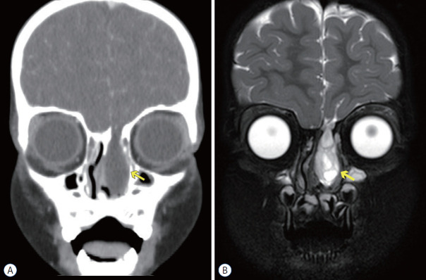
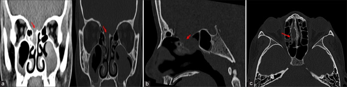
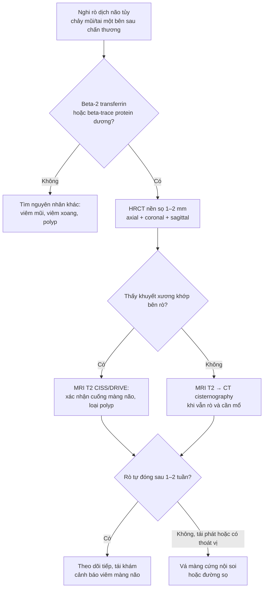
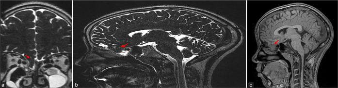
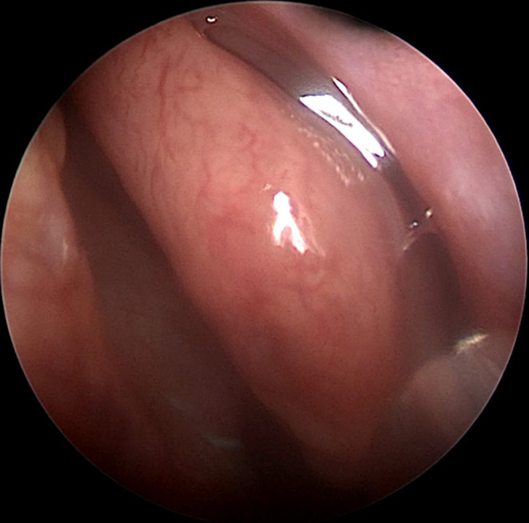

# 244 — Rò dịch não tủy sau chấn thương nền sọ ở trẻ: định vị bằng HRCT/MRI & chỉ định vá / Paediatric post-traumatic CSF leak

**Tags:** `pattern:ro-dich-nao-tuy` `pattern:khuyet-xuong` `vung:nen-so` `vung:xoang` `protocol:HRCT` `protocol:MRI-T2-nang` `protocol:CT-cisternography` `incidentaloma:khi-noi-so`
**Mức chắc chắn (certainty):** tổng hợp y văn (literature synthesis) — số liệu từ tổng quan nhi khoa (PMC9082117), đoàn hệ 499 bệnh nhân vỡ nền sọ (PMC13157939), tổng quan chẩn đoán (PMC11129547) và tổng quan hệ thống (PMC12398667); ca minh họa từ hai bài CC BY-NC/CC BY-NC-SA. Không suy diễn ngoài nguồn.

> Bài này tập trung **rò dịch não tủy (CSF) do chấn thương nền sọ ở trẻ**: xác nhận dịch, định vị lỗ rò, theo dõi tự đóng và chọn thời điểm vá. Vỡ sọ tiến triển (growing skull fracture) và tổn thương mạch cổ đã có ở [231](../231-ton-thuong-mach-mau-nao-chan-thuong-va-vo-so-tien-trien/lesson.md); chấn thương đầu nhẹ/PECARN ở [232](../232-chan-thuong-dau-nhe-concussion-o-tre/lesson.md).

*Bên trái (A): CT coronal cửa sổ xương — khuyết xương ở trần sàng bên trái cạnh gai gà (mũi tên vàng). Bên phải (B): MRI T2 coronal — khối **tăng tín hiệu T2 đồng dạng dịch não tủy** chui qua khuyết xương xuống hốc mũi, tức **màng não–não thoát vị (meningoencephalocele)**. Đây là lý do phải phối hợp CT (xương) với MRI (mô mềm/dịch). Nguồn: Choi JI, Kim SD, J Korean Neurosurg Soc 2022, PMC9082117, Fig. 2, CC BY-NC 4.0 (nguyên bản).*

## 1. Tổng quan bệnh học – cơ chế hình ảnh

- **Định nghĩa:** rò CSF là sự thông thương giữa khoang dưới nhện và môi trường ngoài (mũi, tai, vết thương) do **rách màng cứng + khuyết xương nền sọ**. Ở trẻ, nguyên nhân hay gặp là **chấn thương đầu kín** (tai nạn giao thông, ngã), sau đó là **bẩm sinh** và **do phẫu thuật**.
- **Dịch tễ (số cần nhớ):**
  - Rò CSF gặp ở **2%** tất cả chấn thương đầu ở trẻ và **12–30%** các ca **vỡ nền sọ** (PMC9082117).
  - Thời điểm: **55%** xuất hiện trong **48 giờ**, **70%** trong **tuần đầu**; **10–20%** xuất hiện muộn sau nhiều năm (PMC9082117).
  - Diễn tiến tự nhiên: **20–30%** ngừng trong **1 tuần**, **70%** ngừng trong vài tháng, **phần lớn trong 6 tháng** (PMC9082117).
  - **Viêm màng não** là biến chứng nguy hiểm nhất: **~24%** ở rò mũi không điều trị (PMC9082117); tử vong do viêm màng não sau chấn thương **29–57,9%** (PMC12398667).
  - Đoàn hệ 499 bệnh nhân vỡ nền sọ: **7,2%** có rò CSF; rò làm tăng **viêm màng não 11,1% vs 0,9%**, **liệt thần kinh sọ 19,4% vs 4,8%**, **tổn thương động mạch cảnh trong 13,9% vs 3,7%**; nằm viện trung vị **23,5 vs 14 ngày** (PMC13157939).
- **TẠI SAO trẻ khác người lớn:**
  - Xương sọ trẻ **mỏng, đàn hồi**, xoang hàm/trán/sàng **chưa phát triển đầy đủ** → cùng một lực va đập tạo kiểu vỡ khác, và **dịch có thể chảy qua đường rất nhỏ**.
  - Trẻ nhỏ dễ bỏ sót vì **không mô tả được triệu chứng**; rò có thể biểu hiện gián tiếp: **chảy nước mũi một bên**, nếm mặn, ho, viêm màng não tái phát, hoặc **khí nội sọ** trên CT.
  - **Vỡ sọ tiến triển** (0,05–1,6% các vỡ sọ, > 90% dưới 3 tuổi) là biến chứng riêng của trẻ — xem [231](../231-ton-thuong-mach-mau-nao-chan-thuong-va-vo-so-tien-trien/lesson.md).
- **TẠI SAO hình ảnh đọc được (vật lý):**
  - **CT cửa sổ xương:** xương nền sọ rất mỏng (trần sàng, trần xoang bướm) nên **lỗ rò chỉ vài mm**; cần lát **1–2 mm**, đa bình diện, và đối chiếu **hai bên**. CT **không thấy màng cứng** — chỉ thấy **khuyết xương + dịch trong xoang + khí nội sọ**.
  - **MRI T2 nặng T2 (CISS/DRIVE/FIESTA):** CSF có **T1 thấp, T2 rất cao**; mô não **T2 trung bình**. Nhờ tương phản này, MRI phân biệt **dịch CSF** với **niêm mạc phù/mủ** (cùng đậm độ trên CT) và thấy **cuống thoát vị màng não/não**.
  - **Dịch trong xoang một bên + vách xoang đầy** ở bệnh nhân chấn thương là dấu **gián tiếp** rất gợi ý, nhưng không chứng minh rò.
  - **Khí nội sọ (pneumocephalus)** sau chấn thương là dấu hiệu **chỉ điểm** cho rách màng cứng — trong đoàn hệ 499 ca, khí nội sọ là **yếu tố tiên đoán độc lập** của rò CSF (PMC13157939).

## 2. Mẫu hình + chẩn đoán phân biệt theo vị trí (Gamut)

- **Nền sọ trước (trần sàng, mảnh sàng, xoang trán):** chảy **nước mũi trong, một bên**, tăng khi cúi đầu/Valsalva; nguy cơ viêm màng não cao nhất. Trên CT: khuyết trần sàng/mảnh sàng, dịch trong xoang sàng/trán.
- **Nền sọ giữa (xương đá, xoang bướm):** chảy **dịch tai**, màng nhĩ xanh (hemotympanum), dấu Battle; có thể rò qua vòi nhĩ gây "chảy mũi" — dễ chẩn đoán nhầm là rò mũi.
- **Xoang bướm/sella:** chảy sau mũi, **vị giác mặn**, đau đầu; liên quan động mạch cảnh trong (nguy cơ chảy máu nếu can thiệp) và tuyến yên.
- **Nền sọ sau/hố sau:** hiếm; thường biểu hiện **viêm màng não tái phát** hoặc rò qua ống tai trong.
- **Không do chấn thương:** tăng áp lực nội sọ vô căn (IIH) ở trẻ béo phì/dậy thì, dị dạng bẩm sinh, sau xạ/phẫu thuật.
- **Gợi nhớ "LEAK":** **L**ocation (định vị trước/giữa/sau) · **E**vent (chấn thương, phẫu thuật, tự phát) · **A**nalysis (beta-2 transferrin/beta-trace) · **K**eep imaging (HRCT → MRI → CT cisternography).

## 3. Bảng so sánh phân biệt (ma trận đối chiếu)

| Thực thể (entity) | Hình ảnh điển hình | Chốt vào (rule-in) | Chốt loại (rule-out) | Gợi ý xác nhận |
|---|---|---|---|---|
| **Rò CSF do chấn thương** | Khuyết xương nền sọ + dịch trong xoang một bên; khí nội sọ; MRI thấy cuống màng não | **Beta-2 transferrin dương + khuyết xương khớp lâm sàng** | Dịch trong mũi không có beta-2 transferrin; không có khuyết xương | HRCT 1–2 mm + MRI T2 nặng T2; CT cisternography nếu cần |
| **Viêm mũi dị ứng** | Niêm mạc mũi phù, cuốn mũi to, không khuyết xương | **Ngứa, hắt hơi, đối xứng hai bên, đáp ứng kháng histamine** | Dịch một bên, trong như nước, tăng khi cúi → nghĩ CSF | Beta-2 transferrin; nội soi |
| **Viêm xoang cấp** | Mờ xoang, mức dịch–không khí, dày niêm mạc | **Đau xoang, sốt, mủ, đáp ứng kháng sinh** | Dịch trong, không mủ, không sốt, kéo dài → nghĩ CSF | CT xoang; beta-2 transferrin |
| **Polyp mũi / polyp phế nang–xoang** | Khối mềm trong xoang nan hoa, làm rộng lỗ xoang, không khuyết xương | **Khối đặc, không có cuống màng não, không có beta-2 transferrin** | Có khuyết xương trần sàng + cuống → nghĩ thoát vị màng não | MRI T2; **không sinh thiết mù** |
| **Màng não–não thoát vị (meningoencephalocele)** | Khối **đồng tín hiệu não/dịch** chui qua khuyết xương, cuống rõ | **MRI: cuống liên tục với khoang dưới nhện + khuyết xương** | Khối không liên tục với nội sọ → polyp/u | MRI T2 CISS/DRIVE; CT bổ trợ |
| **Nang nhầy xoang (mucocele)** | Xoang mờ, **làm rộng xoang**, bờ xương mỏng nhưng **liên tục** | **Không có lỗ rò, không có beta-2 transferrin** | Có khuyết xương + dịch CSF → rò | MRI (T2 sáng, không cuống) |
| **Vỡ sọ tiến triển** | Đường vỡ **rộng dần**, nang màng não, thoát vị não | **Trẻ < 3 tuổi + đường vỡ giãn theo thời gian** | Đường vỡ không đổi, không nang → vỡ đơn thuần | So phim cũ; MRI |

*CT không cản quang, cửa sổ xương, nhiều bình diện: (a, b) coronal và sagittal — khuyết trần sàng/mảnh sàng (mũi tên đỏ) với mô mềm chui vào xoang sàng; (c) axial — khuyết xương và mờ trong xoang. Ở trẻ, một khuyết **vài mm** vẫn đủ gây rò. Nguồn: Jesus IM et al., Surg Neurol Int 2026, PMC13440802, Fig. 1, CC BY-NC-SA 4.0.*

## 4. Protocol: xác nhận → định vị → theo dõi → vá

### 4.1 Bước 1 — Xác nhận dịch là CSF (làm trước khi chụp nhiều)

- **Beta-2 transferrin (B2T):** tiêu chuẩn vàng, **Se 87–100%, Sp 71–94%**; cần **200–500 µL**, thời gian 2,5 giờ (tại chỗ) đến 3–5 ngày (gửi ngoài) (PMC11129547).
- **Beta-trace protein (BTP):** **Se 78–100%, Sp 86–100%**; nhanh hơn nhưng cũng có trong huyết thanh (PMC11129547).
- **Đừng dựa vào:** glucose (Sp chỉ **45%**), dấu halo (không đáng tin khi có máu), test giấy glucose oxidase (PMC9082117, PMC11129547).
- **Mẹo lâm sàng:** dịch **một bên, trong, tăng khi cúi/Valsalva**, vị mặn; nhưng chỉ **30%** ca "chảy nước mũi trong một bên" được xác nhận là CSF (PMC11129547) — **không chẩn đoán bằng triệu chứng**.

### 4.2 Bước 2 — Định vị lỗ rò bằng hình ảnh

- **HRCT nền sọ, lát 1–2 mm, axial + coronal + sagittal:** phương thức đầu tay; **độ nhạy ~70%** trong việc tìm đúng vị trí rò đã xác nhận bằng B2T (PMC11129547). Ghi rõ: vị trí, kích thước khuyết, bên, có thoát vị/mô mềm, có khí nội sọ.
- **MRI T2 nặng T2 (CISS/DRIVE/FIESTA) + T1 sau tiêm khi cần:** thấy **cuống màng não/não**, phân biệt dịch với niêm mạc; **MR cisternography Se 56–94%, Sp 57–100%** (PMC11129547). MRI là bước hai sau HRCT, đặc biệt khi xoang viêm/đầy dịch che lấp.
- **CT cisternography (bơm cản quang vào ống sống):** khi HRCT/MRI không định vị được hoặc có **nhiều ổ khuyết xương**; chỉ có giá trị **khi đang rò** (cần đủ áp lực); có nguy cơ đau đầu, nhiễm, co giật (PMC11129547).
- **Đồng vị cisternography:** **Se 0,90 nhưng Sp chỉ 0,50** — **không dùng để định vị** (quá nhiều dương tính giả), chỉ còn giá trị lịch sử (PMC11129547).

### 4.3 Bước 3 — Theo dõi hay vá?

- **Điều trị bảo tồn trước:** nằm nghỉ, **đầu cao 30°**, tránh xì mũi/rặn, tránh Valsalva, điều trị táo bón; theo dõi dấu thần kinh và nhiệt độ. Tỷ lệ tự đóng: **39,5% sau 3 ngày**, tăng đến **85% sau ≥ 1 tuần** trong một tổng quan (PMC9655814).
- **Chỉ định vá (khi hội tụ):** rò **kéo dài/tái phát** sau 1–2 tuần; **viêm màng não tái phát**; **khuyết xương lớn** hoặc **thoát vị não**; **khí nội sọ tăng**; rò qua xoang bướm/sella gần động mạch cảnh.
- **Thời điểm còn tranh luận:** có nhóm ủng hộ **đóng sớm trong 72 giờ**, nhóm khác chờ tự đóng; chưa có thử nghiệm ngẫu nhiên (PMC12398667). Điều chắc chắn: **rò càng kéo dài, nguy cơ viêm màng não càng cao**.
- **Kết quả:** phẫu thuật cần ở **46%** ca trong tổng quan hệ thống, thành công **59,3–77%** (PMC12398667); phẫu thuật nội soi qua mũi hiện đại đạt **đóng kín > 90%**, ít biến chứng (PMC13157939).
- **Kháng sinh dự phòng:** Cochrane **không thấy giảm viêm màng não** ở vỡ nền sọ có rò CSF (dẫn trong PMC13157939); tổng quan hệ thống ghi nhận **RR 0,67, không có ý nghĩa** (PMC12398667). **Không dùng kháng sinh thay cho vá kín** — chỉ điều trị khi có nhiễm.

### 4.4 Khác biệt nhi khoa (đọc nhanh)

- **Trẻ càng nhỏ càng khó định vị:** xoang chưa phát triển, khuyết xương nhỏ; **CT lát mỏng 1 mm** quan trọng hơn ở người lớn.
- **Rò muộn** sau nhiều năm là chuyện có thật: ca minh họa dưới đây rò **4 năm sau chấn thương** (PMC13440802).
- **Viêm màng não tái phát** ở trẻ không rõ nguyên nhân → phải tìm **khuyết xương bẩm sinh/dị dạng nền sọ**, không chỉ nghĩ suy giảm miễn dịch.
- **Không sinh thiết khối trong mũi** khi chưa loại trừ thoát vị màng não — đây là tai biến chết người.

## 5. Biến thể bình thường và cạm bẫy

- **HRCT âm không loại trừ rò:** độ nhạy chỉ **~70%**; khuyết xương có thể bị che bởi máu/niêm mạc phù, hoặc rò qua **lỗ nhỏ xiên**. Nếu vẫn nghi, lặp CT sau vài ngày hoặc chuyển MRI/CT cisternography.
- **Dấu halo và glucose:** đều **không đáng tin**; halo xuất hiện với bất kỳ dịch nào trộn máu, glucose mũi tăng trong tăng đường huyết/viêm mũi.
- **"Chảy nước mũi do viêm mũi" ở trẻ** có thể che rò thật; dịch **một bên, trong, tăng khi cúi** là dấu cảnh báo.
- **Khí nội sọ sau chấn thương:** đừng bỏ qua — có thể là dấu duy nhất của rách màng cứng (PMC13157939).
- **Polyp/màng não thoát vị:** trên CT không cản quang có thể trông giống "polyp"; **MRI T2** phân biệt nhờ cuống liên tục với khoang dưới nhện. **Tuyệt đối không sinh thiết mù**.
- **Rò qua vòi nhĩ:** "chảy mũi" nhưng gốc ở tai giữa; khám màng nhĩ và xương đá.
- **Ảo giác "vá đã kín":** hết chảy nước mũi không đồng nghĩa màng cứng kín — **khuyết xương vẫn còn** và viêm màng não có thể tái phát (PMC9082117).
- **Niềm tin "viêm màng não giúp màng cứng lành":** tổng quan hệ thống **bác bỏ**; viêm màng não làm **chậm lành và tăng biến chứng** (PMC12398667).

## 6. Tự lượng giá — Blind Quiz

**Ca 1 — Bé gái 13 tuổi, chảy nước mũi trong một bên **4 năm** sau chấn thương sọ mặt. CT nền sọ:**

- Câu hỏi: Bất thường ở đâu? Vì sao rò xuất hiện muộn? Cần chụp gì tiếp?

<b>Bấm để hiện đáp án (findings + chẩn đoán)</b>

- Dấu hiệu: **khuyết trần sàng/mảnh sàng** (mũi tên đỏ) với mô mềm trong xoang sàng; các bình diện coronal/sagittal/axial đều thấy bờ xương mất liên tục.
- Chẩn đoán: **rò CSF muộn sau chấn thương** — mô sẹo/màng não bị bong theo thời gian, hoặc khuyết xương lớn dần.
- Tiếp theo: **MRI T2 CISS/DRIVE** để xác nhận cuống màng não và loại polyp; xét nghiệm **beta-2 transferrin** nếu còn dịch; hội chẩn vá nội soi.
- Nguồn: Jesus IM et al., Surg Neurol Int 2026, PMC13440802, Fig. 1, CC BY-NC-SA 4.0.

**Ca 2 — Cùng bệnh nhi, MRI T2 sau đó:**

- Câu hỏi: Cấu trúc nào chui qua khuyết xương? Chuỗi xung nào giúp phân biệt với polyp?

<b>Bấm để hiện đáp án</b>

- Dấu hiệu: khối **tăng tín hiệu T2** liên tục với khoang dưới nhện qua khuyết trần sàng, có cuống — **màng não–não thoát vị (encephalocele)**; phần mô não thoát vị có tín hiệu giống nhu mô não.
- Chuỗi xung: **T2 nặng T2 (CISS/DRIVE/FIESTA)** — CSF rất sáng, não trung bình; giúp thấy cuống và phân biệt với **polyp** (không có cuống, không liên tục với nội sọ).
- Ý nghĩa: có thoát vị não → **chỉ định vá**, không chờ tự đóng.
- Nguồn: Jesus IM et al., Surg Neurol Int 2026, PMC13440802, Fig. 2, CC BY-NC-SA 4.0.

**Ca 3 — Trẻ có khối trong mũi một bên, nội soi thấy dịch trong như nước:**

- Câu hỏi: Dấu hiệu này gợi ý gì? Bước xác nhận nào **không** nên làm?

<b>Bấm để hiện đáp án</b>

- Dấu hiệu: **dấu meniscus (meniscus sign)** — dịch trong tụ thành mặt khum ở ngách mũi giữa, gợi ý rò CSF từ xoang trán/sàng.
- Xác nhận: **beta-2 transferrin** (Se 87–100%, Sp 71–94%) ± beta-trace protein; sau đó **HRCT 1 mm + MRI T2** để định vị.
- **Không nên:** sinh thiết khối/dịch mù khi chưa loại trừ thoát vị màng não; không dựa vào glucose hay dấu halo.
- Nguồn: Torabi SJ et al., Laryngoscope Investig Otolaryngol 2024, PMC11129547, Fig. 2, CC BY-NC-ND 4.0 (nguyên bản).

## Bài liên quan chéo

- [200 – Tổng quan hệ Thần kinh](../200-tong-quan-he-than-kinh/lesson.md)
- [224 – Chấn thương sọ não ở trẻ](../224-chan-thuong-so-nao-nhi/lesson.md)
- [231 – Tổn thương mạch máu não do chấn thương & vỡ sọ tiến triển](../231-ton-thuong-mach-mau-nao-chan-thuong-va-vo-so-tien-trien/lesson.md)
- [232 – Chấn thương đầu nhẹ & PECARN ở trẻ](../232-chan-thuong-dau-nhe-concussion-o-tre/lesson.md)
- [235 – Xương thái dương & xoang](../235-xuong-thai-duong-xoang/lesson.md)
- [236 – Viêm tai xương chũm biến chứng nội sọ](../236-viem-tai-xuong-chum-bien-chung-noi-so/lesson.md)

## Ảnh

- `images/244-ro-dich-nao-tuy_CT-MRI_PMC9082117-Fig2.jpg` — CT + MRI khuyết trần sàng/màng não thoát vị ở trẻ, CC BY-NC 4.0.
- `images/244-ro-dich-nao-tuy_CT_PMC13440802-Fig1.jpg` — CT nhiều bình diện khuyết trần sàng, CC BY-NC-SA 4.0.
- `images/244-ro-dich-nao-tuy_MRI_PMC13440802-Fig2.jpg` — MRI T2 thoát vị màng não, CC BY-NC-SA 4.0.
- `images/244-ro-dich-nao-tuy_NoiSoi_PMC11129547-Fig2.jpg` — nội soi dấu meniscus, CC BY-NC-ND 4.0.
- Nguồn + giấy phép từng ảnh: `images/CREDITS.md`.

> Không dùng để chẩn đoán độc lập khi chưa có người hướng dẫn.
