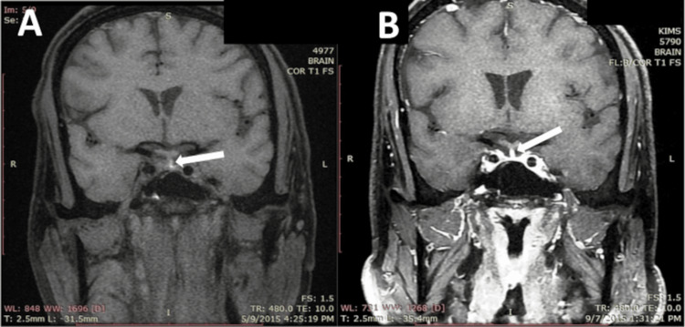
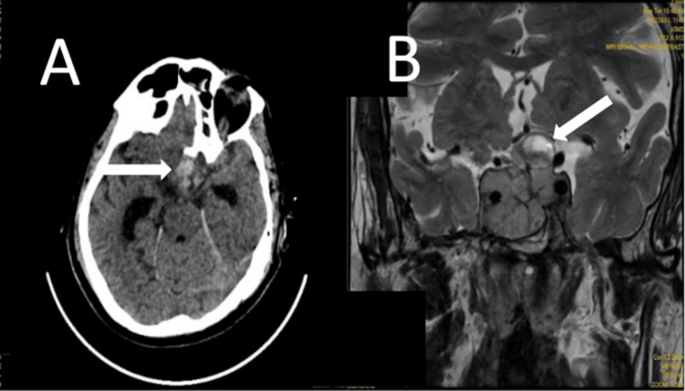
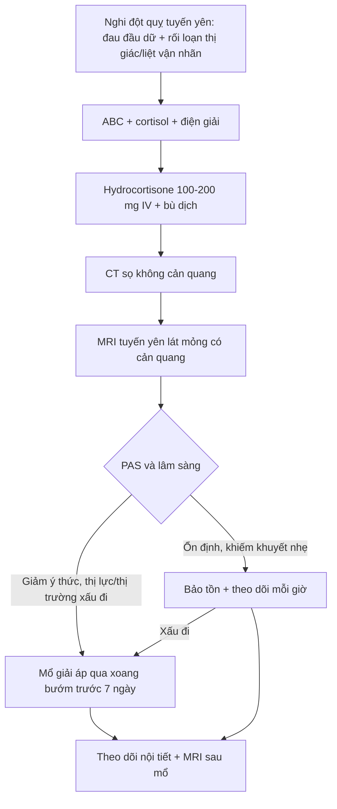
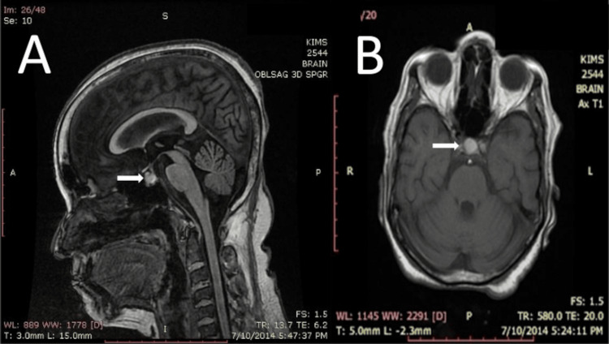
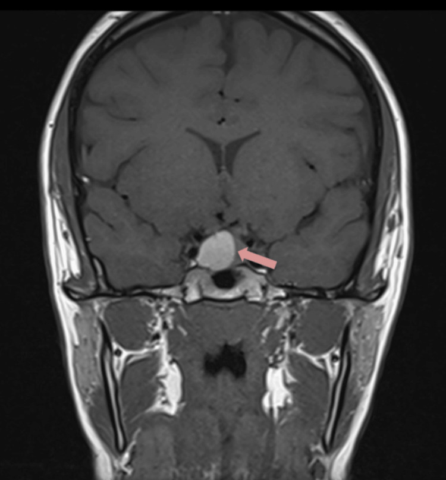

# 245 — U tuyến yên chảy máu/nhồi máu (pituitary apoplexy) & suy tuyến yên cấp / Pituitary apoplexy & acute hypopituitarism

**Tags:** `pattern:dot-quy-tuyen-yen` `pattern:khoi-yen` `pattern:suy-tuyen-yen-cap` `vung:giao-thoa` `score:PAS` `protocol:MRI-yen` `protocol:CT-so-nao`
**Mức chắc chắn (certainty):** tổng hợp y văn (literature synthesis) — số liệu từ bài tổng quan có bản toàn văn mở (PMC4263799, PMC11084238), cohort 98 bệnh nhân (PMC13221369), meta-analysis thời điểm mổ (PMC11614942) và registry tái phát (PMC13033880); **các ca trong quiz là ca nguyên văn** giữ đúng tuổi – bối cảnh – chú thích gốc.

> **Câu chốt cấp cứu:** đau đầu dữ đột ngột + **sụp thị trường/thị lực** hoặc **liệt vận nhãn** ở người có khối vùng yên = **đột quỵ tuyến yên cho tới khi loại trừ**. **Hydrocortisone tĩnh mạch NGAY** (trước khi có kết quả cortisol), rồi MRI tuyến yên — **CT âm không loại trừ**.

## 1. Tổng quan bệnh học – cơ chế hình ảnh (TẠI SAO)

- **Đột quỵ tuyến yên (pituitary apoplexy, PA)** là hội chứng cấp do **chảy máu và/hoặc nhồi máu** trong tuyến yên, thường trên nền một **u tuyến yên (PitNET)**. Cơ chế được chấp nhận: u phát triển vượt cấp máu → **hoại tử thiếu máu** trung tâm → **vỡ mạch và chảy máu trong u**; khối căng trong hố yên hẹp gây chèn ép giao thoa thị và các dây thần kinh trong xoang hang.
- **Tần suất:** PA gặp ở **1,6–2,8%** bệnh nhân u tuyến yên (PMC4263799); ước tính **0,17 ca/100.000 người–năm**, nam:nữ khoảng **2:1**, tuổi hay gặp **50–60** (PMC11084238). Khoảng **60%** bệnh nhân không biết mình có u trước biến cố (PMC4263799).
- **Yếu tố thúc đẩy:** u không chức năng (**OR 1,93**), nam (**OR 2,57**), tăng huyết áp (**OR 2,53**) (PMC13008675); thuốc **đồng vận dopamine (cabergoline)**, **chống đông/chống kết tập tiểu cầu**, phẫu thuật lớn, thai kỳ, test kích thích tuyến yên, xạ trị (PMC11084238).
- **TẠI SAO CT dễ bỏ sót:** máu tụ cấp đặc **60–80 HU**, nhưng hố yên nhỏ và lát cắt dày làm thể tích trung bình (partial volume) — **độ nhạy CT chỉ 21–46%** (PMC4263799); một tổng quan khác ghi CT phát hiện khối yên **> 80%** nhưng chỉ chẩn đoán PA **< 30%** (PMC11084238). Vì vậy **CT bình thường không loại trừ PA**.
- **TẠI SAO MRI là chốt:** độ nhạy MRI **88–90%** (PMC4263799). Tín hiệu thay đổi theo tuổi máu:
  - **Cấp 0–7 ngày:** deoxyhemoglobin → **T2 tối**, T1 đồng/giảm nhẹ tín hiệu.
  - **Bán cấp 7–21 ngày:** methemoglobin nội bào → **T1 sáng**, T2 sáng — đây là lý do **T1 tăng tín hiệu là dấu hiệu MRI thường gặp nhất** của PA.
  - **Mạn > 21 ngày:** hemosiderin/ferritin → **T1 và T2 đều tối**.
  - **Mức dịch–dịch (fluid–fluid level)** trong khối và **blooming trên SWI/T2\*** giúp phân biệt máu với nang giàu protein/mucin.
- **TẠI SAO suy thượng thận cấp nguy hiểm:** cortisol thấp làm **giảm đáp ứng mạch với catecholamine** → tụt huyết áp, choáng; đồng thời **tăng tiết ADH** → **hạ natri máu** (PMC11084238). Vì aldosterone còn phụ thuộc hệ renin–angiotensin, **tăng kali máu không điển hình** — khác suy thượng thận nguyên phát.
- **Số liệu nội tiết tại chẩn đoán (cohort 98 BN):** gần **80%** có suy ít nhất một trục; **giảm cortisol 55,6%**, **giảm giáp 64,4%**, **giảm sinh dục 55,6%**, **thiếu ADH 4,4%** (PMC13221369). Các tỷ lệ cộng > 100% vì một bệnh nhân có thể suy nhiều trục. **Đái tháo nhạt hiếm** vì thùy sau thường được bảo tồn.

*Case 1 (67 tuổi): (A) MRI T1 fat-sat vành — ổ tăng tín hiệu ở chỗ nối cuống–tuyến yên, cạnh một vi tuyến giảm tín hiệu 0,6 × 0,7 × 0,8 cm; (B) sau biến cố, hố yên trống trên T1 + Gd. Nguồn: Meher D et al., Cureus 2025 (PMC12718215), Fig. 1, CC BY 4.0.*

## 2. Mẫu hình + chẩn đoán phân biệt theo cơ chế & bối cảnh (Gamut)

- **Theo cơ chế tổn thương:**
  - **Chảy máu trong u (hemorrhagic apoplexy):** hay gặp nhất; CT tăng đậm độ, MRI T1 sáng (bán cấp), mức dịch–dịch.
  - **Nhồi máu tuyến yên (ischemic apoplexy):** T1 đồng/giảm, T2 tăng, có thể hạn chế khuếch tán; bối cảnh tụt huyết áp, sau mổ, sản khoa (Sheehan).
  - **Hỗn hợp nhồi máu–chảy máu:** mô bệnh thường thấy hoại tử + máu; hình ảnh không đồng nhất.
- **Theo tổn thương nền:**
  - **PitNET/adenoma** (đa số, kể cả vi tuyến — ca 1 chỉ 0,6–0,8 cm).
  - **Nang Rathke kỵ nước (Rathke cleft cyst)** chảy máu: T1 sáng do protein, **không có mức dịch–dịch điển hình**, bờ nang rõ.
  - **Craniopharyngioma, u màng não củ yên, di căn, viêm tuyến yên (hypophysitis)** — hiếm nhưng vào gamut khối vùng yên (bài 432).
  - **Sheehan syndrome:** hoại tử sau sinh do giảm thể tích/máu; tuyến yên to lan tỏa cấp rồi teo.
- **Theo bối cảnh khởi phát:** tự phát; do **cabergoline** (ca 5); do **chống đông/phẫu thuật lớn/thai kỳ**; sau chấn thương đầu.
- **Chẩn đoán phân biệt của đau đầu sét đánh (TCH):** SAH, RCVS, CVST, **bóc tách động mạch cổ** (bài 247), viêm màng não, hạ áp lực nội sọ — xem bài 227.
- **Mnemonic vùng yên “SATCHMO”:** **S**ellar adenoma, **A**poplexy, **T**eratoma/germ cell, **C**raniopharyngioma, **H**ypophysitis, **M**eningioma, **O**ther (Rathke cyst, metastasis, aneurysm).

## 3. Bảng so sánh phân biệt (ma trận đối chiếu)

| Thực thể (entity) | Hình ảnh điển hình | Chốt vào (rule-in) | Chốt loại (rule-out) | Gợi ý xác nhận |
|---|---|---|---|---|
| **PA chảy máu** | CT: ổ tăng đậm độ trong hố yên; MRI: **T1 sáng, T2 không đồng nhất**, mức dịch–dịch, blooming SWI | **T1 sáng trong khối yên + đau đầu dữ/thị trường xấu đi**; máu bán cấp 7–21 ngày | T1 tối hoàn toàn + không có sản phẩm máu → nghĩ nang đơn thuần | MRI tuyến yên lát mỏng + SWI; cortisol/ACTH, FT4, Na |
| **PA nhồi máu** | T1 đồng/giảm, T2 tăng, **DWI hạn chế khuếch tán**; tuyến yên to lan tỏa | **Bối cảnh tụt huyết áp/sau sinh/sau mổ + suy nhiều trục nội tiết cấp** | Khối đặc ngấm đồng nhất, không phù → u không biến chứng | MRI + DWI; xét nghiệm nội tiết; theo dõi |
| **Macroadenoma không apoplexy** | Khối đặc từ yên, T1 đồng tín hiệu, ngấm đồng nhất, nâng giao thoa | **Bán manh thái dương tiến triển chậm + hội chứng nội tiết** | **Mức dịch–dịch/T1 sáng cấp + đau dữ → đã apoplexy** | Nội tiết + thị trường; MRI định kỳ |
| **Nang Rathke chảy máu** | Nang bờ rõ, T1 sáng do protein, có thể có **nốt trong nang**; không mức dịch–dịch | **T1 sáng nhưng không có mức dịch–dịch, không blooming mạnh** | Máu bán cấp có blooming + mức dịch → PA | MRI nhiều chuỗi (T1, T2, SWI, Gd) |
| **Sheehan syndrome** | Tuyến yên to cấp, sau đó **hố yên trống**; không có khối u rõ | **Sau sinh + mất máu nhiều + không tiết sữa, suy giáp/thượng thận** | Có khối u/ổ máu khu trú → PA trên u | MRI sọ; nội tiết; bối cảnh sản khoa |
| **SAH/RCVS (TCH)** | Máu khoang dưới nhện bể nền 60–80 HU; co mạch “chuỗi hạt” hồi phục | **Cứng gáy + máu bể nền** (SAH); **TCH tái diễn + RCVS2 ≥ 5** | Khối yên có máu trong u, không máu bể nền → PA | CTA/DSA; CTV/MRV; RCVS2 |

*Case 5 (49 tuổi, prolactinoma đang dùng cabergoline 0,5 mg/tuần): (A) CT sọ không cản quang — ổ tăng đậm độ trong hố yên; (B) MRI T2 vành — prolactinoma khổng lồ có đột quỵ, tín hiệu không đồng nhất. Nguồn: Meher D et al., Cureus 2025 (PMC12718215), Fig. 5, CC BY 4.0.*

## 4. Protocol chụp + phân độ PAS + xử trí

### 4.1. Protocol hình ảnh và xét nghiệm

- **CT sọ không cản quang:** lát **≤ 5 mm**, dựng lại vành/sagittal; mục đích **loại trừ chảy máu nội sọ/SAH** và thấy khối yên — **không dùng để loại trừ PA** (độ nhạy 21–46%).
- **MRI tuyến yên chuyên biệt:** lát mỏng **2–3 mm**, T1 không cản quang, T2, **T1 + gadolinium động học**, **DWI**, **SWI/T2\***; đánh giá chèn giao thoa, xâm lấn xoang hang (Knosp), mức dịch–dịch và máu trong thành.
- **Nếu MRI chống chỉ định:** CT tuyến yên chuyên biệt lát mỏng có cản quang (khuyến cáo UK, mức IIIB — dẫn qua PMC4263799).
- **Xét nghiệm NGAY (không chờ):** cortisol 8 giờ + ACTH, FT4/TSH, prolactin, IGF-1, LH/FSH + testosterone/estradiol, **Na, glucose, kali**; lấy máu **trước** hydrocortisone nếu không làm chậm điều trị.
- **Không chọc dòng dịch não tủy** khi chưa loại trừ tăng áp lực nội sọ/khối yên.

### 4.2. Điều trị nội khoa cấp

- **Hydrocortisone 100–200 mg tiêm tĩnh mạch bolus**, sau đó **2–4 mg/giờ truyền liên tục** hoặc **50–100 mg mỗi 6 giờ** (PMC11084238); trong ca có choáng, có thể dùng **200 mg bolus** (ca PMC13662773).
- **Bù dịch tinh thể**, điều chỉnh hạ natri máu **từ từ** (ca 1 có Na **103 mmol/L**, dùng NaCl 3% + hydrocortisone 100 mg mỗi 8 giờ, Na về bình thường ngày thứ 3 — PMC12718215).
- **Sau khi cortisol đã được bù**, mới bổ sung **levothyroxine** — bắt đầu giáp trước corticoid có thể làm bộc lộ cơn suy thượng thận.
- **Không dùng dexamethasone thay thế dài hạn**; dexamethasone chỉ cân nhắc giảm phù khi chưa mổ được (PMC11084238).

### 4.3. Chỉ định mổ và thời điểm

- **Mổ giải áp qua xoang bướm (transsphenoidal) sớm** khi: **giảm ý thức**, khiếm khuyết thị lực/thị trường nặng hoặc **xấu đi**, liệt vận nhãn tiến triển, tổn thương vùng dưới đồi.
- **Meta-analysis 29 nghiên cứu:** mổ **trước 7 ngày** cải thiện thị lực tốt hơn mổ sau 7 ngày — **OR 5,88 (95% CI 1,77–19,60)**; mốc **48 giờ** và **72 giờ** không có ý nghĩa (PMC11614942).
- **Cohort 98 BN:** sau mổ sớm, thị lực trung bình **0,63 → 1,03**; thị trường cải thiện **72,2%**; ở nhóm bảo tồn sau đó mổ chọn lọc, thị trường cải thiện **85,7%** (PMC13221369).
- **Bảo tồn** khi bệnh nhân **ổn định, khiếm khuyết thị giác nhẹ**, không suy giảm ý thức; theo dõi lâm sàng **mỗi giờ** trong 24–48 giờ đầu và chụp lại MRI.
- **Phục hồi nội tiết kém** dù mổ hay bảo tồn: chỉ **15,2%** hồi phục chức năng tuyến yên sau mổ sớm (PMC13221369) → cần theo dõi và bổ sung hormone lâu dài.

### 4.4. Pituitary Apoplexy Score (PAS)

| Thành phần | 0 điểm | 2 điểm | 4 điểm |
|---|---|---|---|
| Ý thức (GCS) | 15 | 8–14 | < 8 |
| Thị lực | Bình thường (6/6) | Giảm một bên | Giảm hai bên |
| Thị trường | Bình thường | Khiếm khuyết một bên | Khiếm khuyết hai bên |
| Liệt vận nhãn | Không | Một bên | Hai bên |

- PAS tối đa **10 điểm**. Trong các cohort hồi cứu, nhóm **mổ** có PAS trung bình **3,5–3,8**, nhóm **bảo tồn 1,1–1,8**; vùng **3–4** là nơi quyết định lâm sàng khó nhất (PMC11084238). PAS **hỗ trợ**, không thay thế đánh giá thị giác – ý thức.

### 4.5. Tái phát và theo dõi

- **Tái phát PA 3,3%** (9/274) trong registry Tây Ban Nha; **thời gian trung vị 18 tháng** (2–108 tháng) (PMC13033880).
- Yếu tố liên quan tái phát: u **lớn hơn** (trung vị **35 vs 25 mm**), **xâm lấn xoang hang 77,9% vs 37,3%**, **đã dùng cabergoline 33,3% vs 6,3%** (PMC13033880).
- Theo dõi: nội tiết định kỳ, thị trường, **MRI sau 3–6 tháng** rồi theo nguy cơ; cảnh báo bệnh nhân tái phát có thể xảy ra dù hiếm.

## 5. Biến thể bình thường và cạm bẫy

- **CT âm không loại trừ PA** — độ nhạy chỉ **21–46%**; nếu nghi, chuyển MRI.
- **T1 sáng trong hố yên không đồng nghĩa máu:** mỡ, mucin, protein đặc (Rathke), melanin, gadolinium, hoặc dịch giàu protein đều T1 sáng. Cần **fat-sat + SWI + mức dịch–dịch** để chốt.
- **Đái tháo nhạt hiếm (4,4%)** — không có ĐTĐ nhạt **không** loại trừ PA; ngược lại, ĐTĐ nhạt nặng gợi ý tổn thương thùy sau/cuống.
- **Đừng nhầm với SAH/meningitis:** cứng gáy, nôn, rối loạn ý thức có thể giống; **LP mù** ở bệnh nhân có khối yên là nguy hiểm.
- **Thứ tự hormone:** bù **cortisol trước levothyroxine**; nếu không, có thể khởi phát cơn suy thượng thận cấp.
- **Cabergoline là yếu tố thúc đẩy** (ca 5) — hỏi kỹ thuốc trước biến cố; không tự ngừng thuốc mà không có chiến lược thay thế.
- **PAS thấp không loại trừ mổ:** bệnh nhân có khiếm khuyết thị giác đơn độc nhưng tiến triển vẫn cần mổ; quyết định dựa trên **động học triệu chứng**, không chỉ điểm số.

## 6. Tự lượng giá — Blind Quiz

**Ca 1 — 56 tuổi, đau đầu dữ đột ngột rồi lơ mơ; thị lực bình thường.**

- Gợi ý: GCS 14/15, không sốt, không cứng gáy; thị trường đối chiếu bình thường.
- Câu hỏi: (1) Dấu hiệu chính trên T1? (2) Vì sao T1 sáng? (3) Ba chẩn đoán phân biệt và dấu hiệu chốt?

<b>Bấm để hiện đáp án (findings + chẩn đoán)</b>

- **Findings:** khối trước tuyến yên **T1 tăng tín hiệu không đồng nhất**, kích thước **0,7 × 0,9 × 1,1 cm**; trên axial là khối tròn tăng tín hiệu. Không thấy mức dịch–dịch rõ.
- **Chẩn đoán:** **đột quỵ tuyến yên chảy máu trên u tuyến yên** — T1 sáng do **methemoglobin bán cấp (7–21 ngày)**.
- **Phân biệt:** nang Rathke giàu protein (T1 sáng nhưng thường không blooming, không mức dịch–dịch), craniopharyngioma (vôi hóa/nang), phình động mạch (dòng xoáy, cần CTA/MRA).
- **Chốt:** bối cảnh đau đầu dữ + rối loạn ý thức + T1 sáng trong khối yên; **MRI + SWI** xác nhận sản phẩm máu.
- **Nguồn ảnh:** Meher D et al., Cureus 2025 (PMC12718215), Fig. 2, CC BY 4.0. Ca nguyên văn: nữ 56 tuổi, đau đầu 6 ngày, GCS 14/15, PAS 2.

**Ca 2 — 49 tuổi, prolactinoma đang dùng cabergoline, đau đầu dữ và nôn rồi hôn mê.**

- Gợi ý: GCS 7/15, huyết áp không ổn định; không chụp MRI trước đó.
- Câu hỏi: (1) CT có gì và vì sao CT có thể bỏ sót? (2) Bước tiếp theo? (3) Xử trí nội tiết trước mổ?

<b>Bấm để hiện đáp án (findings + chẩn đoán)</b>

- **Findings:** CT không cản quang — **ổ tăng đậm độ trong hố yên** (máu cấp 60–80 HU); MRI T2 vành — **prolactinoma khổng lồ** tín hiệu không đồng nhất, đột quỵ trong u.
- **Vì sao CT bỏ sót:** độ nhạy **21–46%**, phụ thuộc thời điểm và lát cắt; khối nhỏ/máu đã thoái hóa có thể đồng đậm độ.
- **Bước tiếp theo:** **hydrocortisone 100–200 mg IV ngay** + bù dịch, xét nghiệm cortisol/Na/FT4, **MRI tuyến yên lát mỏng**, hội chẩn ngoại thần kinh — **mổ giải áp sớm** vì GCS 7 và suy thượng thận cấp.
- **Cạm bẫy:** cabergoline là yếu tố thúc đẩy; không chờ cortisol trước khi dùng steroid.
- **Nguồn ảnh:** Meher D et al., Cureus 2025 (PMC12718215), Fig. 5, CC BY 4.0. Ca nguyên văn: nam 49 tuổi, prolactinoma, cabergoline 0,5 mg/tuần, GCS 7/15.

**Ca 3 — 19 tuổi, đau đầu tăng dần 1 tháng, sợ ánh sáng, nhìn mờ hai bên.**

- Gợi ý: thị trường có khiếm khuyết hai bên phía trên; prolactin **4624,73 mIU/L**; các hormone khác bình thường.
- Câu hỏi: (1) Mô tả tổn thương? (2) Prolactin cao do u tiết prolactin hay do hiệu ứng cuống? (3) Khi nào mổ?

<b>Bấm để hiện đáp án (findings + chẩn đoán)</b>

- **Findings:** tổn thương yên **12 × 13 × 15 mm**, dạng nang–chảy máu, **mức dịch–dịch**, lan trên yên, đẩy nhẹ giao thoa; cuống yên lệch trái; xoang hang và ICA còn trống.
- **Chẩn đoán:** **đột quỵ tuyến yên trên PitNET**; prolactin rất cao có thể do **u tiết prolactin** hoặc **hiệu ứng cuống** — sau mổ prolactin giảm còn **153,47 mIU/L trong 24 giờ**, gợi ý hiệu ứng cuống chiếm ưu thế.
- **Xử trí:** hydrocortisone liều stress + theo dõi sát; **mổ nội soi qua xoang bướm ngày thứ 5** khi đau đầu tăng, tụt huyết áp tư thế và huyết áp không ổn định; sau mổ có rò DNT thoáng qua và ĐTĐ nhạt thoáng qua.
- **Bài học:** PA ở người trẻ có thể **bán cấp**, không chỉ tối cấp; **theo dõi sát trong bảo tồn** để mổ kịp khi xấu đi.
- **Nguồn ảnh:** Al Hassani Z et al., Cureus 2026 (PMC13049692), Fig. 1, CC BY 4.0. Ca nguyên văn: nữ 19 tuổi.

## Bài liên quan chéo

- [227 – Đau đầu sét đánh: SAH / RCVS / CVST / u tuyến yên / bóc tách](../227-dau-dau-set-danh-thunderclap/lesson.md)
- [432 – Vùng yên–giao thoa: adenoma vs đột quỵ tuyến yên](../432-vung-yen/lesson.md)
- [247 – Bóc tách động mạch cổ/đốt sống](../247-boc-tach-dong-mach-co-dot-song-cervical-artery-dissection/lesson.md)
- [200 – Tổng quan hệ Thần kinh](../200-tong-quan-he-than-kinh/lesson.md)

> Không dùng để chẩn đoán độc lập khi chưa có người hướng dẫn.
