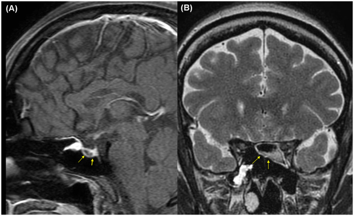
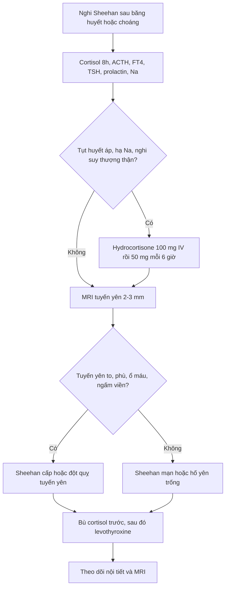
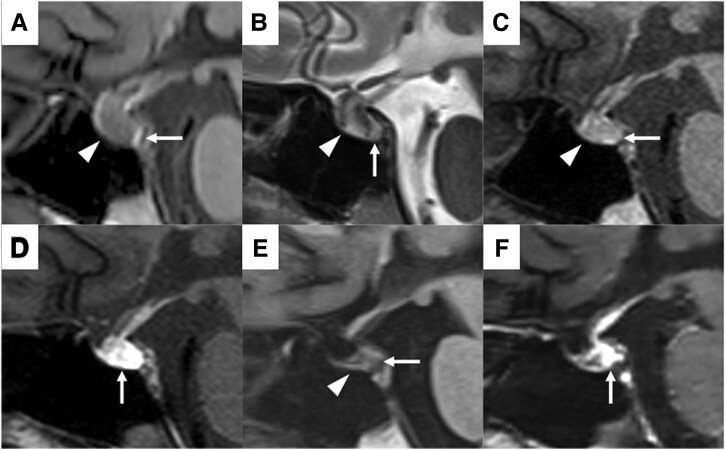
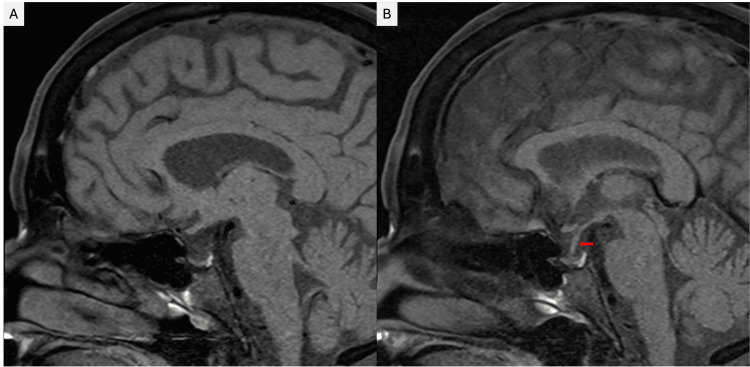

# 246 — Hội chứng Sheehan (hoại tử tuyến yên sau sinh) & suy tuyến yên mạn / Sheehan syndrome & chronic hypopituitarism

**Tags:** `pattern:hoai-tu-tuyen-yen` `pattern:hoi-yen-trong` `pattern:suy-tuyen-yen-man` `vung:giao-thoa` `protocol:MRI-yen` `protocol:xet-nghiem-noi-tiet`
**Mức chắc chắn (certainty):** tổng hợp y văn (literature synthesis) — số liệu từ các bài toàn văn mở (PMC12515800, PMC12246542, PMC12228954, PMC12819307, PMC12467402, PMC13163492); **ba ca trong quiz là ca nguyên văn**, giữ đúng tuổi – bối cảnh – mô tả hình ảnh gốc.

> **Câu chốt:** sau **băng huyết sau sinh / choáng mất máu**, người bệnh **không lên sữa**, mất kinh, mệt lả, **hạ natri máu** → nghĩ **Sheehan** dù MRI có thể chỉ là **hố yên trống**. **Hydrocortisone trước levothyroxine**; không chờ đủ xét nghiệm hormone mới điều trị cơn suy thượng thận cấp.

## 1. Tổng quan bệnh học – cơ chế hình ảnh (TẠI SAO)

- **Định nghĩa:** hội chứng Sheehan (Sheehan syndrome, SS) là **hoại tử thiếu máu tuyến yên trước** sau băng huyết sau sinh (postpartum hemorrhage, PPH) và/hoặc choáng giảm thể tích, dẫn tới thiếu hụt một hoặc nhiều hormone tuyến yên. Sheehan mô tả lần đầu năm **1937** trên tử thi các sản phụ tử vong vì PPH nặng.
- **Tại sao tuyến yên dễ thiếu máu khi sinh:** tuyến yên **to ra tới 136% thể tích bình thường** trong thai kỳ do estrogen (PMC12515800), nhưng **nguồn máu chủ yếu là hệ cửa áp lực thấp** và **không tự điều hòa được**; khi huyết áp tụt, lưu lượng qua hệ cửa giảm trước tiên. Các yếu tố cộng thêm: **đông máu nội mạch rải rác (DIC)**, co thắt động mạch, **hố yên nhỏ**, huyết khối, tiền sản giật.
- **Tần suất:** ước tính **tới 5 ca/100.000 ca sinh sống** (PMC12228954); đã giảm mạnh ở nước có chăm sóc sản khoa tốt nhưng vẫn là nguyên nhân suy tuyến yên hay gặp ở nơi nguồn lực hạn chế (PMC12819307). Chẩn đoán muộn rất thường gặp: trung bình **9 ± 9,7 năm** trong một cohort Pháp; **20,37 ± 8,34 năm** trong cohort Thổ Nhĩ Kỳ 124 bệnh nhân; ca muộn nhất ghi nhận **46 năm** (PMC12228954).
- **Thiếu hormone nào trước:** **GH và prolactin giảm ở 90–100%**; **gonadotropin, TSH, ACTH giảm ở 50–100%** (PMC12228954). Vì vậy **vô sữa/mất kinh** thường là dấu sớm; suy giáp và suy thượng thận xuất hiện muộn hơn.
- **Tại sao hạ natri máu:** cortisol thấp làm giảm đáp ứng mạch với catecholamine và tăng tiết ADH; đồng thời suy giáp làm chậm thải nước. Hạ natri gặp ở **33–69%** bệnh nhân Sheehan (PMC12228954). Ca nguyên văn PMC12246542 còn cho thấy **ADH dao động ba pha** (đái tháo nhạt → SIADH → đái tháo nhạt trung ương), nên hạ natri **không chỉ do thiếu cortisol**.
- **Thiếu máu:** thường là thiếu máu đẳng sắc đẳng bào; cohort 65 bệnh nhân ghi nhận **80%** có thiếu máu so với **25%** nhóm chứng (PMC12228954).

### 1.1. TẠI SAO MRI thay đổi theo thời gian

- **Cấp (vài giờ – vài ngày):** phù tế bào/thiếu máu → **T1 giảm, T2 tăng**, tuyến yên **to lan tỏa**, mất ranh giới với cuống. Nếu có **hoại tử chảy máu**, ổ máu bán cấp (methemoglobin) có thể **T1 tăng**; sau tiêm gadolinium thấy **ngấm viền ngoại vi, trung tâm không ngấm** — đúng mô tả ca PMC12515800 (Hình 2).
- **Bán cấp (1–3 tuần):** tuyến **xẹp dần**; **mất “điểm sáng T1” của thùy sau** do cạn kiệt hạt bài tiết AVP trong bào tương tế bào thần kinh (PMC12246542, ngày 12). Điểm sáng T1 bình thường của thùy sau chính là **các hạt neurosecretory chứa vasopressin** — mất điểm sáng là dấu **suy thùy sau**, không phải dấu đặc hiệu của Sheehan.
- **Mạn (> 3 tháng – nhiều năm):** tuyến teo → **hố yên trống (empty sella)**; dịch não tủy (DNT) lấp hố yên: **T1 tối, T2 sáng**, tuyến bị **dẹt sát sàn yên**. Ca PMC12515800 có **hố yên trống một phần sau 31 tháng**; ca PMC12228954 có hố yên trống **46 năm** sau PPH.
- **Ngưỡng hình ảnh:** tuyến yên nữ trưởng thành bình thường cao **≤ 8 mm** (khi mang thai có thể tăng thêm); **hố yên trống** khi DNT chiếm **> 50%** thể tích hố yên, tuyến bị **dẹt sát sàn yên**. **MRI bình thường không loại trừ** suy tuyến yên — chẩn đoán vẫn dựa vào hormone và bối cảnh sản khoa.

*Ca 1 (32 tuổi, PPH ~20 L, ngưng tim): (A) T1 sagittal — tuyến yên tín hiệu thấp lan tỏa, có ổ tăng tín hiệu nhỏ (mũi tên vàng); (B) T2 coronal — tuyến yên tín hiệu thấp không đồng nhất. Sau gadolinium: ngấm viền ngoại vi, trung tâm không ngấm. Nguồn: Jeon C et al., Front Surg 2025 (PMC12515800), Fig. 2, CC BY 4.0.*

## 2. Mẫu hình + chẩn đoán phân biệt theo vị trí & bối cảnh (Gamut)

- **Theo mẫu hình vùng yên:**
  - **Tuyến yên to cấp sau sinh:** Sheehan cấp · viêm tuyến yên lympho bào (lymphocytic hypophysitis) · đột quỵ tuyến yên trên u tuyến yên · u tuyến yên · di căn · nhiễm trùng.
  - **Hố yên trống:** Sheehan mạn · hố yên trống nguyên phát · sau mổ/xạ tuyến yên · viêm tuyến yên “cháy hết” · hội chứng Sheehan thể muộn.
  - **Khối vùng yên kèm suy hormone:** macroadenoma · craniopharyngioma · nang Rathke · u màng não củ yên · germinoma · lymphoma.
- **Theo cơ chế:** thiếu máu/hoại tử (Sheehan, đột quỵ tuyến yên, sau xạ) · viêm tự miễn (lymphocytic hypophysitis, IgG4, thuốc ức chế miễn dịch) · chèn ép (u, nang, phình mạch) · thâm nhiễm (sarcoidosis, histiocytosis, lymphoma, di căn).
- **Mnemonic “SHEEHAN”:** **S**hock/PPH · **H**emorrhage · **E**mpty sella · **E**ndocrine deficiency · **H**yponatremia · **A**galactia · **N**o mass (không có khối u rõ).
- **Dấu hiệu vàng lâm sàng:** **vô sữa** sau sinh (thường sớm nhất) + **mất kinh** + **mất lông mu/nách** + **suy giáp** + **hạ natri** + tiền sử PPH/choáng. Không có khối u trên MRI càng ủng hộ Sheehan.

## 3. Bảng so sánh phân biệt (ma trận đối chiếu)

| Thực thể (entity) | Hình ảnh điển hình (MRI/CT) | Chốt vào (rule-in) | Chốt loại (rule-out) | Gợi ý xác nhận |
|---|---|---|---|---|
| **Sheehan cấp** | Tuyến yên to lan tỏa, **T1 giảm/T2 tăng**, có thể ổ **T1 tăng** do máu; ngấm viền ngoại vi, trung tâm không ngấm | **PPH/choáng + vô sữa + hạ Na + tuyến yên to không có khối u**; MRI ngày 6–12 sau sinh | Khối đặc có bờ rõ, ngấm đồng nhất, xâm lấn xoang hang → nghĩ u | MRI tuyến yên 2–3 mm; cortisol/ACTH, FT4/TSH, prolactin, Na |
| **Sheehan mạn** | **Hố yên trống**, tuyến dẹt sát sàn, cuống kéo xuống; T1 tối/T2 sáng | **Tiền sử PPH + thiếu nhiều trục hormone + hố yên trống**; không có khối | Có khối ngấm thuốc/xâm lấn → u hoặc viêm hoạt động | Nội tiết đầy đủ; MRI lặp; mật độ xương |
| **Viêm tuyến yên lympho bào** | Tuyến yên **to đối xứng**, **cuống dày**, ngấm mạnh đồng nhất; có thể **mất điểm sáng T1 thùy sau** | **Thai kỳ/hậu sản + đau đầu + suy nhiều trục + đái tháo nhạt**; cuống dày, ngấm mạnh | Không có cuống dày, có ổ máu/hoại tử rõ → Sheehan/đột quỵ | Gutenberg score; Wright score **≥ 3** (AUC 0,96; Se 100%, Sp 75%) (PMC13163492) |
| **Đột quỵ tuyến yên** | Khối yên **T1 sáng** (máu bán cấp), **mức dịch–dịch**, blooming SWI; đau đầu dữ | **Đau đầu đột ngột + sụp thị trường/liệt vận nhãn + T1 sáng trong khối** | Tuyến teo đều, không ổ máu, khởi phát từ từ → Sheehan mạn | MRI + SWI; cortisol; mổ nếu chèn ép |
| **Macroadenoma** | Khối đặc từ yên, T1 đồng tín hiệu, ngấm đồng nhất, có thể xâm lấn xoang hang (Knosp) | **Bán manh thái dương tiến triển + hội chứng tăng tiết**; khối bờ rõ | Tuyến dẹt/hố yên trống, không khối → Sheehan | MRI + nội tiết; prolactin, IGF-1 |
| **Hố yên trống nguyên phát** | Hố yên rộng, DNT lấp, tuyến dẹt; **không có tiền sử PPH** | **Tình cờ, hormone bình thường hoặc thiếu nhẹ**; không bối cảnh sản khoa | Thiếu nhiều trục cấp sau PPH → Sheehan | Nội tiết; theo dõi |

## 4. Protocol chụp + xét nghiệm + xử trí

### 4.1. Hình ảnh

- **MRI tuyến yên chuyên biệt:** lát mỏng **2–3 mm**, T1 không cản quang, T2, **T1 sau gadolinium** (động học nếu nghi u), **DWI**, **SWI/T2\***; đánh giá chiều cao tuyến, cuống, thùy sau (điểm sáng T1), xoang hang, giao thoa thị.
- **CT sọ** chỉ để loại trừ chảy máu nội sọ/SAH hoặc khi chống chỉ định MRI; **CT không đủ để chẩn đoán Sheehan**.
- **Siêu âm không có vai trò** trong đánh giá tuyến yên người lớn.

### 4.2. Xét nghiệm (lấy trước khi bù hormone nếu không làm chậm điều trị)

- **Cortisol 8 giờ + ACTH**, **FT4 + TSH**, **prolactin**, **LH/FSH + estradiol** (nữ) hoặc testosterone (nam), **IGF-1**, **Na, K, glucose, CBC**.
- **Đánh giá thùy sau:** nếu đa niệu/khát nhiều → osmolality máu/nước tiểu, test nhịn nước có kiểm soát; không tự ý dùng DDAVP khi chưa rõ.
- **Không dùng test kích thích tuyến yên** khi đang có suy thượng thận cấp/chưa bù cortisol.

### 4.3. Điều trị cấp & mạn

- **Cơn suy thượng thận cấp:** **hydrocortisone 100 mg tiêm tĩnh mạch**, sau đó **50 mg mỗi 6 giờ** (hoặc truyền **2–4 mg/giờ**); bù dịch tinh thể; tìm và xử trí nguyên nhân (nhiễm trùng, mất máu).
- **Hạ natri:** xử trí theo thể tích và nguyên nhân; **không hiệu chỉnh quá nhanh** (nguyên tắc chung **≤ 8–10 mmol/L/24 giờ**) để tránh hội chứng hủy myelin thẩm thấu. Ca PMC12246542 có Na **153 → 117 → 115 → 138 mmol/L** trong 12 ngày, cho thấy cần theo dõi sát cả SIADH và đái tháo nhạt.
- **Levothyroxine:** chỉ bắt đầu **sau khi cortisol đã được bù**; khởi đầu thấp (**25–50 µg/ngày**) ở người già/bệnh tim, tăng dần tới liều thay thế đầy đủ (**~1,6 µg/kg/ngày** ở người trẻ). Bắt đầu giáp trước corticoid có thể gây **cơn suy thượng thận cấp**.
- **Hormone sinh dục:** estrogen ± progesterone cho nữ tiền mãn kinh nếu không có chống chỉ định; **không dùng để điều trị vô sinh** khi chưa ổn định các trục khác.
- **GH:** cân nhắc ở người lớn có thiếu GH xác định và chất lượng sống kém; **không thường quy** ở mọi bệnh nhân.
- **Prolactin thấp:** không có liệu pháp thay thế; **không dùng dopamine agonist**.
- **Theo dõi:** nội tiết **3–6 tháng/lần** trong năm đầu, sau đó **hằng năm**; MRI lặp **3–6 tháng** nếu giai đoạn cấp để xác nhận teo/hố yên trống; **mật độ xương**, lipid, glucose, huyết áp.

### 4.4. Khi nào cần hội chẩn ngoại thần kinh

- **Không mổ** cho Sheehan đơn thuần.
- Hội chẩn khi **chẩn đoán không chắc** (khối yên không điển hình, nghi u/viêm), **chèn ép giao thoa thị tiến triển**, hoặc **đột quỵ tuyến yên có chỉ định giải ép** (xem bài 245).

## 5. Biến thể bình thường và cạm bẫy

- **Tuyến yên to trong thai kỳ là sinh lý** — đừng chẩn đoán macroadenoma chỉ vì tuyến cao hơn bình thường; so với MRI trước mang thai nếu có.
- **“Điểm sáng T1 thùy sau” có thể mất** ở người già, sau xạ, hoặc trong nhiều bệnh lý; **mất điểm sáng không đặc hiệu** cho Sheehan.
- **Hố yên trống có thể tình cờ** và hormone bình thường — chỉ chẩn đoán Sheehan khi có **bối cảnh PPH + thiếu hormone**.
- **Hạ natri không chỉ do thiếu cortisol:** có thể do **SIADH** hoặc **đái tháo nhạt**; điều trị sai hướng (truyền NaCl ưu trương khi đang đái tháo nhạt) có thể nguy hiểm. Theo dõi Na – nước tiểu – cân nặng.
- **Không bắt đầu levothyroxine trước hydrocortisone** — nguy cơ cơn suy thượng thận cấp.
- **MRI bình thường không loại trừ** suy tuyến yên; chẩn đoán Sheehan là **lâm sàng + hormone + bối cảnh**, hình ảnh chỉ hỗ trợ.
- **Đừng bỏ qua chẩn đoán muộn:** bệnh nhân có thể đến sau **nhiều thập kỷ** với mệt, hạ Na, thiếu máu; hỏi tiền sử sản khoa là chốt.
- **Phân biệt với viêm tuyến yên lympho bào:** cuống dày, ngấm mạnh, đái tháo nhạt, liên quan thai kỳ; **không có ổ máu/hoại tử**; có thể cần sinh thiết nếu không điển hình.

## 6. Tự lượng giá — Blind Quiz

**Ca 1 — 32 tuổi, sau sinh 9 ngày, sốt cao và lú lẫn; tiền sử băng huyết rất nặng.**

- Gợi ý: sinh mổ vì ngôi mông, băng huyết ước tính **20 L**, ngưng tim 20 phút, cắt tử cung cấp cứu; không lên sữa.
- Câu hỏi: (1) Mô tả tín hiệu tuyến yên? (2) Vì sao tuyến yên dễ tổn thương sau choáng? (3) Ba chẩn đoán phân biệt và bước xử trí đầu tiên?

<b>Bấm để hiện đáp án (findings + chẩn đoán)</b>

- **Findings:** tuyến yên **tín hiệu thấp lan tỏa trên T1 sagittal**, có **ổ tăng tín hiệu nhỏ** trong tuyến; T2 coronal **tín hiệu thấp không đồng nhất**. Sau gadolinium: **ngấm viền ngoại vi, trung tâm không ngấm** — phù hợp **hoại tử chảy máu tuyến yên trước**.
- **Chẩn đoán:** **hội chứng Sheehan cấp** sau PPH/choáng; hormone cho thấy suy trục GH, sinh dục và prolactin, còn trục giáp bình thường.
- **Vì sao:** tuyến yên to do thai kỳ + hệ cửa áp lực thấp + tụt huyết áp → thiếu máu vùng tuyến; hoại tử chảy máu tạo ổ T1 tăng.
- **Xử trí:** **hydrocortisone** (ca này dùng dexamethasone 10 mg trước khi có kết quả hormone và cải thiện nhanh), bù dịch, theo dõi Na; sau đó đánh giá và bổ sung hormone theo trục.
- **Nguồn ảnh:** Jeon C et al., Front Surg 2025 (PMC12515800), Fig. 2, CC BY 4.0. Ca nguyên văn: nữ 32 tuổi, PPH ~20 L, ngưng tim, MRI ngày hậu sản 9.

**Ca 2 — 30 tuổi, sau sinh 6 ngày, mất sữa và rối loạn natri máu; MRI được chụp nhiều thời điểm.**

- Gợi ý: băng huyết **7 L** sau mổ lấy thai; ngày 1 đa niệu, Na **153 mmol/L**; ngày 5 Na **117 mmol/L**; không lên sữa.
- Câu hỏi: (1) Chuỗi thay đổi hình ảnh từ A đến F nói gì? (2) Vì sao điểm sáng T1 thùy sau mất? (3) Cơ chế hạ natri ở bệnh nhân này?

<b>Bấm để hiện đáp án (findings + chẩn đoán)</b>

- **Findings:** **(A/B) ngày 6:** thùy trước **to, T1 giảm tín hiệu lan tỏa, T2 tăng không đồng nhất**; thùy sau còn **điểm sáng T1**. **(C/D) ngày 12:** thùy trước xẹp hơn, **mất điểm sáng T1 thùy sau**, phần sau thùy trước và toàn thùy sau ngấm thuốc. **(E/F) ngày 45:** **thùy trước teo**, thùy sau vẫn mất điểm sáng, ngấm thuốc giảm.
- **Chẩn đoán:** **Sheehan cấp** với hoại tử lan tỏa; sau đó **suy tuyến yên mạn** và **đái tháo nhạt trung ương**.
- **Vì sao mất điểm sáng:** điểm sáng T1 của thùy sau do **hạt neurosecretory chứa AVP**; thiếu máu thùy sau làm cạn hạt → mất tín hiệu T1.
- **Cơ chế hạ Na:** ban đầu đái tháo nhạt (mất nước, Na cao) → sau đó **SIADH** do AVP thoát từ thùy sau bị tổn thương → cuối cùng **đái tháo nhạt trung ương** khi AVP cạn. Vì vậy hạ Na **không đáp ứng đủ với hydrocortisone**.
- **Nguồn ảnh:** Minamoto Y et al., JCEM Case Reports 2025 (PMC12246542), Fig. 1, CC BY 4.0. Ca nguyên văn: nữ 30 tuổi, PPH 7 L.

**Ca 3 — 89 tuổi, mệt và hạ natri máu; tiền sử băng huyết sau sinh cách đây 46 năm.**

- Gợi ý: không dùng thuốc lợi tiểu; cortisol thấp, TSH thấp, không có khối yên trên MRI.
- Câu hỏi: (1) Dấu hiệu chính? (2) Vì sao chẩn đoán muộn đến vậy? (3) Điều trị và theo dõi?

<b>Bấm để hiện đáp án (findings + chẩn đoán)</b>

- **Findings:** **(A)** hố yên **trống một phần**, DNT lấp phần lớn hố yên, tuyến yên **dẹt sát sàn**; **(B)** cuống tuyến yên kéo xuống sát sàn (mũi tên đỏ).
- **Chẩn đoán:** **Sheehan mạn** với **hố yên trống** và suy tuyến yên; chẩn đoán muộn **46 năm** sau PPH.
- **Vì sao muộn:** triệu chứng mơ hồ (mệt, hạ Na, thiếu máu) bị quy cho tuổi già; mất kinh/vô sữa không được chú ý vì PPH xảy ra gần tuổi mãn kinh.
- **Điều trị:** **hydrocortisone trước**, sau đó **levothyroxine**; theo dõi Na, cortisol, FT4, mật độ xương; giáo dục bệnh nhân mang thẻ cảnh báo suy thượng thận và tăng liều khi stress.
- **Nguồn ảnh:** Samman BS et al., Cureus 2025 (PMC12228954), Fig. 1, CC BY 4.0. Ca nguyên văn: nữ 89 tuổi, PPH 46 năm trước.

## Bài liên quan chéo

- [245 – U tuyến yên chảy máu/nhồi máu (pituitary apoplexy)](../245-u-tuyen-yen-chay-mau-nhoi-mau-pituitary-apoplexy/lesson.md)
- [247 – Bóc tách động mạch cổ/đốt sống](../247-boc-tach-dong-mach-co-dot-song-cervical-artery-dissection/lesson.md)
- [432 – Vùng yên: adenoma vs đột quỵ tuyến yên](../432-vung-yen/lesson.md)
- [200 – Tổng quan hệ Thần kinh](../200-tong-quan-he-than-kinh/lesson.md)
- [560 – Nhau cài răng lược/PAS cấp cứu sản khoa](../560-nhau-cai-rang-luoc-PAS-cap-cuu-san/lesson.md)

> Không dùng để chẩn đoán độc lập khi chưa có người hướng dẫn.
