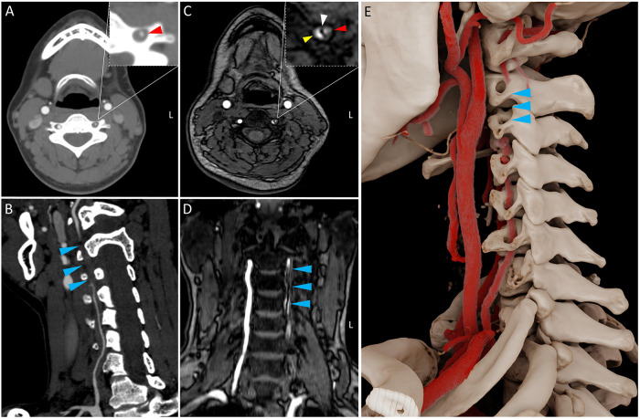
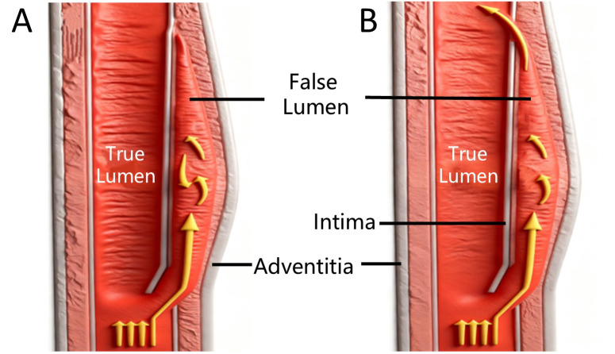
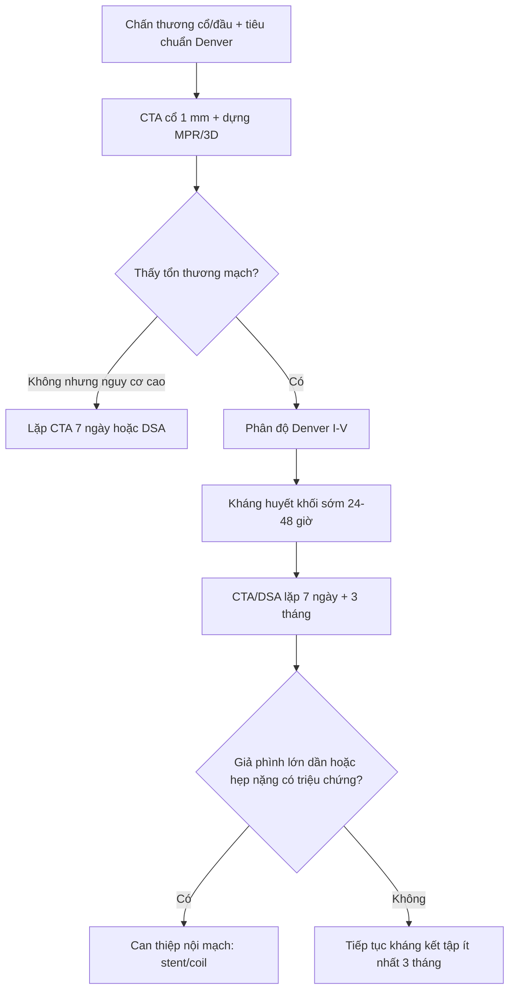
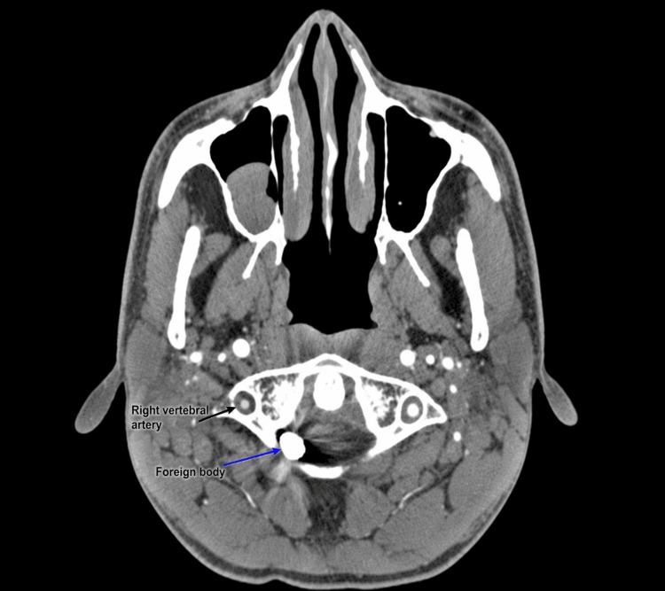
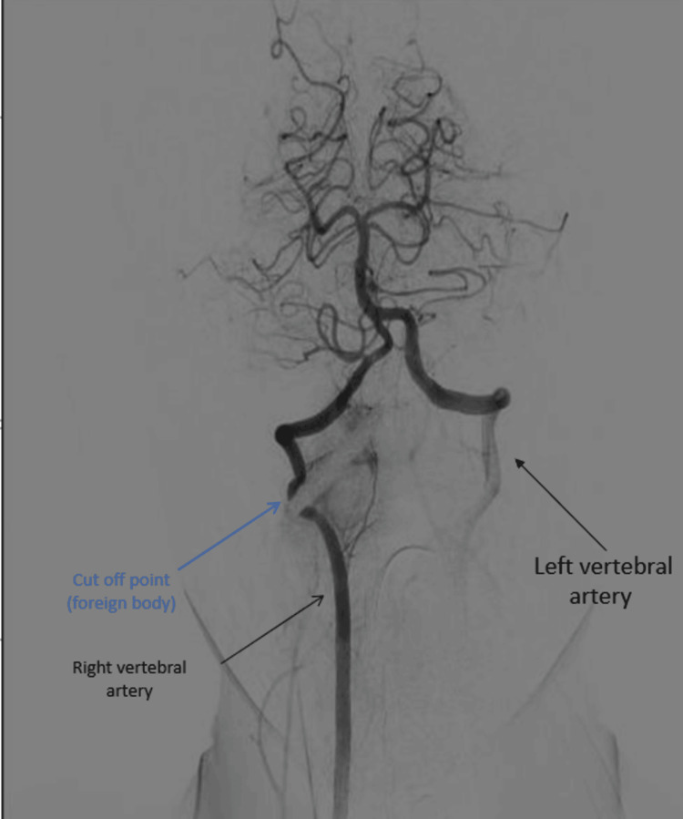

# 247 — Bóc tách động mạch cổ/đốt sống tự phát & sau chấn thương cổ / Cervical artery dissection (CeAD) & blunt cerebrovascular injury (BCVI)

**Tags:** `pattern:boc-tach-mach-co` `pattern:hep-long-mach` `pattern:nhoi-mau-sau` `vung:mach-co` `score:Denver-BCVI` `protocol:CTA-co` `protocol:MRA-co`
**Mức chắc chắn (certainty):** tổng hợp y văn (literature synthesis) — số liệu từ tổng quan CeAD (PMC9447449, PMC8366117), guideline BCVI 2018 (PMC6206718) và pictorial review (PMC6798777); **các ca trong quiz là ca nguyên văn** giữ đúng tuổi – cơ chế – chú thích gốc.

> **Câu chốt:** đau cổ/đau đầu sau **massage cổ, chấn thương nhẹ hoặc cử động cổ mạnh** + **Horner, chóng mặt, thiếu máu não sau** = nghĩ **bóc tách động mạch cổ/đốt sống**. **CTA cổ là bước đầu**, nhưng **CTA âm không loại trừ** — nghi cao thì **MRA/HR-MRI hoặc DSA**.

## 1. Tổng quan bệnh học – cơ chế hình ảnh (TẠI SAO)

- **Bóc tách động mạch cổ (cervical artery dissection, CeAD):** rách lớp nội mạc → máu tràn vào lớp giữa (media) tạo **huyết khối trong thành (intramural hematoma)**. Hậu quả: **hẹp/occlusion lòng mạch**, **giả phình (pseudoaneurysm)** hoặc **dò động–tĩnh mạch**; cơ chế đột quỵ chủ yếu là **thuyên tắc từ huyết khối tại chỗ**, không chỉ do giảm tưới máu.
- **Dịch tễ:** CeAD **2,6–3,0/100.000 người–năm**; chiếm **tới 25% đột quỵ thiếu máu não cấp ở người trẻ–trung niên** và **2–2,5%** toàn bộ đột quỵ thiếu máu não (PMC8366117). VAD gây **8–11%** đột quỵ ở người trẻ (PMC12742373).
- **Triệu chứng tại chỗ:** **đau đầu/đau cổ 65–95%**, **TIA/đột quỵ > 50%**, **Horner không hoàn toàn 25%** (PMC9447449). **Horner, liệt dây sọ dưới, ù tai mạch đập** gợi ý **bóc tách động mạch cảnh trong (ICAD)** nhiều hơn; **đau đầu vùng chẩm, chóng mặt, hội chứng Wallenberg** gợi ý **bóc tách động mạch đốt sống (VAD)** (PMC8366117).
- **TẠI SAO hình ảnh thấy bóc tách:**
  - **CTA:** thuốc cản quang lấp lòng thật; huyết khối trong thành không ngấm → **hẹp hình nón/đuôi chuột (flame-shaped tapering)**, **vách nội mạc (intimal flap)**, **hai lòng (double lumen)**, **giả phình**. Dấu chắc nhất là **vách nội mạc/hai lòng**, nhưng chỉ thấy ở **~22%** trường hợp; dấu thường gặp nhất là **hẹp lòng không đặc hiệu (> 50%)** (PMC6798777).
  - **MRI T1 fat-sat/black-blood:** methemoglobin trong huyết khối thành → **dải tăng tín hiệu hình liềm (crescent sign)** quanh lòng mạch; tín hiệu phụ thuộc tuổi máu (cấp: đồng/giảm T1; bán cấp: tăng T1).
  - **MRA:** thấy hẹp/occlusion nhưng **kém nhạy với huyết khối thành**; độ nhạy **50–100%**, độ đặc hiệu **30–100%** so với DSA (PMC9447449).
  - **DSA:** tiêu chuẩn vàng, thấy **vách nội mạc, hai lòng, giả phình, tuần hoàn bàng hệ**; nhưng xâm lấn.
- **Độ nhạy CTA:** so với DSA dao động **65–100%** (PMC9447449). Trong chấn thương, gộp **Se 66%, Sp 97%** (PMC6206718); một số trung tâm báo **Se ~98%, Sp ~100%** với máy ≥ 64 lát (PMC6798777). Vì vậy **CTA âm ở bệnh nhân nguy cơ cao vẫn cần lặp lại hoặc DSA**.
- **BCVI (blunt cerebrovascular injury):** gặp **1–2%** dân số chấn thương nhập viện, **tới 9%** ở chấn thương đầu nặng (PMC6206718). **Không điều trị, đột quỵ tới 21%; điều trị sớm giảm còn ~0,5%** (PMC6798777).
- **Diễn tiến tự nhiên:** **> 75%** CeAD có hẹp/occlusion; **1/5** phát triển giả phình (thường lành tính, nguy cơ vỡ/thuyên tắc thấp); tái phát **3–9%**, thường trong **2 tháng đầu**; nguy cơ đột quỵ cùng bên trong **12 tháng ~2,4%** (PMC9447449).

*32 tuổi, đau đầu chẩm sau massage cổ: (A) CTA trục — hẹp động mạch đốt sống trái V2; (B) CTA dựng hình — occlusion tại chỗ nối V2–V3 (mũi tên xanh); (C) MRA TOF độ phân giải cao trục — **hai lòng** (đỏ: lòng thật; vàng: lòng giả) + vách nội mạc lệch; (D) mặt cắt vành xác nhận; (E) dựng 3D. Nguồn: Liu J et al., J Belg Soc Radiol 2025 (PMC12742373), Fig. 2, CC BY 4.0.*

## 2. Mẫu hình + chẩn đoán phân biệt theo mạch & cơ chế (Gamut)

- **Theo mạch bị tổn thương:**
  - **ICA đoạn ngoài sọ:** đau cổ/đau đầu, **Horner**, liệt dây sọ dưới, ù tai mạch đập; nguy cơ nhồi máu bán cầu.
  - **Động mạch đốt sống V1–V4:** **V2 (trong lỗ ngang) và V3 (quanh C1–C2)** dễ tổn thương nhất do căng/xoay (PMC13340418); hội chứng **Wallenberg** (nhồi máu hành bên), chóng mặt, thất điều, nhìn đôi.
- **Theo cơ chế:**
  - **Tự phát (spontaneous):** yếu tố mạch máu nền — **loạn sản cơ–sợi (fibromuscular dysplasia, FMD)**, hội chứng Ehlers–Danlos type IV, di truyền; khởi phát sau vận động nhẹ/massage.
  - **Chấn thương (traumatic/BCVI):** tai nạn giao thông, ngã, **nắn chỉnh cổ/chiropractic**, massage, chấn thương xuyên thấu; cơ chế **gập–xoay (distraction-flexion)** là chính (PMC6798777).
  - **Iatrogenic:** đặt catheter, phẫu thuật vùng cổ.
- **Theo biểu hiện:** nhồi máu não cấp (thuyên tắc), TIA, **Horner đơn độc**, liệt dây sọ, ù tai mạch đập, giả phình không triệu chứng.
- **Chẩn đoán phân biệt “DISSECT”:** **D**issection, **I**atrogenic/trauma, **S**tenosis do xơ vữa, **S**trig of beads (FMD), **E**mbolism, **C**ongenital hypoplasia, **T**emporal arteritis/vasculitis.
- **Bẫy vị trí:** hẹp V4 trong sọ có thể do **bóc tách nội sọ** hoặc xơ vữa; hẹp V1 gần nguyên ủy dễ nhầm với **mảng xơ vữa**.

## 3. Bảng so sánh phân biệt (ma trận đối chiếu)

| Thực thể (entity) | Hình ảnh điển hình | Chốt vào (rule-in) | Chốt loại (rule-out) | Gợi ý xác nhận |
|---|---|---|---|---|
| **CeAD tự phát** | **Hẹp hình nón/đuôi chuột**, vách nội mạc, **dải T1 sáng hình liềm** trong thành, giả phình | **Đau cổ/đau đầu + Horner + hẹp hình nón ở người trẻ không yếu tố xơ vữa** | Mảng xơ vữa lệch tâm có vôi hóa, không huyết khối thành → xơ vữa | CTA cổ + **MRI T1 fat-sat/black-blood**; MRA; DSA |
| **BCVI sau chấn thương** | Tổn thương tại V2/V3 hoặc ICA đoạn cổ; phân độ Denver I–V; có thể kèm gãy cột sống | **Cơ chế năng lượng cao + tiêu chuẩn Denver + tổn thương mạch trên CTA** | CTA chất lượng tốt, không tổn thương, nhưng vẫn cần lặp 7 ngày nếu nguy cơ cao | CTA 1 mm; DSA nếu CTA âm mà nghi; lặp 7 ngày |
| **Xơ vữa động mạch cảnh** | Mảng lệch tâm, **vôi hóa**, hẹp không đều; thường > 50 tuổi, có yếu tố nguy cơ | **Vôi hóa + mảng xơ vữa + hẹp tiến triển chậm** | Hẹp hình nón + huyết khối thành + không vôi hóa → bóc tách | Siêu âm Doppler, CTA, MRI mạch |
| **FMD** | **“Chuỗi hạt” (string of beads)** nhiều đoạn, thường ICA cổ giữa, hai bên | **Nhiều chỗ hẹp–giãn xen kẽ + ít yếu tố nguy cơ + nữ trẻ** | Một ổ hẹp hình nón đơn độc → bóc tách | CTA/MRA toàn thân; chụp mạch thận |
| **Viêm mạch/RCVS** | Hẹp đa ổ, quai mạch; RCVS hồi phục < 3 tháng; viêm mạch có ngấm thành mạch | **Hẹp đa ổ hồi phục + bối cảnh co mạch** (RCVS); **ngấm thành mạch đồng tâm** (viêm) | Hẹp khu trú hình nón + huyết khối thành → bóc tách | MRA/CTA lặp; HR-vwMRI; DSA |
| **Giảm sản/thiểu sản động mạch đốt sống** | Mạch nhỏ đều suốt chiều dài, không hẹp khu trú | **Đường kính nhỏ đều, không vách, không huyết khối** | Hẹp khu trú + dải T1 sáng → bóc tách | CTA/MRA; so sánh hai bên; MRI black-blood |

*Sơ đồ: rách nội mạc cho máu vào **lòng giả** giữa nội mạc và áo ngoài; lòng thật bị chèn hẹp. Nguồn: Liu J et al., J Belg Soc Radiol 2025 (PMC12742373), Fig. 3, CC BY 4.0.*

## 4. Protocol chụp + phân độ Denver + điều trị

### 4.1. Protocol hình ảnh

- **CTA cổ–đầu:** lát **≤ 1 mm**, bolus tracking, từ **quai động mạch chủ đến đỉnh sọ**; luôn dựng **MPR trục/vành/sagittal** và **3D** vì tổn thương V2/V3 nằm sát xương, dễ bị che bởi artifact.
- **MRI/MRA:** **T1 fat-sat hoặc black-blood** để thấy huyết khối thành; **DWI** để phát hiện nhồi máu cấp; **TOF-MRA** đánh giá lòng mạch; **HR-MRI** khi CTA/MRA không kết luận.
- **DSA:** chỉ định khi **CTA/MRA âm nhưng nghi cao**, cần xác nhận **vách nội mạc/giả phình**, hoặc trước can thiệp nội mạch.
- **Siêu âm Doppler:** vai trò hạn chế vì không thấy được toàn bộ V2/V3 (PMC6798777) — không dùng để loại trừ.
- **Không bỏ sót tổn thương kèm theo:** gãy cột sống cổ, gãy sọ, chấn thương mặt — chụp CT cột sống theo tiêu chuẩn chấn thương.

### 4.2. Tiêu chuẩn sàng lọc Denver mở rộng (BCVI)

**Dấu hiệu/triệu chứng:** chảy máu động mạch từ cổ/mũi/miệng; **tiếng thổi động mạch cảnh ở người < 50 tuổi**; khối máu tụ cổ lan rộng; **thiếu hụt thần kinh khu trú**; khám thần kinh **không khớp với CT sọ**; **đột quỵ trên CT thứ phát**.

**Yếu tố nguy cơ (cơ chế năng lượng cao):** gãy **Le Fort II/III**; gãy xương hàm dưới; **gãy sọ phức tạp/gãy nền sọ/gãy lồi cầu chẩm**; **TBI nặng GCS < 6**; **gãy/subluxation/chấn thương dây chằng cột sống cổ bất kỳ tầng**; treo cổ gần tử vong; **vết đai an toàn có phù/đau/rối loạn ý thức**; TBI kèm chấn thương ngực; **lột da da đầu**; chấn thương mạch ngực; vỡ tim kín; **gãy xương sườn trên** (PMC6206718).

### 4.3. Phân độ Denver (BCVI)

| Độ | Tổn thương | Xử trí |
|---|---|---|
| **I** | Bất thường thành mạch hoặc bóc tách/huyết khối thành **< 25% hẹp** | Kháng huyết khối; theo dõi |
| **II** | Huyết khối thành, **vách nội mạc nhô** hoặc bóc tách **> 25% hẹp** | Kháng huyết khối; cân nhắc can thiệp nếu tiến triển |
| **III** | **Giả phình (pseudoaneurysm)** | Kháng huyết khối; can thiệp nội mạch nếu lớn/dần hoặc có triệu chứng |
| **IV** | **Occlusion mạch** | Kháng huyết khối; đánh giá tưới máu/tuần hoàn bàng hệ |
| **V** | **Đứt mạch (transection)** | Cấp cứu ngoại khoa/nội mạch |

### 4.4. Điều trị

- **BCVI:** khởi động **kháng huyết khối sớm trong 24–48 giờ** khi an toàn; **LMWH liều điều trị**, sau đó chuyển **aspirin 75 mg/ngày**; kéo dài **ít nhất 3 tháng** (PMC6206718). Trẻ em: **aspirin 3–5 mg/kg/ngày**.
- **Theo dõi hình ảnh BCVI:** **CTA lặp 7 ngày** để xác nhận/loại trừ, và **kiểm tra cuối ở 3 tháng** (PMC6206718).
- **CeAD tự phát — chống đông hay kháng kết tập?**
  - **CADISS (250 BN):** đột quỵ cùng bên **2%** nhóm kháng kết tập vs **1%** nhóm chống đông; **1 xuất huyết dưới nhện** ở nhóm chống đông; ở 12 tháng, đột quỵ/TIA **2,4%** ở cả hai nhóm (PMC9447449).
  - **TREAT-CAD (194 BN):** aspirin **300 mg/ngày** vs VKA trong **3 tháng**; đột quỵ/TIA **8%** vs **2%**; **1 xuất huyết tiêu hóa nặng** ở nhóm VKA; **aspirin không chứng minh được không thua kém** VKA (PMC8366117).
  - Kết luận thực hành: **cá thể hóa**; kháng kết tập hợp lý cho bệnh nhân ít nguy cơ chảy máu, chống đông cân nhắc khi có huyết khối lớn/thiếu máu não; **không có bằng chứng mạnh** cho một phác đồ duy nhất.
- **Đột quỵ cấp do CeAD:** cân nhắc **tiêu sợi huyết tĩnh mạch** và **lấy huyết khối cơ học** nếu tắc mạch lớn, theo đường đột quỵ chuẩn (PMC8366117).
- **Giả phình:** phần lớn lành tính; **can thiệp nội mạch (stent/coil)** khi **lớn dần, có triệu chứng thuyên tắc, hoặc hẹp nặng gây thiếu máu** (PMC6206718).
- **Tái phát 3–9%**, thường trong **2 tháng đầu**; theo dõi lâm sàng và hình ảnh (PMC9447449).

## 5. Biến thể bình thường và cạm bẫy

- **CTA âm không loại trừ BCVI:** độ nhạy gộp **66%**; nếu nguy cơ cao, **lặp CTA 7 ngày hoặc DSA**.
- **Huyết khối lòng giả có thể làm mạch trông nhỏ đều** → nhầm với **thiểu sản động mạch đốt sống**; tìm dải T1 sáng trong thành và so sánh hai bên.
- **Artifact do cử động/nuốt/nền sọ** ở V3–V4 dễ giả hẹp; luôn xem **MPR** và **hai bình diện**, không kết luận trên một lát.
- **Dị vật kim loại có thể tạo artifact trên DSA** giả occlusion mạch lân cận — ca PMC13340418 cho thấy DSA ICA phải bị "tắc" giả do dị vật, xác nhận lại bằng CTA/phẫu thuật.
- **Không bỏ sót bóc tách đối bên:** có thể tổn thương **nhiều mạch**; chụp toàn bộ cổ, không chỉ bên có triệu chứng.
- **Massage cổ/nắn chỉnh cổ là yếu tố khởi phát quan trọng** — hỏi tiền sử trong 1–2 tuần trước; bệnh nhân trẻ không có yếu tố nguy cơ mạch máu vẫn có thể bóc tách.
- **Không stent giả phình nhỏ không triệu chứng** — nguy cơ thủ thuật có thể lớn hơn lợi ích; theo dõi hình ảnh.

## 6. Tự lượng giá — Blind Quiz

**Ca 1 — 32 tuổi, đau đầu chẩm sau massage cổ, chóng mặt thoáng qua rồi thất điều nhẹ.**

- Gợi ý: không yếu tố nguy cơ mạch máu; CT sọ có giảm đậm độ tiểu não trái; DWI dương tính.
- Câu hỏi: (1) Tổn thương ở đoạn nào? (2) Ba dấu hiệu CTA/MRA của bóc tách? (3) Vì sao MRA não bình thường không loại trừ?

<b>Bấm để hiện đáp án (findings + chẩn đoán)</b>

- **Findings:** CTA — **hẹp V2 trái** và **occlusion chỗ nối V2–V3**; MRA TOF độ phân giải cao — **hai lòng** (lòng thật đỏ, lòng giả vàng) với **vách nội mạc lệch**; mặt cắt vành xác nhận.
- **Chẩn đoán:** **bóc tách động mạch đốt sống trái (VAD)** gây **nhồi máu tiểu não trái**.
- **Ba dấu hiệu:** hẹp hình nón/đuôi chuột; vách nội mạc; hai lòng/giả phình.
- **Vì sao MRA não bình thường không loại trừ:** MRA sọ chỉ thấy mạch nội sọ; tổn thương ở **V2 ngoài sọ**, và huyết khối thành có thể không làm hẹp đủ để thấy trên MRA thường.
- **Nguồn ảnh:** Liu J et al., J Belg Soc Radiol 2025 (PMC12742373), Fig. 2, CC BY 4.0. Ca nguyên văn: nữ 32 tuổi.

**Ca 2 — 32 tuổi, tai nạn do súng bắn vít vào cổ, tỉnh táo, chỉ đau cổ và hạn chế xoay.**

- Gợi ý: GCS 15/15, không thiếu hụt thần kinh; CTA ban đầu không thấy bất thường mạch.
- Câu hỏi: (1) Dị vật nằm ở đâu và che lấp gì? (2) CTA âm có đủ loại trừ? (3) Bước xác nhận và xử trí?

<b>Bấm để hiện đáp án (findings + chẩn đoán)</b>

- **Findings:** **dị vật kim loại ở C1–C2**, che lấp **động mạch đốt sống phải** tại chỗ ra khỏi lỗ ngang C2; CTA ban đầu không thấy tổn thương mạch rõ.
- **Chẩn đoán:** **bóc tách/occlusion động mạch đốt sống phải V2 do chấn thương xuyên thấu**.
- **Bước xác nhận:** **DSA** — hình dưới cho thấy **tắc hoàn toàn V2 phải** với tuần hoàn bàng hệ qua động mạch đốt sống trái; xử trí lấy dị vật + đánh giá mạch, cân nhắc kháng huyết khối/theo dõi.

- **Bài học:** **CTA âm không loại trừ** khi dị vật/kim loại che lấp hoặc tổn thương khu trú; **DSA** là chìa khóa. Dị vật còn có thể gây **artifact giả tắc** mạch lân cận trên DSA.
- **Nguồn ảnh:** Alahmed AY et al., Cureus 2026 (PMC13340418), Fig. 2, CC BY 4.0. Ca nguyên văn: nam 32 tuổi.

**Ca 3 — Hình giải phẫu: đọc sơ đồ trước khi trả lời.**

- Câu hỏi: (1) Lòng thật và lòng giả nằm ở đâu? (2) Vì sao lòng thật bị hẹp? (3) Dấu hiệu nào trên CTA giúp phân biệt với mảng xơ vữa?

<b>Bấm để hiện đáp án (findings + chẩn đoán)</b>

- **Findings:** **lòng thật** nằm trong, được lót bởi nội mạc; **lòng giả** nằm giữa nội mạc và **áo ngoài (adventitia)**, chứa máu/huyết khối; vách nội mạc tách hai lòng.
- **Vì sao hẹp:** huyết khối trong thành + lòng giả chèn ép lòng thật → hẹp/occlusion; huyết khối tại chỗ có thể thuyên tắc.
- **Phân biệt với xơ vữa:** bóc tách có **vách nội mạc/hai lòng/hẹp hình nón**, **không vôi hóa**, bệnh nhân trẻ; xơ vữa có **mảng lệch tâm, vôi hóa**, hẹp không đều.
- **Nguồn ảnh:** Liu J et al., J Belg Soc Radiol 2025 (PMC12742373), Fig. 3, CC BY 4.0.

## Bài liên quan chéo

- [227 – Đau đầu sét đánh: SAH / RCVS / CVST / u tuyến yên / bóc tách](../227-dau-dau-set-danh-thunderclap/lesson.md)
- [245 – U tuyến yên chảy máu/nhồi máu & suy tuyến yên cấp](../245-u-tuyen-yen-chay-mau-nhoi-mau-pituitary-apoplexy/lesson.md)
- [211 – Đột quỵ não](../211-dot-quy-nao/lesson.md)
- [200 – Tổng quan hệ Thần kinh](../200-tong-quan-he-than-kinh/lesson.md)

> Không dùng để chẩn đoán độc lập khi chưa có người hướng dẫn.
