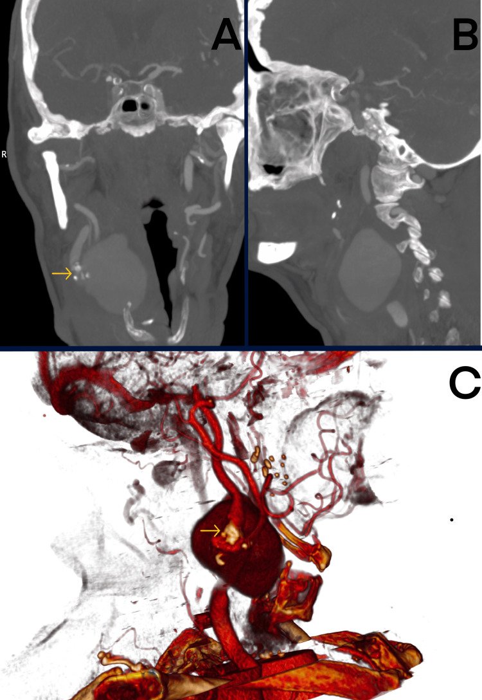
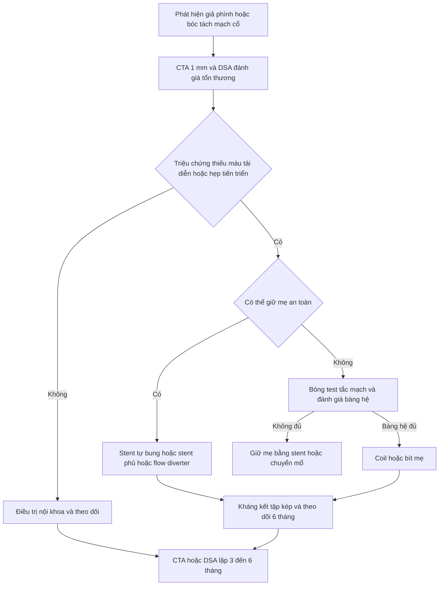
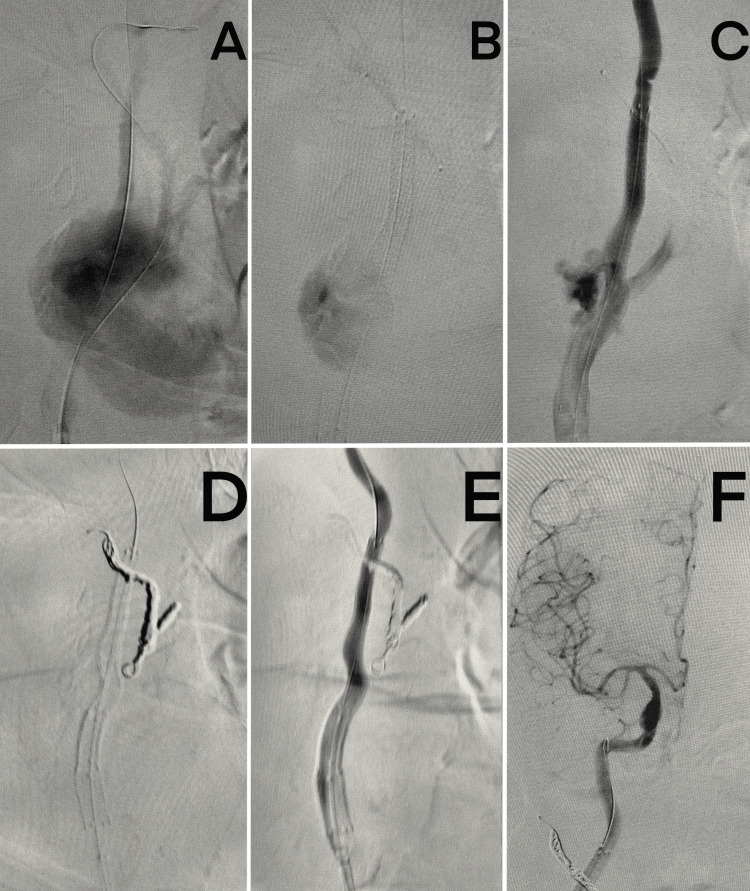
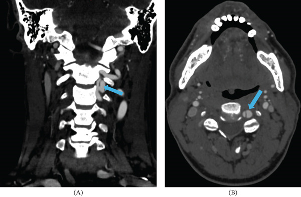

# 248 — Can thiệp nội mạch giả phình & bóc tách động mạch cổ/đốt sống: stent, coil, chỉ định & theo dõi / Endovascular management of cervical artery pseudoaneurysm & dissection

**Tags:** `pattern:gia-phinh` `pattern:boc-tach-mach-co` `pattern:hep-long-mach` `vung:mach-co` `score:Denver-BCVI` `protocol:DSA` `protocol:CTA-co` `protocol:khang-ket-tap`
**Mức chắc chắn (certainty):** tổng hợp y văn (literature synthesis) — số liệu từ các nghiên cứu toàn văn mở (PMC12697641, PMC12099200, PMC13284889, PMC12072270, PMC12190707, PMC12282257); **các ca trong quiz là ca nguyên văn** giữ đúng tuổi – bối cảnh – mô tả hình ảnh gốc.

> **Câu chốt:** **không phải mọi giả phình/bóc tách mạch cổ đều cần stent**. Can thiệp khi **thiếu máu tái diễn dù đã dùng kháng huyết khối**, **hẹp tiến triển/gây giảm tưới máu**, **giả phình to ra, vỡ hoặc gây triệu chứng**, hoặc **không thể dùng kháng đông/kháng kết tập**. **DSA + đánh giá tuần hoàn bàng hệ** là chốt trước khi chọn **dựng lại (stent/coil giữ mẹ)** hay **triệt mạch (coil/embolization)**.

## 1. Tổng quan bệnh học – cơ chế hình ảnh (TẠI SAO)

- **Bóc tách động mạch cổ (cervical artery dissection, CeAD):** rách nội mạc → máu tràn vào lớp áo giữa tạo **khối máu tụ trong thành (intramural hematoma)** → hẹp lòng mạch, tắc mạch hoặc **giả phình**. Tổn thương hay gặp ở **đoạn cổ cao (ICA đoạn xa, V2–V3)** nơi mạch di động và sát xương.
- **Giả phình (pseudoaneurysm):** rách qua cả lớp áo giữa và áo ngoài, máu được giữ bởi **áo ngoài/mô xung quanh** — thành mỏng, dòng xoáy, nguy cơ **vỡ** và **huyết khối gây tắc mạch**. Theo **Laplace**, áp lực thành tỉ lệ với **áp lực × bán kính**, nên túi càng lớn/thành càng mỏng càng dễ vỡ.
- **Dịch tễ:** CeAD khoảng **4,69/100.000 người–năm** (ICA **2,43**, động mạch đốt sống **2,01**); chiếm **~2%** đột quỵ thiếu máu nhưng **15–25%** ở người **< 50 tuổi** (PMC12282257). Khoảng **90%** bóc tách do chấn thương được ghi nhận sau **chấn thương nhẹ** (massage cổ, tập tạ, yoga, sinh nở) (PMC12282257).
- **Vì sao can thiệp nội mạch thay vì mổ hở:** đoạn ICA cao và V2–V3 nằm sâu, sát dây thần kinh sọ và đốt sống; đường vào nội mạch ít xâm lấn hơn, có thể **giữ mẹ** và quan sát dòng chảy ngay trên bàn.
- **Vì sao stent giúp:** stent tự bung ép vách bóc tách vào thành, mở rộng lòng mạch, giảm dòng vào túi giả phình và **ổn định dòng chảy**; stent phủ (covered stent) hoặc **coil** có thể loại túi khỏi tuần hoàn ngay.
- **Số liệu chọn lọc từ y văn:**
  - Phân tích **20.434 bệnh nhân** đột quỵ do CeAD: **11,6%** được đặt stent; nhóm stent có **tái phát đột quỵ 1,2% vs 3,5%** trong 180 ngày (**HR 0,50; 95% CI 0,27–0,95**), nhưng **xuất huyết nội sọ 21,9% vs 19,0%** và tử vong **8,7% vs 7,3%** (PMC12697641).
  - Cohort **21 bệnh nhân** hẹp/bóc tách ICA ngoài sọ: **thành công kỹ thuật 100%**, **2 biến chứng chu phẫu**, **mRS 0–1 ở 95%** lúc 6 tháng, **stent thông 100%**; khoảng **15%** thất bại với điều trị nội khoa trong **3–6 tháng** (PMC12099200).
  - Huyết khối lấy qua đường động mạch ở CeAD: **164/1.861 (8,7%)**, **tắc mạch đồng thời 63,0%**, **tái thông 90,0%**, **mRS 0–2 59,1%**, tử vong **4,3%** (PMC13284889).
  - Chấn thương động mạch đốt sống: điều trị nội khoa **56%**, can thiệp/mổ **26%**, theo dõi **18%**; tổn thương **Denver III** ổn định **39%**, cải thiện/tiêu **56%** sau 2 tháng; **Denver IV** còn tắc **65%** (PMC12072270).
- **TẠI SAO CTA/DSA khác nhau:** CTA lát **≤ 1 mm** rất nhạy nhưng **dương tính giả grade I** do vôi hóa/artifact; **DSA** là chuẩn vàng, phân biệt **vách nội mạc, khối máu trong thành, giả phình, tắc hoàn toàn** và đo **tuần hoàn bàng hệ**.

*Ca 1 (79 tuổi): (A) CTA coronal, (B) sagittal và (C) dựng 3D — túi giả phình lớn cạnh động mạch cảnh phải (mũi tên vàng), kèm hẹp ICA. Nguồn: Kaszczewska J et al., Cureus 2025 (PMC12681997), Fig. 1, CC BY 4.0.*

## 2. Mẫu hình + chẩn đoán phân biệt theo vị trí & quyết định (Gamut)

- **Theo hình thái tổn thương:**
  - **Bóc tách có hẹp/tắc:** “đuôi chuột”/hẹp dài, vách nội mạc, hai lòng; thường điều trị nội khoa trước.
  - **Giả phình bóc tách:** túi cạnh lòng mạch, cổ rộng/hẹp; nguy cơ vỡ và tắc mạch.
  - **Giả phình vỡ/transection:** thuốc thoát mạnh, khối máu tụ lớn, chảy máu mũi/miệng hoặc SAH nếu lan nội sọ.
  - **Giả phình nhiễm trùng (mycotic):** sau nhiễm khuẩn huyết/viêm nội tâm mạc; thành viêm, dễ vỡ, cần kháng sinh dài.
  - **Bóc tách do bệnh nền:** loạn sản cơ–sợi (FMD), NF1, Marfan/vEDS/Loeys–Dietz, xạ trị, chấn thương xuyên thấu.
- **Theo vị trí:**
  - **ICA cổ:** dễ gây nhồi máu bán cầu; chú ý nhánh mắt, PCom, màng não.
  - **Động mạch đốt sống V1–V3:** nguy cơ nhồi máu hố sau; V3 dễ tổn thương khi chấn thương cột sống cổ.
  - **V4/đoạn nội sọ:** có thể vỡ gây **SAH**, cần xử trí như phình nội sọ (flow diverter/coil).
- **Theo quyết định:** **dựng lại (reconstructive)** — stent, stent phủ, flow diverter, stent-assisted coiling; **triệt mạch (deconstructive)** — coil/embolization + bít mẹ; **bảo tồn** — kháng kết tập/kháng đông + theo dõi.
- **Mnemonic “STENT”:** **S**tenosis tiến triển · **T**andem occlusion khi lấy huyết khối · **E**xpanding pseudoaneurysm · **N**eurological recurrence dù đã điều trị nội khoa · **T**hrombus/không thể dùng kháng đông.

## 3. Bảng so sánh phân biệt (ma trận đối chiếu)

| Thực thể (entity) | Hình ảnh điển hình (CTA/DSA/MRI) | Chốt vào (rule-in) | Chốt loại (rule-out) | Gợi ý xác nhận |
|---|---|---|---|---|
| **Bóc tách có hẹp/tắc** | Hẹp dài “đuôi chuột”, vách nội mạc, hai lòng; **HR-vwMRI: dải T1 sáng trong thành** | **Đau cổ + Horner/thiếu máu hố sau + hẹp dài không do xơ vữa**; không có túi giả phình | Tổn thương lồi vào lòng, vôi hóa, nhiều ổ → xơ vữa | CTA 1 mm + MRI HR-vw; DSA nếu cần |
| **Giả phình bóc tách** | Túi thuốc cạnh lòng, cổ rộng/hẹp, **giữ hình thì muộn**, không có tĩnh mạch dẫn | **Túi cạnh mạch + tiền sử chấn thương/viêm + đau cổ**; DSA thấy túi | Không thấy túi, chỉ hẹp → bóc tách đơn thuần | DSA 3D; CTA lặp |
| **Giả phình vỡ** | Thuốc thoát tự do, khối máu tụ, **máu mũi/miệng** hoặc SAH | **Chảy máu hoạt động + tụt huyết áp + túi giả phình** | Máu tụ không thông với lòng mạch → tụ máu đơn thuần | DSA cấp cứu; CTA nếu ổn định |
| **Đứt/transection (Denver V)** | Mất liên tục lòng mạch, thuốc thoát mạnh, hai đầu co lại | **Chấn thương xuyên thấu + chảy máu ồ ạt + mất liên tục mạch** | Mạch còn liên tục, chỉ hẹp → grade I–III | DSA; cân nhắc bít mẹ/khâu mạch |
| **Giả phình nhiễm trùng** | Túi thành dày, viêm mô quanh, **bắt thuốc viền**, có khí; bệnh nhân sốt/nhiễm khuẩn huyết | **Nhiễm khuẩn huyết/viêm nội tâm mạc + túi mới + sốt** | Túi không viêm, không sốt → giả phình vô khuẩn | Cấy máu; MRI/CT; kháng sinh dài |
| **Xơ vữa gây hẹp** | Vôi hóa, hẹp không đều, nhiều tầng; không có vách/máu trong thành | **Nhiều yếu tố nguy cơ + vôi hóa + hẹp ổn định** | Đau cổ cấp + hẹp dài + dải T1 sáng → bóc tách | CTA; siêu âm Doppler |
| **Loạn sản cơ–sợi (FMD)** | “Chuỗi hạt” (string of beads) ở ICA cổ, không vôi hóa; thường nữ trung niên | **Nhiều chỗ hẹp–giãn xen kẽ + không xơ vữa** | Hẹp đơn độc, có vôi hóa → xơ vữa | CTA/MRA; DSA |

## 4. Protocol chụp + kỹ thuật + theo dõi

### 4.1. Chẩn đoán và chọn bệnh nhân

- **CTA cổ–sọ lát ≤ 1 mm** (xương/kính, coronal + sagittal + 3D) là bước đầu; **không dùng CTA để loại trừ hoàn toàn** khi nghi cao — **DSA** khi CTA âm nhưng lâm sàng mạnh.
- **MRI HR-vwMRI** (black-blood T1) giúp thấy **khối máu trong thành** và phân biệt bóc tách với xơ vữa; **MRA** thay thế khi chống chỉ định cản quang.
- **Siêu âm Doppler** hữu ích theo dõi stent nông, nhưng **không đủ** đánh giá V3/đoạn cao.
- **Trước can thiệp:** đánh giá **tuần hoàn bàng hệ** (4 mạch, bất thường bẩm sinh), **balloon test occlusion** nếu định bít mẹ, chức năng thận, đông máu, tiền sử chảy máu.
- **Chỉ định can thiệp mạnh:** (1) **TIA/đột quỵ tái diễn** dù đã dùng kháng kết tập/kháng đông; (2) **hẹp tiến triển/gây giảm tưới máu** hoặc **tandem occlusion** khi lấy huyết khối; (3) **giả phình to ra, vỡ, gây chèn ép/huyết khối**; (4) **không thể dùng kháng đông** (xuất huyết nội sọ, đa chấn thương) với tổn thương nguy cơ cao; (5) **transection/chảy máu không kiểm soát**.
- **Chỉ định tương đối:** giả phình không triệu chứng nhưng **lớn dần**, bệnh nhân trẻ, mạch chi phối vùng quan trọng, **FMD/bệnh mô liên kết**.
- **Bảo tồn:** bóc tách **grade I–II**, giả phình nhỏ **ổn định**, **grade IV** ở mạch không ưu thế với bàng hệ tốt, không triệu chứng.

### 4.2. Kỹ thuật

- **Stent tự bung (self-expanding bare-metal):** Wallstent/Protégé/Precise — dùng cho **bóc tách hẹp dài**; chọn đường kính theo đoạn mạch lành **xa tổn thương**, tránh phủ nhánh quan trọng.
- **Stent phủ (covered stent/stent-graft):** loại túi giả phình ngay, dùng khi **vỡ/nguy cơ vỡ cao**, động mạch thẳng, đủ đường kính; nguy cơ **tắc nhánh** và **nhiễm trùng stent**.
- **Flow diverter (FDS):** lưới dày, thích hợp **đoạn cong/dài, cổ rộng**, đặc biệt V4/ICA nội sọ; cần **DAPT nghiêm ngặt**.
- **Stent-assisted coiling:** **coil túi giả phình** + stent giữ mẹ khi **cổ rộng**; có thể phải bóng remodeling.
- **Triệt mạch (deconstructive):** coil/plug + bít mẹ khi **không thể giữ mẹ** (transection, vỡ không kiểm soát, grade IV), **chỉ khi** bàng hệ đủ qua **balloon test occlusion** và mạch không ưu thế.
- **Trong thủ thuật:** heparin theo cân nặng/ACT; **distal protection filter** cho ICA khi có thể; chụp kiểm tra **hai bình diện + 3D**; tránh thao tác gây **bóc tách lan**.
- **Sau thủ thuật:** **DAPT** (aspirin + clopidogrel/ticagrelor); theo dõi thần kinh, huyết áp, máu tụ vùng chọc; kiểm tra mạch ngoại vi.

### 4.3. Kháng kết tập và theo dõi

- **Sau stent ngoài sọ:** aspirin **150 mg/ngày trong 6–12 tháng** + clopidogrel **75 mg/ngày trong 3 tháng** (PMC12099200); nhiều trung tâm dùng **aspirin + ticagrelor 6 tháng** rồi aspirin đơn trị (PMC12190707).
- **Cầu nối kháng kết tập** khi chưa dùng trước: **cangrelor/tirofiban** trong lúc đặt stent, chuyển sang DAPT đường uống khi ổn định.
- **Theo dõi hình ảnh:** **DSA/CTA lúc 6 tháng**, sau đó **12 tháng** hoặc theo nguy cơ; siêu âm Doppler **1 tháng** với tổn thương nông. Đánh giá **hẹp trong stent, huyết khối, túi còn lại/endoleak, gãy stent**.
- **Theo dõi lâm sàng:** TIA/đột quỵ mới, đau cổ, chảy máu, biến chứng chọc mạch; **không tự ngừng DAPT** vì nguy cơ huyết khối trong stent.
- **Nếu đang dùng kháng đông vì lý do khác:** phối hợp theo hội chẩn; tránh **triple therapy** kéo dài nếu không có chỉ định.

## 5. Biến thể bình thường và cạm bẫy

- **CTA dương tính giả grade I** do vôi hóa/artifact rất thường gặp; **DSA** xác nhận trước khi can thiệp (PMC12072270).
- **Giả phình có thể tự tiêu:** **56%** grade III cải thiện/tiêu sau 2 tháng — **không can thiệp chỉ vì thấy túi** (PMC12072270).
- **Đừng bít mẹ khi chưa test tắc:** bít động mạch đốt sống ưu thế có thể gây nhồi máu hành não/tủy cổ; luôn đánh giá bàng hệ và thử bóng.
- **Stent có thể che nhánh:** ICA (mắt, PCom, màng não), VA (PICA) — phủ nhánh có thể gây nhồi máu hoặc liệt dây thần kinh; chọn vị trí và kích thước trước.
- **Huyết khối trong stent** thường do **ngừng DAPT sớm** hoặc không tuân thủ; trong series FDS, **16%** tắc stent, có ca tắc sau khi ngừng kháng kết tập (PMC12190707).
- **Xuất huyết nội sọ sau stent cấp** gặp **18–43%** trong bệnh cảnh đột quỵ cấp, đặc biệt sau tiêu sợi huyết/nhồi máu lớn (PMC12190707); cân nhắc kỹ trước khi đặt stent ở bệnh nhân đã có chuyển dạng chảy máu.
- **Giả phình nhiễm trùng:** stent phủ có thể **nhiễm trùng stent**; cần kháng sinh dài, cân nhắc mổ hở nếu không kiểm soát.
- **Không nhầm giả phình với phình thật:** phình thật có đủ 3 lớp thành; giả phình sau chấn thương/nhiễm trùng. Điều trị khác nhau (đặc biệt mycotic).
- **Bệnh nền:** FMD, NF1, Marfan/vEDS — sau can thiệp vẫn cần **tầm soát và theo dõi mạch khác**; tái phát/bóc tách mới có thể xảy ra.

## 6. Tự lượng giá — Blind Quiz

**Ca 1 — 79 tuổi, tình cờ phát hiện khối đập ở cổ; tiền sử nhiễm khuẩn huyết do tụ cầu 3 tháng trước.**

- Gợi ý: không đau, không thiếu máu thần kinh; có hẹp ICA kèm theo; nhiều bệnh nền tim mạch.
- Câu hỏi: (1) Mô tả tổn thương? (2) Vì sao đây là giả phình chứ không phải phình thật? (3) Các lựa chọn điều trị và yếu tố quyết định?

<b>Bấm để hiện đáp án (findings + chẩn đoán)</b>

- **Findings:** túi lớn cạnh động mạch cảnh phải, **cổ rộng**, kèm **hẹp ICA**; dựng 3D cho thấy túi thông với lòng mạch, thành mỏng.
- **Chẩn đoán:** **giả phình động mạch cảnh** sau nhiễm khuẩn huyết do *Staphylococcus aureus* (mycotic), kèm hẹp ICA.
- **Vì sao giả phình:** tiền sử nhiễm khuẩn huyết + túi thành mỏng, không có đủ 3 lớp thành; phình thật thường có thành đều và ít liên quan nhiễm trùng.
- **Điều trị:** kháng sinh dài; can thiệp nội mạch **đặt stent tự bung + coil nhánh động mạch cảnh ngoài** để loại túi và xử lý hẹp; mổ hở dự phòng nhiễm trùng stent nếu không kiểm soát.
- **Nguồn ảnh:** Kaszczewska J et al., Cureus 2025 (PMC12681997), Fig. 1, CC BY 4.0. Ca nguyên văn: nữ 79 tuổi.

**Ca 2 — Cùng bệnh nhân, hình ảnh trong và sau can thiệp.**

- Gợi ý: can thiệp qua đường động mạch; mục tiêu là loại túi khỏi tuần hoàn nhưng vẫn giữ dòng não.
- Câu hỏi: (1) Các bước A–F làm gì? (2) Vì sao coil động mạch cảnh ngoài? (3) Sau thủ thuật cần theo dõi gì?

<b>Bấm để hiện đáp án (findings + chẩn đoán)</b>

- **Findings:** **(A–B)** chụp DSA xác nhận túi giả phình và hẹp; **(C)** đặt stent tự bung qua đoạn tổn thương; **(D)** **coil nhánh động mạch cảnh ngoài** để bít túi; **(E)** kiểm tra: **không còn thuốc vào túi**, lòng ICA thông; **(F)** động mạch não được tưới máu tốt.
- **Vì sao coil ECA:** túi giả phình thông với nhánh ECA; bít nhánh này loại túi mà không làm mất dòng ICA.
- **Theo dõi:** DAPT, siêu âm Doppler 1 tháng, CTA/DSA 6 tháng; kiểm tra hẹp trong stent, túi còn lại, biến chứng chọc mạch.
- **Nguồn ảnh:** Kaszczewska J et al., Cureus 2025 (PMC12681997), Fig. 2, CC BY 4.0.

**Ca 3 — Người trẻ, đau cổ và nhìn mờ; CTA thấy bất thường động mạch đốt sống trái.**

- Gợi ý: đau cổ cấp; không yếu liệt; động mạch đốt sống phải tắc mạn tính; giả phình **0,5 cm** ở C2.
- Câu hỏi: (1) Mô tả tổn thương? (2) Vì sao chọn bảo tồn ở ca này? (3) Khi nào phải can thiệp?

<b>Bấm để hiện đáp án (findings + chẩn đoán)</b>

- **Findings:** **(A)** CTA coronal và **(B)** axial: **bóc tách động mạch đốt sống trái ngang C2** với **giả phình 0,5 cm**; động mạch đốt sống phải **tắc hoàn toàn** — chỉ còn một mạch nuôi tuần hoàn sau.
- **Chẩn đoán:** **bóc tách động mạch đốt sống V3 kèm giả phình nhỏ**, trên nền mạch đối bên tắc.
- **Vì sao bảo tồn:** triệu chứng cải thiện với **kháng kết tập**, không có thiếu máu tái diễn, giả phình nhỏ; can thiệp ở mạch độc nhất có thể gây biến chứng nặng.
- **Khi nào can thiệp:** đau/triệu chứng tái diễn, giả phình **lớn dần**, hẹp tiến triển/gây giảm tưới máu, hoặc không thể tiếp tục kháng kết tập — chọn **stent giữ mẹ** hoặc **flow diverter** sau khi đánh giá bàng hệ.
- **Nguồn ảnh:** Reyes D, Gridley D., Case Rep Radiol 2026 (PMC13247984), Fig. 1, CC BY 4.0. Ca nguyên văn: bệnh nhân trưởng thành, đau cổ và rối loạn thị giác, dùng methamphetamine.

## Bài liên quan chéo

- [247 – Bóc tách động mạch cổ/đốt sống: chẩn đoán & Denver](../247-boc-tach-dong-mach-co-dot-song-cervical-artery-dissection/lesson.md)
- [231 – BCVI & vỡ sọ tiến triển ở trẻ](../231-ton-thuong-mach-mau-nao-chan-thuong-va-vo-so-tien-trien/lesson.md)
- [216 – Dị dạng mạch máu não & CVST](../216-di-dang-mach-CVST/lesson.md)
- [227 – Đau đầu sét đánh: SAH/RCVS/bóc tách](../227-dau-dau-set-danh-thunderclap/lesson.md)
- [245 – U tuyến yên chảy máu/nhồi máu](../245-u-tuyen-yen-chay-mau-nhoi-mau-pituitary-apoplexy/lesson.md)
- [200 – Tổng quan hệ Thần kinh](../200-tong-quan-he-than-kinh/lesson.md)

> Không dùng để chẩn đoán độc lập khi chưa có người hướng dẫn.
