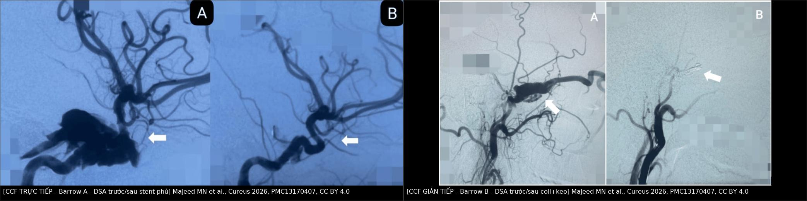
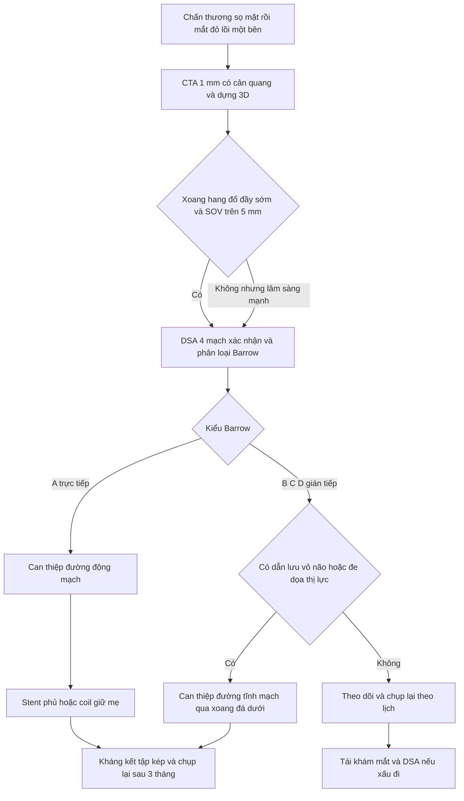
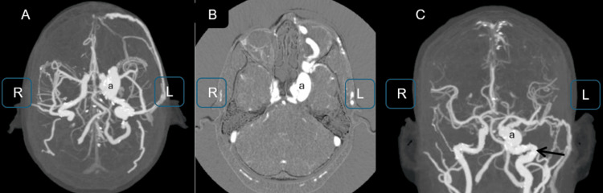
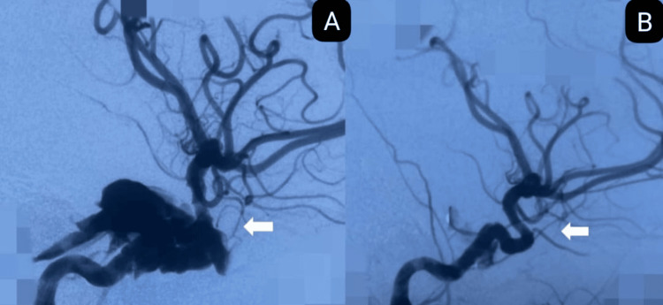
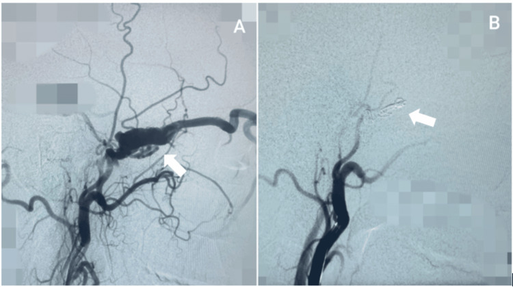

# 249 — Rò động mạch cảnh–xoang hang sau chấn thương: Barrow A–D & can thiệp nội mạch / Post-traumatic carotid-cavernous fistula (CCF)

**Tags:** `pattern:luong-thong-dong-tinh-mach` `pattern:mat-do-loi-mat` `vung:xoang-hang` `vung:o-mat` `score:Barrow` `protocol:DSA` `protocol:CTA-co`
**Mức chắc chắn (certainty):** tổng hợp y văn (literature synthesis) — số liệu lấy từ toàn văn các bài mở (PMC13170407, PMC12949683, PMC10200966, PMC11544482, PMC12643439, PMC4488263); **3 ca trong quiz là ca nguyên văn**, giữ đúng tuổi – cơ chế chấn thương – mô tả hình ảnh gốc.

> **Câu chốt:** chấn thương sọ–mặt rồi **mắt đỏ, lồi, có tiếng thổi** = nghĩ **CCF trực tiếp (Barrow A)** cho tới khi chứng minh ngược; **DSA 4 mạch** là chuẩn vàng và là nơi quyết định can thiệp. **Điều trị đầu tay là nội mạch** (stent phủ/coil), không phải mổ hở. **Chậm chẩn đoán = mất thị lực vĩnh viễn** — ca 1 dưới đây bị điều trị như "viêm kết mạc nhiễm trùng" 2 tháng và mắt đã không còn nhận thức ánh sáng.

## 1. Tổng quan bệnh học – cơ chế hình ảnh

- **Giải phẫu quyết định triệu chứng.** Động mạch cảnh trong đoạn hang (C4) **bị cố định** giữa hai vòng màng cứng (proximal/distal dural ring) và uốn cong trong **xoang hang (cavernous sinus)** — một đám rối tĩnh mạch có vách. Trong xoang: **dây VI là dây DUY NHẤT chạy trong lòng xoang**; dây III, IV, V1, V2 nằm trong **vách màng cứng bên**. Vì vậy **liệt dây VI là dấu hiệu sớm nhất và hay gặp nhất**, còn liệt III–IV–V1–V2 xuất hiện khi xoang căng hoặc viêm lan vách.
- **Cơ chế chấn thương.** Lực tăng–giảm tốc đột ngột làm đoạn C4 cố định bị **rách thành** (trực tiếp do mảnh xương bướm, hoặc do biến dạng mạch) → máu áp lực ~100 mmHg đổ thẳng vào xoang áp lực ~5–10 mmHg. Vì **gradient áp lực lớn**, lỗ rò nhỏ cũng đủ tạo **luồng thông lưu lượng cao (high-flow)**.
- **TẠI SAO hình ảnh như vậy (vật lý):**
  - **CTA:** thuốc cản quang đến xoang hang **ngay thì động mạch**, trước khi các tĩnh mạch khác đổ đầy → gọi là **"đổ đầy sớm" (early opacification)**. Xoang hang **giãn**, **tĩnh mạch mắt trên (superior ophthalmic vein — SOV) giãn**; trên CTA, **SOV > 0,5 cm** là ngưỡng gợi ý CCF thể trực tiếp (PMC11544482).
  - **Não/ổ mắt:** áp lực tĩnh mạch tăng → **lồi mắt, phù kết mạc, giãn mạch kết mạc**, cơ vận nhãn dày lên do ứ máu (không phải do viêm cơ). Tăng áp lực tĩnh mạch → **tăng nhãn áp** → thiếu máu đầu dây thần kinh thị → mất thị lực kiểu **thiếu máu, không hồi phục nếu muộn**.
  - **Tiếng thổi (bruit):** dòng xoáy trong SOV ngay sau ổ mắt — nghe bằng ống nghe, hoặc bệnh nhân tự nghe "ù tai mạch đập" (**pulsatile tinnitus**).
- **Dịch tễ & ngưỡng:** CCF gặp ở **0,2%** ca chấn thương sọ não và tới **3,8%** ca **vỡ nền sọ** (PMC12949683); **~75%** CCF là do chấn thương, trong khi phân tích gộp 1.494 bệnh nhân ghi **87,17% do chấn thương, 10,18% tự phát** (PMC10200966). **CCF trực tiếp chiếm 70–90%** tổng số CCF (PMC13170407).
- **TẠI SAO chấn thương → thể trực tiếp, tự phát → thể gián tiếp:** chấn thương rách **thành động mạch cảnh** (một lỗ lớn, lưu lượng cao); tự phát là **rò màng cứng (dural AVF)** qua các nhánh màng não nhỏ của động mạch cảnh trong/mạch cảnh ngoài — nhiều cuống nhỏ, lưu lượng thấp, thường ở nữ lớn tuổi.

## 2. Mẫu hình + chẩn đoán phân biệt theo vị trí và kiểu dẫn lưu (Gamut)

- **Mẫu hình "mắt đỏ + lồi + thổi" (anterior drainage):** CCF trực tiếp (Barrow A) → CCF gián tiếp (B–D) → huyết khối xoang hang → viêm mô tế bào ổ mắt → bệnh mắt tuyến giáp (TED) → dị dạng động–tĩnh mạch ổ mắt.
- **Mẫu hình "liệt vận nhãn đơn độc, mắt KHÔNG đỏ" (posterior drainage):** CCF dẫn lưu ra **xoang đá dưới/tĩnh mạch cảnh trong** → không có lồi mắt, không thổi; dễ nhầm **Tolosa–Hunt, hội chứng khe ổ mắt trên, đau đầu cluster**. Đây là nhóm **bỏ sót nhiều nhất**.
- **Mẫu hình "chảy máu":** dẫn lưu về **vỏ não (cortical venous drainage)** → xuất huyết nội sọ/chảy máu cam nặng. Trong 236 ca rò động–tĩnh mạch màng cứng, **23,7% xuất huyết lúc chẩn đoán** và **kiểu dẫn lưu tĩnh mạch là yếu tố nguy cơ độc lập duy nhất** (PMC4488263).
- **Phân loại Barrow (dùng cho mọi CCF):**
  - **A — trực tiếp:** động mạch cảnh trong ↔ xoang hang, **lưu lượng cao**, gần như luôn do chấn thương.
  - **B — gián tiếp:** nhánh **màng não của động mạch cảnh trong**.
  - **C — gián tiếp:** nhánh **màng não của động mạch cảnh ngoài**.
  - **D — gián tiếp:** **cả hai** (động mạch cảnh trong + ngoài).
- **Mnemonic "RED EYE" cho CCF:** **R**inging (ù tai mạch đập) · **E**xophthalmos · **D**ilated episcleral vessels · **E**levated IOP · **Y**es bruit · **E**ye movement deficit.
- **Bảng phân tầng nguy cơ theo dẫn lưu:** trước (SOV) = **nguy cơ mắt**; sau (xoang đá) = **nguy cơ liệt dây, ít dấu mắt**; vỏ não = **nguy cơ xuất huyết**; xoang bướm = **chảy máu cam ồ ạt**.

## 3. Bảng so sánh phân biệt (ma trận đối chiếu)

| Thực thể (entity) | Hình ảnh điển hình (CTA/MRI/DSA) | Chốt vào (rule-in) | Chốt loại (rule-out) | Gợi ý xác nhận |
|---|---|---|---|---|
| **CCF trực tiếp (Barrow A)** | **Xoang hang đổ đầy sớm**, SOV **> 5 mm**, lỗ rò lớn từ C4; DSA thấy shunt thì động mạch | **Chấn thương + lồi mắt + tiếng thổi + SOV giãn > 5 mm** | Không có shunt trên DSA 4 mạch → không phải CCF | DSA 4 mạch + 3D; can thiệp nội mạch |
| **CCF gián tiếp (Barrow B–D)** | Nhiều cuống màng não nhỏ, lưu lượng thấp, xoang hang giãn vừa; CTA có thể **âm tính** | **Tự phát + nữ lớn tuổi + đỏ mắt âm ỉ**; DSA thấy cuống màng não | Một lỗ rò lớn từ C4 → thể trực tiếp | DSA (chuẩn vàng), ICGA/CTA lặp |
| **Huyết khối xoang hang** | **Khuyết thuốc trong xoang** trên CTA tĩnh mạch, thành xoang bắt thuốc, viêm xoang/mặt kèm | **Sốt + nhiễm trùng mặt/xoang + liệt nhiều dây + lan 2 bên** | Có shunt động–tĩnh mạch rõ → CCF | CTA tĩnh mạch, MRI, cấy máu; kháng sinh + kháng đông |
| **Bệnh mắt tuyến giáp (TED)** | **Cơ to nhưng CHỪA GÂN**, mỡ ổ mắt tăng, không giãn SOV | **Bệnh tuyến giáp + cơ to chừa gân + 2 bên** | **SOV giãn > 5 mm + thổi** → CCF | TSH/TRAb; MRI có T2 fat-sat |
| **Viêm mô tế bào/áp-xe ổ mắt** | Mỡ ổ mắt thâm nhiễm, **áp-xe có vỏ**, cơ **dính cả gân**, viêm xoang sàng | **Sốt, đau tăng khi liếc, đề kháng ổ mắt** | **Thổi + đổ đầy sớm xoang** → CCF | CTA/MRI; kháng sinh; **không chọc nhầm CCF** |
| **Dị dạng động–tĩnh mạch ổ mắt** | Khối mạch **trong ổ mắt**, nidus, không phải xoang hang | **Nidus trong mô ổ mắt**, thường trẻ | Shunt ở xoang hang → CCF | DSA chọn lọc |
| **Tolosa–Hunt / viêm xoang hang** | Xoang hang **dày, bắt thuốc**, không có shunt; MRI T2 giảm tín hiệu | **Đau ổ mắt dữ dội + liệt nhiều dây + đáp ứng corticoid** | Có shunt thì loại Tolosa–Hunt | MRI + DSA; thử corticoid |

*Trái: CCF **trực tiếp** (Barrow A) — (A) thuốc đổ đầy xoang hang ngay thì động mạch, (B) sau đặt stent phủ: lỗ rò kín, động mạch cảnh trong thông. Phải: CCF **gián tiếp** (Barrow B) — (A) cuống màng não từ động mạch cảnh ngoài đổ vào xoang, (B) sau coil + keo: không còn dòng vào rò. Nguồn: Majeed MN et al., Cureus 2026 (PMC13170407), Fig. 3–4, CC BY 4.0. Ảnh ghép letterbox, giữ nguyên tỷ lệ.*

### Ba dấu hiệu chốt cần đọc đúng
- **Đổ đầy sớm xoang hang:** trên CTA, xoang hang **sáng bằng động mạch cảnh** ở thì động mạch — bình thường xoang chỉ sáng ở thì tĩnh mạch.
- **SOV > 5 mm:** ngưỡng trên CTA; trong 35 ca CCF, **đường kính SOV trái > 0,5 cm** tương quan với thể trực tiếp, còn **SOV phải và tĩnh mạch cảnh trong hai bên không** tương quan với kiểu/vị trí rò (PMC11544482).
- **Lệch 1 bên nhưng triệu chứng 2 bên:** dẫn lưu qua **xoang gian hang** sang bên đối diện → mắt bên kia cũng đỏ/lồi; **không vì "2 bên" mà loại CCF**.

## 4. Protocol chụp + phân độ + can thiệp

### 4.1. Chẩn đoán
- **CTA sọ–ổ mắt lát ≤ 1 mm, có cản quang, dựng 3D MIP** (thì động mạch + thì tĩnh mạch): bước đầu, nhanh, phát hiện **xoang hang giãn, SOV > 5 mm, cơ vận nhãn dày, vỡ xương bướm**.
- **MRI/MRA:** hữu ích khi **chống chỉ định cản quang** hoặc cần đánh giá mô mềm; **nhưng CTA/MRI có thể ÂM TÍNH** ở rò gián tiếp lưu lượng thấp — ca báo cáo có **CTA và MRI trước đó không phát hiện bất thường**, chỉ DSA chẩn đoán (PMC13256690).
- **DSA 4 mạch (động mạch cảnh trong–ngoài + đốt sống hai bên) là chuẩn vàng:** xác định **vị trí lỗ rò, Barrow, cuống nuôi, kiểu dẫn lưu tĩnh mạch, tuần hoàn bàng hệ**, và **chụp đối bên + nghiệm pháp nén (Allcock)** để đánh giá dòng bàng hệ trước khi cân nhắc bít mẹ.
- **Không chọc/hút ổ mắt khi chưa loại CCF** — có thể gây chảy máu không cầm.
- **Trước can thiệp:** chức năng thận, đông máu, **bóng test tắc mạch (balloon test occlusion)** nếu định hy sinh động mạch cảnh trong.

### 4.2. Phân tầng và điều trị
- **Chỉ định can thiệp:** (1) **giảm/mất thị lực**, tăng nhãn áp; (2) **dẫn lưu vỏ não** hoặc chảy máu nội sọ/chảy máu cam; (3) liệt vận nhãn tiến triển; (4) đau đầu không kiểm soát; (5) rò tồn tại có triệu chứng.
- **Có thể theo dõi:** rò **gián tiếp nhẹ, không dẫn lưu vỏ não, không đe dọa thị lực** — có ca **tự đóng hoàn toàn sau ~2 tháng** (thể D hai bên, PMC13256690); chụp lại theo lịch.
- **Trực tiếp (A) → đường động mạch:** **stent phủ (covered stent)** là lựa chọn ưu tiên khi động mạch thẳng, đủ đường kính; **coil ± bóng** khi cổ rộng/không đặt được stent; **chất lỏng (Onyx/n-BCA)** hỗ trợ. Trong series 10 ca, **70% đặt stent phủ PK Papyrus**, **20% thắt động mạch cảnh trong**, **90% cải thiện lâm sàng**, không có chảy máu/nhồi máu/liệt dây mới (PMC13170407).
- **Gián tiếp (B–D) → đường tĩnh mạch:** **xoang đá dưới (inferior petrosal sinus)** là đường vào phổ biến; coil ± chất lỏng; đường động mạch khó vì cuống nhỏ, nguy cơ thiếu máu dây thần kinh.
- **Hy sinh động mạch cảnh trong (ICA ligation/triệt mạch):** chỉ khi **bàng hệ đủ** (test tắc mạch âm tính) và không còn cách giữ mẹ; nguy cơ nhồi máu bán cầu.
- **Tỷ lệ thành công:** đóng kín ngay **68–75%**, lui bệnh hoàn toàn **82–90%**; **liệt dây thần kinh sọ sau can thiệp 5–7%** (PMC10200966, 36 nghiên cứu, 1.494 bệnh nhân). **Tái phát được báo 35% (95% CI 5–66%; I² ≈ 99,8%)** — độ không đồng nhất cực cao, **không dùng con số này để tư vấn từng bệnh nhân**, nhưng đủ để thấy **bắt buộc chụp kiểm tra**.
- **Kháng kết tập:** sau stent phủ dùng **kháng kết tập kép**; series trên dùng **bolus tirofiban 4 mL + nạp clopidogrel 300 mg sau thủ thuật** nếu chưa nạp trước, và **chụp kiểm tra (DSA/CTA/MRI) ở tháng thứ 3** (PMC13170407). Thời gian DAPT cụ thể tùy trung tâm/loại stent — ghi rõ trong hồ sơ, **không tự ngừng**.
- **Biến chứng cần cảnh báo:**
  - **Xuất huyết nội sọ MUỘN sau khi đã đóng rò:** ca 48 tuổi chảy máu thùy trán **12 ngày sau** đóng CCF thành công, cơ chế **"bùng nổ áp lực tưới máu bình thường" (normal perfusion pressure breakthrough — NPPB)** trên vùng não trước đó giảm tưới máu (PMC12643439). Vì vậy **theo dõi huyết áp và thần kinh sau thủ thuật, không chỉ 48 giờ đầu**.
  - Tắc stent/huyết khối, di lệch coil, liệt dây mới do khối choán chỗ, nhồi máu khi hy sinh mạch.

## 5. Biến thể bình thường và cạm bẫy

- **"Viêm kết mạc" kéo dài một bên sau chấn thương = CCF cho tới khi loại trừ.** Ca 1 bị điều trị kháng sinh 2 tháng trước khi chụp mạch; hậu quả **mất thị lực vĩnh viễn**. Bất kỳ **đỏ mắt một bên + lồi + không đáp ứng điều trị** đều phải nghe tiếng thổi và chụp mạch.
- **CTA âm tính không loại trừ rò gián tiếp lưu lượng thấp** — chỉ DSA âm tính mới loại trừ khi lâm sàng mạnh.
- **Dẫn lưu sau (xoang đá) làm mất dấu mắt:** bệnh nhân chỉ liệt dây VI/III, không đỏ mắt, không thổi → dễ chẩn đoán nhầm **đau đầu cluster/Tolosa–Hunt** và cho corticoid.
- **Tổn thương do chấn thương có thể phối hợp:** vừa **giả phình C4** vừa **rò** — phải mô tả cả hai, vì giả phình quyết định cách dựng lại mạch (bài 248).
- **Dị vật kim loại cản MRI:** ca 1 có mảnh kim loại vùng trán → **MRI chống chỉ định**, phải dùng CTA (PMC12949683).
- **Bilateral không loại trừ một ổ rò:** dẫn lưu qua xoang gian hang; đừng kết luận "bệnh 2 bên" rồi bỏ DSA.
- **Tăng nhãn áp sau khi đóng rò vẫn có thể tồn tại** — rò đóng không đồng nghĩa thị lực hồi phục; thời gian thiếu máu thần kinh thị quyết định tiên lượng.
- **Xuất huyết muộn sau đóng rò (NPPB):** đừng cho xuất viện quá sớm ở bệnh nhân tăng huyết áp, não giảm tưới máu mạn.

## 6. Tự lượng giác — Blind Quiz

**Ca 1 — Nam 35 tuổi, vô gia cư, 2 tháng sau vết dao xuyên hốc mắt trái: lồi mắt tăng dần, đau, "mắt đông cứng", không còn nhận thức ánh sáng.**

- Gợi ý: ban đầu được điều trị như nhiễm trùng hốc mắt; đồng tử giãn cố định, liệt hoàn toàn vận nhãn; có mảnh kim loại vùng trán.
- Câu hỏi: (1) Dấu hiệu chính trên CTA? (2) Vì sao mắt "đông cứng" và mất thị lực? (3) Ba chẩn đoán phân biệt và bước tiếp theo?

<b>Bấm để hiện đáp án (findings + chẩn đoán)</b>

- **Findings:** **(A, B)** lát trục và **(C)** MIP coronal: **xoang hang trái giãn, đổ đầy sớm** và **thông trực tiếp với động mạch cảnh trong đoạn hang** (mũi tên); **tĩnh mạch mắt trên giãn**, **cơ vận nhãn dày**, thay đổi viêm mô mềm quanh ổ mắt.
- **Chẩn đoán:** **CCF trực tiếp (Barrow A) sau chấn thương xuyên thấu hốc mắt**, lưu lượng cao, dẫn lưu chủ yếu ra tĩnh mạch mắt trên.
- **Vì sao "đông cứng":** tăng áp lực xoang hang chèn ép **VI (trong lòng xoang) + III, IV, V1** (vách bên) → liệt hoàn toàn vận nhãn; **tăng áp lực tĩnh mạch → tăng nhãn áp → thiếu máu thần kinh thị** gây mất thị lực không hồi phục sau 2 tháng.
- **Phân biệt:** huyết khối xoang hang (sốt, nhiễm trùng, lan 2 bên), viêm mô tế bào/áp-xe ổ mắt (sốt, đau khi liếc, không thổi), TED (cơ to chừa gân, 2 bên, không thổi).
- **Bước tiếp theo:** **DSA 4 mạch** (chuẩn vàng) rồi can thiệp nội mạch; MRI chống chỉ định vì có dị vật kim loại.
- **Diễn biến nguồn:** đặt **11 coil**, đóng được **~80%** lỗ rò; lồi mắt giảm nhưng **thị lực không hồi phục** và liệt vận nhãn giữ nguyên — minh họa giá của chẩn đoán muộn.
- **Nguồn ảnh:** Gómez Cristancho DC et al., Cureus 2026 (PMC12949683), Fig. 2, CC BY 4.0. Ca nguyên văn: nam 35 tuổi.

**Ca 2 — Nữ 30 tuổi, lồi mắt trái, đỏ mắt, tiếng thổi sau ổ mắt; DSA xác nhận một lỗ rò lớn từ đoạn hang của động mạch cảnh trong.**

- Gợi ý: Barrow A; động mạch cảnh trong còn dòng chảy não bình thường; chọn dụng cụ "một thì".
- Câu hỏi: (1) Mô tả (A) và (B)? (2) Vì sao chọn stent phủ thay vì coil? (3) Theo dõi sau thủ thuật gồm gì?

<b>Bấm để hiện đáp án (findings + chẩn đoán)</b>

- **Findings:** **(A)** DSA trước: thuốc từ đoạn hang động mạch cảnh trong **đổ thẳng vào xoang hang giãn lớn** (mũi tên) — rò trực tiếp lưu lượng cao. **(B)** sau **stent phủ**: **không còn thuốc vào xoang**, động mạch cảnh trong và các nhánh não phía trên vẫn thông.
- **Chẩn đoán:** **CCF trực tiếp (Barrow A)**, đóng hoàn toàn bằng stent phủ.
- **Vì sao stent phủ:** bịt lỗ rò **một thì** mà vẫn **giữ mẹ** (giữ dòng não), tránh nguy cơ coil trôi/tắc nhánh; coil phù hợp hơn khi cổ rộng, mạch gấp khúc hoặc stent không áp được thành.
- **Theo dõi:** kháng kết tập kép theo phác đồ, **DSA/CTA kiểm tra tháng thứ 3** (series dùng mốc này), khám mắt (lồi, thị lực, nhãn áp), theo dõi huyết áp và dấu thần kinh muộn (NPPB).
- **Nguồn ảnh:** Majeed MN et al., Cureus 2026 (PMC13170407), Fig. 4, CC BY 4.0. Ca nguyên văn: nữ 30 tuổi.

**Ca 3 — Nam 30 tuổi, đỏ mắt trái âm ỉ nhiều tuần, không chấn thương; DSA thấy cuống màng não từ động mạch cảnh ngoài đổ vào xoang hang.**

- Gợi ý: lưu lượng thấp, nhiều cuống nhỏ; không có lỗ rò trực tiếp từ C4.
- Câu hỏi: (1) Đây là Barrow nào? (2) Vì sao không dùng stent phủ như ca 2? (3) Khi nào có thể chỉ theo dõi?

<b>Bấm để hiện đáp án (findings + chẩn đoán)</b>

- **Findings:** **(A)** DSA động mạch cảnh ngoài: **nhánh màng não** đổ vào xoang hang (mũi tên) — không có thông trực tiếp từ động mạch cảnh trong. **(B)** sau **coil + keo (glue)**: bít cuống, không còn dòng vào xoang.
- **Chẩn đoán:** **CCF gián tiếp, lưu lượng thấp**, bít được bằng coil + keo.
- **Phản biện nguồn (giữ nguyên chú thích gốc):** bài gốc ghi **"Type B"** nhưng chú thích ảnh lại mô tả **nhánh màng não của động mạch cảnh NGOÀI** — theo định nghĩa Barrow, cuống từ động mạch cảnh ngoài là **type C**, còn type B là cuống màng não của động mạch cảnh trong. Điểm cốt lõi không đổi: **thể gián tiếp, nhiều cuống nhỏ, không có lỗ rò trực tiếp từ C4**; khi trích dẫn phải ghi cả hai thông tin này, không tự "sửa" nguồn.
- **Vì sao không stent phủ:** không có một lỗ rò lớn trên thân động mạch cảnh trong để "vá"; tổn thương là **nhiều cuống nhỏ** → bít chọn lọc bằng coil/keo (thường qua đường tĩnh mạch) hợp lý hơn và tránh phủ nhánh lành.
- **Khi nào theo dõi:** rò gián tiếp **nhẹ, không dẫn lưu vỏ não, thị lực ổn định** — có ca **tự đóng sau ~2 tháng** (PMC13256690); nhưng nếu **liệt dây tiến triển, đau không kiểm soát, dẫn lưu vỏ não hoặc thị lực giảm** thì can thiệp.
- **Nguồn ảnh:** Majeed MN et al., Cureus 2026 (PMC13170407), Fig. 3, CC BY 4.0. Ca nguyên văn: nam 30 tuổi.

## Bài liên quan chéo

- [423 – Fistula xoang hang vs huyết khối](../423-fistula-xoang-hang/lesson.md) (góc nhìn mắt: phân biệt CCF với huyết khối xoang hang)
- [248 – Can thiệp nội mạch giả phình & bóc tách động mạch cổ](../248-can-thiep-noi-mach-gia-phinh-boc-tach-dong-mach-co-dot-song/lesson.md) (stent/coil, kháng kết tập)
- [247 – Bóc tách động mạch cổ/đốt sống](../247-boc-tach-dong-mach-co-dot-song-cervical-artery-dissection/lesson.md)
- [231 – Tổn thương mạch máu não do chấn thương & vỡ sọ tiến triển](../231-ton-thuong-mach-mau-nao-chan-thuong-va-vo-so-tien-trien/lesson.md)
- [227 – Đau đầu sét đánh: SAH/RCVS/bóc tách](../227-dau-dau-set-danh-thunderclap/lesson.md)
- [216 – Dị dạng mạch máu não & huyết khối xoang](../216-di-dang-mach-CVST/lesson.md)
- [200 – Tổng quan hệ Thần kinh](../200-tong-quan-he-than-kinh/lesson.md)

> Không dùng để chẩn đoán độc lập khi chưa có người hướng dẫn.
