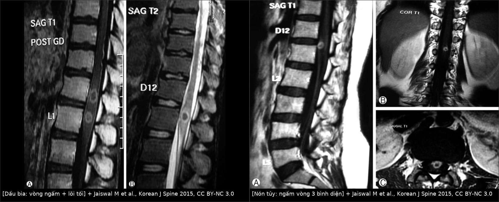
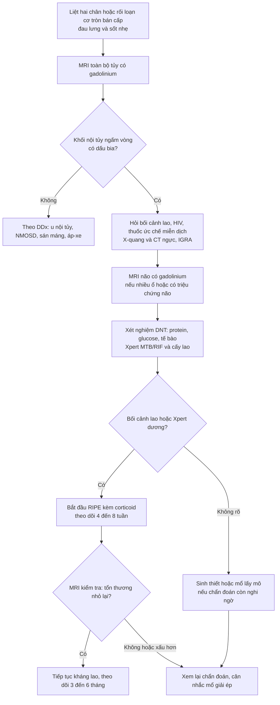
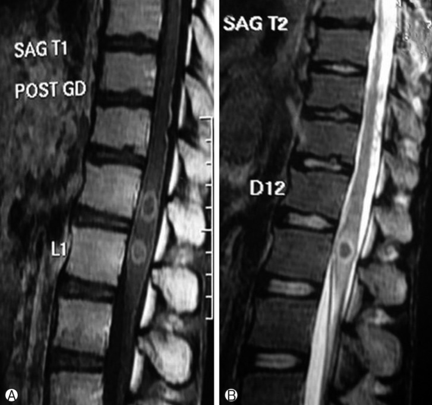
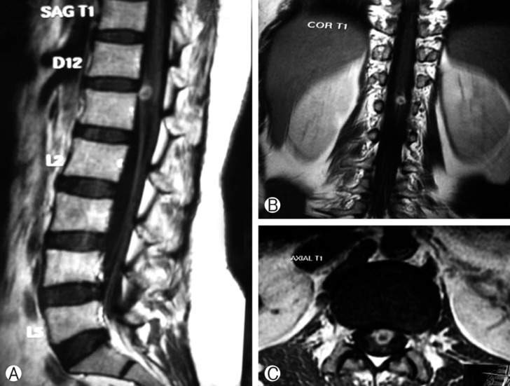

# 250 — Lao nội tủy & lao màng tủy: dấu bia / Spinal intramedullary & leptomeningeal tuberculosis

**Tags:** `pattern:khang-ngam-vong` `pattern:viem-tuy` `vung:tuy-song` `protocol:MRI-tuy-co-gadolinium` `protocol:MRI-nao-tuong-phan`
**Mức chắc chắn (certainty):** tổng hợp y văn (literature synthesis) — số liệu chính từ loạt **11 ca lao nội tủy (spinal intramedullary tuberculoma, SIMT)** trong 27 năm tại một trung tâm Ấn Độ (PMC4398828, Korean J Spine 2015) và ca trẻ có lao nội tủy + lao não đồng thời (PMC6798273, J Pediatr Neurosci 2019). Hai ca trong quiz là **ca nguyên văn**, giữ đúng vị trí – dấu hiệu – cách xử trí của bài gốc.

> **Bài này nối tiếp [243 – Sán máng thần kinh](../243-san-mang-than-kinh/lesson.md)** (cùng mẫu hình "tăng T2 nội tủy + ngấm nốt/đường", nhưng điều trị hoàn toàn khác: praziquantel so với RIPE dài ngày) và **[214 – Nhiễm trùng hệ thần kinh trung ương](../214-nhiem-trung-tktw/lesson.md)**. Điểm chốt: **lao nội tủy chữa khỏi bằng thuốc**, mổ chỉ để giải ép hoặc khi chẩn đoán không rõ — nghĩ tới lao trước khi cắt tủy là quyết định lớn nhất của bài này.

## 1. Tổng quan — vì sao lao cho ra "dấu bia" và vì sao T2 lại TỐI

- **Bệnh học:** *Mycobacterium tuberculosis* lan tới tủy theo **đường máu** hoặc **đường dịch não tủy (DNT)**; tại tủy hình thành **u hạt lao (tuberculoma)** gồm **hoại tử bã đậu (caseous necrosis)** ở trung tâm, bao quanh là **u hạt tế bào biểu mô + tế bào khổng lồ Langerhans**, ngoài cùng là **phù và viêm mạch**. Lao màng tủy (leptomeningeal TB) là biến thể lan theo khoang dưới nhện, thường kèm lao màng não.
- **TẠI SAO T2 tối — không phải "tăng tín hiệu như mọi viêm":** trung tâm bã đậu **đặc, giàu tế bào (macrophage)** và chứa **gốc tự do thuận từ (paramagnetic free radicals)** do đại thực bào sinh ra → **rút ngắn T2 (T2 shortening)** → khối **tối/đẳng tín hiệu trên T2**, khác hẳn phù quanh (sáng). Khi ổ bã đậu **hóa lỏng nhiều**, khối có thể **sáng trên T2** — nên T2 sáng không loại trừ lao.
- **TẠI SAO ngấm vòng (ring enhancement) và "dấu bia" (target sign):** mạch máu chỉ còn ở **viền u hạt** nơi hàng rào máu–tủy bị phá vỡ → **ngấm thuốc vòng**; **trung tâm bã đậu không có mạch** → **không ngấm**. Trên T1 sau gadolinium: **vòng sáng + lõi tối**; trên T2: **vòng tối + lõi tối/sáng** → nhìn như **bia bắn**.
- **Ngưỡng định lượng nằm lòng (từ loạt 11 ca và y văn):**
  - **Tần suất:** SIMT chỉ **2/100.000 ca lao** và **0,2% ca lao thần kinh trung ương**; tỉ lệ **nội tủy : nội sọ ≈ 1 : 42**.
  - **Vị trí:** **tủy ngực 91% (10/11)** trong loạt; hay gặp **vùng nón tủy–tủy ngực giữa**; chỉ 1 ca vùng cổ.
  - **Dấu bia:** có ở **7/9 ca được chụp MRI (78%)**; **giãn tủy lan tỏa tại chỗ có ở 9/9**.
  - **Lao phổi kèm theo:** **5/11 (45%)** — tức **hơn nửa không có lao phổi**, đừng chờ X-quang ngực dương mới nghĩ tới lao.
  - **Lao nội sọ đồng thời:** **2/11 (18%)**, đều là ca **nhiều ổ nội tủy** → có nhiều ổ nội tủy thì **bắt buộc MRI não**.
  - **Vôi hóa:** u hạt lao **lành hóa vôi hóa ở ~23%** ca; vôi hóa là dấu hiệu **muộn**, không dùng để chốt hoạt động.
  - **Điều trị trong loạt:** **HRZE + S + moxifloxacin 3 tháng** (liều theo cân nặng: H 5, R 10, E 15, Z 25, S 15, Mfx 10 mg/kg/ngày) rồi **HR kéo dài tới 21 tháng** (tổng **24 tháng**), kèm **prednisolone 1 mg/kg/ngày giảm dần trong 6 tuần đầu**.
  - **Kết cục:** **8/11 mổ**, **7/8 hết tổn thương trên MRI sau mổ**; 3/11 điều trị nội khoa đơn thuần đều cải thiện; **1/8 rò DNT sau mổ** (ngày 4), xử lý bằng acetazolamide + tư thế nằm sấp + băng ép.

## 2. Mẫu hình + chẩn đoán phân biệt theo vị trí (Gamut)

**A. Tổn thương NỘI TỦY ngấm vòng (gamut chính của bài):**
- **Lao nội tủy (SIMT)** — khối/đa khối, **dấu bia**, phù quanh, **không phá hủy đốt sống–đĩa đệm**, có thể kèm lao màng não/não.
- **U nội tủy:** **ependymoma** (trung tâm, bờ rõ, hay xuất huyết, ngấm đồng nhất hoặc vòng), **astrocytoma** (lệch tâm, bờ mờ, ngấm không đồng nhất), **hemangioblastoma** (nang + nốt ngấm mạnh ở thành, hay có mạch lớn).
- **Áp-xe nội tủy** (rất hiếm): sốt + đau + **DWI hạn chế mạnh trong lõng**, ngấm vòng dày.
- **Sán máng tủy** (bài 243): ngấm **nốt–đường kiểu "cuống lá"** quanh một đường sáng trung tâm, **dịch tễ nước ngọt**, eosinophil DNT chỉ 40–50%.
- **NMOSD/viêm tủy cắt ngang:** **LETM ≥ 3 đốt**, tổn thương trung tâm **"H-sign"**, ngấm **vòng hở (open ring)** hoặc mảng, **không có khối**.
- **Di căn nội tủy / lymphoma:** hiếm, thường có tiền sử ung thư, ngấm đồng nhất, phù rộng.

**B. Tổn thương MÀNG TỦY (lao màng tủy — leptomeningeal TB):**
- **Dày, ngấm thuốc màng tủy–màng nhện**, đặc biệt **mặt lưng tủy ngực**, có thể **dính màng nhện gây giãn tủy (syrinx) thứ phát** hoặc **chèn ép tủy**.
- Gamut dày màng tủy: **lao màng não/tủy**, **sarcoidosis**, **carcinomatosis màng não**, **nhiễm nấm (Cryptococcus)**, **viêm màng não mủ**, **xuất huyết màng não cũ**.

**C. Câu hỏi lọc bắt buộc (3 câu):**
1. **Có bối cảnh lao** (tiếp xúc, lao phổi, lao hạch, IGRA/Xpert dương, môi trường dịch tễ) **hoặc đang dùng thuốc ức chế miễn dịch/HIV**?
2. **Tổn thương có phá đốt sống–đĩa đệm không?** Có → nghĩ **lao cột sống (Pott)** trước, vì đường vào và cách xử trí khác.
3. **Có nhiều ổ nội tủy hoặc đau đầu/co giật?** Có → **MRI não có gadolinium** ngay.

## 3. Bảng so sánh phân biệt (ma trận đối chiếu)

| Thực thể (entity) | Hình ảnh điển hình | Chốt vào (rule-in) | Chốt loại (rule-out) | Gợi ý xác nhận |
|---|---|---|---|---|
| **Lao nội tủy (SIMT)** | Khối nội tủy **T2 tối/đẳng + vòng ngấm + lõi tối ("dấu bia")**, phù quanh, giãn tủy tại chỗ, **không phá xương** | **Dấu bia + bối cảnh lao ± lao phổi ± lao não**, tổn thương **giảm sau ATT** | **Phá hủy đốt–đĩa đệm** → Pott; **ngấm nốt rời rạc** → sán máng | MRI tủy + não có Gd; Xpert MTB/RIF trên DNT/dịch; mô bệnh nếu mổ |
| **Ependymoma** | Khối **trung tâm**, bờ rõ, **phình tủy khu trú**, hay **xuất huyết (viền hemosiderin)**, nang | **Bờ rõ + xuất huyết + không giảm sau ATT** | **Giảm rõ sau 4–8 tuần ATT** → không phải u | MRI; mô bệnh (chuẩn) |
| **Astrocytoma tủy** | Khối **lệch tâm**, bờ mờ, ngấm không đồng nhất, phù dài | **Bờ mờ + lệch tâm + tiến triển dù ATT** | **Dấu bia điển hình + bối cảnh lao** → lao | MRI; mô bệnh |
| **Áp-xe nội tủy** | Ngấm vòng **dày**, **DWI hạn chế mạnh trong lõi**, phù nhiều, sốt | **Sốt + DWI lõi tối + bạch cầu tăng** | **Không hạn chế DWI + bối cảnh lao** → lao | Cấy/mô bệnh; kháng sinh–dẫn lưu |
| **Sán máng tủy** | Ngấm **nốt–đường kiểu cuống lá** quanh đường sáng trung tâm, tủy ngực dưới/nón tủy | **Dịch tễ nước ngọt + ELISA DNT dương** | **Dấu bia đơn khối + Xpert lao dương** → lao | ELISA huyết thanh/DNT; đáp ứng praziquantel |
| **NMOSD / viêm tủy cắt ngang** | **LETM ≥ 3 đốt**, trung tâm "H-sign", ngấm mảng/vòng hở, **không khối** | **AQP4/MOG dương + LETM + viêm dây thị** | **Khối có bờ + dấu bia** → không phải | AQP4/MOG; MRI não |
| **Lao cột sống (Pott)** | **Phá thân đốt + hẹp đĩa đệm + áp-xe cạnh sống**, chèn ép tủy | **Phá đốt–đĩa + áp-xe + vôi hóa** | **Tủy bình thường, tổn thương ngoài màng cứng** → không phải nội tủy | CT xương + MRI; PCR lao |

*Trái: T1 sau gadolinium cạnh T2 — **hai vòng ngấm thuốc có lõi tối**, nằm trong tủy vùng nón tủy (D12–L1), tủy **giãn tại chỗ** nhưng **không phá đốt sống**. Phải: cùng tổn thương nhìn trên **3 bình diện** (sagittal/coronal/axial T1 sau tiêm) — ngấm vòng **bờ rõ**, kèm **ngấm màng tủy nhẹ**. Nguồn: Jaiswal M et al., Korean J Spine 2015, PMC4398828, Fig. 3 và Fig. 2, CC BY-NC 3.0; ảnh ghép letterbox.*

### Dấu hiệu đọc chuẩn xác
- **Dấu bia (target sign)** = **vòng ngấm + lõi không ngấm** trên T1 sau tiêm, **tương ứng vùng tủy tối/đẳng tín hiệu trên T2**. Đây là dấu **gợi ý mạnh** nhưng **không đặc hiệu tuyệt đối** (u hoại tử, áp-xe, di căn hoại tử cũng có thể).
- **Giãn tủy tại chỗ (cord expansion)** có ở **9/9** ca có MRI — nhưng giãn tủy **không phân biệt** lao với u; điều phân biệt là **bờ tổn thương + T2 tối + bối cảnh**.
- **Lao màng tủy:** dày–ngấm màng tủy **lan dọc nhiều đốt**, có thể **dính màng nhện** → biến chứng **giãn tủy thứ phát**; đừng chỉ đọc "khối" mà bỏ qua màng tủy.
- **Đa ổ nội tủy = tín hiệu báo động:** trong loạt, **cả 2 ca đa ổ đều có lao nội sọ đồng thời** → chụp não.

## 4. Protocol chụp + xét nghiệm + điều trị

**Protocol hình ảnh:**
- **MRI toàn bộ tủy sống có gadolinium**: sagittal **T1, T2, STIR**, **T1 sau tiêm**, **axial T2 + T1 sau tiêm** qua ổ tổn thương; **DWI/ADC** khi nghi áp-xe (lõi hạn chế) hoặc phân biệt với u tế bào cao.
- **MRI não có gadolinium** khi: nhiều ổ nội tủy, đau đầu/co giật/rối loạn ý thức, hoặc chuẩn bị điều trị lao thần kinh trung ương (tìm lao màng não–não đồng thời).
- **X-quang/CT ngực** tìm lao phổi (chỉ 45% ca có); **CT cột sống** khi cần loại trừ Pott (phá đốt–đĩa).
- **Chụp lại sau 4–8 tuần ATT** (đánh giá đáp ứng) và **3–6 tháng**; tổn thương **nhỏ lại + hết ngấm** là bằng chứng hồi cứu mạnh cho chẩn đoán.

**Xét nghiệm:**
- **DNT:** protein tăng, glucose giảm, tế bào lympho tăng — **không đặc hiệu**; **Xpert MTB/RIF** và **cấy lao** (độ nhạy DNT không cao, **âm tính không loại trừ**).
- **IGRA/Mantoux** chỉ nói **đã nhiễm**, không phân biệt lao hoạt động; **HIV** và **ức chế miễn dịch** là yếu tố nguy cơ.

**Điều trị (ngưỡng và con số):**
- **Kháng lao có kiểm soát**: phác đồ chuẩn **2HRZE/10HRE** (WHO) cho lao thần kinh trung ương; nhiều trung tâm dùng **9–12 tháng**; loạt ca này dùng **24 tháng (3 tháng 6 thuốc + 21 tháng HR)** vì lo ngại kháng thuốc — **chưa có thử nghiệm so sánh trực tiếp**, nên bài này **không biến 24 tháng thành chuẩn**.
- **Corticoid**: **prednisolone 1 mg/kg/ngày giảm dần 6 tuần** trong loạt, nhằm giảm phù và nguy cơ **viêm màng não lao sau mổ**; dùng **kèm** kháng lao, không bao giờ đơn thuần.
- **Chỉ định mổ (theo loạt):** (1) **không đáp ứng ATT**, (2) **chẩn đoán còn nghi u**, (3) **xấu thần kinh nhanh**, (4) **to ra nghịch lý có hiệu ứng choán chỗ sau khi bắt đầu ATT** (ca 8). Mổ = **cắt u qua đường vào sau, có vi phẫu**, lấy toàn bộ khối có mặt phẳng rõ.
- **Biến chứng sau mổ:** rò DNT **1/8**, phù tủy sau mổ **1/8** (hết sau 3 tháng), di chứng thần kinh tồn dư; **nguy cơ viêm màng não lao sau mổ** là lý do phải phủ kháng lao đầy đủ trước–trong–sau mổ.

## 5. Biến thể bình thường và cạm bẫy

- **T2 tối bị đọc thành máu/melanin:** u hạt lao **tối trên T2** vì đặc tế bào + gốc tự do, **không phải** hemosiderin; đừng vội kết luận "xuất huyết tủy cũ".
- **Dấu bia không độc quyền của lao:** u hoại tử, áp-xe, di căn hoại tử đều có thể cho vòng ngấm + lõi tối → **luôn cộng bối cảnh + DWI + đáp ứng điều trị**.
- **To ra sau khi bắt đầu ATT (paradoxical reaction/IRIS):** ca 8 trong loạt **to lên có hiệu ứng choán chỗ** và phải mổ; nhưng **đa số phản ứng nghịch lý tự giới hạn** — chỉ mổ khi **xấu thần kinh**, không mổ chỉ vì ảnh to hơn.
- **Không có lao phổi không loại trừ:** **6/11 ca không có lao phổi**; **X-quang ngực bình thường không được dừng con đường chẩn đoán**.
- **Bỏ sót lao não:** **2/11 ca** có lao nội sọ đồng thời, đều thuộc nhóm **đa ổ nội tủy** → thiếu MRI não là bỏ sót ổ có thể gây động kinh/tăng áp lực nội sọ.
- **Nhầm với Pott:** nếu **có phá đốt–đĩa đệm** thì tổn thương tủy là **chèn ép từ ngoài**, không phải u nội tủy; điều trị và đường mổ khác.
- **Đừng chờ mô bệnh nếu bối cảnh + hình ảnh phù hợp:** trễ ATT = tủy đã tổn thương không hồi phục; ngược lại **đừng mổ chỉ vì "nhìn giống u"** khi chưa loại trừ lao.
- **Vôi hóa (23%) là dấu muộn**, không dùng để khẳng định "lao cũ không hoạt động".
- **Sau mổ, rò DNT là biến chứng thật (1/8)** — theo dõi vết mổ, tư thế, và không rút chỉ sớm.

## 6. Tự lượng giá — Blind Quiz

**Ca 1 — Nam thanh niên, liệt hai chân tiến triển, sốt nhẹ 3 tháng, có ho khạc. MRI tủy vùng nón tủy:**

- Câu hỏi: (1) Mô tả tổn thương và gọi tên dấu hiệu? (2) Vì sao lõi tổn thương **tối** trên cả T1 sau tiêm và T2? (3) Ba chẩn đoán phân biệt và xét nghiệm chốt hướng?

<b>Bấm để hiện đáp án (findings + chẩn đoán)</b>

- **Dấu hiệu:** **hai vòng ngấm thuốc** trong tủy vùng nón tủy–epiconus (D12–L1), **lõi không ngấm**, tủy **giãn tại chỗ**, **không phá đốt sống** → **dấu bia (target sign)**.
- **Vì sao lõi tối:** trung tâm **hoại tử bã đậu đặc, không mạch máu** → không ngấm gadolinium; đặc tế bào + gốc tự do thuận từ → **T2 tối**.
- **Phân biệt:** **u nội tủy (ependymoma/astrocytoma)**, **áp-xe nội tủy**, **sán máng tủy**; chốt hướng bằng **bối cảnh lao + Xpert/cấy DNT + đáp ứng ATT**; MRI não để tìm lao đồng thời.
- **Ca gốc:** bệnh nhân có **lao phổi**, được điều trị **nội khoa** (không mổ) và tổn thương **giảm dần** trên MRI theo dõi.
- Nguồn ảnh: Jaiswal M et al., Korean J Spine 2015, **PMC4398828**, Fig. 3, CC BY-NC 3.0 (nguyên bản).

**Ca 2 — Bệnh nhân liệt hai chân, MRI tủy có tổn thương nón tủy; ảnh sagittal–coronal–axial sau tiêm:**

- Câu hỏi: (1) Tổn thương nằm **trong hay ngoài tủy**? Dấu hiệu định vị? (2) Có gì ngoài khối? (3) Vì sao ca này vẫn có thể điều trị nội khoa?

<b>Bấm để hiện đáp án</b>

- **Định vị:** khối **nằm trong tủy**, **mặt trước nón tủy**, tủy **giãn** quanh khối → **nội tủy** (không phải ngoài màng cứng: không đẩy lệch túi màng cứng).
- **Ngoài khối:** **ngấm màng tủy nhẹ** (leptomeningeal enhancement) → gợi ý **lao màng tủy kèm theo**.
- **Vì sao nội khoa được:** bệnh nhân **đã dùng ATT cho lao phổi 3–4 tháng**, thần kinh **không xấu thêm** → theo dõi dưới ATT là lựa chọn hợp lý; mổ dành cho **xấu nhanh, không đáp ứng, hoặc chẩn đoán không rõ**.
- Nguồn ảnh: Jaiswal M et al., Korean J Spine 2015, **PMC4398828**, Fig. 2, CC BY-NC 3.0 (nguyên bản).

> **Phản biện (critique):** bằng chứng là **loạt ca hồi cứu 11 ca trong 27 năm**, không có nhóm chứng; **thời gian ATT 24 tháng** trong bài gốc **dài hơn khuyến cáo WHO 9–12 tháng** cho lao thần kinh trung ương, và **liều corticoid 6 tuần** chưa được thử nghiệm ngẫu nhiên. Vì vậy các con số ở đây được ghi kèm nguồn, không nâng thành "khuyến cáo mạnh"; khi áp dụng phải theo **phác đồ của đơn vị và kháng thuốc tại chỗ**.

## Bài liên quan chéo
- [200 – Tổng quan Hệ Thần kinh](../200-tong-quan-he-than-kinh/lesson.md)
- [243 – Sán máng thần kinh: tủy ngực dưới/nón tủy & thể não giả u](../243-san-mang-than-kinh/lesson.md)
- [214 – Nhiễm trùng hệ thần kinh trung ương: sán lợn, lao, toxoplasma](../214-nhiem-trung-tktw/lesson.md)
- [222 – Viêm đốt sống–đĩa đệm & lao cột sống (Pott)](../222-viem-dot-song/lesson.md)
- [220 – Tiếp cận tổn thương ống sống theo 3 khoang](../220-ong-song-tuy/lesson.md)
- [226 – Tủy mềm không do chấn thương: nhồi máu tủy, SDAVF, NMO](../226-tuy-mem-khong-chan-thuong-nhoi-mau-sdavf-nmo-xa/lesson.md)
- [254 – Giãn tủy sau chấn thương tủy sống](../254-gian-tuy-sau-chan-thuong-tuy-song/lesson.md)

> Không dùng để chẩn đoán độc lập khi chưa có người hướng dẫn.
