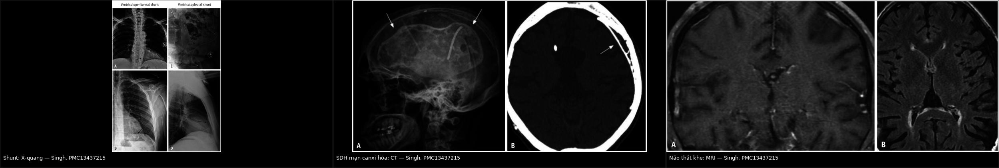
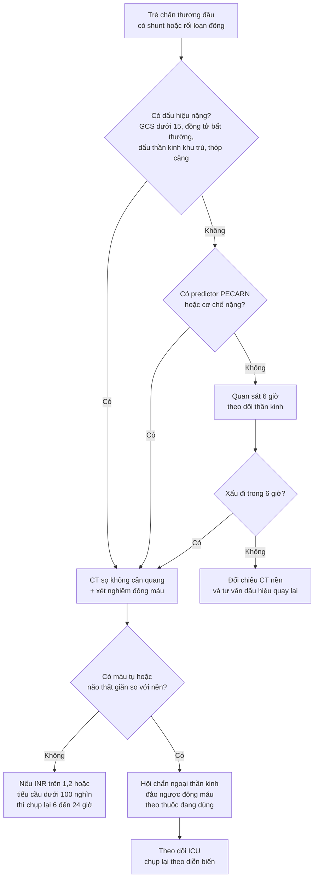
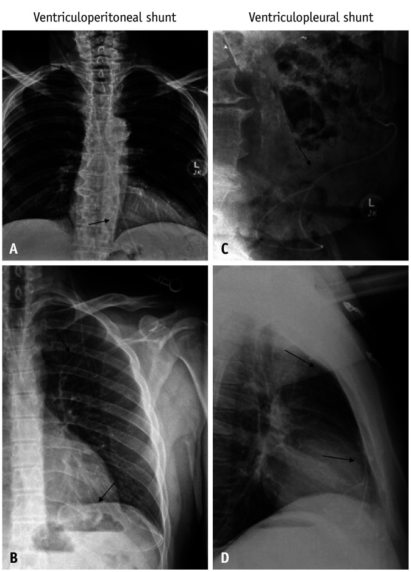
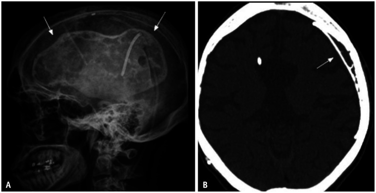
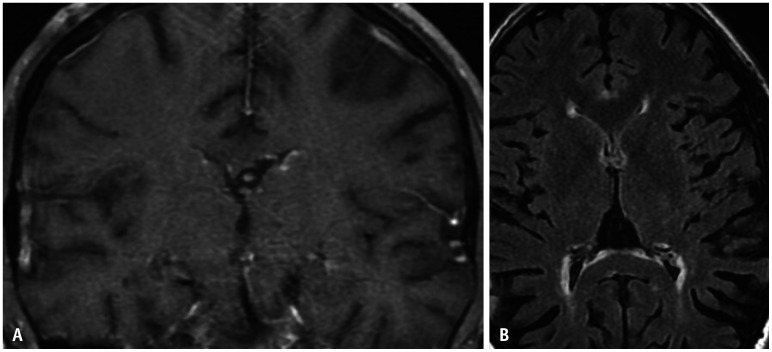

# 251 — Chấn thương đầu ở trẻ có shunt não thất hoặc rối loạn đông máu: khi nào chụp CT & xử trí / Head trauma in children with a ventricular shunt or a bleeding disorder

**Tags:** `pattern:chan-thuong` `pattern:tu-mau` `vung:so-nao` `vung:shunt` `score:PECARN` `protocol:CT-so-nao` `protocol:shunt-series`
**Mức chắc chắn (certainty):** tổng hợp y văn (literature synthesis) — số liệu lấy từ phân tích phụ đoàn hệ PECARN (98 trẻ có shunt), hướng dẫn Ý 2018 và Scandinavia 2016, đoàn hệ tiên lượng 3.012 trẻ, cùng các tổng quan về đông máu và đảo ngược kháng đông. **Không suy diễn ngoài nguồn**; chỗ chưa có dữ liệu nhi khoa ghi rõ "chưa rõ".

> Bài này chỉ bàn **quyết định hình ảnh và xử trí cấp** ở trẻ đã có shunt não thất hoặc có rối loạn đông máu/đang dùng thuốc chống đông khi bị chấn thương đầu. Chấn thương sọ não chung ở trẻ ở [224](../224-chan-thuong-so-nao-nhi/lesson.md); chấn thương đầu nhẹ – PECARN – theo dõi tại nhà ở [232](../232-chan-thuong-dau-nhe-concussion-o-tre/lesson.md); tăng áp lực nội sọ và theo dõi đa phương thức ở [234](../234-tang-ap-luc-noi-so-theo-doi-da-phuong-thuc-nhi/lesson.md).

*Trái: đường đi shunt não thất – não ổ bụng (A, B) và não – màng phổi (C, D) trên X-quang; giữa: máu tụ dưới màng cứng **mạn tính canxi hóa** ở trẻ có shunt (X-quang sọ A và CT B); phải: **não thất khe** do dẫn lưu quá mức (MRI T1 A, FLAIR B). Ba hình này là "phông nền" của mọi ca chấn thương đầu có shunt: biết trước thì mới phân biệt được tổn thương **mới** với tổn thương **có sẵn**. Nguồn: Singh A et al., Korean J Radiol 2026, PMC13437215, Fig. 2/11/12, CC BY-NC 4.0 (nguyên bản, ghép letterbox).*

## 1. Tổng quan bệnh học – cơ chế hình ảnh

- **Hai nhóm bệnh nhân khác nhau về sinh lý, nhưng cùng một câu hỏi:** trẻ có **shunt dẫn lưu dịch não tủy (CSF shunt)** và trẻ có **rối loạn đông máu (coagulopathy)/đang dùng thuốc chống đông (anticoagulant)** đều nằm ngoài vùng bằng chứng của các quy tắc quyết định chụp CT thông thường. Hướng dẫn Scandinavia 2016 ghi rõ: **phần lớn nghiên cứu loại trừ trẻ có shunt hoặc bệnh thần kinh nền**, và trẻ có rối loạn đông máu **không nên cho về ngay từ khoa cấp cứu** (PMC4758024).
- **Vì sao não có shunt dễ chảy máu hơn (cơ chế):**
  - Shunt lấy bớt CSF → **giảm đối áp (counter-pressure)** trong sọ; một khối máu tụ nhỏ có ít mô não "ép ngược" nên có thể **lan nhanh hơn** — đây là lý thuyết được nêu trong hướng dẫn Scandinavia (PMC4758024).
  - Não thường **mỏng (thin cortical mantle)**, khoang dưới màng cứng rộng hơn, tĩnh mạch cầu nối căng → dễ rách khi va đập nhẹ.
  - **Ống thông và mô xơ quanh đường hầm (catheter tract)** là đường vào của máu tụ; catheter còn có thể **gãy, ly giãn, di trú** sau chấn thương.
  - Shunt **lập trình (programmable valve)** chứa nam châm: từ trường mạnh (MRI 3T) có thể **đổi áp lực mở van** hoặc làm thiết bị di lệch (PMC13437215) → phải kiểm tra và cài lại sau MRI.
  - Dẫn lưu quá mức mạn tính gây **hội chứng não thất khe (slit ventricle syndrome, SVS)** — khoảng **10%** sau 10 năm nếu đặt shunt từ nhỏ; đau đầu/vô tuyến ở trẻ này **không đồng nghĩa chấn thương** (PMC13437215).
- **Vì sao trẻ rối loạn đông máu khác biệt (số liệu):**
  - **Rối loạn đông do chấn thương (trauma-induced coagulopathy, TIC)** gặp ở **54,2%** (173/319) trẻ chấn thương sọ não trung bình–nặng; định nghĩa theo PACCMAN: **tiểu cầu < 100 × 10³/µL, INR > 1,2**, hoặc aPTT/PT dài hơn lứa tuổi (PMC13151334).
  - Yếu tố nguy cơ độc lập: **GCS ≤ 8 (OR 2,98)**, **gãy xương dài (OR 2,6)**, **đụng dập não (OR 1,51)**; TIC làm tăng tử vong trong viện **aHR 12,26** và tử vong 28 ngày **aHR 9,52** (PMC13151334).
  - Thuốc chống đông ở trẻ **đang tăng nhanh**: tỉ lệ dùng thuốc ức chế yếu tố Xa tăng từ **0,4% (2009) lên 18,0% (2023)** trong một cơ sở dữ liệu; **9,4%** trẻ dùng thuốc có biến cố chảy máu liên quan, nhưng **≤ 0,1%** được dùng thuốc đảo ngược đặc hiệu (andexanet alfa) (PMC12061172).
- **Vì sao hình ảnh đọc được (vật lý):**
  - **Máu tụ cấp** trên CT: đông tụ **40–70 HU**, máu không đông **30–45 HU** — tương phản với nhu mô não **25–35 HU**, nên CT không cản quang là phương thức đầu tay và đủ để quyết định mổ.
  - **Canxi hóa** trong máu tụ mạn: **> 100 HU**, thấy rõ trên cửa sổ xương; đây là dấu **có sẵn từ trước**, không phải máu mới.
  - **MRI** phân biệt máu ở các giai đoạn (T1/T2 theo hemoglobin) nhưng **chậm và khó dung nạp ở trẻ cấp cứu**; MRI nhanh (rapid-sequence) hữu ích khi câu hỏi là **shunt có hoạt động không**, nhờ giảm liều xạ (PMC13437215).
  - **X-quang "shunt series"** (sọ–ngực–bụng) chỉ trả lời **thiết bị còn liên tục hay không**; nó **không** thấy máu tụ — vì vậy nghi chấn thương thực thể thì **phải CT**.
- **Ngưỡng quyết định (định lượng):**
  - Nhóm shunt trong đoàn hệ PECARN: **98/39.732 (0,2%)** trẻ GCS ≥ 14 có shunt; **CT được dùng 46% vs 35%** ở trẻ không shunt; **ciTBI 1/98 (1%) vs 346/39.619 (0,9%)** — ca duy nhất là **máu tụ dưới màng cứng mạn đã biết, TO RA** so với CT cũ và phải mổ (PMID 23122954).
  - Đoàn hệ thực hành 3.012 trẻ: chỉ **0,9% (27/3.012)** có tổn thương đáng kể trên CT, **0,07% (2/3.012)** phải mổ; độ nhạy PECARN ≥ 2 tuổi **74,1%**, tỉ lệ chụp CT bắt buộc theo quy tắc dao động **1,2%–29,9%** (PMC12447897). Trong đoàn hệ này chỉ có **1 trẻ có shunt** và **8 trẻ có rối loạn đông** — minh họa rằng các quy tắc **không đủ dữ liệu** cho hai nhóm này.
  - **Máu tụ dưới màng cứng/hygroma sau đặt shunt mới: ~3%** các ca đặt shunt (PMC13437215) → nền dễ có sẵn dịch/máu mạn tính, dễ đọc nhầm là "máu mới".

## 2. Mẫu hình + chẩn đoán phân biệt theo vị trí và cơ chế (Gamut)

- **Ngoài màng cứng (epidural hematoma, EDH):** hình **thấu kính (biconvex)**, **không vượt đường khớp sọ**, thường kèm **nứt sọ** cùng bên; ở trẻ có shunt, não teo làm **khoang ngoài màng cứng rộng** nên EDH có thể lớn nhanh mà triệu chứng ban đầu kín đáo.
- **Dưới màng cứng cấp (acute subdural hematoma, SDH):** hình **liềm**, **vượt đường khớp**, có thể **dọc theo đường hầm shunt**; khi có shunt, một lượng máu nhỏ đã đủ gây dịch chuyển đường giữa vì não ít thể tích dự trữ.
- **Dưới màng cứng mạn (chronic SDH):** **giảm đậm độ/đồng đậm độ**, có thể **canxi hóa viền**; đây là tổn thương **có sẵn** ở trẻ shunt — chỉ gọi là biến cố khi **to hơn trên CT cũ** hoặc có triệu chứng mới (đúng như ca duy nhất trong nghiên cứu PECARN, PMID 23122954).
- **Máu tụ trong nhu mô/đụng dập (intraparenchymal hemorrhage/contusion):** ổ tăng đậm độ trong não, có thể tiến triển trong 24–48 giờ; ở trẻ rối loạn đông, **đụng dập là yếu tố nguy cơ TIC độc lập (OR 1,51)** (PMC13151334).
- **Rối loạn chức năng shunt (shunt malfunction):** **não thất to ra so với CT nền** mới là chốt; nếu không có CT nền, dựa vào **giãn bể, phù quanh não thất (transependymal edema), dịch dưới da đầu, phù dọc catheter** (PMC13437215).
- **Hội chứng não thất khe (SVS):** não thất **khe/không thấy**, đau đầu tư thế; **không phải** dấu hiệu chấn thương, nhưng là bẫy lớn khi trẻ vào viện vì đau đầu sau ngã.
- **Tràn khí nội sọ (pneumocephalus):** khí **-1.000 HU**; sau chấn thương gợi ý **rách màng cứng/nứt nền sọ**, cần tìm rò CSF ([244](../244-ro-dich-nao-tuy-nen-so/lesson.md)).
- **Máu tụ dọc đường hầm shunt (tract hematoma):** dải tăng đậm độ men theo catheter, dễ bỏ sót nếu chỉ đọc nhu mô.
- **Gợi nhớ "SHUNT":** **S** – **S**eries X-quang kiểm thiết bị · **H** – **H**ematoma (EDH/SDH/tract) · **U** – **U**nderlying baseline (so CT cũ) · **N** – **N**eurosurgery (hội chẩn) · **T** – **T**iming (chụp lại nếu đông máu).

## 3. Bảng so sánh phân biệt (ma trận đối chiếu)

| Thực thể (entity) | Hình ảnh điển hình | Chốt vào (rule-in) | Chốt loại (rule-out) | Gợi ý xác nhận |
|---|---|---|---|---|
| **EDH cấp** | Thấu kính, tăng đậm độ **40–70 HU**, không vượt đường khớp, nứt sọ cùng bên | **Hình thấu kính + nứt sọ + xoá bể nền** | Hình liềm vượt đường khớp → SDH | CT cửa sổ xương; **hội chẩn ngoại thần kinh ngay khi có máu tụ ngoài trục** (ngưỡng mổ cụ thể tùy trung tâm, chưa kiểm chứng trong bài này) |
| **SDH cấp** | Liềm, vượt đường khớp, có thể theo đường hầm shunt | **Liềm + vượt khớp + dấu lệch đường giữa** | Thấu kính, giới hạn bởi khớp → EDH | CT; so CT nền về kích thước não thất |
| **SDH mạn có sẵn (lớn lên)** | Giảm/đồng đậm độ, **viền canxi > 100 HU**, bờ rõ | **To hơn CT cũ hoặc triệu chứng mới** | Đậm độ như cũ, không thay đổi → không phải biến cố | **Bắt buộc so CT cũ**; MRI T1/T2 nếu cần phân giai đoạn |
| **Shunt malfunction** | **Não thất to hơn** so với nền, phù quanh não thất, giãn bể, dịch dọc catheter | **Giãn não thất so với CT nền + triệu chứng tăng áp lực** | Não thất không đổi + đau đầu tư thế → SVS/đau đầu nguyên phát | CT so sánh + shunt series; X-quang/CT bụng nếu nghi đầu xa |
| **SVS (não thất khe)** | Não thất **khe**, não sát thành sọ, không giãn | **Đau đầu tư thế + não thất khe trên MRI** | Giãn não thất → malfunction | MRI nhanh; chỉnh van/anti-siphon, không mổ vì "não thất nhỏ" |
| **Máu tụ tiến triển do đông máu** | Ổ tăng đậm độ **to thêm** trong 6–24 giờ, có thể nhiều ổ | **INR > 1,2 hoặc tiểu cầu < 100 × 10³/µL + tổn thương ban đầu** | INR/tiểu cầu bình thường, CT ổn định → theo dõi thường | Xét nghiệm đông máu, chụp lại CT; đảo ngược theo phác đồ |
| **Tràn khí nội sọ** | Khí **-1.000 HU** trong khoang dưới nhện/não thất | **Khí + nứt nền sọ/xoang** | Không khí, chỉ giảm đậm độ → nhiễm mỡ/artifact | CT cửa sổ xương; tìm rò CSF ([244](../244-ro-dich-nao-tuy-nen-so/lesson.md)) |

*Đọc từ trái: (1) shunt não thất — phải biết đường đi để tìm máu tụ dọc catheter và kiểm tra thiết bị; (2) SDH mạn canxi hóa — **không** gọi là máu mới nếu không to hơn CT cũ; (3) não thất khe — dấu dẫn lưu quá mức, không phải dấu chấn thương. Nguồn: Singh A et al., Korean J Radiol 2026, PMC13437215, CC BY-NC 4.0.*

### Ba câu hỏi phải trả lời trước khi gọi "chấn thương"
1. **Có CT nền không?** Nếu có, so **kích thước não thất, chiều dày máu tụ, mức canxi hóa** từng lát.
2. **Triệu chứng là của chấn thương hay của shunt?** Đau đầu tư thế, nôn buổi sáng, li bì, thóp căng → nghĩ shunt trước.
3. **Đông máu có bình thường không?** INR > 1,2 hoặc tiểu cầu < 100 × 10³/µL làm đổi hoàn toàn lịch chụp lại.

## 4. Protocol: khám → chụp → đảo ngược đông máu → theo dõi

### 4.1 Trước khi chụp (5 phút quyết định)

- **Hỏi bệnh có cấu trúc:** loại shunt (VP/VA/VPL/lumboperitoneal), **van có lập trình không**, lần sửa gần nhất, lần chụp CT gần nhất, thuốc chống đông và **liều cuối**, bệnh máu (hemophilia, von Willebrand, ITP, suy gan), tiền sử chảy máu kéo dài.
- **Khám:** GCS theo tuổi, đồng tử, dấu thần kinh khu trú, thóp, **sờ dọc đường shunt** (bước gãy, khối tụ máu), vết thương da đầu.
- **Không áp dụng máy móc PECARN:** quy tắc này được xây dựng trên quần thể mà **shunt và rối loạn đông chỉ chiếm 0,2% và 0,3%** (PMID 23122954; PMC12447897). Hướng dẫn Ý 2018 (KAS 7) cho phép **quan sát thay vì CT ngay** ở trẻ shunt **không có predictor PECARN và không có yếu tố nguy cơ khác** — nhưng đây là khuyến cáo mức trung bình, không phải "miễn chụp" (PMC5769508).
- **Hướng dẫn Scandinavia 2016:** trẻ có shunt **không triệu chứng** nên **quan sát ≥ 6 giờ**; trẻ có rối loạn đông/đang chống đông **không cho về ngay** (PMC4758024).

### 4.2 Chọn phương thức

- **CT sọ không cản quang, lát ≤ 5 mm (1–2 mm qua hố sau/nền sọ khi nghi vỡ):** lựa chọn đầu tay khi có **cơ chế nặng, GCS < 15, dấu thần kinh khu trú, nôn tái diễn, đau đầu tăng, thóp căng, hoặc rối loạn đông đáng kể**. Đọc **cả cửa sổ nhu mô và cửa sổ xương** — nứt sọ là chốt của EDH và vỡ sọ tiến triển.
- **Shunt series (X-quang sọ–ngực–bụng):** khi nghi **gãy/ly giãn/di trú catheter** hoặc sốt – đau bụng; **không thay thế CT**.
- **MRI nhanh (rapid-sequence):** khi câu hỏi chính là **shunt còn hoạt động hay không**, trẻ hợp tác/khoa có protocol, nhằm giảm liều xạ; **không dùng để loại trừ máu tụ cấp trong cấp cứu** (PMC13437215). Sau MRI, **kiểm tra và cài lại van lập trình** vì từ trường có thể đổi áp lực mở (PMC13437215).
- **Siêu âm qua thóp:** chỉ bổ trợ ở nhũ nhi còn thóp, không loại trừ máu tụ ngoại vi.

### 4.3 Xét nghiệm và ngưỡng đảo ngược (theo bằng chứng hiện có)

- **Bắt buộc:** công thức máu, **INR/PT, aPTT, fibrinogen**, nhóm máu; TEG/ROTEM nếu có. Định nghĩa TIC dùng trong nhi: **INR > 1,2; tiểu cầu < 100 × 10³/µL** hoặc PT/aPTT dài hơn lứa tuổi (PMC13151334).
- **Ngưỡng truyền máu (đồng thuận chuyên gia, bằng chứng yếu):** hemoglobin đích **≥ 7 g/dL**; **không truyền huyết tương chỉ vì INR ≤ 1,5** khi đặt dụng cụ đo ICP; **tiểu cầu > 100.000/µL có thể có hại** ở trẻ thần kinh ổn định, chỉ cân nhắc khi **< 100.000/µL và cần đặt dụng cụ ICP ở trẻ đang xấu đi** (PMC12839847).
- **Đảo ngược theo thuốc:** warfarin → **vitamin K + phức hợp prothrombin 4 yếu tố (4F-PCC)**; dabigatran → **idarucizumab**; apixaban/rivaroxaban → **andexanet alfa** (nếu có), nếu không → PCC; heparin → **protamine**; LMWH → protamine chỉ đảo ngược một phần (PMC13600188). **Liều theo cân nặng ở trẻ chưa có dữ liệu tiên lượng đủ mạnh — chưa rõ, cần tra phác đồ huyết học nhi của đơn vị**, không tự suy từ người lớn.
- **Thực tế đáng nhớ:** dù thuốc chống đông ở trẻ tăng nhanh, **≤ 0,1%** trường hợp chảy máu được dùng thuốc đảo ngược đặc hiệu (PMC12061172) → **chuẩn bị sẵn PCC/antidote và gọi huyết học trước khi cần**, không chờ kết quả INR.

### 4.4 Theo dõi và chụp lại

- **Quan sát tối thiểu 6 giờ** với trẻ shunt không triệu chứng (PMC4758024); nếu có rối loạn đông, **nhập viện theo dõi** thay vì cho về.
- **Chụp lại CT 6–24 giờ** khi: tổn thương ban đầu có trên CT, INR > 1,2/tiểu cầu < 100 × 10³/µL, đang dùng chống đông, hoặc tri giác xấu đi. *Đây là thực hành dựa trên sinh lý và ý kiến chuyên gia; chưa có RCT ở trẻ — mức suy luận, không phải số liệu từ nguồn.*
- **Hội chẩn ngoại thần kinh** khi: có máu tụ ngoài trục, máu tụ trong nhu mô tiến triển, não thất giãn so với nền, thiết bị gãy/di trú, hoặc trẻ có **can thiệp thần kinh trước đó không chỉ là đặt shunt đơn thuần** (khuyến cáo Ý KAS 13a, PMC5769508).
- **Tiêu chí cho về:** GCS bình thường theo tuổi, không nôn tái diễn, CT không tổn thương mới, **đông máu bình thường/đã kiểm soát**, gia đình hiểu dấu hiệu quay lại, và **đã đối chiếu CT nền**.

### 4.5 Khác biệt theo cơ chế (đọc nhanh)

- **Shunt + ngã nhẹ, không triệu chứng:** bằng chứng hiện có **không** cho thấy tăng ciTBI (1% vs 0,9%) nhưng **tăng gấp đôi tỉ lệ chụp CT** (46% vs 35%) → đây là chỗ **quan sát có kiểm soát** có giá trị nhất (PMID 23122954).
- **Shunt + đau đầu/vô tuyến:** nghĩ **shunt malfunction/SVS** trước, so CT nền; đừng gán cho "chấn thương đầu nhẹ".
- **Rối loạn đông + CT bình thường lần đầu:** không loại trừ chảy máu muộn; **theo dõi và chụp lại** là điểm khác biệt cốt lõi so với trẻ bình thường.
- **Trẻ dùng DOAC:** thời gian bán thải ngắn nhưng **không có nghĩa an toàn** — vẫn cần CT sớm và đảo ngược nếu có máu tụ; dữ liệu nhi còn mỏng (PMC12061172).

## 5. Biến thể bình thường và cạm bẫy

- **SDH mạn canxi hóa có sẵn** ở trẻ shunt là **biến thể "bình thường" của bệnh nền**: viền canxi **> 100 HU**, bờ rõ, không thay đổi qua nhiều năm — **không** gọi là máu mới nếu không to hơn (PMC13437215).
- **Não thất khe** không phải bằng chứng "không có shunt malfunction"; ngược lại, nó là dấu **dẫn lưu quá mức** và là bẫy khi trẻ đau đầu sau ngã.
- **CT bình thường trong 3 giờ đầu** ở trẻ rối loạn đông **không loại trừ** máu tụ tiến triển — cần chụp lại theo lịch.
- **Nứt sọ chỉ thấy trên cửa sổ xương**: đọc cửa sổ nhu mô đơn thuần dễ bỏ sót EDH/đường vỡ; ở trẻ **< 3 tuổi** còn phải nghĩ **vỡ sọ tiến triển (growing skull fracture)** ([231](../231-ton-thuong-mach-mau-nao-chan-thuong-va-vo-so-tien-trien/lesson.md)).
- **Van lập trình và MRI:** từ trường có thể **đổi áp lực mở van**; luôn kiểm tra cài đặt sau MRI, đặc biệt 3T (PMC13437215).
- **Shunt series bình thường không loại trừ tắc đầu gần**: tắc do **đám rối mạch mạc/bùn** vẫn có thể xảy ra với ống thông nguyên vẹn.
- **Đừng nhầm "não thất nhỏ" với "não phù"** ở trẻ shunt: não thất nhỏ + xóa rãnh cuộn não có thể là **phù do tăng áp lực**, không phải teo.
- **Bẫy "satisfaction of search":** thấy máu tụ rồi dừng lại — phải xem **toàn bộ đường shunt**, xoang, nền sọ và **so CT cũ**.

## 6. Tự lượng giá — Blind Quiz

**Ca 1 — Bé trai 9 tuổi có shunt, ngã đập đầu, đau đầu tăng dần. X-quang định vị thiết bị:**

- Câu hỏi: Đây là loại shunt gì? Hình này trả lời được và **không** trả lời được câu hỏi nào? Bước tiếp theo?

<b>Bấm để hiện đáp án (findings + chẩn đoán)</b>

- Dấu hiệu: (A, B) ống thông từ sọ xuống **ổ bụng** = shunt não thất–ổ bụng (ventriculoperitoneal); (C, D) ống thông tận cùng trong **khoang màng phổi** = shunt não thất–màng phổi (ventriculopleural). Mũi tên chỉ đoạn ống thông ở ngực/bụng.
- Trả lời được: **loại shunt và tính liên tục của thiết bị** (gãy, ly giãn, di trú).
- **Không** trả lời được: có máu tụ nội sọ hay không, não thất có giãn hay không → **phải CT sọ** và **so CT nền**.
- Nguồn: Singh A et al., Korean J Radiol 2026, PMC13437215, Fig. 2, CC BY-NC 4.0.

**Ca 2 — Bé gái 7 tuổi có shunt, ngã từ xe đạp, CT sọ được chụp vì đau đầu:**

- Câu hỏi: Tổn thương là máu tụ **mới** hay **cũ**? Dấu hiệu nào trên ảnh giúp phân biệt? Điều gì quyết định thái độ xử trí?

<b>Bấm để hiện đáp án (findings + chẩn đoán)</b>

- Dấu hiệu: (A) X-quang sọ thấy **viền canxi hóa** hình liềm; (B) CT axial có **dải canxi hóa dưới màng cứng** (mũi tên) bên cạnh ống thông shunt — máu tụ dưới màng cứng **mạn tính, canxi hóa**.
- Phân biệt: canxi hóa **> 100 HU**, bờ rõ, không phù não xung quanh → **có sẵn từ trước**; máu cấp sẽ **tăng đậm độ 40–70 HU** và có thể phù/xóa rãnh.
- Xử trí: **so CT cũ**; chỉ can thiệp nếu **to hơn** hoặc có triệu chứng tăng áp lực. Trong đoàn hệ PECARN, ca ciTBI duy nhất ở trẻ shunt chính là kiểu này: **SDH mạn to ra** và phải mổ (PMID 23122954).
- Nguồn: Singh A et al., Korean J Radiol 2026, PMC13437215, Fig. 11, CC BY-NC 4.0.

**Ca 3 — Bé trai 12 tuổi shunt từ nhỏ, đau đầu khi đứng, nôn buổi sáng. MRI sọ:**

- Câu hỏi: Mô tả não thất. Đây là shunt tắc hay dẫn lưu quá mức? Cần làm gì tiếp?

<b>Bấm để hiện đáp án (findings + chẩn đoán)</b>

- Dấu hiệu: (A) T1 sau tiêm coronal và (B) FLAIR axial — **não thất khe (slit-like)**, gần như xẹp, không giãn; không thấy phù quanh não thất.
- Chẩn đoán: **dẫn lưu quá mức/hội chứng não thất khe (SVS)** — không phải tắc shunt. SVS gặp ở **~10%** trẻ đặt shunt từ nhỏ sau 10 năm (PMC13437215).
- Xử lý: **không mổ vì "não thất nhỏ"**; đánh giá van/anti-siphon, cân nhắc chỉnh áp lực, điều trị đau đầu; nếu có triệu chứng tăng áp lực thật thì phải loại trừ tắc đầu gần bằng hình ảnh và áp lực.
- Bẫy: đau đầu sau ngã ở trẻ SVS dễ bị gán cho "chấn thương" — nhưng hình ảnh không có máu tụ.
- Nguồn: Singh A et al., Korean J Radiol 2026, PMC13437215, Fig. 12, CC BY-NC 4.0.

## Bài liên quan chéo

- [200 – Tổng quan hệ Thần kinh](../200-tong-quan-he-than-kinh/lesson.md)
- [224 – Chấn thương sọ não ở trẻ](../224-chan-thuong-so-nao-nhi/lesson.md)
- [232 – Chấn thương đầu nhẹ & PECARN](../232-chan-thuong-dau-nhe-concussion-o-tre/lesson.md)
- [234 – Tăng áp lực nội sọ & theo dõi đa phương thức](../234-tang-ap-luc-noi-so-theo-doi-da-phuong-thuc-nhi/lesson.md)
- [231 – Tổn thương mạch máu não do chấn thương & vỡ sọ tiến triển](../231-ton-thuong-mach-mau-nao-chan-thuong-va-vo-so-tien-trien/lesson.md)
- [244 – Rò dịch não tủy sau chấn thương nền sọ](../244-ro-dich-nao-tuy-nen-so/lesson.md)
- [202 – Quy tắc chụp cột sống cổ cấp cứu (NEXUS/Canadian)](../202-quy-tac-chup-cot-song-co-cap-cuu-nexus-canadian/lesson.md)

## Ảnh

- `images/251_shunt_XR_PMC13437215-Fig2.jpg` — X-quang đường đi shunt VP và VPL, CC BY-NC 4.0.
- `images/251_sdh-man-tinh_CT_PMC13437215-Fig11.jpg` — X-quang/CT SDH mạn canxi hóa ở trẻ shunt, CC BY-NC 4.0.
- `images/251_slit-ventricle_MRI_PMC13437215-Fig12.jpg` — MRI não thất khe, CC BY-NC 4.0.
- `images/composite_shunt-baseline.jpg` — ảnh ghép letterbox ba tình huống nền, CC BY-NC 4.0 (nguyên bản, không crop).
- Nguồn + giấy phép từng ảnh: `images/CREDITS.md`.

> Không dùng để chẩn đoán độc lập khi chưa có người hướng dẫn.
