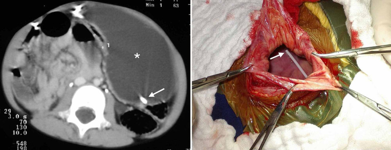
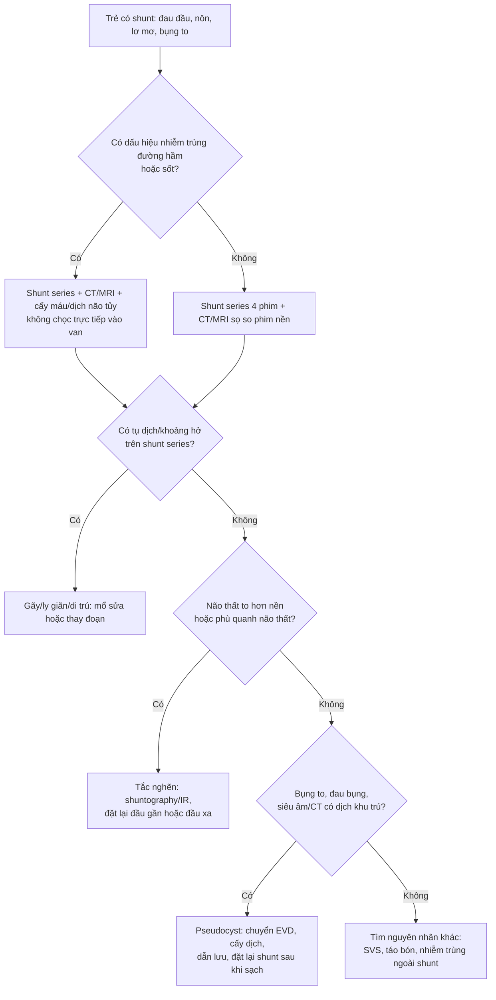
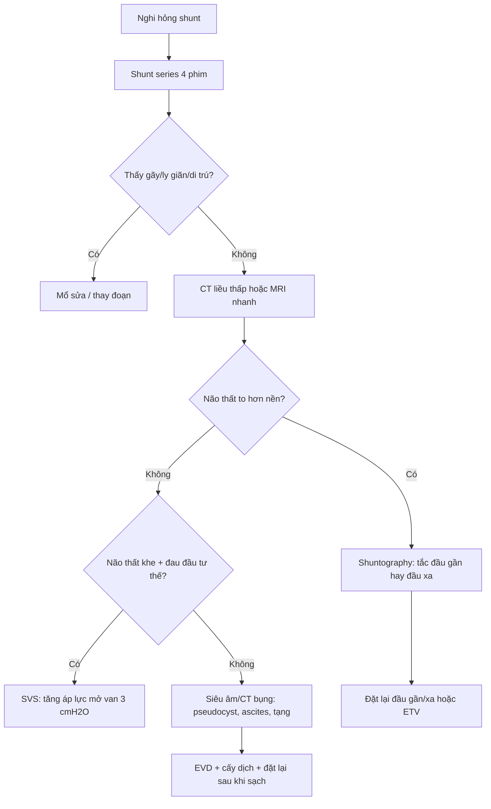
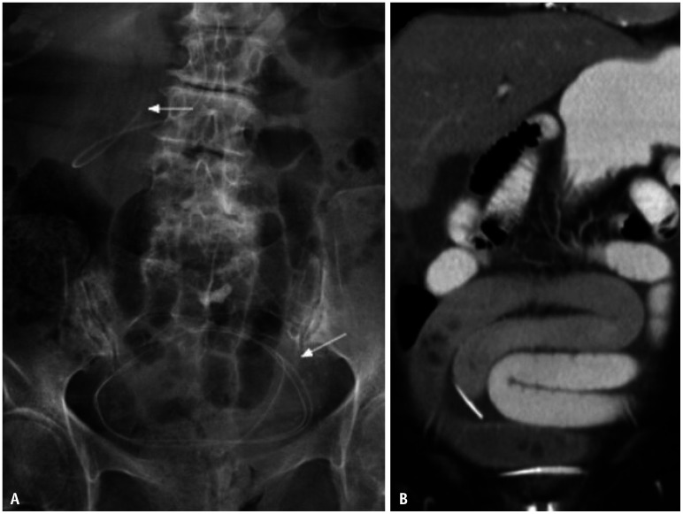
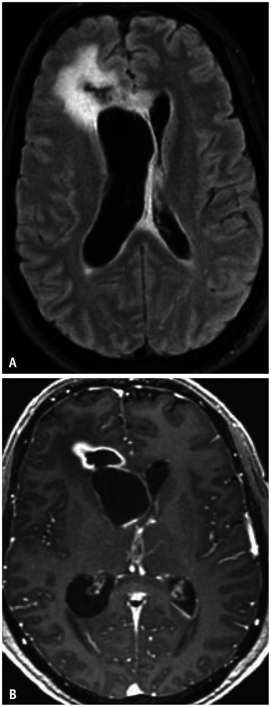

# 252 — Biến chứng muộn của shunt não thất: gãy – ly giãn catheter, nhiễm trùng, pseudocyst ổ bụng, di trú / Late complications of CSF shunts: fracture, disconnection, infection, abdominal pseudocyst and migration

**Tags:** `pattern:hong-thiet-bi` `pattern:nhiem-trung` `pattern:tu-dich` `vung:so-nao` `vung:shunt` `protocol:shunt-series` `protocol:CT-so-nao` `anatomy:shunt-nao-that`
**Mức chắc chắn (certainty):** tổng hợp y văn (literature synthesis) — tổng quan hình ảnh có số liệu (Korean J Radiol 2026, PMC13437215), tổng quan biến chứng ổ bụng (Cureus 2021, PMC7877257) + ca pseudocyst ở trẻ spina bifida; mọi tỷ lệ lấy đúng như nguồn, chỗ chưa rõ ghi "chưa rõ".

> Bài này bàn **biến chứng muộn** (sau khi shunt đã hoạt động): gãy/ly giãn catheter, tắc nghẽn, di trú đầu xa, nhiễm trùng, pseudocyst/dịch ổ bụng, dẫn lưu quá mức. Quyết định chụp CT ở trẻ có shunt sau **chấn thương đầu** nằm ở [251](../251-chan-thuong-dau-tre-shunt-va-roi-loan-dong-mau/lesson.md); rò dịch não tủy nền sọ ở [244](../244-ro-dich-nao-tuy-nen-so/lesson.md); tăng áp lực nội sọ và theo dõi đa phương thức ở [234](../234-tang-ap-luc-noi-so-theo-doi-da-phuong-thuc-nhi/lesson.md).

*Trái: CT bụng — khối dịch khu trú (\*) trong ổ phúc mạc trái, **đầu catheter (mũi tên trắng) nằm trong khối dịch** = pseudocyst dịch não tủy. Phải: hình mổ — thành nang dày, đầu catheter nằm trong lòng nang. Nguồn: Ferreira Furtado LM et al., Cureus 2021 (PMC7877257), Fig. 2, CC BY 3.0.*

## 1. Tổng quan bệnh học – cơ chế hình ảnh

- **Shunt não thất là thiết bị "dễ hỏng" nhất trong ngoại thần kinh nhi:** tỷ lệ hỏng **30–40% trong năm đầu** và khoảng **50% đến năm thứ hai** ở trẻ; shunt não thất–ổ bụng (ventriculoperitoneal shunt, VPS) đơn thuần có tỷ lệ hỏng **11–25%**, và **≥ 60%** bệnh nhân phải mổ sửa shunt ít nhất một lần trong đời (PMC13437215, PMC7877257). Vì vậy "đau đầu ở trẻ có shunt" là một **cấp cứu mặc định** cho đến khi chứng minh shunt còn hoạt động.
- **Tắc nghẽn (obstruction)** là nguyên nhân hỏng shunt hay nhất; **tắc đầu gần (proximal) chiếm > 50%** các ca hỏng ở trẻ. Vật tắc: đám rối mạch mạc (choroid plexus), cục máu, mảnh tổ chức; đầu xa tắc do gập góc (kinking) hoặc do **pseudocyst**.
- **Gãy catheter (fracture)** gần như chỉ xảy ra ở **catheter xa, giữa van và phúc mạc**, hay gặp nhất ở **vùng cổ** vì cổ động + sẹo dính + trẻ lớn nhanh; **canxi hóa ống catheter** theo thời gian làm tăng nguy cơ gãy. Vì đầu xa còn trôi theo đường hầm dưới da/ổ bụng nên trên phim thường thấy **khoảng hở lớn giữa hai đầu** — đây là dấu hiệu rất đặc hiệu.
- **Ly giãn (disconnection)** xảy ra sớm sau mổ (nối đầu gần–bầu chứa, van–catheter xa) do vật liệu/lỗi kỹ thuật; nhưng **ly giãn muộn ở trẻ** do **sự phát triển cơ thể kéo căng** ống và mối nối. Canxi hóa quanh hai đoạn rời = quá trình **mạn**, đã ly giãn từ lâu.
- **Nhiễm trùng shunt** là nguyên nhân hỏng thứ hai: **phần lớn trong 6 tháng đầu**, giảm dần sau đó; **Staphylococcus epidermidis ~50%**, *S. aureus* **~20%**, trực khuẩn gram âm **~15%**. Yếu tố nguy cơ: tuổi nhỏ, đã mổ não/nhiều lần sửa shunt, **có ống mở thông dạ dày (gastrostomy)**. Catheter tẩm kháng sinh giảm nhiễm từ **6,0% → 2,2%**; bó quy trình mổ giảm từ **5,7% → 1%** ở một trung tâm nhi.
- **Pseudocyst dịch não tủy (abdominal CSF pseudocyst / CSFoma):** khoang dịch khu trú có vỏ xơ bao quanh đầu catheter xa, gặp ở **1–4,5%** trẻ có VPS (y văn rộng **0,25–10%**), có thể xuất hiện **nhiều tháng đến nhiều năm** sau đặt. Cơ chế: **nhiễm trùng âm ỉ nồng độ thấp** + dính phúc mạc + protein dịch não tủy cao làm giảm hấp thu; thường gặp hơn ở trẻ **spina bifida** đã mổ nhiều lần.
- **Dẫn lưu quá mức (over-drainage) → hội chứng não thất khe (slit ventricle syndrome, SVS):** khoảng **10%** trẻ đặt shunt từ nhỏ sau **10 năm**; van điều chỉnh lưu lượng (flow-regulated) giảm SVS **~2/3** so với van chênh áp.
- **Tụ dịch dưới màng cứng sau đặt shunt mới: ~3%**; đa số không triệu chứng, tự hết, nhưng **máu tụ dưới màng cứng mạn canxi hóa** có thể tồn tại nhiều năm và là "phông nền" khi trẻ bị chấn thương đầu.
- **TẠI SAO hình ảnh thay đổi:**
  - **CT:** đầu catheter cản quang nằm trong não thất/bụng; **não thất to hơn so với phim nền** mới là chốt của rối loạn chức năng. Kèm **phù quanh não thất (transependymal edema)**, giãn bể, dịch dưới da đầu, **phù dọc đường đi catheter**.
  - **X-quang shunt series:** kim loại/ barium trong ống cho thấy **đứt đoạn, khoảng hở, gập góc, di trú**; nhưng **mối nối và van có thể cản quang kém** → chỗ "trông như đứt" có thể chỉ là **linh kiện không cản quang**.
  - **Siêu âm bụng:** pseudocyst = khối dịch có vách, đầu catheter là **đường cản âm/echogenic** trong lòng nang; ascites = dịch tự do, phân bố đều giữa các quai ruột.
  - **Shuntography (đồng vị phóng xạ hoặc iohexol):** thuốc lan **tự do hai bên ổ bụng** = shunt thông; **khu trú một chỗ quanh đầu catheter** = tắc một phần/pseudocyst; **không thấy thuốc trong ổ bụng** = tắc hoàn toàn.
- **Ngưỡng định lượng cần nhớ:**
  - **Nhiễm trùng:** cấy dịch não tủy có thể **âm** vì shunt "cô lập" ổ nhiễm; **cấy đầu catheter** nhạy hơn dịch não tủy (một nghiên cứu xác định nhiễm trùng ở **66%** mẫu cấy đầu catheter — PMC7877257).
  - **Pseudocyst:** chẩn đoán khi dịch khu trú **quanh đầu catheter**, có vách rõ, không thấy thuốc lan tự do; **không** dựa vào kích thước tuyệt đối.
  - **Dẫn lưu quá mức:** áp lực mở van điều chỉnh **tăng thêm 3 cmH₂O** là bước đầu; nếu van cố định → thêm **anti-siphon/anti-gravitational** hoặc phải mổ sửa.

## 2. Mẫu hình + chẩn đoán phân biệt theo vị trí (gamut)

- **Mẫu hình lâm sàng → khoanh vùng tổn thương:**
  - **Đau đầu + nôn + não thất to** → tắc nghẽn (đầu gần nhiều hơn đầu xa).
  - **Sưng/đau/đỏ dọc đường đi catheter, sốt nhẹ** → nhiễm trùng đường hầm.
  - **Bụng to, đau bụng, nôn, shunt vẫn "bơm được"** → pseudocyst hoặc ascites.
  - **Catheter "tụt ra" tái diễn, bóng xẹp** → sỏi bàng quang/sỏi quanh catheter cọ vào bóng (bài [691](../691-soi-bang-quang-va-soi-quanh-catheter-o-tre/lesson.md) khi shunt đổ vào bàng quang).
  - **Đau đầu tư thế đứng, não thất khe** → dẫn lưu quá mức.
- **Gamut theo vị trí:**
  - **Đầu gần (trong não thất):** tắc do đám rối mạch mạc, catheter rút vào nhu mô, di trú vào não thất bên đối diện, u/bào tương.
  - **Van/bầu chứa:** hỏng van, kẹt van lập trình, nhiễm trùng quanh van.
  - **Đường đi cổ–ngực:** gãy, ly giãn, xoắn, canxi hóa, nhiễm trùng đường hầm, **di trú đầu xa vào mô mềm**.
  - **Đầu xa trong ổ bụng:** pseudocyst, ascites, tắc do mạc nối/dính, **di trú vào tạng rỗng** (bàng quang, đại tràng, gan, dạ dày), **di trú vào bìu** qua ống phúc tinh mạc hở, thoát vị qua thành bụng.
  - **Ngoài shunt:** táo bón, viêm ruột thừa, tắc ruột, bệnh lý tiết niệu — trẻ có shunt **vẫn có thể** bị bệnh nội khoa/nhi khoa thông thường.

## 3. Bảng so sánh phân biệt (ma trận đối chiếu)

| Thực thể (entity) | Hình ảnh điển hình | Chốt vào (rule-in) | Chốt loại (rule-out) | Gợi ý xác nhận |
|---|---|---|---|---|
| Gãy catheter (fracture) | **Khoảng hở lớn** giữa hai đoạn ống ở cổ/ngực/bụng; đầu xa trôi xuống ổ bụng; có thể thấy canxi hóa quanh ống | **Hai đầu ống tách rời nhau, không liên tục trên ≥ 2 phim của shunt series** | Đầu ống liên tục, không hở, chỉ gập góc → nghĩ tắc/van | Shunt series 4 phim (sọ AP + lateral, ngực AP, bụng AP) + CT; **không cần** chọc van |
| Ly giãn (disconnection) | Hở tại **mối nối** đầu gần–bầu chứa hoặc van–đầu xa; canxi hóa quanh hai đoạn rời; có thể có dịch dọc đường hầm | **Mối nối tách rời + canxi hóa quanh đoạn rời (mạn)** | "Hở" ở vị trí linh kiện **không cản quang** → không phải ly giãn | Dựng hình 3D CT định vị mối nối; so phim cũ |
| Tắc nghẽn đầu gần | Não thất **to hơn nền**; phù quanh não thất; đầu catheter nằm trong não thất nhưng không có dòng | **Não thất giãn tiến triển + phù quanh não thất + không thấy thuốc ở đầu xa trên shuntography** | Không có phim nền và không có dấu hiệu giãn/phù → **không loại trừ**, cần so sánh | MRI nhanh/CT liều thấp; shuntography |
| Nhiễm trùng shunt | **Ngấm thuốc dọc đường hầm**, dày màng não thất không đều, mảnh vụn trong não thất **sáng trên DWI**, viêm mô tế bào quanh van | **Ngấm thuốc dọc catheter + sốt/đau dọc đường đi + cấy đầu catheter dương tính** | Chỉ **ngấm màng não lan tỏa sau mổ** vài tuần → phản ứng hậu phẫu, không chắc nhiễm | Cấy dịch não tủy + **cấy đầu catheter**; không chọc qua ổ nhiễm |
| Pseudocyst ổ bụng | Khối dịch khu trú, **vách rõ**,  **đầu catheter nằm trong lòng nang**; siêu âm: dịch có vách/cặn; shuntography: thuốc khu trú | **Đầu catheter trong khối dịch khu trú + không có thuốc lan tự do ổ bụng** | Dịch tự do giữa các quai ruột, không vách → **ascites**, không phải pseudocyst | Siêu âm + CT bụng; cấy dịch nang; chuyển EVD rồi đặt lại |
| Di trú đầu xa | Đầu catheter ở **bàng quang, đại tràng, gan, bìu** hoặc **xuyên thành bụng**; trên X-quang thấy ống chạy ra ngoài ổ phúc mạc | **Đầu catheter ra khỏi vị trí phúc mạc dự kiến + hình ảnh xuyên tạng** | Đầu catheter còn tự do trong phúc mạc dù dài → **thừa ống sinh lý**, không phải di trú | CT bụng; nội soi/ phẫu thuật khi xuyên tạng |
| Dẫn lưu quá mức / SVS | **Não thất khe**, não sát hộp sọ, não thất bất đối xứng; có thể tụ dịch dưới màng cứng | **Đau đầu tư thế + não thất khe + van còn bơm được** | Não thất khe **không triệu chứng** là hình ảnh thường gặp, không phải bệnh | MRI; thử tăng áp lực mở van **3 cmH₂O** nếu van điều chỉnh |
| Ascites do shunt | Dịch tự do, phân bố đều, **không vách**, không khu trú quanh đầu catheter | **Dịch tự do + protein dịch não tủy cao/thấp tùy nguyên nhân** | Dịch khu trú có vách + đầu catheter trong nang → pseudocyst | Siêu âm/CT; xét nghiệm protein dịch |
| Biến chứng ổ bụng không do shunt | Táo bón, tắc ruột, viêm ruột thừa, lồng ruột | **Dấu hiệu nội khoa/nhi khoa điển hình + shunt bình thường trên hình ảnh** | Có gãy/tắc/pseudocyst giải thích được toàn bộ → không cần tìm thêm | Siêu âm bụng, X-quang bụng |

### Dấu hiệu chốt cần đọc đúng

- **Gãy vs ly giãn:** gãy = **đứt thân ống**, hai đầu **lệch trục**, thường có **khoảng hở lớn**; ly giãn = **tách tại mối nối**, hai đầu vẫn thẳng trục, thường có **canxi hóa** bao quanh nếu đã lâu.
- **Pseudocyst trên shuntography:** hình ảnh "**hồ thuốc**" khu trú tại đầu catheter (CSFoma) + **không thấy thuốc lan tự do** — đây là dấu hiệu mạnh hơn kích thước nang.
- **Nhiễm trùng:** **mảnh vụn trong não thất sáng trên DWI** là dấu hiệu ventriculitis đáng tin; **ngấm màng não lan tỏa** đơn thuần sau mổ **không** đủ chẩn đoán.
- **Di trú:** luôn chụp **toàn bộ đường đi** từ sọ đến bụng, không dừng ở phim sọ; đầu xa có thể ở bìu/bàng quang.

## 4. Protocol chụp + hệ phân độ/điểm chuẩn hóa

- **Shunt series (bộ phim chuẩn):** **4 phim** — sọ thẳng + nghiêng, ngực thẳng, bụng thẳng (KUB). Đây là phương thức **nhạy nhất** để phát hiện gãy/ly giãn/di trú; **không** thay thế được CT/MRI để đánh giá não thất.
- **CT sọ liều thấp:** chỉ định khi nghi rối loạn chức năng; **luôn so với phim nền** (não thất to hơn = chốt). Ở trẻ, dùng **low-dose protocol** và **MRI nhanh (rapid-sequence)** khi câu hỏi chính là kích thước não thất, nhằm giảm liều xạ.
- **MRI:** ưu tiên khi cần đánh giá **nhu mô, ventriculitis, mảnh vụn (DWI)**, hoặc khi CT không kết luận; **kiểm tra và cài lại van lập trình sau MRI** vì từ trường có thể đổi áp lực mở.
- **Siêu âm bụng:** bước đầu rẻ, không xạ, phát hiện pseudocyst/ascites/dịch khu trú; **không** đánh giá được toàn bộ catheter.
- **CT bụng:** khi siêu âm nghi ngờ hoặc cần xác định **vị trí đầu catheter, xuyên tạng, ổ dịch**; có thể phối hợp **CT sọ + bụng trong một lần** ở trẻ cần khảo sát toàn bộ.
- **Shuntography (đồng vị hoặc iohexol):** khi nghi tắc mà hình ảnh giải phẫu không rõ; kết quả: **lan tỏa hai bên = thông**, **khu trú = tắc một phần/pseudocyst**, **không thấy = tắc hoàn toàn**. Với iohexol, thuốc lan tự do trong ổ bụng sau **30–60 phút** là bình thường.
- **Xét nghiệm:** cấy máu + cấy dịch não tủy (nếu an toàn), **cấy đầu catheter** khi mổ; không chọc trực tiếp vào van/nang nhiễm.
- **Nguyên tắc xử trí theo hình ảnh:**
  - **Gãy/ly giãn/di trú:** mổ sửa/thay đoạn; nếu đầu xa xuyên tạng → ngoại khoa phối hợp.
  - **Tắc đầu gần:** đặt lại catheter; cân nhắc **ETV** nếu giải phẫu thuận lợi (giảm phụ thuộc thiết bị).
  - **Nhiễm trùng:** **rút toàn bộ shunt + EVD + kháng sinh**; đặt lại shunt khi dịch não tủy **âm tính** (thời gian tùy tác nhân và đáp ứng lâm sàng) — ngoại lệ ETV.
  - **Pseudocyst:** **chuyển EVD**, cấy dịch nang, dẫn lưu; đặt lại shunt **sau khi hết nhiễm**; nhiều nhóm chọn **đặt lại đầu xa đối bên** hoặc **nội soi ổ bụng** để kiểm tra.
  - **Dẫn lưu quá mức:** tăng áp lực mở van **3 cmH₂O** nếu van điều chỉnh; nếu không → thêm anti-siphon hoặc mổ sửa.

## 5. Biến thể bình thường và cạm bẫy

- **Linh kiện không cản quang:** mối nối trong suốt, van không cản quang → trên phim **giả ly giãn**. Dựng hình 3D/CT giúp phân biệt; **đừng mổ chỉ vì một "khoảng hở" trên phim 2D**.
- **Canxi hóa dọc ống catheter:** dấu hiệu **mạn**, không phải nhiễm trùng cấp; nhưng làm tăng nguy cơ gãy.
- **Catheter xa dư dài trong ổ bụng** ở trẻ: bình thường để dự phòng trẻ lớn lên; **không** gọi là di trú nếu đầu vẫn tự do trong phúc mạc.
- **Não thất khe không triệu chứng:** rất hay gặp ở trẻ shunt lâu năm; **chỉ điều trị khi có triệu chứng** (đau đầu tư thế, nôn, lơ mơ).
- **Ngấm màng não sau mổ:** có thể kéo dài vài tuần và **không** đồng nghĩa nhiễm trùng; cần bối cảnh sốt, dịch não tủy, cấy.
- **Nhiễm trùng "ẩn" với dịch não tủy âm:** shunt có thể cô lập ổ nhiễm; **cấy đầu catheter** quan trọng hơn cấy dịch não tủy.
- **Pseudocyst vs ascites:** cùng là "bụng to + dịch", nhưng **vách/khu trú quanh đầu catheter** là pseudocyst; dịch tự do là ascites.
- **Sỏi quanh catheter bàng quang** (khi shunt đổ vào bàng quang): cọ sát làm **bóng catheter xẹp, catheter tụt ra tái diễn** — nhìn phim bụng có thể thấy cản quang hình nan hoa (bài [691](../691-soi-bang-quang-va-soi-quanh-catheter-o-tre/lesson.md)).
- **Bỏ sót "bệnh thường gặp":** trẻ có shunt vẫn có thể bị **táo bón nặng, viêm ruột thừa, tắc ruột**; đừng quy mọi triệu chứng bụng cho shunt.

## 6. Tự lượng giá — Blind Quiz

> Ba ca dưới đây là **tình huống minh họa** dựng trên ảnh nguồn; chi tiết lâm sàng không có trong bài gốc (tuổi, thời gian đặt shunt) là **giả định để tập đọc phim**, không phải dữ liệu ca.

**Ca 1 — Bệnh nhi có shunt não thất–ổ bụng đặt nhiều năm. Đau đầu 3 ngày, nôn, không sốt. Phim bụng và CT bụng.**

- Gợi ý lâm sàng: shunt bơm "cứng", không có dấu viêm đường hầm.
- Câu hỏi: Dấu hiệu chính trên phim? Vì sao có **dịch trong tiểu khung** và **liệt ruột**? Chẩn đoán và bước xử trí?

<b>Bấm để hiện đáp án (findings + chẩn đoán)</b>

- **Findings:** (A) phim bụng — **đoạn catheter xa bị gãy**, hai đầu tách rời (mũi tên), đầu xa trôi xuống tiểu khung; (B) CT — đoạn ống gãy nằm trong tiểu khung, kèm **dịch tự do** và **quai ruột giãn (liệt ruột)**.
- **Chẩn đoán:** gãy catheter xa gây hỏng shunt; dịch tự do + liệt ruột phù hợp với **dịch não tủy thoát vào ổ bụng/phản ứng phúc mạc** (diễn giải hợp lý, không phải kết luận mô học).
- **Phân biệt:** ly giãn tại mối nối, di trú catheter, tắc đầu gần (không có khoảng hở), pseudocyst (dịch khu trú có vách).
- **Xử trí:** mổ sửa/thay đoạn catheter xa; kiểm tra toàn bộ hệ thống (van, đầu gần) trong cùng thì; không chọc van khi chưa loại trừ nhiễm.
- **Nguồn ảnh:** Singh A et al., *Korean J Radiol* 2026;27:728-744 (PMC13437215), Fig. 7, CC BY-NC 4.0.

**Ca 2 — Bệnh nhân có shunt não thất–ổ bụng. Bụng to tăng dần 1 tháng, đau bụng, không sốt; shunt vẫn "bơm" được. CT bụng.**

- Gợi ý lâm sàng (giả định): đã mổ sửa đầu xa trước đó; siêu âm thấy khối dịch có vách.
- Câu hỏi: Cấu trúc (\*) là gì? Vì sao đây không phải ascites đơn thuần? Xử trí tiếp theo?

<b>Bấm để hiện đáp án (findings + chẩn đoán)</b>

- **Findings:** khối dịch lớn, **vách rõ, khu trú** ở phúc mạc trái (\*), **đầu catheter (mũi tên trắng) nằm trong lòng khối**; hình mổ xác nhận thành nang dày và đầu catheter trong nang.
- **Chẩn đoán:** **pseudocyst dịch não tủy (CSFoma)** quanh đầu catheter xa — biến chứng gặp ở **1–4,5%** trẻ có VPS, hay gặp hơn ở spina bifida.
- **Vì sao không phải ascites:** ascites là dịch **tự do**, phân bố giữa các quai ruột, **không vách**, không khu trú quanh đầu catheter. Trên shuntography, pseudocyst cho hình **thuốc khu trú** tại đầu catheter, không lan tự do.
- **Xử trí:** chuyển **EVD** (bên ngoài hóa đầu xa), **cấy dịch nang** + kháng sinh theo kết quả; đặt lại shunt khi dịch sạch, thường **đầu xa đối bên** hoặc dưới hướng dẫn nội soi; loại trừ nhiễm trùng âm ỉ trước khi đặt lại.
- **Nguồn ảnh:** Ferreira Furtado LM et al., *Cureus* 2021;13:e13230 (PMC7877257), Fig. 2, CC BY 3.0.

**Ca 3 — Bệnh nhi có shunt đặt vài tuần trước. Sốt 38,5°C, đau đầu, nôn; không đỏ đường hầm. MRI sọ sau tiêm.**

- Gợi ý lâm sàng: dịch não tủy tế bào **tăng nhẹ**, cấy còn chờ.
- Câu hỏi: Hai dấu hiệu trên MRI? Vì sao ngấm màng não lan tỏa một mình không đủ chẩn đoán? Cần lấy mẫu gì?

<b>Bấm để hiện đáp án (findings + chẩn đoán)</b>

- **Findings:** (A) FLAIR — **phù/viêm não quanh não thất** và dọc đường đi catheter; (B) T1 sau tiêm — **ngấm thuốc màng não thất không đều (ventriculitis)** kèm **viêm mô/quanh catheter**; có thể thấy **mảnh vụn trong não thất sáng trên DWI**.
- **Chẩn đoán:** nhiễm trùng shunt/ventriculitis — phần lớn trong **6 tháng đầu** sau đặt; *S. epidermidis* ~50%.
- **Vì sao ngấm màng não đơn thuần không đủ:** ngấm màng não **lan tỏa sau mổ** là phản ứng hậu phẫu thường gặp và có thể kéo dài vài tuần; chốt là **ngấm dọc đường hầm + sốt/đau + cấy dương tính**.
- **Lấy mẫu:** cấy máu, cấy dịch não tủy (nếu an toàn), và **cấy đầu catheter** khi rút — cấy đầu catheter nhạy hơn dịch não tủy vì shunt có thể cô lập ổ nhiễm.
- **Xử trí:** rút toàn bộ shunt + EVD + kháng sinh (thường theo kinh nghiệm phủ tụ cầu, sau đó theo kháng sinh đồ); đặt lại khi dịch não tủy âm tính.
- **Nguồn ảnh:** Singh A et al., *Korean J Radiol* 2026;27:728-744 (PMC13437215), Fig. 10, CC BY-NC 4.0.

## Bài liên quan chéo
- [200 – Tổng quan hệ Thần kinh](../200-tong-quan-he-than-kinh/lesson.md)
- [251 – Chấn thương đầu ở trẻ có shunt hoặc rối loạn đông máu](../251-chan-thuong-dau-tre-shunt-va-roi-loan-dong-mau/lesson.md)
- [234 – Tăng áp lực nội sọ & theo dõi đa phương thức ở trẻ](../234-tang-ap-luc-noi-so-theo-doi-da-phuong-thuc-nhi/lesson.md)
- [244 – Rò dịch não tủy nền sọ ở trẻ](../244-ro-dich-nao-tuy-nen-so/lesson.md)
- [214 – Nhiễm trùng hệ thần kinh trung ương](../214-nhiem-trung-tktw/lesson.md)
- [691 – Sỏi bàng quang & sỏi quanh catheter ở trẻ bàng quang thần kinh](../691-soi-bang-quang-va-soi-quanh-catheter-o-tre/lesson.md)

## Ảnh
- `252_gay-catheter_XR-CT_PMC13437215-F7-CCBYNC.jpg` — gãy catheter xa trên phim bụng + CT, kèm dịch tiểu khung/liệt ruột; Singh A et al., *Korean J Radiol* 2026, CC BY-NC 4.0.
- `252_long-catheter_3D_PMC13437215-F8-CCBYNC.jpg` — ly giãn mối nối trên dựng hình 3D (ngày 2 và ngày 26 sau mổ) và đối chiếu "bình thường"; Singh A et al., CC BY-NC 4.0.
- `252_nhiem-shunt_MRI_PMC13437215-F10-CCBYNC.jpg` — nhiễm trùng shunt: phù quanh não thất, ngấm màng não thất không đều; Singh A et al., CC BY-NC 4.0.
- `252_tac-nghen_Shuntography_PMC13437215-F6-CCBYNC.jpg` — shuntography: thuốc khu trú tại đầu catheter = pseudocyst/tắc đầu xa; Singh A et al., CC BY-NC 4.0.
- `252_pseudocyst_CT_PMC7877257-F2-CCBY30.jpg` — pseudocyst ổ bụng + hình mổ; Ferreira Furtado LM et al., *Cureus* 2021, CC BY 3.0.
- `252_di-tru_XR_PMC7877257-F6-CCBY30.jpg` — di trú đầu catheter vào bìu; Ferreira Furtado LM et al., CC BY 3.0.
- Nguồn + giấy phép từng ảnh: `images/CREDITS.md`. Ảnh CC BY-NC/CC BY giữ nguyên bản, không crop/ghép.

> Không dùng để chẩn đoán độc lập khi chưa có người hướng dẫn.
