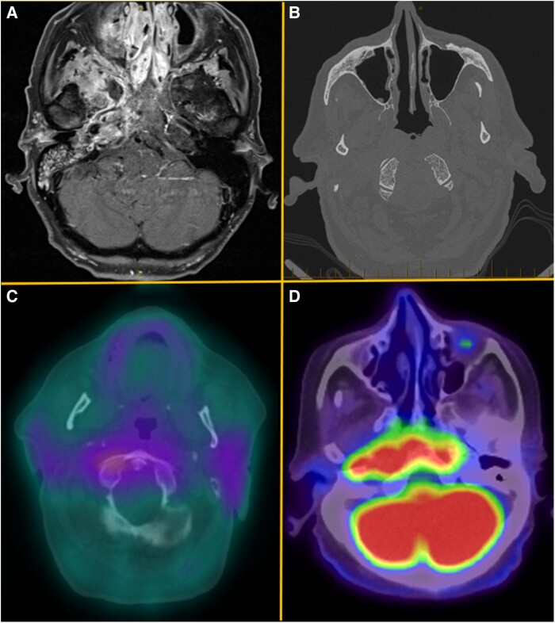
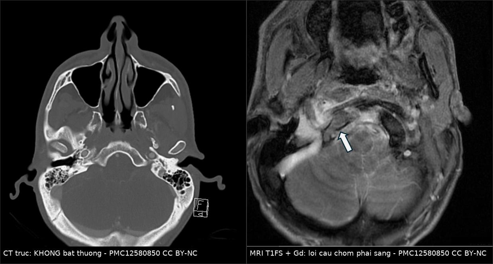
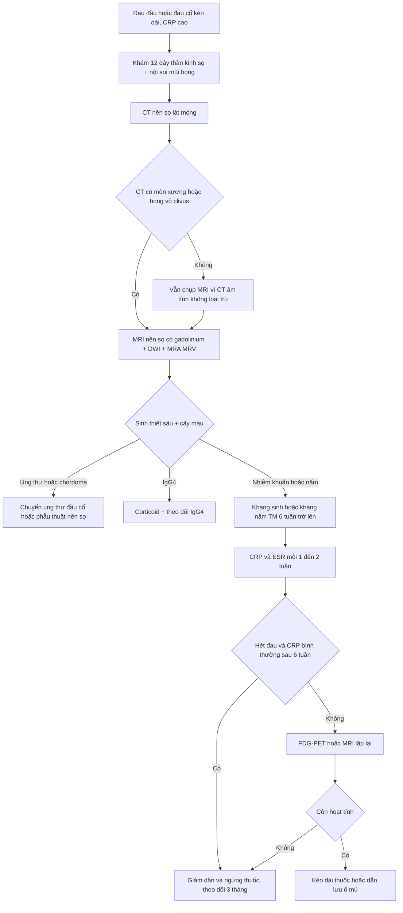
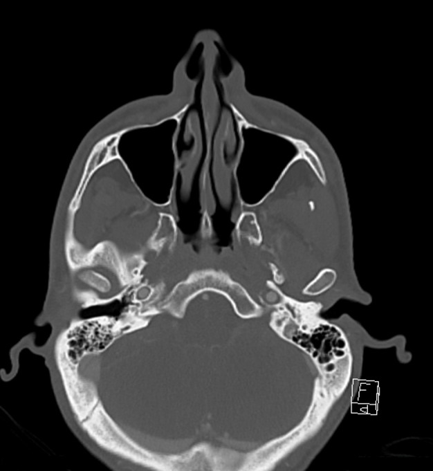
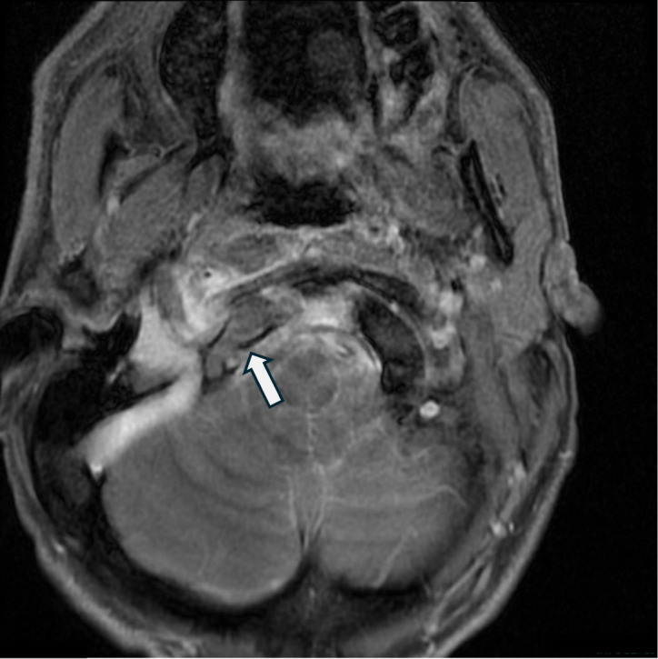
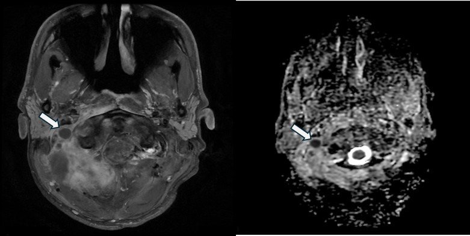

# 253 — Viêm xương nền sọ GIỮA không do tai: clivus, lồi cầu & cạm bẫy "CT bình thường" / Central skull base osteomyelitis (CSBO)

**Tags:** `pattern:viem-xuong-nen-so` `pattern:mo-xuong` `pattern:liet-day-than-kinh-so` `vung:nen-so` `vung:clivus` `vung:xuong-cham` `score:CN-palsy` `protocol:MRI-T1-fat-sat` `protocol:CT-xuong-thai-duong` `protocol:PET-FDG`
**Mức chắc chắn (certainty):** tổng hợp y văn (literature synthesis) — số liệu từ đoàn hệ 22 ca Queensland (Eustace MB et al., *Open Forum Infect Dis* 2024, PMC11500440), đoàn hệ 22 ca Hàn Quốc (Jung JH et al., *Otolaryngol Head Neck Surg* 2026, PMC13418054), tổng quan hệ thống 25 bài/44 bệnh nhân (PMC12064298), bộ điểm theo dõi CSBO (Upreti G et al., 2023, PMC10646027), cộng 2 ca nguyên văn (verbatim case) CC BY-NC 4.0 (PMC12580850) và CC BY 4.0 (PMC12282796).

## 1. Tổng quan bệnh học – cơ chế hình ảnh: vì sao CT thường "sạch" mà MRI đã dương tính

- **Định nghĩa:** viêm xương nền sọ giữa (central skull base osteomyelitis — CSBO) là nhiễm trùng xương **clivus, xương bướm và/hoặc xương chẩm/lồi cầu**, **không có ổ nhiễm tai–xương chũm khởi nguồn**. Khác hẳn viêm xương nền sọ bên do viêm tai ngoài ác tính (bài 233), CSBO **không có mô hạt ống tai**, người bệnh **không nhất thiết đái tháo đường**, và tác nhân thường là **tụ cầu vàng** chứ không chỉ *Pseudomonas*.
- **Đường lan quyết định ổ nhiễm ở đâu:**
  - **Xoang bướm** viêm mạn → xương bướm → clivus (đường trực tiếp).
  - **Răng hàm trên/hàm dưới** (ổ răng, viêm quanh răng) → **đám rối tĩnh mạch chân bướm (pterygoid venous plexus)** — van tĩnh mạch này không có giá trị một chiều, nên nhiễm từ vùng hàm mặt đi ngược lên nền sọ; ca nguyên văn 2026 (PMC13145246) khởi đầu bằng **viêm cơ chân bướm phải** trước khi ăn vào nền sọ.
  - **Đường máu** từ ổ nhiễm xa (nhọt da, viêm phổi, catheter) — ca PMC12580850: **MRSA** từ nhọt tay–chân.
  - **Từ nền sọ bên (do tai)** lan vào trong: thể chuyển tiếp, tiên lượng riêng.
- **TẠI SAO MRI dương tính trước CT — vật lý tủy xương:** clivus và lồi cầu ở người lớn chứa **tủy mỡ**, nên **T1W sáng hơn cơ và sáng hơn đĩa đệm**. Khi viêm xương, mỡ tủy bị thay bằng **dịch phù, mủ, tế bào viêm** (nhiều nước, ít proton mỡ) → **T1W tối, T2W/STIR sáng, ngấm gadolinium**. Đây là thay đổi **trong tủy xương**, xảy ra trước khi vỏ xương bị phá.
- **TẠI SAO CT có thể bình thường:** cửa sổ xương chỉ thấy **mòn vỏ xương** khi đã mất khoáng đáng kể (thực nghiệm cần mất khoảng **30–50%** khoáng chất mới thấy trên CT); trong **2–4 tuần đầu**, tổn thương khu trú trong tủy xương → **CT âm tính giả**. Ca PMC12580850 là bằng chứng nguyên văn: **CT cổ bình thường**, MRI cùng ngày phát hiện viêm xương lồi cầu chẩm phải.
- **TẠI SAO theo dõi bằng CRP/ESR chứ không bằng phim:** hình ảnh tủy xương **tồn tại nhiều tháng** sau khi hết nhiễm; CRP giảm nhanh (nửa đời ngắn, men gan IL-6), ESR giảm chậm. Vì vậy "phim còn xấu" **không** đồng nghĩa "còn nhiễm".
- **TẠI SAO FDG-PET hữu ích:** bạch cầu trung tính và đại thực bào trong ổ viêm tăng đường phân → tích tụ FDG; nhưng **u cũng dương tính**, nên PET chỉ dùng để **theo dõi đáp ứng** sau khi đã có chẩn đoán, hoặc phân biệt tồn dư.

### Ngưỡng định lượng trụ cột (đọc nhanh)

| Chỉ số | Số liệu | Nguồn |
|---|---|---|
| Tuổi trung vị | **73** (Queensland); 63–87 (loạt 7 ca Mỹ) | PMC11500440 |
| Nam giới | **73%** | PMC11500440 |
| Đái tháo đường | **68,2%** (Hàn Quốc); là bệnh nền hay gặp nhất (Queensland, CCI trung vị **5**) | PMC13418054, PMC11500440 |
| Đau đầu khi nhập viện | **95%** (tổng quan 44 ca); **63,6%** (Hàn Quốc) | PMC12064298, PMC13418054 |
| Liệt dây thần kinh sọ | **82%** (tổng quan 44 ca) | PMC12064298 |
| ESR lúc nhập viện | trung vị **65 mm/giờ** (IQR 67) | PMC11500440 |
| Bạch cầu | trung vị **11,6 × 10⁹/L** | PMC11500440 |
| Tác nhân | *P. aeruginosa* **31,8%**, *Staphylococcus* **27,3%** (Queensland); nấm **41%**, vi khuẩn **32%**, hỗn hợp **23%** (Hàn Quốc) | PMC11500440, PMC13418054 |
| Kháng sinh | TM trung vị **42 ngày** (IQR 12) → uống trung vị **42 ngày** (IQR 109,3) | PMC11500440 |
| Tử vong | **31,8%** (Queensland) / **13,6%** (Hàn Quốc) | PMC11500440, PMC13418054 |
| Di chứng dài hạn | **45,5%** (liệt dây sọ, nghe kém tiếp nhận, đau mặt dai dẳng) | PMC11500440 |
| FDG-PET theo dõi | Se **95,2%**, Sp **89,1%**, LR+ **8,7**, LR− **0,05** | PMC13030614 |

## 2. Mẫu hình + chẩn đoán phân biệt theo đường lan (Gamut)

- **Nhóm 1 — từ xoang bướm/xoang sàng sau:** viêm xoang mạn, sau phẫu thuật nội soi, sau chấn thương; hình ảnh **dày niêm mạc xoang + mất tủy xương bướm/clivus**.
- **Nhóm 2 — từ răng/hàm (odontogenic):** ổ răng, viêm quanh răng, sau nhổ răng; **viêm cơ chân bướm (pterygoid)**, viêm mô tế bào khoang nhai — dễ bị đọc thành "viêm mô tế bào đơn thuần" (PMC13145246).
- **Nhóm 3 — từ vòm họng (giả u):** **ung thư biểu mô vòm (NPC)** xâm lấn nền sọ, **u chordoma**, **chondrosarcoma** vùng nhân nền sọ — nhóm này **không đáp ứng kháng sinh** và là lý do bắt buộc sinh thiết.
- **Nhóm 4 — từ nền sọ bên (do tai):** viêm tai ngoài ác tính lan vào trong (bài 233); có **mô hạt ống tai**, liệt VII sớm.
- **Nhóm 5 — do nấm xâm lấn:** *Aspergillus*, *Mucorales* ở người **suy giảm miễn dịch/đái tháo đường kiểm soát kém**; hoại tử mạch máu, **không ngấm thuốc trung tâm**, lan nhanh, khí trong mô mềm.
- **Nhóm 6 — lao nền sọ:** sốt nhẹ kéo dài, viêm màng não nền, tổn thương dạng u hạt, vùng dịch tễ.
- **Nhóm 7 — bệnh IgG4 nền sọ (kẻ giả danh lớn):** dày mô mềm **đối xứng**, ngấm đồng nhất, tăng IgG4 huyết thanh, **đáp ứng corticoid** — ca PMC12282796 khởi đầu giống CSBO kèm áp-xe sau hầu, chỉ chẩn đoán đúng nhờ **sinh thiết sâu**.
- **Nhóm 8 — di căn/xương tủy (myeloma):** nhiều ổ, không có mô mềm viêm lan, không sốt, tiền sử ung thư.

- **Gợi nhớ SPHENOID:** **S**inus (xoang bướm), **P**terygoid/răng (chân bướm), **H**IV–immunosuppression (nấm), **E**ar (nền sọ bên), **N**eoplasm (NPC/chordoma), **O**steoporosis–metastasis/myeloma, **I**gG4, **D**iabetes.

## 3. Bảng so sánh phân biệt (ma trận đối chiếu)

*A: MRI T1 sau gadolinium — ngấm mạnh xoang cạnh mũi và nền sọ phải, ăn vào clivus, xương bướm và đỉnh xương đá phải. B: CT trục — **bong vỏ xương (decortication) clivus hai bên** ở bờ bên và bờ trước. C: gallium-67 — tăng tích tụ lan tới vùng clivus. D: FDG-PET/CT — tích tụ mạnh ăn mòn clivus, lan sang xương đá và lỗ rách/lỗ cảnh. Nguồn: Eustace MB et al., Open Forum Infect Dis 2024, PMC11500440 Fig. 2, CC BY 4.0.*

| Thực thể | Hình ảnh điển hình | Chốt vào (rule-in) | Chốt loại (rule-out) | Gợi ý xác nhận |
|---|---|---|---|---|
| **CSBO do vi khuẩn** | MRI: tủy clivus/lồi cầu **T1 tối, T2/STIR sáng, ngấm thuốc**; mô mềm trước clivus dày; CT có thể **bình thường** hoặc bong vỏ xương | **Đau đầu/đau cổ + CRP–ESR cao + MRI thay tủy xương nền sọ** | **CT bình thường không loại trừ**; tổn thương không ngấm thuốc trung tâm gợi nấm/hoại tử | MRI 1,5–3 T + cấy máu + sinh thiết sâu |
| **CSBO do nấm** | Hoại tử, **không ngấm trung tâm**, xâm lấn mạch, lan nhanh, có thể có khí; xoang cạnh mũi bị phá | **Suy giảm miễn dịch + không đáp ứng kháng sinh 2 tuần + cấy nấm dương** | Cấy nấm âm **không loại trừ** (chỉ dương ~72% ở nhóm phối hợp kháng nấm) | Sinh thiết + PCR/nhuộm bạc + phối hợp kháng nấm |
| **NPC xâm lấn nền sọ** | Khối **xoang Rosenmüller**, lan theo dây thần kinh, hạch cổ, phá xương nền sọ | **Khối vòm một bên + hạch cổ + EBV-DNA** | Niêm mạc vòm **đối xứng, không khối** → ít nghĩ NPC | Nội soi vòm + sinh thiết |
| **Chordoma clivus** | Khối **đường giữa**, **T2 rất sáng**, tiêu xương, vôi hóa dạng mảnh; ngấm không đồng nhất | **T2 rất sáng + tiêu xương đường giữa + diễn tiến chậm nhiều tháng** | **T2 tối + phù tủy lan + sốt** → viêm, không chordoma | Sinh thiết (brachyury) + MRI |
| **Chondrosarcoma vùng đá–clivus** | Lệch đường giữa, vôi hóa **cung/vòng**, T2 sáng | **Vôi hóa cung vòng + lệch trục** | Vôi hóa mảnh rải rác + phù xương → viêm | CT xương + sinh thiết |
| **Di căn / myeloma** | Tiêu xương **nhiều ổ**, không mô mềm viêm lan, không sốt | **Tiền sử ung thư + nhiều ổ + tăng canxi** | Một ổ + phù tủy + mô mềm viêm → nhiễm | MRI toàn thân/PET + điện di |
| **IgG4 nền sọ** | Dày mô mềm **đối xứng**, ngấm đồng nhất, có thể kèm viêm tụy/tuyến nước bọt | **IgG4 huyết thanh cao + mô bệnh tương ứng** | Một bên, phá xương mạnh, sốt cao → nhiễm | Sinh thiết sâu + IgG4 huyết thanh |
| **Lao nền sọ** | Viêm màng não nền, u hạt, dày màng não; tổn thương xương ít phá vỡ | **Dịch tễ lao + viêm màng não nền + IGRA dương** | Không có tổn thương màng não, CRP rất cao, đáp ứng kháng sinh thường → ít nghĩ lao | PCR lao/IGRA + sinh thiết |
| **Viêm xương nền sọ bên (do tai)** | Mô hạt ống tai, mòn xương ống tai/trước xương đá, liệt VII sớm | **Đái tháo đường + đau tai + mô hạt ống tai** | Ống tai bình thường, đau đầu là triệu chứng chính → nghĩ CSBO | Soi tai + cấy ống tai + sinh thiết |

### Đọc chuẩn xác: "CT âm tính" không phải "không viêm xương"

*Trái: CT trục ngang lồi cầu — **không thấy bất thường vỏ xương**, dễ kết luận "bình thường". Phải: MRI T1 fat-sat sau gadolinium cùng bệnh nhân — **tủy lồi cầu chẩm phải sáng hơn bên trái** (mũi tên), kèm ngấm mô mềm quanh. Nguồn: Wu M et al., BMJ Case Rep 2025, PMC12580850 Fig. 2–3, CC BY-NC 4.0. Ảnh ghép letterbox, giữ nguyên tỷ lệ.*

## 4. Protocol chụp + phác đồ điều trị & theo dõi

### 4.1 Protocol hình ảnh

- **MRI nền sọ là cửa chốt — chụp ngay khi nghi, không chờ CT:**
  - **1,5 T hoặc 3 T**, FOV phủ **từ xoang bướm tới C2**, lát **≤ 3 mm**.
  - Chuỗi tối thiểu: **T1W axial + coronal (không tiêm)**, **T2W fat-sat/STIR**, **DWI/ADC**, **T1W fat-sat sau gadolinium** (axial + coronal + sagittal), **MRA/MRV** khi có liệt dây sọ hoặc nghi huyết khối.
  - Đọc **5 vùng bắt buộc:** clivus, lồi cầu chẩm, xương bướm, đỉnh xương đá, **khoang nhai/chân bướm**; sau đó **khoang hang, lỗ cảnh, lỗ thần kinh hạ thiệt, ICA**.
- **CT xương thái dương/nền sọ:** lát **0,6–1 mm**, axial + coronal, cửa sổ xương; tìm **bong vỏ xương clivus**, mòn lỗ cảnh/hạ thiệt, khí trong mô mềm, ổ răng. **CT bình thường KHÔNG loại trừ.**
- **FDG-PET/CT:** dùng để **theo dõi đáp ứng** hoặc phân biệt tồn dư khi lâm sàng–CRP không rõ; **LR− 0,05** giúp loại trừ nhiễm hoạt động, nhưng **dương tính giả** sau xạ trị/viêm mô hạt.
- **Xét nghiệm:** **CRP + ESR mỗi 1–2 tuần**; công thức máu, HbA1c, creatinin; **cấy máu ×2 trước kháng sinh**; nội soi mũi họng tìm ổ nguyên phát và **sinh thiết sâu**.

### 4.2 Điều trị

- **Kháng sinh:** khởi đầu theo kinh nghiệm phủ **S. aureus/MRSA + Pseudomonas** (ví dụ vancomycin + piperacillin–tazobactam hoặc cefepime), sau đó **thu hẹp theo kháng sinh đồ**; **tối thiểu 6 tuần TM**, thực tế đoàn hệ Queensland dùng **trung vị 42 ngày TM + 42 ngày uống**.
- **Kiểm soát ổ nguyên phát:** nha khoa (nhổ răng/điều trị tủy), nội soi xoang bướm dẫn lưu, dẫn lưu áp-xe sau hầu.
- **Ngoại khoa nền sọ:** **không mổ "dọn" rộng**; chỉ **sinh thiết/lấy mủ** hoặc giải ép khi có chèn ép. Tổng quan 44 ca cho thấy **mổ dọn ở giai đoạn muộn có kết cục xấu hơn** (khỏi 61% so với 39%, p = 0,013), và **sinh thiết đích ở giai đoạn muộn** cũng xấu hơn (64% so với 36%, p = 0,023) — tức **chẩn đoán sớm mới là yếu tố quyết định**, không phải mổ nhiều.
- **Kiểm soát đường huyết** chặt (đái tháo đường là bệnh nền hay gặp nhất); **corticoid chỉ khi có chẩn đoán IgG4 hoặc phù não đe dọa**, vì corticoid che lấp nhiễm và làm cấy âm.

### 4.3 Tiêu chuẩn theo dõi & ngừng thuốc

- **Lâm sàng:** hết đau đầu/đau cổ, hết liệt dây sọ tiến triển, ăn uống bình thường.
- **Sinh học:** **CRP về bình thường** (ESR có thể còn cao nhiều tuần).
- **Hình ảnh:** MRI/PET **không tiến triển**; không đòi hỏi hết bất thường.
- **Bộ điểm theo dõi (Upreti 2023):** **điểm hình ảnh ban đầu < 30**, **điểm đau VAS ≤ 7**, **điểm liệt dây sọ CNAS < 10** dự báo cải thiện sớm và thời gian kháng sinh ngắn hơn — dùng để **phân tầng theo dõi**, không phải để bỏ kháng sinh sớm.

## 5. Biến thể bình thường và cạm bẫy

- **"CT bình thường" là cạm bẫy số 1:** ca nguyên văn PMC12580850 có CT cổ hoàn toàn bình thường, MRI mới thấy viêm xương lồi cầu; bệnh nhân sau đó vẫn **liệt dây sọ và mất thính lực** vì chẩn đoán muộn.
- **Tủy xương lồi cầu không đối xứng "sinh lý":** mỡ tủy hai bên có thể lệch nhẹ; chỉ gọi bệnh khi **T1 tối hơn cơ/đĩa đệm** và **ngấm thuốc**, kèm **phù mô mềm** và **CRP cao**.
- **Sau xạ trị nền sọ:** tủy xương T1 tối + ngấm thuốc do **hoại tử phóng xạ** (bài 204) tồn tại **6–24 tháng** — đừng chẩn đoán viêm xương chỉ vì MRI còn bất thường; cần bối cảnh sốt/CRP/cấy.
- **PET dương tính giả** do viêm mô hạt, sau mổ, sau xạ; chỉ có giá trị khi **so hai thời điểm** (SUV giảm).
- **Sinh thiết nông bỏ sót:** cấy dịch vòm/mũi chỉ là **tạp khuẩn**; muốn có tác nhân thật phải **sinh thiết xương/mô sâu dưới hướng dẫn** — Queensland chỉ **6/22 ca** được lấy xương, còn lại cấy nông.
- **Đã dùng kháng sinh trước khi cấy** → cấy âm; **ngừng kháng sinh 48 giờ** trước sinh thiết nếu lâm sàng cho phép.
- **Corticoid che lấp:** dùng corticoid trước khi loại trừ nhiễm có thể làm giảm đau–giảm CRP trong vài ngày rồi bùng phát; **không thử corticoid mù** ở CSBO.
- **Satisfaction of search:** thấy viêm xương rồi bỏ sót **huyết khối ICA/xoang bên**, **áp-xe nội sọ**, **liệt dây IX–XII**; luôn đọc mạch máu và khám đủ 12 dây.
- **Nhầm với IgG4:** tổn thương đối xứng, không sốt, IgG4 cao; **chỉ sinh thiết sâu** mới phân biệt được (PMC12282796).

## 6. Tự lượng giá — Blind Quiz

**Ca 1 — Nam khoảng 30 tuổi, đau cổ tăng nhanh, CRP/ESR cao, có nhọt da tay–chân. CT cổ tại khoa cấp cứu "bình thường". Nhìn CT trước, mô tả.**

- Hỏi: (1) CT này có loại trừ viêm xương nền sọ không? (2) Cần chụp gì tiếp và đọc ở đâu? (3) Vì sao bệnh nhân trẻ, không đái tháo đường vẫn có thể mắc?

<b>Bấm để hiện đáp án (findings + chẩn đoán)</b>

- **Dấu hiệu:** trên CT **không có mòn vỏ xương** rõ; trên MRI T1 fat-sat sau gadolinium, **tủy lồi cầu chẩm phải sáng hơn bên trái** (mũi tên) kèm **ngấm mô mềm quanh** — tương ứng **viêm tủy xương**.
- **Chẩn đoán:** **viêm xương nền sọ giữa (CSBO)** do **MRSA** (cấy máu dương), ổ nguyên phát từ **nhọt da**.
- **Vì sao CT không loại trừ:** thay đổi tủy xương đi trước phá vỏ xương; CT chỉ dương khi mất khoáng đáng kể. **MRI là cửa chốt.**
- **Bước tiếp:** cấy máu ×2, MRI toàn nền sọ + MRA/MRV, khám 12 dây, kháng sinh phủ MRSA, theo dõi CRP; bệnh nhân này sau đó vẫn **liệt dây sọ và giảm thính lực** — bài học là **chẩn đoán muộn để lại di chứng**.
- **Nguồn ảnh:** Wu M et al., *BMJ Case Rep* 2025, PMC12580850 Fig. 2–3, CC BY-NC 4.0.

**Ca 2 — Nữ 68 tuổi, đái tháo đường, đau đầu vùng đỉnh–chẩm 2 tháng, sốt nhẹ. MRI nền sọ và CT cùng ngày.**

- Hỏi: (1) Panel nào chứng minh tổn thương **xương** và panel nào chứng minh **hoạt tính viêm**? (2) Vì sao phải sinh thiết sâu? (3) Ngưỡng thời gian kháng sinh?

<b>Bấm để hiện đáp án (findings + chẩn đoán)</b>

- **Dấu hiệu:** **A** — MRI T1 sau gadolinium: ngấm mạnh xoang cạnh mũi và nền sọ phải, ăn vào **clivus, xương bướm, đỉnh xương đá phải**. **B** — CT: **bong vỏ xương clivus hai bên** ở bờ bên và bờ trước (chứng minh tổn thương xương). **C** — gallium-67: tăng tích tụ lan tới clivus (hoạt tính viêm). **D** — FDG-PET/CT: tích tụ mạnh ăn mòn clivus, lan tới **lỗ rách và lỗ cảnh**.
- **Chẩn đoán:** **CSBO** (không có ổ tai), cần **sinh thiết sâu** để loại **NPC/chordoma** và tìm tác nhân (Queensland: *P. aeruginosa* 31,8%, *Staphylococcus* 27,3%).
- **Ngưỡng điều trị:** **tối thiểu 6 tuần TM**; đoàn hệ dùng trung vị **42 ngày TM + 42 ngày uống**; ngừng khi **hết đau + CRP bình thường + hình ảnh không tiến triển**.
- **Nguồn ảnh:** Eustace MB et al., *Open Forum Infect Dis* 2024, PMC11500440 Fig. 2, CC BY 4.0.

**Ca 3 — Cùng bệnh nhân Ca 1, sau 10 ngày kháng sinh: sốt tăng, xuất hiện ổ dịch sau hầu. MRI có DWI/ADC.**

- Hỏi: (1) Mô tả ổ dịch trên T1 sau tiêm và ADC? (2) Vì sao phải dẫn lưu? (3) Cấy mủ này khác gì cấy dịch vòm?

<b>Bấm để hiện đáp án (findings + chẩn đoán)</b>

- **Dấu hiệu:** **ổ dịch ngấm viền** (T1 fat-sat sau gadolinium) và **giảm khuếch tán trên ADC** (vùng tối) — phù hợp **áp-xe**, không phải mô hạt đơn thuần.
- **Chẩn đoán:** **áp-xe khoang sau hầu** biến chứng của CSBO — cần **dẫn lưu** và **cấy mủ sâu**.
- **Vì sao dẫn lưu:** ổ mủ không thấm kháng sinh, chèn ép đường thở; đồng thời lấy được **tác nhân thật** thay vì tạp khuẩn vòm.
- **Cấy mủ vs cấy dịch vòm:** dịch vòm là **hệ vi sinh thường trú**; mủ trong ổ kín có giá trị định danh cao hơn — đây là lý do Queensland chỉ tin cấy **xương/mô sâu**, và tổng quan 44 ca nhấn mạnh **chẩn đoán sớm** hơn can thiệp muộn.
- **Nguồn ảnh:** Wu M et al., *BMJ Case Rep* 2025, PMC12580850 Fig. 5, CC BY-NC 4.0.

## Bài liên quan chéo
- [233 – Viêm tai ngoài ác tính & viêm xương nền sọ](../233-viem-tai-ngoai-ac-tinh-nen-so/lesson.md) (thể nền sọ **bên**, do tai)
- [237 – Biến chứng thần kinh sọ của viêm tai: Gradenigo, liệt VII, viêm mê nhĩ](../237-bien-chung-than-kinh-so-viem-tai-gradenigo/lesson.md)
- [730 – Nhiễm trùng khoang cổ sâu](../730-deep-neck-infections/lesson.md) (áp-xe sau hầu, khoang nguy hiểm)
- [750 – Hạch cổ & NI-RADS](../750-cervical-lymph-nodes-nirads/lesson.md) (hạch cổ + khối vòm)
- [720 – Xương đá & cholesteatoma](../720-temporal-bone-cholesteatoma/lesson.md) (mòn xương, non-EPI DWI)
- [204 – Hoại tử phóng xạ sau xạ trị u não](../204-hoai-tu-phong-xa-sau-xa-tri-u-nao/lesson.md) (MRI nền sọ bất thường sau xạ, không phải nhiễm)
- [700 – Tổng quan Đầu Mặt Cổ](../700-head-neck-overview/lesson.md)

> Không dùng để chẩn đoán độc lập khi chưa có người hướng dẫn.
