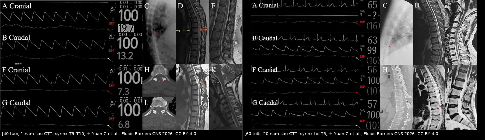
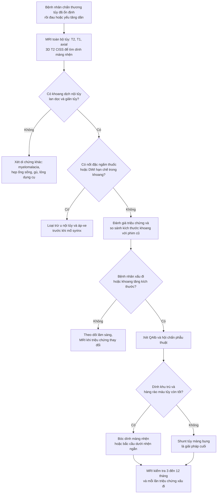
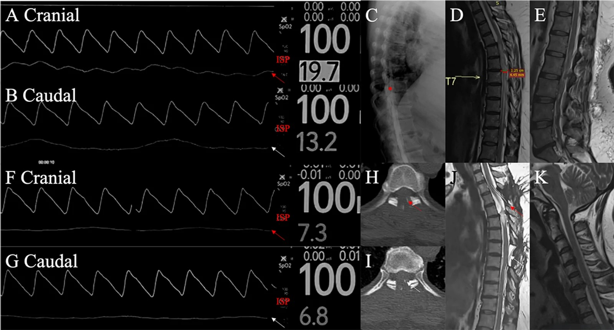
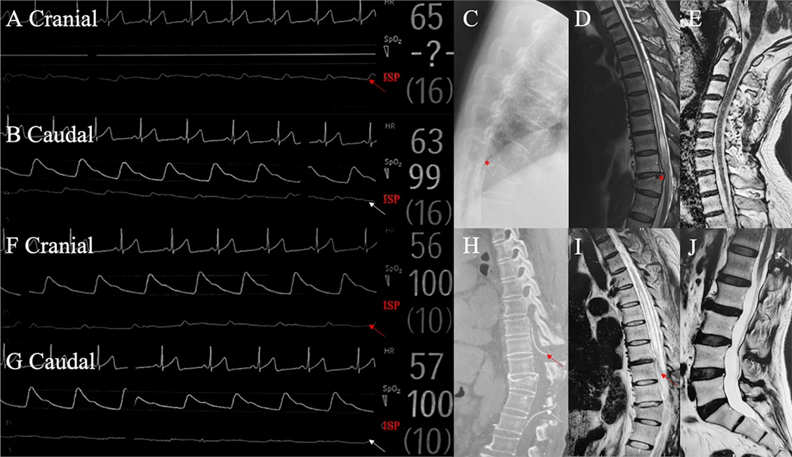
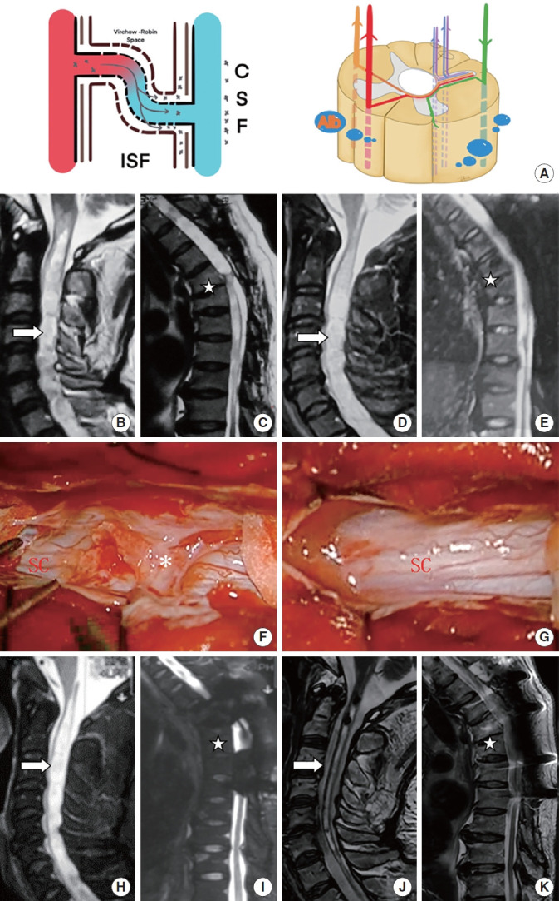

# 254 — Giãn tủy sau chấn thương tủy sống: bệnh nhân "xấu đi sau giai đoạn ổn định" / Post-traumatic syringomyelia

**Tags:** `pattern:gian-tuy` `pattern:viem-tuy` `vung:tuy-song` `protocol:MRI-tuy-co-gadolinium` `protocol:MRI-dong-hoc-csf`
**Mức chắc chắn (certainty):** tổng hợp y văn (literature synthesis) — số liệu từ **đoàn hệ 64 bệnh nhân** được phẫu thuật bắc cầu dưới nhện–dưới nhện (subarachnoid–subarachnoid bypass, S-S bypass) tại Xuanwu, theo dõi trung bình **23,6 tháng** (PMC13523516, Fluids Barriers CNS 2026) và **đoàn hệ 56 ca** so sánh bóc dính màng nhện với đặt shunt (PMC10992642, Neurospine 2024). Bốn ca minh họa trong bài là **ca nguyên văn** của bài gốc.

> **Bài này nối tiếp [223 – Chấn thương tủy sống: ASIA & SCIWORA](../223-chan-thuong-tuy-so/lesson.md)** (giai đoạn cấp) và **[226 – Tủy mềm không do chấn thương](../226-tuy-mem-khong-chan-thuong-nhoi-mau-sdavf-nmo-xa/lesson.md)** (nhồi máu tủy, SDAVF, NMO). Câu chốt: bệnh nhân chấn thương tủy **đã ổn định rồi đau/yếu tăng dần** — nghĩ tới **giãn tủy tiến triển**, không phải "di chứng cố định".

## 1. Tổng quan — vì sao tủy bị chấn thương lại sinh ra khoang dịch

- **Bệnh học:** sau chấn thương, **dính màng nhện (arachnoid adhesions)** và **sẹo mô đệm** tại vùng tổn thương chặn dòng DNT lưu thông → **chênh áp lực dịch trong ống sống**, DNT bị **đẩy vào tủy qua vùng hàng rào máu–tủy đã vỡ (blood–spinal cord barrier, BSCB)** → khoang dịch **lan dọc** trong tủy (syrinx). Ba yếu tố cùng lúc: **tắc dòng DNT + chênh áp lực + hàng rào máu–tủy hỏng**.
- **Vì sao hình ảnh trông như vậy (vật lý):**
  - **T2 sáng đồng tín hiệu DNT** = khoang **dịch tự do** (không phải mô); **T1 tối**, **không ngấm thuốc**, **không hạn chế khuếch tán** (khác áp-xe).
  - **Tủy giãn (cord expansion)** vì khoang dịch choán chỗ; **mất tín hiệu dòng chảy (flow void)** quanh tủy khi dính màng nhện dày.
  - **Myelomalacia (tủy mềm)** = vùng **T2 sáng ranh giới mờ, không tạo khoang**, không giãn tủy — **khác syrinx**.
- **Ngưỡng định lượng nằm lòng:**
  - **Tần suất:** giãn tủy sau chấn thương gặp ở **khoảng 20%** bệnh nhân chấn thương tủy sống (theo phần mở đầu của đoàn hệ Neurospine 2024; y văn cũ nêu 1–4% ca có triệu chứng, tới 28% trên MRI) — tức **phần lớn không triệu chứng**, chỉ theo dõi.
  - **Thời điểm:** từ **3 tháng đến nhiều thập kỷ** sau chấn thương; 4 ca minh họa của bài gốc xuất hiện sau **1 năm, 15 năm, 20 năm và 2 năm sau mổ thất bại**.
  - **Triệu chứng:** **đau (neuropathic, theo khoanh)** là triệu chứng sớm và hay gặp nhất; kèm **mất cảm giác đau–nhiệt kiểu "treo" (suspended dissociation)** trong khi **cảm giác sâu còn**, **yếu/spasticity tăng dần**, **rối loạn cơ tròn**, **ra mồ hôi bất thường** trên mức tổn thương.
  - **Kết cục phẫu thuật:** **bóc dính màng nhện cải thiện < 50%** bệnh nhân PTS (so với **80%** ở giãn tủy do Chiari); **S-S bypass: 71,9% (46/64) cải thiện thần kinh** sau **23,6 tháng**; **shunt tủy–phúc mạc** là cứu cánh khi bypass thất bại (ca 4).
  - **Yếu tố tiên đoán hồi phục sau S-S bypass:** **gradient áp lực nội ống sống (intraspinal pressure, ISP) trước mổ > 1,5 mmHg** (Se **93,48%** / Sp **66,67%**); **biên độ ISP phía trên tổn thương > 3,5 mmHg** (Se **82,61%** / Sp **94,44%**); **cầu nối < 5,5 đốt sống** (Se **100%** / Sp **44,44%**).
  - **Chọn shunt thay vì bóc dính:** **QAlb (albumin DNT/huyết thanh) > 12,67** dự đoán cần shunt với **Se 80,95% / Sp 100%**; QAlb cao hơn có ý nghĩa ở nhóm shunt so với nhóm bóc dính (p < 0,001).

## 2. Mẫu hình + chẩn đoán phân biệt theo vị trí (Gamut)

**A. Khoang dịch NỘI TỦY (gamut chính):**
- **Giãn tủy sau chấn thương (PTS):** khoang **liên tục, bờ nhẵn**, **lan dọc từ mức tổn thương**, tủy giãn, **dính màng nhện** ở đầu trên/dưới khoang, **mất flow void**.
- **Giãn tủy do Chiari I / dính màng nhện nguyên phát:** khoang từ **ống trung tâm cổ cao**, kèm **hạnh nhân tiểu não thấp ≥ 5 mm**; bóc dính hiệu quả hơn nhiều so với PTS (80%).
- **U nội tủy có nang (ependymoma/hemangioblastoma):** **nốt đặc ngấm thuốc** trong/thành nang — **không được bỏ** khi đọc "syrinx".
- **Áp-xe nội tủy:** **DWI hạn chế trong khoang**, ngấm vòng, sốt.
- **Myelomalacia:** T2 sáng **không tạo khoang**, không giãn tủy — di chứng cũ, không mổ.
- **Nhồi máu tủy (artery of Adamkiewicz):** khởi phát **đột ngột**, **DWI hạn chế**, phân bố **2/3 trước tủy**.

**B. Dấu hiệu đi kèm phải tìm (đừng chỉ nhìn khoang dịch):**
- **Dính màng nhện (arachnoid web/adhesion)** — màng mỏng ngang khoang dưới nhện, **"scalpel sign"** ở mặt lưng tủy ngực; là **nguyên nhân chữa được**.
- **Hẹp ống sống tại chỗ / gù / dụng cụ cố định** — đánh giá trên CT; **di lệch dụng cụ** có thể là nguyên nhân.
- **Tụ dịch dưới màng cứng (pseudomeningocele)** sau mổ — chèn ép ngoài tủy.
- **Rò DNT** hoặc **nhiễm trùng vết mổ** ở bệnh nhân có dụng cụ.

**C. Ba câu hỏi lọc trước khi kết luận "di chứng cố định":**
1. **Bệnh nhân có giai đoạn ổn định rồi xấu đi không?** Có → **chụp lại MRI**, đừng gán cho "di chứng".
2. **Đau có tính chất thần kinh theo khoanh, tăng dần?** Có → nghĩ syrinx.
3. **Có nốt ngấm thuốc trong khoang không?** Có → **loại trừ u** trước khi mổ syrinx.

## 3. Bảng so sánh phân biệt (ma trận đối chiếu)

| Thực thể (entity) | Hình ảnh điển hình | Chốt vào (rule-in) | Chốt loại (rule-out) | Gợi ý xác nhận |
|---|---|---|---|---|
| **Giãn tủy sau chấn thương (PTS)** | Khoang **T2 sáng = DNT**, **lan dọc từ mức tổn thương**, tủy giãn, **dính màng nhện** đầu khoang, **không ngấm**, **không hạn chế DWI** | **Tiền sử chấn thương + xấu đi sau ổn định + khoang liên tục bờ nhẵn** | **Nốt đặc ngấm thuốc** → u; **DWI hạn chế** → áp-xe | MRI toàn tủy T2/T1 ± Gd; CT myelography khi cần thấy dính; đo ISP nếu mổ |
| **U nội tủy (ependymoma)** | Khối **đặc ngấm thuốc**, ± nang, ± xuất huyết, phình tủy khu trú | **Nốt ngấm trong/thành khoang + bờ không đều** | **Khoang trơn, không nốt, nhiều năm ổn định** → syrinx | MRI + Gd; mô bệnh |
| **SDAVF** | **Flow void quanh tủy**, phù lan **dài** từ nón tủy, tủy **không giãn nhiều**, ngấm mờ lan tỏa | **Flow void + phù dài + nam > 50 tuổi, nặng khi đứng** | **Khoang dịch rõ + không flow void** → syrinx | DSA tủy (chuẩn); MRA |
| **NMOSD/viêm tủy cắt ngang** | **LETM ≥ 3 đốt**, trung tâm "H-sign", ngấm mảng, **không khoang** | **AQP4/MOG dương + LETM + viêm dây thị** | **Khoang dịch bờ nhẵn** → không phải | AQP4/MOG; MRI não |
| **Dính màng nhện / web lưng (dorsal arachnoid web)** | **"Scalpel sign"**: màng ngang đẩy tủy ra trước, **flow void mất**, ± syrinx | **Màng ngang + tủy bị đẩy ra trước + xấu dần** | **Không thấy màng ngang, dính lan tỏa** → PTS | MRI 3D T2 CISS/DRIVE; CT myelography |
| **Myelomalacia** | T2 sáng **ranh giới mờ**, **không khoang**, tủy **teo** chứ không giãn | **Không khoang + teo tủy + ổn định lâu năm** | **Có khoang + giãn tủy** → syrinx | MRI; so phim cũ |

*Trái: nữ **40 tuổi**, **1 năm** sau chấn thương tủy ngực, syrinx **T5–T10**; gradient ISP trước mổ **6,5 mmHg**, bắc cầu T4–T7 → **đi lại được, duy trì 2 năm**, MRI hết phù và hết syrinx. Phải: nam **60 tuổi**, **20 năm** sau chấn thương **T11**, syrinx lan tới **T5** nhưng **không có sóng áp lực bất thường**; bắc cầu T10–L1 chỉ **ổn định**, **không cải thiện**, MRI không đổi. Cùng hình ảnh — khác **sinh lý áp lực** → khác kết cục. Nguồn: Yuan C et al., Fluids Barriers CNS 2026, PMC13523516, Fig. 3 và Fig. 5, CC BY 4.0; ảnh ghép letterbox.*

### Đọc chuẩn xác: syrinx "đang hoạt động" hay "đã cũ"
- **Syrinx hoạt động:** khoang **tăng kích thước** trên phim so sánh, **tủy giãn thêm**, **phù quanh khoang**, **xuất hiện/tăng triệu chứng** — đây là nhóm **có chỉ định can thiệp**.
- **Syrinx cũ ổn định:** khoang **không đổi nhiều năm**, bệnh nhân **không xấu đi** — **theo dõi**, không mổ vì "thấy khoang trên phim".
- **Đo được — nên đo:** **chiều dài khoang (số đốt)**, **đường kính ngang tối đa**, **tỉ lệ syrinx/tủy (syrinx-to-cord ratio)**, **vị trí dính**, **mức tổn thương gốc**. Ghi vào báo cáo để so lần sau, thay vì "syrinx lớn".

## 4. Protocol chụp + đo áp lực + chỉ định mổ

**Protocol hình ảnh:**
- **MRI toàn bộ tủy sống**: sagittal **T2, T1, STIR**, **axial T2** qua khoang và qua mức tổn thương; **T1 sau gadolinium** khi nghi u/áp-xe hoặc có nốt trong khoang.
- **Chuỗi xung 3D T2 (CISS/DRIVE/FIESTA)** để thấy **dính màng nhện/màng ngang** — đây là chi tiết quyết định kỹ thuật mổ.
- **MRI tưới/dòng chảy DNT (phase-contrast cine)** khi cần đánh giá lưu thông quanh ổ dính (không bắt buộc, phụ thuộc trang bị).
- **CT myelography** khi MRI bị nhiễu kim loại dụng cụ, hoặc cần **xác định chính xác vị trí dính** trước mổ.
- **Chụp lại 3–12 tháng sau mổ** (theo đoàn hệ) + mỗi lần **triệu chứng xấu đi** — không chụp định kỳ vô hạn ở người không triệu chứng.

**Đo áp lực nội ống sống (ISP) — bổ sung trong mổ, không phải xét nghiệm ngoại trú:**
- Đặt catheter **trên và dưới ổ dính**, đo **gradient** và **biên độ sóng mạch đập**; ngưỡng tiên đoán hồi phục sau bắc cầu: **gradient > 1,5 mmHg**, **biên độ > 3,5 mmHg** (bảng dưới).
- **QAlb trước mổ** (DNT/huyết thanh): **> 12,67** → cân nhắc **shunt** là giải pháp cuối, vì bóc dính đơn thuần khó hiệu quả khi hàng rào máu–tủy đã hỏng nặng.

| Thông số | Ngưỡng | Ý nghĩa |
|---|---|---|
| Gradient ISP qua ổ dính | **> 1,5 mmHg** | Tiên đoán hồi phục (Se 93,48% / Sp 66,67%) |
| Biên độ sóng ISP phía trên tổn thương | **> 3,5 mmHg** | Tiên đoán hồi phục (Se 82,61% / Sp 94,44%) |
| Số đốt cầu nối | **< 5,5 đốt** | Cầu càng dài càng ít hiệu quả (Se 100% / Sp 44,44%) |
| QAlb trước mổ | **> 12,67** | Dự đoán cần shunt (Se 80,95% / Sp 100%) |

**Chỉ định can thiệp (theo đoàn hệ và thực hành):**
- **Bóc dính màng nhện (arachnoid lysis)** — lựa chọn đầu tay khi dính **khu trú**, hàng rào máu–tủy còn tương đối; lưu ý **chỉ cải thiện < 50%** bệnh nhân PTS.
- **Bắc cầu dưới nhện–dưới nhện (S-S bypass)** — tạo đường DNT **vòng qua ổ dính**, hiệu quả **71,9%** trong đoàn hệ 64 ca; **cầu càng ngắn càng tốt**.
- **Shunt tủy–phúc mạc / tủy–màng bụng** — khi **dính lan tỏa, bypass thất bại, QAlb cao**; đặt áp lực mở thấp (ca 4: **110 mmH₂O**), theo dõi **tắc shunt** và **quá dẫn lưu** (đau đầu khi đứng).
- **Không mổ** khi khoang **ổn định, không triệu chứng** — theo dõi lâm sàng là đủ.

## 5. Biến thể bình thường và cạm bẫy

- **Giãn ống trung tâm (central canal) lành tính:** đường **≤ 2 mm**, **không giãn tủy**, không triệu chứng — **không phải syrinx**; đừng mô tả thành "giãn tủy" trong báo cáo.
- **Myelomalacia không phải syrinx:** T2 sáng **ranh giới mờ, không khoang, tủy teo** — mổ syrinx ở đây **không giúp gì**.
- **Bỏ sót u trong "syrinx":** luôn xem **từng lát axial** tìm **nốt ngấm thuốc** ở thành/đầu khoang; ependymoma và hemangioblastoma **có thể biểu hiện chủ yếu bằng nang**.
- **Nhiễu kim loại dụng cụ:** làm mất chi tiết vùng mổ — dùng **CT myelography** hoặc chuỗi xung giảm nhiễu (MAVRIC/SEMAC) nếu có.
- **"Không đổi trên MRI" không đồng nghĩa "không tiến triển":** ca 3 trong bài gốc **không có sóng áp lực bất thường**, mổ chỉ **ổn định** và **MRI không đổi** — hình ảnh và sinh lý áp lực có thể **không đi cùng nhau**.
- **Quá dẫn lưu sau shunt:** đau đầu **tư thế đứng**, buồn nôn, khoang **xẹp quá mức** — chỉnh áp lực van, không mổ lại ngay.
- **Đau sau chấn thương không phải lúc nào cũng do syrinx:** phân biệt **đau rễ do hẹp lỗ ghép**, **loãng xương/gãy xẹp**, **nhiễm trùng dụng cụ**, **hội chứng đau trung tâm** — MRI không giải thích hết.
- **Thai kỳ và tăng áp lực ổ bụng** có thể làm triệu chứng syrinx nặng lên; theo dõi lâm sàng sát khi sinh.
- **Không có bằng chứng mức độ cao:** các ngưỡng ISP/QAlb đến từ **đoàn hệ đơn trung tâm**, chưa có RCT → dùng để **hội chẩn**, không dùng như "chỉ định tuyệt đối".

## 6. Tự lượng giá — Blind Quiz

**Ca 1 — Nữ 40 tuổi, chấn thương tủy ngực 1 năm trước, tê–yếu hai chân tăng dần, 3 tháng nay không đi được. MRI + đo áp lực trong mổ:**

- Câu hỏi: (1) Mô tả khoang dịch và mức lan? (2) Vì sao đây là **syrinx hoạt động** chứ không phải myelomalacia? (3) Can thiệp gì và theo dõi ra sao?

<b>Bấm để hiện đáp án (findings + chẩn đoán)</b>

- **Dấu hiệu:** **phù tủy + syrinx từ T5 đến T10**, tủy **giãn**, không nốt ngấm thuốc; **gradient ISP trước mổ 6,5 mmHg** (trên > dưới ổ dính).
- **Vì sao hoạt động:** khoang **lan dọc, tủy giãn, phù quanh** + **triệu chứng tiến triển sau giai đoạn ổn định** — khác myelomalacia (không khoang, tủy teo).
- **Can thiệp:** **hai cầu nối dưới nhện–dưới nhện T4–T7**; sau mổ **đi lại được**, duy trì **2 năm**; **MRI hết phù và hết syrinx**.
- Nguồn ảnh: Yuan C et al., Fluids Barriers CNS 2026, **PMC13523516**, Fig. 3, CC BY 4.0.

**Ca 2 — Nam 60 tuổi, chấn thương T11 cách đây 20 năm, yếu chân tiến triển 2 năm. MRI và đo áp lực trước mổ:**

- Câu hỏi: (1) Hình ảnh syrinx có giống ca 1 không? (2) Vì sao kết cục khác? (3) Bài học về chỉ định mổ?

<b>Bấm để hiện đáp án</b>

- **Hình ảnh:** syrinx **lan tới T5** — **giống hệt** kiểu hình của ca 1; điểm khác nằm ở **sinh lý**, không ở hình thái.
- **Vì sao khác:** **không phát hiện sóng áp lực bất thường** trước mổ; sau bắc cầu **T10–L1**, triệu chứng **chỉ ổn định**, **MRI không đổi** → thiếu "động lực áp lực" thì bắc cầu không tạo được lợi ích.
- **Bài học:** **không mổ theo hình ảnh**; cần **triệu chứng tiến triển + bằng chứng chênh áp lực** (hoặc ít nhất hội chẩn kỹ). Khi bypass thất bại, **shunt tủy–màng bụng** (ca 4, van 110 mmH₂O) có thể là bước tiếp theo.
- Nguồn ảnh: Yuan C et al., Fluids Barriers CNS 2026, **PMC13523516**, Fig. 5, CC BY 4.0.

**Ca 3 — Bệnh nhân PTS, hình ảnh học cơ chế và kết quả sau bóc dính:**

- Câu hỏi: (1) Sơ đồ mô tả dòng dịch đi qua đâu? (2) Trên MRI, dấu hiệu nào cho thấy **dính màng nhện** là nguyên nhân? (3) Khi nào chọn **shunt** thay vì bóc dính?

<b>Bấm để hiện đáp án</b>

- **Cơ chế (A):** DNT đi từ khoang dưới nhện vào tủy qua **vùng hàng rào máu–tủy bị phá vỡ** (đường Virchow–Robin/ISF), tạo dòng **xuyên nhu mô** nuôi khoang dịch.
- **Dấu hiệu dính:** **mất flow void**, **màng/dính ngang** ở đầu khoang, **tủy bị kéo–đẩy cục bộ**, phù quanh khoang; hình trong mổ cho thấy **dải xơ màng nhện** phải cắt.
- **Chọn shunt:** **QAlb > 12,67** (Se 80,95% / Sp 100%), dính **lan tỏa** không thể bóc hết, hoặc **bypass thất bại** — shunt là **giải pháp cuối**, không phải lựa chọn đầu.
- Nguồn ảnh: Xia P et al., Neurospine 2024, **PMC10992642**, Fig. 3, CC BY-NC 4.0 (nguyên bản).

> **Phản biện (critique):** các con số về ISP và QAlb đến từ **hai đoàn hệ hồi cứu/cận lâm sàng của cùng một trung tâm**, cỡ mẫu **64 và 56 ca**, **không có nhóm chứng ngẫu nhiên**; đo ISP là **thủ thuật trong mổ**, không phổ quát. Vì vậy bài này trình bày các ngưỡng như **dữ liệu tiên đoán để hội chẩn**, không phải tiêu chuẩn bắt buộc; quyết định vẫn dựa trên **triệu chứng + hình ảnh + kinh nghiệm trung tâm**.

## Bài liên quan chéo
- [200 – Tổng quan Hệ Thần kinh](../200-tong-quan-he-than-kinh/lesson.md)
- [223 – Chấn thương tủy sống: ASIA (AIS A–E) & SCIWORA](../223-chan-thuong-tuy-so/lesson.md)
- [225 – Hội chứng tủy KHÔNG hoàn toàn: CCS, ASA, Brown-Séquard, tủy sau](../225-hoi-chung-tuy-khong-hoan-toan/lesson.md)
- [226 – Tủy mềm không do chấn thương: nhồi máu tủy, SDAVF, NMO, tủy mềm do xạ](../226-tuy-mem-khong-chan-thuong-nhoi-mau-sdavf-nmo-xa/lesson.md)
- [220 – Tiếp cận tổn thương ống sống theo 3 khoang](../220-ong-song-tuy/lesson.md)
- [243 – Sán máng thần kinh: tủy ngực dưới/nón tủy & thể não giả u](../243-san-mang-than-kinh/lesson.md)
- [250 – Lao nội tủy & lao màng tủy: dấu bia](../250-lao-noi-tuy-va-lao-mang-tuy/lesson.md)

> Không dùng để chẩn đoán độc lập khi chưa có người hướng dẫn.
