# 255 — Màng nhện lưng & dấu "scalpel" / Dorsal spinal arachnoid web and the scalpel sign

**Tags:** `pattern:scalpel-sign` `pattern:dan-mang-nhen` `pattern:chen-ep-tuy` `pattern:gian-tuy` `pattern:tac-dong-dich-nao-tuy` `vung:tuy-song` `vung:ong-song` `protocol:MRI-cot-song` `protocol:MRI-dong-hoc-csf` `protocol:3D-CISS` `protocol:CT-tuy-myelo` `score:tJOA` `score:McCormick`

**Mức chắc chắn (certainty):** tổng hợp y văn (literature synthesis) — 3 loạt mổ lớn (17 ca, Brain Spine 2025, PMC12337197; 18 ca, J Neurosurg Case Lessons 2026, PMC12951421; 12 ca nội soi ống, Brain Spine 2026, PMC13147814) + 1 loạt giải phẫu bệnh trong cơ sở dữ liệu **1.039 ca giãn tủy** (Neurospine 2025, PMC12518900) + 3 ca nguyên văn có ảnh (Cureus 2026 PMC13358518; Reports 2025 PMC12643434; Cureus 2025 PMC11911252). Không có thử nghiệm ngẫu nhiên; mọi ngưỡng xử trí là tổng hợp thực hành, chỗ suy luận được ghi rõ.

> **Câu chốt:** màng nhện lưng (spinal arachnoid web, SAW) **không phải khối u và không phải nang** — đây là **một dải màng ngang dày ở mặt lưng khoang dưới nhện**, chặn dòng dịch não tủy (cerebrospinal fluid, CSF) như **van một chiều**, làm tủy bị **đẩy ra trước + lõm mặt lưng** (dấu **scalpel**), và gây **giãn tủy (syrinx) ở hoặc ngay trên mức màng**. Ba câu để không bỏ sót: **(1)** tổn thương nằm **LƯNG** tủy (không phải trước) ở **ngực trên–giữa (T2–T8)**; **(2)** tủy **lệch ra trước + khoang dịch não tủy phía sau giãn rộng** chứ không có khối ngấm thuốc; **(3)** dải màng chỉ thấy rõ trên **3D-CISS/T2 SPACE hoặc CT tủy cản quang** — bỏ sót vì "MRI thường không thấy gì" là chuyện thường, và **không có dấu scalpel cũng không loại trừ** (thể cấp, Cureus 2025, PMC11911252). Đây là nguyên nhân **chữa khỏi được** của giãn tủy: cắt màng → tủy về vị trí, syrinx xẹp.

## 1. Tổng quan bệnh học – cơ chế hình ảnh (TẠI SAO)

### 1.1 Bệnh học: một dải màng ngang, không phải nang, không phải u

- **Định nghĩa:** SAW là **dải mô màng nhện dày, căng ngang** trong **khoang dưới nhện LƯNG**, dính vào **màng nhện tạng và màng nhện thành**, chia đôi khoang dưới nhện theo chiều trên–dưới. Mô bệnh: **lưới mô liên kết lỏng, tăng sợi collagen, xen tế bào màng não EMA dương** (Brain Spine 2025, PMC12337197); loạt giải phẫu bệnh khác mô tả **xơ hóa + tế bào màng não + thể vôi hóa psammoma**, **cytokeratin (+)**, **EMA (+)**, **SSTR2 (+)**, **Ki-67 1%** (Neurospine 2025, PMC12518900) — tức **mô màng não lành tính**, không tân sinh.
- **Vì sao hay ở ngực trên–giữa:** khoang dưới nhện lưng ở đoạn chuyển tiếp cổ–ngực **rộng nhất** và có nhiều **vách màng nhện lưng (dorsal septa)** — y văn cho rằng đây là **yếu tố giải phẫu thuận lợi** để mô màng nhện dày lên thành dải (giả thuyết được bàn trong PMC12337197, chưa chứng minh); cả 3 loạt đều ghi nhận tổn thương **chỉ ở ngực**, **T2–T3 hay gặp nhất** (6/12 ca, Brain Spine 2026, PMC13147814), điểm lệch tủy tối đa **thường ở T3–T4** (Brain Spine 2025, PMC12337197).
- **Không có tiền sử chấn thương/viêm màng nhện:** loạt 17 ca **không ca nào** có chấn thương, xuất huyết hay viêm màng nhện trước đó, và mô bệnh **không có dấu viêm màng nhện dính** (PMC12337197) — nên **đừng gọi là "viêm màng nhện dính"** khi không có tiền sử; thể dính lan tỏa là bệnh khác (bài 254).
- **Dịch tễ thực dụng:** không có số liệu quần thể. Trong **cơ sở dữ liệu 1.039 ca giãn tủy**, chỉ **15 ca (1,4%)** là giãn tủy "vô căn" thật ra do **màng nhện ẩn** (Neurospine 2025, PMC12518900). Tuổi trung bình **50–61**, nam ≈ nữ, **BMI cao** (34,0 kg/m² và 29,3 ± 5,2 kg/m²) — **béo phì là yếu tố nền hay gặp**, cơ chế chưa rõ.

### 1.2 Cơ chế: van một chiều → chênh áp → lõm tủy + giãn tủy

1. **Dải màng chặn dòng CSF theo chiều dọc**, nhưng **cho qua một chiều** (van) → CSF **ứ lại phía trên/dưới** dải, tạo **chênh áp trong khoang dưới nhện**.
2. **Áp lực khoang dưới nhện lưng tăng cục bộ** đè **mặt lưng tủy** → **lõm mặt lưng + đẩy tủy ra trước**. Đây là **hiệu ứng cơ học**, nên tủy bị **biến dạng hình lưỡi dao**, không phải bị xâm lấn.
3. **Hẹp khoang dưới nhện → tăng vận tốc dòng CSF cục bộ (hiệu ứng Venturi)** → lực "hút" thêm vào tủy (giả thuyết được nêu trong sơ đồ cơ chế, PMC12337197).
4. **Chênh áp giữa ống trung tâm (central canal) và khoang dưới nhện** → CSF **vào nhu mô tủy** → **syrinx**, thường **ở hoặc ngay trên** mức màng (53% trong loạt 17 ca).
5. **Sinh lý chứng minh:** MRI **phase-contrast (PC) cine có cổng tim** cho thấy **xung CSF bị ngắt cả thì tâm thu và tâm trương ngay dưới chỗ lõm tủy** — bằng chứng trực tiếp của tắc dòng (PMC12337197).

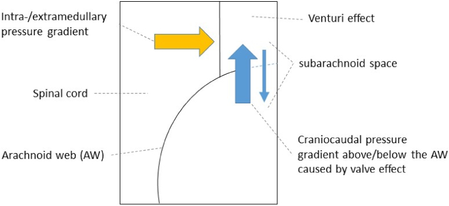
*Sơ đồ mặt cắt dọc ống sống. **Mũi tên xanh**: chênh áp trên/dưới dải màng do dòng CSF bị hạn chế, dải màng đóng vai **van một chiều** → CSF ứ một bên, tăng áp lên tủy. **Mũi tên vàng**: ứ CSF trong ống trung tâm → **syrinx**. **Venturi**: khoang dưới nhện hẹp lại làm tăng vận tốc dòng, tạo lực hút vào tủy (giả thuyết). Nguồn: Brain & Spine 2025 (PMC12337197), CC BY 4.0.*

### 1.3 Ngưỡng định lượng trụ cột

| Đại lượng | Con số | Nguồn |
|---|---|---|
| Vị trí | **Chỉ ngực**, ngực trên–giữa **T1–T8**; **T2–T3 hay nhất (50%)**; lõm tối đa **T3–T4** | PMC13147814; PMC12337197 |
| Giãn tủy đi kèm | **53%** (9/17) · **17%** (2/12) · 2/18 ca | PMC12337197; PMC13147814; PMC12951421 |
| Thời gian từ khởi phát đến chẩn đoán | **12,5 ± 10 tháng** (loạt 17 ca) · **14,3 ± 12,9 tháng** (loạt 12 ca, 4–51) | PMC12337197; PMC13147814 |
| Tuổi trung bình | **55,5 ± 10,3** · **61,1 ± 8,8** (50–80) · **54,7** | PMC12337197; PMC13147814; PMC12951421 |
| Triệu chứng | Rối loạn cảm giác **65%** · yếu chi dưới **59%** · thất điều **59%** · đau lưng **53%** · đau thần kinh **41%** · rối loạn cơ tròn **1/17 (6%)** | PMC12337197 |
| Tỉ lệ syrinx/tủy trên MRI | **0,70 ± 0,07** (0,54–0,88) — **≥ 0,5 là syrinx có ý nghĩa** trong loạt này | PMC12518900 |
| Mức xẹp syrinx sau mổ | **12,2% – 100%, trung bình 29,6%** (theo dõi 18–42 tháng) | PMC12518900 |
| Cải thiện sau mổ | **tJOA 8 ± 1,1 → 9,2 ± 1,3** (p < 0,02, n = 10); **8/10 cải thiện**, 1 không đổi, 1 xấu đi | PMC12337197 |
| Dấu scalpel mất trên phim sau mổ | **46,7% (7/15)** trong loạt 18 ca | PMC12951421 |
| Mổ lại | **2/12 (17%)**: 1 rò CSF, 1 cắt chưa hết | PMC13147814 |

## 2. Mẫu hình + chẩn đoán phân biệt theo vị trí (Gamut)

**Mẫu hình chốt:** *tủy ngực bị **đẩy ra TRƯỚC + lõm mặt lưng** tại một điểm, **khoang CSF phía sau giãn rộng**, **không có khối ngấm thuốc**, ± **syrinx ở/trên mức đó**; dải màng ngang thấy trên **3D-CISS / CT tủy**; bệnh nhân **50–60 tuổi, BMI cao, triệu chứng tủy ngực tiến triển 1 năm**.*

### 2.1 Gamut theo hướng tủy bị đẩy (câu hỏi số 1 khi đọc)

| Hướng tủy bị đẩy | Thực thể | Vì sao khác nhau |
|---|---|---|
| **Ra TRƯỚC, lõm LƯNG** | **Màng nhện lưng (SAW)**; **nang nhện lưng**; **giãn màng cứng (dural ectasia)** | Cả ba đẩy tủy ra trước; khác nhau ở **có/không vỏ nang** và **dải màng ngang** |
| **Ra SAU, lõm BỤNG** | **Thoát vị tủy ra trước (ventral cord herniation, VCH)** | Tủy **chui qua khuyết màng cứng mặt bụng** — tủy nằm **sát màng cứng trước**, mất khoang CSF trước |
| **Không đẩy, tủy to ra** | U nội tủy (ependymoma, astrocytoma), myelomalacia, **presyrinx** | Tổn thương **trong tủy**; ngấm thuốc là chốt |
| **Tủy bình thường, mạch bất thường** | **Rò động–tĩnh mạch màng cứng (dural AVF)** | Phù tủy + **flow void** màng cứng + giãn tĩnh mềm; **bỏ sót = liệt không hồi phục** |
| **Dính lan tỏa, không khu trú** | Viêm màng nhện dính (arachnoiditis) sau viêm/xuất huyết/mổ | Bó rễ dính thành chùm, màng dày lan tỏa, ngấm màng |

### 2.2 Mnemonic **SCALPEL** (đọc đúng dấu hiệu)

- **S** — **Sagittal T2**: đường viền tủy hình **lưỡi dao** — mặt lưng **lõm**, mặt bụng **lồi ra trước**.
- **C** — **CSF phía sau giãn rộng**: khoang tăng tín hiệu T2 **sau tủy rộng bất thường** so với trên/dưới.
- **A** — **Axial**: tủy **dẹt mặt lưng**, **không có khối** trong khoang dưới nhện.
- **L** — **Level**: **ngực trên–giữa (T2–T8)**; ngoài vùng này phải nghĩ chẩn đoán khác.
- **P** — **PC cine**: xung CSF **mất** ngay dưới chỗ lõm.
- **E** — **Effect, không mass**: bệnh phát hiện qua **hiệu ứng lên tủy**, bản thân màng thường **không thấy trên MRI 3 mm**.
- **L** — **Look again with CISS/CT myelography** khi MRI thường "không kết luận".

## 3. Bảng so sánh phân biệt (ma trận đối chiếu)

| Thực thể (entity) | Hình ảnh điển hình | Chốt vào (rule-in) | Chốt loại (rule-out) | Gợi ý xác nhận |
|---|---|---|---|---|
| **Màng nhện lưng (SAW)** | Lõm **mặt lưng** tủy ngực trên, **CSF sau giãn**, ± syrinx ở/trên mức, **không ngấm thuốc** | **Dấu scalpel + dải màng ngang trên 3D-CISS/CT tủy + xung CSF mất dưới chỗ lõm** | **Khối ngấm thuốc** trong tủy → u; **tủy chui ra trước sát màng cứng bụng** → VCH | 3D-CISS; PC cine; CT tủy |
| **Nang nhện lưng (dorsal arachnoid cyst)** | **Túi dịch hình vòm** chiếm khoang dưới nhện lưng, **hiệu ứng khối rõ**, có thể **kèm SAW** (cơ chế van) | **Vỏ nang rõ, hình vòm, đẩy tủy ra trước mạnh** | **Chỉ có dải màng mỏng, không túi dịch** → SAW | 3D-CISS; theo dõi tăng kích thước; mổ thấy vỏ nang |
| **Thoát vị tủy ra trước (VCH)** | Tủy **lệch ra TRƯỚC**, **mất khoang CSF trước tủy**, tủy **áp sát màng cứng bụng**, ± syrinx | **Tủy nằm trước, sát màng cứng, khoang trước mất** | **CSF dư phía SAU + lõm lưng** → SAW | 3D-CISS; CT tủy (thấy khuyết màng cứng bụng) |
| **Viêm màng nhện dính** | **Bó rễ dính chùm**, màng dày **lan tỏa nhiều tầng**, ngấm màng, ± nang | **Tiền sử viêm màng não/xuất huyết/mổ + dính lan tỏa + ngấm màng** | **Một dải ngang đơn độc, không viêm, không tiền sử** → SAW | MRI + gadolinium; mô bệnh |
| **U nội tủy (ependymoma/astrocytoma)** | Tủy **to ra**, **ngấm thuốc**, bờ không rõ, ± nang trong u | **Ngấm thuốc trong tủy + tủy to** | **Không ngấm, tủy dẹt chứ không to** → SAW | MRI + gadolinium; mô bệnh |
| **Rò động–tĩnh mạch màng cứng** | **Flow void** màng cứng lưng, tủy **phù tăng T2 dài**, giãn tĩnh mềm | **Flow void + phù tủy lan dài + tăng tín hiệu sau tiêm** | **Không flow void, tủy biến dạng khu trú** → SAW | MRA/CTA; DSA là chuẩn |
| **Giãn tủy sau chấn thương (bài 254)** | Syrinx **dưới mức chấn thương**, tủy teo, ± dính màng | **Tiền sử chấn thương tủy + syrinx dưới mức tổn thương** | **Không chấn thương + syrinx trên/ngang mức lõm lưng** → SAW | MRI; PC cine |
| **Giãn tủy vô căn (IS)** | Syrinx **không rõ nguyên nhân**, không lõm lưng rõ | **Loại trừ hết nguyên nhân khác** — nhưng **1,4% "vô căn" thật ra có màng ẩn** | **Có scalpel sign hoặc tắc dòng CSF** → không "vô căn" | CT tủy; PC cine; mổ thấy màng |

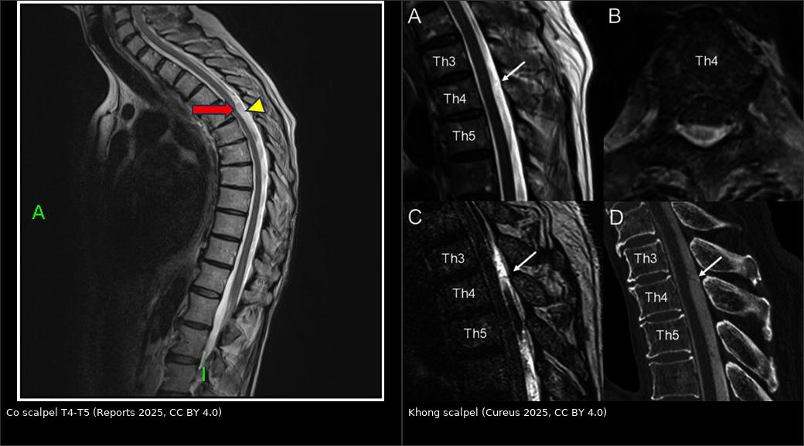
*Trái: T2W sagittal — lõm mặt lưng + CSF sau giãn rộng ở T4–T5 (mũi tên đỏ), khoang sau rộng (đầu mũi tên vàng) — dấu scalpel điển hình (Reports 2025, PMC12643434, CC BY 4.0). Phải: cùng mức T4 nhưng **không có dấu scalpel** trên T2 thường; chỉ T2 nặng (C) và CT tủy (D) mới thấy **cấu trúc dạng màng** sau tủy (Cureus 2025, PMC11911252, CC BY 4.0). Ảnh ghép letterbox, không crop.*

### 3.1 Ba dấu hiệu cần đọc kỹ

- **Dấu scalpel trên sagittal T2:** mô tả **"lưỡi dao phẫu thuật"** — nhưng đừng dừng ở mô tả: phải đo **chiều dài đoạn lõm (mm)**, ghi **mức đốt sống**, và so **bề rộng khoang CSF sau** với đoạn trên/dưới.
- **Dải màng trên 3D-CISS / T2 SPACE:** độ phân giải **0,9 mm** cho thấy **dải mỏng ngang** sau tủy (Reports 2025, PMC12643434; Cureus 2026, PMC13358518). Đây là **dấu trực tiếp**, còn scalpel là **dấu gián tiếp**.
- **PC cine CSF:** đặt ROI vuông góc ống sống ngay **trên và dưới** chỗ lõm; **mất xung** dưới chỗ lõm = tắc dòng (PMC12337197). Đây là bằng chứng **sinh lý**, giúp phân biệt với **tủy dẹt do tư thế**.

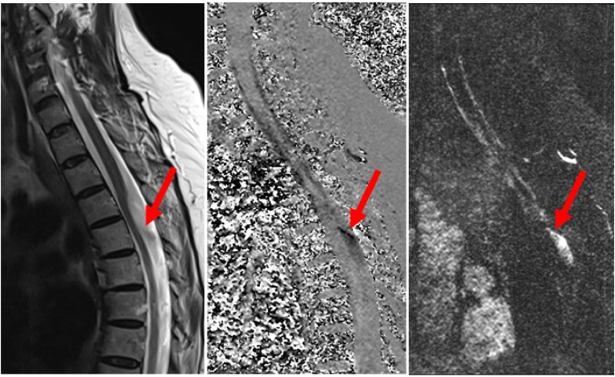
*MRI phase-contrast cine có cổng tim. **Xung CSF bị ngắt trong cả thì tâm thu và tâm trương** ở đoạn dưới chỗ lõm mặt lưng tủy — hình ảnh trực tiếp của tắc dòng do dải màng. Nguồn: Brain & Spine 2025 (PMC12337197), CC BY 4.0.*

## 4. Protocol chụp + hệ phân độ/điểm chuẩn hóa

### 4.1 Protocol theo tình huống

| Tình huống | Chuỗi bắt buộc | Mục đích |
|---|---|---|
| **Nghi tủy ngực (myelopathy) lần đầu** | **MRI toàn bộ tủy sống**: sagittal T2 **3 mm**, sagittal T1, **axial T2 tại mức tổn thương**; gadolinium nếu nghi u/viêm | Phát hiện lõm lưng + syrinx; **đừng chỉ chụp đoạn ngực** — syrinx có thể lên cổ |
| **MRI thường không kết luận** | **3D-CISS / T2 SPACE / FIESTA** lát **0,9 mm**, dựng lại sagittal + axial; hoặc **CT tủy cản quang** | Thấy **dải màng** trực tiếp; CT tủy là chuẩn khi MRI mơ hồ (PMC11911252) |
| **Xác nhận cơ chế trước mổ** | **PC cine CSF** (cổng tim) trên/dưới chỗ lõm | Chứng minh **tắc dòng**, tiên lượng đáp ứng cắt màng |
| **Trước mổ** | MRI **toàn bộ tủy** + 3D-CISS + **X-quang/fluoroscopy** đánh dấu mức | Chọn mức mở cung sau; tránh **cắt sót** (đã gặp: 1/12 ca mổ lại vì cắt chưa hết, PMC13147814) |
| **Sau mổ** | MRI **6–12 tuần** rồi **3–6 tháng**: vị trí tủy, syrinx, có dải còn lại | Syrinx xẹp **chậm** (12,2–100%, trung bình 29,6%, PMC12518900); đừng kết luận thất bại sớm |

### 4.2 Thang điểm thực hành

- **tJOA (thoracic Japanese Orthopaedic Association, 0–11):** điểm càng thấp càng nặng; loạt 17 ca **8 ± 1,1 → 9,2 ± 1,3** sau mổ. Dùng để **theo dõi tiến triển và đáp ứng**, không dùng để chọn mổ một mình.
- **Modified McCormick (I–V):** thang chức năng dùng trong loạt nội soi ống (12 ca, McCormick II–III trước mổ → **không ca nào xấu đi** sau mổ), PMC13147814.
- **Không có RADS/score riêng cho SAW** — quyết định dựa trên **triệu chứng tiến triển + hình ảnh chắc chắn**, không dựa vào kích thước.

### 4.3 Flowchart xử trí

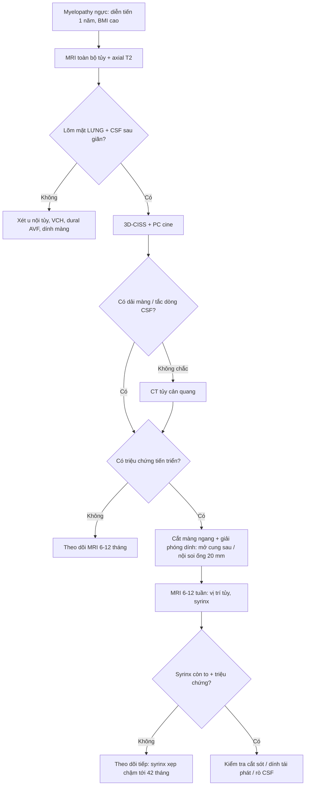

- **Chỉ định mổ:** **triệu chứng tủy tiến triển + hình ảnh chắc chắn**. Loạt 17 ca: **10/17 (59%) được mổ**, 7 ca theo dõi vì triệu chứng nhẹ/ổn định; nhóm không mổ **tJOA không đổi (9,2 → 9,1)** — theo dõi là lựa chọn hợp lý ở ca nhẹ (PMC12337197).
- **Kỹ thuật:** **mở cung sau + mở màng cứng + cắt dải màng và giải phóng dính** tới khi **thấy tủy đập và CSF lưu thông**. Loạt 12 ca dùng **ống nội soi 20 mm** (9 ca không giãn, 3 ca giãn): **110 ± 30 phút**, **nằm viện 4,9 ± 2,1 ngày**, **không biến chứng thần kinh vĩnh viễn**; **2 ca mổ lại** (1 rò CSF, 1 cắt sót) (PMC13147814).
- **Không đặt shunt syrinx ngay:** với SAW, **cắt màng là điều trị nguyên nhân**; shunt chỉ dành cho giãn tủy **tái phát/không hồi phục sau khi đã giải phóng dính** (Neurospine 2025, PMC12518900).

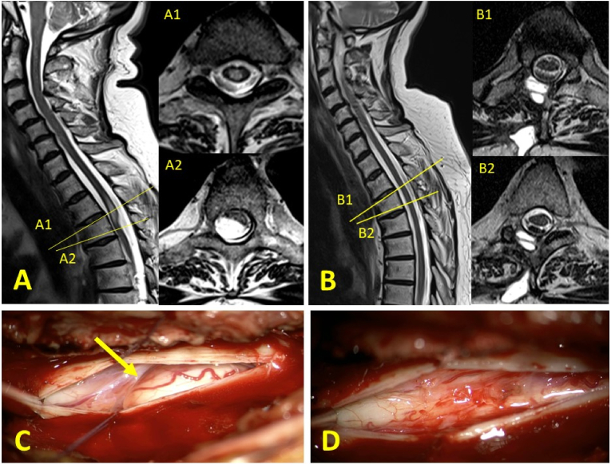
*Bệnh nhân trong loạt 17 ca. (A) Trước mổ: **dấu scalpel** — tủy đẩy ra trước, lõm mặt lưng; (A1, A2) axial tại mức tổn thương và mức lệch tối đa. (B) Sau mổ: **tủy về vị trí**, hết lõm. (C) Dải màng nhện căng ngang nhìn qua kính vi phẫu; (D) sau khi cắt. Nguồn: Brain & Spine 2025 (PMC12337197), CC BY 4.0.*

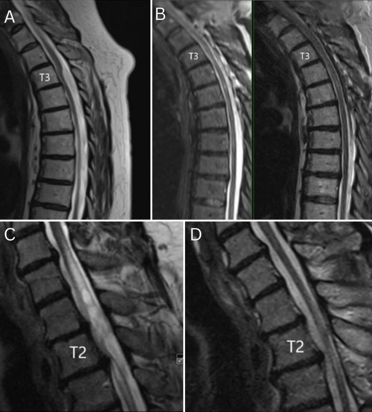
*(A, B) Bệnh nhân 12: **scalpel sign T3–4** trước mổ và **mất dấu** sau mổ. (C, D) Bệnh nhân 13: syrinx làm tủy giãn + chèn ép trước mổ, sau mổ **syrinx xẹp một phần** nhưng còn giãn ống trung tâm đoạn xa. Lưu ý: dấu scalpel **chỉ mất ở 46,7% (7/15)** ca trong loạt 18 ca — đừng lấy hình ảnh làm tiêu chí thành công duy nhất. Nguồn: J Neurosurg Case Lessons 2026 (PMC12951421), CC BY-NC-ND 4.0 (nguyên bản).*

## 5. Biến thể bình thường và cạm bẫy

### 5.1 Biến thể bình thường dễ đọc quá

- **Khoang dưới nhện lưng rộng ở đoạn cổ–ngực** là bình thường; chỉ gọi bệnh khi có **lõm tủy khu trú** hoặc **tắc dòng CSF**.
- **Tủy hơi dẹt mặt lưng do tư thế nằm ngửa** — kiểm tra lại bằng **axial** và **so sánh trên/dưới**; đừng chẩn đoán SAW chỉ trên một lát sagittal.
- **Giãn ống trung tâm nhỏ (central canal)** ở người trẻ là bình thường, **không phải syrinx**; trong loạt giãn tủy được mổ, **tỉ lệ syrinx/tủy lớn nhất là 0,70 ± 0,07 (0,54–0,88)** — dùng tỉ lệ này để mô tả **mức độ**, không phải để chẩn đoán một mình (PMC12518900).

### 5.2 Cạm bẫy (pitfall)

1. **"MRI thường bình thường nên không có gì"** — dải màng **1–2 mm** thường **không thấy** trên lát 3 mm; ca 77 tuổi chỉ chẩn đoán được nhờ **T2 nặng + CT tủy** (PMC11911252). Luôn nâng cấp kỹ thuật khi lâm sàng mạnh.
2. **"Không có scalpel sign = không phải màng nhện"** — SAI. Thể **diễn tiến cấp** có thể **chưa** hình thành dấu điển hình; tủy chỉ **biến dạng nhẹ** trên T2 thường (PMC11911252).
3. **Nhầm với u nội tủy** — nhiều ca được gửi đi với chẩn đoán **"u trong tủy"**, **"myelomalacia không rõ nguyên nhân"**, **"viêm tủy"**, **"dính tủy ra trước"** (PMC12337197). **Không ngấm thuốc + không làm tủy to** là chốt loại u.
4. **Nhầm với thoát vị tủy ra trước (VCH)** — **hướng lệch quyết định**: VCH tủy **ra trước sát màng cứng bụng, mất CSF trước**; SAW có **CSF sau dư + lõm lưng**. Nhầm → **đường mổ sai** (VCH cần vá màng cứng bụng, không phải cắt màng lưng).
5. **Dấu scalpel cũng gặp trong nang nhện lưng và VCH** — dấu hiệu **không đặc hiệu tuyệt đối**; phải tìm **dải màng** hoặc **vỏ nang** (Reports 2025, PMC12643434). SAW và nang nhện có thể **cùng tồn tại** do cơ chế van (J Neurosurg Case Lessons 2024, PMC11337934).
6. **Bỏ sót rò động–tĩnh mạch màng cứng** — bệnh cảnh **giống hệt** (myelopathy tiến triển, tủy tăng T2); luôn tìm **flow void** và **giãn tĩnh mềm** trên axial T2. Bỏ sót = liệt không hồi phục dù đã "điều trị giãn tủy".
7. **Cắt chưa hết** — 1/12 ca mổ lại sau **3 năm** vì dải màng còn; MRI **6–12 tuần** sau mổ là bắt buộc để phát hiện sớm (PMC13147814).
8. **Rò CSF sau mổ** — 1/12 ca (8%) có **tụ dịch dưới màng cứng**, tự hết sau vá rò; đóng màng cứng **kín, keo fibrin** ở người BMI cao (yếu tố nền của nhóm bệnh này).
9. **Xấu đi sau mổ do biến chứng nhỏ, không do bệnh** — 1 ca trong loạt 17 ca bị **xuất huyết dưới/ngoài màng cứng nhẹ** rồi **dính tủy + syrinx mới**; theo dõi sát 24–48 giờ đầu (PMC12337197).
10. **Kỳ vọng syrinx xẹp ngay** — xẹp **chậm và không hoàn toàn**: 12,2–100%, trung bình **29,6%** sau 18–42 tháng; **triệu chứng cải thiện trước hình ảnh** (PMC12518900).

## 6. Tự lượng giá — Blind Quiz

**Ca 1 — Nam 47 tuổi, đau ngực giữa tiến triển + tê bàn chân hai bên 6 tháng. Nhìn sagittal và axial T2 trước, mô tả trước.**

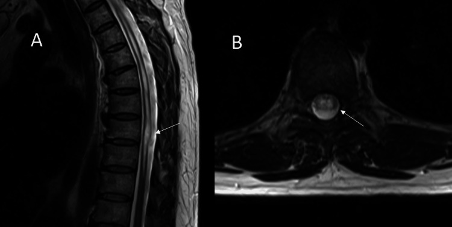

- Câu hỏi: Tủy bị đẩy về hướng nào? Có khối trong khoang dưới nhện không? Ba chẩn đoán phân biệt hàng đầu? Chuỗi nào để xác nhận?

<b>Bấm để hiện đáp án (findings + chẩn đoán)</b>

- **Dấu hiệu:** sagittal + axial T2 — **lõm mặt lưng tủy tại T8–T9**, tủy **dẹt mặt lưng**, **không có khối đặc hay nang** trong khoang dưới nhện; có **giãn tủy ngực** đi kèm.
- **Chẩn đoán:** **màng nhện lưng (SAW)** với **syrinx thứ phát** — dấu **scalpel** kinh điển.
- **Xác nhận:** **3D-CISS** cho thấy **dải màng ngang sau tủy** (ảnh dưới).
- **Điều trị:** **mở cung sau T8–T9 + mở màng cứng + cắt dải màng**; sau mổ **hết triệu chứng cảm giác trong 2 tuần**, syrinx **giảm dần** trên phim theo dõi.
- **Nguồn:** Cureus 2026 (PMC13358518), **CC BY 4.0**.

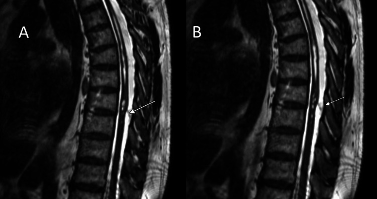

**Ca 2 — Nữ 57 tuổi, đau cổ–lưng mạn, yếu hai chân + dáng đi loạng choạng. MRI thường "không kết luận". Nhìn T2 sagittal.**

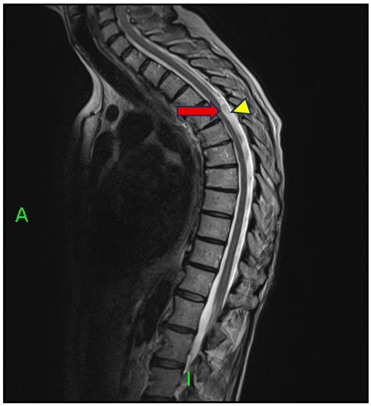

- Câu hỏi: Dấu hiệu nào gọi là "scalpel"? Vì sao MRI thường không kết luận? Nang hay màng? 3D-CISS thêm được gì?

<b>Bấm để hiện đáp án (findings + chẩn đoán)</b>

- **Dấu hiệu:** **lõm mặt lưng + đẩy tủy ra trước tại T4–T5** (mũi tên đỏ) + **khoang CSF sau giãn rộng** (đầu mũi tên vàng) → **dấu scalpel**; trên **3D-CISS** thấy thêm **đường viền hình vòm của nang nhện lưng** và dải màng.
- **Vì sao MRI thường mờ:** dải màng/vỏ nang **rất mỏng**, lát **3 mm** không đủ phân giải — phải dùng **3D-CISS 0,9 mm**.
- **Chẩn đoán:** **màng nhện lưng kèm nang nhện lưng** — dấu scalpel **không đặc hiệu tuyệt đối**, có thể gặp trong nang và trong thoát vị tủy ra trước.
- **Nguồn:** Reports 2025 (PMC12643434), **CC BY 4.0**.

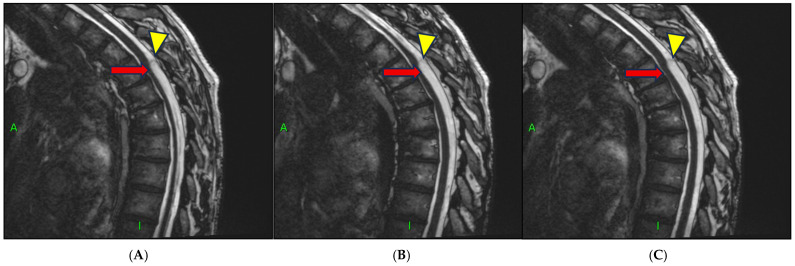

**Ca 3 — Nam 77 tuổi, yếu hai chân TIẾN TRIỂN NHANH trong vài tuần. Nhìn T2 thường trước.**

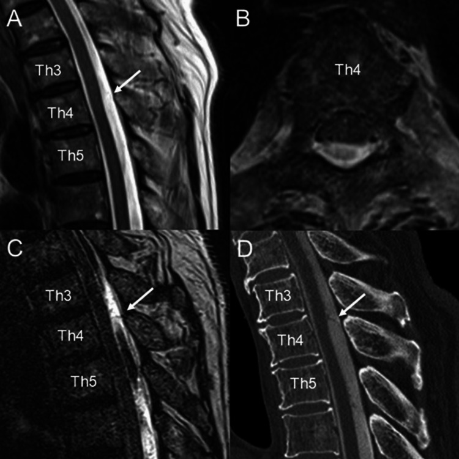

- Câu hỏi: Có dấu scalpel không? Nếu không, có loại trừ màng nhện lưng? Làm gì tiếp?

<b>Bấm để hiện đáp án (findings + chẩn đoán)</b>

- **Dấu hiệu:** (A, B) T2 sagittal + axial — **biến dạng lõm nhẹ mặt lưng tủy tại T4**, **không có dấu scalpel điển hình**; (C) **T2 nặng** và (D) **CT tủy cản quang** mới thấy **cấu trúc dạng màng** sau tủy.
- **Chẩn đoán:** **màng nhện lưng thể diễn tiến cấp** — bằng chứng **không có scalpel sign vẫn là SAW**.
- **Điều trị:** **cắt màng + mở cung sau**; sau mổ tủy **về vị trí**, hồi phục thần kinh đáng kể.
- **Bài học:** khi lâm sàng mạnh mà hình ảnh mờ → **nâng cấp kỹ thuật (T2 nặng/3D-CISS/CT tủy)**, không kết luận "không có gì".
- **Nguồn:** Cureus 2025 (PMC11911252), **CC BY 4.0**.

## Bài liên quan chéo
- [200 – Tổng quan hệ Thần kinh](../200-tong-quan-he-than-kinh/lesson.md)
- [254 – Giãn tủy sau chấn thương tủy sống](../254-gian-tuy-sau-chan-thuong-tuy-song/lesson.md) — syrinx **dưới mức chấn thương**, cơ chế dính màng
- [226 – Tủy mềm không chấn thương (SDAVF, nhồi máu tủy, NMO)](../226-tuy-mem-khong-chan-thuong-nhoi-mau-sdavf-nmo-xa/lesson.md) — myelopathy **khởi phát cấp**, không biến dạng tủy; hàng DDx bắt buộc
- [250 – Lao nội tủy & lao màng tủy](../250-lao-noi-tuy-va-lao-mang-tuy/lesson.md) — khối nội tủy **ngấm vòng**, khác hẳn
- [220 – Ống sống 3 khoang](../220-ong-song-tuy/lesson.md) — định khu **ngoài/trong màng cứng – nội tủy** trước khi gọi tên

## Ảnh
- Tên file: `255_*_Modality_SourceID.jpg`; nguồn + giấy phép từng ảnh trong `images/CREDITS.md`.
- `images/composite_scalpel-vs-khong-scalpel.jpg` — ảnh ghép **chỉ từ nguồn CC BY 4.0** (PMC12643434 + PMC11911252), letterbox bằng `tools/make_composite.py`.
- Ảnh **CC BY-NC-ND** (PMC12951421) dùng **nguyên bản**, không đưa vào composite, không crop.

> Không dùng để chẩn đoán độc lập khi chưa có người hướng dẫn.
