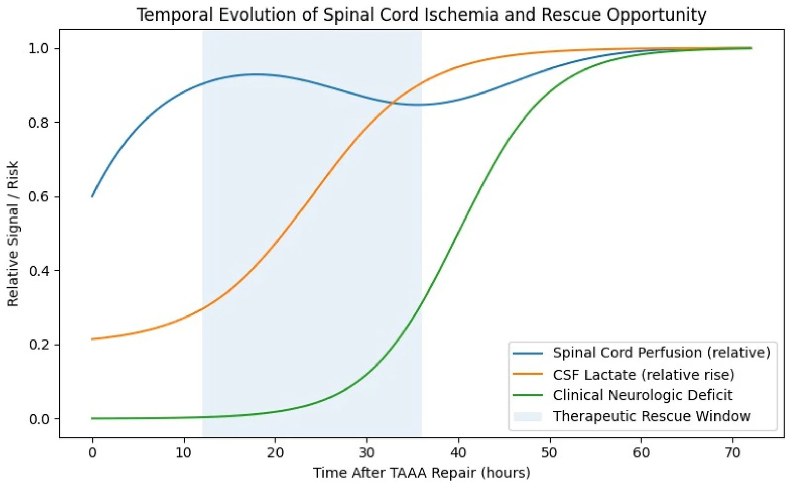
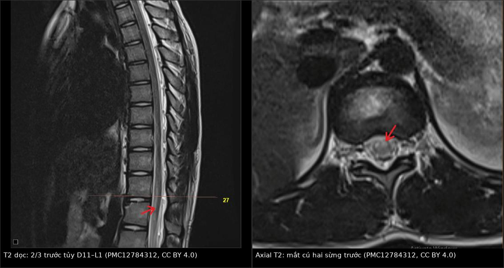
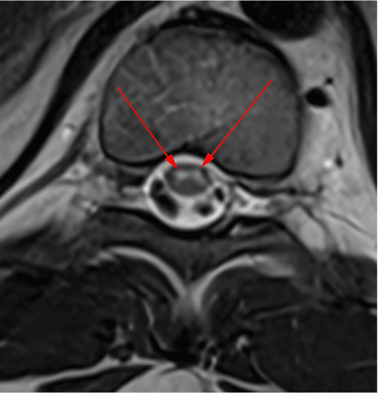
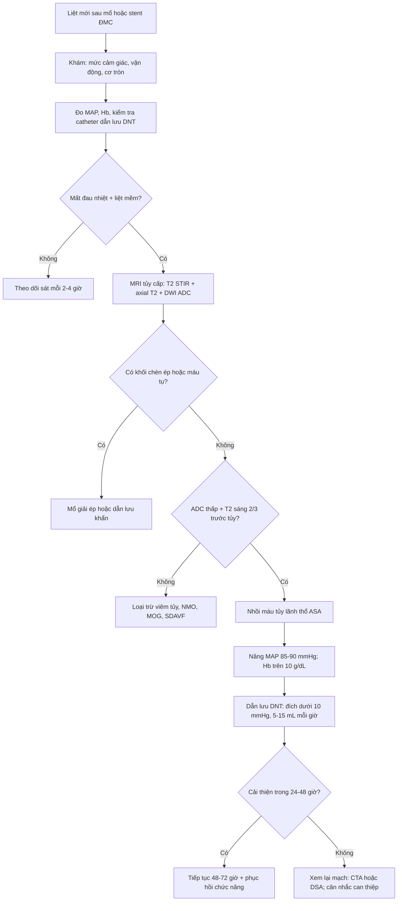
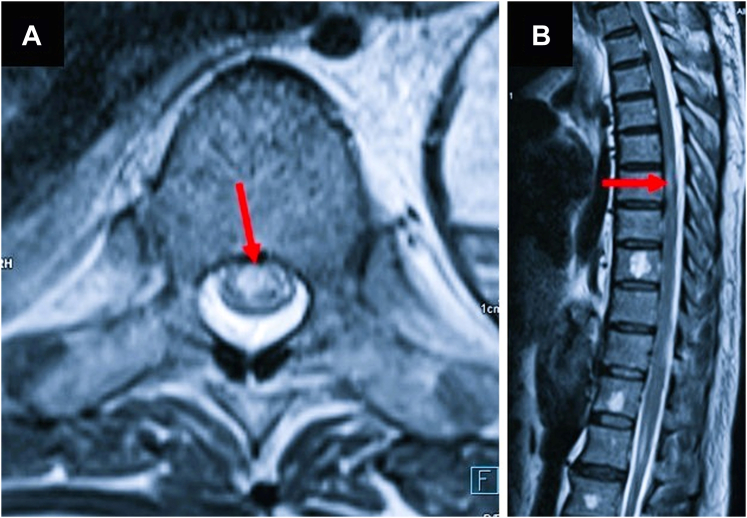
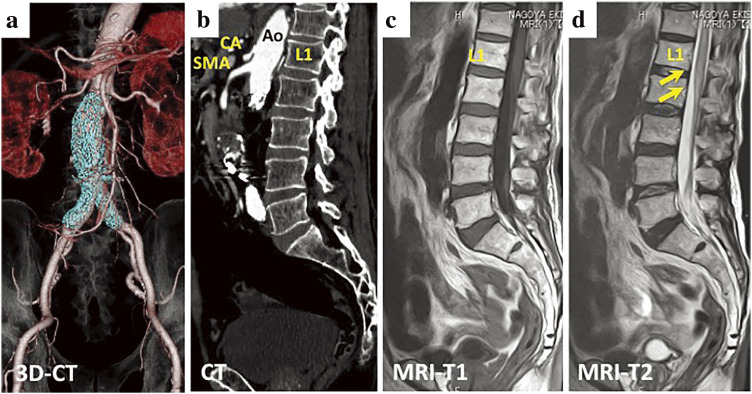
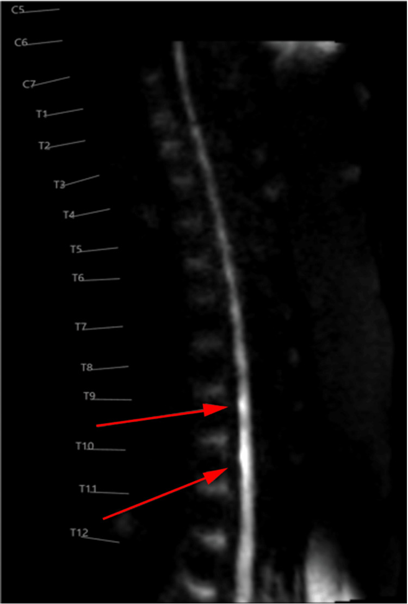

# 256 — Nhồi máu tủy sau phẫu thuật/đặt stent động mạch chủ: động mạch Adamkiewicz & dấu "mắt cú"

**Tags:** `pattern:nhoi-mau-tuy` `pattern:owl-eye` `pattern:han-che-khuech-tan` `pattern:tuoi-mau-doc-truc` `pattern:lien-tuy-chien` `vung:tuy-nguc` `vung:tuy-that-lung` `protocol:MRI-tuy-DWI` `protocol:CTA-dong-mach-chu` `score:ASIA` `score:Crawford` `score:mRS`

**Mức chắc chắn (certainty):** tổng hợp y văn (literature synthesis) — 1 tổng quan thuật toán (*Neurol Int* 2026, PMC13516104), 1 tổng quan hệ thống (umbrella review, *Brain Sci* 2025, PMC12025544), 1 nghiên cứu giải phẫu 102 tử thi + 101 chụp mạch (PMC13002190), 1 phân tích gộp chẩn đoán/tiên lượng (PMC11450783), 2 ca nguyên văn sau can thiệp ĐMC có ảnh (PMC12539470; PMC11444833) và 2 ca nguyên văn có ảnh DWI/T2 (PMC12784312; PMC12915697). Không có thử nghiệm ngẫu nhiên; mọi ngưỡng xử trí là tổng hợp thực hành, chỗ suy luận được ghi rõ.

> **Câu chốt:** nhồi máu tủy sau mổ/đặt stent ĐMC là **biến chứng của "cắt máu nuôi" chứ không phải của gây mê**: động mạch Adamkiewicz (artery of Adamkiewicz, AKA) cấp máu cho **2/3 trước tủy**, nằm **bên trái 74%**, hay xuất phát **T9** (rồi T10, L1), đường kính chỉ **0,75–0,88 mm**. Ba câu để không bỏ sót: **(1)** liệt mềm + **mất cảm giác đau/nhiệt** dưới một mức, **giữ cảm giác sâu** = lãnh thổ **động mạch tủy trước**; **(2)** **DWI hạn chế + ADC thấp** là dấu **sớm nhất**, T2 có thể **bình thường trong giờ đầu**; **(3)** axial **hai chấm sáng ở sừng trước ("owl's eyes")** rất gợi ý nhưng **không đặc hiệu** — phải loại **máu tụ ngoài/trong màng cứng sau dẫn lưu DNT** trước khi tăng dẫn lưu.

## 1. Tổng quan bệnh học – cơ chế hình ảnh (TẠI SAO)

### 1.1 Giải phẫu: một "ống tưới" hẹp, phụ thuộc vài nhánh

- **Động mạch tủy trước (anterior spinal artery, ASA)** chạy dọc mặt trước tủy, cấp máu **2/3 trước** (sừng trước, bó tháp, bó gai–đồi thị); **động mạch tủy sau (posterior spinal artery, PSA)** cấp **1/3 sau** (bó sau, cảm giác sâu). ASA **mảnh** và chỉ được **tăng cường** bởi các **động mạch tủy–rễ trước (anterior radiculomedullary arteries, ARM)** xuất phát từ **động mạch liên sườn/thắt lưng** — nhánh của ĐMC (PMC13516104).
- **AKA** là ARM lớn nhất vùng ngực–thắt lưng, có **quai kẹp tóc (hairpin)** trước khi nối ASA. Nghiên cứu **102 tử thi + 101 chụp mạch**: AKA **bên trái 75/102 (74%)**; hay nhất **T9 (20/102)**, rồi **T10 (20)** và **L1 (19)**; trên chụp mạch **T9 25/99 (25,3%)**, **T10 22/99 (22,2%)**; đường kính **0,75 ± 0,3 mm** tại màng cứng và **0,88 ± 0,1 mm** tại chỗ nối ASA; góc quai **110,8° ± 45°** (PMC13002190).
- **Vì sao vùng ngực–thắt lưng dễ tổn thương:** đây là **vùng chuyển tiếp** giữa nguồn cấp cổ–ngực trên và nguồn cấp thắt lưng; **ASA mảnh** (đường kính **0,51 mm** đoạn trên chỗ nối, **0,64 mm** đoạn dưới) nên **một nhánh bị che/tắc** là đủ gây thiếu máu lan rộng (PMC13002190). Vùng **watershed** giữa các nhánh **sulcal** và **bờ** là nơi **nhạy nhất** với tụt huyết áp.

### 1.2 Cơ chế sau mổ/đặt stent ĐMC

- **Mổ hở:** **kẹp ĐMC** làm giảm tưới máu tủy; **cắt/tái tạo các động mạch liên sườn–thắt lưng** làm mất nhánh nuôi; **tụt huyết áp** và **thiếu máu** làm nặng thêm (PMC13516104).
- **Nội mạch (TEVAR/EVAR/FEVAR):** **che lỗ các động mạch liên sườn** (đặc biệt khi vùng hạ cánh dài), **bong mảng xơ vữa** do dây/dụng cụ, **huyết khối từ túi phình**, và **tụt huyết áp** chu phẫu (PMC13516104; PMC12539470).
- **Hai pha:** pha **giảm tưới máu** (có thể hồi phục nếu sửa ngay) → pha **thứ phát** với **phù tủy, rối loạn vi mạch, phá vỡ hàng rào máu–tủy, cytokine/oxy hóa** (PMC13516104). Vì vậy **cửa sổ cứu** không chỉ trong phòng mổ: **24–72 giờ đầu** vẫn có thể xuất hiện **liệt muộn**.
- **Vì sao EVAR dưới thận vẫn gây nhồi máu:** dù stent nằm **dưới động mạch thận**, việc **bít động mạch mạc treo tràng dưới (IMA)** và **các động mạch thắt lưng** làm mất **tuần hoàn bàng hệ** cấp cho đoạn tủy dưới; nếu AKA xuất phát **cao (L1/L2)** hoặc bàng hệ kém → thiếu máu (PMC11444833).

### 1.3 TẠI SAO nhìn thấy trên MRI: phù độc tế bào → DWI trước, T2 sau

- **Thiếu máu → mất ATP → bơm Na⁺/K⁺ hỏng → nước vào tế bào (phù độc tế bào)** → **nước bị hạn chế khuếch tán** → **DWI sáng, ADC thấp**. Dấu này xuất hiện **sớm**, trước khi T2 đủ sáng để thấy.
- **T2 tăng tín hiệu** khi **nước ngoại bào/tự do** tăng (phù vận mạch, hoại tử) — thường **muộn hơn DWI**; vì vậy **MRI sớm có thể âm** (PMC11450783).
- **Phân bố "2/3 trước":** tổn thương **tăng T2 hình bút chì** ở **phần trước tủy** trên sagittal, **giữ nguyên** cột sau (PSA) — dấu **rất gợi ý** lãnh thổ ASA.
- **"Owl's eyes" (mắt cú):** trên axial, **hai chấm sáng đối xứng ở sừng trước** — vì **sừng trước** là **chất xám vận động**, chuyển hóa cao, nằm trong vùng **nhánh sulcal** tận cùng của ASA; tổn thương **hai bên** tạo hình **hai mắt**. Tần suất: **39,6% ở cổ**, **22,9% ở ngực** (p = 0,031) (PMC11450783).

*Sơ đồ khái niệm: tưới máu tủy giảm → **lactate DNT tăng** → **triệu chứng thần kinh** xuất hiện muộn hơn; vùng xanh là **cửa sổ cứu** (theo mô hình của tác giả, trục tung là tín hiệu **tương đối**, không phải giá trị tuyệt đối). Nguồn: *Neurol Int* 2026 (PMC13516104), CC BY 4.0.*

### 1.4 Ngưỡng định lượng trụ cột

| Đại lượng | Con số | Nguồn |
|---|---|---|
| Nhồi máu tủy nói chung | **0,3–1%** đột quỵ; **6%** myelopathy cấp; **3,1/100.000 người–năm** (quần thể) | PMC11450783; PMC13653364 |
| Sau mổ ĐMC hở / nội mạch | **~10% / ~3,5%**; **7,4% vs 13,5%** (TAAA); tổn thương **vĩnh viễn 3,3%** (4% mổ hở, 2,9% nội mạch) | PMC12025544 |
| Theo Crawford (vĩnh viễn) | **I 3,8% · II 13,4% · III 7,1% · IV 2,3% · V 6,7%** | PMC12025544 |
| TEVAR | **vĩnh viễn 2,0%** (22 nghiên cứu/1.479 ca); **tạm thời 1,0%** (24 nghiên cứu/2.048 ca) | PMC12025544 |
| EVAR dưới thận | **0,21–0,64%**; mổ hở AAA **0,1–1,4%** | PMC11444833 |
| Liệt muộn | **1–12%**; thường trong **24–72 giờ** | PMC12025544; PMC13516104 |
| Đáp ứng theo bậc | Chia **2 thì**: SCI **9% vs 18%** (p = 0,02) | PMC12025544 |
| Thời gian tới đỉnh triệu chứng | **< 6 giờ: 56,1%**; 6–12 giờ: 30,7%; 12–72 giờ: 5,4%; > 72 giờ: 7,8% | PMC11450783 |
| DWI ở giai đoạn tối cấp | **AUC 0,835** cho phát hiện T2 tăng tín hiệu khi đỉnh < 6 giờ | PMC11450783 |
| Kết cục | **mRS 3 (2–3) lúc nhập → 1 (1–2) sau 12 tháng**; **68,9%** điều trị nội + PHCN, **22,8%** mổ giải ép | PMC11450783 |
| Giải phẫu AKA | **Trái 74%**; **T9 20/102**, **T10 20**, **L1 19**; **0,75 ± 0,3 mm** tại màng cứng, **0,88 ± 0,1 mm** tại ASA | PMC13002190 |
| Dẫn lưu DNT dự phòng | **NNT 10** (giảm 10% nguy cơ liệt); đích **< 10 mmHg** | PMC12025544 |
| Tốc độ dẫn lưu | **5–15 mL/giờ**, tối đa **20 mL/giờ** trong mổ; sau mổ **≤ 10 mL/giờ** | PMC12025544 |
| Biến chứng dẫn lưu DNT | Chung **13,6%**; nặng **1,95%**; tử vong tới **1,4–1,9%** | PMC12025544 |

## 2. Mẫu hình + chẩn đoán phân biệt theo vị trí (Gamut)

**Mẫu hình chốt:** *bệnh nhân vừa mổ/đặt stent ĐMC, **thức dậy hoặc trong 24–72 giờ** có **liệt mềm hai chân**, **mất cảm giác đau/nhiệt** dưới một mức, **giữ cảm giác sâu**, **rối loạn cơ tròn**; MRI có **T2 tăng 2/3 trước tủy** ± **DWI hạn chế** ± **owl's eyes**; đã loại trừ **máu tụ/chèn ép**.*

### 2.1 Gamut theo vùng tủy

| Vùng tổn thương | Thực thể | Vì sao khác nhau |
|---|---|---|
| **2/3 trước, dọc dài** | **Nhồi máu ASA sau mổ ĐMC**; **xơ vữa/emboli từ ĐMC**; **FCE**; **hạ huyết áp** | Mất vận động + đau/nhiệt, **giữ cảm giác sâu**; DWI hạn chế |
| **1/3 sau** | **Nhồi máu PSA** (hiếm) | Mất **cảm giác sâu/rung**, đau/nhiệt còn; thường do **nhánh sau** |
| **Trung tâm, dọc dài** | **NMO/MOGAD**, **viêm tủy ngang**, **SDAVF** | Không theo lãnh thổ mạch; **NMO-IgG/MOG-IgG**, dịch não tủy, flow void |
| **Ngoài tủy, chèn ép** | **Máu tụ ngoài/trong màng cứng sau dẫn lưu DNT**, **áp-xe**, **di lệch dụng cụ** | Có **hiệu ứng khối**, màng cứng căng; **mổ/dẫn lưu cấp** |
| **Chất xám sừng trước hai bên** | **Nhồi máu ASA**, **FCE**, **surfer's myelopathy** | **Owl's eyes** — không đặc hiệu cho một nguyên nhân |
| **Tủy teo, tín hiệu mạn** | **Myelomalacia** sau chấn thương/nhồi máu cũ | Không hạn chế khuếch tán; teo + tăng T2 |

### 2.2 Mnemonic **CORD** (đọc ca liệt sau mổ ĐMC)

- **C** — **Cấp**: liệt mềm, mất cảm giác đau/nhiệt, **giữ cảm giác sâu** → lãnh thổ ASA.
- **O** — **Owl's eyes**: hai chấm sáng sừng trước trên axial T2 = chất xám chịu thiếu máu.
- **R** — **Restricted diffusion**: DWI sáng/ADC thấp, có thể **dương trước T2**.
- **D** — **Drain/compression**: luôn loại **máu tụ sau dẫn lưu DNT** và **chèn ép** trước khi kết luận "nhồi máu".

## 3. Bảng so sánh phân biệt (ma trận đối chiếu)

| Thực thể (entity) | Hình ảnh điển hình | Chốt vào (rule-in) | Chốt loại (rule-out) | Gợi ý xác nhận |
|---|---|---|---|---|
| **Nhồi máu tủy sau mổ ĐMC** | **T2 tăng 2/3 trước tủy** theo trục dọc, **DWI hạn chế/ADC thấp**, ± **owl's eyes**; không hiệu ứng khối | **Mới mổ/stent ĐMC + liệt mềm cấp + DWI hạn chế đúng lãnh thổ ASA** | **Có khối/máu tụ chèn ép, tủy bị đẩy** → không phải nguyên nhân chính | MRI tủy + DWI/ADC; CTA ĐMC |
| **Máu tụ ngoài/trong màng cứng sau dẫn lưu DNT** | **Khối hình thấu kính/bầu dục** trong ống sống, **chèn ép tủy**, tín hiệu máu theo tuổi | **Đau lưng cấp sau đặt catheter + yếu chi + MRI có khối** | **Không khối, tủy không bị đẩy** → nghĩ nhồi máu | MRI cấp/CT tủy; mổ giải ép |
| **Chèn ép do dụng cụ/di lệch** | **Dụng cụ/đĩa/mảnh xương** chèn vào ống sống, tủy biến dạng | **Thấy điểm chèn ép + phù tủy khu trú** | **Tổn thương đối xứng 2/3 trước, không chèn ép** → nhồi máu | CT xoay dụng cụ; MRI |
| **Rò động–tĩnh mạch màng cứng (SDAVF)** | **Phù tủy lan dài**, **flow void** mặt lưng, giãn tĩnh mềm, ngấm màng | **Flow void + phù lan + tiến triển nhiều tuần** | **Khởi phát cấp sau mổ + DWI hạn chế** → nhồi máu | MRA/CTA; DSA |
| **NMO/MOGAD** | **Tổn thương trung tâm, dọc ≥ 3 đốt**, có thể **owl's eyes**, ngấm thuốc | **NMO-IgG/MOG-IgG dương + viêm dây thần kinh thị + dọc dài** | **Không kháng thể, đúng lãnh thổ mạch, DWI rõ** → nhồi máu | Xét nghiệm huyết thanh/DNT; MRI sọ |
| **Viêm tủy ngang** | **T2 tăng trung tâm/lan**, phù, ngấm thuốc; **dịch não tủy tăng tế bào/protein** | **Dịch não tủy viêm + khởi phát bán cấp** | **Dịch não tủy bình thường + DWI hạn chế** → nhồi máu | Chọc dò; MRI; PCR |
| **FCE (fibrocartilaginous embolism)** | **Owl's eyes** + T2 trước tủy sau **gắng sức/chấn thương nhẹ** | **Tiền sử gắng sức + đau lưng đột ngột + hình ảnh ASA** | **Có bệnh ĐMC/mổ ĐMC + tụt HA** → nghĩ nhồi máu do mổ | MRI; loại trừ nguyên nhân khác |
| **Thiếu máu vùng watershed do tụt HA** | **Tổn thương đối xứng vùng chuyển tiếp**, có thể nhiều ổ | **Tụt HA kéo dài + tổn thương đối xứng** | **Một vùng lãnh thổ ASA rõ + mạch bị che** → nhồi máu do mạch | Theo dõi HA; MRI lặp |

*Trái: **T2 sagittal** — tăng tín hiệu **2/3 trước tủy từ D11 đến L1** (mũi tên đỏ). Phải: **axial T2** cùng bệnh nhân — **hai chấm sáng ở sừng trước** ("owl's eyes", mũi tên đỏ), cột sau còn tối. Nguồn: *Cureus* 2025 (PMC12784312), CC BY 4.0. Ảnh ghép letterbox, không crop.*

### 3.1 Ba dấu hiệu cần đọc kỹ

- **DWI/ADC:** đặt ROI ở **tủy lành trên/dưới** và **vùng tổn thương**; **ADC thấp hơn** tủy lành + **DWI sáng** = hạn chế khuếch tán thật. **Không** dựa vào DWI một mình nếu ảnh **nhiễu do chuyển động/dị vật kim loại**.
- **T2 axial "owl's eyes":** hai chấm sáng **đối xứng** ở **sừng trước**, **không** lan ra cột sau; nếu tổn thương **tròn, trung tâm, lan toàn bộ** → nghĩ **viêm tủy/NMO**, không phải nhồi máu.
- **Sagittal "pencil-like":** đo **số đốt bị ảnh hưởng** và **mức trên–dưới**; ghi **mức đốt** (D11–L1, T8–T12...) để đối chiếu **vùng phủ stent** và **mức AKA**.

*Axial T2 tủy ngực: **hai ổ tăng tín hiệu đối xứng ở sừng trước** (mũi tên đỏ) — "owl's eyes". Dấu này **gợi ý** nhồi máu ASA nhưng cũng gặp trong **FCE**, **surfer's myelopathy**, và một số thể **viêm tủy**. Nguồn: *Cureus* 2026 (PMC12915697), CC BY 4.0.*

## 4. Protocol chụp + hệ phân độ/điểm chuẩn hóa

### 4.1 Protocol theo tình huống

| Tình huống | Chuỗi bắt buộc | Mục đích |
|---|---|---|
| **Liệt mới sau mổ/stent ĐMC** | **MRI toàn bộ tủy cấp**: sagittal **T2 + STIR**, **axial T2** tại mức tổn thương, **DWI (b = 1.000) + ADC**, T1 ± gadolinium | Xác định **lãnh thổ ASA**, **hạn chế khuếch tán**, loại **chèn ép/máu tụ** |
| **MRI âm nhưng nghi cao** | **Lặp MRI sau 24–48 giờ**; **CT tủy** nếu không chụp MRI được | T2 có thể **âm sớm**; DWI nhạy hơn nhưng **không hoàn hảo** (AUC **0,835** < 6 giờ) |
| **Chưa có CTA ĐMC** | **CTA ngực–bụng–chậu**: đánh giá **vùng phủ stent**, **động mạch liên sườn/thắt lưng**, **AKA** nếu thấy | Tìm **mạch bị che/tắc**, **bóc tách**, **huyết khối**, **emboli** |
| **Trước mổ TAAA nguy cơ cao** | **CTA/MRA xác định AKA** (thường **T9–T12 bên trái**), đánh giá **tuần hoàn bàng hệ** | Lập kế hoạch **tái tạo nhánh**, **stent có cửa sổ**, **chia thì** |
| **Theo dõi hậu phẫu** | Khám thần kinh **mỗi 2–4 giờ** trong **48–72 giờ**; **MEP/SSEP** trong mổ; **NIRS/lactate DNT** chỉ nghiên cứu | Phát hiện **liệt muộn** trong cửa sổ cứu |

### 4.2 Hệ phân độ/điểm thực hành

- **Crawford I–V** cho **TAAA**: nguy cơ **tổn thương vĩnh viễn** tăng theo độ rộng: **I 3,8%, II 13,4%, III 7,1%, IV 2,3%, V 6,7%** (PMC12025544). Dùng để **tư vấn trước mổ** và **chọn mức độ theo dõi**.
- **ASIA Impairment Scale (A–E):** phân độ **vận động/cảm giác** sau tổn thương tủy; **ASIA A** = mất hoàn toàn vận động và cảm giác dưới mức. Dùng để **theo dõi hồi phục**, không dùng để chọn can thiệp.
- **mRS:** kết cục chức năng; phân tích gộp cho thấy **mRS 3 → 1** sau **12 tháng** ở nhồi máu tủy nói chung (PMC11450783) — **đừng tiên lượng tử vong/không hồi phục ngay**.
- **Không có RADS riêng cho nhồi máu tủy.**

### 4.3 Flowchart xử trí

- **Mục tiêu huyết động:** **MAP 80–90 mmHg** (nhiều chương trình **85–90 mmHg trong 48–72 giờ đầu**); **Hb > 10 g/dL**; tránh **hạ huyết áp** và **thuốc hạ áp** (PMC12025544; PMC13516104).
- **Dẫn lưu DNT:** dự phòng đích **< 10 mmHg**; **5–15 mL/giờ**, tối đa **20 mL/giờ** trong mổ, **≤ 10 mL/giờ** sau mổ; **NNT 10** cho mổ hở (PMC12025544). **Không dẫn lưu mù** khi chưa loại **máu tụ**.
- **Cứu nguy:** tăng MAP + dẫn lưu DNT + ngừng thuốc hạ áp; **steroid/naloxone/edaravone** được dùng trong ca nguyên văn nhưng **không có bằng chứng mạnh**, không thay thế **tái tưới máu/tăng áp lực tưới** (PMC11444833).

*Bệnh nhân 58 tuổi sau TEVAR đoạn ngực T6–T12: (A) axial T2 — **tăng tín hiệu sừng trước hai bên**; (B) sagittal T2 — **tăng tín hiệu tủy ngực giữa**. Dẫn lưu DNT bắt đầu trong 24 giờ, đích **< 10 mmHg**, tốc độ **15 mL/giờ** trong **48 giờ**; **MAP ~100 mmHg**, **Hb > 10 g/dL**; sau 3 tháng đi lại có hỗ trợ. Nguồn: *JACC Case Rep* 2025 (PMC12539470), CC BY-NC-ND 4.0 (nguyên bản).*

## 5. Biến thể bình thường và cạm bẫy

### 5.1 Biến thể/dấu hiệu dễ đọc quá

- **Tăng tín hiệu nhẹ trung tâm do hiệu ứng thể tích** từ dịch não tủy/dây thần kinh — so **axial** và **ADC**, không chẩn đoán trên một lát sagittal.
- **Giãn ống trung tâm nhỏ** ở người trẻ là bình thường, **không hạn chế khuếch tán**.
- **Owl's eyes** có thể gặp trong **FCE** và **surfer's myelopathy** — hình ảnh **không cho nguyên nhân**, bối cảnh quyết định.

### 5.2 Cạm bẫy (pitfall)

1. **"MRI sớm bình thường = không nhồi máu"** — SAI. T2 có thể **âm trong giờ đầu**; DWI **AUC 0,835** ở < 6 giờ (PMC11450783). Nghi cao → **lặp MRI 24–48 giờ**.
2. **Tăng dẫn lưu DNT khi chưa loại máu tụ** — máu tụ ngoài/trong màng cứng sau đặt catheter có thể **gây liệt giống hệt**; tăng dẫn lưu làm **nặng thêm**. Luôn **MRI/CT cấp** trước.
3. **Nhầm với viêm tủy/NMO** — tổn thương **trung tâm, dọc ≥ 3 đốt, ngấm thuốc**; **NMO-IgG/MOG-IgG** và dịch não tủy giúp phân biệt (PMC12915697).
4. **Bỏ sót liệt muộn** — bệnh nhân **ổn định khi thức dậy** rồi **yếu dần trong 24–72 giờ**; khám thần kinh **mỗi 2–4 giờ** trong 48–72 giờ (PMC13516104).
5. **Cho rằng EVAR dưới thận "không thể" gây nhồi máu** — vẫn có, **0,21–0,64%**; bít IMA/động mạch thắt lưng + AKA cao/bàng hệ kém (PMC11444833).
6. **Quy tội cho gây mê/tụt HA đơn thuần** — tụt HA là **yếu tố làm nặng**, nhưng **che nhánh/emboli** là cơ chế chính; CTA ĐMC giúp xác định.
7. **Không đánh giá AKA trước mổ mở rộng** — AKA **trái 74%**, **T9–T10** hay gặp; vùng phủ dài mà không tái tạo nhánh → nguy cơ cao (PMC13002190).
8. **Dẫn lưu DNT quá tay** — biến chứng **13,6%**, nặng **1,95%**, tử vong **1,4–1,9%**; theo dõi **đau đầu, tri giác, chảy máu** (PMC12025544).
9. **Kết luận tiên lượng ngay** — **mRS 3 → 1 sau 12 tháng**; nhiều ca hồi phục một phần dù liệt hoàn toàn ban đầu (PMC11450783; PMC12539470).
10. **Bỏ sót tổn thương đôi**: **FCE + bóc tách động mạch liên sườn** cùng lúc — nếu hình ảnh không giải thích hết, **chụp mạch** (PMC12784312).

## 6. Tự lượng giá — Blind Quiz

**Ca 1 — Nam 58 tuổi, TEVAR đoạn ngực T6–T12 vì phình 6,7 cm; thức dậy liệt hai chân, mất cơ tròn. Nhìn axial và sagittal T2 trước.**

- Hỏi: tổn thương ở đâu? Lãnh thổ nào? Ba việc phải làm ngay?

<b>Bấm để hiện đáp án (findings + chẩn đoán)</b>

- **Dấu hiệu:** (A) axial T2 — **tăng tín hiệu hai bên sừng trước**; (B) sagittal — **tăng tín hiệu tủy ngực giữa**; hình ảnh **lãnh thổ động mạch tủy trước**.
- **Chẩn đoán:** **nhồi máu tủy sau TEVAR** (che động mạch liên sườn + tụt tưới máu).
- **Xử trí trong ca:** **dẫn lưu DNT** ngay (áp lực ban đầu **22 mmHg**, đích **< 10 mmHg**, **15 mL/giờ** trong **48 giờ**), **MAP ~100 mmHg**, **Hb > 10 g/dL**, kháng kết tập tiểu cầu đôi + phục hồi chức năng.
- **Kết cục:** 4 tuần sức cơ **2/5**; 3 tháng **3/5**; 6 tháng **đi lại có hỗ trợ**, còn rối loạn cơ tròn.
- **Nguồn:** *JACC Case Rep* 2025 (PMC12539470), **CC BY-NC-ND 4.0**.

**Ca 2 — Nam 81 tuổi, EVAR cho phình ĐMC bụng 62 mm; ngay sau mổ/rút ống nội khí quản liệt hai chân + mất cảm giác đau/nhiệt. Nhìn CT và MRI trước.**

- Hỏi: stent nằm dưới động mạch thận, vì sao vẫn nhồi máu? MRI thấy gì? Điều trị?

<b>Bấm để hiện đáp án (findings + chẩn đoán)</b>

- **Dấu hiệu:** (a) CT: stent-graft đặt **dưới L2**, lòng mạch thông, **không endoleak**; (b) MRI: **tăng tín hiệu T2 tủy thắt lưng dưới L1** — tổn thương **phần xa tủy/nón tủy**.
- **Vì sao:** **bít IMA + động mạch thắt lưng** làm mất bàng hệ; **AKA không thấy rõ** trên CT trước/sau; AKA xuất phát **L1/L2** ở một số người → thiếu máu đoạn xa.
- **Điều trị:** **dẫn lưu DNT 3–10 cmH₂O** bắt đầu **62 phút** sau mổ, **MAP ≥ 80 mmHg**, methylprednisolone/naloxone/edaravone; hồi phục **một phần gối phải**, **chân trái và cơ tròn không hồi phục**.
- **Bài học:** **EVAR dưới thận vẫn có SCI 0,21–0,64%**; phải khám thần kinh ngay sau rút ống.
- **Nguồn:** *Ann Vasc Dis* 2024 (PMC11444833), **CC BY-NC-SA 4.0** (nguyên bản).

**Ca 3 — Bé gái 11 tuổi, ngã, 3 ngày sau yếu hai chân; MRI có DWI. Nhìn sagittal DWI trước.**

- Hỏi: dấu hiệu trên DWI nói gì? Có loại trừ viêm tủy không? Cần làm gì thêm?

<b>Bấm để hiện đáp án (findings + chẩn đoán)</b>

- **Dấu hiệu:** **DWI sagittal** — **hạn chế khuếch tán** (tăng tín hiệu) từ **T9 đến T12**, tương ứng vùng tủy **trước**; axial T2 có **owl's eyes**.
- **Chẩn đoán:** **nhồi máu tủy lãnh thổ ASA** (trong ca: sau ngã, kèm **gãy mỏm ngang T9–T10** và **áp lực mở DNT tăng**).
- **Không loại trừ viêm tủy chỉ bằng DWI:** cần **dịch não tủy** (tế bào, protein, NMO/MOG), **MRI não**, và loại **chèn ép**; DWI hạn chế **ủng hộ** nhồi máu nhưng **không tuyệt đối**.
- **Bài học:** ở trẻ, **chấn thương nhẹ + đau lưng + liệt tiến triển** vẫn có thể là **nhồi máu tủy**; đừng chờ "đủ tiêu chuẩn người lớn".
- **Nguồn:** *Cureus* 2026 (PMC12915697), **CC BY 4.0**.

## Bài liên quan chéo
- [200 – Tổng quan hệ Thần kinh](../200-tong-quan-he-than-kinh/lesson.md)
- [226 – Tủy mềm không chấn thương (SDAVF, nhồi máu tủy, NMO)](../226-tuy-mem-khong-chan-thuong-nhoi-mau-sdavf-nmo-xa/lesson.md) — hàng DDx bắt buộc
- [255 – Màng nhện lưng & dấu "scalpel"](../255-mang-nhen-lung-dorsal-scalpel-sign/lesson.md) — biến dạng tủy do màng, không phải nhồi máu
- [254 – Giãn tủy sau chấn thương tủy sống](../254-gian-tuy-sau-chan-thuong-tuy-song/lesson.md) — syrinx, không hạn chế khuếch tán
- [170 – Phình động mạch chủ bụng](../170-phinh-DMC-bung/lesson.md) — chỉ định EVAR, biến chứng
- [172 – Theo dõi sau can thiệp bóc tách ĐMC bụng](../172-theo-doi-sau-can-thiep-boc-tach-dmc-bung/lesson.md) — vùng phủ stent, endoleak
- [258 – Áp-xe ngoài màng cứng & nhiễm trùng ống sống](../258-apxe-ngoai-mang-cung-loet-ti-de-cung-cut/lesson.md) — chèn ép tủy, DDx
- [3038 – Chẩn đoán chết não](../3038-chet-nao-cta-ct-tuoi-mau/lesson.md) — bệnh cảnh thần kinh cấp sau hồi sức

## Ảnh
- Tên file: `256_*_Modality_SourceID.jpg`; nguồn + giấy phép từng ảnh trong `images/CREDITS.md`.
- `images/composite_doc-va-ngang-mat-cu.jpg` — ảnh ghép **chỉ từ nguồn CC BY 4.0** (PMC12784312), letterbox bằng `tools/make_composite.py`.
- Ảnh **CC BY-NC-ND** (PMC12539470) và **CC BY-NC-SA** (PMC11444833) dùng **nguyên bản**, không đưa vào composite, không crop.

> Không dùng để chẩn đoán độc lập khi chưa có người hướng dẫn.
