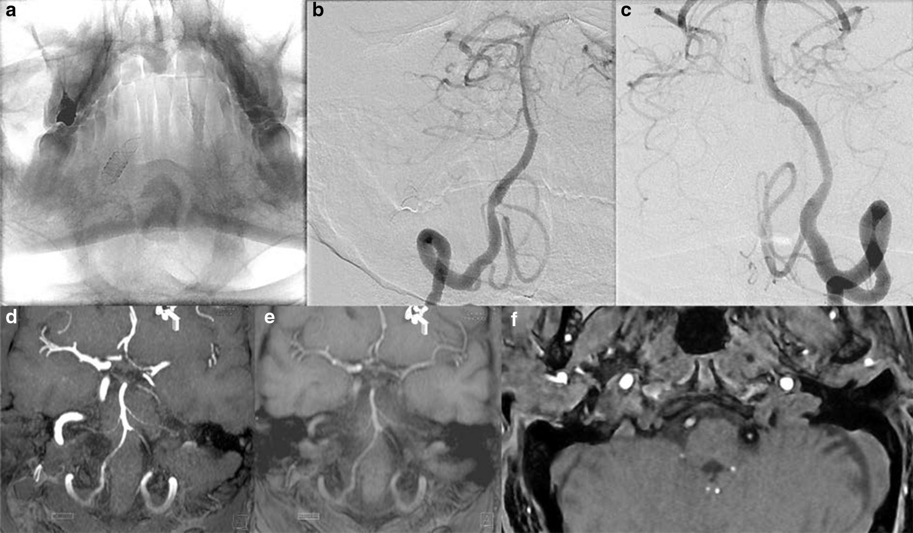
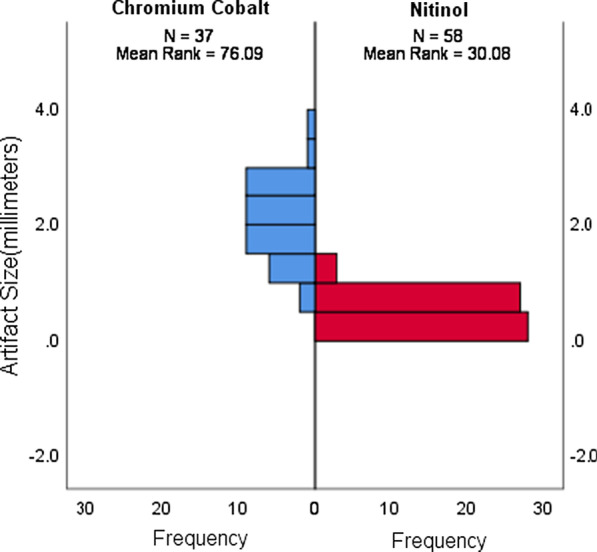
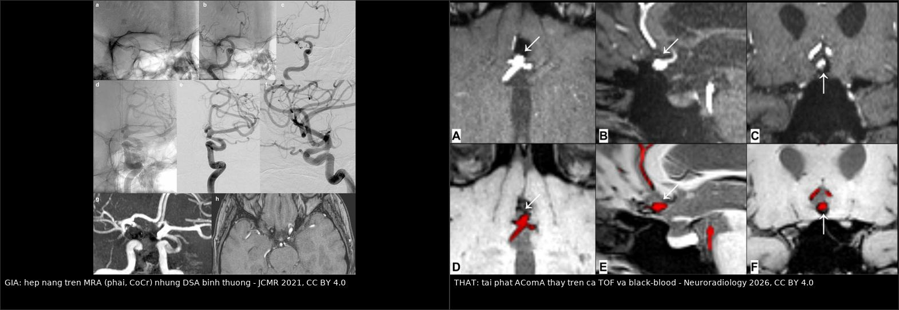
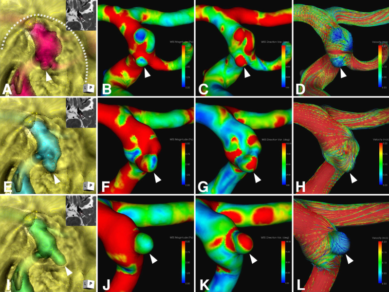
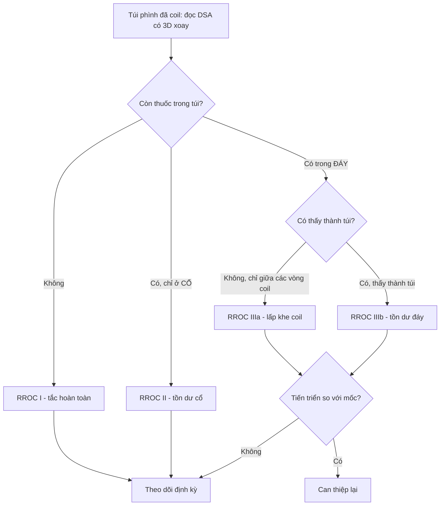
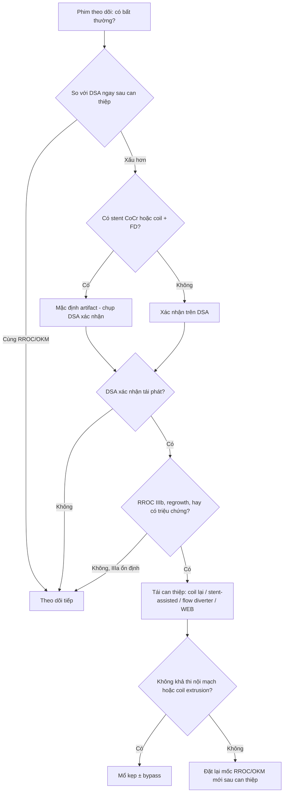
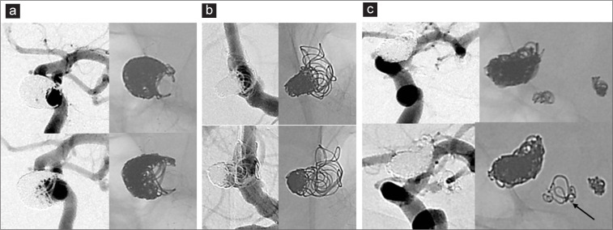
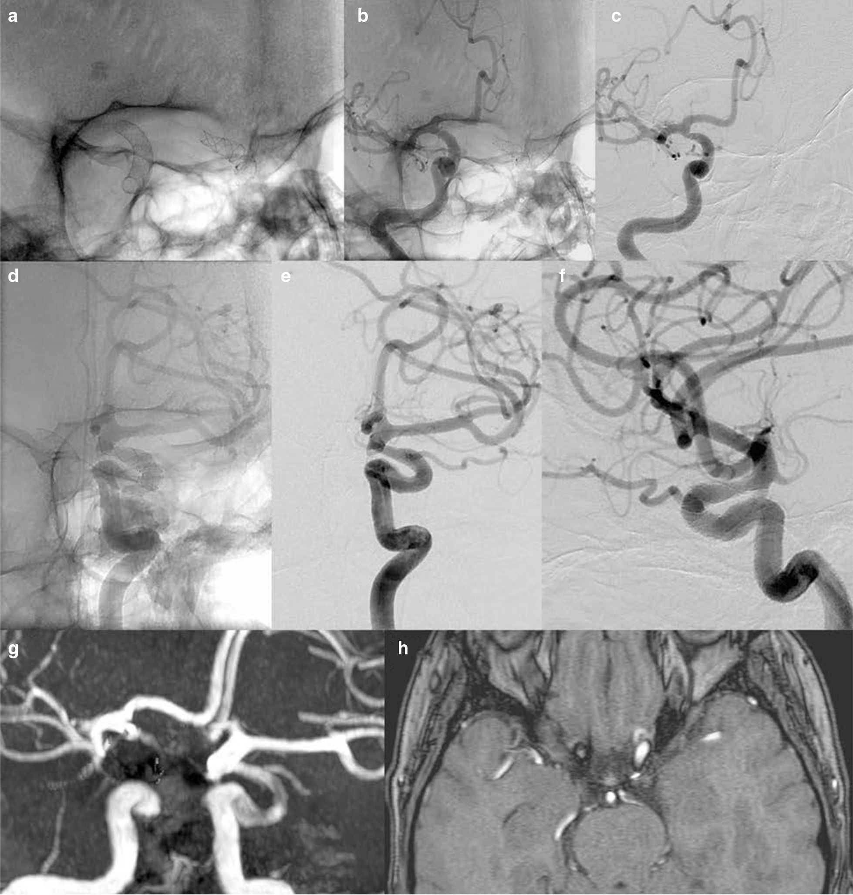
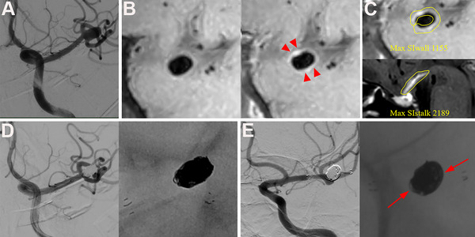
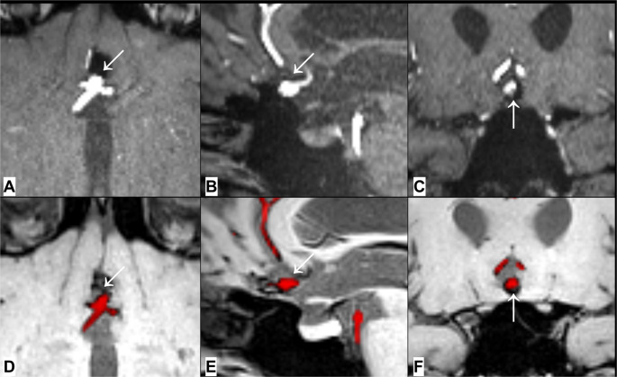

# 257 — Theo dõi & tái phát sau can thiệp túi phình não: RROC, coil compaction và bẫy artifact MRA / Follow-up after endovascular aneurysm treatment

**Tags:** `pattern:tai-phat` `pattern:coil-compaction` `pattern:artifact-MRA` `pattern:hep-mach` `pattern:huyet-khoi-tui` `vung:mach-nao` `vung:nao` `score:RROC` `score:OKM` `protocol:MRA-TOF` `protocol:DSA` `protocol:CTA-co` `protocol:HR-vwMRI` `protocol:black-blood-MRI` `protocol:PCD-CTA`

**Mức chắc chắn (certainty):** tổng hợp y văn (literature synthesis) — 1 đoàn hệ 338 túi phình có **định nghĩa tái phát và chỉ định can thiệp lại rõ ràng** (Surg Neurol Int 2026, PMC13157938), 1 nghiên cứu **artifact theo từng loại flow diverter** (JCMR 2021, PMC8182930), 1 nghiên cứu **MRI black-blood so TOF** (Neuroradiology 2026, PMC13139250), 1 đoàn hệ **ngấm thành mạch dự báo tái thông** (Brain Behav 2025, PMC12451054), 1 đoàn hệ **tái phát sớm ACom** (J Neuroendovasc Ther 2025, PMC12014850), 3 ca nguyên văn có ảnh (J Neurosurg Case Lessons 2026, PMC13138284; Surg Neurol Int 2026, PMC13633592) và 1 đoàn hệ tiến cứu 5 năm FRED (Stroke 2026, PMC13138487). Không có thử nghiệm ngẫu nhiên về **khoảng cách theo dõi**; mọi lịch chụp là tổng hợp thực hành, chỗ suy luận được ghi rõ.

> **Câu chốt:** sau khi đặt coil/stent/flow diverter, ba câu hỏi phải trả lời **theo thứ tự** — **(1) so với phim ngay sau can thiệp, túi phình có ĐỔI không** (RROC cho coil, OKM cho flow diverter)? **(2) đổi THẬT hay do artifact** (flow diverter cobalt–chromium làm mất tín hiệu trên TOF-MRA, **độ đặc hiệu chỉ 0,08**)? **(3) có phải can thiệp lại BÂY GIỜ không**? Sai lầm chết người theo cả hai chiều: **gọi artifact thành tái phát** rồi can thiệp lại vô ích, và **gọi tái phát thật là artifact** rồi bỏ qua cho tới khi **vỡ lại** — tỷ lệ can thiệp lại **12,1%** (18,1% túi đã vỡ so với 8,5% túi chưa vỡ), và **thời điểm can thiệp lại muộn nhất tới 100,6 tháng** (8,4 năm) sau lần đầu.

## 1. Tổng quan bệnh học – cơ chế hình ảnh (TẠI SAO)

### 1.1 Ba cơ chế tái phát — và vì sao chúng trông khác nhau

1. **Coil compaction (bóng coil xẹp lại):** khối coil chịu **lực "búa nước" (water hammer)** của dòng đập vào cổ túi mỗi nhát tim; đồng thời **huyết khối trong túi co lại và tổ chức hóa**, còn **không có vỏ xơ** giữ hình. Kết quả: bóng coil **xẹp dần về phía cổ**, để lộ **cổ hoặc đáy** — hình ảnh học là **"bóng coil nhỏ lại, khoảng trống lớn ra"**, không phải túi phình to lên.
2. **Regrowth (túi phình lớn lại):** thành túi **đã mất lớp đàn hồi trong** tiếp tục giãn dưới áp lực — **hình dạng túi đổi hoàn toàn**, bóng coil **biến dạng chứ không chỉ xẹp**.
3. **Thiếu sót ban đầu (incomplete initial treatment):** nếu **ngay sau can thiệp** đã còn **RROC III**, thì "tái phát" chỉ là **phát hiện muộn của tồn dư** — không phải bệnh tiến triển. Vì vậy **phim ngay sau can thiệp là mốc bắt buộc**, không có nó thì không phân biệt được (định nghĩa tái phát của PMC13157938 chính là **chuyển từ RROC I/II sang III** hoặc **regrowth**).

### 1.2 Yếu tố dự báo — số liệu định lượng

| Yếu tố | Ngưỡng / con số | Ý nghĩa thực hành | Nguồn |
|---|---|---|---|
| **Tỷ lệ lấp đầy thể tích (VER)** | **20,86%** (nhóm tái phát sớm) vs **35,57%** (nhóm không tái phát), **p = 0,02** | Lấp **< ~25–30%** thể tích túi → nguy cơ cao; ghi VER vào báo cáo | PMC12014850 |
| **Thời gian hoạt hóa đông máu (ACT) trong mổ** | **149 s** (tái phát) vs **189,5 s** (không), **p = 0,0226** | ACT thấp → huyết khối không đủ tổ chức, coil dễ xẹp | PMC12014850 |
| **A1 đối bên** | **0,26 mm** (tái phát) vs **0,85 mm**, **p = 0,0264** | Bất sản/hypoplasia A1 đối bên → dòng dồn qua ACom, tăng tải lên cổ túi | PMC12014850 |
| **Nhánh mạch xuất phát từ túi** | **11,8%** túi; **RROC cuối OR 6,33** (KTC 95% 2,…) | Túi có nhánh trong túi → khó lấp kín, tái phát nhiều hơn | PMC13056674 |
| **Ngấm thành mạch đồng tâm (CAWE) trước can thiệp** | **15,9%** túi nhỏ (< 10 mm); **CRstalk ≥ 0,5** | Viêm thành mạch → **tái thông 20,3%** ở 12,6 tháng; đưa vào mô hình dự báo | PMC12451054 |
| **Kích thước túi** | Là yếu tố độc lập ở **túi đã vỡ** (đa biến); ở túi chưa vỡ **không** đạt ý nghĩa | Đừng chỉ dựa vào kích thước để hẹn theo dõi dày | PMC13157938 |
| **Túi đã vỡ vs chưa vỡ** | Can thiệp lại **18,1% (23/127)** vs **8,5% (18/211)** | Túi đã vỡ cần theo dõi **sát hơn** | PMC13157938 |

### 1.3 TẠI SAO hình ảnh trông như vậy (vật lý)

- **TOF-MRA dựa trên DÒNG CHẢY**, không dựa trên lòng mạch: trong stent/flow diverter, dòng bị rối và chậm → **mất tín hiệu trong lòng** → trông như **hẹp nặng hoặc tắc mạch mẹ**. Đây là **giả hẹp**, không phải bệnh lý.
- **Kim loại làm lệch pha (susceptibility artifact):** cobalt–chromium (CoCr) **nhiễm từ mạnh hơn nitinol** → vùng mất tín hiệu **lớn hơn**. Đo trên 95 túi: **kích thước artifact tăng theo thứ tự Silk (nitinol) < Derivo < Pipeline < Surpass (CoCr)**, **p < 0,005** (PMC8182930). Hệ quả định lượng: đối chiếu DSA, **độ đặc hiệu cho hẹp/tắc mạch mẹ chỉ 0,08 với CoCr so với 0,60 với nitinol** — nói cách khác **92% ca "hẹp" trên MRA ở CoCr là GIẢ**.
- **Nhưng phát hiện TÚI tồn dư/tái phát thì TOF-MRA lại tốt:** so DSA (85 túi), **κ = 0,88**, **Se 0,89 / Sp 1,00 / PPV 1,00 / NPV 0,89** — tức MRA **không bỏ sót nhiều** nhưng **không đọc được lòng mạch mẹ** (PMC8182930). Hai câu hỏi khác nhau, hai độ tin cậy khác nhau.
- **Black-blood T1W (máu/dịch tối, thành và kim loại sáng):** không phụ thuộc dòng chảy nên **không bị giả hẹp**; phân đoạn tự động bằng học sâu đạt **Dice 0,81**, đồng thuận với TOF **78% (70/90)**, tỷ lệ tái phát lớn **18% (16/90) vs 16% (14/90)**, so DSA (22 ca) **độ chính xác 73% vs 77%, Se 62% cả hai, Sp 79% vs 86%** (PMC13139250). **Hai chuỗi bổ sung nhau theo vị trí:** ACom có **7 ca chỉ black-blood thấy**, thân nền có **5 ca chỉ TOF thấy**.
- **CT (kể cả PCD-CTA) sau flow diverter:** tốt khi **chỉ có FD** (đánh giá lòng stent, áp sát thành, tắc túi khớp DSA), nhưng **hạn chế khi có coil đi kèm** vì artifact kim loại (J Neuroendovasc Ther 2026, PMC12981938) — nên **coil + FD vẫn cần DSA**.
- **"Silent MRA" (MRA không cản quang) theo chuỗi thời gian:** cho thấy tồn dư ở cổ **DI CHUYỂN dọc mặt phẳng cổ** (6, 12, 18 tháng) chứ không lớn dần đồng tâm — hiện tượng **"remnant drift"**, giải thích vì sao đo một lần dễ kết luận sai (PMC13138284).

*Hai flow diverter đặt **đối xứng** hai bên: **nitinol (Silk)** một bên và **cobalt–chromium (Surpass Streamline)** bên kia. (a) DSA nguyên bản; (b, c) DSA đã trừ nền: **không hẹp, không tồn dư** hai bên. (d–f) MRA không cản quang: **bên CoCr bị mất tín hiệu** trông như **tắc/hẹp trước tắc**, bên nitinol bình thường. Nguồn: JCMR 2021 (PMC8182930), CC BY 4.0.*

*So sánh kích thước artifact (mm) của flow diverter gốc **nitinol** và gốc **cobalt–chromium** (Mann–Whitney U, **p < 0,005**). Xếp tăng dần: **Silk < Derivo < Pipeline < Surpass**. Nguồn: JCMR 2021 (PMC8182930), CC BY 4.0.*

### 1.4 Ngưỡng định lượng trụ cột

| Đại lượng | Con số | Nguồn |
|---|---|---|
| Can thiệp lại sau coil (338 túi, theo dõi **50,4 tháng**) | **12,1%** tổng; **18,1%** túi vỡ; **8,5%** túi chưa vỡ; can thiệp lại lần 2 **2,4%** | PMC13157938 |
| Thời gian đến can thiệp lại lần đầu | **13 tháng** (túi vỡ) vs **32,8 tháng** (chưa vỡ); muộn nhất **62,1** và **100,6 tháng** | PMC13157938 |
| ISAT (dẫn trong bài) | can thiệp lại sớm **8,8%** (coil) vs **3%** (clip); mạn **8,3%** vs **0,9%**; thời gian trung bình **41,4 tháng** vs **5,7 tháng** | PMC13157938 |
| BRAT (dẫn trong bài) | sớm **10,6%** vs **4,5%**; mạn **20%** vs **0,8%** | PMC13157938 |
| Tái phát sớm sau coil ACom vỡ (44 ca) | **6/44 (13,6%)** đã **RROC III ngay 2 tuần** dù **không có coil compaction**; can thiệp lại **8/44 (18,2%)** | PMC12014850 |
| Biến chứng của chính lần can thiệp lại (51 lần) | **4,9% (2/41)** thuyên tắc, **1 ca mRS 2→3**; **94,1% (48/51)** không giảm mRS | PMC13157938 |
| Tái phát "lớn" (≥ 3 mm) trên MRI | **18%** (black-blood) / **16%** (TOF) ở 90 túi | PMC13139250 |
| FD: tắc hoàn toàn/gần hoàn toàn (OKM C–D) ở 5 năm | **95,3% (225/236)** — FRED, đoàn hệ tiến cứu | PMC13138487 |
| Artifact theo thiết bị | **Silk < Derivo < Pipeline < Surpass**, p < 0,005 | PMC8182930 |
| Độ đặc hiệu MRA cho hẹp mạch mẹ | **0,08** (CoCr) vs **0,60** (nitinol) | PMC8182930 |

## 2. Mẫu hình + chẩn đoán phân biệt theo kiểu thay đổi (Gamut)

**Mẫu hình chốt:** *túi phình đã can thiệp, **hình thái thay đổi so với phim ngay sau can thiệp**; câu hỏi không phải "có bất thường không" mà là **"cái gì đổi, so với mốc nào, trên chuỗi nào"**.*

### 2.1 Gamut theo thứ đổi (đọc từng mục)

| Cái gì đổi | Nghĩ tới | Dấu hiệu chốt trên hình |
|---|---|---|
| **Bóng coil xẹp, khoảng trống lớn ra** | **Coil compaction** | Bóng coil **nhỏ hơn** trên DSA/CT; RROC **I/II → III**; **không** có máu trong túi mới |
| **Hình dạng túi đổi, bóng coil biến dạng** | **Regrowth** | Túi **to ra / đổi trục**, coil **méo**, RROC IIIb; nguy cơ vỡ lại |
| **Cổ còn sáng, không đổi qua nhiều lần chụp** | **Tồn dư ổn định (RROC II)** | **Không tiến triển ≥ 2 lần chụp**; không cần can thiệp |
| **Mạch mẹ "hẹp/tắc" trên MRA, DSA bình thường** | **Artifact CoCr** | DSA **lòng mạch đều**; artifact **lớn quanh stent**; hay gặp **Pipeline/Surpass** |
| **Mạch mẹ hẹp thật trong stent** | **Tăng sinh nội mạc / huyết khối trong stent** | Hẹp **thấy cả trên DSA**, ± triệu chứng thiếu máu; **không mất khi đổi chuỗi** |
| **Túi "đầy" trên T1, không có dòng trên DSA** | **Huyết khối trong túi sau FD** | T1 **tăng tín hiệu** trong túi, **không ngấm**, DSA **OKM B–D**; theo dõi tiếp |
| **Vòng coil nằm ngoài túi** | **Coil extrusion** | Coil **lòi ra ngoài thành/cổ**; khó can thiệp lại → **mổ kẹp** |
| **Túi mới ở vị trí khác** | **Túi de novo** | Vị trí **khác** túi cũ; đánh giá lại yếu tố nguy cơ (HA, hút thuốc) |

### 2.2 Mnemonic **CRASH** (5 thứ phải loại trừ khi "tái phát")

- **C** — **Compaction**: bóng coil xẹp.
- **R** — **Regrowth**: túi lớn lại.
- **A** — **Artifact**: giả hẹp/giả tắc do kim loại (CoCr).
- **S** — **Stenosis thật trong stent**: tăng sinh nội mạc.
- **H** — **Hemorrhage / huyết khối**: chảy máu mới hoặc huyết khối túi.

## 3. Bảng so sánh phân biệt (ma trận đối chiếu)

| Thực thể (entity) | Hình ảnh điển hình | Chốt vào (rule-in) | Chốt loại (rule-out) | Gợi ý xác nhận |
|---|---|---|---|---|
| **Coil compaction** | Bóng coil **xẹp**, khoảng trống ở **cổ/đáy** lớn dần; RROC **I/II → III** | **So phim ngay sau can thiệp: bóng coil nhỏ đi + RROC tăng bậc** | **Bóng coil không đổi qua 2 lần chụp ≥ 6 tháng** → không tiến triển | DSA (chuẩn); CT lát mỏng đo bóng coil |
| **Regrowth** | **Hình túi đổi hoàn toàn**, túi to ra, coil méo | **Túi to > 2 mm hoặc đổi trục** trên cùng bình diện | **Chỉ cổ còn sáng, thân túi không đổi** → tồn dư cổ | DSA + so 3D xoay |
| **Tồn dư cổ ổn định (RROC II)** | "Tai chó" ở cổ, **không đổi** nhiều năm | **Bất biến ≥ 2 lần chụp** | **Lớn dần hoặc xuất hiện mới** → tái phát | DSA/MRA cùng bình diện |
| **Artifact CoCr trên TOF-MRA** | **Mất tín hiệu/mất liên tục** mạch mẹ quanh stent, mức độ **không khớp** túi | **DSA lòng mạch đều + artifact lớn quanh stent CoCr** | **Hẹp vẫn thấy trên DSA** → hẹp thật | **DSA**; black-blood MRI; đổi sang nitinol nếu phải theo dõi bằng MRA |
| **Hẹp trong stent thật** | Hẹp **đồng tâm hoặc lệch tâm** trong stent, ± giảm dòng xa | **Thấy trên ≥ 2 modality (DSA + CTA/black-blood) + triệu chứng** | **Chỉ TOF thấy, CoCr, DSA bình thường** → artifact | DSA + đo áp lực nếu cần |
| **Huyết khối túi sau FD** | Túi **T1 tăng tín hiệu**, không ngấm, không có dòng | **Không dòng vào túi trên DSA/ASL + OKM B–D** | **Có dòng vào túi (OKM A)** → chưa tắc, theo dõi | DSA; T1 black-blood; ASL |
| **Coil extrusion** | **Vòng coil ngoài túi/thành mạch**, ± hẹp mạch mẹ | **Coil lòi rõ trên DSA/CT, không thể coil tiếp** | **Coil nằm trong túi** → tái phát thường | DSA + CT; hội chẩn mổ kẹp |
| **Túi de novo** | Túi **ở vị trí khác**, thành mạch mới | **Vị trí khác túi đã điều trị + nguy cơ nền (HA, hút thuốc, đa túi)** | **Cùng vị trí** → tái phát, không phải de novo | CTA/DSA toàn bộ; so phim cũ |

*Trái: bệnh nhân đặt **Surpass (CoCr) bên phải** và **Silk (nitinol) bên trái** — DSA (a–f) **không hẹp**, nhưng MRA không cản quang (g, h) **gợi ý hẹp nặng bên phải** (JCMR 2021, PMC8182930, CC BY 4.0). Phải: **tái phát thật** ở túi ACom đã coil — thấy trên **cả TOF-MRA (A–C)** và **black-blood có phân đoạn (D–F)** (Neuroradiology 2026, PMC13139250, CC BY 4.0). Cùng một câu hỏi "có tái phát không", hai câu trả lời trái ngược nếu không có DSA. Ảnh ghép letterbox.*

### 3.1 Ba dấu hiệu đọc kỹ

- **Dấu "bóng coil nhỏ lại" (compaction):** đo **chiều cao bóng coil** và **khoảng cách từ bóng coil tới đỉnh túi** trên **cùng bình diện, cùng modality**; **≥ 2 mm** thay đổi mới đáng gọi (ngưỡng "tái phát lớn" trong PMC13139250 là **≥ 3 mm**).
- **Dấu "mất liên tục mạch mẹ" trên TOF:** luôn hỏi **loại stent**. Nếu **CoCr** → **mặc định là artifact** cho tới khi DSA chứng minh ngược (Sp 0,08).
- **Dấu "remnant drift":** tồn dư ở cổ có thể **di chuyển dọc mặt phẳng cổ** theo thời gian chứ không lớn dần — đo **thể tích** và **vị trí trọng tâm**, đừng chỉ đo một chiều (PMC13138284).

*Silent MRA hợp nhất với MR cisternography, nhìn từ trong túi (intradome) ở **6, 12, 18 tháng**: tồn dư ở cổ **đổi vị trí dọc mặt phẳng cổ** (mũi tên) chứ không lớn dần đồng tâm; CFD cho thấy **vị trí dòng vào (inflow targeting)** thay đổi theo thời gian. Nguồn: J Neurosurg Case Lessons 2026 (PMC13138284), CC BY-NC-ND 4.0 (nguyên bản).*

## 4. Protocol chụp + hệ phân độ/điểm chuẩn hóa

### 4.1 Lịch theo dõi (theo protocol của đoàn hệ 338 túi)

| Mốc | Chuỗi | Mục đích |
|---|---|---|
| **Ngay sau can thiệp** | **DSA** cuối (bắt buộc) — chụp 3D xoay, lưu làm **mốc RROC** | Không có mốc này thì **không định nghĩa được tái phát** |
| **3 tháng** | **MRI/MRA** (không cản quang) | Phát hiện sớm thiếu sót/tắc, kiểm tra biến chứng |
| **6 tháng** | **DSA** hoặc **MRI + CTA** | Mốc chính; **DSA** nếu có stent CoCr hoặc nghi tái phát |
| **12 tháng** | **DSA** hoặc **MRI + CTA** | Chốt tắc hoàn toàn; so với mốc 6 tháng |
| **Hàng năm tới ≥ 5 năm** | **MRA/CTA**, DSA khi có thay đổi | Vì can thiệp lại muộn nhất ghi nhận **100,6 tháng** — **đừng ngừng theo dõi ở năm 3** |
| **Bất kỳ lúc nào có triệu chứng mới** | **CT/DSA ngay** | Đau đầu mới, dấu thần kinh khu trú = chụp, không chờ lịch |

- Đây là lịch của **PMC13157938** (MRI ~3 tháng; DSA hoặc MRI+CTA ở **6 tháng và 1 năm**), mở rộng theo dõi dài hạn dựa trên **thời gian tái phát muộn** — phần "hàng năm tới ≥ 5 năm" là **suy luận thực hành**, nguồn không nêu con số tuyệt đối.

### 4.2 Phân độ RROC (cho coil) — sửa đổi Mascitelli

- **RROC I** = tắc hoàn toàn; **II** = tồn dư **cổ**; **IIIa** = thuốc lấp **khe giữa các vòng coil** (chưa thấy thành túi); **IIIb** = thuốc trong **đáy**, thấy **thành túi**.
- **Định nghĩa tái phát dùng trong thực hành (PMC13157938):** **I/II → III** = *significant coil compaction (SCC)*; **IIIb** = *hazardous coil compaction (HCC)* → **chỉ định can thiệp lại**; **hình túi đổi hoàn toàn** = *regrowth*.
- **Nguyên tắc:** **RROC I và II → theo dõi**; **IIIb hoặc tiến triển → can thiệp lại**; **IIIa** → tùy vị trí, triệu chứng, tiến triển.

### 4.3 Phân độ OKM (cho flow diverter)

- **A** = túi còn đầy thuốc; **B** = còn đầy **> 50%** túi; **C** = còn **< 50%** (chỉ còn lối vào); **D** = **không còn** thuốc trong túi.
- **Mốc thành công là C–D:** đoàn hệ tiến cứu FRED 5 năm đạt **95,3% (225/236)** (PMC13138487). Đừng kỳ vọng tắc hoàn toàn ngay 6 tháng — tắc tiến triển **theo tháng**.

### 4.4 Flowchart quyết định can thiệp lại

- **Lựa chọn can thiệp lại:** trong 51 lần can thiệp lại của đoàn hệ 338 túi, **49 lần nội mạch**, **2 lần mổ + bypass**; **94,1%** không giảm mRS (PMC13157938).
- **Coil extrusion** là tình huống **hạn chế nội mạch rõ rệt** — 3 ca được **mổ kẹp có định vị neuronavigation + theo dõi sinh lý + ICG + Doppler**, tái phát ở **6 tháng, 10 năm và gần 20 năm** (Surg Neurol Int 2026, PMC13633592).
- **Ngấm thành mạch trước can thiệp (CAWE, CRstalk ≥ 0,5)** là yếu tố **dự báo tái thông** → ca có CAWE cần **theo dõi sát hơn**, có thể dùng để chọn lịch DSA (PMC12451054).

## 5. Biến thể bình thường và cạm bẫy

### 5.1 "Bất thường" không phải bệnh

- **Tồn dư cổ nhỏ (RROC II) không đổi qua nhiều năm:** đây là **kết quả chấp nhận được**, không phải thất bại — can thiệp lại làm tăng nguy cơ mà không giảm nguy cơ vỡ.
- **"Tai chó" (dog-ear) ở cổ** thường **không tiến triển**; chỉ theo dõi.
- **Tăng tín hiệu T1 trong túi sau flow diverter:** huyết khối lành hóa, **không phải máu cấp** — đối chiếu DSA/ASL trước khi gọi chảy máu.
- **Mất tín hiệu quanh coil/clip trên MRI** là **artifact kim loại**, không phải tổn thương.

### 5.2 Cạm bẫy (pitfall)

1. **Đọc MRA mà không biết loại stent** — CoCr cho **Sp 0,08**; "hẹp" gần như luôn là giả (PMC8182930). **Luôn ghi loại thiết bị trong phiếu theo dõi.**
2. **Không có phim ngay sau can thiệp** — không phân biệt **tồn dư ban đầu** với **tái phát**; đây là lỗi hệ thống hay gặp khi bệnh nhân chuyển viện.
3. **"RROC III = thất bại, phải can thiệp"** — **IIIa** có thể ổn định nhiều năm; chỉ **IIIb/tiến triển** mới can thiệp (PMC13157938).
4. **Bỏ sót tái phát ACom vì chỉ đọc TOF** — **7 ca ACom chỉ black-blood thấy** (PMC13139250); ngược lại **thân nền** có **5 ca chỉ TOF thấy** → **hai chuỗi bổ sung**, không thay thế.
5. **Tin PCD-CTA khi có coil + FD** — artifact che lòng stent và túi; **vẫn cần DSA** (PMC12981938).
6. **Kết luận tái phát chỉ vì "tồn dư to ra" trên một bình diện** — phải đo **cùng bình diện, cùng modality**; **remnant drift** làm tồn dư "đổi chỗ" mà không to lên (PMC13138284).
7. **Tái phát sớm sau coil ACom** — **13,6%** đã **RROC III ngay 2 tuần** dù **không có coil compaction**; đừng chờ 6 tháng mới chụp lại ở nhóm **VER thấp, ACT thấp, A1 đối bên nhỏ** (PMC12014850).
8. **Coil extrusion** — dễ bị đọc là "tái phát thường" và cố coil tiếp; coil đã lòi ra ngoài thì **nội mạch thất bại**, cần **mổ kẹp** (PMC13633592).
9. **Ngừng theo dõi ở năm 3** — đã có ca can thiệp lại ở **100,6 tháng**; đặc biệt **túi chưa vỡ lớn** có thể tái phát **rất muộn** (PMC13157938).
10. **Bỏ qua triệu chứng vì "phim 6 tháng bình thường"** — đau đầu mới/dấu khu trú phải **chụp ngay**, không theo lịch.

## 6. Tự lượng giá — Blind Quiz

**Ca 1 — Ba kiểu tái phát. Nhìn DSA trước và mô tả từng hàng trước.**

- Gợi ý: mỗi hàng là **một kiểu**: trên trái = DSA cuối lần đầu; trên phải = hình coil lúc đó; dưới trái = DSA trước can thiệp lại; dưới phải = hình coil lúc đó.
- Câu hỏi: Hàng (a), (b), (c) khác nhau ở điểm nào? Hàng nào **bắt buộc** can thiệp lại? Vì sao?

<b>Bấm để hiện đáp án (findings + chẩn đoán)</b>

- **(a) Significant coil compaction (SCC):** bóng coil **xẹp rõ** nhưng **thành túi chưa lộ**; thuốc vào vùng cổ/đáy — theo dõi hoặc can thiệp tùy chọn.
- **(b) Hazardous coil compaction (HCC):** bóng coil xẹp **+ thành túi lộ một phần** → **chỉ định can thiệp lại** (nguy cơ vỡ lại).
- **(c) Regrowth:** **hình dạng túi đổi hoàn toàn**, túi lớn lên (mũi tên đen) → tái phát thật, cần can thiệp.
- **Nguyên tắc:** **HCC là nhóm được khuyến cáo can thiệp lại**; SCC tùy chọn; tắc hoàn toàn/tồn dư cổ thì theo dõi.
- **Nguồn:** Surg Neurol Int 2026 (PMC13157938), **CC BY-NC-SA 4.0** (nguyên bản).

**Ca 2 — Bệnh nhân đặt hai flow diverter hai bên. Nhìn MRA trước, đừng nhìn DSA.**

- Gợi ý: **Surpass (CoCr) bên phải**, **Silk (nitinol) bên trái**, đặt cho túi phình đoạn mắt hai bên.
- Câu hỏi: MRA nói gì ở hai bên? DSA nói gì? Giải thích khác biệt bằng vật lý.

<b>Bấm để hiện đáp án (findings + chẩn đoán)</b>

- **DSA (a–f):** **không có** tồn dư túi, **không hẹp** mạch mẹ ở cả hai bên.
- **MRA (g, h):** **gợi ý hẹp nặng bên PHẢI** (nơi có Surpass CoCr), **bên trái bình thường**.
- **Chẩn đoán:** **giả hẹp do artifact từ tính** của CoCr — không phải hẹp thật. Vì sao: CoCr gây lệch pha mạnh → **mất tín hiệu trong lòng** trên TOF (vốn dựa vào dòng chảy).
- **Con số:** độ đặc hiệu cho hẹp mạch mẹ **0,08 (CoCr)** vs **0,60 (nitinol)**; artifact **Silk < Derivo < Pipeline < Surpass**, p < 0,005.
- **Xử trí:** **không can thiệp**; nếu buộc theo dõi bằng MRA, ưu tiên **nitinol** hoặc dùng **black-blood/CTA**, và **DSA khi có nghi ngờ**.
- **Nguồn:** JCMR 2021 (PMC8182930), **CC BY 4.0**.

**Ca 3 — Nữ, túi phình MCA 8,8 mm chưa vỡ, được stent-assisted coiling. Nhìn HR-VWI trước và DSA 9 tháng sau.**

- Câu hỏi: (B, C) cho thấy gì trên thành túi? (E) là gì? Hai dấu hiệu này liên quan thế nào?

<b>Bấm để hiện đáp án (findings + chẩn đoán)</b>

- **(A)** DSA: túi phình **8,8 mm** ở **chạc MCA trái**. **(B)** HR-VWI trước tiêm/sau tiêm: **ngấm thành mạch đồng tâm (CAWE)** — đầu mũi tên đỏ. **(C)** **CRstalk = 0,53** (≥ 0,5). **(D)** Sau stent-assisted coiling: tắc tốt. **(E)** **DSA 9 tháng: tái thông nhẹ + coil compaction ở cổ và đáy** (mũi tên đỏ).
- **Liên hệ:** CAWE là dấu **viêm thành mạch**; trong 69 túi nhỏ, **15,9% có CAWE**, **tái thông 20,3%** ở **12,6 tháng**, và CAWE + CRstalk ≥ 0,5 là yếu tố dự báo độc lập → **lịch theo dõi sát hơn**.
- **Bài học:** ngấm thành mạch **trước** can thiệp là thông tin **tiên lượng**, không chỉ để quyết định có mổ hay không.
- **Nguồn:** Brain Behav 2025 (PMC12451054), **CC BY 4.0**.

**Ca 4 — Túi ACom đã coil, theo dõi 12 tháng. Hai chuỗi MRI, cùng bệnh nhân.**

- Câu hỏi: (A–C) và (D–F) là hai chuỗi nào? Tái phát ở đâu? Vì sao phải dùng cả hai?

<b>Bấm để hiện đáp án (findings + chẩn đoán)</b>

- **(A–C)** TOF-MRA, dựng đa bình diện: **tái phát lớn** (mũi tên) sau coil túi ACom. **(D–F)** **black-blood T1W có phân đoạn tự động** (đỏ) cùng bệnh nhân: thấy **mạch nền và tồn dư/tái phát** (mũi tên).
- **Vì sao cần cả hai:** black-blood **không phụ thuộc dòng chảy** nên không bị giả hẹp, nhưng **nhạy kém hơn ở thân nền (5 ca chỉ TOF thấy)**; TOF tốt cho túi nhưng **mất tín hiệu quanh kim loại** và **ACom (7 ca chỉ black-blood thấy)**.
- **Con số:** đồng thuận **78% (70/90)**; tái phát lớn **18% vs 16%**; so DSA (22 ca) **Se 62% cả hai, Sp 79% vs 86%**.
- **Nguồn:** Neuroradiology 2026 (PMC13139250), **CC BY 4.0**.

## Bài liên quan chéo
- [200 – Tổng quan hệ Thần kinh](../200-tong-quan-he-than-kinh/lesson.md)
- [207 – Phình mạch nội sọ chưa vỡ](../207-phinh-mach-noi-so-chua-vo/lesson.md) — **quyết định can thiệp lần đầu** (PHASES/ELAPSS/UIATS, AWE)
- [241 – Đọc HR-vwMRI thành mạch nội sọ](../241-hr-vwmri-doc-ngam-thanh-mach/lesson.md) — kỹ thuật đọc ngấm thành mạch (CAWE)
- [248 – Can thiệp nội mạch giả phình & bóc tách mạch cổ](../248-can-thiep-noi-mach-gia-phinh-boc-tach-dong-mach-co-dot-song/lesson.md) — stent/coil ở mạch cổ
- [212 – Xuất huyết não](../212-xuat-huyet-so-nao/lesson.md) — biến cố chảy máu sau can thiệp
- [211 – Đột quỵ não](../211-dot-quy-nao/lesson.md) — thiếu máu do hẹp trong stent/huyết khối
- [201 – Protocol sọ não](../201-protocol-so-nao/lesson.md) — chuỗi MRI/CTA nền

## Ảnh
- Tên file: `257_*_Modality_SourceID.jpg`; nguồn + giấy phép từng ảnh trong `images/CREDITS.md`.
- `images/composite_artifact-vs-tai-phat.jpg` — ảnh ghép **chỉ từ nguồn CC BY 4.0** (PMC8182930 + PMC13139250), letterbox bằng `tools/make_composite.py`.
- Ảnh **CC BY-NC-ND** (PMC13138284) và **CC BY-NC-SA** (PMC13157938) dùng **nguyên bản**, không đưa vào composite.

> Không dùng để chẩn đoán độc lập khi chưa có người hướng dẫn.
