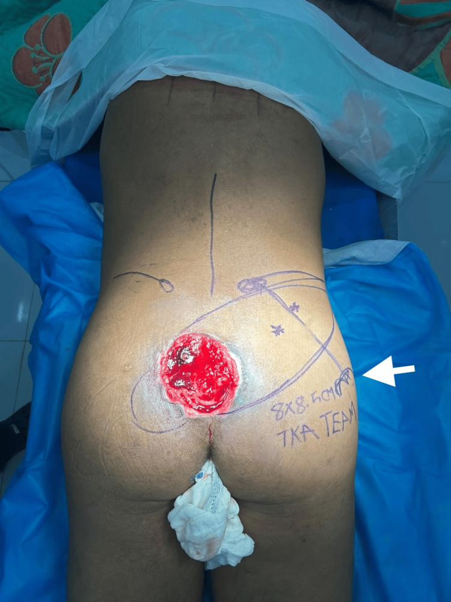
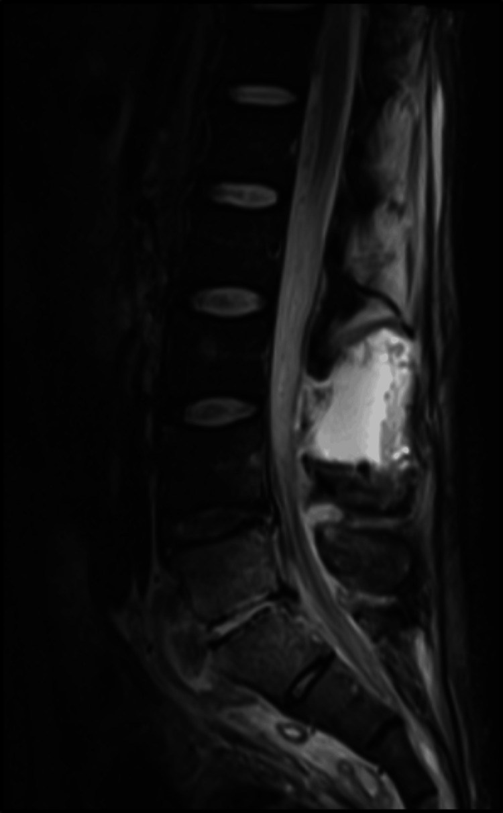
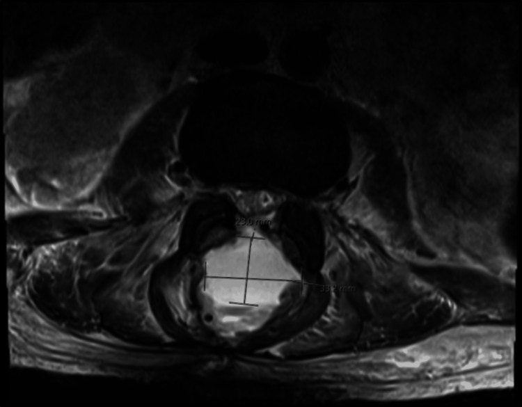
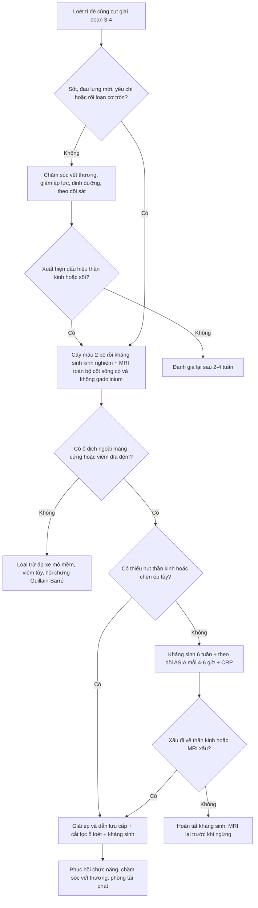
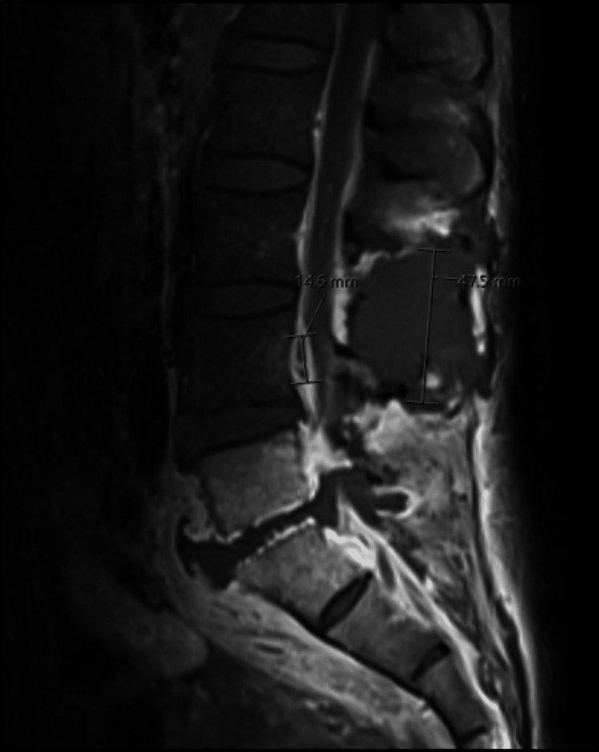

# 258 — Áp-xe ngoài màng cứng & nhiễm trùng ống sống do loét tì đè cùng cụt / Spinal epidural abscess complicating sacral pressure injury

**Tags:** `pattern:ap-xe-ngoai-mang-cung` `pattern:viem-xuong-tuy` `pattern:viem-dia-dem` `vung:tuy-song` `vung:khung-chau` `score:ASIA` `protocol:MRI-tuy-co-gadolinium` `protocol:CT-xuong`
**Mức chắc chắn (certainty):** tổng hợp y văn (literature synthesis) — **ca nguyên văn** PMC11178510 (bệnh nhân 41 tuổi, loét cùng cụt bệnh viện → viêm đĩa đệm L5–S1 + áp-xe ngoài màng cứng lan rộng, có ảnh MRI) đặt trong khung số liệu của 2 tổng quan (PMC7733760, PMC7595828) và cohort phẫu thuật (PMC7671776); ca lâm sàng lộ xương cùng dùng minh họa cửa vào (PMC13180459, **ca này không có viêm xương tủy** — chỉ dùng để dạy ổ loét nguồn).

> **Bài này nối [309 – Loét tì đè & viêm xương tủy khung chậu](../309-loet-ti-de-viem-xuong-tuy-spina-bifida-nguoi-lon/lesson.md)** (ổ loét → xương) với **đường lan lên ống sống**: 309 dừng ở xương cùng/ụ ngồi, bài này đi tiếp vào **khoang ngoài màng cứng** — nơi chậm vài giờ là mất chức năng thần kinh vĩnh viễn. Cũng nối **[222 – Viêm đốt sống](../222-viem-dot-song/lesson.md)**, **[250 – Lao nội tủy & lao màng tủy](../250-lao-noi-tuy-va-lao-mang-tuy/lesson.md)** và **[220 – Ống sống tủy](../220-ong-song-tuy/lesson.md)**.

## 1. Tổng quan bệnh học – cơ chế hình ảnh

- **Cửa vào là ổ loét, không phải “đau lưng tuổi già”.** Loét tì đè giai đoạn 3–4 có **viêm xương tủy dưới loét 17–86%, đa số khoảng 20%** (tổng quan 6 nghiên cứu, PMC7517666). Vùng gai cùng chỉ có lớp mô mềm mỏng che phủ, vỏ xương mỏng; vi khuẩn kỵ khí và đa vi khuẩn từ ổ loét mạn đi **liên tục (contiguous)** vào xương cùng → đĩa đệm L5–S1 → **khoang ngoài màng cứng**. Đường **lây theo máu (hematogenous)** chiếm **25–50%**, lây liên tục khoảng **1/3** các ca (PMC11178510).
- **Vì sao cùng cụt là “điểm mù”:** tủy sống kết thúc ở **L1–L2**; dưới mức này ống sống chỉ còn **đuôi ngựa (cauda equina)**. Áp-xe cùng cụt gây **đau rễ/thần kinh tọa, yếu chi dưới, bí tiểu – đại tiện** nhưng **không có mức tổn thương tủy rõ** ở giai đoạn đầu; khi mủ lan lên tới nón tủy mới xuất hiện **mức cảm giác** (ca PMC11178510: mất cảm giác dưới **T8**). Bệnh nhân liệt/giảm cảm giác còn **không cảm thấy đau** — dấu hiệu cảnh báo duy nhất có thể chỉ là **sốt và chảy mủ hôi**.
- **TẠI SAO MRI là chuẩn — vật lý của mủ trong khoang ngoài màng cứng:**
  - **T1W:** mủ **giảm hoặc đồng tín hiệu** so với tủy sống; khó phân biệt với mô mềm/dịch.
  - **T2W:** mủ **tăng tín hiệu**, nhưng **gần bằng dịch não tủy (CSF)** → trên T2 đơn thuần ổ mủ “hòa” vào CSF, **dễ bỏ sót** (PMC7595828).
  - **T1W sau gadolinium:** viền xơ hóa – mô hạt **ngấm thuốc dạng vòng**, lòng ổ không ngấm; đây là dấu hiệu định vị và phân biệt **áp-xe (ổ có vỏ)** với **phlegmon (ngấm lan tỏa, không vỏ)**.
  - **DWI/ADC:** mủ nhớt hạn chế khuếch tán → **DWI sáng, ADC tối**, giúp phát hiện ổ nhỏ và phân biệt với **máu tụ ngoài màng cứng** (không hạn chế khuếch tán) (PMC7733760).
  - **Xương cùng/đĩa đệm:** viêm tủy xương làm **T1 giảm, STIR/T2FS tăng, ngấm thuốc**; vỏ xương bị **phá hủy**, có thể thấy **khí trong ống sống/đĩa đệm** trên CT — dấu hiệu nhiễm khuẩn sinh hơi, cấp cứu.
  - **CT:** nhanh, thấy **khí, phá hủy xương, hẹp ống sống**, nhưng **không phân biệt được mủ với dịch/phù mô mềm** và **bỏ sót ổ ngoài màng cứng sớm**; X-quang thường **bình thường** ở giai đoạn đầu.
- **Vì sao chẩn đoán muộn là quy luật, không phải ngoại lệ:**
  - **Tam chứng kinh điển** (sốt + đau lưng + thiếu hụt thần kinh) chỉ gặp **8–15%** (PMC7595828), khoảng **10%** (PMC7733760); **sốt chỉ ~25%**, đau lưng **92–100%**, thiếu hụt thần kinh lúc nhập viện **47%** (PMC4617026).
  - **Chẩn đoán nhầm lần đầu 75–89%** (PMC7733760).
  - **Điều trị bảo tồn thất bại 30–40%** (PMC7733760) và **41–42,5%** (PMC4617026); **liệt vĩnh viễn 22%**; tử vong chung **1,3–31%**, các loạt gần đây **3,7–5%** (PMC7595828).
  - **Cửa sổ hồi phục hẹp:** liệt kéo dài **quá 24–36 giờ** khó hồi phục (PMC11178510); mổ **trong 12 giờ** sau nhập viện cho kết cục lâm sàng và chất lượng sống tốt hơn mổ muộn trong cohort 123 bệnh nhân (PMC7671776).

*Loét tì đè cùng cụt **giai đoạn IV, 11 × 9 cm, lộ xương cùng** ở nam 43 tuổi liệt T11–T12; đường vẽ là quy hoạch vạt xuyên nhánh động mạch mông trên (SGAP). Ca này **không có viêm xương tủy** — ảnh dùng để nhận diện **cửa vào** và mức độ phơi xương, không phải bằng chứng nhiễm trùng ống sống. Nguồn: Zin NA et al, *Cureus* 2026;18(4):e107245 (PMC13180459), Fig. 1, CC BY 4.0 — ảnh nguyên bản.*

## 2. Mẫu hình + chẩn đoán phân biệt theo vị trí (gamut)

- **Theo đường lan:**
  - **Liên tục từ ổ loét cùng cụt:** viêm xương cùng → viêm đĩa đệm L5–S1 → áp-xe ngoài màng cứng **sau (dorsal)** hoặc lan tỏa chu vi; thường **đa vi khuẩn**, có kỵ khí (ca PMC11178510: *Bacteroides fragilis*, *B. pneumosintes*, *B. thetaiotaomicron*).
  - **Theo máu (Batson plexus tĩnh mạch không van):** ổ loét ở **bất kỳ đâu** cũng có thể gây áp-xe **cổ/ngực** — ca loét do vòng nâng tinh hoàn gây áp-xe **C4–C6** và liệt tứ chi (*Streptococcus intermedius*, PMC6710723) là ví dụ không được bỏ qua.
  - **Sau thủ thuật:** đặt catheter ngoài màng cứng, chọc dò, phẫu thuật cột sống — tỷ lệ rất thấp nhưng **ổ nhiễm nằm ngay sau lưng**, dễ nhầm đau hậu phẫu.
- **Theo tầng — quyết định tốc độ nguy kịch:**
  - **Cùng cụt – thắt lưng:** hội chứng **đuôi ngựa** (yếu hai chi, mất cảm giác yên ngựa, bí tiểu, giảm trương lực hậu môn).
  - **Ngực:** chèn ép **tủy** → mức cảm giác, liệt hai chi, rối loạn cơ tròn; nguy cơ **tụt huyết áp/liệt ruột** do sốc nhiễm khuẩn.
  - **Cổ:** chèn ép tủy cổ → **liệt tứ chi, suy hô hấp**; nguy cơ tử vong cao nhất.
- **Theo hình thái trên MRI:**
  - **Áp-xe có vỏ:** ổ dịch khu trú, viền ngấm thuốc, DWI sáng/ADC tối — **có chỉ định dẫn lưu** khi có chèn ép/thiếu hụt.
  - **Phlegmon ngoài màng cứng:** ngấm thuốc lan tỏa, không vỏ, không ổ dịch rõ — có thể điều trị kháng sinh nếu **không có thiếu hụt thần kinh** và theo dõi sát.
  - **Viêm xương tủy/đĩa đệm đơn thuần:** phù tủy, phá hủy đĩa–đốt sống, **chưa có ổ ngoài màng cứng** — vẫn phải theo dõi vì có thể tiến triển.
- **Bảng gợi nhớ 4 nhóm dễ nhầm tại cùng cụt:** **S**EA (áp-xe) – **H**ematoma (máu tụ) – **T**umor (di căn/u) – **D**isc (thoát vị đĩa đệm) — “**SHTD**”.
- **Bẫy vị trí:** áp-xe **sau** đẩy tủy ra trước; áp-xe **trước** thường đi kèm viêm đĩa đệm và **không gây chèn ép sớm** — vì vậy **không có thiếu hụt thần kinh không loại trừ áp-xe**.

## 3. Bảng so sánh phân biệt (ma trận đối chiếu)

| Thực thể (entity) | Hình ảnh/lâm sàng điển hình | Chốt vào (rule-in) | Chốt loại (rule-out) | Gợi ý xác nhận |
|---|---|---|---|---|
| Áp-xe ngoài màng cứng (SEA) | Ổ dịch ngoài màng cứng, **viền ngấm thuốc**, DWI sáng/ADC tối; sốt, đau lưng, yếu chi | **Viền ngấm + hạn chế khuếch tán + hội chứng nhiễm trùng** | **Không hạn chế khuếch tán + không ngấm + khởi phát đột ngột sau chấn thương** → nghĩ máu tụ | MRI toàn bộ cột sống có/không gadolinium; cấy máu, cấy mủ |
| Máu tụ ngoài màng cứng | Khối giữ hình, tín hiệu T1/T2 **thay đổi theo tuổi máu**, không vỏ ngấm; đau đột ngột | **Khởi phát tức thì sau gắng sức/chấn thương + dùng chống đông** | **Sốt + viền ngấm + DWI sáng** → áp-xe (hoặc máu tụ bội nhiễm) | MRI + INR/tiểu cầu; DWI/Gd lặp lại nếu nghi bội nhiễm |
| Di căn/u ngoài màng cứng | Khối đặc, ngấm thuốc, **phá hủy xương**, có thể chèn ép tủy | **Tiền sử ung thư + tổn thương xương + không sốt** | **Hạn chế khuếch tán + sốt + CRP tăng nhanh** → áp-xe | MRI + staging; sinh thiết nếu chưa rõ |
| Mủ dưới màng cứng (subdural empyema) | Hình liềm **dưới màng cứng**, bờ mỏng, lan dọc, không có mỡ ngoài màng cứng | **Viêm màng não/sau mổ + hình liềm + ngấm màng** | **Vị trí ngoài màng cứng, mỡ bị đẩy** → áp-xe ngoài màng cứng | MRI Gd; cấy CSF (thận trọng) |
| Viêm đĩa đệm–đốt sống (không ổ dịch) | Phù tủy hai bên đĩa, **ngấm đĩa–đốt sống**, hẹp khe đĩa | **Ngấm cả đĩa và hai thân đốt + phù tủy** | **Không phù xương, chỉ ổ mô mềm** → áp-xe đơn thuần | MRI Gd; cấy xương/đĩa qua kim |
| Viêm xương tủy xương cùng dưới loét | Phù tủy xương cùng, phá hủy vỏ, đường rò từ loét vào xương | **Lộ xương + probe-to-bone dương + phù tủy khu trú** | **Không phù tủy, không phá hủy vỏ** → loét mô mềm đơn thuần | MRI + **sinh thiết xương** (mô học + cấy) |
| Thoát vị đĩa đệm gây hội chứng đuôi ngựa | Khối đĩa **không ngấm thuốc**, hẹp ống sống; đau sau gắng sức | **Đĩa thoát vị + không hội chứng nhiễm trùng** | **Viền ngấm + sốt + CRP cao** → áp-xe | MRI; CRP/ESR; theo dõi 6–24 giờ |
| Viêm tủy ngang (transverse myelitis) | Tăng T2 **trong tủy**, không khối ngoài màng cứng | **Tổn thương nội tủy + khởi phát vài ngày** | **Khối ngoài màng cứng chèn ép** → áp-xe | MRI não–tủy; CSF; loại trừ NMO/MS |

*MRI cột sống thắt lưng **sau tiêm thuốc tương phản** (chú thích gốc: “enhanced”): ổ dịch ngoài màng cứng lớn phía sau, đẩy bao tủy ra trước, kèm thay đổi viêm đĩa đệm L5–S1. Bệnh nhân 41 tuổi, loét cùng cụt bệnh viện, sốt 39,5 °C, yếu hai chi dưới 2/5, mất cảm giác dưới T8. Nguồn: Carlson TL et al, *Cureus* 2024;16(5):e60379 (PMC11178510), Fig. 1, CC BY 4.0 — ảnh nguyên bản.*

### Đọc đúng “ổ dịch trong ống sống”
- **Đo ở đâu:** đo **chiều dài lan dọc** trên lát **sagittal T1 sau tiêm** và **chiều dày tối đa** trên lát **axial** tại mức hẹp nhất; ghi kèm **mức độ hẹp ống sống** và **mức chèn ép tủy/đuôi ngựa**. Ca PMC11178510: ổ dịch **33 × 23 mm** trên axial, **47,5 mm** và **14,6 mm** trên sagittal, một ổ khác **41 mm**.
- **Phân biệt mủ – phlegmon:** chỉ gọi “áp-xe” khi có **vỏ ngấm thuốc + lòng không ngấm**; phlegmon là **ngấm lan tỏa không vỏ**, thường đáp ứng kháng sinh tốt hơn nhưng vẫn có thể tiến triển thành ổ mủ.
- **Dấu hiệu “khí trong ống sống”** trên CT (ca này có khí trong ống sống và đĩa đệm L5–S1) là **cờ đỏ nhiễm khuẩn sinh hơi**, không chờ MRI nếu bệnh nhân xấu.

*Lát axial sau tiêm: ổ dịch ngoài màng cứng **33 × 23 mm** (đường đo của bài gốc), chiếm gần toàn bộ ống sống sau và đẩy bao tủy ra trước. Đo **chiều dày tối đa trên axial** là con số quyết định mức chèn ép, không đo trên lát sagittal. Nguồn: Carlson TL et al, *Cureus* 2024;16(5):e60379 (PMC11178510), Fig. 2, CC BY 4.0 — ảnh nguyên bản.*

## 4. Protocol chụp + hệ phân độ/điểm chuẩn hóa

### 4.1 Khi nào chụp — ngưỡng không được chờ
- **Bất kỳ loét tì đè giai đoạn 3–4 + một trong các dấu hiệu:** sốt, đau lưng/cùng cụt mới, yếu chi mới, rối loạn tiểu tiện, mất cảm giác yên ngựa, CRP tăng không giải thích → **MRI toàn bộ cột sống cấp** (trong vài giờ), không chờ đáp ứng kháng sinh.
- **Không có sốt không loại trừ:** tam chứng chỉ **8–15%**; ở người già, đái tháo đường, suy giảm miễn dịch có thể **chỉ có đau và lú lẫn**.
- **Ổ loét “sạch” không loại trừ:** ổ loét có thể đã được chăm sóc tốt trong khi mủ đã lan vào ống sống; **đau tăng khi thay đổi tư thế** và **yếu chi** mới là dấu hiệu định hướng.

### 4.2 Protocol MRI (tối thiểu)
- **MRI là chuẩn chẩn đoán:** độ nhạy và độ đặc hiệu **> 90%** (PMC11178510 dẫn nguồn 17; PMC7733760); gadolinium làm rõ vỏ ổ và mức lan.
- **Sagittal T1W, T2W, STIR** toàn bộ cột sống (cổ → cùng cụt) — không chỉ vùng đau, vì ổ có thể **nhảy cóc** (ở nhóm tiêm chích ma túy, tổn thương nhảy cóc khoảng **20%**, PMC7595828).
- **Axial T2W** qua mọi tầng có bất thường trên sagittal.
- **T1W sau gadolinium + fat-sat** sagittal và axial: xác định **vỏ ngấm**, ổ dịch, viêm đĩa đệm, áp-xe mô mềm cạnh sống.
- **DWI/ADC** nếu có: chốt mủ, phát hiện ổ nhỏ, phân biệt máu tụ.
- **Toàn bộ cột sống + não** khi có sốt/lú lẫn hoặc nghi lan lên màng não (ca PMC11178510 chụp thêm não, cổ, ngực — đều bình thường, nhưng chính điều đó giúp loại ổ thứ phát).

### 4.3 Xét nghiệm – vi sinh (trước và trong khi chờ MRI)
- **Cấy máu 2 bộ trước kháng sinh**; cấy máu âm tới **40%** (PMC11178510) và cấy ổ nhiễm dương **78,1–90%** so với cấy máu **54,9–60%** (PMC7595828) → **vẫn phải lấy mủ/xương khi mổ**.
- **CRP, ESR, công thức máu:** CRP **> 10 mg/L** và ESR **> 30 mm/h** đạt **độ nhạy > 95%** cho viêm nhiễm cột sống (PMC7595828), nhưng **bình thường không loại trừ** giai đoạn rất sớm.
- **KHÔNG chọc dò tủy sống (LP) khi nghi áp-xe ngoài màng cứng:** nguy cơ **đưa vi khuẩn vào khoảng dưới nhện**, gây viêm màng não, và dịch lấy ra có thể **chính là mủ ngoài màng cứng** (ca PMC11178510: 798.600 tế bào/µL, glucose 26 mg/dL, gram-negative) — kết quả này **không** chứng minh viêm màng não. MRI trước, rồi mới quyết định.

### 4.4 Phân độ ASIA và chỉ định can thiệp
- **Thang ASIA (American Spinal Injury Association):** **A** = mất hoàn toàn cảm giác và vận động dưới mức tổn thương; **B** = còn cảm giác, không vận động; **C** = vận động dưới mức nhưng **< 50%** cơ có lực ≥ 3/5; **D** = **≥ 50%** cơ có lực ≥ 3/5; **E** = bình thường. Ghi ASIA **lúc nhập viện và mỗi 4–6 giờ** khi còn theo dõi bảo tồn (PMC7671776).
- **Chỉ định mổ/giải ép — không có ngưỡng kích thước mm thống nhất:** thiếu hụt thần kinh tiến triển, hội chứng đuôi ngựa, chèn ép tủy, áp-xe **có vỏ** lớn gây chèn ép, khí trong ống sống, thất bại điều trị bảo tồn (**30–42,5%**), mất vững cột sống. Kích thước chỉ là yếu tố **tương đối** — quyết định dựa trên **chèn ép + thần kinh**, không dựa riêng vào mm.
- **Mổ sớm:** cohort 123 bệnh nhân cho thấy mổ **trong 12 giờ** cải thiện kết cục lâm sàng và chất lượng sống so với mổ muộn (PMC7671776) — nhưng đây là nghiên cứu hồi cứu, không phải thử nghiệm ngẫu nhiên.
- **Kháng sinh:** khởi đầu **vancomycin + phủ Gram âm** (ví dụ cefepime); thêm **metronidazole** khi ổ loét cùng cụt/kỵ khí; **tối thiểu 6 tuần**, kéo dài **8–12 tuần** khi có viêm xương tủy/đĩa đệm; theo **CRP** và cấy.
- **Kiểm soát nguồn là bắt buộc:** cắt lọc ổ loét, cắt xương chết, **dẫn lưu kín**, tránh đè lên vùng mổ; không có kiểm soát ổ loét thì kháng sinh đơn thuần thất bại.

## 5. Biến thể bình thường và cạm bẫy

- **Không sốt, không tam chứng:** chỉ **8–15%** có đủ bộ ba; **sốt chỉ ~25%**. Không được dùng “không sốt” để trì hoãn MRI.
- **Bệnh nhân liệt không đau:** mất cảm giác làm **đau lưng không xuất hiện**; dấu hiệu sớm có thể chỉ là **tăng co cứng, vã mồ hôi, thay đổi tính tình** hoặc **mủ hôi nhiều hơn**.
- **CRP bình thường:** độ nhạy cao nhưng **không tuyệt đối**; CRP có thể còn bình thường lúc đầu. Theo dõi xu hướng, không dựa một lần.
- **MRI âm sớm:** trong **tuần đầu**, ổ mủ có thể chỉ là **phlegmon** hoặc thay đổi rất nhỏ; nếu lâm sàng mạnh, **chụp lại sau 24–48 giờ** thay vì kết luận loại trừ.
- **Dương tính giả do tì đè:** phù tủy xương cùng do **lực tì đè mạn** rất giống viêm xương tủy; trong loạt 73 vạt, **PPV của MRI chỉ 84,6%, NPV 16,7%** (PMC5404448, bài 309) → **sinh thiết xương** mới chốt.
- **Chọc dò tủy sống “để chẩn đoán”:** có thể **chọc vào ổ mủ**, làm **mủ tràn vào khoảng dưới nhện**, và kết quả dịch **giả viêm màng não**. Trong nghi áp-xe ngoài màng cứng, **MRI trước, LP sau** (nếu còn chỉ định).
- **Máu tụ ngoài màng cứng bội nhiễm:** ca PMC4352647 khởi đầu **không sốt**, MRI giống máu tụ, được **corticoid** → sốc nhiễm khuẩn và tử vong; **DWI + gadolinium lặp lại** là bắt buộc khi nghi ngờ. Không dùng corticoid mù ở “máu tụ” chưa loại trừ nhiễm trùng.
- **Chỉ chụp cột sống thắt lưng:** bỏ sót ổ **ngực/cổ** do lan theo màng cứng hoặc theo máu; ổ nhảy cóc gặp ở **~20%** nhóm tiêm chích (PMC7595828). Chụp **toàn bộ cột sống** khi đã xác định một ổ.
- **“Khí trong ống sống” không phải hơi ruột:** trên CT, khí trong ống sống/đĩa đệm là **nhiễm khuẩn sinh hơi**, cần **dẫn lưu cấp** và kháng sinh phủ kỵ khí.
- **Sau mổ: sốt lại không phải “phản ứng mổ”:** ca PMC11178510 **tái nhập sau 4 ngày** vì nhiễm khuẩn huyết và **thất bại VAC**; đau tăng + CRP tăng sau mổ phải **MRI lại** tìm ổ tồn dư.

## 6. Tự lượng giá — Blind Quiz

**Ca 1 — Nam 43 tuổi, liệt T11–T12 do chấn thương tủy, loét cùng cụt 3 tháng. Nhìn ảnh lâm sàng, mô tả trước khi đọc đáp án.**

- Hỏi: phân độ loét? Dấu hiệu nào cho thấy xương đã phơi? Vì sao ổ loét này là **cửa vào** của nhiễm trùng ống sống, và **khi nào phải chụp MRI cấp**?

<b>Bấm để hiện đáp án (findings + chẩn đoán)</b>

- **Findings:** ổ loét cùng cụt **11 × 9 cm**, đáy đỏ, **lộ xương cùng**; đường vẽ quy hoạch vạt SGAP. Đây là **loét giai đoạn IV** (mất toàn bộ lớp dày, lộ xương/gân/cơ) theo NPUAP/EPUAP.
- **Vì sao là cửa vào:** xương cùng vỏ mỏng, không có cơ đệm; vi khuẩn từ ổ loét đi **liên tục** vào xương cùng rồi đĩa đệm L5–S1 và khoang ngoài màng cứng.
- **Khi nào MRI cấp:** sốt, đau lưng/cùng cụt mới, yếu chi mới, bí tiểu, mất cảm giác yên ngựa, CRP tăng không giải thích — **không chờ** đáp ứng kháng sinh.
- **Lưu ý trung thực:** ca ảnh này **không** có viêm xương tủy; ảnh chỉ minh họa **cửa vào và mức độ phơi xương**, không phải bằng chứng nhiễm trùng ống sống.
- **Nguồn ảnh:** Zin NA et al, *Cureus* 2026;18(4):e107245 (PMC13180459), Fig. 1, CC BY 4.0.

**Ca 2 — Nam 41 tuổi, đái tháo đường type 2, nghiện rượu; 4 ngày sau xuất viện vì loét cùng cụt bệnh viện, sốt 39,5 °C, yếu hai chi dưới 2/5, mất cảm giác dưới T8. Xem MRI.**

- Hỏi: mô tả ổ dịch? Vì sao **không** chọc dò tủy sống? Bước tiếp theo trong 6 giờ đầu?

<b>Bấm để hiện đáp án (findings + chẩn đoán)</b>

- **Findings:** MRI sau gadolinium: **áp-xe ngoài màng cứng lan rộng phía sau**, đẩy bao tủy ra trước; kèm **viêm đĩa đệm L5–S1**, phù mô mềm cạnh sống, hẹp ống sống nặng L4–S1. Trên axial, ổ dịch **33 × 23 mm**; sagittal đo **47,5 mm** và **14,6 mm**; một ổ khác **41 mm** (Fig. 2–4).
- **Chẩn đoán:** **áp-xe ngoài màng cứng + viêm đĩa đệm–đốt sống L5–S1** do lây liên tục từ loét cùng cụt; cấy mủ và máu mọc *Bacteroides fragilis*, *B. pneumosintes*, *B. thetaiotaomicron*.
- **Vì sao không LP:** nguy cơ **đưa vi khuẩn vào khoảng dưới nhện** và **chọc vào ổ mủ**; trong ca này LP lấy ra **798.600 tế bào/µL, glucose 26 mg/dL, gram-negative** — chính là mủ ngoài màng cứng, không phải viêm màng não.
- **6 giờ đầu:** **cấy máu 2 bộ** → **kháng sinh kinh nghiệm** (vancomycin + cefepime ± metronidazole) → **MRI toàn bộ cột sống** → **hội chẩn ngoại thần kinh** để **giải ép + dẫn lưu** và **cắt lọc ổ loét**.
- **Nguồn ảnh:** Carlson TL et al, *Cureus* 2024;16(5):e60379 (PMC11178510), Fig. 1, CC BY 4.0.

**Ca 3 — Cùng bệnh nhân, MRI sagittal đo ổ dịch 47,5 mm và 14,6 mm; CT trước đó có khí trong ống sống và đĩa đệm L5–S1. Hỏi: vì sao phải chụp toàn bộ cột sống? Khí trong ống sống có nghĩa gì? Điều gì có thể xảy ra sau mổ?**

- Hỏi: 2 con số đo được nói gì? Vì sao không dừng ở “áp-xe thắt lưng”? Sau mổ cần theo dõi gì?

<b>Bấm để hiện đáp án (findings + chẩn đoán)</b>

- **Hai con số:** ổ dịch lan **47,5 mm** theo trục dọc và dày **14,6 mm** — mức lan đủ để chèn ép **nón tủy/đuôi ngựa**, giải thích **mức cảm giác T8** và **yếu 2/5**.
- **Vì sao chụp toàn bộ:** áp-xe lan dọc khoảng ngoài màng cứng và có thể **nhảy cóc** (ở nhóm tiêm chích **~20%**); ổ ngực/cổ không triệu chứng sẽ bị bỏ sót nếu chỉ chụp thắt lưng. Ca này đã chụp não, cổ, ngực — **âm tính**, giúp loại ổ thứ phát.
- **Khí trong ống sống:** dấu hiệu **nhiễm khuẩn sinh hơi** (ở đây do *Bacteroides*), chỉ điểm cần **dẫn lưu sớm** và kháng sinh phủ kỵ khí, không chờ đáp ứng.
- **Sau mổ:** theo dõi **sốt, CRP, ASIA, tình trạng vết mổ/VAC**; ca này **tái nhập ngày thứ 4** vì nhiễm khuẩn huyết và thất bại VAC, cần kháng sinh IV lại; MRI 2 tháng sau còn viêm mô mềm, kháng sinh kéo dài **12 tuần**, và bệnh nhân đi lại được ở tháng thứ 4.
- **Nguồn ảnh:** Carlson TL et al, *Cureus* 2024;16(5):e60379 (PMC11178510), Fig. 3, CC BY 4.0.

## Bài liên quan chéo

- [200 – Tổng quan Hệ Thần kinh](../200-tong-quan-he-than-kinh/lesson.md)
- [220 – Ống sống tủy: giải phẫu cắt lớp & khoang ngoài màng cứng](../220-ong-song-tuy/lesson.md)
- [222 – Viêm đốt sống: viêm đĩa đệm–đốt sống & lao cột sống](../222-viem-dot-song/lesson.md)
- [250 – Lao nội tủy & lao màng tủy: dấu bia, ngấm vòng](../250-lao-noi-tuy-va-lao-mang-tuy/lesson.md)
- [228 – Thoát vị đĩa đệm thắt lưng & phân độ Pfirrmann/Modic](../228-thoat-vi-dia-dem-that-lung-pfirrmann-modic/lesson.md)
- [309 – Loét tì đè & viêm xương tủy vùng khung chậu ở người lớn spina bifida](../309-loet-ti-de-viem-xuong-tuy-spina-bifida-nguoi-lon/lesson.md)
- [254 – Giãn tủy sau chấn thương tủy sống: xấu đi sau giai đoạn ổn định](../254-gian-tuy-sau-chan-thuong-tuy-song/lesson.md)

## Ảnh

- `images/258_loet-cung-cut_Anh-PMC13180459-F1.jpg` — loét cùng cụt giai đoạn IV lộ xương, CC BY 4.0.
- `images/258_apxe-ngoai-mang-cung_MRI-PMC11178510-F1.jpg` — MRI sagittal sau tiêm, CC BY 4.0.
- `images/258_apxe-ngoai-mang-cung_MRI-PMC11178510-F2.jpg` — MRI axial 33 × 23 mm, CC BY 4.0.
- `images/258_apxe-ngoai-mang-cung_MRI-PMC11178510-F3.jpg` — MRI sagittal đo 47,5 mm/14,6 mm, CC BY 4.0.

Nguồn và giấy phép từng ảnh: [`images/CREDITS.md`](images/CREDITS.md).

> Không dùng để chẩn đoán độc lập khi chưa có người hướng dẫn.
