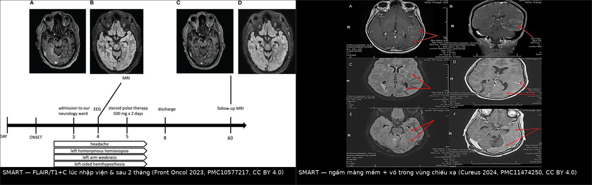
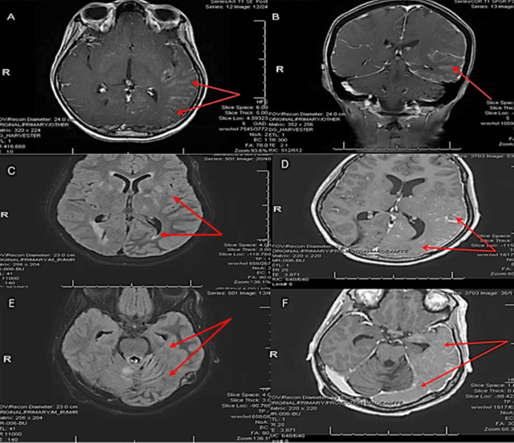
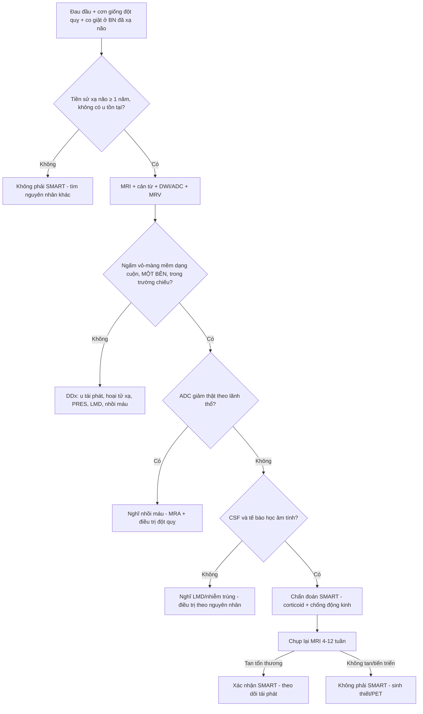
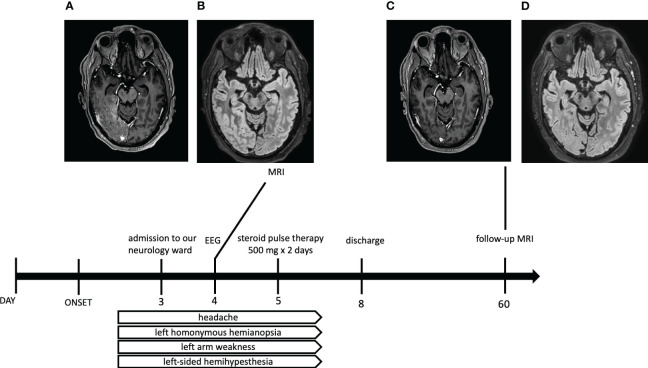
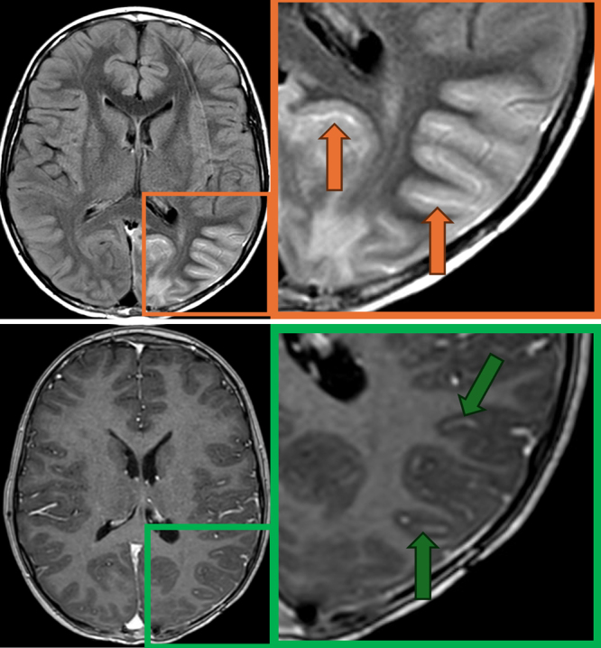
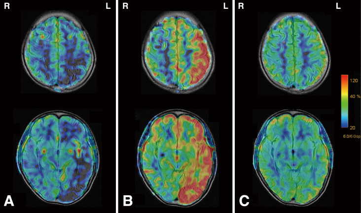

# 259 — Hội chứng SMART: cơn giống đột quỵ – đau nửa đầu sau xạ trị não / Stroke-like migraine attacks after radiation therapy (SMART) syndrome

**Tags:** `pattern:ngam-mang-me` `pattern:ngam-vo-dang-cuon` `pattern:phu-vo-nao` `pattern:khong-theo-lanh-tho-mach` `vung:vo-nao` `vung:thai-duong-dinh-cham` `protocol:MRI-nao` `protocol:MRV` `protocol:ASL` `protocol:EEG`

**Mức chắc chắn (certainty):** tổng hợp y văn (literature synthesis) — 3 ca nguyên văn có ảnh (Front Oncol 2023, PMC10577217; Cureus 2024, PMC11474250; J Neurosurg Case Lessons 2025, PMC12105588) + 1 ca có ASL động (NMC Case Rep J 2024, PMC11165263) + 1 ca có DSC-rCBV theo dõi dọc (Front Oncol 2026, PMC13521836) + tổng quan biến chứng muộn sau xạ (Insights Imaging 2018, PMC6269328) + loạt 15 ca nhi (PMC12105588). Không có thử nghiệm ngẫu nhiên nào; mọi ngưỡng xử trí là tổng hợp thực hành, chỗ nào là suy luận được ghi rõ.

> **Câu chốt:** SMART là **chẩn đoán loại trừ bằng bệnh sử + hình ảnh**: bệnh nhân **đã xạ trị não từ nhiều năm trước**, nay **đau đầu kiểu migraine + cơn giống đột quỵ + co giật**, MRI cho **ngấm vỏ–màng mềm dạng cuộn MỘT BÊN, nằm ĐÚNG trong vùng chiếu xạ, KHÔNG theo lãnh thổ mạch**, và **tự hồi phục**. Hai ngưỡng phải thuộc: **khởi phát 1–37 năm sau xạ (trung bình 9,5 năm; trung vị 14 năm)** và **ngấm thuốc xuất hiện trong tuần đầu, tan trong ~1 tháng (có thể tới 3 tháng)**. Sai lầm chết người không phải bỏ sót SMART mà là **gọi SMART là tái phát u và xạ lại/sinh thiết não** — hoặc **gọi là mủ màng não (LMD) và mở tháo shunt**.

## 1. Tổng quan bệnh học – cơ chế hình ảnh

### 1.1 Bệnh học: tổn thương muộn của mạch–hàng rào máu não trong trường chiếu

- SMART được mô tả lần đầu 1995 ở trẻ, nay chủ yếu gặp ở người lớn; **giới nam nhiều hơn nữ ~2,2 : 1** (Insights Imaging 2018, PMC6269328). Y văn chủ yếu là **ca lẻ và loạt nhỏ (~100–200 ca tích lũy)** — **không có tần suất quần thể**, nên đừng trích "1%" khi chưa có nguồn.
- **Liều xạ điển hình 50–64 Gy**; đã có ca sau **16,2 Gy** (loạt nhi) và ca sau xạ toàn não — **liều thấp KHÔNG loại trừ SMART**.
- Ba giả thuyết cơ chế, không loại trừ nhau:
  1. **Nội mô – tự điều hòa mạch**: xạ gây hại nội mô muộn → mất tự điều hòa, **rò hàng rào máu não** → phù vận mạch vỏ + ngấm thuốc (giống PRES nhưng khu trú đúng trường chiếu).
  2. **Trục trigeminovascular – cortical spreading depression**: ngưỡng lan truyền vỏ giảm → cơn migraine kèm thiếu hụt thần kinh thoáng qua.
  3. **Cơ chế do cơn động kinh**: co giật gây phù vỏ sau cơn (peri-ictal) — nhưng **một nửa số ca SMART không có phóng điện động kinh trên EEG** (dẫn trong PMC10577217), nên **động kinh là bạn đồng hành, không phải nguyên nhân duy nhất**.

### 1.2 TẠI SAO hình ảnh trông như vậy (vật lý + mô bệnh)

- **FLAIR/T2 sáng dạng cuộn theo vỏ + vỏ dày nhẹ:** phù **vận mạch (vasogenic)** trong chất trắng dưới vỏ và vỏ — nước ngoại bào tăng → T2/FLAIR sáng, **không phá vỡ cấu trúc vỏ** như nhồi máu.
- **Ngấm thuốc dạng cuộn (gyriform) + màng mềm:** rò hàng rào máu não ở mao mạch vỏ/màng mềm → gadolinium thoát vào khoang ngoại bào. Vì tổn thương **bám theo vỏ**, thuốc ngấm thành **dải uốn theo hồi não**, không thành ổ tròn như u.
- **DWI:** phần lớn là **T2 shine-through** — DWI sáng nhưng **ADC không giảm** (phù vận mạch làm khuếch tán tăng). **ADC giảm thật** chỉ xuất hiện ở ca có hạn chế khuếch tán nhẹ hoặc khi có nhồi máu/động kinh kéo dài đi kèm → **ADC là câu trả lời cho "SMART hay nhồi máu"**.
- **Tưới máu:** báo cáo **không đồng nhất** — ASL có thể **giảm tưới máu lúc khởi phát rồi chuyển sang tăng tưới máu** trong vài ngày (NMC Case Rep J 2024, PMC11165263), trong khi ca theo dõi dọc bằng **DSC-rCBV** cho **rCBV bình thường đến giảm nhẹ, không tăng khu trú** (Front Oncol 2026, PMC13521836). Bài học: **đừng dùng tăng tưới máu để chốt SMART**, và **đừng dùng nó để chốt tái phát u**.

### 1.3 Ngưỡng định lượng bắt buộc nhớ

| Đại lượng | Con số | Nguồn |
|---|---|---|
| Thời gian tiềm tàng (latency) | **1–37 năm**, trung bình **9,5 năm**; trung vị **14 năm** | PMC10577217 / PMC12105588 |
| Latency ở trẻ | **4 tháng – 10 năm** (15 ca, 5–17 tuổi) | PMC12105588 |
| Liều xạ | thường **50–64 Gy**; trẻ **16,2–60 Gy** | PMC6269328 / PMC12105588 |
| Thiếu hụt thần kinh khu trú | **33–74%** | PMC6269328 |
| Co giật | **70–82%** | PMC6269328 |
| Thời điểm ngấm thuốc | xuất hiện **trong tuần đầu**, tan **~1 tháng**, có thể **tới 3 tháng** | PMC8645481 (dẫn Black) |
| Kết cục trẻ | **7/15 hồi phục hoàn toàn**, **8/15 hồi phục một phần** | PMC12105588 |

## 2. Mẫu hình + chẩn đoán phân biệt theo vị trí (Gamut)

**Mẫu hình chốt:** *ngấm vỏ–màng mềm dạng cuộn, MỘT BÊN, ưu thế vùng đỉnh–chẩm–thái dương, nằm trong trường chiếu cũ, không theo lãnh thổ mạch, hồi phục trên phim chụp lại.*

Gamut theo **vị trí + bối cảnh**:

- **Trong trường chiếu xạ, có tiền sử xạ não:** SMART · **hoại tử xạ (radiation necrosis)** · **tái phát u/pseudoprogression** · **bệnh mạch máu do xạ (hẹp–tắc, moyamoya)** · **leukoencephalopathy do xạ**.
- **Không theo lãnh thổ mạch, đối xứng hoặc nhiều ổ:** **PRES** · **bệnh não do thuốc** · **bệnh ty thể (MELAS)** · **viêm màng não–não tự miễn/nhiễm trùng**.
- **Ngấm màng mềm lan tỏa:** **LMD (di căn màng não)** · **viêm màng não do thuốc** · **SMART** — đây là bẫy lớn nhất, vì cả ba đều "ngấm màng mềm".
- **Khởi phát cấp, có cơn co giật:** **trạng thái động kinh không co giật / liệt Todd** · **nhồi máu cấp** · **huyết khối xoang tĩnh mạch não**.
- **Gợi nhớ SMART:** **S**troke-like deficits · **M**igraine · **A**fter **R**adiation · **T**ransient (và **T**erritory-sparing).

## 3. Bảng so sánh phân biệt (ma trận đối chiếu)

| Thực thể (entity) | Hình ảnh điển hình | Chốt vào (rule-in) | Chốt loại (rule-out) | Gợi ý xác nhận |
|---|---|---|---|---|
| **SMART** | FLAIR sáng + ngấm **vỏ–màng mềm dạng cuộn một bên**, trong trường chiếu, **không theo lãnh thổ mạch**, hồi phục | **Vị trí đúng trường chiếu + hồi phục trong 4–12 tuần + bệnh sử xạ não nhiều năm** | Ngấm thuốc **lan ngoài trường chiếu** hoặc **nốt đặc trong lòng** → nghĩ u/LMD | MRI + cản từ lúc cấp và **chụp lại 4–12 tuần**; CSF âm tính |
| **Tái phát u / pseudoprogression** | Khối **đặc**, ngấm thuốc **dạng nốt/ổ**, có hiệu ứng khối, **lan ra ngoài trường chiếu** | **Ổ đặc + phù quanh ổ + lớn dần** trên phim nối tiếp | **Ngấm dạng cuộn theo vỏ, không có ổ đặc, tan dần** → SMART | MRI 3–4 tuần + MR spectroscopy/PET; sinh thiết chỉ khi vẫn tiến triển |
| **Hoại tử xạ** | Ổ **"bơ" (soap-bubble)**, ngấm **viền/vòng**, T2 hỗn hợp, thường **đỉnh liều** | **Viền ngấm + hoại tử trung tâm + đỉnh liều** trong kế hoạch xạ | **Ngấm vỏ dạng cuộn một dải dài** → SMART | MRI đa chuỗi + lịch sử liều; PET/DSC |
| **PRES** | Phù **đối xứng hai bên** đỉnh–chẩm, **không bám trường chiếu**, thường có tăng HA/thuốc | **Đối xứng + tăng huyết áp/thuốc ức chế miễn dịch** | **Một bên, đúng trường chiếu, tiền sử xạ** → SMART | Theo dõi huyết áp, ngừng thuốc; xem 3031 |
| **LMD (di căn màng não)** | Ngấm màng mềm **lan tỏa, nhiều tầng**, có nốt màng mềm, **không tự tan** | **Tế bào ác tính trong CSF / nốt màng mềm / lan theo rễ** | **CSF âm tính + tan sau vài tuần + không nốt** → SMART | CSF tế bào học (làm 1–2 lần), MRI tủy |
| **Trạng thái động kinh / liệt Todd** | Phù vỏ **quanh ổ động kinh**, có thể hạn chế khuếch tán nhẹ | **EEG có phóng điện + đáp ứng thuốc chống động kinh** | **EEG không phóng điện + phù kéo dài vài tuần** → SMART | EEG kéo dài, theo dõi sau cắt cơn |
| **Nhồi máu cấp** | **ADC giảm thật**, theo **lãnh thổ mạch**, vỏ + chất trắng | **ADC tối + lãnh thổ mạch** | **ADC không giảm + bám trường chiếu** → SMART | DWI/ADC, MRA |

*Trái: FLAIR/T1+C lúc nhập viện và sau 2 tháng — ngấm vỏ thái dương–chẩm phải, tan gần hoàn toàn. Phải: ngấm màng mềm + vỏ thái dương–đỉnh–chẩm trái theo đúng trường chiếu. Cả hai đều CC BY 4.0, ảnh ghép letterbox.*

*Ngấm màng mềm và vỏ thái dương–đỉnh–chẩm trái (A–F, mũi tên đỏ) ở bệnh nhân đã xạ sọ–tủy; CSF âm tính và tổn thương tan sau corticoid. Nguồn: Cureus 2024, PMC11474250, CC BY 4.0.*

### Ba dấu hiệu chốt (đọc theo thứ tự)

1. **Vị trí có nằm trong trường chiếu cũ không?** Nếu có → nghĩ SMART trước u. Nếu tổn thương **vượt qua đường giữa/lan xa trường chiếu** → nghĩ u/LMD.
2. **Có ổ đặc trong lòng hay chỉ một dải vỏ?** Chỉ dải vỏ → SMART. Có ổ đặc + phù quanh ổ → u/hoại tử.
3. **Có hồi phục trên phim chụp lại không?** Đây là tiêu chuẩn **bắt buộc** của Black; **không chụp lại = không được chốt SMART**.

## 4. Protocol chụp + hệ phân độ/điểm chuẩn hóa

- **MRI não 1,5T hoặc 3T, tối thiểu:** T1W, T2W, **FLAIR**, **DWI + ADC**, **T1W sau gadolinium** (lát mỏng ≤ 3 mm qua vùng nghi), **MRV** (loại huyết khối xoang), **MRA/TOF** khi nghi bệnh mạch do xạ.
- **Thêm khi còn chẩn đoán mở:** **ASL** (tưới máu không cản từ) hoặc **DSC-rCBV**; **MR spectroscopy** khi nghi hoại tử/u; **MRI tủy** khi nghi LMD.
- **Thời điểm:** chụp **ngay trong tuần đầu** (ngấm thuốc rõ nhất) và **chụp lại 4–12 tuần** (bắt buộc để chứng minh hồi phục). Nếu vẫn tiến triển sau 12 tuần → **không còn là SMART**, phải tìm u/hoại tử.
- **EEG kéo dài** khi có rối loạn ý thức/cơn lặp lại: **một nửa ca SMART không có phóng điện**, nên EEG âm **không loại trừ**; nhưng EEG bắt được trạng thái động kinh không co giật (bệnh cảnh dễ nhầm).
- **CSF** khi có ngấm màng mềm lan tỏa: tế bào học + protein + cấy + PCR — để loại **LMD/nhiễm trùng**; trong SMART **CSF bình thường**.
- **Không có hệ phân độ/RADS cho SMART** (khác Fleischner/Lung-RADS). Tiêu chuẩn dùng là **Black 2006**:

**Điều trị (không có chuẩn hóa):**
- **Corticoid** là lựa chọn được báo cáo nhiều nhất: ca người lớn dùng **methylprednisolone 500 mg × 2 ngày** rồi giảm liều (PMC10577217); ca nhi dùng **methylprednisolone 30 mg/kg/ngày × 5 ngày**, cải thiện trong **24 giờ** (PMC12105588).
- **Chống động kinh** khi có cơn (levetiracetam, lacosamide…), cân nhắc cai sau **6–12 tháng không cơn**.
- **Dự phòng tái phát:** có báo cáo dùng **verapamil** cho các ca tái diễn (PMC10577217) — **bằng chứng ca lẻ**, không phải khuyến cáo mạnh.
- **TUYỆT ĐỐI tránh:** xạ lại vào vùng tổn thương khi chưa loại trừ SMART; sinh thiết não "để chắc" khi hình ảnh điển hình + CSF âm tính.

## 5. Biến thể bình thường và cạm bẫy

- **Ngấm màng mềm sau mổ/màng cứng nhân tạo** ở bệnh nhân đã mổ u: ngấm **khu trú tại vết mổ**, không theo vỏ — đừng gọi LMD, cũng đừng gọi SMART.
- **Ngấm màng mềm ở hố sau** có thể là **bình thường giả** do mạch máu màng mềm; ca SMART ở trẻ có **ngấm màng mềm lan rộng nhưng TIỂU NÃO KHÔNG ngấm** — chi tiết này giúp loại LMD (PMC11474250).
- **Co giật đơn thuần (liệt Todd)** gây phù vỏ thoáng qua **giống hệt** SMART về hình ảnh; khác biệt nằm ở **tiền sử xạ + vị trí đúng trường chiếu + tái diễn nhiều đợt**.
- **Bệnh nhân có shunt não thất:** đau đầu + nôn + lừ đừ dễ bị gán "shunt hỏng" và **mổ thăm dò shunt**; nếu não thất **không giãn thêm** và MRI có phù vỏ đúng trường chiếu → nghĩ SMART trước (PMC12105588).
- **Tăng tưới máu không phải tiêu chuẩn:** có ca **rCBV bình thường/giảm nhẹ**; dùng "tăng tưới máu" để chốt SMART sẽ bỏ sót ca điển hình.
- **Cạm bẫy thỏa mãn tìm kiếm (satisfaction of search):** thấy ngấm màng mềm là dừng ở LMD, không đọc lại **vùng chiếu xạ cũ** và không so **phim trước xạ** để xác định trường chiếu.

## 6. Tự lượng giá — Blind Quiz

**Ca 1 — Nam 41 tuổi, u oligodendroglioma độ 3 đã mổ + xạ 60 Gy/30 phân liều 26 năm trước, nay đau đầu nửa đầu phải, bán manh cùng bên trái, yếu tay trái.**

- Câu hỏi: Tổn thương nằm ở đâu so với trường chiếu? Chuỗi xung nào chốt? Chẩn đoán phân biệt 3 khả năng và dấu hiệu nào loại tái phát u?

<b>Bấm để hiện đáp án (findings + chẩn đoán)</b>

- **Dấu hiệu:** (A) T1 sau cản từ và (B) FLAIR lúc nhập viện: **phù vỏ + ngấm vỏ thái dương–chẩm phải**, đúng vùng bán cầu phải đã xạ; (C, D) chụp lại **sau 2 tháng**: **tan gần hoàn toàn**.
- **Chẩn đoán:** **SMART** — thoả tiêu chuẩn Black: xạ não từ xa, thiếu hụt khu trú một bên hồi phục, ngấm vỏ dạng cuộn trong trường chiếu, không do nguyên nhân khác.
- **Loại tái phát u:** không có **ổ đặc**, không hiệu ứng khối, và **tan theo thời gian** — u không tự tan.
- **Điều trị trong ca:** **methylprednisolone 500 mg × 2 ngày**, triệu chứng giảm; không xạ lại.
- **Phản biện:** ca này latency **26 năm** — cực dài so với trung bình **9,5 năm**; đừng vì "quá lâu" mà loại SMART.
- **Nguồn ảnh:** *Frontiers in Oncology* 2023, PMCID PMC10577217, **CC BY 4.0** (nguyên bản, giữ nhãn A–D).

**Ca 2 — Nữ 23 tuổi, medulloblastoma thời thơ ấu đã xạ sọ–tủy 55 Gy + shunt não thất–phúc mạc, nay đau đầu và cơn co giật mới. Hình dưới là gì?**

- Câu hỏi: Ngấm thuốc ở đâu, có phải di căn màng não không? Vì sao không mổ thăm dò shunt? Dấu hiệu nào giúp loại LMD?

<b>Bấm để hiện đáp án (findings + chẩn đoán)</b>

- **Dấu hiệu:** **FLAIR sáng + vỏ dày nhẹ + ngấm màng mềm** vùng **thái dương–chẩm trái** (khung cam), **T1 sau cản từ** xác nhận ngấm màng mềm theo rãnh (khung xanh).
- **Chẩn đoán:** **SMART** sau xạ sọ–tủy; **CSF âm tính** (không tế bào ác tính, không nhiễm trùng) và **tan sau 6 tháng** trên MRI chụp lại.
- **Loại LMD:** CSF âm tính + **không có nốt màng mềm** + **tiểu não không ngấm** + tan dần.
- **Vì sao không mổ shunt:** não thất **không giãn thêm**, không có dòng chuyển vận qua mô não thất; đau đầu do SMART, **mổ thăm dò shunt là can thiệp oan**.
- **Nguồn ảnh:** *Journal of Neurosurgery: Case Lessons* 2025, PMCID PMC12105588, **CC BY-NC-ND 4.0** (nguyên bản, không chỉnh sửa).

**Ca 3 — Bệnh nhân sau xạ hố sau 8 năm, đột ngột mất ngôn ngữ và liệt nửa người phải. ASL ba thời điểm dưới đây nói gì?**

- Câu hỏi: Mô tả thay đổi tưới máu theo thời gian? Vì sao thay đổi này loại nhồi máu? Có nên chốt SMART chỉ dựa vào tăng tưới máu không?

<b>Bấm để hiện đáp án (findings + chẩn đoán)</b>

- **Dấu hiệu:** (A) lúc nhập viện: **giảm tưới máu (xanh) vùng thái dương–đỉnh trái**; (B) ngày thứ 2–3: **tăng tưới máu (đỏ) cùng vùng**; (C) ngày 15: **gần bình thường**.
- **Vì sao loại nhồi máu:** nhồi máu không **tăng tưới máu** rồi bình thường hoá trong 2 tuần; kiểu **giảm → tăng → bình thường** phù hợp **rối loạn tự điều hòa thoáng qua** (SMART/hemiplegic migraine).
- **Không chốt chỉ dựa vào tưới máu:** báo cáo khác có **rCBV bình thường/giảm nhẹ**; tưới máu chỉ là **bằng chứng phụ**, chốt vẫn là **bệnh sử xạ + ngấm vỏ đúng trường chiếu + hồi phục**.
- **Nguồn ảnh:** *NMC Case Report Journal* 2024, PMCID PMC11165263, **CC BY-NC-ND 4.0** (nguyên bản, giữ nhãn A–C).

## Bài liên quan chéo
- [200 – Tổng quan hệ Thần kinh](../200-tong-quan-he-than-kinh/lesson.md)
- [204 – Hoại tử phóng xạ sau xạ trị u não](../204-hoai-tu-phong-xa-sau-xa-tri-u-nao/lesson.md)
- [3031 – PRES: phù vận mạch không theo lãnh thổ mạch](../3031-pres-benh-nao-sau-phuc-hoi/lesson.md)
- [219 – PRES & RCVS](../219-pres-rcvs/lesson.md)
- [211 – Đột quỵ não](../211-dot-quy-nao/lesson.md)
- [214 – Nhiễm trùng thần kinh trung ương](../214-nhiem-trung-tktw/lesson.md)
- [3023 – Ù tai mạch đập (bệnh mạch do xạ, hẹp xoang)](../3023-u-tai-mach-dap/lesson.md)
- [3033 – Bệnh não Wernicke (phù đối xứng quanh cống)](../3033-benh-nao-wernicke-thieu-thiamin/lesson.md)

> Không dùng để chẩn đoán độc lập khi chưa có người hướng dẫn.
