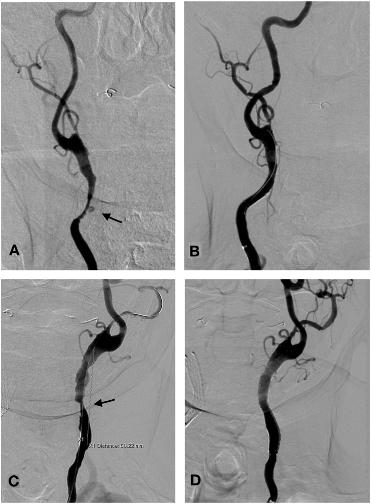
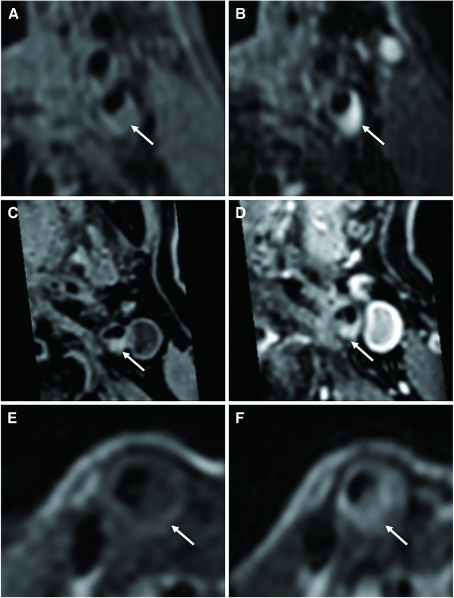
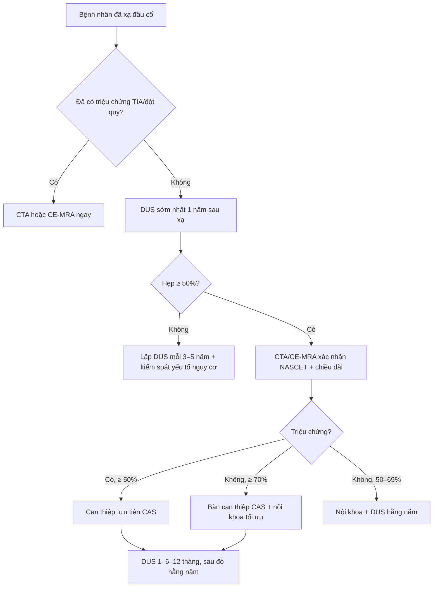

# 260 — Bệnh mạch cảnh do xạ trị đầu cổ: hẹp–tắc dài, nhẵn, không vôi / Radiation-induced carotid stenosis (RICS)

**Tags:** `pattern:hep-mach` `pattern:tac-mach` `pattern:hep-dai-doan` `pattern:it-voi-hoa` `pattern:loet-mang-xo-vua` `pattern:nhieu-o` `vung:dong-mach-canh` `vung:dau-co` `score:NASCET` `score:PSV-DUS` `protocol:SA-Doppler` `protocol:CTA-MRA` `protocol:MRI-mang-xo-den` `protocol:DSA`

**Mức chắc chắn (certainty):** tổng hợp y văn (literature synthesis) — 1 phân tích gộp 16 nghiên cứu ở bệnh nhân ung thư vòm họng (Braz J Otorhinolaryngol 2022, PMC9756067), 1 đoàn hệ 907 bệnh nhân ung thư đầu cổ (PLoS One 2025, PMC11781643), 1 đoàn hệ so sánh CEA–CAS có ghép cặp 43 ca RICS (Ann Surg Treat Res 2022, PMC9365643), 1 loạt 26 ca có can thiệp (Transl Oncol 2019, PMC6542749), 1 nghiên cứu MRI mảng xơ (J Neuroendovasc Ther 2022, PMC10370715), 1 ca nguyên văn stent ngắn lại trong 24 giờ (Front Neurol 2023, PMC10203154) và 1 tổng quan điều trị hẹp cảnh cập nhật 2026 (Front Stroke 2026, PMC13343524). Không có thử nghiệm ngẫu nhiên riêng cho RICS; các ngưỡng can thiệp là mượn từ hẹp cảnh xơ vữa, chỗ suy luận được ghi rõ.

> **Câu chốt:** RICS là **hẹp cảnh NGOÀI SỌ trong trường chiếu cũ**, khác xơ vữa ở ba điểm: **(1) dài và nhiều ổ** — đoạn hẹp CCA trung bình **31,16 ± 10,60 mm** trong loạt chính, và **32,8 ± 30,0 mm** so với **6,9 ± 5,1 mm** ở hẹp xơ vữa trong loạt so sánh của Sano; **(2) ít viêm, nhiều xơ** — mô bệnh học "less inflammatory and more fibrotic", mảng xơ **mềm, ít vôi hóa**, **loét 14/26 (54%)** trong loạt có triệu chứng; **(3) đến MUỘN và âm thầm** — trung vị **10 năm** tới đột quỵ ở bệnh nhân xạ **60–70 Gy**, nguy cơ hẹp nặng tăng **8,5 lần** nếu đã xạ **> 5 năm**. Ba con số phải thuộc: xạ đầu cổ làm tăng hẹp có ý nghĩa **RR 7,06 (3,61–13,79)**; **25–26%** người sống sót có hẹp **> 50%**, **12%** hẹp **> 70%**; và **tầm soát Doppler từ 1 năm sau xạ, lặp 3–5 năm** (ICOS 2021) — vì bỏ sót nghĩa là để một **đột quỵ có thể phòng được** xảy ra ở người còn nhiều năm sống.

## 1. Tổng quan bệnh học – cơ chế hình ảnh

### 1.1 Bệnh học: xơ hóa thành mạch do xạ, không phải mảng xơ vữa điển hình

- **Định nghĩa thực hành:** RICS = hẹp **> 50%** động mạch cảnh ở bệnh nhân **đã xạ vùng cổ** để điều trị ung thư, xuất hiện sau một khoảng tiềm tàng (latency) nhiều tháng đến nhiều năm (Ann Surg Treat Res 2022, PMC9365643).
- **Chuỗi tổn thương 4 bước** (tổng hợp từ PMC6542749 và PMC9365643):
  1. **Tổn thương nội mô + tế bào cơ trơn** do bức xạ → apoptosis, viêm, stress oxy hóa.
  2. **Tổn thương vasa vasorum + xơ hóa lớp áo ngoài** → thành mạch thiếu máu nuôi, xơ cứng, dính vào mô cổ xung quanh.
  3. **Tăng sinh nội mạc + lắng lipid** → mảng xơ **dài, lan dọc**, bờ **nhẵn**, **nhiều ổ** (multifocal), **ít vôi hóa**.
  4. **Loét bề mặt + huyết khối tại chỗ** → nguồn tắc mạch (embolic source), dù mảng xơ về mô học **ít viêm hơn** mảng xơ vữa thường.
- **Vì sao "ít viêm, nhiều xơ" lại quan trọng trên ảnh:** thành mạch xơ → **dính, khó bóc** khi mổ hở, **không có vôi hóa để làm mốc**, và mảng xơ có thể **mềm, dễ vỡ** khi can thiệp. So sánh mô bệnh học của Fokkema (trích trong PMC6542749): tổn thương sau xạ **ít tế bào viêm, nhiều collagen** hơn mảng xơ vữa không xạ.
- **Chiều dài — dấu hiệu định lượng mạnh nhất trên hình ảnh:** trong 26 ca có triệu chứng, đoạn hẹp ICA trung bình **19,16 ± 3,42 mm**, CCA **31,16 ± 10,60 mm**; loạt của Sano so sánh CCA **32,8 ± 30,0 mm** (xạ) với **6,9 ± 5,1 mm** (xơ vữa) — chênh gần **5 lần** (PMC6542749). Hẹp xơ vữa điển hình **khu trú một ổ ở chỗ chia đôi/đoạn đầu ICA**, còn RICS **lan dọc CCA và nhiều đoạn**.
- **Latency:** loạt có triệu chứng **27–50 tháng** (trung bình **45,2 tháng**) sau xạ **58–70 Gy** (trung bình **62 Gy**) (PMC6542749). Ngoài ra: nguy cơ hẹp nặng **8,5 lần** nếu xạ **> 5 năm**; Brown thấy nguy cơ chỉ tăng rõ sau **10–15 năm**; Dorresteijn báo **trung vị 10 năm** tới đột quỵ (dẫn trong PMC6542749). Phân tích gộp ghi khoảng cách xạ **0,3–30 năm** (PMC9756067) — nghĩa là **không có "cửa sổ an toàn"**.
- **Liều và thể tích:** liều trung bình trong đoàn hệ 907 ca là **69,30 ± 24,29 Gy** (PMC11781643); hướng dẫn COG dùng mốc **≥ 40 Gy vào cổ** để chỉ định siêu âm cảnh **10 năm sau xạ** (dẫn trong PMC10627489). Các nghiên cứu liều–đáp ứng cho thấy **V10–V70 Gy của cảnh** đều liên quan tới hẹp cảnh không triệu chứng (PMC11781643) — tức **ngưỡng liều thấp hơn ta tưởng**.
- **Dịch tễ — vì sao đáng làm bài riêng:** xạ đầu cổ làm **tăng gấp đôi** nguy cơ TIA/đột quỵ thiếu máu (tổng quan 99 nghiên cứu, dẫn trong PMC6542749); ở bệnh nhân ung thư vòm họng, phân tích gộp 16 nghiên cứu cho **RR 3,53** cho mọi mức hẹp và **RR 7,06** cho hẹp có ý nghĩa (PMC9756067). Đoàn hệ 907 ca Thái Lan: **đột quỵ/TIA 1,98%**, tích lũy **1,65% sau 5 năm**; hẹp mới **> 50%** tích lũy **1,3% / 2,2% / 2,5%** ở **12 / 24 / 36 tháng** (PMC11781643).

### 1.2 Cơ chế hình ảnh — TẠI SAO RICS trông như vậy

- **CT:** mảng xơ xơ hóa **ít cản quang hơn vôi**; vì vậy RICS thường **không có "đốm trắng" vôi hóa** dễ thấy ở chỗ chia đôi. CTA đo được **chiều dài tổn thương** và **đường kính lòng mạch** — hai biến số quyết định chọn stent.
- **Siêu âm Doppler (DUS):** mảng xơ **giảm hồi âm**, bờ **nhẵn**, **dài**; vôi hóa ít → **không bị "che" bóng**, nhưng cũng **không có mốc sáng** để đo. Tốc độ đỉnh tâm thu (PSV) **> 230 cm/s** kèm **tỉ số ICA/CCA > 4,0** là ngưỡng dùng trong loạt RICS để gọi hẹp **≥ 70%** (PMC9365643).
- **MRI mảng xơ (black-blood):** T1 cao phản ánh **xơ, lipid, hoại tử hoặc máu trong mảng**; T2 cao phản ánh **lipid/hoại tử**. Ở RICS, **tỉ số tín hiệu T2 so với cơ ức đòn chũm cao hơn** hẹp xơ vữa (**p = 0,0381**), phù hợp với **lõi hoại tử** nhiều hơn — và đây là lý do **tái hẹp sau stent cao hơn** (PMC10370715).
- **Vì sao hẹp lại gây đột quỵ dù mảng "xơ":** hẹp làm **giảm áp lực tưới máu xa** (nhồi máu vùng ranh giới khi huyết áp tụt) và **loét bề mặt** giải phóng huyết khối (tắc mạch). Trong loạt 26 ca, **14 ca có loét bề mặt** và **20 ca TIA, 6 ca đột quỵ** (PMC6542749) — hình ảnh **loét** là dấu hiệu nguy cơ, không phải chi tiết phụ.

## 2. Mẫu hình + chẩn đoán phân biệt theo vị trí (gamut)

### 2.1 Theo vị trí trong trường chiếu

- **CCA (thân chung):** tổn thương **dài nhất**, thường **hẹp nhẵn lan dọc**, có thể **giãn đoạn gần** (post-stenotic dilatation) — loạt 26 ca: CCA **58%**. Đây là vị trí **dễ bị bỏ sót** trên DUS nếu chỉ đo chỗ chia đôi.
- **Chỗ chia đôi + đoạn đầu ICA:** hẹp **khu trú hoặc lan xuống CCA**; ICA **85%** trong loạt trên. Dễ nhầm với xơ vữa nhất, vì cùng vị trí.
- **ECA:** **58%** trong loạt; thường **hẹp lỗ vào ECA** kèm hẹp CCA. Ít gây đột quỵ trực tiếp nhưng **làm hẹp nguồn bàng hệ** khi ICA tắc — quan trọng khi **tắc ICA đối bên**.
- **Động mạch dưới đòn:** **19%** trong loạt 26 ca (PMC6542749) — **phải khảo sát khi siêu âm**, vì hẹp dưới đòn làm **sai lệch PSV** và gây **hội chứng cướp dưới đòn**.
- **Hai bên:** RICS có thể **một bên** (đúng trường chiếu) hoặc **hai bên không đối xứng**; **tắc ICA đối bên** gặp **nhiều hơn** hẹp xơ vữa (**16,2% vs 0** trong loạt ghép cặp, PMC9365643) — đây là **chống chỉ định tương đối** của mổ hở và là lý do **ưu tiên stent**.

### 2.2 Gamut theo hình thái (nhìn ảnh mà nghĩ)

- **Hẹp dài, nhẵn, một hoặc nhiều ổ, không vôi:** RICS (ưu tiên số 1 khi có tiền sử xạ cổ); **viêm mạch lớn** (Takayasu, GCA — thường có dày thành đồng tâm, ngấm thuốc); **loạn sản cơ xơ (FMD)** — "chuỗi hạt" ở ICA giữa, **không dài nhẵn**; **bóc tách** — vạt nội mạc, giả lòng.
- **Hẹp khu trú + vôi hóa nặng + loét:** xơ vữa thông thường (nhưng **RICS vẫn có thể loét** — đừng loại vì có loét).
- **Hẹp + phình/giả phình + chảy máu cam tái diễn:** **vỡ giả phình do xạ (carotid blowout)** — bệnh cảnh cấp cứu khác, xem bài 3046.
- **Hẹp + hẹp nội sọ kèm mạng bàng hệ:** **bệnh mạch máu lớn nội sọ do xạ/moyamoya do xạ** — xem bài 262; có thể **đồng thời** với RICS.

### 2.3 Gợi nhớ **R-A-D-I-O**

**R**adiation field (vị trí đúng trường chiếu) · **A**ge/interval (nhiều năm sau xạ) · **D**iffuse long lesion (dài, nhiều ổ) · **I**nflammation-poor/fibrotic (ít viêm, nhiều xơ) · **O**cclusion/ulcer (tắc hoặc loét bề mặt).

## 3. Bảng so sánh phân biệt (ma trận đối chiếu)

| Thực thể (entity) | Hình ảnh điển hình (DUS/CTA/MRI) | Chốt vào (rule-in) | Chốt loại (rule-out) | Gợi ý xác nhận |
|---|---|---|---|---|
| **RICS** | Hẹp **dài (CCA ≥ 30 mm), nhẵn, nhiều ổ**, **ít vôi**, đúng trường chiếu; có thể loét; **tắc ICA đối bên** | **Tiền sử xạ cổ + tổn thương dài/nhiều ổ trong trường chiếu + latency ≥ 2 năm** | **Vôi hóa nặng khu trú đúng chỗ chia đôi, không tiền sử xạ** → nghĩ xơ vữa | CTA/CE-MRA đo chiều dài; DUS PSV > 230 cm/s + tỉ số > 4,0; MRI mảng xơ |
| **Xơ vữa cảnh** | Khu trú **chỗ chia đôi/đoạn đầu ICA**, **vôi hóa**, mảng không đều, thường **một ổ** | **Vôi hóa + khu trú + yếu tố nguy cơ kinh điển** (tuổi, THA, ĐTĐ, hút thuốc, rối loạn lipid) | **Tổn thương dài lan CCA + ít vôi + đúng trường xạ** → RICS | DUS + CTA; không cần sinh thiết |
| **Takayasu/GCA (viêm mạch lớn)** | **Dày thành đồng tâm**, ngấm thuốc, hẹp dài **nhiều đoạn**, thường **hai bên**; GCA ở người **> 50 tuổi** | **Dày thành > 1 mm đồng tâm + ngấm thuốc + triệu chứng viêm** (CRP, đau đầu, thị lực) | **Không dày thành, không ngấm thuốc** → không phải viêm mạch hoạt động | MRI/CTA thành mạch + CRP/VS; PET-CT nếu cần |
| **Loạn sản cơ xơ (FMD)** | **"Chuỗi hạt" (string of beads)** ICA giữa/cổ, **không dài nhẵn**, thường nữ trẻ | **Chuỗi hạt điển hình + không tiền sử xạ** | **Hẹp dài nhẵn một đoạn** → không phải FMD | CTA/DSA; FMD **không** can thiệp stent thường quy |
| **Bóc tách cảnh** | **Vạt nội mạc**, **giả lòng**, hẹp **hình nón** ("flame"), đau cổ + Horner | **Vạt/giả lòng + khởi phát cấp** | **Hẹp nhẵn mạn, không vạt** → không bóc tách | CTA/MRA thì mạch; MRI T1 fat-sat thành mạch (máu trong thành) |
| **Giả phình/blowout do xạ** | **Túi phình** trong trường xạ, có thể **vôi hóa vỏ**, chảy máu cam ồ ạt | **Túi phình + chảy máu cam tái diễn** | **Chỉ hẹp lòng, không túi** → RICS đơn thuần | CTA mạch máu **cấp cứu**, DSA |

### 3.1 Đọc đúng "dài – nhẵn – ít vôi": ba dấu hiệu, một chẩn đoán

- **Dài:** đo **chiều dài đoạn hẹp** trên CTA/CE-MRA, không chỉ đo % đường kính. **≥ 20 mm ở ICA hoặc ≥ 30 mm ở CCA** là gợi ý mạnh cho RICS (ngưỡng **suy luận** từ phân bố của loạt 26 ca: ICA 19,16 mm, CCA 31,16 mm; PMC6542749).
- **Nhẵn:** bờ trong **đều**, không có **mảng vôi lồi**; nhưng **có thể loét** — loét là **dấu hiệu nguy cơ**, không loại RICS.
- **Ít vôi:** đừng dùng "không thấy vôi" để loại xơ vữa ở người trẻ; hãy dùng **tiền sử xạ + chiều dài + nhiều ổ**.

*Bốn ô: (A) CCA phải — hẹp nặng + **loét** giữa đoạn (mũi tên), hẹp tới lỗ ECA; (B) sau đặt stent, lòng mạch thông; (C) CCA trái — **hẹp dài tới mức tới hạn**, đoạn hẹp **56,22 mm**; (D) sau stent. Ảnh nguyên bản, không crop/ghép: Transl Oncol 2019, Fig. 1 — PMC6542749, **CC BY-NC-ND 4.0**.*

*T1 (A, C, E) và T2 (B, D, F) black-blood: mũi tên chỉ **mảng xơ**. Ở RICS, **tỉ số tín hiệu T2/cơ ức đòn chũm cao hơn** hẹp xơ vữa (p = 0,0381), phù hợp **lõi hoại tử** và nguy cơ **tái hẹp**. Ảnh nguyên bản: J Neuroendovasc Ther 2022, Fig. 1 — PMC10370715, **CC BY-NC-ND 4.0**.*

## 4. Protocol chụp + tầm soát + phân độ

### 4.1 Ai chụp, khi nào

- **Mọi bệnh nhân xạ đầu cổ** (vòm họng, thanh quản, hạ họng, tuyến giáp, hạch cổ) — **không chỉ ung thư vòm họng**. Đoàn hệ 907 ca: **ung thư thanh quản** là yếu tố nguy cơ độc lập cho hẹp mới (**aHR 2,36; 1,01–5,55**), cùng **tuổi > 65** (**aHR 2,60; 1,28–5,30**) và **tổng điểm mảng xơ** (**aHR 1,38; 1,23–1,56**) (PMC11781643).
- **Tầm soát bằng DUS:** theo ICOS 2021, **đánh giá nguy cơ + DUS sớm nhất 1 năm sau xạ**, sau đó **lặp mỗi 3–5 năm**; ESVS 2023 khuyến cáo **DUS hằng năm** cho hẹp **50–60% không triệu chứng**; COG khuyến cáo **DUS 10 năm sau xạ** nếu **≥ 40 Gy vào cổ** (dẫn trong PMC11781643 và PMC10627489).
- **Vì sao tầm soát có ý nghĩa:** tầm soát **có hiệu quả chi phí khi tỉ lệ mắc ≥ 20%**, và hai phân tích gộp cho thấy tỉ lệ hẹp **> 50%** ở người xạ đầu cổ **> 20%** (**25–26%**), hẹp **> 70%** **12%**, **tắc hoàn toàn 4%** (dẫn trong PMC11781643).
- **Khi đã có triệu chứng** (TIA, đột quỵ, amaurosis): **CTA/CE-MRA ngay**, không chờ DUS.

### 4.2 Giao thức hình ảnh

- **DUS (đầu tay):** B-mode + Doppler màu + xung; đo **PSV** ở ICA, CCA, **tỉ số ICA/CCA**, **chiều dài mảng xơ**, **đặc điểm mảng** (hồi âm, loét). Ngưỡng hẹp **≥ 70%**: **PSV > 230 cm/s + tỉ số > 4,0** (PMC9365643). **Lưu ý:** hẹp dài làm **PSV không tăng tương ứng** — luôn đo **nhiều điểm** và ghi **chiều dài**.
- **CTA:** lát **≤ 1 mm**, **MIP + MPR cong (curved MPR)** dọc trục mạch; đo **% NASCET** (đường kính lòng hẹp nhất / đường kính ICA xa bình thường), **chiều dài**, **vôi hóa**, **loét**, **tắc đối bên**. CTA là **bắt buộc trước can thiệp** để chọn **đường kính và chiều dài stent**.
- **CE-MRA/TOF-MRA:** khi **suy thận** hoặc cần tránh iod; **MRA thành mạch** đánh giá **dày thành/ngấm thuốc** (viêm mạch) và **mảng xơ**.
- **MRI black-blood mảng xơ:** T1/T2 ± gadolinium; **T2 cao** gợi ý **lõi hoại tử**, liên quan **tái hẹp** (PMC10370715). Không dùng để quyết định mổ đơn thuần, nhưng hữu ích khi **hẹp mức trung gian** hoặc **theo dõi sau stent**.
- **DSA:** chuẩn vàng khi **kết quả không hòa hợp**, trước **CAS**, hoặc khi **nghi giả phình/blowout**.

### 4.3 Phân độ và ngưỡng xử trí

- **NASCET** là thang dùng chung: **hẹp ≥ 70%** = nặng; **50–69%** = trung bình; **< 50%** = nhẹ. Với RICS, **đa số bệnh nhân đến muộn đã ≥ 70%** (loạt ghép cặp: **97,9% vs 86,7%** ở hẹp xơ vữa; PMC9365643).
- **Chỉ định can thiệp** (mượn từ hẹp cảnh xơ vữa, SVS): **có triệu chứng ≥ 50%**, **không triệu chứng ≥ 70%**. Ở RICS, **ưu tiên CAS** vì **cổ đã xạ → mổ hở khó, nguy cơ tổn thương dây thần kinh sọ và lành thương kém**; CEA vẫn chấp nhận được **nếu chọn lọc** (43 ca RICS: **CAS 77,1%**, giải phẫu không thuận lợi cho CEA **16,2% vs 0%**; không khác biệt kết cục thần kinh, nhưng **tái hẹp > 50% chỉ gặp sau CAS**; PMC9365643).
- **Kết quả can thiệp:** loạt 26 ca, **46 stent** (25 ICA, 17 CCA), **không có biến cố mạch máu não trong 24 tháng**; DUS **6 và 12 tháng** không tái hẹp ở 24 ca theo dõi (PMC6542749). Ngược lại, y văn ghi **tái hẹp sau CAS ở người xạ tới 75% trong 3 năm** (so với **20%** không xạ), một loạt khác **21%** ở trung bình **28 tháng** (dẫn trong PMC6542749) — **theo dõi DUS sau stent là bắt buộc**.
- **Bối cảnh 2025–2026:** CREST-2 cho thấy **stent + điều trị nội khoa tối ưu** tốt hơn nội khoa đơn thuần ở hẹp không triệu chứng (**2,8% vs 6,0% ở 4 năm, p = 0,02, NNT 31**) (PMC13343524) — nhưng **không có dữ liệu riêng cho RICS**; quyết định vẫn cá thể hóa.

## 5. Biến thể bình thường và cạm bẫy

- **Xơ hóa mô cổ sau xạ làm hẹp "giả" trên DUS:** mô xơ cứng quanh mạch **đè ép** và làm **mất mặt phẳng mỡ**; đừng đo bằng **đầu dò ấn mạnh** — dùng **gel đệm**, đo **hai bình diện**, đối chiếu CTA nếu tốc độ không khớp mức hẹp.
- **Hẹp dài → PSV thấp giả:** dòng chảy có thể **không đạt > 230 cm/s** dù hẹp nặng vì **giảm lưu lượng toàn bộ** (tắc đối bên, hẹp dưới đòn). **Chốt bằng CTA**, không loại hẹp nặng chỉ vì PSV thấp.
- **Vôi hóa ít ≠ không phải RICS:** ngược lại, **vôi hóa nặng khu trú** ở người **không tiền sử xạ** mới là xơ vữa. Đừng dùng "không vôi" để loại xơ vữa, cũng đừng dùng "có vôi" để loại RICS.
- **Stent ngắn lại trong 24 giờ:** ca 67 tuổi, cảnh **hình nón** (CCA xa **7,63 mm**, ICA xa **4,41 mm**, lòng hẹp **0,56 mm**), đặt **Wallstent 8 × 36 mm**, CTA **ngày hôm sau** thấy stent **trượt xuống, hở đoạn hẹp** → phải đặt stent thứ hai (PMC10203154). **Bài học:** RICS **dài + mạch hình nón** → chọn stent **đường kính theo đoạn xa**, **chiều dài dư**, và **kiểm tra CTA/DSA ngay sau thủ thuật** thay vì tin "thành công kỹ thuật".
- **Tái hẹp trong stent:** đừng đọc tái hẹp là "bệnh tiến triển" rồi đặt stent lần hai mù; **DUS + CTA** phân biệt **tăng sinh nội mạc** (đều, trong stent) với **mảng xơ mới** (ngoài stent).
- **Bỏ sót tổn thương thứ hai:** RICS **nhiều ổ** — sau khi can thiệp một bên, **luôn khảo sát CCA/ECA/dưới đòn đối bên**; trong loạt 26 ca, **5 ca có hẹp dưới đòn** và **nhiều ca hẹp ECA** (PMC6542749).
- **Đừng quên nội sọ:** bệnh nhân xạ vòm họng có thể **đồng thời** hẹp cảnh ngoài sọ và **bệnh mạch lớn nội sọ/moyamoya do xạ** (bài 262) — hạ huyết áp mạnh khi mổ có thể gây **nhồi máu ranh giới**.

## 6. Tự lượng giá — Blind Quiz

**Ca 1 — Nam 63 tuổi, đã mổ + xạ ung thư thanh quản 52 tháng trước, hiện yếu nửa người thoáng qua.**

- Gợi ý: nhìn **ô A** (trước can thiệp) và **ô B** (sau can thiệp).
- Câu hỏi: (1) Mô tả hình thái hẹp (dài/ngắn, nhẵn/gồ ghề, có loét?); (2) Ba chẩn đoán phân biệt; (3) Dấu hiệu nào chốt RICS thay vì xơ vữa?

<b>Bấm để hiện đáp án (findings + chẩn đoán)</b>

- **Findings:** CCA phải hẹp **nặng, dài, bờ nhẵn**, có **ổ loét** giữa đoạn (mũi tên); hẹp tới **lỗ ECA**. Sau stent (B), lòng mạch **thông rộng**, không còn hẹp.
- **Chẩn đoán:** **RICS** — **tiền sử xạ 52 tháng + hẹp dài/nhẵn trong trường chiếu + loét**; loét giải thích **TIA** (nguồn tắc mạch).
- **Vì sao không phải xơ vữa đơn thuần:** xơ vữa điển hình **khu trú chỗ chia đôi, vôi hóa, một ổ**; ở đây tổn thương **lan dọc CCA**, **không vôi**, **đúng trường xạ**.
- **Nguồn ảnh:** Transl Oncol 2019, Fig. 1 — PMC6542749, **CC BY-NC-ND 4.0** (nguyên bản).

**Ca 2 — Nam 73 tuổi, xạ ung thư thanh quản, hẹp cảnh trái được stent; 3 năm sau khám lại.**

- Gợi ý: so **T1 (C, E)** với **T2 (D, F)**; chú ý **tỉ số tín hiệu so với cơ ức đòn chũm**.
- Câu hỏi: (1) Mảng xơ nằm ở đâu? (2) T2 cao gợi ý thành phần gì? (3) Vì sao điều này quan trọng sau stent?

<b>Bấm để hiện đáp án</b>

- **Findings:** mũi tên chỉ **mảng xơ dày** ở thành cảnh; **T2 (D, F) tăng tín hiệu** so với cơ ức đòn chũm, trong khi T1 (C, E) không tương ứng.
- **Diễn giải:** **T2 cao = lipid/hoại tử (lõi hoại tử)**, không phải máu cấp; ở RICS **tỉ số T2/cơ ức đòn chũm cao hơn** hẹp xơ vữa (**p = 0,0381**), phù hợp mô bệnh **lõi hoại tử**.
- **Vì sao quan trọng:** RICS có **nguy cơ tái hẹp cao** (tới **75% trong 3 năm** ở một số loạt), nên **theo dõi DUS/CTA** sau stent; MRI mảng xơ giúp giải thích cơ chế và chọn chiến lược.
- **Nguồn ảnh:** J Neuroendovasc Ther 2022, Fig. 1 — PMC10370715, **CC BY-NC-ND 4.0** (nguyên bản).

**Ca 3 — Câu hỏi ngắn (không cần ảnh):** Bệnh nhân 60 tuổi xạ vòm họng 2 năm, không triệu chứng. DUS: PSV 190 cm/s, không thấy vôi, hẹp dài 25 mm ở CCA. Xử trí?

<b>Bấm để hiện đáp án</b>

- **Không loại hẹp nặng chỉ vì PSV 190 cm/s** — hẹp **dài** có thể làm **PSV thấp giả**. Cần **CTA/CE-MRA** đo **NASCET + chiều dài**.
- Nếu **50–69% không triệu chứng**: **nội khoa tối ưu + DUS hằng năm** (ESVS 2023); nếu **≥ 70%**: **bàn can thiệp CAS** (ưu tiên stent ở cổ đã xạ).
- **Tầm soát tiếp tục 3–5 năm/lần** theo ICOS 2021 dù lần này chưa can thiệp.

## Bài liên quan chéo

- [262 – Bệnh mạch máu LỚN nội sọ do xạ (moyamoya do xạ)](../262-benh-mach-mau-lon-do-xa-tri-moyamoya/lesson.md) — tổn thương **trong sọ** cùng cơ chế, khác vị trí và xử trí.
- [3046 – Chảy máu cam ồ ạt do vỡ giả phình cảnh trong (carotid blowout)](../3046-chay-mau-cam-do-vo-gia-phinh-dong-mach-canh-trong-xoang-buom/lesson.md) — **biến chứng cấp cứu** của xạ vùng cổ.
- [259 – Hội chứng SMART sau xạ não](../259-hoi-chung-smart-benh-nao-do-xa-muon/lesson.md) · [261 – Bệnh não chất trắng do xạ](../261-benh-nao-chat-trang-do-xa-tri/lesson.md) — di chứng xạ thần kinh khác.
- [093 – Chèn ép tĩnh mạch chủ trên](../093-hoi-chung-tinh-mach-chu-tren/lesson.md) — can thiệp mạch vùng cổ–trung thất.

## Ảnh

- `260_hep-canh-do-xa_DSA_PMC6542749-F1.jpg` — DSA 4 ô, **CC BY-NC-ND 4.0**, nguyên bản.
- `260_mang-xo-vua-xa_MRI_PMC10370715-F1.jpg` — MRI black-blood 6 ô, **CC BY-NC-ND 4.0**, nguyên bản.
- Không tạo ảnh ghép: cả hai nguồn **CC BY-NC-ND** (cấm phái sinh).

> Không dùng để chẩn đoán độc lập khi chưa có người hướng dẫn.
