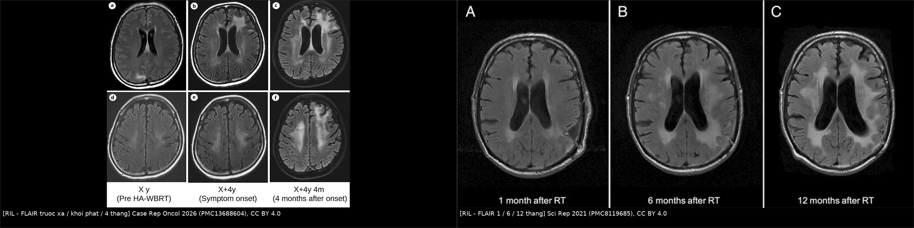
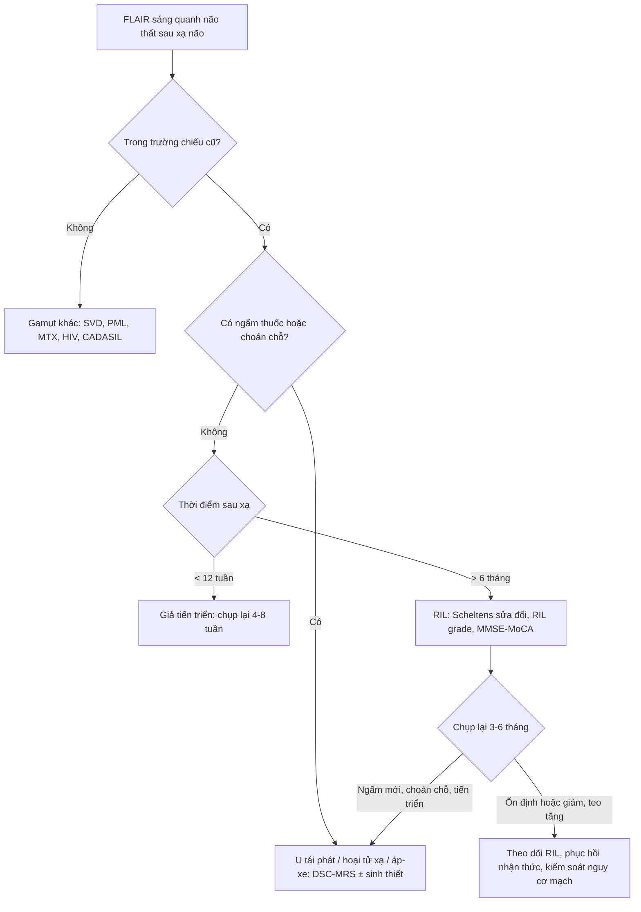
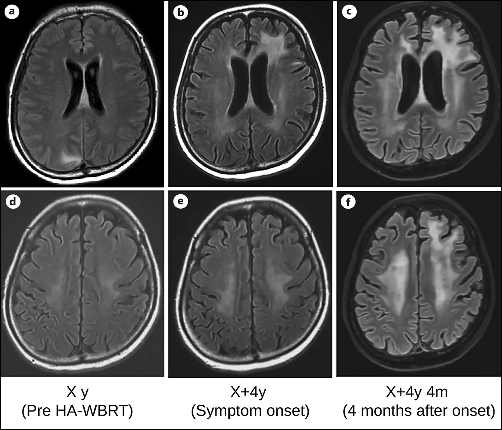
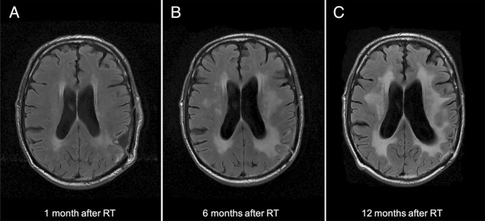
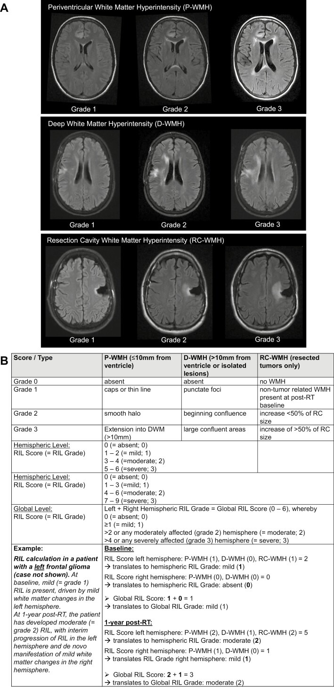

# 261 — Bệnh não chất trắng do xạ trị / Radiation-induced leukoencephalopathy (RIL)

**Tags:** `pattern:roi-loan-chat-trang` `pattern:doi-xung` `pattern:teo-nao` `pattern:khong-ngam-thuoc` `vung:chat-trang-quanh-nao-that` `vung:nao` `score:Fazekas` `score:Scheltens` `protocol:MRI-nao` `protocol:MRI-DSC-MRS` `protocol:danh-gia-nhan-thuc`

**Mức chắc chắn (certainty):** tổng hợp y văn (literature synthesis) — đoàn hệ 81 bệnh nhân u thần kinh đệm sống dài (Sci Rep 2021, PMC8119685), so sánh proton–photon 34 ca theo dõi 3 năm (The Oncologist 2024, PMC11630789), **1 ca nguyên văn có ảnh** sau HA-WBRT (Case Rep Oncol 2026, PMC13688604), tổng quan hình ảnh sau điều trị u não (Front Med 2026, PMC13589733) và tổng quan biến chứng muộn sau xạ (Insights Imaging 2018, PMC6269328). Không có thử nghiệm ngẫu nhiên nào điều trị RIL; mọi khuyến cáo xử trí là tổng hợp thực hành, chỗ suy luận được ghi rõ.

> **Câu chốt:** RIL là **chẩn đoán hình ảnh + thời gian + phân bố**, không phải chẩn đoán mô bệnh: **FLAIR sáng đối xứng quanh não thất và chất trắng sâu, nằm trong trường chiếu, KHÔNG ngấm thuốc, KHÔNG choán chỗ, kèm teo não**, xuất hiện **nhiều tháng đến nhiều năm** sau xạ. Ba ngưỡng phải thuộc: **(1)** RIL gặp **54,3%** người sống > 30 tháng sau xạ u thần kinh đệm ác tính; **(2)** tích lũy **21% / 42% / 48%** ở **12 / 36 / 60 tháng**; **(3)** **thang Scheltens sửa đổi ≥ 10 điểm** là ngưỡng của một định nghĩa RIL đã công bố. Sai lầm chết người không phải bỏ sót RIL — mà là **gọi RIL là tái phát u lan tỏa và xạ lại/sinh thiết não**, hoặc **gọi là "lão hóa bình thường" và bỏ mất suy giảm nhận thức tiến triển**.

## 1. Tổng quan bệnh học – cơ chế hình ảnh

### 1.1 Bệnh học: tổn thương chất trắng muộn, lan tỏa, không phải một ổ hoại tử

- **Định nghĩa:** RIL là biến chứng muộn của xạ trị não, đặc trưng bởi **tăng tín hiệu T2/FLAIR đối xứng vùng quanh não thất và chất trắng sâu**, **không ngấm thuốc, không choán chỗ**, có thể tiến triển tới **lan tỏa toàn bộ chất trắng + teo não**, và **thường chừa sợi U dưới vỏ, thể chai và vỏ não** (Front Med 2026, PMC13589733).
- **Khác hoại tử phóng xạ (bài 204) ở đâu:** hoại tử phóng xạ là **ổ** — ngấm vòng, phù, choán chỗ, thường **6–24 tháng** sau xạ khu trú; RIL là **lan tỏa, không ngấm, không choán chỗ**, thường **muộn hơn** và liên quan **liều + thể tích chiếu + hóa trị đồng thời** (đặc biệt **methotrexate**).
- **Sinh lý bệnh — chuỗi 4 bước:**
  1. **Tổn thương nội mô vi mạch** → dày, trong suốt hóa thành mạch, hẹp lòng, giảm tưới máu chất trắng.
  2. **Thiếu máu cục bộ mạn + stress oxy hóa** → mất oligodendrocyte, **mất myelin**, tổn thương sợi trục.
  3. **Astrocyte phản ứng + xơ hóa quanh mạch** → mô thay bằng gliosis và **khoảng ngoại bào chứa nước tự do**.
  4. **Teo não muộn** → giãn não thất **ex vacuo** + giãn rãnh, không phải não úng thủy áp lực.
- **Yếu tố nguy cơ đã kiểm chứng:** **tuổi > 60**, **hút thuốc**, **đa hình rs2120825 locus PPARγ**, **liều xạ cao**, **thể tích chiếu lớn**, **xạ toàn não**, **hóa trị đồng thời/MTX**. Trong đoàn hệ 81 ca: **44/81 (54,3%)** phát triển RIL; **29/44** có triệu chứng — **sa sút trí tuệ dưới vỏ 28 ca**, **rối loạn dáng đi 12**, **tiểu không kiểm soát 9**; triệu chứng xuất hiện **trung vị 33 tháng** sau xạ (**4,7–146,1 tháng**) (PMC8119685).

### 1.2 TẠI SAO hình ảnh trông như vậy (vật lý + mô bệnh)

- **FLAIR/T2 sáng:** mô mất myelin + gliosis + **nước ngoại bào tăng** → thời gian T2 dài. Đây là **phù vận mạch/tổn thương cấu trúc**, không phải phù tế bào; vì vậy **FLAIR sáng lan theo bó sợi**, bờ không rõ, đối xứng.
- **T1 giảm tín hiệu, KHÔNG sáng:** không có mỡ, không có methemoglobin, không có melanin — chỉ là mô mất myelin nhiều nước.
- **Không ngấm gadolinium:** hàng rào máu–não **còn nguyên** ở RIL (khác hoại tử phóng xạ/u). Đây là dấu **chốt loại** mạnh nhất trên phim thường: một vùng FLAIR sáng lan tỏa **không ngấm** khó là u đặc đang hoạt động.
- **Không choán chỗ, thay vào đó là TE O:** mô mất dần → **não thất giãn, rãnh giãn**. Nếu thấy **hiệu ứng khối, xóa rãnh, đẩy đường giữa** thì phải nghĩ u/hoại tử/áp-xe, không phải RIL.
- **DWI/ADC:** RIL **không hạn chế khuếch tán**; ADC **tăng** do mất tế bào và tăng nước ngoại bào. **DWI sáng + ADC tối** = nhồi máu cấp, áp-xe, hoặc **PML** — không phải RIL.
- **Chừa sợi U dưới vỏ:** tổn thương bắt đầu ở **chất trắng sâu quanh mạch xuyên**, nơi mật độ mạch thấp và liều xạ cao; sợi U nằm ngay dưới vỏ, giàu mạch và được tưới máu từ màng mềm → **tương đối được bảo vệ**. Vỏ não và thể chai cũng thường chừa (PMC13589733).
- **Vì sao đối xứng khi xạ toàn não, bất đối xứng khi xạ khu trú:** phân bố theo **bản đồ liều**; xạ toàn não cho tổn thương hai bán cầu; xạ khu trú cho tổn thương nặng hơn ở bán cầu **cùng bên ổ chiếu**, có thể lan sang bán cầu đối diện qua thể chai.

### 1.3 Ngưỡng định lượng trụ cột

| Đại lượng | Con số | Nguồn |
|---|---|---|
| RIL ở u thần kinh đệm ác tính sống > 30 tháng | **54,3% (44/81)** | PMC8119685 |
| Tích lũy RIL | **21% (12 tháng) · 42% (36 tháng) · 48% (60 tháng)** | PMC8119685 |
| Triệu chứng (nếu có RIL) | **29/44 = 65,9%**; khởi phát trung vị **33 tháng** (4,7–146,1) | PMC8119685 |
| Tuổi / hút thuốc / SNP | **> 60 tuổi**, hút thuốc, **rs2120825 (PPARγ)** | PMC8119685 |
| RIL vừa–nặng trong 3 năm | **62% (photon) · 71% (proton)** | PMC11630789 |
| Vi chảy máu sau xạ (CMB) | **76% (photon) · 71% (proton)**; trung bình **4,0 · 4,2** CMB | PMC11630789 |
| Hoại tử mô sau xạ | **6% (photon) · 18% (proton)** (khác biệt không ý nghĩa) | PMC11630789 |
| Liều xạ trong đoàn hệ | **55–62 Gy**, **1,8–2,0 Gy/phân liều** | PMC8119685 |
| Ngưỡng Scheltens sửa đổi để gọi RIL | **≥ 10 điểm** | PMC8119685 |
| Ngưỡng chi tiết: P-WMH | tổn thương **cách thành não thất ≤ 10 mm** | PMC11630789 |
| Ca nguyên văn | **HA-WBRT 30 Gy/10** + **SRT 30 Gy/3**; RIL **4 năm** sau WBRT; **MMSE 30 → 18 trong 2 tháng**; tử vong **~2 tháng** sau chẩn đoán | PMC13688604 |
| Bảo vệ nhận thức | **NRG CC001: 518 ca, TCF 59,5% vs 68,2%, HR 0,74** (HA-WBRT + memantine) | PMC11379916 |

## 2. Mẫu hình + chẩn đoán phân biệt theo vị trí (Gamut)

**Mẫu hình chốt:** *FLAIR sáng **đối xứng**, ưu thế **quanh não thất + chất trắng sâu**, bờ hòa lẫn, **không ngấm**, **không choán chỗ**, **teo não**, chừa sợi U dưới vỏ/thể chai/vỏ, trong **trường chiếu cũ**, xuất hiện **sau 6 tháng–nhiều năm**.*

Gamut theo **vị trí + bối cảnh**:

- **Quanh não thất, đối xứng, sau xạ toàn não:** RIL · **bệnh mạch nhỏ do tăng huyết áp/đái tháo đường** (Fazekas) · **HIV encephalopathy** · **hủy myelin thẩm thấu** (cầu não trung tâm) · **bệnh não gan** (T1 sáng hạch nền) · **nhiễm độc hóa trị** (MTX, CAR-T/ICANS).
- **Chất trắng dưới vỏ, bất đối xứng, KHÔNG ngấm:** **PML** (JCPyV) · **ADEM** · **CADASIL** (cực thái dương trước, bao ngoài) · **u thần kinh đệm thâm nhiễm lan tỏa** (gliomatosis) · **bệnh mạch do xạ**.
- **Quanh ổ xạ, có ngấm vòng + phù + choán chỗ:** **hoại tử phóng xạ** (bài 204) · **tái phát tại chỗ** · **áp-xe** · **nhồi máu bán cấp**.
- **Ngấm vỏ–màng mềm dạng cuộn, hồi phục:** **SMART** (bài 259) — khác RIL ở chỗ **ngấm** và **hồi phục**.
- **Tăng tín hiệu đối xứng hai bên đồi thị/quanh cống:** **Wernicke** (bài 3033) · **nhồi máu Percheron** · **CVST sâu**.
- **Gợi nhớ 4D:** **D**elay (nhiều tháng–năm) · **D**istribution (quanh não thất–sâu, theo trường chiếu) · **D**ensity (FLAIR sáng, T1 tối, **không ngấm**) · **D**ecline (nhận thức/dáng đi, kèm teo não).

## 3. Bảng so sánh phân biệt (ma trận đối chiếu)

| Thực thể (entity) | Hình ảnh điển hình | Chốt vào (rule-in) | Chốt loại (rule-out) | Gợi ý xác nhận |
|---|---|---|---|---|
| **RIL (bệnh não chất trắng do xạ)** | FLAIR sáng **đối xứng** quanh não thất + chất trắng sâu, **không ngấm**, không choán chỗ, teo não, chừa U-fibers | **Đúng trường chiếu + latency > 6 tháng + không ngấm + không choán chỗ + teo não** | **Ngấm thuốc, choán chỗ, xóa rãnh, tổn thương ngoài trường chiếu** → không phải RIL đơn thuần | MRI 3T + so phim cũ + **Scheltens sửa đổi ≥ 10**; theo dõi 3–6 tháng |
| **Tái phát u lan tỏa** | Chất trắng **bất đối xứng**, bờ không đều, có thể **ngấm**, **choán chỗ**, xâm lấn vỏ/thể chai | **Tăng thể tích liên tục + ngấm mới + rCBV cao + Cho/NAA cao** | **Đối xứng + không ngấm + teo + ổn định/giảm khi chụp lại** → không phải tái phát | **DSC rCBV**, **MRS Cho/NAA**, MET/FET-PET; sinh thiết chỉ khi đổi điều trị |
| **Hoại tử phóng xạ (RN)** | Ổ **ngấm vòng mỏng**, phù, có thể choán chỗ; trong trường xạ | **6–24 tháng + vòng ngấm + rCBV thấp + lipid–lactate** | **Lan tỏa, không ngấm, không choán chỗ, teo** → RIL | DSC-MRI + MRS; xem bài 204 |
| **Giả tiến triển (pseudoprogression)** | Ngấm tăng quanh ổ xạ, phù tăng, lâm sàng ổn | **< 12 tuần sau hóa–xạ + tự giảm khi chụp lại 4–8 tuần** | **Tiến triển sau 12 tuần hoặc không ngấm lan tỏa** → không phải giả tiến triển | Chụp lại 4–8 tuần; RANO |
| **Bệnh mạch nhỏ (SVD)** | FLAIR quanh não thất **đối xứng**, thường có **lacune hạch nền**, CMB sâu; **không liên quan liều xạ** | **Tuổi già + THA/ĐTĐ + lacune + CMB sâu** | **Bệnh nhân trẻ, phân bố đúng bán cầu chiếu, latency sau xạ** → nghĩ RIL | Fazekas; kiểm soát yếu tố nguy cơ |
| **PML** | Chất trắng dưới vỏ **bất đối xứng**, **bờ rõ**, **chừa vỏ**, **DWI sáng/ADC tối ở rìa** | **Bất đối xứng + U-fibers + ADC thấp rìa + PCR JCV** | **Đối xứng quanh não thất + ADC cao + không suy giảm miễn dịch** → không PML | PCR JCV dịch não tủy; xem bài 206 |
| **Bệnh não do hóa trị (MTX/CAR-T)** | FLAIR quanh não thất, có thể đối xứng; **liên quan thời điểm truyền** | **Tiền sử MTX nội tủy/động mạch hoặc CAR-T + thời gian khớp** | **Khởi phát nhiều năm sau xạ, không hóa trị gần** → RIL | Ngừng/giảm thuốc nghi ngờ; MRI theo dõi |

*Trái: bệnh nhân HA-WBRT 30 Gy/10 + SRT 30 Gy/3 — trước xạ (X y), lúc khởi phát suy giảm nhận thức (X+4y), và 4 tháng sau (X+4y 4m): FLAIR sáng quanh não thất–chất trắng sâu lan rộng, não thất giãn, không có ổ choán chỗ. Phải: xạ khu trú 60 Gy/30 phân liều + TMZ — FLAIR sáng quanh ổ mổ lan ra hai bán cầu ở 1, 6, 12 tháng, kèm teo vỏ–dưới vỏ. Nguồn: Case Rep Oncol 2026 (PMC13688604) và Sci Rep 2021 (PMC8119685), CC BY 4.0. Ảnh ghép letterbox, không crop.*

### RIL và "tái phát lan tỏa": ba câu hỏi tách biệt

1. **Có ngấm thuốc không?** Không ngấm + không choán chỗ → nghiêng RIL; ngấm mới/tiến triển → nghiêng u/RN.
2. **Có choán chỗ không?** RIL **teo**; u **đẩy**. Đo **thể tích não thất** và **độ dày vỏ** trên hai thời điểm — RIL làm não thất to lên, u làm đường giữa lệch.
3. **Có bằng chứng tân mạch không?** **rCBV thấp** và **Cho thấp + lipid–lactate** → RIL; **rCBV cao, Cho/NAA cao** → u. Nếu không có DSC/MRS, **chụp lại 6–8 tuần** là "xét nghiệm" rẻ nhất.

## 4. Protocol chụp + hệ phân độ/điểm chuẩn hóa

### 4.1 Protocol MRI

- **Tối thiểu:** T1W axial (không tiêm), T2W, **FLAIR 3D** (1–2 mm, axial + coronal), **DWI + ADC**, **SWI** (vi chảy máu sau xạ), **T1W sau gadolinium 3 bình diện**.
- **Khi cần phân biệt với u:** **DSC-MRI (rCBV)** + **MRS đa voxel** (voxel trong vùng FLAIR sáng **không ngấm**, tránh hoại tử/xương); thêm **MET/FET-PET** nếu có.
- **Đo và ghi số:** vị trí (quanh não thất/chất trắng sâu), **khoảng cách tới thành não thất** (ngưỡng **10 mm** phân P-WMH và D-WMH), **Scheltens sửa đổi**, **thể tích não thất bên**, **độ dày vỏ**, có/không ngấm, có/không choán chỗ, có/không CMB.
- **Đánh giá nhận thức:** **MMSE/MoCA** ở mỗi lần chụp; ghi mốc thời gian so với xạ.

### 4.2 Phân độ

- **Thang Scheltens sửa đổi (dùng trong định nghĩa RIL):** tổng điểm **≥ 10** mới đủ ngưỡng (thang gồm nắp trước/nắp chẩm/dải sát não thất và 5 vùng chất trắng + hạch nền).
- **RIL score/grade (The Oncologist 2024):** chia **P-WMH (≤ 10 mm từ não thất)**, **D-WMH (> 10 mm/ổ biệt lập)**, **RC-WMH (quanh ổ mổ)**; mỗi loại **grade 1–3**; cộng lại → **grade 0–3** toàn não/bán cầu. **ICC > 0,85** — dùng được để theo dõi dọc.
- **Phân độ theo triệu chứng:** không triệu chứng · suy giảm nhận thức nhẹ · **sa sút trí tuệ dưới vỏ + rối loạn dáng đi + tiểu không kiểm soát** (bộ ba "giả NPH").

## 5. Biến thể bình thường và cạm bẫy

- **"Chất trắng tuổi già" không phải chẩn đoán:** ở người **> 60 tuổi** hoặc **hút thuốc**, RIL và bệnh mạch nhỏ chồng lấp; đừng quy mọi FLAIR sáng cho lão hóa — **so phim trước xạ** là bắt buộc.
- **HA-WBRT KHÔNG bảo vệ khỏi RIL lan tỏa:** ca nguyên văn phát triển RIL nặng **4 năm** sau HA-WBRT + SRT, dù đã tránh hồi hải mã và đạt kiểm soát u (PMC13688604). Đừng hứa "không suy giảm nhận thức" chỉ vì đã dùng HA-WBRT.
- **Giả tiến triển < 12 tuần ≠ RIL:** giả tiến triển **ngấm** và **tự giảm**; RIL **không ngấm** và **muộn**. Gọi sai → ngừng/đổi điều trị oan hoặc xạ lại.
- **Tăng tín hiệu sau xạ có thể là "bóng" của phù quanh u đang điều trị:** corticoid làm giảm phù, **không làm RIL hết**; đừng dùng đáp ứng corticoid để chốt chẩn đoán.
- **Đừng sinh thiết một vùng FLAIR sáng đối xứng không ngấm** chỉ để "chắc": mô có thể chỉ là gliosis/mất myelin, **không phân biệt được với u thâm nhiễm**, mà biến chứng không nhỏ. Sinh thiết khi **có ngấm/choán chỗ/tiến triển** hoặc khi kết quả **thay đổi điều trị**.
- **Cạm bẫy "satisfaction of search":** thấy di căn não ổn định rồi bỏ qua **teo não + giãn não thất** — dấu hiệu RIL và suy giảm nhận thức.
- **Thuốc/hóa trị đồng thời:** **methotrexate** (nội tủy/động mạch) làm tăng nguy cơ và làm tổn thương **nặng hơn, sớm hơn**; **trastuzumab deruxtecan** trong ca nguyên văn là yếu tố gây nhiễu không loại trừ được — bài gốc vẫn kết luận RIL dựa trên phân bố + latency (ghi chú phản biện, không sửa nguồn).
- **PML là bẫy lớn:** PML **bất đối xứng**, ăn **sợi U dưới vỏ**, **ADC thấp ở rìa**, bờ rõ; RIL **đối xứng, ADC cao, chừa U-fibers**. Ở người suy giảm miễn dịch sau xạ/hóa trị, **PCR JCV** phải làm trước khi gọi RIL.

## 6. Tự lượng giá — Blind Quiz

**Ca 1 — Nữ 43 tuổi, ung thư vú HER2+ có di căn não, đã HA-WBRT 30 Gy/10 và SRT 30 Gy/3; 4 năm sau suy giảm nhận thức nhanh. Nhìn FLAIR, mô tả trước khi mở đáp án.**

- Gợi ý: MMSE từ 30 xuống 18 trong 2 tháng; không sốt, không đau đầu dữ dội; kiểm soát u nội sọ tốt.
- Hỏi: (1) Mô tả phân bố tổn thương và đối xứng? (2) Có ngấm/choán chỗ không? (3) Ba chẩn đoán phân biệt và dấu hiệu nào chốt?

<b>Bấm để hiện đáp án (findings + chẩn đoán)</b>

- **Findings:** FLAIR sáng **đối xứng quanh não thất và chất trắng sâu hai bán cầu**, lan rộng theo thời gian; **không ngấm thuốc, không choán chỗ**; **não thất giãn và rãnh giãn** (teo não); **chừa vỏ và sợi U dưới vỏ**. Không có ổ ngấm vòng, không có khối.
- **Chẩn đoán:** **RIL muộn sau HA-WBRT + SRT**, biểu hiện bằng sa sút trí tuệ dưới vỏ tiến triển. Cơ chế: mất myelin + gliosis + teo não do tổn thương vi mạch muộn; **hàng rào máu–não còn nguyên** nên không ngấm.
- **Phân biệt:** tái phát u lan tỏa (bất đối xứng, choán chỗ, ngấm, rCBV cao) · hoại tử phóng xạ (ổ ngấm vòng) · bệnh mạch nhỏ (tuổi/THA, lacune) · PML (bất đối xứng, ADC thấp rìa, PCR JCV).
- **Xử trí:** không xạ lại, không sinh thiết vùng không ngấm; chụp lại 3–6 tháng, đánh giá MMSE/MoCA, phục hồi nhận thức, kiểm soát yếu tố nguy cơ mạch.
- **Nguồn:** Case Rep Oncol 2026 (PMC13688604), Fig. 3, CC BY 4.0.

**Ca 2 — Nam 48 tuổi, u nguyên bào thần kinh đệm thùy đỉnh trái, xạ 60 Gy/30 phân liều + TMZ. So ba mốc 1–6–12 tháng.**

- Gợi ý: sau 1 năm có **suy giảm trí nhớ (MOCA 13/30)**, rối loạn dáng đi, tiểu không kiểm soát.
- Hỏi: Tổn thương tiến triển theo hướng nào? Có phải tái phát u? Dấu hiệu nào giúp phân biệt?

<b>Bấm để hiện đáp án</b>

- **Findings:** FLAIR sáng quanh ổ mổ lan dần ra **chất trắng hai bán cầu** từ 1 → 6 → 12 tháng; **teo vỏ và dưới vỏ** tăng; **không ngấm, không choán chỗ**.
- **Chẩn đoán:** **RIL** — đúng bộ ba định nghĩa của đoàn hệ: (1) tăng tín hiệu quanh ổ mổ lan tới ≥ 1 thùy khác hoặc hai bên quanh não thất; (2) teo vỏ/dưới vỏ; (3) **Scheltens sửa đổi ≥ 10**. Triệu chứng: **sa sút trí tuệ dưới vỏ + rối loạn dáng đi + tiểu không kiểm soát**.
- **Vì sao không phải tái phát:** không ngấm, không choán chỗ, **teo tăng** thay vì thể tích khối tăng; nếu nghi ngờ, DSC rCBV thấp + Cho thấp + lipid–lactate.
- **Nguồn:** Sci Rep 2021 (PMC8119685), Figure 1, CC BY 4.0; số liệu đoàn hệ trong cùng bài (54,3%; 21/42/48%).

**Ca 3 — Cùng bệnh nhân, làm thế nào "đếm" mức độ RIL để theo dõi dọc?**

- Hỏi: Ba vùng nào được chấm? Ngưỡng phân biệt P-WMH và D-WMH? Khi nào gọi "nặng" ở mức toàn não?

<b>Bấm để hiện đáp án</b>

- **Ba vùng:** **(1) quanh não thất (P-WMH, ≤ 10 mm từ thành não thất)**, **(2) chất trắng sâu (D-WMH, > 10 mm hoặc ổ biệt lập)**, **(3) quanh ổ mổ (RC-WMH)**; mỗi vùng **grade 1–3** theo thang Fazekas sửa đổi.
- **Cách tính:** cộng điểm ba vùng → **RIL score** → quy đổi **grade 0–3** cho từng bán cầu và toàn não. **ICC > 0,85** nên dùng được để so sánh giữa các lần chụp.
- **"Nặng" toàn não:** **grade 3** khi có ≥ 1 bán cầu grade 3 hoặc tổng điểm cao (bảng trong ảnh); thực hành: grade 3 + teo não + suy giảm nhận thức = RIL nặng.
- **Nguồn:** The Oncologist 2024 (PMC11630789), Figure 1, **CC BY-NC 4.0** — dùng nguyên bản, không cắt/ghép.

## Bài liên quan chéo

- [200 – Tổng quan hệ Thần kinh](../200-tong-quan-he-than-kinh/lesson.md) (bản đồ gamut chất trắng)
- [204 – Hoại tử phóng xạ sau xạ trị u não](../204-hoai-tu-phong-xa-sau-xa-tri-u-nao/lesson.md) (thể Ổ, ngấm vòng — phân biệt với RIL lan tỏa)
- [259 – Hội chứng SMART](../259-hoi-chung-smart-benh-nao-do-xa-muon/lesson.md) (ngấm vỏ–màng mềm, hồi phục)
- [206 – PML & IRIS](../206-pml-va-iris-uc-che-mien-dich/lesson.md) (bất đối xứng, ADC thấp rìa, PCR JCV)
- [215 – Mất myelin](../215-mat-myelin/lesson.md) (gamut bệnh chất trắng)
- [3033 – Wernicke & thiếu thiamin](../3033-benh-nao-wernicke-thieu-thiamin/lesson.md) (đối xứng quanh cống–đồi thị)
- [3031 – PRES](../3031-pres-benh-nao-sau-phuc-hoi/lesson.md) (phù vận mạch, ADC tăng)
- [218 – Thoát vị não & não úng thủy](../218-thoat-vi-nao-ung-thuy/lesson.md) (phân biệt giãn não thất do teo với úng thủy áp lực)

## Ảnh

- `261_ril-flair-serial_PMC13688604-F3.jpg` — FLAIR trước xạ / khởi phát / 4 tháng; Case Rep Oncol 2026 (PMC13688604), **CC BY 4.0**.
- `261_ril-flair-1-6-12m_PMC8119685-F1.jpg` — FLAIR 1/6/12 tháng; Sci Rep 2021 (PMC8119685), **CC BY 4.0**.
- `261_ril-grade_PMC11630789-F1.jpg` — thang RIL grade; The Oncologist 2024 (PMC11630789), **CC BY-NC 4.0** (nguyên bản).
- `composite_ril-tien-trien.jpg` — ghép 2 ảnh CC BY ở trên, letterbox, dải attribution.

> Không dùng để chẩn đoán độc lập khi chưa có người hướng dẫn.
