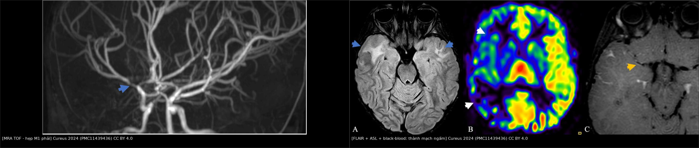
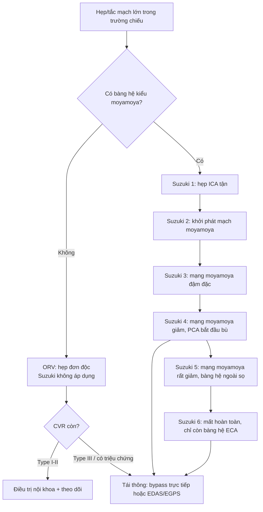
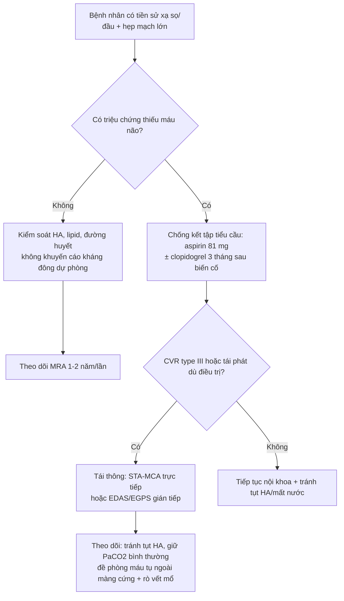
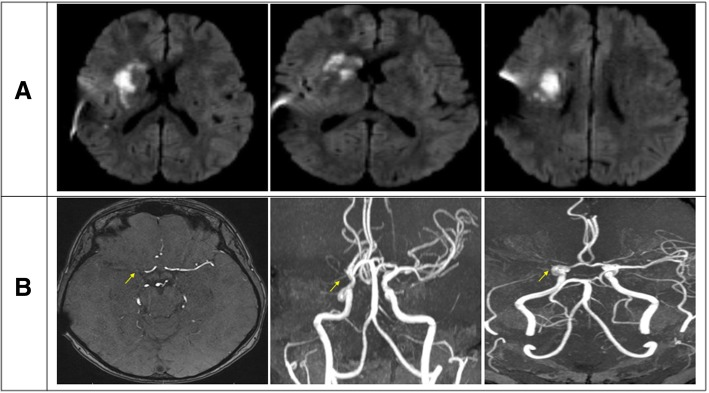
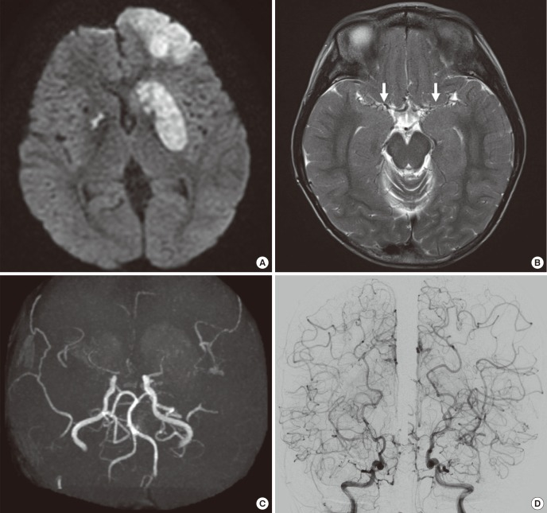
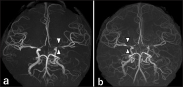
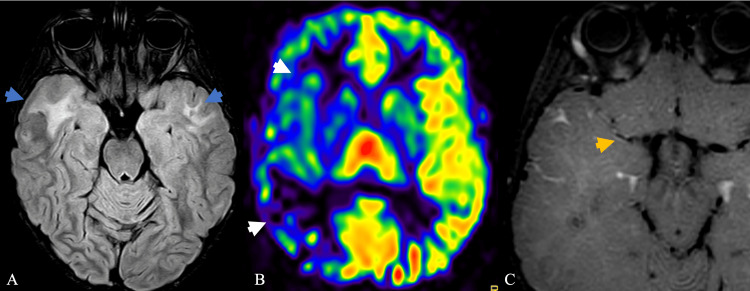

# 262 — Bệnh mạch máu LỚN do xạ trị não (hẹp–tắc kiểu moyamoya) / Radiation-induced large-vessel cerebral vasculopathy (radiation-induced moyamoya syndrome)

**Tags:** `pattern:hep-mach` `pattern:tac-mach` `pattern:ngam-thanh-mach` `pattern:nhoi-mau-phan-thuy` `pattern:bang-he-moyamoya` `vung:da-giac-willis` `vung:dong-mach-canh-trong` `vung:nao` `score:Suzuki` `score:CVR` `score:Rogg` `protocol:MRI-MRA-TOF` `protocol:HR-vwMRI` `protocol:CTA-DSA` `protocol:CTP-Diamox` `protocol:ASL`

**Mức chắc chắn (certainty):** tổng hợp y văn (literature synthesis) — 3 ca nguyên văn có ảnh (J Med Case Rep 2019, PMC6545722; J Korean Med Sci 2017, PMC5639076; Surg Neurol Int 2026, PMC13331182) + 1 ca nguyên văn dùng cho phần cơ chế (Cureus 2024, PMC11439436) + 2 tổng quan (Cerebrovasc Dis Extra 2025, PMC12266706; J Clin Med 2026, PMC13027234) + 1 ca muộn 30 năm có kèm u màng não (Radiol Case Rep 2026, PMC12925087). Không có thử nghiệm ngẫu nhiên nào về điều trị; mọi ngưỡng xử trí là tổng hợp thực hành, chỗ suy luận được ghi rõ.

> **Câu chốt:** đây là **hẹp lòng mạch DO XẠ, không phải xơ vữa và không phải moyamoya bẩm sinh**. Ba trụ để không bỏ sót: **(1)** hẹp **dài, nhẵn, KHÔNG vôi hóa**, nằm đúng **trường chiếu** (ICA tận–M1–A1), xuất hiện **2–25 năm** sau xạ, có thể **một bên**; **(2)** trên **HR-vwMRI** thành mạch **dày + ngấm đồng tâm** trong khi **moyamoya nguyên phát có thành mỏng, đường kính ngoài teo**; **(3)** nguy cơ **phụ thuộc liều**: tổn thương mạch vùng circle of Willis **0,2% ở 30 Gy → 1,3% ở 45 Gy → 4,4% ở 54 Gy**. Sai lầm chết người: gọi là **"xơ vữa ở người trẻ"** rồi chỉ cho statin, hoặc **hạ huyết áp/giảm CO₂ khi mổ u thứ phát** trên bệnh nhân đã cạn dự trữ tưới máu — cả hai đều gây nhồi máu vùng ranh giới.

## 1. Tổng quan bệnh học – cơ chế hình ảnh

### 1.1 Bệnh học: xơ hóa – tăng sinh nội mạc do tế bào nội mô chết, không phải mảng xơ vữa điển hình

- **Định nghĩa:** bệnh mạch máu lớn do xạ trị (radiation-induced large-vessel vasculopathy, RILVV; y văn cũ gọi *occlusive radiation vasculopathy* — ORV) là **hẹp hoặc tắc tiến triển** của các động mạch lớn nội sọ trong **trường chiếu cũ**, thường ở **ICA đoạn trên yên, M1, A1**, có hoặc không có **mạng bàng hệ kiểu moyamoya** (khi có → *hội chứng moyamoya do xạ*, radiation-induced moyamoya syndrome — RIMMS) (Cerebrovasc Dis Extra 2025, PMC12266706).
- **Chuỗi mô bệnh 4 bước** (tổng hợp từ mô tả giải phẫu bệnh trong PMC6545722 và PMC11439436):
  1. **Tổn thương nội mô** do bức xạ → apoptosis, lão hóa tế bào, mất cân bằng yếu tố đông máu/tiêu sợi huyết và yếu tố giãn mạch.
  2. **Viêm mạn + stress oxy hóa** → bạch cầu bám và **tế bào bọt (foam cell) lắng trong nội mạc**.
  3. **Tăng sinh cơ trơn nội mạc (myointimal proliferation) + hyalin hóa dày đặc** lớp áo giữa, **xơ hóa màng đàn hồi và lớp áo ngoài** → lòng mạch hẹp **nhẵn, dài**, không có lõi lipid/nắp xơ như xơ vữa.
  4. **Tổn thương vasa vasorum** → thiếu máu thành mạch, xơ hóa lan dọc đoạn chiếu; **không có vôi hóa** vì không có mảng xơ vữa trưởng thành.
- **Vì sao trẻ nhạy hơn người lớn:** hệ mạch đang phát triển + số lần phân chia tế bào nội mô cao; tổn thương mạch xuất hiện **sớm hơn và nặng hơn theo liều** (PMC13027234). Ca trẻ 10 tuổi sau xạ hố sau **4–5 năm** đã hẹp M1; ca 17 tuổi sau **54 Gy** hẹp M1 trái lúc **18 tháng** và M1 phải **6 tháng sau đó** (PMC13331182).
- **Yếu tố nguy cơ đã kiểm chứng:** **trường chiếu ôm circle of Willis**, **liều ≥ 45 Gy**, **tuổi nhỏ lúc xạ**, **hóa trị kèm**, **yếu tố mạch máu kinh điển** (tăng huyết áp, đái tháo đường, rối loạn lipid, hút thuốc) làm bệnh nặng thêm nhưng **không cần có** để bệnh xuất hiện (PMC12266706; PMC13331182).

### 1.2 Ngưỡng định lượng trụ cột

| Đại lượng | Con số | Nguồn |
|---|---|---|
| Bất thường mạch máu phát hiện trên hình ảnh sau xạ sọ | **5–20%** | PMC13331182 (tổng hợp Bavle) |
| Thời gian từ xạ đến phát hiện trên hình ảnh | **2–28 năm** | PMC13331182 |
| Đột quỵ/TIA do bệnh mạch xạ | **2–18,8%**, khởi phát **2,3–24 năm** sau xạ | PMC13331182 |
| Đột quỵ ở trẻ sống sót u não sau xạ sọ | **548/100.000 người–năm**, gấp **~100 lần** trẻ thường | PMC13331182 (Campen 2012) |
| Hội chứng moyamoya sau xạ, đoàn hệ **391 trẻ** Đài Loan, theo dõi **7 năm** | **u thần kinh thị 33,3% · u sọ hầu 12,5% · u nguyên bào tủy 2% · u tế bào sao 5,3%** | PMC6545722 (Wu 2016) |
| Đáp ứng theo liều (PENTEC) — biến cố mạch vùng circle of Willis | **0,2% (30 Gy) · 1,3% (45 Gy) · 4,4% (54 Gy)** | PMC12925087 (Waxer 2024) |
| U vùng trên yên/trong yên sau xạ | **9–20%** bất kỳ bệnh mạch; **5–17,8%** thể nặng (gồm moyamoya) | PMC12925087 |
| Thời gian tiềm tàng (ORV) | **2–25 năm** | PMC6545722 |
| Thời gian khởi phát bệnh mạch xạ | **4 tháng – 24 năm** | PMC11439436 |
| 54 ca moyamoya do xạ 1967–2002 (Desai 2006): tuổi xạ – thời gian tiềm tàng | tuổi trung vị lúc xạ **3,8 tuổi** (0,4–47); **56,3% xạ < 5 tuổi**; **NF1 25,9%**; **u thần kinh thị 29/54**; liều trung bình **46,5 Gy** (22–120); latency **trung vị 40 tháng** (4–240) | PMID 16626890 |
| Tích lũy khởi phát trong 54 ca đó | **27,7% (2 năm) · 53,2% (4 năm) · 74,5% (6 năm) · 95,7% (12 năm)** — đây là **tỷ lệ trong số ca đã mắc**, KHÔNG phải tỷ lệ mắc của quần thể | PMID 16626890 |
| Ca muộn nhất trong bộ sưu tập này | **30 năm** sau xạ u sọ hầu, tắc M1 trái + u màng não | PMC12925087 |

### 1.3 TẠI SAO hình ảnh trông như vậy (vật lý + mô bệnh)

- **Hẹp DÀI và NHẴN trên CTA/MRA:** tổn thương là **tăng sinh nội mạc lan dọc** chứ không phải mảng khu trú ở chỗ chia đôi → bờ lòng **mượt**, đoạn hẹp **> 10 mm**, thường **liên tục từ ICA tận xuống M1/A1**. Xơ vữa thường **khu trú ở chỗ chia**, **lệch tâm**, có **vôi hóa** và **tái tạo dương**.
- **Không vôi hóa:** vôi hóa cần mảng xơ vữa lâu năm có lõi hoại tử; bệnh xạ là **xơ hóa – tăng sinh tế bào**, nên **không có cặn calci** — đây là dấu **chốt loại xơ vữa** mạnh trên CTA không cản quang.
- **Thành mạch DÀY + NGẤM ĐỒNG TÂM trên HR-vwMRI:** gadolinium rò từ **vasa vasorum** khi tính thấm nội mô tăng; viêm – xơ thành mạch lan **toàn chu vi** → ngấm **đồng tâm**. So sánh nhóm: **Aoki 2002** thấy **5 ca viêm mạch do xạ có thành dày + ngấm mạnh**, khác **18 ca moyamoya** (thành mỏng, **ít/không ngấm**) (PMC9362557; PMC7656038). Đường kính ngoài **không teo nhỏ** như moyamoya là **suy luận từ hình thái thành dày về phía lòng**, không phải tiêu chuẩn đã kiểm chứng — vì vậy **luôn đọc kèm bề dày thành (mm), không chỉ đường kính lòng**.
- **Nhồi máu KIỂU RANH GIỚI (watershed):** khi lòng hẹp tiến triển, **tự điều hòa giãn mạch tối đa** giữ được lưu lượng lúc nghỉ nhưng **mất dự trữ**; tụt huyết áp, mất nước, thiếu máu, hoặc **giảm CO₂ (co mạch)** sẽ đẩy vùng **giữa các lãnh thổ MCA–ACA/PCA** vào thiếu máu → ổ nhồi máu **hình chêm, dọc ranh giới**, không theo một nhánh. Ca 17 tuổi: nhồi máu ranh giới phải sau **mất nước 2,5 kg** trong bối cảnh hẹp M1 hai bên (PMC13331182).
- **DWI sáng + ADC tối:** phù tế bào của nhồi máu cấp; **ADC tối phân biệt với phù vận mạch** của hoại tử xạ/SMART (bài 259)/RIL (bài 261).
- **ASL/CTP giảm CBF, TTP–MTT kéo dài:** chậm dòng sau chỗ hẹp; **sau acetazolamide** có 3 kiểu đáp ứng (Rogg): **I** tăng bình thường; **II** vùng giảm lúc nghỉ tăng lên; **III** **"steal" — giảm thêm** vì máu bị hút sang vùng giãn mạch tốt hơn → **dự trữ đã cạn**. Ca 31 tuổi: **type III** ở toàn bộ lãnh thổ MCA phải, **penumbra 132,52 mL**, **lõi nhồi máu 14,97 mL** (PMC6545722).
- **Bàng hệ kiểu moyamoya:** các động mạch **thấu chi (lenticulostriate, đồi thị)** giãn và ngoằn ngoèo bù cho M1/ICA tận → "khói thuốc" trên DSA; trên FLAIR là **dấu ivy** (mạch màng mềm chậm dòng) — **không phải xuất huyết dưới nhện**.
- **Vì sao có ca KHÔNG có bàng hệ moyamoya:** tổn thương xạ tiến triển **chậm và ít đối xứng** hơn moyamoya bẩm sinh; nhiều ca tắc **đơn độc** và bàng hệ **không đủ thời gian/thành mạch để hình thành**. Vì vậy **thiếu "khói thuốc" KHÔNG loại trừ bệnh xạ** — y văn gọi nhóm này là **ORV** thay vì moyamoya (PMC6545722; PMC11439436).
- **Vi chảy máu + cavernoma đi kèm:** xạ gây tổn thương vi mạch → **SWI** thấy nhiều ổ giảm tín hiệu; đây là **cùng phổ bệnh xạ**, không phải di căn.

## 2. Mẫu hình + chẩn đoán phân biệt theo vị trí (Gamut)

**Mẫu hình chốt:** *hẹp–tắc **dài, nhẵn**, **không vôi hóa**, ưu thế **ICA tận + M1 + A1**, **trong trường chiếu**, **một hoặc hai bên**, kèm **thành mạch dày–ngấm đồng tâm** và **nhồi máu ranh giới**; xuất hiện **≥ 2 năm** (thường 5–20 năm) sau xạ; có thể kèm **bàng hệ moyamoya**, **vi chảy máu**, **u màng não thứ phát**.*

### 2.1 Gamut theo đoạn mạch (quan trọng vì quyết định can thiệp)

| Vị trí | Bệnh cảnh điển hình | Ghi chú thực hành |
|---|---|---|
| **ICA đoạn trên yên – M1** | Trẻ xạ u sọ hầu/u thần kinh thị; người lớn xạ u tuyến yên, u màng não, NPC | Vị trí **hay gặp nhất**; hẹp **dài** từ ICA tận lan ra M1; nếu tắc hoàn toàn → bàng hệ từ ACA/PCA |
| **A1 – A2** | Cùng trường chiếu; thường **đi kèm** M1 | Hẹp A1 hai bên + M1 hai bên = hình ảnh **gần giống moyamoya** |
| **P1 – P2** | **Suzuki giai đoạn 4–6**; xạ hố sau, u tuyến yên | PCoA/PCA tham gia **bàng hệ**; tổn thương P1 = **nguy cơ xuất huyết** cao hơn |
| **Động mạch cảnh ngoài sọ (CCA/ICA cổ)** | Xạ cổ–đầu (NPC, ung thư vòm) | Hẹp **dài, không vôi, dễ loét**, **hai bên**; nguy cơ **carotid blowout**; xử trí **stent/TCAR**, không phải bypass nội sọ |
| **Động mạch đốt sống – thân nền** | Xạ hố sau, u thân nền | Ít gặp hơn; nhồi máu **đồi thị/thân não**; dễ nhầm bệnh mạch nhỏ |

### 2.2 Gamut theo tuổi và thời gian (giúp chọn xác suất trước)

- **Trẻ em (< 18 tuổi):** khởi phát **sớm hơn** (4 tháng–10 năm), thường **hai bên**, hay có **bàng hệ moyamoya**, **nhồi máu + thiếu máu não thoáng qua**; **u sọ hầu, u thần kinh thị, u nguyên bào tủy, u tế bào sao**.
- **Người lớn trẻ (18–45 tuổi):** hẹp **một bên hoặc hai bên**, **nhồi máu ranh giới**, thường **không có yếu tố nguy cơ xơ vữa**; tiền sử xạ **thời thơ ấu** là mấu chốt.
- **Người lớn > 45 tuổi:** có thể **chồng lấp xơ vữa**; tìm **vôi hóa, mảng lệch tâm, hẹp ở chỗ chia** để loại xơ vữa; **u màng não do xạ** đi kèm là gợi ý mạnh (PMC6545722; PMC12925087).

### 2.3 Mnemonic **R-A-Y-S** (bốn câu hỏi trước khi kết luận)

- **R** — **Radiation field**: đoạn hẹp có nằm trong **bản đồ liều** cũ không? (đối chiếu ảnh xạ trị, mô tả trường chiếu).
- **A** — **Age at RT**: xạ lúc **< 10 tuổi** → nguy cơ cao, khởi phát sớm.
- **Y** — **Years**: **≥ 2 năm**, thường **5–20 năm**; **< 6 tháng** thì phải nghĩ nguyên nhân khác.
- **S** — **Smooth, long, no calcium**: hẹp **dài–nhẵn–không vôi**; nếu **ngắn, lệch tâm, vôi hóa** → xơ vữa.

## 3. Bảng so sánh phân biệt (ma trận đối chiếu)

| Thực thể (entity) | Hình ảnh điển hình | Chốt vào (rule-in) | Chốt loại (rule-out) | Gợi ý xác nhận |
|---|---|---|---|---|
| **Bệnh mạch lớn do xạ (RILVV/ORV)** | Hẹp **dài, nhẵn**, **không vôi**, ICA tận–M1–A1, **đúng trường chiếu**, một hoặc hai bên; thành **dày + ngấm đồng tâm**; nhồi máu **ranh giới** | **Tiền sử xạ sọ/đầu + hẹp dài không vôi trong trường chiếu + thành ngấm đồng tâm** | **Không có tiền sử xạ**; hẹp **khu trú chỗ chia + vôi hóa + lệch tâm** → xơ vữa | Đối chiếu **bản đồ liều**; HR-vwMRI; DSA; theo dõi tiến triển |
| **Bệnh moyamoya nguyên phát (MMD)** | Hẹp **hai bên** ICA tận + M1/A1, **mạng "khói thuốc"** rõ, thường **nữ châu Á 10–20 hoặc 35–50 tuổi** | **Hai bên + bàng hệ moyamoya điển hình + không tiền sử xạ + có thể RNF213 p.R4810K** | **Một bên, không bàng hệ, thành dày ngấm** → không phải MMD; **tiền sử xạ** → hội chứng moyamoya do xạ | **HR-vwMRI: thành mỏng, đường kính ngoài teo**; gene **RNF213**; DSA |
| **Xơ vữa nội sọ** | Hẹp **khu trú ở chỗ chia**, **lệch tâm**, **vôi hóa**, **tái tạo dương**, tuổi lớn, có yếu tố nguy cơ | **Vôi hóa + mảng lệch tâm + hẹp < 10 mm ở chỗ chia** | **Hẹp dài nhẵn không vôi ở người < 40 tuổi không yếu tố nguy cơ** → nghĩ xạ | CTA (vôi hóa), HR-vwMRI (mảng lệch tâm), siêu âm mạch cảnh |
| **Viêm mạch TKTW nguyên phát (PACNS)** | Hẹp **nhiều ổ, nhiều đoạn, nhiều mạch**, **ngấm thành mạch không đồng nhất**; DNT viêm; đột quỵ **lặp lại nhiều lãnh thổ** | **DNT có tế bào/protein tăng + hẹp nhiều ổ + không tiền sử xạ** + sinh thiết | **Hẹp dài đơn độc đúng trường chiếu + DNT bình thường + tiền sử xạ** → bệnh xạ | DNT, ANA/ANCA, **sinh thiết não–màng não** khi còn nghi |
| **RCVS** | Co thắt **lan tỏa, thay đổi từng lần chụp**, "**chuỗi hạt**", đau đầu sét đánh, **hồi phục trong 12 tuần** | **Co thắt đổi hình giữa 2 lần DSA/CTA + đau đầu sét đánh + hồi phục** | **Hẹp cố định, tiến triển qua nhiều năm** → không phải RCVS | Chụp lại sau 4–6 tuần; **không ngấm thành mạch** |
| **Bóc tách nội sọ** | **Vạt lòng mạch (intimal flap)**, **dấu chuỗi hạt**, **hẹp dài tới tắc**, thường sau chấn thương/cử động mạnh | **Flap + giả phình + hẹp dài khởi phát cấp** | **Tiến triển nhiều năm, hai bên đối xứng, không flap** → không bóc tách | **HR-vwMRI (flap,hematoma thành mạch)**; CTA/DSA |
| **Co thắt sau xuất huyết dưới nhện** | Co thắt **lan tỏa** trong **3–14 ngày** sau SAH | **SAH trên CT/DNT + co thắt trong cửa sổ 3–14 ngày** | **Không SAH + hẹp mạn tính** → không phải co thắt | DSA/CTA lặp, siêu âm TCD |
| **Bệnh mạch nhỏ do xạ (RIL)** | **FLAIR sáng đối xứng quanh não thất**, **không ngấm**, **không choán chỗ**, teo não (bài 261) | **Tổn thương chất trắng lan tỏa, không hẹp mạch lớn** | **Hẹp/tắc mạch lớn có triệu chứng lãnh thổ** → bài này | MRI + MRA; phân biệt bằng **MRA có hẹp hay không** |

*Trái: MRA TOF — hẹp nặng M1 phải (mũi tên). Phải: cùng bệnh nhân — FLAIR còn ổ tăng tín hiệu chất trắng thái dương trước, ASL giảm tưới máu lãnh thổ MCA phải, **black-blood sau tiêm: ngấm đồng tâm quanh M1 hẹp**. Ảnh ghép letterbox từ Cureus 2024 (PMC11439436), CC BY 4.0.*

### 3.1 Ba dấu hiệu đọc kỹ trên từng chuỗi

- **Dấu "string sign" trên CTA/MRA:** đoạn hẹp **dài > 10 mm**, **bờ mượt**, **không có mảng**; đối chiếu **đoạn mạch lành ngay trên/dưới** để thấy **đường kính ngoài không teo** (khác MMD).
- **Dấu "ivy" trên FLAIR:** mạch màng mềm chậm dòng → **tăng tín hiệu dạng sợi trong rãnh**; **đừng đọc là máu dưới nhện** — kiểm tra **SWI/CT** và bệnh cảnh (không đau đầu sét đánh).
- **Dấu "brush sign"/vi chảy máu trên SWI:** tĩnh mạch tủy giãn nổi bật + ổ giảm tín hiệu **< 5 mm** nhiều ổ → **bệnh vi mạch xạ**, gợi ý **nguy cơ xuất huyết** khi can thiệp.

## 4. Protocol chụp + hệ phân độ/điểm chuẩn hóa

### 4.1 Protocol theo tình huống

| Tình huống | Chuỗi bắt buộc | Mục đích |
|---|---|---|
| **Sàng lọc sau xạ sọ** (≥ 45 Gy hoặc circle of Willis trong trường) | **MRI não + TOF-MRA** lúc **12 tháng**, sau đó **mỗi 1–2 năm** (**đề xuất thực hành** — nguồn chỉ khuyến cáo "theo dõi dài hạn", không nêu khoảng cách chuẩn); thêm **HR-vwMRI** nếu MRA bất thường | Phát hiện hẹp **trước khi** có triệu chứng; ca 13 tuổi đã có hẹp **từ 2011** nhưng **bỏ sót** vì không so MRA (PMC5639076) |
| **Đột quỵ/TIA cấp** | **DWI/ADC + TOF-MRA + ASL** (hoặc **CTP**) ± **HR-vwMRI**; **CTA** nếu không chụp được MRI | Xác định **nhồi máu ranh giới**, mức hẹp, **dự trữ tưới máu** |
| **Trước mổ u thứ phát / trước can thiệp** | **DSA** (chuẩn vàng) + **HR-vwMRI** + **CTP/SPECT với acetazolamide** | Đánh giá **Suzuki**, bàng hệ, **CVR**; tránh mổ khi **CVR đã cạn** mà không chuẩn bị |
| **Nghi hẹp cảnh ngoài sọ** | **Siêu âm Doppler cảnh** + **CTA cổ**; **DSA** khi can thiệp | Đo **IMT**, mảng **loét/giàu phản âm**, mức hẹp |

**Thông số HR-vwMRI (theo bài 241):** 3T, **black-blood T1 sau tiêm + fat-sat**, voxel **2,0 × 0,4 × 0,4 mm**, FOV **10–13 cm**, lát **2 mm**; đọc **độ dày thành (mm)**, **hình thái ngấm (đồng tâm/lệch tâm)**, **đường kính ngoài**.

**Acetazolamide (Diamox) 1 g IV**, chụp **trước và 15–20 phút sau**; phân loại **Rogg**:
- **Type I:** CBF nền bình thường, **tăng** sau Diamox → dự trữ tốt.
- **Type II:** CBF nền **giảm**, **tăng** sau Diamox → dự trữ còn, đang bù.
- **Type III:** CBF nền giảm, **giảm thêm** sau Diamox (**steal**) → **dự trữ cạn**, nguy cơ nhồi máu khi tụt huyết áp/mất nước; **cân nhắc tái thông** (PMC6545722).

### 4.2 Phân độ Suzuki (6 giai đoạn, theo DSA) — dùng chung cho bệnh xạ có bàng hệ

- **Suzuki 1–6** (Suzuki & Takaku 1969; consensus 2024 nhấn mạnh **hai bên có thể lệch giai đoạn**) — **stage 4–6** là khi **PCA** tham gia bù; đây là nhóm **nguy cơ xuất huyết** và **nguy cơ cao khi mổ**.
- **Berlin grading** và **phân độ tuần hoàn bàng hệ** (Liu 2019) bổ sung cho Suzuki vì Suzuki **không phản ánh dự trữ tưới máu** (PMC13540286). Trong thực hành, ghi **Suzuki + CVR + có/không triệu chứng** — ba trục này mới quyết định mổ.

### 4.3 Quyết định điều trị (flowchart thực hành)

- **Nội khoa:** **aspirin 81 mg**; sau biến cố cấp có ca dùng **aspirin + clopidogrel 3 tháng** rồi aspirin đơn độc (PMC6545722). **Statin** theo hướng dẫn; **kiểm soát huyết áp** nhưng **tránh hạ quá mức** ở người đã cạn CVR.
- **Kháng đông dự phòng ở người không triệu chứng: KHÔNG** — đoàn hệ 37.638 bệnh nhân ung thư đầu cổ đã xạ, dùng thuốc kháng huyết khối không giảm đột quỵ/TIA (**aHR 0,812; KTC 95% 0,199–3,309**) và không tăng chảy máu (PMC12266706).
- **Tái thông:** **bypass trực tiếp STA–MCA** khi có động mạch cho phù hợp; **EDAS/EGPS** khi mạch nhỏ/trẻ nhỏ. Ca 13 tuổi: **EDAS trái + EGPS** → hết đau đầu sau **1 tháng**, nhưng **ngày 1 sau mổ có máu tụ ngoài màng cứng + phù nhu mô**, và **2 tháng sau rò vết mổ** (PMC5639076) — biến chứng **đặc thù của da đầu đã xạ**.
- **Stent nội sọ do xạ:** **không phải lựa chọn đầu tay**; tổn thương lan dài, tái hẹp cao; chỉ cân nhắc **thể ngoài sọ** (ICA cổ) với **stent/TCAR** (TCAR: biến cố gộp **3,2%** so với **11,2%** stent qua đường đùi và **11,1%** CEA) (PMC12266706).
- **Tiêu sợi huyết:** **không chống chỉ định** vì lý do xạ; ca 17 tuổi được **rt-PA lúc 4 giờ**, **mRS 0** lúc ra viện (PMC13331182).

## 5. Biến thể bình thường và cạm bẫy

### 5.1 Biến thể bình thường dễ đọc quá

- **Bất đối xứng nhẹ M1/A1** do **bất sản/hypoplasia A1** (A1 bên kia bù) — **không phải hẹp**; kiểm tra **đường kính ngoài** và **so phim cũ**.
- **Tĩnh mạch tủy nổi trên SWI ở người trẻ** (brush sign) có thể là **bình thường**; chỉ gọi bệnh khi **kèm hẹp mạch lớn** hoặc **nhiều vi chảy máu**.
- **Dấu ivy nhẹ ở thùy đỉnh** có thể gặp ở **moyamoya không triệu chứng** — đọc cùng **MRA**, không kết luận SAH.

### 5.2 Cạm bẫy (pitfall)

1. **"Không có bàng hệ moyamoya = không phải bệnh xạ"** — SAI. Nhiều ca là **ORV tắc đơn độc**, không có "khói thuốc" (PMC6545722; PMC11439436). Chẩn đoán dựa **tiền sử xạ + phân bố + thành mạch**.
2. **"Hẹp một bên = moyamoya bẩm sinh"** — moyamoya **thường hai bên**, nhưng **thể một bên** tồn tại; bệnh xạ **hay một bên** khi trường chiếu lệch. Đừng lấy **tính hai bên** làm tiêu chuẩn.
3. **"Người trẻ hẹp M1 = xơ vữa sớm"** — nếu **không vôi, hẹp dài, không yếu tố nguy cơ**, phải hỏi **tiền sử xạ thời thơ ấu**. Ca 31 tuổi bị gọi nhầm hướng **xơ vữa** cho tới khi lộ **tiền sử u nguyên bào tùng tuyến lúc 3 tuổi** (PMC6545722).
4. **Hạ huyết áp/giảm CO₂ khi gây mê** — ca 13 tuổi bị **nhồi máu cấp sau mổ u màng não** trong lúc **PaCO₂ 31–34 mmHg**; tác giả **cho rằng** giảm CO₂ gây **co mạch + giảm tưới máu vùng ranh giới** (giả thuyết). **Giữ PaCO₂ bình thường, tránh tụt HA** ở mọi bệnh nhân đã xạ có hẹp mạch (PMC5639076).
5. **MRA đánh giá quá nặng mức hẹp** và **bỏ sót hẹp nhẹ**; **CTA** phân giải cao hơn cho hẹp nhẹ; **DSA** vẫn là chuẩn khi cân nhắc can thiệp (PMC13027234).
6. **Nhầm ổ nhồi máu ranh giới với "di căn mới"** ở bệnh nhân ung thư: ổ **hình chêm, dọc ranh giới, DWI sáng/ADC tối**, **không ngấm**, **không choán chỗ** → nhồi máu, không phải tiến triển u.
7. **Bỏ sót hẹp mạch vì chỉ đọc não trên MRI thường** — ca 13 tuổi có hẹp ICA tận **từ 2011** nhưng **không được nhận ra** cho tới khi nhồi máu; **luôn xem MRA/TOF** ở bệnh nhân đã xạ (PMC5639076).
8. **Sau EDAS ở da đầu đã xạ:** nguy cơ **máu tụ ngoài màng cứng**, **phù nhu mô**, **rò vết mổ**; đóng vết mổ kỹ, **cắt chỉ muộn** (PMC5639076).
9. **Tắc M1 + bàng hệ từ ACA/PCA** dễ bị đọc là **"moyamoya điển hình"**; nhưng bàng hệ **một bán cầu, theo lãnh thổ**, không có mạng thấu chi dày đặc → **ORV** (PMC6545722).
10. **Xạ phẫu (SRS) cũng gây hẹp:** bệnh nhân đã SRS có thể hẹp **muộn** quanh tổn thương; **không loại trừ** chỉ vì liều xạ khu trú.

## 6. Tự lượng giá — Blind Quiz

**Ca 1 — Nam 31 tuổi, yếu nửa người trái 3 ngày. Nhìn DWI và MRA trước, mô tả trước.**

- Gợi ý lâm sàng: không tăng huyết áp, không đái tháo đường, LDL 117 mg/dL, A1C 5,9%; tiền sử **u nguyên bào tùng tuyến lúc 3 tuổi** đã mổ + xạ + hóa trị.
- Câu hỏi: ổ nhồi máu ở đâu và theo lãnh thổ nào? Mạch nào tắc? Hai chẩn đoán phân biệt hàng đầu? Cần thêm chuỗi nào để quyết định can thiệp?

<b>Bấm để hiện đáp án (findings + chẩn đoán)</b>

- **Dấu hiệu:** (A) DWI **tăng tín hiệu** vùng **hạch nền phải – bao trong – bao ngoài – corona radiata**, kèm **ADC tối**; (B) MRA **tắc hoàn toàn M1 phải**, còn **đoạn xa được bù từ ACA và PCA phải**.
- **Chẩn đoán:** **bệnh mạch lớn do xạ** (occlusive radiation vasculopathy) — 28 năm sau xạ u nguyên bào tùng tuyến; **không phải xơ vữa** (không yếu tố nguy cơ, hẹp dài, không vôi).
- **Quyết định:** **CTP với acetazolamide** cho thấy **steal type III** toàn lãnh thổ MCA phải, **penumbra 132,52 mL**, **lõi 14,97 mL** → dự trữ cạn; nhưng **phẫu thuật từ chối**, điều trị **aspirin 81 mg + clopidogrel 75 mg trong 3 tháng**, atorvastatin 40 mg.
- **Nguồn:** J Med Case Rep 2019 (PMC6545722), **CC BY 4.0**.

**Ca 2 — Bé trai 13 tuổi, yếu nửa người phải sau mổ u màng não. Nhìn DWI–T2–MRA–DSA.**

- Gợi ý: **u nguyên bào tủy hố sau lúc 3 tuổi**, xạ **30,6 Gy trục não tủy + 19,8 Gy hố sau**, 10 năm trước; nay mổ u màng não mới.
- Câu hỏi: Tại sao nhồi máu **hai bán cầu**? Dấu hiệu nào trên T2 and MRA? Đây là moyamoya nguyên phát hay thứ phát? Nguy cơ khi mổ u màng não là gì?

<b>Bấm để hiện đáp án (findings + chẩn đoán)</b>

- **Dấu hiệu:** (A) DWI **nhồi máu cấp thùy trán trái + hai hạch nền**; (B) T2 **mất tín hiệu dòng chảy ICA tận hai bên** (mũi tên); (C) MRA **hẹp nặng thân M1 hai bên**; (D) DSA **tắc ICA tận hai bên** + **mạng bàng hệ màng mềm từ đốt sống và màng não giữa**.
- **Chẩn đoán:** **hội chứng moyamoya do xạ** (thứ phát), xuất hiện **83 tháng** sau xạ; nhồi máu cấp xảy ra **ngày 5 sau mổ u màng não** — **tác giả cho rằng** giảm CO₂ (PaCO₂ **31–34 mmHg**) gây co mạch trên nền **hẹp hai bên** (giả thuyết, không chứng minh nhân–quả).
- **Xử trí:** **EDAS trái + EGPS** sau 4 tháng; **ngày 1 sau mổ có máu tụ ngoài màng cứng + phù nhu mô**, hồi phục bảo tồn; **2 tháng sau rò vết mổ** do da đầu đã xạ.
- **Nguồn:** J Korean Med Sci 2017 (PMC5639076), **CC BY-NC 4.0**.

**Ca 3 — Nữ 17 tuổi, hẹp M1 hai bên tiến triển; nhập viện vì lơ mơ. Nhìn hai thời điểm MRA.**

- Gợi ý: **u sọ hầu tái phát**, mổ nội soi qua xoang bướm lúc 13 tuổi, **xạ khu trú 54 Gy**; suy tuyến yên + đái tháo nhạt trung ương, nhiều lần nhập viện vì tăng Na máu.
- Câu hỏi: Hai ảnh cách nhau bao lâu và cho thấy gì? Vì sao lần này lại nhồi máu? Có nên tiêu sợi huyết không?

<b>Bấm để hiện đáp án (findings + chẩn đoán)</b>

- **Dấu hiệu:** (a) **18 tháng trước**: hẹp **M1 trái**; (b) **6 tháng sau đó**: hẹp **M1 phải** mới xuất hiện → **tiến triển hai bên, không đối xứng**.
- **Cơ chế nhồi máu:** mất nước **2,5 kg** do nhiễm khuẩn + đái tháo nhạt → **giảm thể tích**, tụt áp lực tưới máu trên nền **hẹp hai bên** → **nhồi máu ranh giới phải** (DWI sáng/ADC tối); NIHSS **9**.
- **Xử trí:** **rt-PA lúc 4 giờ** (đủ tiêu chuẩn) → cải thiện, **mRS 0**; sau đó **prasugrel + cilostazol + argatroban**; SPECT nghỉ **> 30 mL/100 g/phút** hai bên nên **chưa can thiệp**; theo dõi sát vì hẹp vẫn tiến triển.
- **Nguồn:** Surg Neurol Int 2026 (PMC13331182), **CC BY-NC-SA 4.0**.

**Ca 4 (tùy chọn) — Bé trai 10 tuổi, chóng mặt + lơ mơ 1 tháng. Nhìn FLAIR/ASL/black-blood.**

<b>Bấm để hiện đáp án (findings + chẩn đoán)</b>

- **Dấu hiệu:** (A) FLAIR **tăng tín hiệu chất trắng thái dương trước hai bên**; (B) ASL **giảm tưới máu lãnh thổ MCA phải**; (C) **black-blood sau tiêm: ngấm đồng tâm quanh M1 phải hẹp**.
- **Chẩn đoán:** **bệnh mạch lớn do xạ** sau xạ u nguyên bào tủy lúc 5 tuổi; **không có bàng hệ moyamoya** — vẫn là bệnh xạ, không loại trừ.
- **Diễn tiến:** **Diamox** làm giảm thêm tưới máu phải (dự trữ cạn) → **EDAS** sau vài tháng; còn **chóng mặt/thoáng yếu** trong giai đoạn chờ tạo mạch.
- **Nguồn:** Cureus 2024 (PMC11439436), **CC BY 4.0**.

## Bài liên quan chéo
- [200 – Tổng quan hệ Thần kinh](../200-tong-quan-he-than-kinh/lesson.md)
- [261 – Bệnh não chất trắng do xạ trị (RIL)](../261-benh-nao-chat-trang-do-xa-tri/lesson.md) — thể **vi mạch lan tỏa**, không hẹp mạch lớn
- [259 – Hội chứng SMART](../259-hoi-chung-smart-benh-nao-do-xa-muon/lesson.md) — phù vỏ–màng mềm sau xạ, **không hẹp mạch**
- [204 – Hoại tử phóng xạ sau xạ trị u não](../204-hoai-tu-phong-xa-sau-xa-tri-u-nao/lesson.md) — tổn thương **ổ**, ngấm vòng
- [241 – Đọc HR-vwMRI thành mạch nội sọ: ngấm đồng tâm vs lệch tâm](../241-hr-vwmri-doc-ngam-thanh-mach/lesson.md) — kỹ thuật đọc thành mạch
- [211 – Đột quỵ não](../211-dot-quy-nao/lesson.md) — nhồi máu ranh giới và xử trí cấp
- [212 – Xuất huyết não](../212-xuat-huyet-so-nao/lesson.md) — thể xuất huyết của bệnh mạch xạ
- [203 – Neuro-Behçet và mạch máu lớn](../203-neuro-behcet-va-mach-mau-lon/lesson.md) — gamut viêm mạch lớn
- [242 – PACNS: duy trì theo dõi](../242-pacns-duy-tri-theo-doi/lesson.md) — phân biệt viêm mạch nguyên phát

## Ảnh
- Tên file: `262_moyamoya-*_Modality_SourceID.jpg`; nguồn + giấy phép từng ảnh trong `images/CREDITS.md`.
- `images/composite_moyamoya-long-thanh-mach.jpg` — ảnh ghép **chỉ từ nguồn CC BY 4.0** (Cureus 2024, PMC11439436), letterbox bằng `tools/make_composite.py`.
- Không dùng ảnh từ nguồn không rõ giấy phép; Radiopaedia/AuntMinnie chỉ dẫn link.

> Không dùng để chẩn đoán độc lập khi chưa có người hướng dẫn.
