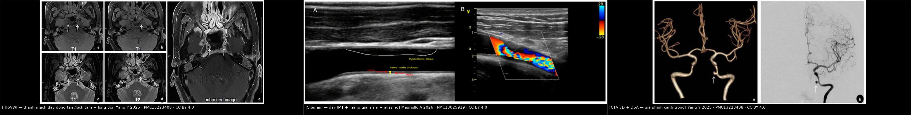
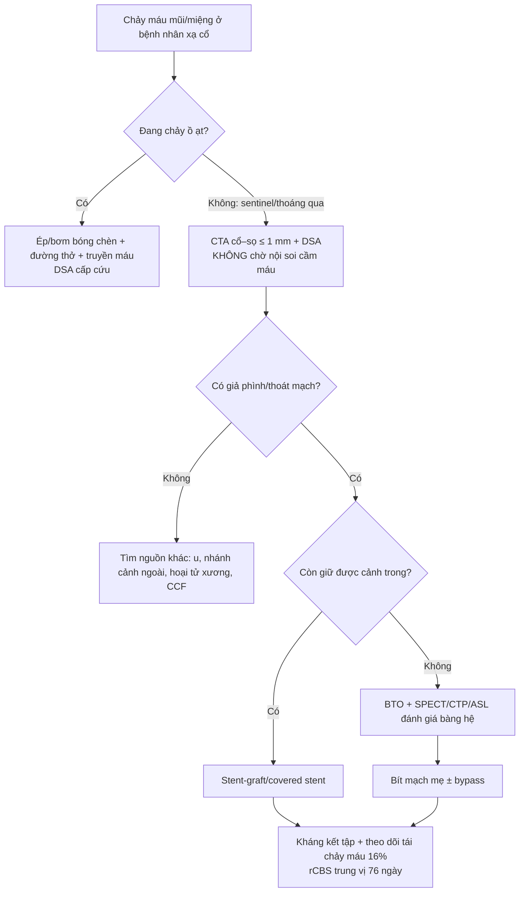
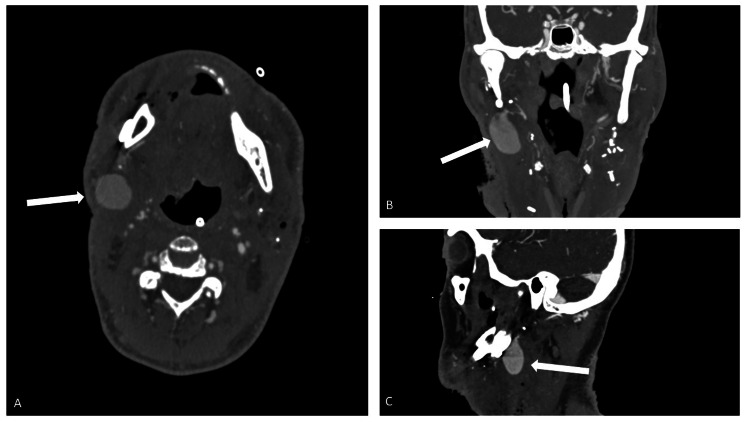
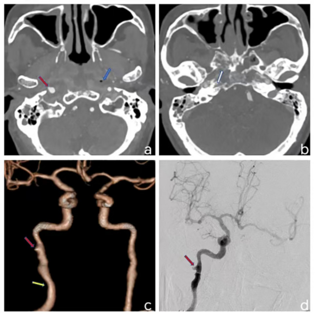
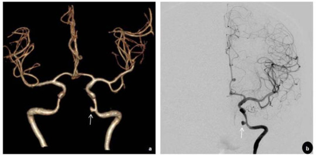
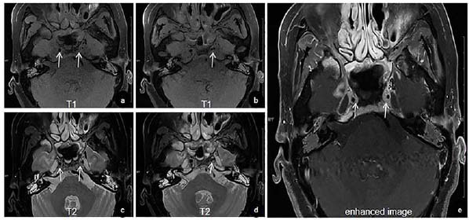

# 263 — Hội chứng vỡ mạch cảnh sau xạ cổ (carotid blowout syndrome, CBS): nhận diện sentinel bleed & can thiệp nội mạch

**Tags:** `pattern:gia-phinh` `pattern:thoat-mach` `pattern:chay-mau` `pattern:hoai-tu` `vung:dong-mach-canh-trong` `vung:mach-co-dau-co` `vung:co` `protocol:CTA` `protocol:DSA` `protocol:BTO` `protocol:stent-graft` `incidentaloma:khong`

**Mức chắc chắn (certainty):** tổng hợp y văn (literature synthesis) — 1 đoàn hệ 1.084 bệnh nhân ung thư đầu cổ (Diagnostics 2024, PMC11202696), 1 loạt 44 ca can thiệp nội mạch (Acta Otorhinolaryngol Ital 2025, PMC12673942), 1 loạt 225 ca với 35 ca tái phát (J Chin Med Assoc 2022, PMC12755353), 1 nghiên cứu so sánh stent bảo vệ vs bít mạch ở ung thư vòm họng (Quant Imaging Med Surg 2024, PMC10895091) và 3 ca nguyên văn có ảnh (Current Medical Imaging 2025, PMC13223408; BMC Med Imaging 2025, PMC12797736; Cureus 2025, PMC12017741). Bối cảnh hẹp cảnh do xạ (RICS) đã có bài riêng **260** — bài này chỉ giữ phần tối thiểu để hiểu cơ chế vỡ.

> **Câu chốt:** CBS là **vỡ/giả phình mạch cảnh ở vùng cổ đã xạ – đã mổ – có rò hầu–da**, chia **3 loại**: **I đe dọa** (mạch phơi, chưa chảy), **II sắp vỡ (sentinel bleed — chảy máu thoáng qua tự cầm)**, **III vỡ cấp**. **Sentinel bleed là tiếng chuông, không phải "chảy máu cam tái phát"**: phải **CTA/DSA ngay trong vài giờ**, không chờ nội soi cầm máu. Can thiệp nội mạch cầm máu **95%**, nhưng **tái chảy máu 16%**, **rCBS trung vị 76 ngày**, và **sống 6 tháng chỉ 28%** vì phần lớn là bệnh ung thư tiến triển.

## 1. Tổng quan bệnh học – cơ chế hình ảnh

### 1.1 Từ xạ cổ đến vỡ mạch: 3 lớp tổn thương chồng nhau

- **Lớp 1 — thành mạch:** xạ gây **hoại tử tế bào nội mô và cơ trơn áo giữa**, tổn thương **vasa vasorum**, xơ hóa áo ngoài → thành mạch mỏng–xơ–thiếu máu nuôi, mất khả năng sửa chữa. Đây là nền của **hẹp cảnh do xạ (RICS)** (bài 260) và cũng là nền của **giả phình**.
- **Lớp 2 — mô quanh mạch:** niêm mạc hầu/mũi, cơ, sụn, da vùng cổ **hoại tử sau xạ**; nếu có **mổ + rò hầu–da (pharyngocutaneous fistula) + nhiễm khuẩn**, mô quanh mạch mất hoàn toàn → **mạch phơi trong ổ hoại tử**, chỉ còn lớp mô hoại tử che.
- **Lớp 3 — dòng máu:** áp lực động mạch đập vào chỗ thành mạch mỏng → **giả phình (pseudoaneurysm)** không có thành thật (chỉ là mô xơ–viêm bao quanh), rồi **vỡ tự do** vào đường thở/miệng. Vì máu chảy vào **khoang có sẵn đường thoát** (mũi, miệng, khí quản), **không thấy khối máu tụ lớn** như chấn thương kín — người bệnh có thể **chết trong vài phút vì mất máu vào đường thở**.
- **TẠI SAO hình ảnh lại là "túi giả phình + khí quanh mạch":** túi giả phình **giữ hình cầu** và **ngấm cản quang đồng thì với lòng mạch** (có cổ thông với mạch); khí quanh mạch phản ánh **hoại tử mô + nhiễm khuẩn sinh hơi** — trên CT cửa sổ mô mềm, **bóng khí sát thành mạch** là dấu hiệu **đe dọa vỡ**, không phải "khí bình thường sau mổ".
- **TẠI SAO CBS hay ở cảnh trong đoạn xa:** ở ung thư vòm–họng, khối u xâm lấn **khoang cạnh hầu** và **cảnh trong đoạn lỗ rách (lacerum)** theo đường **hố chân bướm–lỗ rách**; xạ liều cao trúng vùng này → **cảnh trong đoạn xa** là nơi hay vỡ nhất. Đây cũng là đoạn **khó tiếp cận cả về mổ và can thiệp**.

### 1.2 Ngưỡng định lượng trụ cột

| Đại lượng | Con số | Nguồn |
|---|---|---|
| CBS trong đoàn hệ hiện đại **1.084 bệnh nhân HNC xạ trị** (2013–2023) | **0,8%** toàn nhóm; **NPC 0,9%** vs **không NPC 0,7%** (p = 0,34) | PMC11202696 |
| Tích lũy CBS gộp y văn | **5% (3–7%)** sau mổ + xạ · **4% (2–6%)** sau mổ · **5% (3–7%)** sau xạ | PMC11202696 |
| Sau **mổ cổ triệt căn** / sau **xạ lại** | **4,3% / 17%** | PMC12673942 |
| Phân bố thể trong 44 ca | **đe dọa 62% · sentinel 11% · vỡ cấp 27%** | PMC12673942 |
| Can thiệp nội mạch (44 ca) | cầm máu **95%** · thiếu máu cấp **11%** · **tái chảy máu 16%** · sống 6 tháng **28%** | PMC12673942 |
| Mổ cấp cứu kinh điển vs can thiệp nội mạch | biến chứng thần kinh **40%**, tử vong **60%** → còn **0–8%** biến chứng sau can thiệp | PMC12673942 |
| Tái phát CBS (225 bệnh nhân → 35 rCBS) | trung vị **76 ngày** (bệnh tiến triển **129 ngày**; nút chưa đủ **12 ngày**) | PMC12755353 |
| Vị trí rCBS | hành cảnh/thân cảnh ngoài **57%** · cảnh trong **23%** · nhánh xa cảnh ngoài **11%** · cảnh chung **9%** | PMC12755353 |
| Stent bảo vệ vs bít cảnh trong (28 NPC nguy cơ cao) | đột quỵ thủ thuật **0% vs 15,4%**; tắc stent không triệu chứng **20%**; sống trung vị **23,3 vs 15,8 tháng** (p = 0,04) | PMC10895091 |
| Nguy cơ tích lũy hẹp cảnh do xạ (nền của CBS) | **25–26%** hẹp > 50%; **12%** hẹp > 70%; **4%** tắc; 10 năm **29,6%** không triệu chứng | bài 260 / PMC13025919 |

### 1.3 Ba thể CBS — định nghĩa dùng để quyết định

- **Loại I — đe dọa (threatened):** mạch **phơi** trong vết thương/ổ hoại tử hoặc bị u xâm lấn, **chưa chảy máu**. Điều trị: **che phủ mô lành (vạt) ± can thiệp phòng ngừa**; nếu chỉ theo dõi, nguy cơ vỡ cao.
- **Loại II — sắp vỡ (impending/sentinel):** **chảy máu thoáng qua**, tự cầm hoặc cầm bằng ép; có thể kèm **đau tai/mũi, khối sưng vùng cổ, thiếu máu**. Đây là **thời điểm vàng** để can thiệp — **nhập viện, CTA/DSA trong vài giờ**.
- **Loại III — vỡ cấp (acute):** **chảy máu ồ ạt** từ mũi/miệng/vết mổ, sốc; cần **ép/bơm bóng chèn, kiểm soát đường thở, truyền máu, DSA cấp cứu**.

## 2. Mẫu hình + chẩn đoán phân biệt theo vị trí (Gamut)

- **Chảy máu mũi/miệng tái phát ở bệnh nhân xạ cổ:** gamut theo **nguồn**:
  - **Cảnh trong/cảnh chung** → **CBS** (giả phình, thoát mạch).
  - **Nhánh cảnh ngoài** (động mạch hàm trong, mặt, hầu lên) → **giả phình nhánh** sau mổ/hốc miệng; nút chọn lọc.
  - **U tái phát** xâm lấn mạch → chảy máu từ mô u, không có túi giả phình.
  - **Hoại tử xương thái dương/hốc mũi** → chảy máu từ mô hoại tử, không nguồn mạch lớn.
  - **Rò động–tĩnh mạch màng cứng/cảnh–xoang hang** → thì tĩnh mạch sớm, ù tai mạch đập (bài 249).
- **Khối sưng/đau vùng cổ sau xạ:** **giả phình** · **áp-xe/hoại tử mô** · **u tái phát** · **hạch hoại tử** · **huyết khối tĩnh mạch cảnh**.
- **Mất máu cấp không rõ nguồn:** luôn nghĩ CBS ở bệnh nhân **xạ cổ + rò hầu–da + mở khí quản**, kể cả khi **không thấy máu bên ngoài** (máu chảy vào đường thở/ống nuốt).

## 3. Bảng so sánh phân biệt (ma trận đối chiếu)

| Thực thể (entity) | Hình ảnh điển hình | Chốt vào (rule-in) | Chốt loại (rule-out) | Gợi ý xác nhận |
|---|---|---|---|---|
| **CBS — giả phình cảnh trong** | **Túi giả phình** ngấm cản quang cùng thì lòng mạch, cổ rộng/hẹp; **khí quanh mạch**, hoại tử mô quanh | **Xạ cổ + chảy máu sentinel + túi giả phình ở cảnh trong/chung** | Không túi, chỉ hẹp dài → RICS đơn thuần (bài 260) | **CTA cấp + DSA**; không chờ nội soi |
| **CBS — thoát mạch hoạt tính** | Cản quang **tràn ra ngoài lòng mạch**, lan theo thì muộn, **đổi hình giữa các thì** | **Thoát mạch trên DSA/CTA + chảy máu đang hoạt động** | Túi kín, không tràn → giả phình kín | DSA là chuẩn; **chuẩn bị can thiệp ngay** |
| **Giả phình nhánh cảnh ngoài** | Túi ở **động mạch hàm trong/mặt**, sau mổ/hốc miệng; **thoát mạch vào mô** | **Vị trí nhánh cảnh ngoài + tiền sử mổ miệng/hàm** | Túi ở cảnh trong → CBS (xử trí khác) | CTA/DSA; **nút chọn lọc nhánh**, tránh bít cảnh trong |
| **U tái phát xâm lấn mạch** | Khối mô mềm quanh cảnh, **mất mặt phẳng mỡ**, bờ không đều, ngấm thuốc; có thể hẹp lòng | **Bệnh ung thư đang tiến triển + khối quanh mạch** | Hẹp nhẵn, không khối → RICS/CBS | MRI tương phản + PET/CT; sinh thiết khi cần |
| **Hoại tử xương thái dương/hốc mũi** | Mảnh xương chết, khí trong mô, viêm quanh; **không túi mạch** | **Đau sâu + chảy máu từ mô hoại tử + xương chết trên CT** | Có túi giả phình → CBS | CT xương thái dương; nội soi; **DSA loại nguồn mạch** |
| **Rò cảnh–xoang hang (CCF)** | Giãn xoang hang, **thì tĩnh mạch sớm**, giãn tĩnh mạch mắt trên | **Ù tai mạch đập + giãn tĩnh mạch mắt + thì tĩnh mạch sớm** | Không shunt, chỉ túi ĐM → CBS | DSA (Barrow A–D) — bài 249 |

*Trái: **HR-VWI** — dày thành cảnh trong **đồng tâm** bên phải, **lệch tâm + lòng đôi** bên trái (Current Medical Imaging 2025, PMC13223408, CC BY 4.0). Giữa: **siêu âm** — dày IMT + **mảng giảm âm**, Doppler màu aliasing (Diagnostics 2026, PMC13025919, CC BY 4.0) — nền tổn thương thành mạch của CBS. Phải: **CTA 3D + DSA** — **túi giả phình hình "viên nang"** ở cảnh trong (PMC13223408, CC BY 4.0). Ảnh ghép letterbox, không crop/kéo giãn.*

## 4. Protocol chụp + phân độ và xử trí

### 4.1 CTA cấp cứu — làm gì trong 10 phút

- **CTA cổ–sọ** lát **≤ 1 mm**, phủ **quai ĐMC → nền sọ**, **thì động mạch** (bolus tracking ở quai ĐMC), dựng **MPR cong + MIP + VRT**; đọc **cửa sổ mô mềm** tìm **khí quanh mạch**, **mất mặt phẳng mỡ**, **mảnh xương/u xâm lấn**.
- **Dấu hiệu chốt:** **túi giả phình** (ngấm cùng thì lòng mạch, có cổ), **thoát mạch hoạt tính** (cản quang ngoài lòng mạch, đổi hình theo thì), **hẹp/tắc kèm** (RICS nền).
- **TẠI SAO CTA trước DSA:** CTA **không xâm lấn, nhanh**, định hướng **vị trí và cỡ túi**, phát hiện **nguồn thứ hai** (nhánh cảnh ngoài, u); DSA để **can thiệp** ngay sau đó. Ở bệnh nhân chảy máu ồ ạt, có thể **DSA thẳng** nếu phòng can thiệp sẵn.

### 4.2 DSA và quyết định can thiệp

- **Chụp 4 mạch** (cảnh hai bên + đốt sống) + **chụp chọn lọc cảnh ngoài** — vì rCBS hay ở **hành cảnh/thân cảnh ngoài (57%)** và **nhánh xa cảnh ngoài (11%)**; bỏ sót nhánh = tái chảy máu sớm (trung vị **12 ngày** khi nút chưa đủ).
- **Hai chiến lược:**
  - **Tái thông/giữ dòng (reconstruction):** **stent-graft (covered stent)** bít lỗ rò, giữ cảnh trong; ưu tiên khi **còn dòng và bán cầu cần**.
  - **Bít mạch mẹ (deconstruction):** bóng/coil ± plug ở cảnh trong/chung; ưu tiên khi **không giữ được** hoặc **tổn thương quá xa**; nguy cơ **thiếu máu bán cầu** — trong loạt 28 NPC, bít cảnh trong có **đột quỵ 15,4%** so với **0%** ở stent bảo vệ (PMC10895091).
- **Trước khi bít cảnh trong:** **BTO 20 phút + SPECT/CTP/ASL** đánh giá bàng hệ; nhớ **BTO âm vẫn 26% đột quỵ/12% tử vong** (bài 3059) — không có "test an toàn tuyệt đối".
- **Sau can thiệp:** kháng kết tập tiểu cầu (stent), theo dõi **tái chảy máu 16%**, **tắc stent không triệu chứng 20%**, kiểm tra CTA/DSA khi có triệu chứng mới; **không bỏ theo dõi ung thư** vì 66% tử vong do bệnh tiến triển.

### 4.3 Phân độ CBS và flowchart

### 4.4 Phòng ngừa ở nhóm nguy cơ cao

- **Nhóm nguy cơ cao:** xạ lại, liều tích lũy cao, **rò hầu–da**, mổ cổ nhiều lần, mở khí quản, nhiễm vùng cổ, **mạch phơi**.
- **Stent bảo vệ phòng ngừa** ở cảnh trong đoạn xa (NPC): an toàn hơn bít mạch (đột quỵ **0% vs 15,4%**) nhưng **tắc stent không triệu chứng 20%** và cần theo dõi — chỉ định phải cá thể hóa (PMC10895091).
- **Kiểm soát nhiễm + che phủ mô lành** (vạt cơ) là nền tảng; can thiệp mạch **không thay thế** việc xử lý ổ hoại tử.

## 5. Biến thể bình thường và cạm bẫy

- **"Chảy máu cam tái phát" ở bệnh nhân xạ cổ = CBS cho tới khi loại trừ.** Nội soi mũi cầm máu đơn thuần có thể **làm vỡ túi giả phình**; nếu đã cầm máu, vẫn phải **CTA/DSA** trước khi cho về.
- **Không thấy máu bên ngoài không loại trừ CBS:** máu chảy vào **miệng/hầu/khí quản**; bệnh nhân có thể chỉ **thiếu máu, ho máu, khó thở**.
- **Khí trong mô mềm cổ** sau xạ/mổ có thể do **hoại tử hoặc nhiễm khuẩn sinh hơi**; nhưng **khí sát thành mạch** là dấu hiệu **đe dọa vỡ** — đọc cửa sổ mô mềm, đừng chỉ nhìn xương.
- **Giả phình nhánh cảnh ngoài** (động mạch hàm trong) sau mổ/hốc miệng: chảy máu miệng ồ ạt nhưng **không phải CBS**; **nút chọn lọc nhánh** thường đủ, **tránh bít cảnh trong oan**.

*Không phải mọi chảy máu sau mổ cổ là CBS: CTA thì động mạch cho thấy **túi giả phình 2,9 cm từ động mạch hàm trong phải**, túi lan xuống dưới–ra ngoài vào giường mổ vùng cổ (Cureus 2025, PMC12017741, CC BY 4.0). Xử trí: nút mạch chọn lọc, không bít cảnh trong.*

- **Tái chảy máu sau can thiệp** có thể do **bệnh tiến triển (trung vị 129 ngày)** hoặc **nút chưa đủ (trung vị 12 ngày)** — luôn so sánh DSA lần đầu và lần tái phát; **chụp lại cảnh ngoài** nếu lần đầu chỉ xử lý cảnh trong.
- **Stent có thể gãy/ngắn lại/xuyên thành** trong vùng cổ đã xạ; theo dõi bằng CTA, không dựa vào X-quang cổ.
- **BTO âm không đồng nghĩa an toàn:** vẫn **26% đột quỵ/12% tử vong** sau bít mạch mẹ (bài 3059); cần **SPECT/CTP/ASL + lâm sàng**.
- **Satisfaction of search:** thấy túi giả phình cảnh trong rồi dừng — phải tìm **nhánh cảnh ngoài, u tái phát, rò hầu–da, CCF** vì có thể **nhiều nguồn chảy máu**.

*Bệnh nhân ung thư vòm–họng sau xạ: **giả phình cảnh trong đoạn C1** (mũi tên đỏ) kèm **khí trong ổ hoại tử vòm mũi họng** (mũi tên xanh) và **phá hủy xương bướm** — khí + hoại tử mô quanh mạch là dấu hiệu **đe dọa vỡ**, phải can thiệp trước khi chảy máu ồ ạt (BMC Med Imaging 2025, PMC12797736, CC BY-NC-ND 4.0, nguyên bản).*

## 6. Tự lượng giá — Blind Quiz ngay trên trang tĩnh

**Ca 1 — Nam 58 tuổi, ung thư vòm–họng xạ trị 6 năm trước, chảy máu mũi 2 tuần nay "lúc có lúc không", hôm nay chảy ồ ạt rồi tự cầm. CTA được chụp.**

- Gợi ý lâm sàng: xạ cổ cũ, chảy máu tái phát, không sốt, không chấn thương.
- Câu hỏi: Dấu hiệu chính ở đâu? Đây là loại CBS nào? Ba chẩn đoán phân biệt? Bước tiếp theo **không được** làm?

<b>Bấm để hiện đáp án (findings + chẩn đoán)</b>

- Dấu hiệu: **túi giả phình hình "viên nang"** (mũi tên) ở **động mạch cảnh trong đoạn xa**, rõ trên CTA 3D (a) và DSA (b); mạch não trên còn dòng.
- Chẩn đoán: **CBS loại II (impending/sentinel)** — giả phình cảnh trong sau xạ, đã có **sentinel bleed**. Vì xạ làm hoại tử áo giữa + mô quanh mạch, tạo túi giả phình không có thành thật.
- Phân biệt: u tái phát xâm lấn mạch, giả phình nhánh cảnh ngoài, rò động–tĩnh mạch/CCF.
- **Không được**: chỉ soi mũi cầm máu rồi cho về; **không chờ** chảy máu lần sau. Cần **DSA + can thiệp (stent-graft hoặc bít mạch mẹ)** ngay.
- Nguồn ảnh: Yang Y et al., *Current Medical Imaging* 2025, Fig. 2 — PMC13223408, CC BY 4.0.

**Ca 2 — Nam 62 tuổi, mổ ung thư lưỡi 3 tuần trước, chảy máu miệng ồ ạt, huyết áp tụt. CTA cổ.**

- Câu hỏi: Túi ở mạch nào? Có phải CBS không? Xử trí khác CBS ở điểm nào?

<b>Bấm để hiện đáp án (findings + chẩn đoán)</b>

- **Túi giả phình 2,9 cm** phát sinh từ **động mạch hàm trong (maxillary artery) phải**, lan xuống dưới–ra ngoài vào giường mổ vùng cổ; các thì cho thấy **thoát mạch hoạt tính** vào mô mềm/miệng.
- **Không phải CBS** (không phải cảnh trong/chung) — đây là **giả phình nhánh cảnh ngoài** sau mổ.
- Xử trí: **nút mạch chọn lọc nhánh cảnh ngoài** (coil/keo) để cầm máu, **không bít cảnh trong**; CBS mới cần stent-graft/bít mạch mẹ ± BTO.
- Nguồn ảnh: Salloum E, Altan A, *Cureus* 2025, Fig. 1 — PMC12017741, CC BY 4.0.

**Ca 3 — Bệnh nhân xạ cổ 5 năm, đột quỵ nhẹ, HR-VWI cảnh được chụp. Nhìn ảnh trước, mô tả trước.**

- Câu hỏi: Thành mạch hai bên khác nhau thế nào? Dấu hiệu "lòng đôi" gợi ý gì? Vì sao phải loại trừ trước khi can thiệp?

<b>Bấm để hiện đáp án (findings + chẩn đoán)</b>

- **Phải: dày thành ĐỒNG TÂM** (mũi tên trắng); **trái: dày LỆCH TÂM + "lòng đôi"** (b, d) — gợi ý **bóc tách/vạt nội mạc** trên nền xạ.
- Chẩn đoán: **bệnh mạch cảnh do xạ** với tổn thương thành mạch hai bên (nền của RICS — bài 260); cần **CTA/DSA** phân biệt hẹp do xạ với **bóc tách**.
- Vì sao quan trọng: nong bóng/stent ở mạch đang **bóc tách** có thể làm lan vạt nội mạc và tắc cấp; phải xác định trước khi can thiệp.
- Nguồn ảnh: Yang Y et al., *Current Medical Imaging* 2025, Fig. 1 — PMC13223408, CC BY 4.0.

## Bài liên quan chéo
- [200 – Tổng quan Hệ Thần kinh](../200-tong-quan-he-than-kinh/lesson.md)
- [260 – Bệnh mạch cảnh do xạ đầu cổ (RICS): hẹp–tắc dài, nhẵn, không vôi](../260-hep-dong-mach-canh-do-xa/lesson.md)
- [262 – Bệnh mạch máu LỚN do xạ trị não (hẹp–tắc kiểu moyamoya)](../262-benh-mach-mau-lon-do-xa-tri-moyamoya/lesson.md)
- [3046 – Chảy máu cam ồ ạt do vỡ giả phình cảnh trong vào xoang bướm](../3046-chay-mau-cam-do-vo-gia-phinh-dong-mach-canh-trong-xoang-buom/lesson.md)
- [249 – Rò động mạch cảnh–xoang hang sau chấn thương](../249-ro-dong-mach-canh-xoang-hang-chan-thuong/lesson.md)
- [3059 – Thiếu máu não sau bít động mạch cảnh trong (BTO, bypass)](../3059-thieu-mau-nao-sau-bit-dong-mach-canh-trong/lesson.md)

## Ảnh
- `263_hep-canh-do-xa_SieuAm_PMC13025919-F2.jpg` — siêu âm: dày IMT + mảng giảm âm + aliasing (nền RICS).
- `263_hep-canh-do-xa_MRI-PMC13223408-F1.jpg` — HR-VWI: dày thành đồng tâm/lệch tâm + lòng đôi.
- `263_gia-phinh-canh_CTA-DSA_PMC13223408-F2.jpg` — CTA 3D + DSA: túi giả phình cảnh trong.
- `263_gia-phinh-dong-mach_CTA_PMC12017741-F1.jpg` — CTA: giả phình động mạch hàm trong (không phải CBS).
- `263_gia-phinh-canh_CTA_PMC12797736-F2.jpg` — CTA: giả phình cảnh trong C1 + khí trong hoại tử vòm mũi họng.
- `composite_rics_cbs.jpg` — ảnh ghép 3 ô (chỉ từ nguồn CC BY 4.0), tạo bằng `tools/make_composite.py`.
- Nguồn + giấy phép từng ảnh: xem `images/CREDITS.md` và `sources.md`.

> Không dùng để chẩn đoán độc lập khi chưa có người hướng dẫn.
