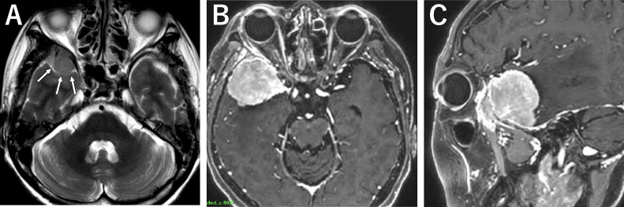
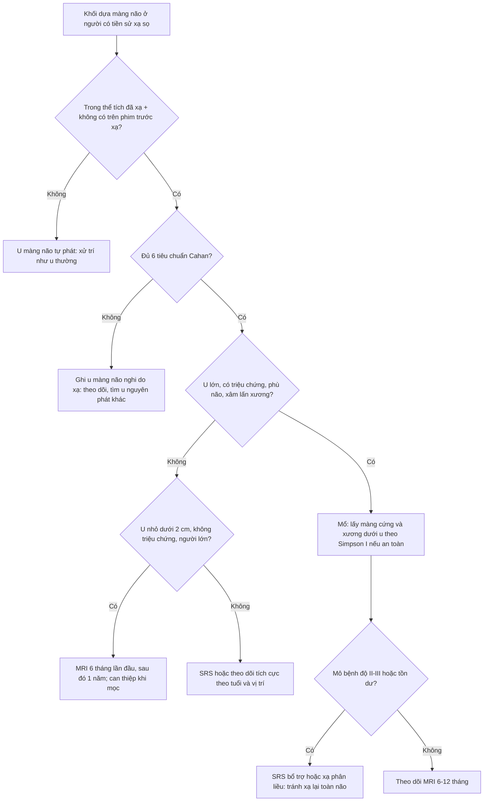
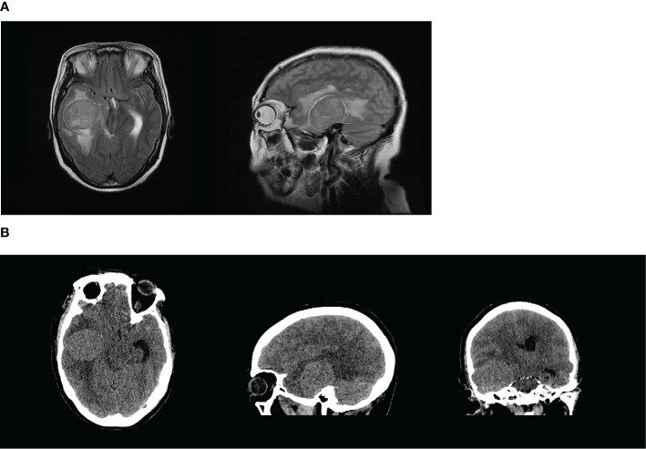
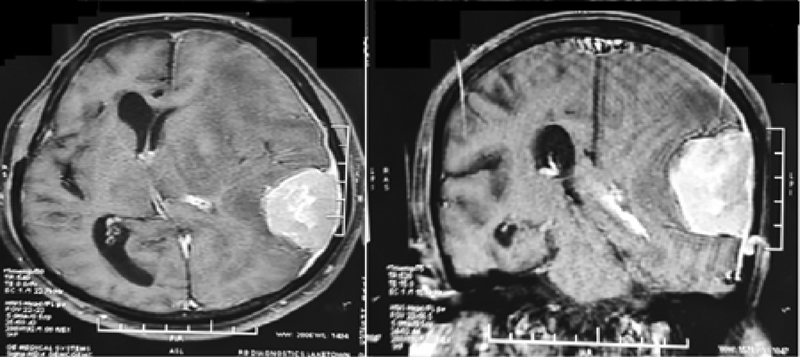

# 264 — U màng não do xạ trị (radiation-induced meningioma, RIM) / Radiation-induced meningioma

**Tags:** `pattern:u-mang-nao` `pattern:ngoai-truc` `pattern:ngam-thuoc-dong-nhat` `pattern:duoi-mang-nao` `pattern:day-xuong` `pattern:nhieu-o` `pattern:trong-truong-chieu` `vung:manh-nao` `vung:vom-so` `vung:nen-so` `vung:canh-buom` `vung:nao` `score:WHO-2021` `score:Simpson` `score:Cahan` `protocol:MRI-T1C` `protocol:CT-xuong` `protocol:MRI-sang-loc` `protocol:SRS` `protocol:DOTATATE-PET`

**Mức chắc chắn (certainty):** tổng hợp y văn (literature synthesis) — 1 tổng quan 251 ca (World Neurosurg 2017), 2 đoàn hệ lớn người sống sót ung thư nhi (Neuro-Oncology 2019, PMC6380414; J Clin Oncol 2017, PMC5455703), 1 đoàn hệ đơn trung tâm 90 ca (J Cancer Res Clin Oncol 2015, PMC11823707), 1 loạt sàng lọc MRI 176 ca (2019), 1 tổng quan biến chứng sọ não do xạ (Neuroradiology 2021) và **3 ca nguyên văn có ảnh** (Front Oncol 2024, PMC11246846 — CC BY; Radiol Case Rep 2024, PMC10770502 — CC BY; Asian J Neurosurg 2022, PMC9771624 — CC BY-NC-ND). **Không có thử nghiệm ngẫu nhiên** nào về theo dõi/điều trị RIM; mọi ngưỡng xử trí là tổng hợp đoàn hệ, chỗ suy luận được ghi rõ.

> **Câu chốt:** RIM là **u màng não mọc trong đúng trường chiếu cũ, sau một khoảng tiềm tàng tính bằng THẬP KỶ** (trung bình **22,9 ± 11,4 năm**; ngắn nhất ghi nhận **12 tháng**, dài nhất **63 năm**). Ba con số phải thuộc: **(1)** ở người sống sót ung thư nhi đã xạ sọ, nguy cơ tích lũy tới **12,4% ở năm thứ 40** sau chẩn đoán ban đầu (DCOG-LATER, 5.843 người); **(2) 11,9%** có **nhiều u**, **18,3%** tái phát, và chỉ **140/205 (68%)** là độ I — tức RIM **hung hơn** u màng não tự phát; **(3)** sống còn **5 năm 77,7% / 10 năm 66,1%** — không phải "u lành cắt là xong". Sai lầm hay gặp: đọc khối dựa màng não ở người **đã xạ sọ 20–30 năm trước** như u màng não thường, cắt không lấy diện màng não–xương rộng, rồi tái phát nhiều lần trong mô đã xạ.

## 1. Tổng quan bệnh học – cơ chế hình ảnh – vì sao "do xạ"

### 1.1 Vì sao màng não là mô nhạy nhất với tia xạ
- U màng não là **u não nguyên phát thường gặp nhất** (13–26% u nội sọ nguyên phát); **RIM là u não do tia xạ thường gặp nhất** trong các u thần kinh thứ phát sau xạ.
- **TẠI SAO màng não:** tế bào nắp nhện (arachnoid cap cell) nằm sát xương–màng cứng, **không có hàng rào máu–não bảo vệ**, phân bào chậm nhưng **tích lũy đột biến theo thời gian**; xạ gây **đứt sợi đôi DNA** ở tế bào nền, chọn lọc dòng tế bào có **mất NF2/22q** (thường gặp ở RIM) → sau nhiều năm mới đủ khối nhìn thấy. Vì vậy: **liều thấp vẫn gây bệnh** (kể cả **1.367,3 mGy** trong một ca can thiệp mạch não, Front Oncol 2024), nhưng **liều cao rút ngắn tiềm tàng và làm u hung hơn**.
- **Vật lý hình ảnh (TẠI SAO trông như vậy):** u màng não **giàu tế bào + mao mạch có cửa sổ (fenestrated)** → **ngấm thuốc gadolinium mạnh, đồng nhất, sớm**; **không có hàng rào máu–não** nên ngấm cả ở thì sớm và giữ lâu. Mô u **đặc, ít nước tự do** → **T1 xấp xỉ chất xám, T2 xấp xỉ chất xám/giảm nhẹ**, **không hạn chế khuếch tán mạnh** (khác áp-xe/lymphoma). **Vôi hóa** (tinh thể calci, T1/T2 đều tối, CT tăng đậm độ) gặp ở một phần u. **Xương dưới u dày lên (hyperostosis)** do tế bào u kích thích cốt bào → **CT xương là cửa sổ bắt buộc**, MRI một mình dễ bỏ.
- **Vì sao RIM "nhiều ổ" và "hung":** trường chiếu phủ **nhiều màng cứng cùng lúc** → nhiều ổ độc lập; mô nền đã xơ–giảm tưới máu, DNA tổn thương nhiều đợt → **tỉ lệ độ II–III cao hơn** u tự phát. Trong 251 ca: **độ I 140, độ II 55, độ III 10**; u **hung và nhiều ổ gặp nhiều hơn ở nhóm liều trung bình–cao**.

### 1.2 Ba mốc lịch sử phải nhớ khi đọc hồ sơ
- **Tiêu chuẩn Cahan (1998)** — 6 điều kiện, dùng để **gọi tên** một u là do xạ: (1) u nằm **trong trường chiếu**; (2) có **khoảng tiềm tàng** giữa xạ và u; (3) **mô bệnh khác** u nguyên phát trước đó; (4) bệnh nhân **không** có bệnh nền sinh u (NF2, xơ cứng củ, retinoblastoma...); (5) u **không có trước** khi xạ; (6) u **không phải tái phát/di căn** của u cũ.
- **Phân loại theo liều Harrison:** **liều thấp < 10 Gy** (tinea capitis, X-quang nha khoa, can thiệp mạch), **trung bình 10–20 Gy** (u da đầu–cổ nông), **cao > 20 Gy** (xạ trị u não, dự phòng sọ trong leukemia). Nhóm **liều cao**: tiềm tàng ngắn hơn, độ ác cao hơn, nhiều ổ hơn.
- **Dịch tễ định lượng (dùng để tư vấn, không phải để trấn an):**
  - **DCOG-LATER** (5.843 người sống sót ung thư nhi, theo dõi trung vị 23,3 năm): **97 u màng não lành**; **nguy cơ tích lũy 12,4% (9,8–15,2%) ở 40 năm** sau chẩn đoán ung thư đầu; **ERR/Gy = 0,30**; so với liều 1–19 Gy: **không xạ HR 0,04**, **40+ Gy HR 2,81 (1,30–6,08)**; xạ **trước 5 tuổi** HR **2,38 (1,39–4,07)** so với 10–17 tuổi.
  - **CCSS** (4.221 người đã xạ sọ): **199 u màng não ở 169 người**; **khoảng cách trung vị 22 năm (5–37)**; **nguy cơ tích lũy tới 40 tuổi 5,6%**; liều **≥ 30 Gy HR 2,6 (1,6–4,2)** so với 1,5–19,9 Gy; **20%** có di chứng thần kinh mới quanh lúc chẩn đoán (động kinh 8,3%).
  - **Đơn trung tâm Turin** (90 người, theo dõi 24,6 năm): **15/90 (16,7%)** có u màng não, trung vị **22,5 năm**, **4 người nhiều u**, **4/10 ca mổ là độ II**, **5 u khổng lồ không triệu chứng**.

## 2. Mẫu hình + chẩn đoán phân biệt theo vị trí (Gamut)

- **Mẫu hình chốt:** **khối ngoài trục, dựa màng cứng, ngấm thuốc đồng nhất**, bờ rõ, **dấu đuôi màng não (dural tail)**, có thể **dày xương dưới u**, **nằm gọn trong thể tích đã xạ** — và **không có trước** trên phim cũ (đối chiếu ảnh cũ là bước 1, không phải bước phụ).
- **Gamut theo vị trí trong trường chiếu:**
  - **Liềm–vòm sọ (convexity/parasagittal):** hay gặp nhất sau xạ toàn não; dễ thấy nhất, hay kèm phù não và động kinh.
  - **Cánh bướm xương bướm (sphenoid wing):** thể **en plaque**, xâm lấn xương, **lồi mắt** — sau xạ **hốc mắt** (basedow, u hốc mắt) dễ bị nhầm là basedow tái phát (ca PMC10770502).
  - **Nền sọ–hố sau:** sau xạ u tuyến yên/tủy nguyên bào; **chèn ép dây thần kinh sọ**, khó mổ hơn, hay tồn dư.
  - **Nhiều ổ (11,9%):** nhiều màng cứng cùng lúc, kích thước khác nhau — **không** phải di căn nếu tất cả nằm trong trường chiếu cũ.
  - **Tủy sống (rất hiếm):** u màng não trong trường chiếu cổ–ngực sau xạ lymphoma/Hodgkin — cùng nguyên lý, khác giải phẫu.
- **Chẩn đoán phân biệt theo hình ảnh (khi đã có tiền sử xạ):** u màng não **tự phát** (không phân biệt được trên ảnh — **phải dựa vào vị trí trong trường chiếu + thời gian + phim cũ**) · **di căn màng cứng** (thường nhiều ổ, phá xương, có u nguyên phát) · **plasmacytoma/myeloma** (tiêu xương, không dày xương) · **lymphoma màng cứng** (ngấm đồng nhất nhưng hạn chế khuếch tán, thường không dày xương) · **u nguyên bào sợi đơn độc/SFT–hemangiopericytoma** (giàu mạch, "chảy máu như núi lửa" trên DSA, tái phát cao) · **sarcoma xương sọ do xạ** (Cahan, phá xương ác tính, không phải u màng não) · **hoại tử phóng xạ** (bài 204: ngấm viền, không ngoài trục, tiến triển theo thời gian) · **loạn sản sợi (fibrous dysplasia)** và **Paget** (dày xương nhưng không có khối mô mềm ngấm thuốc) · **meningocele giả sau mổ** (dịch, không ngấm).

## 3. Bảng so sánh phân biệt (ma trận đối chiếu)

| Thực thể (entity) | Hình ảnh điển hình | Chốt vào (rule-in) | Chốt loại (rule-out) | Gợi ý xác nhận |
|---|---|---|---|---|
| **RIM (u màng não do xạ)** | Khối **ngoài trục dựa màng cứng**, ngấm thuốc **đồng nhất**, bờ rõ, **trong trường chiếu cũ**, có thể nhiều ổ, dày xương dưới u | **Nằm đúng thể tích đã xạ + có trên phim mới, không có trên phim trước xạ + đủ 6 tiêu chuẩn Cahan** | U **trước khi xạ** đã có; **cùng mô bệnh** với u cũ; **ngoài trường chiếu** | So phim/đĩa xạ cũ, tái tạo liều 3D; MRI T1+C; CT xương |
| **U màng não tự phát** | Cùng hình thái, thường **một ổ**, không liên quan trường chiếu | Vị trí **ngoài** thể tích đã xạ, không tiền sử xạ | **Nhiều ổ trong trường chiếu + tiền sử xạ** → nghi RIM | Hồ sơ xạ trị; theo dõi tốc độ mọc |
| **Di căn màng cứng** | Nhiều ổ màng cứng, **phá xương**, phù mô mềm, có u nguyên phát | **Nhiều ổ ngoài trường chiếu + tiêu xương + u nguyên phát đang tiến triển** | **Dày xương + đuôi màng não + ổ đơn trong trường chiếu** → RIM | PET/CT, sinh thiết nếu không điển hình |
| **SFT/hemangiopericytoma** | Khối ngoài trục **giàu mạch**, bờ chia múi, **không vôi hóa**, xâm lấn xương kiểu "gặm" | **DSA: mạng mạch dày, tĩnh mạch dẫn sớm**; tái phát nhanh | **Ngấm đồng nhất đều, đuôi màng não** → u màng não | Sinh thiết + STAT6; DSA trước mổ |
| **Sarcoma xương sọ do xạ** | Khối **từ xương**, phá vỏ xương, mô mềm lớn, không đuôi màng não | **Phá xương ác tính + mô bệnh sarcoma**, đủ Cahan | **Dày xương đặc + khối màng não** → RIM | CT xương, MRI, sinh thiết |
| **Hoại tử phóng xạ (204)** | Vùng ngấm **viền không đều**, phù trắng, co rút theo thời gian, trong mô đã xạ | **Không có khối ngoài trục**, tín hiệu thay đổi theo tháng, PET chưa chắc | **Khối đặc ngoài trục, ngấm đồng nhất, có đuôi** → u | MRI đa thời điểm, MRS/PET, hội chẩn |
| **Loạn sản sợi xương sọ** | Dày xương **"kính mờ"**, không có khối mô mềm ngấm thuốc | **CT: xương đặc đồng nhất, không phá vỏ, không mô mềm** | **Có thành phần mô mềm ngấm thuốc** → u | CT xương là đủ |

*(A) T2 axial: khối nhỏ 15 × 13 × 11 mm ở cánh bướm phải (mũi tên) — phát hiện tình cờ. (B, C) T1 sau tiêm gadolinium, axial và sagittal: cùng vị trí đã thành khối 38 × 38 × 41 mm, thể tích 31,3 cc, ngấm thuốc mạnh, phù não xung quanh. Nguồn: Radiol Case Rep 2024 (PMC10770502), CC BY 4.0.*

### Dấu hiệu "đọc đúng" trên từng chuỗi
- **T1 sau tiêm:** ngấm **đồng nhất, mạnh, giữ lâu**; **đuôi màng não** (dural tail) là dấu **gợi ý, không đặc hiệu** (cũng gặp ở di căn màng cứng, lymphoma). **Ngấm không đồng nhất + hoại tử trung tâm** → nghĩ **độ II–III**, đặc biệt ở RIM.
- **CT xương (bắt buộc):** **dày xương dưới u (hyperostosis)** và **xâm lấn xương** thay đổi **đường mổ** (cần lấy xương); đồng thời **phân biệt với sarcoma xương** (phá xương) và **loạn sản sợi** (kính mờ).
- **FLAIR/T2:** phù não xung quanh **không tương xứng kích thước u** ở thể xâm lấn; **thể en plaque** có thể chỉ là dải dày màng cứng bám xương — **dễ bỏ nhất** trên MRI thường quy.
- **DWI:** không hạn chế khuếch tán mạnh; **hạn chế rõ → nghĩ lymphoma/áp-xe**, không phải u màng não điển hình.
- **Mạch:** u màng não giàu mạch nhưng **không có "mạng mạch cuồng nộ"** như SFT; nếu định mổ, **chụp mạch/nút mạch** khi u lớn, giàu mạch.

## 4. Protocol chụp + theo dõi + phân độ

- **MRI sọ có cản quang là chuẩn:** T1 trước tiêm, **T1 sau tiêm 3 mặt phẳng**, T2/FLAIR, DWI, SWI; **lát ≤ 3 mm** qua vùng nghi ngờ. **CT xương lát mỏng** cùng lúc nếu u sát xương/nền sọ.
- **Tái tạo liều 3D từ kế hoạch xạ cũ** (nếu còn dữ liệu): chứng minh u **nằm trong ≥ 90% liều kê** — đây là bằng chứng mạnh nhất cho "do xạ", hơn cả ký ức bệnh nhân.
- **Theo dõi người đã xạ sọ:** **bắt đầu MRI sau ≥ 10 năm** (các nghiên cứu sàng lọc dùng mốc 10 năm), lặp **mỗi 3–5 năm**; **không dùng CT lặp** (chính CT là nguồn liều) — đặc biệt ở người trẻ.
- **Sàng lọc có lợi không?** RCT sàng lọc **không có**: sàng lọc MRI phát hiện **21,4% (15/70)** so với **8,5% (9/106)** ở nhóm chỉ chụp khi có triệu chứng, u nhỏ hơn (**1,6 vs 2,6 cm**, p = 0,13) nhưng **không** giảm tỉ lệ cắt toàn bộ hay di chứng (p = 0,19; p = 0,28). → Sàng lọc là **quyết định chia sẻ**, không phải chỉ định cứng.
- **Phân độ & điểm:**
  - **WHO 2021 (u màng não):** độ 1 (nhiều thể), **độ 2 (không điển hình, tổn thương não xâm lấn, ≥ 4 phân bào/mm²)**, **độ 3 (ác tính, nhú, tế bào sáng)** — độ cao → tiềm tàng RIM **ngắn hơn** và tái phát nhiều hơn.
  - **Simpson (mức cắt):** I–V; **Simpson I (lấy cả màng cứng + xương)** là mục tiêu với RIM vì **diện cắm rộng và đã xạ**.
  - **Cahan:** tiêu chuẩn chẩn đoán (mục 1.2) — ghi vào hồ sơ, không chỉ ghi "u màng não".
- **Sơ đồ quyết định (dùng cho hội chẩn):**

> Lưu ý về sơ đồ: **RIM độ I vẫn có thể tái phát** (18,3% trong 251 ca) — "độ I" không cho phép cắt tiết kiệm rồi thôi theo dõi.

## 5. Biến thể bình thường và cạm bẫy

- **"U màng não" trên phim cũ nhưng không ai đối chiếu:** RIM chỉ được chứng minh khi **u không có trước khi xạ**. Không có phim cũ → ghi **"nghi do xạ"**, đừng khẳng định; nhưng cũng **đừng bỏ** yếu tố xạ khi lập kế hoạch mổ.
- **En plaque cánh bướm sau xạ hốc mắt** — bệnh cảnh **lồi mắt tái phát sau xạ basedow**: dễ bị coi là basedow bùng phát; **MRI hốc mắt có cản quang** là bước phân biệt (ca PMC10770502: u phát hiện ở tuổi 60, **18 năm sau xạ 20 Gy/10 lần**, rồi **to 38 mm trong 6 năm**).
- **Bỏ sót nhiều ổ:** 11,9% có nhiều u → **chụp toàn bộ não có cản quang**, không chỉ vùng triệu chứng; ở trẻ đã xạ toàn não, **đọc cả liềm, hố sau, nền sọ**.
- **Nhầm với tái phát u cũ:** Cahan yêu cầu **mô bệnh khác** u trước đó. Ca PMC9771624: xạ phẫu thuật u tuyến yên tái phát → nhiều năm sau **u màng não thể nhú độ III** ở vòm sọ thái dương, **chảy máu khoang mổ 2 lần** và tử vong — "u mới" không hiền như tên gọi.
- **Nhầm với hoại tử phóng xạ (204):** hoại tử **không tạo khối ngoài trục có đuôi màng não**; ngấm **viền**, co rút theo tháng. Điều trị ngược nhau (mổ vs corticoid/theo dõi).
- **Tăng sinh xương sau xạ** (dày xương vòm, "calvarial thickening") là **biến đổi lành tính**, không phải u — **không sinh thiết** chỉ vì xương dày; chỉ sinh thiết khi có **thành phần mô mềm**.
- **Trẻ em:** sau xạ sọ, **dày xương + thay đổi da đầu** có thể che u nhỏ; **MRI là phương thức theo dõi**, không phải CT (ALARA, và chính CT góp liều).
- **Cạm bẫy "u nhỏ = lành":** ca Turin có **5 u khổng lồ không triệu chứng**; ca Front Oncol 2024 u **5,1 × 4,1 cm** gây **tụt tri giác GCS 6** trong vài ngày. Kích thước không dự báo được triệu chứng.

## 6. Tự lượng giá — Blind Quiz

**Ca 1 — Nữ 69 tuổi, 27 năm trước xạ 20 Gy/10 lần vùng sau hốc mắt vì basedow, nay khối cánh bướm phải. Nhìn ảnh trước, mô tả trước.**

- Gợi ý lâm sàng: không đau đầu, không nhìn đôi; u phát hiện tình cờ trên MRI 10 năm trước.
- Hỏi: (1) Khối ở đâu, chuỗi xung nào? (2) Vì sao gọi là **do xạ** chứ không phải u thường? (3) Kế hoạch tiếp theo?

<b>Bấm để hiện đáp án (findings + chẩn đoán)</b>

- **Findings:** (A) T2 axial: khối **15 × 13 × 11 mm** cánh bướm phải, đồng tín hiệu chất xám, bờ rõ. (B, C) T1 sau gadolinium: khối **38 × 38 × 41 mm**, **31,3 cc**, ngấm **mạnh đồng nhất**, phù não xung quanh mức trung bình, bám màng cứng cánh bướm.
- **Chẩn đoán:** **u màng não do xạ (RIM)**, mô bệnh **độ II không điển hình**.
- **Vì sao:** u **nằm đúng trường chiếu 20 Gy** (song song đối diện sau hốc mắt), **không có trên CT lúc xạ**, **mô bệnh khác** bệnh nền (basedow không phải u) → đủ Cahan. Tốc độ: **15 mm → 38 mm trong 6 năm** (~3,8 mm/năm) — nhanh hơn u lành điển hình, phù hợp độ II.
- **Nguồn:** Radiol Case Rep 2024 (PMC10770502), CC BY 4.0. *Phản biện: ca này là ca thứ hai trong y văn về RIM sau xạ basedow; kết luận "do xạ" dựa trên vị trí + tiềm tàng, không có liều 3D tái tạo.*

**Ca 2 — Nam 56 tuổi, can thiệp nút túi phình mạch não 2,5 năm trước (tổng liều 1.367,3 mGy), nay lú lẫn – liệt nửa người trái.**

- Hỏi: (1) Mô tả khối và hiệu ứng choán chỗ. (2) Vì sao đây là **tiềm tàng ngắn bất thường** và điều đó nói gì về liều thấp? (3) Xử trí cấp?

<b>Bấm để hiện đáp án</b>

- **Findings:** khối **5,1 × 4,1 cm** thùy thái dương phải, bờ rõ, **đè đẩy đường giữa 0,5 cm**, chèn ép não thất bên phải; trên CT không cản quang khối giảm đậm độ nhẹ, phù não xung quanh.
- **Chẩn đoán:** **RIM thể khổng lồ, độ I** (meningothelial), sau can thiệp mạch não **2,5 năm** — tiềm tàng **ngắn nhất** được báo cáo (kinh điển 12 tháng–63 năm, trung bình 22,9 năm).
- **Ý nghĩa:** liều **1.367,3 mGy** (thấp) vẫn đủ gây u → **liều không có ngưỡng an toàn tuyệt đối**; tối ưu hóa liều can thiệp là việc của bác sĩ CĐHA can thiệp.
- **Xử trí:** **mổ cấp cứu** lấy u + giải ép; mô bệnh độ I; tác giả khuyến cáo **tránh xạ bổ trợ cho RIM độ I đã lấy toàn bộ**.
- **Nguồn:** Front Oncol 2024 (PMC11246846), CC BY 4.0.

**Ca 3 — Nam 69 tuổi, xạ phẫu thuật u tuyến yên tái phát nhiều năm trước, nay khối vòm sọ thái dương trái.**

- Hỏi: (1) Dấu hiệu nào chốt u **ngoài trục**? (2) Vì sao tiền sử xạ u tuyến yên vẫn tính là "cùng trường chiếu"? (3) Điều gì khiến ca này khác u màng não thường?

<b>Bấm để hiện đáp án</b>

- **Findings:** khối **ngoài trục**, dựa màng cứng vòm sọ thái dương trái, **ngấm thuốc mạnh đồng nhất**, **đuôi màng não** hướng về liềm, đè đẩy đường giữa sang phải, phù não trắng xung quanh.
- **Chẩn đoán:** **RIM độ III — u màng não thể nhú (papillary)**, sau xạ phẫu thuật u tuyến yên.
- **Vì sao khác:** **độ III** (hiếm), **chảy máu khoang mổ 2 lần sau phẫu thuật** và tử vong; đúng như dữ liệu 251 ca — RIM **hung hơn**, tái phát **18,3%**, sống 10 năm **66,1%**.
- **Nguồn:** Asian J Neurosurg 2022 (PMC9771624), CC BY-NC-ND 4.0 (nguyên bản, không cắt ghép).

## Bài liên quan chéo
- [213 – U não: GBM vs di căn vs lymphoma vs áp-xe](../213-u-nao/lesson.md) (khối nội trục, phân biệt nền)
- [204 – Hoại tử phóng xạ sau xạ trị u não](../204-hoai-tu-phong-xa-sau-xa-tri-u-nao/lesson.md) (chẩn đoán ngược)
- [260 – Hẹp động mạch cảnh ngoài sọ do xạ](../260-hep-dong-mach-canh-do-xa/lesson.md)
- [262 – Bệnh mạch máu lớn do xạ trị não](../262-benh-mach-mau-lon-do-xa-tri-moyamoya/lesson.md)
- [268 – Bệnh tủy do xạ trị](../268-benh-tuy-do-xa-tri/lesson.md) (cùng nguyên lý "trong trường chiếu")
- [240 – Schwannoma tiền đình: SRS vs mổ](../240-hannover-schwannoma-tien-dinh-srs-vs-mo-cpa/lesson.md)
- [201 – Protocol sọ não](../201-protocol-so-nao/lesson.md)

> Không dùng để chẩn đoán độc lập khi chưa có người hướng dẫn.
