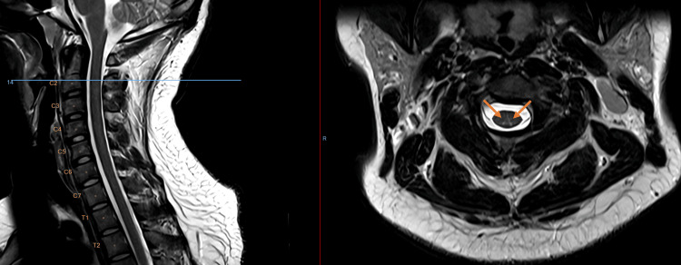
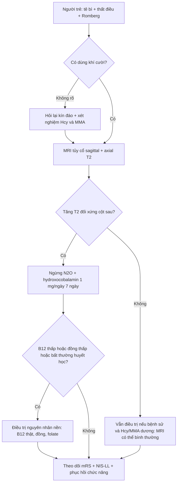
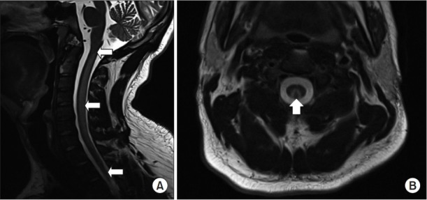
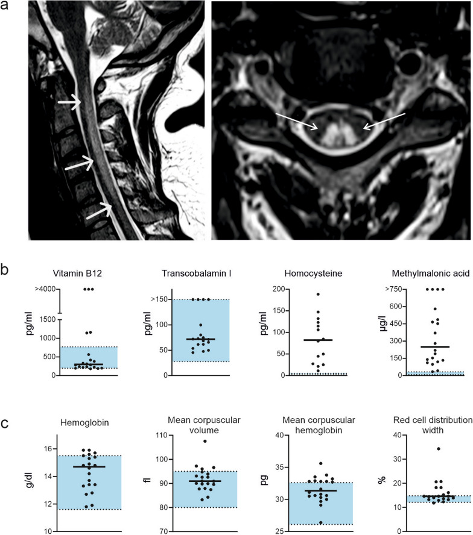

# 265 — Ngộ độc khí cười (N₂O) & thiếu vitamin B₁₂ chức năng: tủy sau "chữ V ngược" / Nitrous oxide-induced myeloneuropathy (functional B₁₂ deficiency)

**Tags:** `pattern:tang-tin-hieu-t2` `pattern:doi-xung` `pattern:tuy-sau` `pattern:chu-v-nguoc` `pattern:khong-ngam-thuoc` `pattern:myelin` `pattern:teo-tuy` `vung:tuy-co` `vung:tuy-nguc` `vung:cot-song-co` `score:mRS` `score:NIS-LL` `protocol:MRI-tuy` `protocol:T2-axial` `protocol:DWI` `protocol:EMG-NCS`

**Mức chắc chắn (certainty):** tổng hợp y văn (literature synthesis) — 2 đoàn hệ lớn (81 người/100 lần nhập viện, Br J Clin Pharmacol 2026, PMC13714620; 20 người, Neurol Res Pract 2025, PMC12049779), 1 loạt 10 người (Neuromuscul Disord 2026), 1 tổng quan 154 ca (The Neurologist 2024), 1 loạt 8 ca (2024) và **3 ca nguyên văn có ảnh** (Cureus 2026, PMC13049691 — CC BY; Ann Rehabil Med 2019, PMC6734019 — CC BY-NC; Neurol Res Pract 2025, PMC12049779 — CC BY). **Không có RCT** về liều B₁₂ hay thời gian điều trị; phác đồ dưới đây là tổng hợp thực hành từ ca/đoàn hệ, chỗ suy luận được ghi rõ.

> **Câu chốt:** khí cười (N₂O) **bất hoạt vitamin B₁₂** bằng cách oxy hóa ion coban → khóa **methionin synthase** → **ức chế methyl hóa myelin**. Kết quả là **tủy sau (dorsal columns) mất myelin đối xứng**, trên MRI là **hai vệt tăng T2 hình "chữ V ngược" (inverted V)** ở tủy cổ. Ba con số phải thuộc: **(1)** B₁₂ huyết thanh **bình thường ở 95%** bệnh nhân trong một đoàn hệ (20 người) — **B₁₂ bình thường KHÔNG loại trừ**; **(2) homocystein và MMA tăng 100%** ở đoàn hệ đó, và **homocystein có độ nhạy 95% / đặc hiệu 13%**, MMA **93%/45%**; **(3)** **tiếp tục dùng N₂O = không hồi phục** (20% được theo dõi, không ai cải thiện). Đây là bệnh **chẩn đoán bằng BỆNH SỬ + homocystein/MMA**, không bằng B₁₂.

## 1. Tổng quan bệnh học – cơ chế hình ảnh – vì sao "chữ V ngược"

### 1.1 Cơ chế phân tử: một phân tử khí, hai enzym
- N₂O **oxy hóa Cob(I) → Cob(III)** trong cobalamin → cobalamin **không còn dạng hoạt động** (methylcobalamin, adenosylcobalamin). Hai enzym bị khóa:
  - **Methionin synthase:** giảm **methionin** và **S-adenosylmethionin (SAM)** → **giảm methyl hóa phospholipid myelin** → myelin mỏng, phù gian myelin (intramyelinic edema) → **mất myelin tủy sau**.
  - **Methylmalonyl-CoA mutase:** ứ **methylmalonic acid (MMA)** — đây là **dấu ấn đặc hiệu hơn B₁₂ huyết thanh**.
- **TẠI SAO tủy sau:** cột sau gồm **sợi myelin dày, dẫn truyền cảm giác bản thể–rung–vị thế**, mật độ myelin cao nhất tủy, **dòng máu nuôi tương đối nghèo** so với nhu cầu → tổn thương sớm và đối xứng. Vì **vận động (cột bên) và cảm giác đau–nhiệt (cột trước–bên) ít bị hơn**, bệnh cảnh là **mất cảm giác bản thể + mất thăng bằng**, không liệt mềm kiểu tủy trước.
- **TẠI SAO "chữ V ngược":** giải phẫu **rãnh giữa sau (posterior median septum)** tách **fasciculus gracilis (trong)** và **cuneatus (ngoài)**; hai bó tăng tín hiệu **hình hai cánh** trên lát cắt axial → **"inverted V"** (còn gọi "rabbit ears"). Dấu này **không đặc hiệu** — thiếu B₁₂ kinh điển, thiếu đồng, HIV, giang mai cũng cho hình tương tự.
- **Vật lý hình ảnh (TẠI SAO T2 sáng, không ngấm, không hạn chế khuếch tán):** phù gian myelin và giảm myelin → **tăng nước tự do ngoại bào** → **T2/FLAIR tăng tín hiệu**, **T1 đồng/giảm nhẹ**. **Không phá hàng rào máu–tủy** → **không ngấm gadolinium** (ngấm nhẹ thoáng qua ở một số ca cấp). **Không phải nhồi máu/áp-xe** → **DWI không hạn chế rõ**; hạn chế khuếch tán mạnh phải nghĩ **nhồi máu tủy (bài 226)**. Ở thể nặng–muộn, tăng tín hiệu **teo dần** và tủy **mỏng đi** (atrophy) — dấu tiên lượng xấu.

### 1.2 Dịch tễ & liều phơi nhiễm (dùng để hỏi bệnh, không phải để phán xét)
- Khảo sát quốc tế: **tiền sử dùng N₂O cả đời 17%**, **dùng trong năm 11,9%**, người dùng **69,3% là nam**; **4,2%** người dùng có triệu chứng cảm giác dai dẳng kiểu "găng–tất".
- **Mỹ 2019 (SAMHSA):** **~12,9 triệu** người từ 12 tuổi trở lên đã lạm dụng N₂O. Châu Âu: EMCDDA 2022 xếp N₂O vào nhóm chất hướng thần được dùng nhiều nhất.
- **Liều–đáp ứng (đoàn hệ Sydney 2026, 81 người):** **tổng lượng tích lũy** là yếu tố dự báo mạnh nhất; liên quan **tủy thoái hóa bán cấp tủy sau (SCD) p = 0,006**, **bệnh thần kinh ngoại biên p = 0,036**, tương quan với **độ nặng thần kinh ngoại biên (Spearman ρ = 0,43, p = 0,001)**.
- **Kiểu dùng thực tế:** trung bình **2.500 g/ngày** (Frankfurt); ca nặng **> 500 cartridges/ngày**; ca Cureus: **5–20 canister/lần, 2–5 lần/tháng trong 7–10 năm**, khởi phát sau một lần dùng nặng.
- **Tổn thương thần kinh trong 154 ca (tổng quan 2024):** tuổi trung vị **22 (19–26)**, phơi nhiễm **9 (3–18) tháng**; **tủy 75%**, **thần kinh ngoại biên 58%** — tức **đa số là myelo-polyneuropathy phối hợp**, không phải chỉ tủy.

## 2. Mẫu hình + chẩn đoán phân biệt theo vị trí (Gamut)

- **Mẫu hình chốt:** người trẻ **mất cảm giác bản thể + thất điều dáng đi + dấu Romberg (+)**, đối xứng, **không đau lưng, không sốt, không chấn thương**; MRI: **tăng T2 hai bên cột sau tủy cổ** ("chữ V ngược"), **không ngấm thuốc**; **B₁₂ có thể bình thường** nhưng **homocystein ± MMA tăng**.
- **Gamut theo vị trí tổn thương:**
  - **Chỉ cột sau, cổ (điển hình N₂O):** mất bản thể–rung, dáng đi như "giẫm bông", phản xạ gân xương **giảm hoặc bình thường** (vì kèm bệnh lý thần kinh ngoại biên); **Babinski có thể âm**.
  - **Cột sau + cột bên (SCD tiến triển):** thêm **tăng phản xạ, Babinski (+), rối loạn cơ tròn** — dấu hiệu tổn thương bó vỏ–tủy; đây là thể nặng hơn, tiên lượng chậm hồi phục.
  - **Thần kinh ngoại biên đơn thuần:** tê bì "găng–tất", **MRI tủy bình thường** — **không loại trừ** N₂O; cần EMG/NCS.
  - **Tủy ngực/thắt lưng:** ít gặp hơn; nếu tổn thương **cổ + ngực** thì **tiên lượng chức năng xấu hơn** (loạt 2026: số đốt tổn thương là yếu tố dự báo chính).
- **Gamut "tăng T2 đối xứng cột sau tủy":**
  - **Thiếu B₁₂ chức năng do N₂O (bài này)** · **thiếu B₁₂ thật (thiếu máu ác tính, cắt dạ dày, ăn chay trường, metformin kéo dài)** · **thiếu ĐỒNG (copper) — bắt chước gần như hoàn hảo, kèm thiếu máu/giảm bạch cầu trung tính** · **bệnh tủy do HIV (vacuolar myelopathy)** · **giang mai tủy (tabes dorsalis)** · **ngộ độc methotrexate/cytosine arabinoside nội tủy** · **xơ hóa tủy do xạ (bài 268)** · **nhồi máu tủy trước (khác vị trí, "owl's eye")** · **viêm tủy cắt ngang/NMO (tổn thương dài, trung tâm, ngấm thuốc)** · **MS (ngắn, không đối xứng, quanh não thất)** · **chèn ép tủy do thoát vị/dây chằng vàng** (bờ tủy, có tín hiệu chèn ép).
- **Ba câu hỏi tại giường:** (1) **Có dùng khí cười không** — hỏi thẳng, không gợi ý (bệnh nhân thường không tự khai); (2) **Đối xứng, tủy sau, không đau** không? (3) **B₁₂/MMA/homocystein** — và nhớ **đo cả đồng** trước khi kết luận.

## 3. Bảng so sánh phân biệt (ma trận đối chiếu)

| Thực thể (entity) | Hình ảnh điển hình | Chốt vào (rule-in) | Chốt loại (rule-out) | Gợi ý xác nhận |
|---|---|---|---|---|
| **Myeloneuropathy do N₂O** | T2 **đối xứng cột sau tủy cổ** ("chữ V ngược"), không ngấm, không hạn chế khuếch tán; có thể teo muộn | **Bệnh sử dùng N₂O + Hcy/MMA tăng + B₁₂ có thể bình thường** | **B₁₂ bình thường KHÔNG loại trừ**; MRI bình thường **không loại trừ** (chỉ 60–73% có tổn thương) | Hỏi bệnh sử kỹ; Hcy + MMA; EMG/NCS |
| **Thiếu B₁₂ thật (SCD)** | Cùng hình thái, thường **tủy ngực** + cột bên | **B₁₂ thấp + MMA/Hcy tăng + thiếu máu hồng cầu to**, không dùng N₂O | **Dùng N₂O rõ ràng + B₁₂ bình thường** → nghi N₂O | B₁₂, holoTC, MMA, Hcy, nội soi dạ dày nếu cần |
| **Thiếu đồng (copper)** | T2 cột sau **giống hệt**, có thể kèm cột bên | **Đồng huyết thanh thấp + thiếu máu/giảm bạch cầu trung tính**, sau phẫu thuật dạ dày | **Đồng bình thường** → loại | Ceruloplasmin, đồng huyết thanh, CBC |
| **Nhồi máu tủy (tủy trước)** | **"Owl's eye"** hai bên sừng trước, **hạn chế khuếch tán**, khởi phát **đột ngột**, liệt + mất đau–nhiệt | **Khởi phát tức thì + DWI hạn chế + mất chức năng vận động/đau–nhiệt** | **Khởi phát nhiều ngày, cảm giác bản thể, DWI không hạn chế** | MRI + DWI sớm; mạch máu (bài 226) |
| **Viêm tủy/NMO** | Tổn thương **dài ≥ 3 đốt**, **trung tâm**, phù, **ngấm thuốc**, không đối xứng | **Tổn thương dài + ngấm thuốc + NMO-IgG/MOG (+)** | **Đối xứng cột sau, không ngấm, bệnh sử N₂O** | MRI + kháng thể; DNT |
| **MS** | Ổ **ngắn < 2 đốt**, **bờ bên/peripheral**, không đối xứng, quanh não thất | **Tiền sử từng đợt, McDonald 2017, dịch kẽ** | **Tổn thương đối xứng cột sau + bệnh sử N₂O** | MRI sọ + tủy, DNT (OCB) |
| **Chèn ép tủy** | Tủy bị **đè bởi đĩa/dây chằng**, tín hiệu tại chỗ, hẹp ống sống | **Hẹp ống sống + tín hiệu chèn ép + đau/lực cơ theo mức** | **Không có chèn ép + tổn thương đối xứng** | MRI sagittal + axial; đo đường kính ống sống |

*Sagittal T2 (trái) và axial T2 (phải) tủy cổ: tăng tín hiệu **đối xứng hai bên cột sau**, tạo hình **"chữ V ngược"**, lan từ **C1 đến C5**; trên sagittal khó thấy vì độ phân giải. Nguồn: Cureus 2026 (PMC13049691), CC BY 4.0.*

### Dấu hiệu "đọc đúng" trên từng chuỗi
- **Axial T2 là chuỗi quyết định:** phải đặt lát cắt **vuông góc tủy tại đúng mức tăng tín hiệu**; nếu chỉ có sagittal, tổn thương **có thể bị bỏ** (ca Cureus nêu rõ: không thấy trên sagittal vì độ phân giải).
- **T2 sagittal:** dải tăng tín hiệu **dọc tủy cổ**, thường **không phù tủy rõ** (khác viêm tủy); **bờ không rõ** — dễ bị đọc là "artifact".
- **T1 sau tiêm:** **thường không ngấm** — nếu ngấm mạnh, **nghĩ viêm/u/khác**, không phải N₂O.
- **DWI:** không hạn chế (khác nhồi máu); **ADC không giảm**.
- **Giai đoạn muộn:** tủy **mỏng, teo**, tăng tín hiệu tồn tại dù đã bỏ thuốc — tương ứng di chứng.

## 4. Protocol chụp + xét nghiệm + điều trị

- **MRI cột sống (không cần cản quang trước):** sagittal T2 + **axial T2 qua từng mức nghi ngờ**; T1; DWI/ADC (loại nhồi máu); cân nhắc T1 sau tiêm nếu nghi viêm/u. Không cần CT trừ khi nghi chấn thương/xương.
- **Xét nghiệm tối thiểu (bộ "B₁₂ chức năng"):**
  - **B₁₂ huyết thanh + holotranscobalamin (holoTC)** — nhạy kém, **đừng dựa vào**.
  - **Homocystein toàn phần (Hcy)** và **methylmalonic acid (MMA)** — **dùng để chẩn đoán và theo dõi**.
  - **Folate, đồng huyết thanh/ceruloplasmin, CBC + MCV + RDW, LDH, haptoglobin** (loại thiếu máu do thiếu B₁₂/đồng); **creatinin** (MMA tăng trong suy thận — cạm bẫy).
- **Ngưỡng/giá trị tham chiếu thực dụng:**
  - Homocystein bình thường **5–15 µmol/L**; trong đoàn hệ N₂O: **trung vị 50 µmol/L (IQR 32–114)** — **gấp 3–7 lần** bình thường.
  - MMA bình thường **< 0,27 µmol/L** (theo đơn vị bài gốc); trong đoàn hệ: **trung vị 0,68 (0,18–3,16)**.
  - **B₁₂ độ nhạy 22% / đặc hiệu 87%**; **holoTC 5% / 98%**; **Hcy 95% / 13%**; **MMA 93% / 45%** cho việc phát hiện ca có SCD → **Hcy/MMA để SÀNG LỌC, không để khẳng định**.
  - **Hcy giảm nhanh sau ngừng N₂O: nửa đời 14,59 giờ** (IQR 10,75–24,35) → xét nghiệm muộn có thể "bình thường giả".
- **Điều trị (tổng hợp từ ca/đoàn hệ — không có RCT):**
  - **Ngừng N₂O tuyệt đối** — điều trị quan trọng nhất; tiếp tục dùng = **không hồi phục**.
  - **Hydroxocobalamin 1 mg tiêm (bắp/dưới da) ngày 1 lần × 7 ngày**, sau đó **uống 2 mg/ngày** đến khi hết triệu chứng (ca Cureus); nhiều nơi dùng **1 mg cách ngày × 5–10 lần** rồi duy trì 3 tháng — **chưa có so sánh**.
  - **Methionin 1 g × 3/ngày × 6 tuần** (ca Cureus, dựa trên cơ chế SAM) và **folate** sau khi bắt đầu B₁₂ — **bằng chứng yếu**, không thay thế B₁₂.
  - **Phục hồi chức năng sớm** (tập dáng đi, cảm giác bản thể) — ca Cureus đi lại độc lập sau điều trị.
- **Phân độ/theo dõi:** **mRS** lúc ra viện (0–6) và **NIS-LL** (thần kinh ngoại biên chi dưới); **số đốt tủy tổn thương trên MRI** là yếu tố dự báo chức năng (loạt 2026); theo dõi **Hcy/MMA** để xác nhận tuân thủ.
- **Sơ đồ xử trí:**

## 5. Biến thể bình thường và cạm bẫy

- **B₁₂ bình thường (95% một đoàn hệ, 60% loạt khác) — cạm bẫy số 1.** Chẩn đoán dựa **Hcy/MMA + bệnh sử**; **đừng** kết luận "không thiếu B₁₂" chỉ vì B₁₂ trong khoảng tham chiếu.
- **HoloTC "tăng" trong ca Cureus** — nghịch lý do N₂O ức chế chuyển hóa nội bào, không phải tăng dự trữ; **không dùng holoTC để loại trừ**.
- **MRI bình thường** gặp ở **27–40%** (11/15 có tổn thương trong đoàn hệ Frankfurt; 60% trong loạt 2026; 1/5 ca trong loạt 5 ca có MRI bình thường). → **MRI bình thường không loại trừ**; EMG/NCS có thể là bất thường duy nhất.
- **Nhầm với chấn thương tủy:** ca 19 tuổi ngã tường, liệt tứ chi, **MRI chỉ có tín hiệu cột sau** → hóa ra N₂O; **đừng gắn nhãn "chấn thương tủy"** khi hình ảnh không khớp cơ chế (bài 221/223).
- **Nhầm với MS/viêm tủy:** tổn thương **đối xứng, cột sau, không ngấm, không hạn chế khuếch tán** là **không điển hình** cho MS/NMO → hỏi N₂O trước khi bắt đầu corticoid.
- **Thiếu đồng bị bỏ qua:** hình ảnh giống hệt; **luôn đo đồng** trước khi quy mọi thứ cho N₂O, đặc biệt ở người đã mổ dạ dày.
- **Suy thận làm MMA tăng** — MMA cao không đồng nghĩa thiếu B₁₂ chức năng; đọc cùng creatinin.
- **Xét nghiệm muộn:** Hcy nửa đời **14,59 giờ**; nếu đã ngừng N₂O vài ngày, Hcy có thể về bình thường → **hỏi bệnh sử vẫn là chốt**.
- **Biến chứng ngoài thần kinh:** **thiếu máu hồng cầu to** (65% trong đoàn hệ Frankfurt có bất thường huyết học), **huyết khối tĩnh mạch** do homocystein cao, tổn thương do lạnh, ngộ độc cấp. Đừng chỉ đọc tủy.
- **"Khí cười trong phòng mổ":** bệnh nhân thiếu B₁₂ nền (ăn chay, metformin, cắt dạ dày) có thể **nặng lên sau gây mê N₂O** — cần hỏi trước mổ, không chỉ ở người lạm dụng.

## 6. Tự lượng giá — Blind Quiz

**Ca 1 — Nam 27 tuổi, tê hai chân và hai tay 48 giờ, đi loạng choạng; dùng khí cười 7–10 năm. Nhìn ảnh trước, mô tả trước.**

- Gợi ý: Romberg (+), mất rung–vị thế tới mào chậu, phản xạ gân xương giảm đều, Babinski (−).
- Hỏi: (1) Chuỗi xung và vị trí tổn thương? (2) Vì sao "chữ V ngược"? (3) Xét nghiệm nào quyết định?

<b>Bấm để hiện đáp án (findings + chẩn đoán)</b>

- **Findings:** sagittal T2: dải tăng tín hiệu dọc tủy cổ; **axial T2: hai vệt tăng tín hiệu đối xứng ở cột sau**, hình **chữ V ngược**, **C1–C5**, không ngấm thuốc.
- **Chẩn đoán:** **myelopathy do N₂O (thiếu B₁₂ chức năng)**.
- **Vì sao:** N₂O bất hoạt cobalamin → khóa methionin synthase → giảm methyl hóa myelin ở cột sau (myelin dày nhất, dễ tổn thương); rãnh giữa sau tạo hình hai cánh.
- **Xét nghiệm:** B₁₂ **thấp** nhưng holoTC **tăng**, **MMA tăng mạnh**, **Hcy tăng**; điều trị hydroxocobalamin **1 mg dưới da/ngày × 7 ngày**, sau uống **2 mg/ngày**, methionin **1 g × 3/ngày × 6 tuần**.
- **Nguồn:** Cureus 2026 (PMC13049691), CC BY 4.0.

**Ca 2 — Hai bệnh nhân Hàn Quốc hít N₂O nhiều tháng, tê chi + bí tiểu + đi khó.**

- Hỏi: (1) Dấu hiệu trên axial? (2) Vì sao có **bí tiểu** mà tổn thương lại ở cột sau? (3) Xét nghiệm giúp phân biệt với thiếu B₁₂ thật?

<b>Bấm để hiện đáp án</b>

- **Findings:** (A) sagittal T2: tăng tín hiệu dọc tủy cổ (mũi tên); (B) axial **C2**: **tăng tín hiệu hình chữ V ngược hai bên cột sau**.
- **Chẩn đoán:** **SCD do N₂O**. **Bí tiểu không điển hình** cho tổn thương cột sau đơn thuần — ở ca này là triệu chứng đi kèm, nhắc rằng tổn thương có thể lan cột bên dù ảnh chưa thấy rõ; **đừng vì có bí tiểu mà loại trừ**.
- **Phân biệt:** B₁₂ **bình thường hoặc giảm nhẹ** nhưng **homocystein tăng**; EMG/SSEP gợi ý **tổn thương cột sau + thần kinh ngoại biên**.
- **Nguồn:** Ann Rehabil Med 2019 (PMC6734019), CC BY-NC 4.0 (nguyên bản).

**Ca 3 — Nam 21 tuổi (trung vị đoàn hệ), tê bì 100%, đi khó 85%, yếu cơ 70%. Nhìn hình: MRI + xét nghiệm.**

- Hỏi: (1) Panel (a) cho thấy gì? (2) Panel (b) nói gì về giá trị của B₁₂ so với Hcy/MMA? (3) Vì sao panel (c) quan trọng?

<b>Bấm để hiện đáp án</b>

- **(a)** Sagittal T2: dải tăng tín hiệu tủy cổ (mũi tên trắng); **axial: tăng tín hiệu cột sau hình "v" ngược** — dấu điển hình.
- **(b)** **B₁₂ phần lớn trong khoảng tham chiếu** (một số rất cao do đã bổ sung), trong khi **homocystein và MMA tăng rõ** → **B₁₂ không đủ để sàng lọc**, Hcy/MMA mới có giá trị.
- **(c)** **Hemoglobin, MCV, MCH, RDW**: nhiều ca **bất thường huyết học** (65% trong đoàn hệ) — thiếu máu hồng cầu to là manh mối thiếu B₁₂ chức năng, nhưng **không có cũng không loại trừ**.
- **Nguồn:** Neurol Res Pract 2025 (PMC12049779), CC BY 4.0.

## Bài liên quan chéo
- [226 – Tủy mềm không chấn thương: nhồi máu tủy, SDAVF, NMO, tủy mềm do xạ](../226-tuy-mem-khong-chan-thuong-nhoi-mau-sdavf-nmo-xa/lesson.md)
- [225 – Hội chứng tủy không hoàn toàn](../225-hoi-chung-tuy-khong-hoan-toan/lesson.md) (tủy sau)
- [215 – Mất myelin: cơ chế và hình ảnh](../215-mat-myelin/lesson.md)
- [209 – Bệnh chất trắng do độc chất](../209-benh-chat-trang-do-doc-chat/lesson.md)
- [268 – Bệnh tủy do xạ trị](../268-benh-tuy-do-xa-tri/lesson.md) (tăng T2 trong trường chiếu — phân biệt)

> Không dùng để chẩn đoán độc lập khi chưa có người hướng dẫn.
