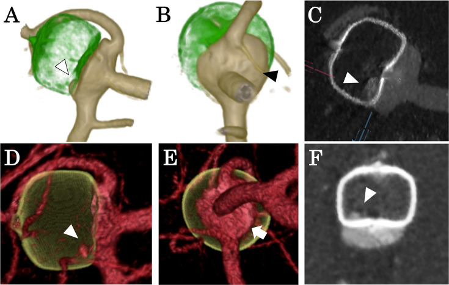
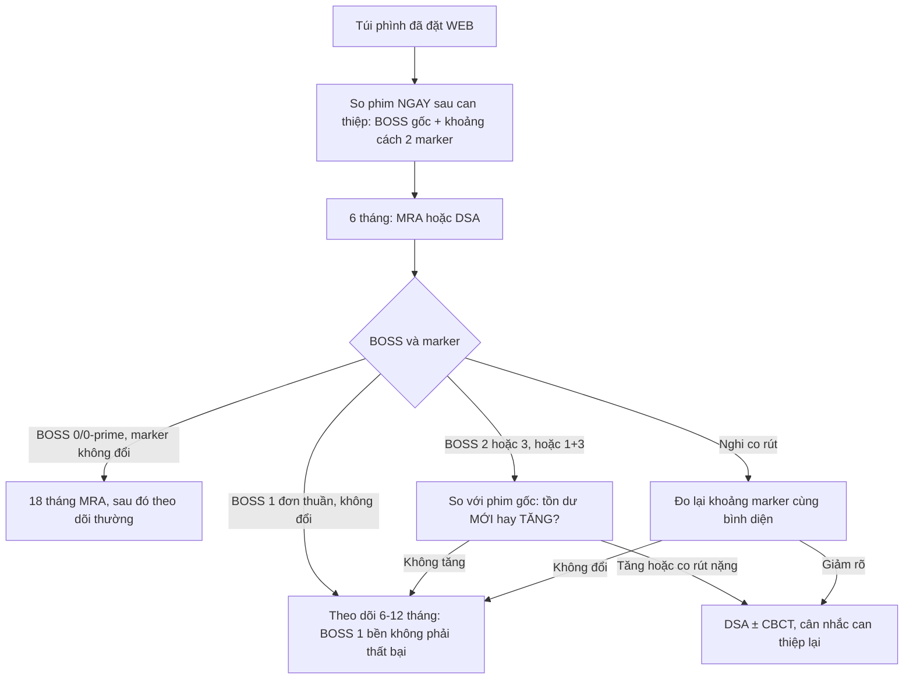
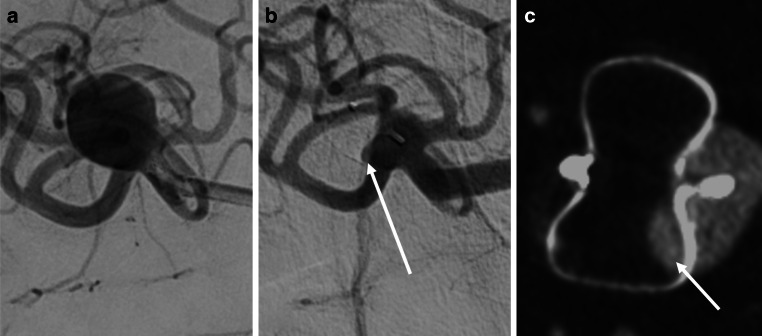
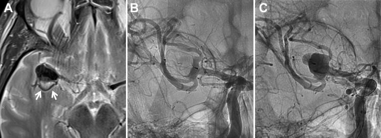
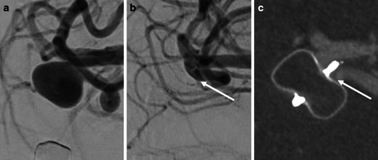

# 266 — Theo dõi sau WEB & thiết bị rối loạn dòng nội túi: thang BOSS, co rút lưới, "tắc giả"

**Tags:** `pattern:tai-phat` `pattern:ton-du` `pattern:co-rut-thiet-bi` `pattern:ngam-thuoc-trong-luoi` `vung:nao` `score:BOSS` `protocol:DSA` `protocol:CTA-phan-giai-cao` `protocol:CBCT-tinh-mach` `protocol:MRA`

**Mức chắc chắn (certainty):** tổng hợp y văn (literature synthesis) — đoàn hệ **247 bệnh nhân / 266 túi phình** theo dõi tới 2024 định nghĩa đầy đủ thang **BOSS** và tỉ lệ tắc theo mốc thời gian (Clin Neuroradiol 2026, PMC13319165); **405 túi** phân tích co rút lưới WEB đa trung tâm (Neurosurg Rev 2025, PMC11850463); **54 lần chụp** đối chiếu CTA phân giải cao với DSA (J Neurointerv Surg 2026, PMC13217054); **16 túi** đối chiếu CBCT tĩnh mạch với DSA (Clin Neuroradiol 2026, PMC13009025); **1.303 bệnh nhân** trong đó **26 túi huyết khối một phần** (WorldWideWEB, J Neurointerv Surg 2026, PMC13217109). Không có thử nghiệm ngẫu nhiên nào so sánh các chiến lược theo dõi.

> **Câu chốt:** WEB **không để lại stent trong lòng mạch mẹ** — vì vậy **không đọc tồn dư bằng RROC (Raymond–Roy) hay OKM (O'Kelly–Marotta)** như với coil/flow diverter, mà phải dùng **BOSS (Bicêtre Occlusion Scale Score)**. Ba câu hỏi ở mọi lần theo dõi: **(1) thuốc cản quang nằm Ở ĐÂU — trong lưới (BOSS 1), ở cổ (BOSS 2), hay quanh thân lưới (BOSS 3)? (2) khoảng cách 2 marker của WEB có NGẮN LẠI (co rút) không? (3) có ngấm thuốc **mới** ở cổ so với phim ngay sau can thiệp không?** Sai lầm hay gặp: gọi **BOSS 1** là "thất bại" và can thiệp lại, trong khi đa số **ổn định và tự tắc dần**; chiều ngược lại là bỏ qua **co rút lưới độ nặng** — yếu tố dự báo can thiệp lại mạnh nhất.

## 1. Tổng quan bệnh học – cơ chế hình ảnh

### 1.1 WEB là gì và vì sao hình ảnh "khác coil"

- **WEB (Woven EndoBridge, Terumo Neuro)** là **lưới nitinol dệt** hình chiếc trụ/cầu, thả **hoàn toàn trong túi phình**, không có stent hay bóng nong ở mạch mẹ. Chỉ định kinh điển: **túi phình ngã ba mạch não (bifurcation)** có **tỉ lệ vòm/cổ < 2** hoặc **cổ ≥ 4 mm** (túi "cổ rộng").
- **Cơ chế:** lưới chắn ngay **mặt cổ** từ bên trong túi → làm **giảm vận tốc và tạo xoáy** trong túi → ứ trệ → huyết khối → tổ chức hóa. Vì **không có kim loại trong lòng mạch mẹ**, bệnh nhân thường chỉ cần **một thuốc kháng kết tập tiểu cầu (SAPT)** thay vì DAPT — đây là lợi điểm chính so với stent-assisted coiling/flow diverter.
- Hệ quả cho hình ảnh: **không có "stent trong lòng mạch" để đọc hẹp trong stent**, và **không có "coil mass" để đọc compaction**. Cái cần đọc là **lưới** và **khoảng 2 marker**.

### 1.2 Vật lý: vì sao phải có thang riêng

- **Nitinol cản quang mạnh** → trên DSA lưới hiện thành **khối sáng có hoa văn**, trên CTA/CBCT là **vòng/đĩa tăng đậm độ** kèm **beam hardening**. Vì lưới **có lỗ**, một **lượng nhỏ cản quang len giữa các sợi** là bình thường về mặt cơ học — đó chính là **BOSS 1**, khác hoàn toàn "túi còn thông".
- **Ba vị trí cản quang cần tách:**
  1. **Trong lưới** (giữa các sợi, sát 2 marker) → **BOSS 1**;
  2. **Ở cổ, ngoài lưới** → **BOSS 2** (neck remnant);
  3. **Giữa thành túi và mặt ngoài lưới** → **BOSS 3** (aneurysm remnant).
- **Co rút lưới (shape modification):** định nghĩa **% giảm khoảng cách giữa marker xa và marker gần**, đo giữa DSA lúc can thiệp và lần chụp cuối. Cơ chế được cho là **co cục huyết khối trong lưới khi tổ chức hóa**; dòng máu mạnh tiếp xúc làm co nhiều hơn. Co rút **kéo mặt lưới ra khỏi cổ** → hở cổ → tái thông.
- **Vì sao CTA có thể "bỏ sót" BOSS 0′:** 0′ là **lớp cản quang rất mỏng trong hốc gần (proximal recess)** sát marker gần; trên CTA phân giải cao, **hiệu ứng thể tích riêng phần (partial volume)** làm lớp mỏng này **hòa vào nitinol** → đọc thành **BOSS 0**. Đây là **nguồn sai lệch duy nhất** trong nghiên cứu đối chiếu (PMC13217054).

### 1.3 Ngưỡng định lượng trụ cột

| Đại lượng | Con số | Nguồn |
|---|---|---|
| Tắc hoàn toàn **ngay sau can thiệp** (BOSS 0/0′) | **62,0%** (266 túi) | PMC13319165 |
| Tắc hoàn toàn **1 năm** | **67,0%** (n = 188) | PMC13319165 |
| Tắc hoàn toàn **3 năm** | **75,6%** (n = 119) | PMC13319165 |
| BOSS 2 (tồn dư cổ) **1 → 3 năm** | **12,8% → 10,1%** (giảm dần = huyết khối tiến triển) | PMC13319165 |
| Can thiệp lại (toàn bộ) | **12,8%**, **trung vị 319 ngày**, **25% ca > 5 năm** | PMC13319165 |
| Nhóm theo dõi **≥ 5 năm** (n = 66) | **18,2%** can thiệp lại; **84,6%** còn **BOSS 0/0′** bền | PMC13319165 |
| Co rút lưới **nhẹ / nặng** | **31,4% / 10,1%** (405 túi) | PMC11850463 |
| Co rút **nặng** → tắc đủ / can thiệp lại | **70,7% vs 86,6%**; **26,8% vs 8,1%**; **OR 4,93 (1,74–13,8)** | PMC11850463 |
| Túi **huyết khối một phần** → can thiệp lại | **38,5% vs 7,0%**, **OR 3,64 (1,28–10,1)** | PMC13217109 |
| WEB-IT (đối chứng lịch sử) | tắc đủ 1 năm **85,6%**, tái thông **11,5%** từ 6 tháng → 1 năm, can thiệp lại **9,8%** | PMC11850463 |
| Gộp 29 nghiên cứu | can thiệp lại **~8,6% (6,5–10,9)** | PMC13319165 |
| Góc dòng vào (inflow angle) ở nhóm can thiệp lại | **152,7° ± 19,1° vs 142,3° ± 24,4°** (p = 0,006) | PMC13319165 |
| Đường kính WEB ở nhóm can thiệp lại | **7,9 ± 2,0 mm vs 5,6 ± 1,9 mm** (p < 0,001) | PMC13319165 |

## 2. Mẫu hình + chẩn đoán phân biệt (gamut)

### 2.1 Thang BOSS — đọc đúng từng bậc

| Bậc | Nghĩa | Cản quang ở đâu | Xử trí điển hình |
|---|---|---|---|
| **0** | Tắc hoàn toàn | Không thấy trong túi | Theo dõi |
| **0′** | Tắc hoàn toàn **+ ngấm hốc gần** | Lớp mỏng sát marker gần, **không vào thân túi** | Theo dõi (bậc "gần như tắc") |
| **1** | Ngấm **trong lưới** | Giữa các sợi, sát 2 marker | Theo dõi nếu **không đổi/xấu đi** |
| **2** | Tồn dư **cổ** | Ngoài lưới, ngay mặt cổ | Theo dõi; can thiệp lại nếu **tăng** |
| **3** | Tồn dư **thân túi** | Giữa thành túi và mặt ngoài lưới | Thường can thiệp lại |
| **1 + 3** | Phối hợp | Cả trong lưới và quanh thân | Can thiệp lại |

- Gộp phân tích: **0 và 0′ = tắc hoàn toàn**; **1, 2, 3, 1+3 = chưa tắc hoàn toàn** (cách gộp này là chuẩn của PMC13319165 và PMC13217054).

### 2.2 Gamut theo "cản quang nằm ở đâu"

- **Trong lưới, không đổi qua nhiều lần chụp** → **BOSS 1 bền** — hiện tượng "tắc giả" (pseudo-occlusion) đã mô tả; **không phải chỉ định can thiệp lại** nếu thể tích không tăng.
- **Trong lưới + xuất hiện mới sau 6 tháng** → nghi **co rút lưới** đã mở đường vào; so **khoảng cách marker** với phim ngay sau can thiệp.
- **Ở cổ, hình chỏm lồi (convex)** → **BOSS 0′** nếu chỉ là hốc gần; **BOSS 2** nếu là chỏm thật ở cổ.
- **Quanh thân lưới, hình lưỡi liềm** → **BOSS 3** — tái thông thật.
- **Ở cổ + quanh thân cùng lúc** → **BOSS 1+3** (ví dụ PMC13217054 Hình 2).

### 2.3 Gamut theo bối cảnh túi phình

- **Túi huyết khối một phần (partially thrombosed):** nguy cơ cao nhất — **38,5% can thiệp lại**; trên T2 thấy **khối huyết khối trong túi** (tín hiệu hỗn hợp), DSA ngay sau can thiệp có thể "đẹp" nhưng **tái thông quanh cổ trong 3 tháng** (PMC13217109).
- **Túi lớn, cổ rộng, có túi con (daughter sac):** co rút nặng nhiều hơn; yếu tố dự báo gồm **WEB rộng hơn túi (WEB width − aneurysm width)**, **túi con**, **vị trí ngã ba**, **ứ trệ dòng ngay sau thả**.
- **Túi đã điều trị trước đó (5,5% trong đoàn hệ):** nền xơ/coil cũ làm mặt cổ không đều — khó đọc BOSS hơn.

## 3. Bảng so sánh phân biệt (ma trận đối chiếu)

| Thực thể (entity) | Hình ảnh điển hình | Chốt vào (rule-in) | Chốt loại (rule-out) | Gợi ý xác nhận |
|---|---|---|---|---|
| **Tắc hoàn toàn (BOSS 0)** | Lưới đậm độ đều, **không cản quang** trong túi, không tồn dư cổ | **Không ngấm ở mọi thì, mọi bình diện** | Có lớp mỏng sát marker gần → **0′**, không phải 0 | DSA 3D + CBCT |
| **BOSS 0′ (hốc gần)** | **Chỏm lồi nhỏ sát marker gần**, không lan vào thân túi | **Chỉ khu trú ở hốc gần, bờ lồi ra ngoài** | Ngấm lan vào thân túi → **BOSS 3** | DSA 3D; **CTA dễ đọc nhầm thành 0** |
| **BOSS 1 (ngấm trong lưới)** | **Hoa văn cản quang giữa các sợi**, hình vuông/góc cạnh theo lưới | **Bờ trong theo hình lưới, không vượt mặt cổ** | Cản quang **ngoài** mặt lưới → 2 hoặc 3 | CBCT tĩnh mạch (κ 1,0 với DSA) |
| **BOSS 2 (tồn dư cổ)** | Chỏm cản quang **ngay mặt cổ, ngoài lưới** | **Nằm giữa lưới và động mạch mẹ, không có thành túi bao ngoài** | Có thành túi bao quanh → **BOSS 3** | DSA 3D xoay |
| **BOSS 3 (tồn dư thân)** | **Lưỡi liềm cản quang giữa thành túi và mặt ngoài lưới** | **Có thành túi bao ngoài, lan ra ngoài chu vi lưới** | Chỉ ở cổ → 2 | DSA + so phim ngay sau can thiệp |
| **Co rút lưới (shape modification)** | **Khoảng 2 marker ngắn lại**; lưới "dẹt" theo trục | **Giảm ≥ ngưỡng % khoảng marker so với phim gốc**; co rút **nặng** = nhóm nguy cơ | Khoảng marker **không đổi** → không phải co rút | Đo marker trên DSA/CBCT cùng bình diện |
| **Túi huyết khối một phần** | **T2: huyết khối trong túi**; DSA sau thả "sạch" nhưng tái thông sớm | **T2 có khối trong túi + tái thông quanh cổ ≤ 3 tháng** | Túi không huyết khối, tắc bền → theo dõi thường | MRI T2 trước can thiệp + DSA 3 tháng |

*Túi phình động mạch não giữa phải, WEB SL 11/6, chụp 1 năm sau can thiệp. A–C: DSA (3D xoay + CBCT) — tồn dư ở cổ (đầu mũi tên đen) và trong lưới (đầu mũi tên trắng) = **BOSS 1+3**. D–F: CTA phân giải cao — cũng thấy tồn dư cổ (mũi tên trắng) và trong lưới, **đồng thuận** với DSA. Nguồn: PMC13217054, CC BY-NC 4.0.*

### 3.1 Dấu hiệu phân biệt tinh

- **Bờ trong của cản quang:** nếu bờ trong **theo hình lưới** (vuông, góc cạnh) → cản quang **trong lưới** (BOSS 1). Nếu bờ **theo thành túi** (cong tròn) → **BOSS 3**.
- **So với phim NGAY sau can thiệp là bắt buộc:** "tồn dư" chỉ có nghĩa khi **mới xuất hiện hoặc tăng**; tồn dư có từ đầu và giảm dần là **quá trình lành**.
- **Co rút lưới ≠ tái thông:** co rút **nhẹ (31,4%)** không làm tăng can thiệp lại; chỉ **co rút nặng (10,1%)** mới gắn với **tắc đủ thấp hơn** và **can thiệp lại gấp ~3 lần**.

## 4. Protocol theo dõi + hệ phân độ

### 4.1 Lịch chụp (theo PMC13319165)

- **6 tháng: MRA** (hoặc DSA khi cần) → **18 tháng: MRA** → sau đó theo dõi dài hạn ở nhóm nguy cơ.
- **DSA** khi: MRA/CTA không kết luận, nghi **co rút nặng**, hoặc **chuẩn bị can thiệp lại**.
- **Nhóm nguy cơ cao cần theo dõi lâu hơn** (≥ 5 năm): túi huyết khối một phần, co rút nặng, tồn dư cổ tăng dần, can thiệp trước 2018/thế hệ WEB cũ.
- **Lý do theo dõi dài:** **25% ca can thiệp lại trong nhóm ≥ 5 năm xảy ra SAU mốc 5 năm** (trung vị 319 ngày nhưng đuôi dài).

### 4.2 Thay thế không xâm lấn — số liệu đối chiếu

| Phương thức | Đồng thuận với DSA | Ghi chú |
|---|---|---|
| **CTA phân giải cao (HR-CTA)** | **85,2%** (46/54 lần), **κ 0,81 (0,69–0,93)**; phân tích nhị phân **κ 1,00** | **Mọi ca lệch đều do HR-CTA ĐÁNH GIÁ CAO hơn** (bỏ sót 0′); vẫn nhận diện được tồn dư thân |
| **CBCT tĩnh mạch (IVCBCT)** | **κ 1,0** cho cả 2 người đọc (16 ca); **liên quan sát viên κ 0,86** | Phân bố BOSS: **0/0′ 50,0%**, **1 31,3%**, **2 12,5%**, **3 6,2%** |
| **MRA** | Không có trong các nghiên cứu này | Dùng trong lịch thực tế; thận trọng artifact ở túi lớn |

## 5. Biến thể bình thường và cạm bẫy

- **BOSS 1 "bền" không phải thất bại:** ngấm trong lưới có thể tồn tại nhiều năm mà **không tăng thể tích** — can thiệp lại là quá tay. Chỉ hành động khi **tăng dần** hoặc **kèm co rút nặng**.
- **HR-CTA chỉ sai một chiều:** vì **bỏ sót lớp mỏng ở hốc gần (0′)**, CTA **không được dùng để loại trừ BOSS 0′**. Nếu cần chắc chắn (túi vừa vỡ, bệnh nhân trẻ), **DSA 3D/CBCT**.
- **Co rút lưới đọc sai vì khác bình diện:** khoảng marker **phải đo trên cùng góc chụp**; chụp lệch 10–20° làm khoảng cách "đổi" giả tạo.
- **Túi huyết khối một phần "đẹp" ngay sau thả:** dòng vào túi đã bị chặn một phần bởi huyết khối cũ → ảnh hưởng **thấp giả**; phải chụp lại **3 tháng**, không đợi 6–12 tháng.
- **Hiệu ứng học việc (learning curve) trộn với cải tiến dụng cụ:** can thiệp lại **21,1% trước 2018 vs 7,2% từ 2018** (HR 0,31) phản ánh **cả kinh nghiệm và thế hệ WEB17**, không chỉ "bệnh nhân dễ hơn" — đừng dùng số này để tiên lượng cá nhân.
- **Sai lầm "đọc theo RROC":** RROC mô tả **coil mass**; với WEB, "Class I/II/III" không tương ứng — dùng RROC sẽ **gộp BOSS 1 với tái thông thật**.

## 6. Tự lượng giá — Blind Quiz

**Ca 1 — Nữ 58 tuổi, túi phình động mạch não giữa phải đã đặt WEB 1 năm, chụp theo dõi. Mô tả trước khi mở đáp án.**

- Gợi ý lâm sàng: không triệu chứng, túi phình chưa vỡ, WEB SL 11/6.
- Câu hỏi: Cản quang nằm ở đâu? BOSS mấy? CTA có đồng thuận không?

<b>Bấm để hiện đáp án (findings + chẩn đoán)</b>

- **Findings:** tồn dư **ở cổ** (đầu mũi tên đen ở A, mũi tên trắng ở E) **và trong lưới** (đầu mũi tên trắng ở C, F) → **BOSS 1+3**.
- **Chẩn đoán:** chưa tắc hoàn toàn, **có tồn dư cả trong lẫn quanh lưới**; CTA phân giải cao **đồng thuận** với DSA ở ca này.
- **Vì sao:** lưới có lỗ nên cản quang len giữa sợi (BOSS 1) cộng thêm chỏm ở cổ (BOSS 3) — hai thành phần phải mô tả riêng, không gộp thành "tái thông".
- **Nguồn ảnh:** Suyama K et al, *J Neurointerv Surg* 2026, Fig. 2 — PMC13217054, CC BY-NC 4.0.

**Ca 2 — Nam 64 tuổi, túi phình ngã ba động mạch não giữa, chụp 6 tháng sau WEB.**

- Câu hỏi: DSA (b) và CBCT tĩnh mạch (c) cho thấy gì? BOSS mấy? Có cần DSA xâm lấn lặp lại không?

<b>Bấm để hiện đáp án (findings + chẩn đoán)</b>

- **Findings:** (a) DSA trước đặt; (b) DSA 6 tháng và (c) IVCBCT 6 tháng đều thấy **ngấm thuốc tối thiểu trong lưới, không tồn dư cổ** → **BOSS 1**.
- **Chẩn đoán:** tồn dư trong lưới đơn thuần, **chưa cần can thiệp lại** — theo dõi.
- **Vì sao:** IVCBCT **đồng thuận hoàn toàn với DSA (κ 1,0)** trong 16 ca, nên có thể thay DSA lặp lại ở ca này; liên quan sát viên IVCBCT **κ 0,86**.
- **Nguồn ảnh:** Tajima Y et al, *Clin Neuroradiol* 2026, Fig. 1 — PMC13009025, CC BY 4.0.

**Ca 3 — Nữ 51 tuổi, túi phình huyết khối một phần đã đặt WEB; chụp ngay sau thả "rất sạch", 3 tháng sau tái khám.**

- Câu hỏi: Vì sao ảnh ngay sau can thiệp "đẹp" mà vẫn phải chụp sớm? Findings ở C?

<b>Bấm để hiện đáp án (findings + chẩn đoán)</b>

- **Findings:** (A) T2 trục: **huyết khối trong túi** (mũi tên); (B) DSA ngay sau thả: **chỉ còn rất ít** dòng vào túi; (C) DSA 3 tháng: **tái thông rõ quanh vùng cổ**.
- **Chẩn đoán:** **tái thông sớm của túi phình huyết khối một phần** — nhóm có **38,5% can thiệp lại** (vs 7,0%), **OR 3,64**; tỉ lệ RROC IIIa/b **38,5% vs 9,9%**.
- **Vì sao:** huyết khối cũ trong túi làm **giảm thể tích dòng vào ngay sau thả** → ảnh hưởng "tắc giả"; WEB **không phải lựa chọn đầu tay** cho thể này.
- **Nguồn ảnh:** Saliou G et al (WorldWideWEB), *J Neurointerv Surg* 2026, Fig. 1 — PMC13217109, CC BY-NC 4.0.

**Ca 4 (cạm bẫy) — Cùng bệnh nhân, hai người đọc khác nhau.**

- Câu hỏi: Vì sao hai người đọc ra 0 và 0′? Điều này ảnh hưởng quyết định gì?

<b>Bấm để hiện đáp án</b>

- **Findings:** cả DSA (a) và IVCBCT (b) đều có **lớp ngấm mỏng ở hốc gần** (mũi tên trắng).
- **Chẩn đoán:** **BOSS 0′** — một người đọc gọi 0 (bỏ lớp mỏng), người kia gọi 0′.
- **Vì sao quan trọng:** 0 và 0′ **cùng nhóm tắc hoàn toàn** khi phân tích gộp, nhưng **ghi nhận 0′ là nguồn lệch duy nhất** giữa CTA và DSA → không được dùng một lần đọc CTA để kết luận "tắc hoàn toàn" ở ca sát ngưỡng.
- **Nguồn ảnh:** Tajima Y et al, *Clin Neuroradiol* 2026, Fig. 3 — PMC13009025, CC BY 4.0.

## Bài liên quan chéo

- [200 – Tổng quan hệ Thần kinh](../200-tong-quan-he-than-kinh/lesson.md)
- [257 – Theo dõi & tái phát sau can thiệp túi phình não: RROC/OKM, coil compaction, artifact MRA](../257-theo-doi-tai-phat-sau-can-thiep-tui-phinh/lesson.md) — thang của **coil/flow diverter**; bài này là thang **riêng cho WEB**
- [207 – Phình mạch nội sọ chưa vỡ: PHASES/ELAPSS/UIATS](../207-phinh-mach-noi-so-chua-vo/lesson.md) — quyết định điều trị ban đầu
- [248 – Can thiệp nội mạch giả phình & bóc tách động mạch cổ/đốt sống](../248-can-thiep-noi-mach-gia-phinh-boc-tach-dong-mach-co-dot-song/lesson.md)
- [241 – HR-vwMRI đọc ngấm thành mạch](../241-hr-vwmri-doc-ngam-thanh-mach/lesson.md) — đánh giá nguy cơ trước can thiệp

> Không dùng để chẩn đoán độc lập khi chưa có người hướng dẫn.
