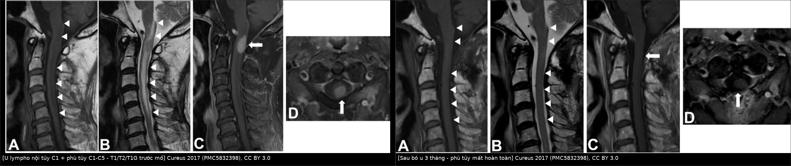
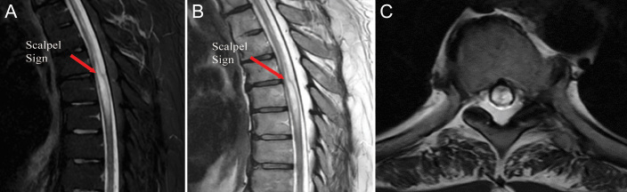
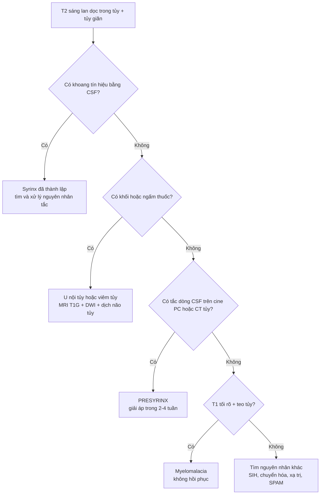
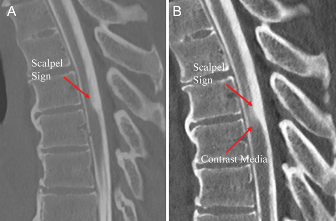
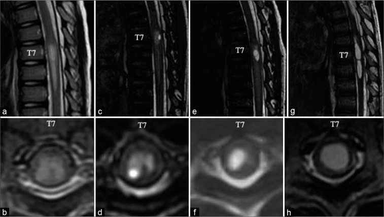
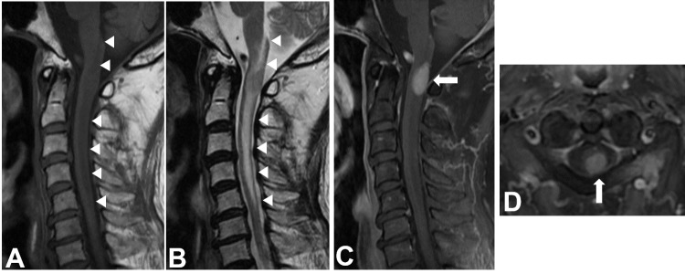

# 267 — Presyrinx: phù tủy HỒI PHỤC trước giãn tủy / The "presyrinx" state

**Tags:** `pattern:phu-tuy` `pattern:tang-t2-tuy` `pattern:gian-tuy` `pattern:khong-choan-cho` `pattern:presyrinx` `vung:tuy-song` `vung:cot-song` `protocol:MRI-cot-song` `protocol:MRI-dong-hoc-csf` `protocol:CT-tuy-myelo` `protocol:MRI-T1G` `score:tJOA` `score:McCormick`

**Mức chắc chắn (certainty):** tổng hợp y văn (literature synthesis) — 2 loạt ca nguyên văn (Fischbein 1999, *AJNR* 20:7–20, **5 ca người lớn**, PMID 9974051; Goh 2008, *Neurology* 71:351–356, **6 trẻ**, PMID 18565831) + 4 ca nguyên văn có ảnh (J Neurosurg Case Lessons 2024, PMC11337934; Korean J Neurotrauma 2019, PMC6826087; Cureus 2017, PMC5832398; Surg Neurol Int 2021, PMC8942189) + 2 ca có ảnh dùng cho chẩn đoán phân biệt (Clin Case Rep 2023, PMC10731126; J Clin Neurol 2023, PMC10622733) + 1 mô hình động học dịch não tủy (Neurol Med Chir 2024, PMC10918455). **Không có thử nghiệm ngẫu nhiên, không có tỉ lệ chuyển dạng presyrinx → syrinx trên quần thể**; chỗ suy luận được ghi rõ.

> **Câu chốt:** **presyrinx không phải một bệnh, mà là một TRẠNG THÁI** — tủy **giãn + T2 sáng lan dọc + T1 hơi tối, KHÔNG có khoang**, xuất hiện khi **dòng dịch não tủy (cerebrospinal fluid, CSF) bị tắc**, và **HỒI PHỤC** sau khi giải phóng tắc. Ba câu quyết định: **(1) có khoang dịch tự do chưa?** — có = syrinx đã thành lập, tiên lượng xấu hơn hẳn; **(2) có khối/ngấm thuốc không?** — có = u nội tủy hoặc viêm tủy, không phải presyrinx; **(3) có bằng chứng tắc dòng CSF không?** — cine phase-contrast, CT tủy thì muộn, hoặc chính đáp ứng sau giải áp. Đây là **cửa sổ duy nhất còn chữa khỏi**: giải áp lúc còn presyrinx thì tủy về bình thường (5/5 ca Fischbein), còn để thành syrinx thì mổ chỉ xẹp được **12,2–100%, trung bình 29,6%** (bài 255).

## 1. Tổng quan bệnh học – cơ chế hình ảnh (TẠI SAO)

### 1.1 Định nghĩa và nguồn gốc khái niệm

- **Định nghĩa hình ảnh (Fischbein 1999):** **giãn tủy + T1 và T2 kéo dài trong nhu mô, KHÔNG có cavitation (khoang)**, kèm **bằng chứng tắc/đổi dòng CSF**, **không có u nội tủy và không có biến cố mạch tủy**. Tất cả **5/5 ca** hồi phục giãn tủy và bình thường hoặc cải thiện tín hiệu sau can thiệp giải áp; **1/5 ca** (dính màng nhện nặng) tiến triển thành syrinx khi dòng CSF **vẫn còn tắc** sau mổ — đây chính là bằng chứng "presyrinx chỉ hồi phục khi hết tắc".
- **Ở trẻ (Goh 2008):** **6 trẻ**, **4 Chiari I + 2 Chiari II**; đặc điểm MRI là **T2 kéo dài, T1 kéo dài MỜ NHẸ, tủy giãn, không có khoang**; **cine phase-contrast ở 3 trẻ cho thấy dòng CSF tại lỗ chẩm giảm nặng hoặc mất**; **5 trẻ được giải áp**, **3/3 trẻ có ảnh sau mổ hồi phục hoàn toàn presyrinx**; **2 trẻ có triệu chứng tủy** và hết sau mổ. Trước bài này y văn chỉ có **3 ca nhi**.
- **Vì sao khái niệm này quan trọng:** nó **đảo ngược tiên lượng**. Cùng một ảnh "tủy sáng + giãn" có thể là **presyrinx (chữa được)**, **syrinx (đã muộn)**, **u nội tủy (phải mổ u)** hoặc **myelomalacia (không hồi phục)** — bốn hướng xử trí khác nhau hoàn toàn.

### 1.2 Cơ chế: tắc dòng CSF → chênh áp → nước vào nhu mô tủy

1. **Tắc dòng CSF** ở một mức (Chiari, màng nhện lưng, nang nhện, dính màng nhện sau viêm/xuất huyết, hẹp ống sống, shunt rối loạn, uống trung tâm dày dính) tạo **chênh áp giữa khoang dưới nhện trên và dưới chỗ tắc**.
2. **Chênh áp đẩy CSF vào nhu mô tủy** theo **khoảng quanh mạch (Virchow–Robin)** và **ống trung tâm (central canal)**. Nước ngoại bào tăng → **phù nhu mô** → tủy **giãn** và **T2 kéo dài**. Đây là **phù, chưa phải khoang**: chưa có vách, chưa có túi dịch tự do.
3. **Mô hình "van một chiều" (direction-selective resistance):** một cấu trúc chỉ cản dòng CSF **một chiều** sẽ làm **áp lực trong ống trung tâm tăng dần theo TỪNG chu chuyển tim**, không cân bằng lại — mô phỏng động học này tái tạo được hiện tượng dịch ứ và "bơm" vào tủy (Chang 2024, PMC10918455). Đây là mô hình **giải thích**, chưa phải bằng chứng đo trực tiếp ở người.
4. **Vì sao có ca thành syrinx, có ca không:** Fischbein đặt giả thuyết **"độ thông thoáng của ống trung tâm" (competence of the central canal)** — ống trung tâm còn chắc thì nước chỉ ngấm vào nhu mô (presyrinx, hồi phục); khi ống trung tâm **giãn ra** thì tạo **khoang chứa dịch** (syrinx). Ca trẻ của Shimizu cho thấy rõ **chuỗi thời gian**: phù tủy **T7–T9 lúc 6 tuổi** → **hang nhỏ ở sừng sau phải lúc 7,25 tuổi** → **syrinx trưởng thành lúc 10 tuổi**, dù đã **tháo xoắn tủy 2 lần** (3 tuần tuổi và 7 tuổi) (PMC8942189).
5. **Hệ quả lâm sàng:** triệu chứng do **chèn ép + mất chức năng nhu mô do phù**, chưa do **phá hủy**. Vì vậy **giải áp sớm hồi phục được chức năng**, còn chờ tới khi có khoang thì đã mất nhu mô.

### 1.3 Vật lý ảnh: vì sao T2 sáng, T1 hơi tối, và vì sao KHÔNG thấy khoang

| Chuỗi xung / kỹ thuật | Presyrinx | Giải thích vật lý (TẠI SAO) |
|---|---|---|
| **T2W sagittal** | **Tăng tín hiệu lan dọc ≥ 2–3 đốt**, bờ mờ, tủy **giãn** | Nước ngoại bào tăng làm **T2 kéo dài**; nước tự do trong mô phản hồi chậm nên tín hiệu sáng |
| **T1W** | **Giảm nhẹ, MỜ** ("mild indistinct T1 prolongation" — Goh 2008) | Phù làm tăng nước ngoại bào → T1 kéo dài, nhưng **ít hơn nhiều so với hoại tử/myelomalacia**; mờ vì phù lan tỏa, không khu trú |
| **T1W + gadolinium** | **Không ngấm** (trừ khi kèm viêm) | Hàng rào máu–tủy còn nguyên; phù **không phải mô tân sinh** nên không có mạch máu rò |
| **DWI/ADC** | Không hạn chế khuếch tán rõ (phù vận chuyển) — **số liệu định lượng ở người chưa đủ, ghi "chưa rõ"** | Phù ngoại bào làm ADC tăng nhẹ; khác nhồi máu tủy (ADC giảm) và áp-xe |
| **Khoang dịch** | **KHÔNG có** | Chưa tích đủ dịch tự do để tạo túi; trên T2 không thấy vùng tín hiệu **bằng đúng CSF** với bờ rõ |
| **CT tủy (myelography)** | **Cản quang đi vào nhu mô tủy** ở thì muộn | Chứng minh **thông thương giữa khoảng dưới nhện và nhu mô/ống trung tâm** — dấu hiệu trực tiếp của rối loạn dòng CSF (Halloran 2024, Hình 2) |
| **Cine phase-contrast MRI** | **Dòng CSF giảm nặng hoặc mất** tại mức tắc (3/3 trẻ trong Goh 2008) | Đo vận tốc dòng theo chu chuyển tim; tắc → biên độ dòng giảm/mất |

### 1.4 Ngưỡng định lượng trụ cột (mọi số lấy từ nguồn, không suy diễn)

| Đại lượng | Con số | Nguồn |
|---|---|---|
| Số ca presyrinx được mô tả | **5 người lớn** (1999) · **6 trẻ** (2008) · trước 2008 chỉ **3 ca nhi** | PMID 9974051; PMID 18565831 |
| Hồi phục sau giải áp | **5/5** hết giãn tủy, tín hiệu bình thường/cải thiện · **3/3** có ảnh sau mổ hết presyrinx | PMID 9974051; PMID 18565831 |
| Tiến triển thành syrinx | **1/5** khi dòng CSF còn tắc · **1 ca nhi** tiến triển dù tháo xoắn **2 lần** | PMID 9974051; PMC8942189 |
| Thời gian presyrinx → syrinx ở ca nhi | **6 tuổi** (phù T7–T9) → **7,25 tuổi** (hang) → **10 tuổi** (syrinx) | PMC8942189 |
| Mức giãn tủy trong ca hydrocephalus | Tủy giãn + T2 sáng **C1–T5**, **không có khoang**; **Evan's ratio 0,332**; tụt hạnh nhân tiểu não **13 mm** | PMC6826087 |
| Hồi phục sau dẫn lưu não thất–ổ bụng | Tín hiệu tủy **bắt đầu bình thường ngay sau đặt shunt**; **> 4 năm không tái phát** | PMC6826087 |
| Hồi phục sau bỏ u nội tủy | Phù tủy **mất hoàn toàn trên MRI 3 tháng sau mổ** | PMC5832398 |
| Hồi phục phù tủy do hẹp ống sống | **JOA 10 → 13** (3 tháng) → **16** (2 năm); phù **mất hoàn toàn lúc 2 năm** | PMC10731126 |
| Xẹp syrinx sau mổ (để so sánh — đã muộn) | **12,2–100%, trung bình 29,6%** | bài 255 (PMC12518900) |
| Tỉ lệ "giãn tủy vô căn" thật ra do màng nhện ẩn | **1,4% (15/1.039)** | bài 255 (PMC12518900) |

## 2. Mẫu hình + chẩn đoán phân biệt theo VỊ TRÍ TẮC (Gamut)

**Mẫu hình chốt:** *tủy cổ–ngực **giãn + T2 sáng lan dọc ≥ 2–3 đốt**, **T1 hơi tối mờ**, **không khoang**, **không ngấm thuốc**, kèm **một nguyên nhân tắc dòng CSF ở gần đó**; bệnh nhân **triệu chứng tủy tiến triển hàng tháng**; ảnh **hồi phục sau giải áp**.*

### 2.1 Gamut theo vị trí tắc (câu hỏi số 1: tắc ở đâu?)

| Vị trí tắc | Thực thể | Manh mối trên ảnh |
|---|---|---|
| **Lỗ chẩm** | Chiari I/II, nang nhện hố sau, dính màng nhện sau viêm màng não | Tụt hạnh nhân tiểu não, dòng CSF lỗ chẩm mất trên cine PC, giãn não thất kèm theo |
| **Ống sống cổ–ngực** | Hẹp ống sống, thoát vị đĩa, dày dây chằng vàng | Tủy giãn **đúng mức chèn ép**, ngấm thuốc khu trú tại mức hẹp nhất (PMC10731126) |
| **Màng nhện lưng/ngực** | Màng nhện lưng (bài 255), nang nhện lưng | Dấu **scalpel**, tủy đẩy ra trước, dải màng trên 3D-CISS |
| **Toàn bộ khoang dưới nhện** | Dính màng nhện lan tỏa sau viêm màng não, xuất huyết dưới nhện, lao màng não | Mất tín hiệu CSF xung quanh tủy, tủy dính thành, giãn tủy nhiều đoạn |
| **Hệ thống CSF phía trên** | Rối loạn chức năng shunt, hydrocephalus, tụt hạnh nhân do rò CSF (SIH) | Giãn não thất hoặc dấu SIH; hồi phục sau sửa shunt/EBP (PMC6826087, PMC10622733) |
| **Tủy bị neo (tethered cord)** | Lipoma tủy, thoát vị tủy–màng tủy | Nón tủy thấp, mỡ trong ống sống; presyrinx có thể tiến triển dù đã tháo xoắn (PMC8942189) |
| **Nội tủy (giả presyrinx)** | U nội tủy (lymphoma, ependymoma, astrocytoma), viêm tủy ngang | **Khối + ngấm thuốc**, phù lệch, không có tắc dòng CSF phía trên (PMC5832398) |

### 2.2 Gamut theo TUỔI (câu hỏi số 2: ai?)

- **Trẻ < 16 tuổi:** **Chiari I/II là nguyên nhân số 1** (4/6 và 2/6 trong Goh 2008); tiếp theo là **thoát vị tủy–màng tủy/lipoma** và **shunt rối loạn** sau viêm màng não.
- **Người lớn 40–70 tuổi:** **màng nhện lưng** (bài 255), **hẹp ống sống cổ**, **dính màng nhện sau chấn thương/xuất huyết**, **nang nhện**; ở người trẻ sau chấn thương nhẹ phải nghĩ **SIH** (PMC10622733).
- **Sau chấn thương tủy:** phân biệt **presyrinx do tắc** với **SPAM (subacute posttraumatic ascending myelopathy)** — SPAM chiếm **0,42–1%** chấn thương tủy, **tử vong ~10%**, **không hồi phục** (PMC5504449).

### 2.3 Ba câu hỏi tại chỗ đọc phim (dùng như checklist)

1. **Có khoang không?** — nếu có vùng tín hiệu **bằng đúng CSF**, bờ rõ, có thể có vách → **syrinx**, không phải presyrinx.
2. **Có khối/ngấm thuốc không?** — khối + ngấm → **u**; ngấm mờ dọc + LETM → **viêm tủy**; không ngấm + không khối → nghĩ **presyrinx**.
3. **Có tắc dòng CSF không, và ở đâu?** — tìm **từ lỗ chẩm xuống tới nón tủy**; đừng dừng ở đoạn tủy giãn (cạm bẫy "satisfaction of search").

## 3. Bảng so sánh phân biệt (ma trận đối chiếu)

| Thực thể (entity) | Hình ảnh điển hình | Chốt vào (rule-in) | Chốt loại (rule-out) | Gợi ý xác nhận |
|---|---|---|---|---|
| **Presyrinx** | Tủy **giãn + T2 sáng lan dọc**, T1 **hơi tối mờ**, **không khoang**, **không ngấm**, có nguyên nhân tắc CSF | **Có tắc dòng CSF + không khoang + không khối**; **hồi phục sau giải áp** | Có khoang rõ hoặc khối ngấm thuốc → không phải presyrinx | Cine PC CSF; CT tủy thì muộn; MRI sau giải áp 3 tháng |
| **Syrinx thành lập** | Khoang **tín hiệu = CSF**, bờ rõ, ± vách, tủy có thể không còn giãn | **Vùng tín hiệu CSF thực sự trong nhu mô** | T2 sáng đồng nhất không bờ, không có vùng dịch → presyrinx/phù | T1/T2 so sánh tín hiệu với CSF trong ống sống |
| **Myelomalacia** | **T1 tối rõ + teo tủy**, T2 sáng, không giãn | **Teo + T1 tối đậm**, tiền sử chấn thương/xạ/thiếu máu | Tủy giãn, T1 chỉ hơi tối → còn phù hồi phục | So phim cũ; không có đáp ứng sau giải áp |
| **U nội tủy** (lymphoma, ependymoma) | Khối **ngấm thuốc**, phù lệch trên/dưới, có thể giãn tủy | **Khối + ngấm thuốc**, phù không cân xứng | Phù đối xứng, không khối, không ngấm → không phải u | MRI T1G; cắt/sinh thiết (ca lymphoma C1, PMC5832398) |
| **Viêm tủy ngang (NMOSD/MOG)** | **LETM ≥ 3 đốt**, phù, ± ngấm mờ, ± dấu H trên axial | **LETM + ngấm + bối cảnh viêm** (đau, sốt, area postrema) | Không tắc CSF, không hồi phục nhanh sau giải áp | AQP4/MOG, dịch não tủy, MRI não |
| **Phù tủy do hẹp ống sống** | T2 sáng **đúng mức hẹp nhất**, ± ngấm khu trú tại đó, ít lan xa | **Ngấm thuốc khu trú đúng chỗ chèn ép**, hẹp ống sống rõ | Lan dọc qua nhiều mức không tương ứng hẹp → nghĩ presyrinx/viêm | MRI động học cột sống; đáp ứng sau giải ép |
| **SPAM sau chấn thương** | T2 sáng **lan LÊN ≥ 4 đốt** trong vài tuần sau chấn thương, tủy giãn | **Tiền sử chấn thương + lan lên nhanh**, không có tắc CSF mới | Có tắc CSF chữa được + hồi phục → presyrinx | Theo dõi; **tiên lượng xấu, tử vong ~10%** |

*Trái: **khối ngấm thuốc ở C1** (mũi tên trắng) + **phù T2 lan từ hành não tới C5** (đầu mũi tên) — đây là **giả presyrinx do u**, không phải presyrinx do tắc CSF. Phải: **3 tháng sau bỏ u, phù tủy mất hoàn toàn**. Ảnh ghép letterbox, giữ nguyên tỉ lệ. Nguồn: *Cureus* 2017 (PMC5832398), CC BY 3.0.*

### 3.1 Hai dấu hiệu "chốt" của presyrinx (và giới hạn của chúng)

- **Cản quang trong nhu mô tủy trên CT tủy thì muộn:** ca 57 tuổi của Halloran — CT tủy **sớm** chỉ thấy dấu scalpel, CT tủy **muộn** thấy **cản quang trong tủy**, chứng minh CSF thông với nhu mô/ống trung tâm. **Giới hạn:** syrinx thông thương với ống trung tâm **cũng** có thể nhận cản quang → dấu này nói "có thông thương", **không** nói "còn hồi phục".
- **Hồi phục sau giải áp:** là **tiêu chuẩn vàng hồi cứu** — không dùng để quyết định mổ, nhưng là bằng chứng mạnh nhất khi đọc lại. **Đừng chờ hồi phục để chẩn đoán**: mỗi tuần chờ là thêm nguy cơ tạo khoang.

### 3.2 Ảnh chốt dấu scalpel kèm presyrinx

*Sagittal STIR (A), sagittal T2 (B) và axial T2 (C): **lõm mặt lưng tủy + tủy đẩy ra trước** tại mức màng nhện lưng (mũi tên đỏ), tủy phía trên giãn nhẹ. Đây là nguyên nhân tắc — presyrinx là **hệ quả**, không phải tổn thương nguyên phát. Nguồn: *J Neurosurg Case Lessons* 2024 (PMC11337934), CC BY-NC-ND 4.0, nguyên bản.*

## 4. Protocol chụp + cách phân tầng xử trí

### 4.1 Protocol MRI (tối thiểu để không bỏ presyrinx)

- **MRI toàn trục cột sống** (không chỉ đoạn có triệu chứng): **sagittal T2 3 mm**, **axial T2 3 mm** tại mức tổn thương, **T1 trước và sau gadolinium** (bắt buộc — để loại u/viêm), ± **STIR** để phân biệt mỡ/phù.
- **Cine phase-contrast CSF flow** tại **lỗ chẩm** và **mức nghi tắc**: dòng giảm/mất hỗ trợ chẩn đoán (3/3 ca nhi trong Goh 2008). **Thông số VENC cụ thể tùy máy — chưa chuẩn hóa, ghi "chưa rõ" nếu không có trong protocol địa phương.**
- **CT tủy cản quang** khi MRI không kết luận hoặc nghi màng nhện/dò: chụp **thì sớm VÀ thì muộn**, tìm **cản quang trong tủy** (PMC11337934).
- **Siêu âm trong mổ** sau mở màng cứng: xác nhận màng/dải, đánh giá tủy phù và phục hồi dòng CSF ngay tại bàn mổ (PMC11337934).
- **Theo dõi sau giải áp:** MRI **3 tháng** và **12 tháng**; ghi **tJOA** (tủy cổ) hoặc **McCormick** (tủy ngực) trước và sau mổ.

### 4.2 Phân tầng xử trí (không có RADS cho tủy; dùng thuật toán 3 bước)

- **Có tắc + không khoang + không khối = presyrinx → giải áp sớm** (mở màng cứng/cắt dải màng, giải ép, sửa shunt, tháo xoắn). **Không "theo dõi 6 tháng"** — đó là khoảng thời gian đủ để phù thành khoang.
- **Đã có khoang = syrinx:** vẫn phải xử lý nguyên nhân tắc (không chỉ dẫn lưu syrinx); kết cục xẹp chỉ **29,6% trung bình** (bài 255).
- **Có khối/ngấm = u hoặc viêm:** đi theo bài 220/215/226 — **không giải áp mù**.

### 4.3 Kết cục đã báo cáo (để tư vấn, không hứa hẹn)

| Bối cảnh | Can thiệp | Kết cục |
|---|---|---|
| Chiari I/II (6 trẻ) | Giải áp hố sau (5 trẻ) | **3/3 có ảnh sau mổ hết presyrinx**; triệu chứng tủy hết |
| Hydrocephalus + Chiari I sau chấn thương nhẹ | Dẫn lưu não thất–ổ bụng | Tín hiệu tủy bình thường **ngay sau đặt shunt**; **> 4 năm** không tái phát |
| U lympho nội tủy C1 | Bỏ u + hóa–xạ | Phù tủy **mất hoàn toàn sau 3 tháng**; sống **> 2 năm** |
| Hẹp ống sống cổ | Giải ép | **JOA 10 → 13 → 16**; phù mất hoàn toàn sau **2 năm** |
| Lipoma/tethered cord | Tháo xoắn 2 lần | **Vẫn tiến triển thành syrinx** — giải áp không phải lúc nào cũng đủ |

## 5. Biến thể bình thường và cạm bẫy

- **"T2 sáng trong tủy" không đồng nghĩa presyrinx:** phân biệt **phù do hẹp ống sống** (khu trú đúng mức hẹp, ngấm thuốc tại chỗ — PMC10731126) với **phù do tắc CSF lan tỏa**. Điều trị khác nhau: giải ép tại chỗ vs giải phóng dòng CSF.
- **Myelomalacia đọc nhầm thành presyrinx:** nếu **T1 tối đậm + teo tủy**, mổ giải áp **không làm tủy hồi phục** — đừng hứa "mổ xong tủy về bình thường". Ngược lại, gọi presyrinx là myelomalacia sẽ **bỏ mất cửa sổ chữa khỏi**.
- **U nội tủy giả presyrinx:** ca lymphoma C1 (PMC5832398) có phù lan **từ hành não đến C5** trông như presyrinx; **khối ngấm thuốc** là chốt loại. Sinh thiết mù một "phù tủy" có thể bỏ sót u.
- **SPAM (subacute posttraumatic ascending myelopathy):** tổn thương **lan LÊN** vài tuần sau chấn thương tủy, **0,42–1%** ca chấn thương tủy, **tử vong ~10%**, không hồi phục — **không phải presyrinx**, dù ảnh giống.
- **SIH:** rò CSF tự phát gây tụt hạnh nhân + phù tủy, **30% khỏi bảo tồn** (PMC10622733) — **không mổ cột sống**, điều trị bằng nằm/EBP.
- **Satisfaction of search:** thấy syrinx/presyrinx rồi dừng, **bỏ qua màng nhện lưng ở trên** (bài 255) — luôn đọc từ lỗ chẩm xuống và **tìm dải màng trên 3D-CISS/CT tủy**.
- **Ảnh giả:** phù tủy do **artifact chuyển động/dị vật kim loại** ở cột sống ngực — đối chiếu axial và chuỗi xung khác trước khi kết luận.

## 6. Tự lượng giá — Blind Quiz

**Ca 1 — Nam 57 tuổi, yếu hai chân 10 năm, MRI ban đầu bị gọi là "myelomalacia + syringomyelia". CT tủy sớm (A) và muộn (B):**

- Gợi ý: dấu **scalpel** ở mặt lưng tủy; cấu trúc **tăng đậm độ** trong nhu mô tủy ở thì muộn.
- Câu hỏi: (1) Cấu trúc tăng đậm độ trong tủy là gì? (2) Vì sao nó chứng minh rối loạn dòng CSF? (3) Nó loại trừ hay không loại trừ u?

<b>Bấm để hiện đáp án (findings + chẩn đoán)</b>

- **Findings:** (A) thì sớm: lõm mặt lưng tủy + tủy đẩy ra trước (**scalpel sign**); (B) thì muộn: **cản quang trong nhu mô tủy** (mũi tên "contrast media") dưới mức dải màng.
- **Chẩn đoán:** **presyrinx** do **màng nhện lưng** gây tắc dòng CSF; cản quang vào tủy chứng minh **thông thương khoảng dưới nhện ↔ nhu mô/ống trung tâm**, tức CSF bị "ép" vào tủy.
- **Phản biện:** dấu này **không loại trừ u** — u cũng có thể ngấm thuốc; phải dựa vào **khối + ngấm thuốc trên MRI T1G**, không có ở ca này. Mổ giải áp → bệnh nhân cải thiện.
- Nguồn ảnh: *J Neurosurg Case Lessons* 2024 (PMC11337934), CC BY-NC-ND 4.0.

**Ca 2 — Bé trai có lipoma/tethered cord, MRI T7 ở 4 thời điểm (a–h):**

- Gợi ý: hàng trên là sagittal T2, hàng dưới là axial T2 tại T7; chú ý **bờ tổn thương** và **vùng tín hiệu ở sừng sau**.
- Câu hỏi: (1) Ở thời điểm đầu, tổn thương **có khoang** chưa? (2) Nó khu trú ở đâu trên axial? (3) Điều gì xảy ra sau 2 lần tháo xoắn tủy?

<b>Bấm để hiện đáp án (findings + chẩn đoán)</b>

- **Findings:** lúc 6 tuổi — **T2 sáng khu trú trong CHẤT XÁM tủy T7–T9, không có khoang** (a, b) = **presyrinx**; 7,25 tuổi — **hang nhỏ ở sừng sau phải** lan dần ra chất xám bên phải (c, d, e, f); 10 tuổi — **syrinx trưởng thành** (g, h).
- **Chẩn đoán:** **presyrinx tiến triển thành syrinx** dù đã **tháo xoắn tủy 2 lần** (3 tuần và 7 tuổi) — vì **tắc dòng CSF vẫn còn**.
- **Bài học:** presyrinx là **giai đoạn còn hồi phục**, nhưng **không phải cứ mổ là hết** — phải giải quyết **đúng nguyên nhân tắc**, và theo dõi MRI định kỳ.
- Nguồn ảnh: *Surg Neurol Int* 2021 (PMC8942189), CC BY-NC-SA 4.0, nguyên bản.

**Ca 3 — Nam 79 tuổi, liệt nửa người trái, MRI cổ:**

- Gợi ý: chú ý **khối** ở C1 (mũi tên) và vùng **T2 sáng lan từ hành não đến C5** (đầu mũi tên).
- Câu hỏi: (1) Đây là presyrinx hay "giả presyrinx"? (2) Dấu nào chốt? (3) Xử trí khác presyrinx thế nào?

<b>Bấm để hiện đáp án (findings + chẩn đoán)</b>

- **Findings:** **khối nội tủy C1 đồng tín hiệu T1/T2, ngấm thuốc đồng nhất** (C), kèm **phù T2 lan từ hành não tới C5**; axial (D) cho thấy khối choán gần hết tiết diện tủy.
- **Chẩn đoán:** **u lympho nội tủy (DLBCL)** — **giả presyrinx**; phù là **phù quanh u**, không phải do tắc CSF. Sau **bỏ u toàn bộ**, phù **mất hoàn toàn sau 3 tháng** (ảnh ghép mục 3).
- **Chốt loại:** **khối + ngấm thuốc** → không phải presyrinx; nếu chỉ giải áp mà không cắt u thì đã bỏ sót u ác.
- Nguồn ảnh: *Cureus* 2017 (PMC5832398), CC BY 3.0.

## Bài liên quan chéo
- [255 – Màng nhện lưng & dấu "scalpel"](../255-mang-nhen-lung-dorsal-scalpel-sign/lesson.md) — nguyên nhân tắc hay gặp nhất ở tủy ngực
- [254 – Giãn tủy sau chấn thương tủy sống](../254-gian-tuy-sau-chan-thuong-tuy-song/lesson.md) — khi đã thành syrinx
- [226 – Tủy mềm không chấn thương: nhồi máu, SDAVF, NMO, xạ trị](../226-tuy-mem-khong-chan-thuong-nhoi-mau-sdavf-nmo-xa/lesson.md)
- [268 – Bệnh tủy do xạ trị](../268-benh-tuy-do-xa-tri/lesson.md) — phù tủy trong trường chiếu, không hồi phục
- [220 – Ống sống 3 khoang: thoát vị đĩa, u tủy, viêm tủy](../220-ong-song-tuy/lesson.md)
- [215 – Mất myelin: MS, NMOSD, ADEM](../215-mat-myelin/lesson.md)
- [200 – Tổng quan hệ Thần kinh](../200-tong-quan-he-than-kinh/lesson.md)

## Ảnh
- `267_presyrinx-scalpel_MRI_PMC11337934-F1.jpg`, `267_presyrinx_CT-myelo_PMC11337934-F2.jpg` — CC BY-NC-ND 4.0, **nguyên bản**.
- `267_presyrinx-tien-trien_MRI_PMC8942189-F2.jpg` — CC BY-NC-SA 4.0, **nguyên bản**.
- `267_presyrinx-u-lymphoma_MRI_PMC5832398-F1.jpg`, `267_presyrinx-sau-mo_MRI_PMC5832398-F4.jpg` — CC BY 3.0; **ảnh ghép** `composite_presyrinx-u-truoc-sau.jpg` tạo bằng `tools/make_composite.py`.
- Nguồn + giấy phép + tác giả từng ảnh: `images/CREDITS.md`; link bài gốc: `sources.md`.

> Không dùng để chẩn đoán độc lập khi chưa có người hướng dẫn.
