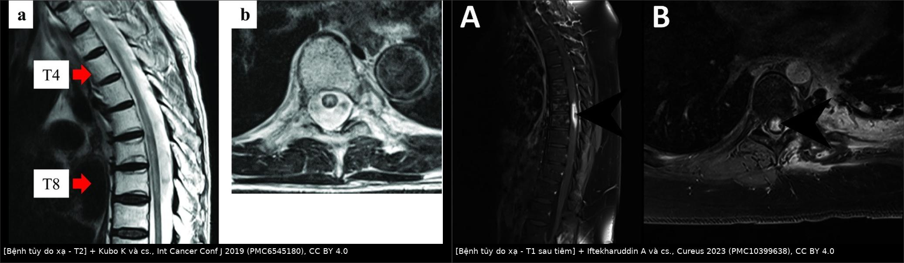
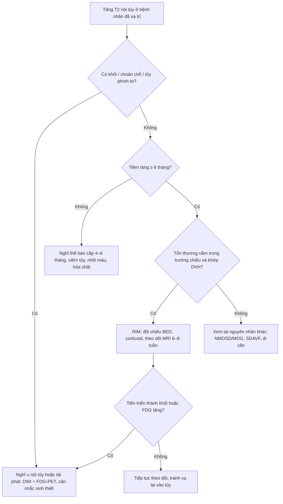
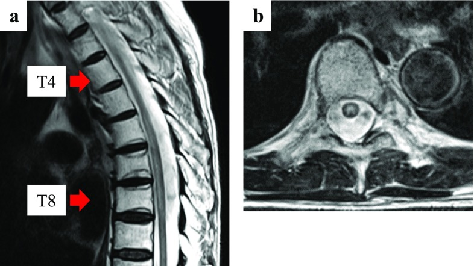
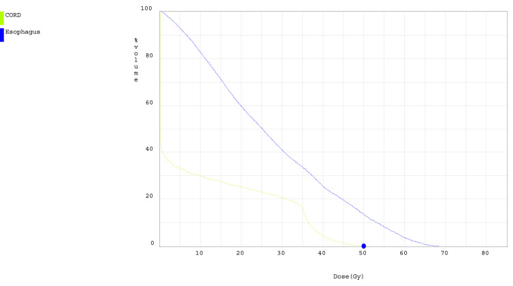

# 268 — Bệnh tủy do xạ trị (radiation-induced myelopathy, RIM): tổn thương T2 trong trường chiếu

**Tags:** `pattern:tang-t2-tuy` `pattern:ngam-thuoc-tuy` `pattern:khong-choan-cho` `pattern:ton-thuong-trong-truong-chieu` `pattern:teo-tuy` `vung:tuy-song` `vung:tuy-nguc` `protocol:MRI-tuy-T2-T1C` `protocol:DWI-tuy` `protocol:lap-ke-hoach-xa-tri` `score:BED`

**Mức chắc chắn (certainty):** tổng hợp y văn (literature synthesis) — 1 ca nguyên văn có ảnh MRI + đường cong liều (PMC10399638), 1 ca nguyên văn có ảnh MRI trước/sau corticoid (PMC6545180), 1 ca nguyên văn dùng PET/CT để phân biệt (PMC3613644), 1 ca nguyên văn xạ giảm phân liều + gefitinib (PMC4313465) và 1 phân tích mô hình liều–phân liều trên dữ liệu người + động vật (PMC4559090). Không có thử nghiệm ngẫu nhiên; các ngưỡng BED là mô hình hồi quy, chỗ suy luận được ghi rõ.

> **Câu chốt:** RIM là tổn thương tủy **trong đúng trường chiếu**, xuất hiện **sau ≥ 6 tháng**, trên MRI là **tăng T2 trung tâm tủy lan dọc nhiều đốt + ngấm thuốc mờ**, **không có khối choán chỗ**. Ba câu hỏi quyết định: **(1) tổn thương có nằm trong trường chiếu và khớp với liều đã cho không (lấy DVH ra đối chiếu)? (2) đã đủ thời gian tiềm tàng chưa? (3) có bằng chứng tái phát/u nội tủy không (khối, choán chỗ, FDG)?** Nhầm RIM với tái phát → **xạ lại vào tủy đã tổn thương**; nhầm tái phát với RIM → **bỏ điều trị cứu được**.

## 1. Tổng quan bệnh học – cơ chế hình ảnh (TẠI SAO)

### 1.1 Ba thể lâm sàng theo thời gian

| Thể | Thời điểm | Cơ chế | Diễn tiến |
|---|---|---|---|
| Cấp | trong/ngay sau xạ | phù, viêm | hiếm, thường không có triệu chứng rõ |
| **Bán cấp** | **4–6 tháng** | **hủy myelin tạm thời** (transient demyelination) | **tự khỏi**, không cần điều trị |
| **Muộn (DRM)** | **≥ 6 tháng**, nhiều tháng–nhiều năm | **hoại tử chất trắng, tổn thương nội mô mạch máu** | **không hồi phục**, tiến triển tăng dần |

(Nguồn: PMC10399638; PMC3613644.)

- **Tiêu chuẩn chẩn đoán DRM** (đủ cả 3): đoạn tủy tổn thương **nằm trong vùng đã chiếu xạ**; **triệu chứng khớp đốt tủy tổn thương**; **thời gian tiềm tàng > 6 tháng**; kèm **loại trừ u nội tủy nguyên phát/di căn và chèn ép tủy** (PMC3613644; PMC10399638).
- **Triệu chứng:** yếu–tê **tăng dần**, rối loạn cảm giác/proprioception, **rối loạn cơ tròn**, cuối cùng liệt; khởi phát **âm thầm trong vài tuần** (PMC3613644).

### 1.2 TẠI SAO thấy trên MRI (vật lý + mô bệnh)

- **Tăng tín hiệu T2:** xạ → **phù nội bào/kẽ + hủy myelin** làm tăng nước tự do → T2 dài → **sáng trên T2/FLAIR**, **không phải "u"** nên **không làm tủy phình to rõ** và **không xóa khoang dịch não tủy quanh tủy** như u.
- **Ngấm thuốc:** tổn thương **nội mô vi mạch** làm **hàng rào máu–tủy vỡ** → gadolinium rò ra khoảng kẽ → **ngấm mờ, dạng "khói" (smudgy)**, thường **muộn và khu trú một đoạn ngắn trong vùng T2 sáng**. Ngấm thuốc **có thể không có** ở thể bán cấp và **có thể mất sau corticoid** → **không dùng "không ngấm" để loại RIM**.
- **Teo tủy muộn:** sau nhiều tháng–năm, mô hoại tử được thay bằng xơ → tủy **nhỏ lại, T1 tối**, chỉ còn dải tín hiệu bất thường — dấu của **di chứng không hồi phục**.
- **Vì sao tổn thương dài theo trục:** trường chiếu thường phủ **nhiều đốt liên tiếp**; vùng liều cao nhất nằm dọc trục tủy → tổn thương **lan dọc theo đốt bị chiếu**, không theo lãnh thổ mạch (khác nhồi máu tủy — bài 256).

### 1.3 Ngưỡng định lượng trụ cột (BED — biological effective dose)

Mô hình tuyến tính–bậc hai: **BED = n × d × (1 + d/(α/β))**, với **α/β tủy ≈ 3,9 Gy** (nhóm động vật 3,6–4,1 Gy; người tương tự) (PMC4559090).

| Đại lượng | Con số | Quy đổi | Nguồn |
|---|---|---|---|
| **BED5** (5% nguy cơ RIM) | **83,9 Gy** | **55,4 Gy** chia 2 Gy/lần, hoặc **16,2 Gy** một lần | PMC4559090 |
| **BED50** (50% nguy cơ) | **111 Gy** | **73,4 Gy** chia 2 Gy/lần, hoặc **19,0 Gy** một lần | PMC4559090 |
| Nguy cơ < 5% trong 5 năm | **47–50 Gy** với **1,8–2 Gy/lần** | — | PMC4559090 |
| Thời gian tiềm tàng DRM | **> 6 tháng** | — | PMC3613644; PMC10399638 |

**Tính lại BED cho các ca trong bài** (α/β = 3,9 Gy; đây là **suy luận số học**, không phải số tác giả công bố):

| Ca | Liều tủy | BED | Diễn giải |
|---|---|---|---|
| PMC6545180 | **40 Gy** (30 Gy × 2 Gy + 10 Gy × 1 Gy) | **≈ 57,9 Gy** | dưới BED5 (83,9) nhưng vẫn gây myelitis khi **có durvalumab** → thuốc đồng thời làm giảm ngưỡng |
| PMC10399638 | **35 Gy** trong **10 lần** (3,5 Gy/lần) | **≈ 66,4 Gy** | dưới BED5, vẫn có DRM sau **9 tháng** |
| PMC4313465 | **36 Gy** trong **12 lần** (3 Gy/lần) | **≈ 63,7 Gy** | dưới BED5, myelitis sau **16 tháng** khi **có gefitinib** |
| PMC3613644 | **62 Gy** chia 2 Gy/lần | **≈ 93,8 Gy** | trên BED5 → nguy cơ cao; DRM sau **18 tháng** |

> **Điểm cần nhớ:** các ca thực tế **đều dưới ngưỡng "an toàn" 55,4 Gy/2 Gy** — vì **hóa trị/ức chế miễn dịch đồng thời, xạ giảm phân liều, và chiếu toàn bộ tiết diện tủy** làm tăng nguy cơ (PMC3613644; PMC6545180; PMC4313465). "Liều dưới ngưỡng" **không loại trừ** RIM.

## 2. Mẫu hình + chẩn đoán phân biệt theo vị trí (Gamut)

- **Tăng T2 nội tủy, đoạn dài (≥ 3 đốt), trong trường chiếu, không choán chỗ:** **RIM** · viêm tủy (NMOSD/MOG) · nhồi máu tủy · tủy mềm do thiếu máu mạn (SDAVF) · phù do chèn ép · di căn nội tủy lan dọc · **myelopathy do hóa chất (methotrexate nội tủy, nelarabine)** · **viêm tủy do ức chế miễn dịch (irAE)**.
- **Tăng T2 khu trú ngắn (< 1 đốt) + ngấm thuốc:** **RIM thể muộn** · u nội tủy (ependymoma/astrocytoma) · di căn nội tủy · **hoại tử tủy do xạ (focal radiation necrosis)**.
- **Tăng T2 + tủy phình to + xóa khoang DNT:** u hoặc di căn — **không điển hình cho RIM**.
- **Teo tủy + T1 tối, không ngấm:** **di chứng RIM** · myelomalacia sau chấn thương · xơ tủy sau viêm.
- Gợi nhớ **"IN-FIELD"**: **I**rradiation (đúng trường chiếu) · **N**o mass (không choán chỗ) · **F**raction/dose (đối chiếu DVH–BED) · **I**nterval ≥ 6 tháng · **E**nhancement mờ · **L**ong segment · **D**WI không hạn chế rõ.

## 3. Bảng so sánh phân biệt (ma trận đối chiếu)

| Thực thể (entity) | Hình ảnh điển hình | Chốt vào (rule-in) | Chốt loại (rule-out) | Gợi ý xác nhận |
|---|---|---|---|---|
| **RIM / DRM** | T2 sáng **trung tâm**, lan dọc **nhiều đốt**, **khu trú đúng trường chiếu**, ngấm mờ muộn, không choán chỗ; teo tủy muộn | **Tổn thương khớp trường chiếu + tiềm tàng ≥ 6 tháng + không khối** | **Khối choán chỗ, tủy phình to, FDG tăng** → không phải RIM | Đối chiếu **DVH/BED**; PET/CT; theo dõi MRI 6–8 tuần |
| **Tái phát/u nội tủy** | Khối **khu trú**, tủy **phình to**, ngấm **đậm**, có thể **hạn chế khuếch tán**, phù quanh | **Khối + choán chỗ + ngấm đậm + tiến triển nhanh** | **T2 sáng dọc, không choán chỗ, đúng trường chiếu** → nghĩ RIM | **FDG-PET tăng**; DWI; so phim cũ; sinh thiết **rất nguy hiểm** |
| **Di căn nội tủy** | Nốt/khối trong tủy, ngấm đậm, thường có di căn xương/đốt sống kèm | **Nốt ngấm đậm + di căn xương cùng vùng** | Tổn thương **dọc, mờ, không choán chỗ** → không điển hình | MRI toàn trục + PET/CT |
| **Viêm tủy NMOSD/MOG** | **LETM ≥ 3 đốt**, T2 sáng trung tâm, **H-sign** (NMOSD), có thể **area postrema** | **LETM + H-sign + kháng thể đặc hiệu** | **Đúng trường chiếu + không kháng thể + tiềm tàng dài** → RIM | AQP4/MOG; DNT; MRI não |
| **Nhồi máu tủy** | **Hai phần ba trước**, **owl's eyes** trên axial, **DWI hạn chế rõ**, khởi phát **đột ngột + đau** | **DWI/ADC hạn chế + khởi phát đột ngột** | T2 sáng dọc, khởi phát âm thầm, không hạn chế khuếch tán → RIM | DWI/ADC; mạch máu (bài 256) |
| **SDAVF / tủy mềm** | T2 sáng **lan dài từ nón tủy lên**, **flow void** mặt lưng, tủy phình nhẹ | **Flow void + giãn tĩnh mạch tủy trên T2** | Không flow void + đúng trường chiếu → RIM | MRI + **DSA** (bài 226/255) |
| **Myelopathy do hóa chất** | T2 sáng đối xứng/dọc, **không ngấm**, sau **MTX nội tủy/nelarabine** | **Tiền sử hóa chất nội tủy + không ngấm** | Có xạ đúng vùng + tiềm tàng ≥ 6 tháng → nghĩ RIM hơn | Bệnh sử thuốc; MRI lặp lại |

*Trái: T2 sáng trung tâm tủy lan dọc T5–T8, axial có chấm sáng trung tâm — không choán chỗ. Phải: T1 sau tiêm ngấm thuốc mờ ở T7–T8, axial ngấm bờ bên tủy. Ảnh ghép letterbox từ 2 hình CC BY 4.0 (PMC6545180; PMC10399638).*

### Đọc "trong trường chiếu" thế nào cho đúng
- Lấy **ảnh lập kế hoạch (CT simulation) + DVH** ra chồng lên MRI; đo **chiều dài tổn thương theo đốt** và so với **vùng nhận ≥ 90% liều**.
- Tổn thương **dừng đúng ranh giới trường chiếu** là dấu rất mạnh của RIM; tổn thương **vượt qua ranh giới** gợi ý nguyên nhân khác (u, viêm, nhồi máu).
- **Dùng đúng chuỗi xung:** T2 sagittal + axial, T1 trước/sau tiêm **fat-sat**, ± DWI.

## 4. Protocol chụp + phân độ/ngưỡng xử trí

- **MRI tủy toàn trục** (sagittal T2, T1, T1 sau tiêm fat-sat, axial T2 tại ổ tổn thương, ± DWI/ADC); **không cần cản quang nội tủy**.
- **Bắt buộc đối chiếu liều:** lấy **DVH** (Dmax tủy, V35/V40/V45, số lần), tính **BED** theo α/β = 3,9 Gy — đây là "chìa khóa" phân biệt RIM với tái phát.
- **Theo dõi:** MRI lặp lại **6–8 tuần** sau khi ngừng/đổi điều trị; RIM **không tiến triển thành khối**, có thể **giảm tín hiệu sau corticoid** (PMC6545180: T2 giảm rõ sau **1 tuần** methylprednisolone).
- **Điều trị (theo ca báo):** **methylprednisolone 1 g/ngày × 5 ngày**, sau đó **uống 80 mg/ngày × 1 tuần, giảm liều trong 3 tuần** (PMC3613644); **bevacizumab** đã cải thiện cả hình ảnh và triệu chứng trong các ca nhỏ (PMC10399638) — **chưa có thử nghiệm ngẫu nhiên**.
- **Không sinh thiết tủy để "chẩn đoán xác định"** khi bệnh cảnh điển hình: nguy cơ cao, không đổi xử trí.

## 5. Biến thể bình thường và cạm bẫy

- **Ngấm thuốc không bắt buộc:** thể bán cấp và một phần DRM **không ngấm** → thiếu ngấm **không loại** RIM.
- **Corticoid làm mất dấu T2 rất nhanh (1 tuần)** — nếu chụp lại quá sớm sau corticoid, có thể **không thấy tổn thương** và tưởng "không có bệnh" (PMC6545180).
- **"Dưới ngưỡng liều" không an toàn:** 4 ca trong bài đều **dưới 55,4 Gy/2 Gy**; **gefitinib, durvalumab, xạ giảm phân liều, chiếu toàn tiết diện tủy** làm tăng nguy cơ (PMC4313465; PMC6545180; PMC3613644).
- **Nhầm với tái phát:** khối ngấm đậm, tủy phình to, FDG tăng → tái phát; **đừng xạ lại** khi chưa loại RIM vì xạ lại có thể gây **liệt không hồi phục**.
- **Nhầm với thể bán cấp:** thể bán cấp **4–6 tháng, tự khỏi**; DRM **> 6 tháng, tiến triển** — hỏi kỹ mốc thời gian.
- **Bỏ sót tổn thương ngoài trường chiếu:** phải chụp **toàn trục tủy**; một ổ thứ hai ngoài trường chiếu đổi hoàn toàn chẩn đoán (di căn/viêm).
- **Ảnh hưởng của kim loại/dụng cụ cố định** ở bệnh nhân xạ trị: artifact có thể che tủy — dùng chuỗi xung không bị ảnh hưởng (T2 fast spin echo).

## 6. Tự lượng giá — Blind Quiz

**Ca 1 — Nam, xạ trị 70 Gy/10 lần vào ngực trái; tủy nhận tối đa 35 Gy. Chín tháng sau: tê–yếu chân trái, giảm cảm giác proprioception.**

- Câu hỏi: Tổn thương ở đâu, có choán chỗ không? Vì sao vẫn nghĩ do xạ dù liều tủy dưới ngưỡng?

<b>Bấm để hiện đáp án (findings + chẩn đoán)</b>

- **Findings:** (A) T1 sau tiêm sagittal: **ngấm thuốc dọc bờ bên tủy ngực T7–T8**; (B) axial: **ngấm thuốc một bờ bên**, **không có khối, không phình tủy**.
- **Chẩn đoán:** **DRM** sau **9 tháng**; liều tủy **35 Gy trong 10 lần** ≈ **BED 66,4 Gy** (dưới BED5 83,9 Gy) nhưng vẫn gây bệnh → **liều "an toàn" không loại trừ**.
- **Xử trí:** corticoid liều cao; theo dõi — bệnh cảnh **ổn định** ở lần khám 9 tháng.
- Nguồn ảnh: Iftekharuddin A và cs., *Cureus* 2023, Fig. 3 (PMC10399638), CC BY 4.0.

**Ca 2 — Bệnh nhân ung thư phổi không tế bào nhỏ, hóa–xạ 50 Gy/2 Gy (tủy tối đa 40 Gy), sau đó durvalumab. 2,5 tháng sau: bí tiểu, yếu hai chân.**

- Câu hỏi: Vì sao khởi phát sớm hơn "6 tháng"? Có bằng chứng tái phát không? Làm gì tiếp?

<b>Bấm để hiện đáp án (findings + chẩn đoán)</b>

- **Findings:** (a) T2 sagittal: **tăng tín hiệu trung tâm tủy từ T5 đến T8**, đúng vùng chiếu; (b) axial T7: **chấm sáng trung tâm tủy**; không khối, không chèn ép, không di căn đốt sống.
- **Chẩn đoán:** **radiation myelitis** khởi phát sớm, **nghi do durvalumab** làm tăng nhạy cảm; tổng liều tủy **40 Gy** ≈ **BED 57,9 Gy**.
- **Xử trí:** **ngừng durvalumab + corticoid** → yếu chân cải thiện sau **1 tuần** (đi nạng được), **T2 giảm rõ**; rối loạn cơ tròn còn lại.
- **Cạm bẫy:** "chưa đủ 6 tháng" **không loại** myelitis khi có thuốc đồng thời.
- Nguồn ảnh: Kubo K và cs., *Int Cancer Conf J* 2019, Fig. 1 (PMC6545180), CC BY 4.0.

**Ca 3 — Bệnh nhân xạ 36 Gy/12 lần (3 Gy/lần) vào T8–T12, dùng gefitinib đồng thời. 16 tháng sau: yếu hai chân tăng dần.**

- Câu hỏi: Đường cong này dùng để làm gì khi nghi RIM? Liều tủy tối đa bao nhiêu?

<b>Bấm để hiện đáp án (findings + chẩn đoán)</b>

- **Findings:** **DVH** so sánh tủy (xanh lá) và thực quản (xanh dương); **liều tủy tối đa 35 Gy** trong ca này (trục hoành: liều Gy; trục tung: % thể tích).
- **Chẩn đoán:** công cụ **bắt buộc** để chứng minh tổn thương "trong trường chiếu" và tính **BED**; ca minh họa là DRM sau **9 tháng**.
- **Cạm bẫy:** không có DVH thì **không thể** phân biệt chắc RIM với tái phát — luôn xin **ảnh lập kế hoạch + DVH** từ khoa xạ trị.
- Nguồn ảnh: Iftekharuddin A và cs., *Cureus* 2023, Fig. 2 (PMC10399638), CC BY 4.0.

## Bài liên quan chéo
- [256 – Nhồi máu tủy sau mổ/đặt stent ĐMC](../256-nhoi-mau-tuy-sau-phau-thuat-dong-mach-chu/lesson.md) (cùng "tủy tăng T2 dọc", khác: **DWI hạn chế + khởi phát đột ngột**)
- [261 – Bệnh não chất trắng do xạ trị](../261-benh-nao-chat-trang-do-xa-tri/lesson.md) (cùng cơ chế xạ, khác ngăn)
- [262 – Bệnh mạch máu lớn do xạ trị](../262-benh-mach-mau-lon-do-xa-tri-moyamoya/lesson.md)
- [226 – Tủy mềm không do chấn thương (nhồi máu/SDAVF/NMO/xạ)](../226-tuy-mem-khong-chan-thuong-nhoi-mau-sdavf-nmo-xa/lesson.md)
- [200 – Tổng quan hệ Thần kinh](../200-tong-quan-he-than-kinh/lesson.md)

## Ảnh
- `268_benh-tuy-do-xa-tri_MRI-T1C_PMC10399638-F3.jpg` — ngấm thuốc T7–T8 (DRM sau 9 tháng).
- `268_benh-tuy-do-xa-tri_MRI-T2_PMC6545180-F1.jpg` — T2 sáng T5–T8, axial trung tâm.
- `268_benh-tuy-do-xa-tri_MRI-T2-sau-corticoid_PMC6545180-F3.jpg` — T2 giảm sau 1 tuần corticoid.
- `268_benh-tuy-do-xa-tri_DVH_PMC10399638-F2.jpg` — DVH tủy/thực quản.
- `composite_t2-vs-t1c.jpg` — ảnh ghép đối chiếu T2 vs T1 sau tiêm (CC BY 4.0).
- Nguồn + giấy phép từng ảnh: `images/CREDITS.md`.

> Không dùng để chẩn đoán độc lập khi chưa có người hướng dẫn.
