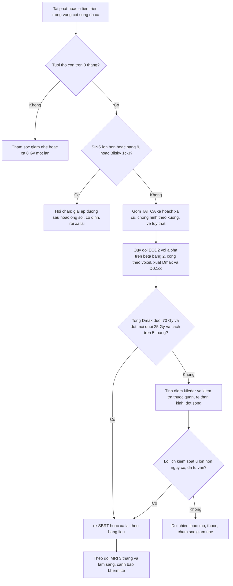
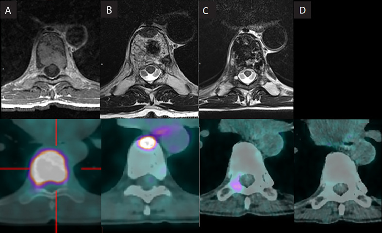
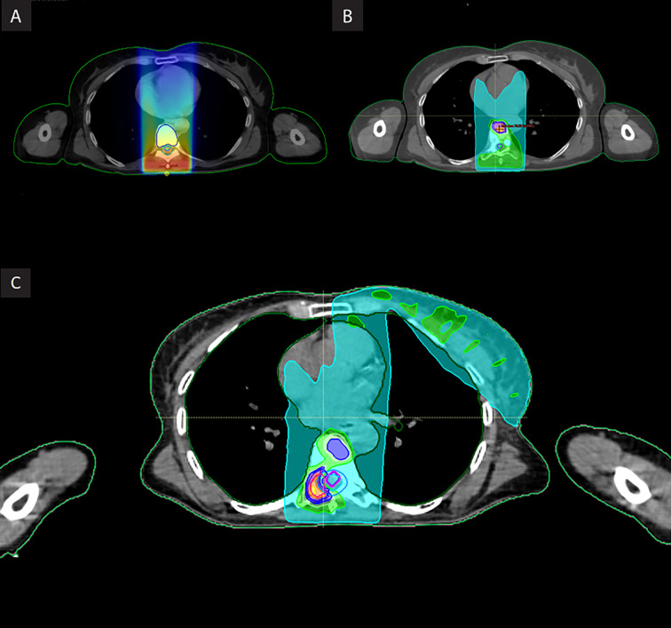
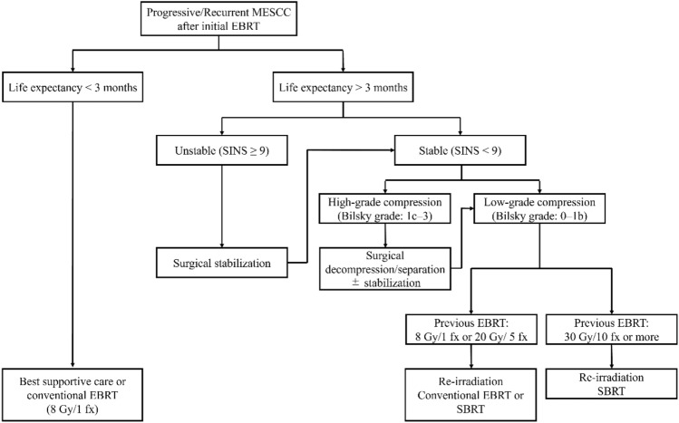
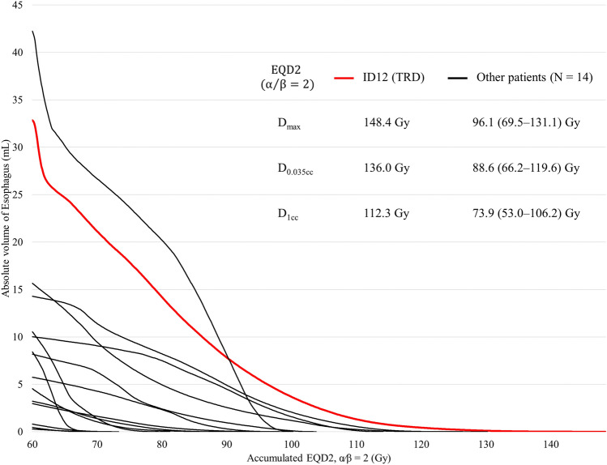

# 269 — Xạ lại tủy sống (spinal cord re-irradiation): quyết định nằm ở **tổng liều EQD2 trên DVH**, không ở một lần chụp

**Tags:** `pattern:tong-lieu-cong-don` `pattern:tai-phat-tai-cho` `pattern:tang-t2-tuy` `pattern:ton-thuong-trong-truong-chieu` `vung:tuy-song` `vung:tuy-nguc` `vung:cot-song` `protocol:MRI-tuy-T2-T1C` `protocol:lap-ke-hoach-xa-tri` `protocol:tong-lieu-EQD2` `score:EQD2` `score:BED` `score:Nieder-risk-score`

**Mức chắc chắn (certainty):** tổng hợp y văn (literature synthesis) — **1 ca nguyên văn 3 đợt xạ cùng đốt T8** (PMC9869751, có ảnh MRI tiến triển + ảnh bản đồ liều cộng dồn), **1 đoàn hệ 21 ca re-SBRT sau xạ ≥ 50 Gy EQD2** (PMC11139739, có ảnh DVH thực quản và 1 ca tử vong do rò thực quản), **1 đoàn hệ 32 ca** (PMC8154818) và **1 tổng quan** (PMC9857541) cho ngưỡng liều. **Không có thử nghiệm ngẫu nhiên** về xạ lại tủy; mọi ngưỡng dưới đây là mô hình hồi quy/LQ từ dữ liệu hồi cứu, chỗ suy luận được ghi rõ.

> **Câu chốt:** xạ lại tủy **không có "liều an toàn tuyệt đối"** — chỉ có **tổng liều cộng dồn EQD2 trên đúng cấu trúc tủy**, **khoảng cách thời gian**, và **liều của đợt mới**. Ba câu hỏi trước khi ký kế hoạch: **(1) đã gom TẤT CẢ các đợt xạ cũ chưa (kể cả đợt xạ vùng khác chồng lấn, như xạ thành ngực trong ung thư vú)? (2) tổng EQD2 Dmax và D0.1cc của tủy là bao nhiêu? (3) cách đợt trước bao lâu, và cơ quan nào khác đang cùng chịu liều (thực quản, rễ thần kinh, đốt sống)?** Bỏ bước gom liều → hoặc **xạ lại quá tay gây liệt**, hoặc **từ chối xạ lại oan** vì tưởng "đã hết liều".

## 1. Tổng quan bệnh học – cơ chế hình ảnh (TẠI SAO)

### 1.1 Vì sao tủy sống "chịu" được đợt thứ hai — và chịu đến đâu

- Tủy sống là **mô muộn (late-responding)**, **α/β thấp**: tổn thương phụ thuộc **liều mỗi lần** nhiều hơn tổng liều. Vì vậy **cùng một tổng liều**, chia nhiều lần nhỏ ít độc hơn; và **thời gian** cho phép mô **sửa chữa tổn thương dưới lâm sàng**.
- Trong mô hình hóa xạ lại, thực hành chuẩn dùng **α/β = 2 Gy** cho tủy (PMC8154818; PMC9857541): **EQD2 = D × (d + 2)/(2 + 2) = n × d × (d + 2)/4**, với **d** = liều mỗi lần (Gy), **n** = số lần.
  - **Lưu ý quy ước:** bài [268](../268-benh-tuy-do-xa-tri/lesson.md) dùng **α/β ≈ 3,9 Gy** (từ dữ liệu động vật, PMC4559090) để tính **BED5/BED50 của một đợt**. **Hai quy ước này KHÔNG được trộn** trong cùng một phép cộng liều — đây là lỗi hay gặp khi tự tính tay.
- **Bồi thường theo thời gian (recovery)** — ba mô hình đang lưu hành, khác nhau đáng kể:

| Mô hình | Bồi thường | Dung nạp tương ứng | Nguồn |
|---|---|---|---|
| Khuyến cáo chuyên gia (dùng phổ biến nhất) | **25% sau 6 tháng**, **50% sau 12 tháng** | **125%** và **150%** dung nạp ban đầu | Nieder 2018 (dẫn trong PMC8154818) |
| Wong 1994 | **10% nếu < 14 tháng**, **25% nếu > 14 tháng** | thấp hơn nhiều | dẫn trong PMC9857541 |
| ReTEC 2026 (mô hình NTCP) | **> 50% trong < 1 năm** (CI bootstrap **31–95%** ở mốc 1 năm) | cao hơn thực hành, **CI rất rộng** | PMC13062923 |

> **Đọc sao cho đúng:** mô hình ReTEC (13 bài, **282 tổn thương**, chỉ **6 ca myelopathy**) gợi ý tủy hồi phục **nhanh và nhiều hơn** ta vẫn giả định — nhưng chính tác giả **khuyến cáo giữ ngưỡng hiện hành** cho tới khi có dữ liệu tốt hơn. Vì vậy trong bài này **dùng mô hình 25%/50%** làm mốc, và ghi rõ khi nào một ca nằm ngoài mốc đó.

### 1.2 Vì sao "hình ảnh" của quyết định là **bản đồ liều**, còn MRI là hình ảnh của **hậu quả**

- **Bản đồ liều cộng dồn (composite dose)**: chồng các kế hoạch cũ lên CT lập kế hoạch mới → mỗi **voxel** tủy nhận **tổng EQD2**. Đây là thứ duy nhất trả lời được "còn bao nhiêu liều cho tủy?". **Cộng Dmax của hai đợt là sai** khi vị trí Dmax khác nhau (thường gặp khi kỹ thuật đổi từ 2D/3D sang SBRT).
- **Khi đã tổn thương (radiation myelopathy, RM)** — MRI (chi tiết ở bài 268):
  - **T2 sáng trung tâm tủy**, lan dọc nhiều đốt: **phù nội bào/kẽ + hủy myelin** làm tăng nước tự do → T2 dài.
  - **Ngấm thuốc mờ**: **vỡ hàng rào máu–tủy** do tổn thương nội mô vi mạch → gadolinium rò ra khoảng kẽ; **ngấm có thể không có**.
  - **Teo tủy muộn + T1 tối**: mô hoại tử thay bằng xơ.
  - **Không choán chỗ, không xóa khoang dịch não tủy** — khác u.
- **Thời gian tiềm tàng:** điển hình **> 6 tháng**; trong các ca RM **sau xạ lại** đã báo, trung vị **5 tháng** (PMC9857541, tổng hợp ca Sahgal 2012) — tức **ngắn hơn** thể một đợt, nên **theo dõi 3 tháng/lần trong năm đầu** là hợp lý.

### 1.3 Ngưỡng định lượng trụ cột

**a) Xạ SBRT một đợt (chưa xạ trước) — Dmax túi cùng/tủy cho nguy cơ RM 1–5%** (tổng hợp PMC9857541, Bảng 4):

| Số lần | Dmax (Gy) |
|---|---|
| 1 lần | **12,4–14** |
| 2 lần | **17–19,3** |
| 3 lần | **20,3–23,1** |
| 4 lần | **23–26,2** |
| 5 lần | **25,3–28,8** |

**b) Xạ lại sau xạ phân liều thường quy — tiêu chuẩn Sahgal 2012** (PMC9857541): **cách ≥ 5 tháng**; **tổng EQD2 Dmax túi cùng < 70 Gy**; **liều đợt xạ lại < 25 Gy** (EQD2).

**c) Bảng liều xạ lại theo liều đợt đầu** (PMC9857541, Bảng 5 — Dmax cho phép, Gy):

| Đợt đầu | EQD2 đợt đầu | 1 lần | 2 lần | 3 lần | 4 lần | 5 lần |
|---|---|---|---|---|---|---|
| 20 Gy/5 lần | 30 | 9 | 12,2 | 14,5 | 16,2 | 18 |
| 30 Gy/10 lần | 37,5 | 9 | 12,2 | 14,5 | 16,2 | 19 |
| 40 Gy/20 lần | 40 | — | 12,2 | 14,5 | 16,2 | 20 |
| 45 Gy/25 lần | 43 | — | 12,2 | 14,5 | 16,2 | 21 |
| 50 Gy/25 lần | 50 | — | 11 | 12,5 | 14 | 15,5 |

> Bảng này **không đơn điệu** (đợt đầu 50 Gy cho phép liều thấp hơn đợt đầu 40 Gy ở cột 2–5 lần) — đó là **đặc điểm của dữ liệu gốc**, không phải lỗi đánh máy; đừng "nội suy mượt" rồi tự tin quá mức.

**d) Điểm nguy cơ Nieder** (PMC8154818, Bảng 1):

| Yếu tố | Điểm |
|---|---|
| Khoảng cách **< 6 tháng** | **4,5** |
| EQD2 **một trong hai đợt ≥ 51 Gy** | **4,5** |
| Tổng EQD2 **60,1–65 Gy** | 1 |
| 65,1–70 Gy | 2 |
| 70,1–75 Gy | 3 |
| 75,1–80 Gy | 4 |
| 80,1–85 Gy | 5 |
| 85,1–90 Gy | 6 (mỗi 5 Gy tiếp theo **+1**) |

- **Nguy cơ thấp: 0–3 điểm** (RM **< 5%**, trong loạt mới **0/…**); **trung bình 4–6 điểm**; **cao > 6 điểm**.
- Ước lượng lại sau loạt 32 ca: nhóm trung bình **2/16 = 12,5%** (theo Dmax) và **2/21 = 9,5%** (theo D0.1cc) — **thấp hơn** con số 25% cũ, nhưng vẫn **không phải 0**.

**e) Dữ liệu thực hành "vượt ngưỡng"** (PMC8154818 — 32 ca, theo dõi trung vị **12 tháng**, tối đa **90 tháng**):

- **0 ca RM**; khoảng cách xạ lại **6–97 tháng** (trung vị **15**).
- **Tổng EQD2 Dmax trung vị 80,7 Gy** (61,12–**114,79**); **D0.1cc trung vị 76,1 Gy** (61,12–95,62).
- **69% (22/32)** ca có **Dmax đợt xạ lại CAO HƠN đợt đầu**; **48/64 đợt** dùng **2,5–4 Gy/lần**.
- **Phản biện:** đây là loạt nhỏ, hồi cứu, nhiều bệnh nhân chết trước khi đủ thời gian biểu hiện — "chưa thấy RM" **không** đồng nghĩa "an toàn", và tác giả tự nhận điều này.

## 2. Mẫu hình + chẩn đoán phân biệt theo vị trí (Gamut)

- **Khối/tổn thương mới trong vùng cột sống đã xạ:** **u tái phát tại chỗ** · **thay đổi do xạ (viêm/xơ, "pseudoprogression")** · **RM (tổn thương trong tủy, không phải khối)** · **xẹp đốt sống tiến triển chèn ép** · **tụ máu ngoài màng cứng** · **viêm đốt–đĩa (spondylodiscitis)** · **gãy xương do xạ**.
- **Tăng T2 nội tủy, đoạn dài, trong trường chiếu, không choán chỗ:** **RM** · viêm tủy (NMOSD/MOG) · nhồi máu tủy · dò động–tĩnh mạch màng cứng (SDAVF) · phù do chèn ép · di căn nội tủy lan dọc · myelopathy do hóa chất (chi tiết: bài 268, 226, 256).
- **Đau rễ/thần kinh sau xạ lại:** **radiculitis do liều rễ** (thường **chấp nhận có ý thức** khi không thể giữ liều) · tái phát chèn rễ · gãy đốt sống · zoster.
- **Mẫu hình "đúng trường chiếu":** tổn thương **dừng đúng ranh giới** vùng liều cao là dấu mạnh của nguyên nhân do xạ; tổn thương **vượt ranh giới** gợi ý u/viêm/nhồi máu.

## 3. Bảng so sánh phân biệt (ma trận đối chiếu)

| Thực thể (entity) | Hình ảnh điển hình | Chốt vào (rule-in) | Chốt loại (rule-out) | Gợi ý xác nhận |
|---|---|---|---|---|
| **RM sau xạ lại** | T2 sáng **trung tâm tủy**, lan dọc nhiều đốt, **đúng trường chiếu**, ngấm mờ muộn, **không choán chỗ**; teo tủy muộn | **Tổn thương trong tủy + khớp bản đồ liều + tiềm tàng ≥ 6 tháng** | **Khối choán chỗ, tủy phình to, FDG tăng** → không phải RM | Đối chiếu **DVH/EQD2**; MRI lặp 6–8 tuần; PET/CT khi nghi u |
| **U tái phát tại chỗ** | Khối **trong đốt/ngoài màng cứng**, ngấm đậm, tiến triển theo thời gian, có thể hạn chế khuếch tán | **Khối + tiến triển + ngấm đậm + chèn ép** | **T2 sáng dọc trong tủy, không khối** → RM | So phim cũ cùng chuỗi xung; FDG-PET; **sinh thiết chỉ khi đổi xử trí** |
| **Thay đổi do xạ ("pseudoprogression")** | Phù/xơ **mờ, bờ không rõ**, có thể ngấm nhẹ, **ổn định hoặc giảm** khi lặp 6–8 tuần | **Ổn định/giảm khi lặp lại + không khối** | **Lớn dần + ngấm đậm + phá xương** → tái phát | MRI lặp **6–8 tuần** cùng protocol |
| **Xẹp đốt tiến triển / gãy do xạ** | Mất chiều cao đốt, **thường không có khối mô mềm**, đau cơ học; **VCF 9–23,8%** sau re-SBRT | **Mất chiều cao + đau cơ học + không khối** | **Khối mô mềm + phá vỏ** → u | CT xương bổ sung; SINS |
| **Radiculitis do liều rễ** | **Không có tổn thương tủy**; đau theo dermatome, khởi phát sau xạ vài tuần | **Đau dermatome + tủy trống trên MRI + rễ nhận EQD2 cao** | **Tủy có tín hiệu bất thường** → RM | Đối chiếu **liều rễ** (ngưỡng độc ~**> 108 Gy EQD2**) |
| **Viêm đốt–đĩa** | Phù tủy xương **hai bên đĩa**, đĩa tăng tín hiệu, áp-xe mô mềm | **Phù hai đốt kề + đĩa bất thường + CRP tăng** | **Chỉ một đốt + đĩa bình thường** → u/xạ | CRP/máu; sinh thiết khi cần |
| **Myelopathy do hóa chất/ức chế miễn dịch** | T2 sáng dọc, **không ngấm**, sau MTX nội tủy/nelarabine/irAE | **Thuốc khớp thời điểm + không ngấm** | **Có xạ đúng vùng + khớp DVH** → nghĩ RM hơn | Bệnh sử thuốc; MRI lặp |

## 4. Protocol chụp + phân độ/ngưỡng xử trí

### 4.1 Quy trình "gom liều" (bắt buộc trước khi quyết định xạ lại)

1. **Thu thập TẤT CẢ** kế hoạch xạ cũ: ảnh CT simulation, **DVH**, số lần, liều/lần — **kể cả đợt xạ cho ổ bệnh khác** mà trường chiếu chồng lên cột sống (ví dụ xạ thành ngực trong ung thư vú: trong ca PMC9869751, vùng xạ chuỗi vú trong đóng góp **Dmax 5,46 Gy = EQD2 3,05 Gy** cho tủy).
2. **Chồng hình**: cột sống dùng **fusion cứng theo xương** (đáng tin vì xương không biến dạng); **DIR** chỉ khi giải phẫu thay đổi nhiều (mổ, xẹp đốt) và phải ghi nhận **bất định**.
3. **Vẽ đúng cấu trúc**: **tủy thật (MRI-defined cord)** — không dùng **ống sống (spinal canal)** hay **túi cùng (thecal sac)** thay thế; đây là nguồn sai lệch lớn nhất khi so các nghiên cứu.
4. **Quy đổi EQD2** (α/β = 2 cho tủy; α/β = 3 cho thực quản/rễ theo quy ước từng nguồn) rồi **cộng theo voxel**; xuất **Dmax** và **D0.1cc** (thêm **D0.03cc** nếu dùng ngưỡng của nghiên cứu khác).
5. **Đối chiếu ngưỡng** (mục 1.3), **tính điểm Nieder**, và **ghi rõ trong hồ sơ** là đã tư vấn nguy cơ.

### 4.2 Ngưỡng xử trí thực hành

- **Trong ngưỡng** (tổng Dmax < 70 Gy, đợt mới < 25 Gy, cách ≥ 5 tháng): **re-SBRT hoặc xạ lại phân liều** theo bảng 1.3c.
- **Ngoài ngưỡng**: quyết định **cá thể hóa** — nếu kiểm soát u là ưu tiên (thường đúng ở di căn cột sống đã kháng xạ), có thể **vượt ngưỡng sau tư vấn**, ưu tiên **gradient dốc** để chỉ một thể tích rất nhỏ tủy nhận liều cao (PMC8154818).
- **Cơ quan khác phải kiểm cùng lúc:**
  - **Thực quản**: trong loạt 21 ca re-SBRT **24 Gy/2 lần** sau ≥ 50 Gy EQD2 có **1 ca tử vong do rò thực quản**; ngưỡng tổng liều đề xuất (đơn vị **BED Gy3**): **Dmax < 203**, **D0.035cc < 187**, **D1cc < 167** (PMC11139739).
  - **Rễ thần kinh**: độc tính thần kinh ngoại biên xuất hiện khi **EQD2 rễ > 108 Gy** (4/61 ca, PMC13114983).
  - **Đốt sống**: **gãy xẹp 9%** (reSBRT, PMC13114983) và **23,8%** (24 Gy/2 lần, PMC11139739) → cân nhắc **cố định dự phòng** khi SINS cao.

### 4.3 Theo dõi sau xạ lại

- **MRI tủy + cột sống** (T2 sagittal/axial, T1 sau tiêm fat-sat) **3 tháng/lần trong năm đầu**, sau đó **3–6 tháng**; chụp ngay khi có **yếu mới, rối loạn cơ tròn, hoặc Lhermitte**.
- **Hiệu quả:** kiểm soát tại chỗ 1 năm **89%** (reSBRT sau SBRT, PMC13114983), **76%** (Garg, 59 ca — dẫn trong PMC9869751); sau re-SBRT cho chèn ép sau xạ ≥ 50 Gy: **thất bại tại chỗ 1 năm 29,3%**, **sống 1 năm 55,0%** (PMC11139739).
- **Tái phát tại chỗ sau xạ thường quy** (lý do phải xạ lại): **39%** ở 1 năm với **1 lần xạ**, **23%** với xạ chia lần (PMC9857541).

## 5. Biến thể bình thường và cạm bẫy

- **Lhermitte (cảm giác điện giật khi gập cổ)** sau xạ cổ: **thường lành tính, tự hết trong vài tháng** — **không đồng nghĩa RM**; nhưng phải chụp MRI nếu kèm yếu/tê tiến triển.
- **"Dưới ngưỡng" không loại trừ:** trong loạt 32 ca vượt ngưỡng **không có RM**, nhưng ca RM kinh điển của Sahgal 2012 xảy ra ở **tổng EQD2 99,6 Gy** — và ngược lại, RM đã xảy ra ở những ca **dưới ngưỡng** khi có **hóa chất/ức chế miễn dịch đồng thời** (bài 268). Ngưỡng là **xác suất**, không phải hàng rào.
- **Cộng Dmax hai đợt là sai** khi Dmax nằm ở hai vị trí khác nhau (đổi kỹ thuật 2D → SBRT). Phải **cộng theo voxel** trên bản đồ liều.
- **Nhầm cấu trúc:** báo liều cho **ống sống** hoặc **túi cùng** thay vì **tủy thật** làm ngưỡng 70 Gy mất ý nghĩa; ghi rõ cấu trúc nào trong hồ sơ.
- **Bỏ sót đợt xạ "không liên quan":** xạ thành ngực, xạ vùng đầu–cổ, xạ toàn thân (TBI) đều có thể đóng góp vào tủy — phải hỏi **toàn bộ tiền sử xạ**, không chỉ đợt điều trị cột sống.
- **Thời gian theo dõi ngắn đánh lừa:** RM sau xạ lại có thể xuất hiện **muộn hơn 1 năm**; "0 ca RM" trong loạt có trung vị theo dõi 12 tháng **không** chứng minh an toàn.
- **Chết vì cơ quan khác, không phải tủy:** ca tử vong trong loạt re-SBRT là **rò thực quản**, không phải myelopathy (PMC11139739) — **kiểm thực quản/tim/rễ** cùng lúc với tủy.
- **Đừng xạ lại khi chưa loại u tiến triển:** xạ lại vào khối u đang tiến triển chỉ làm chậm, và làm mất cơ hội mổ/đổi thuốc; ngược lại, gọi "tái phát" một vùng **xơ do xạ** dẫn tới **xạ lại không cần thiết**.
- **Gãy xẹp sau xạ lại** (9–23,8%) có thể bị đọc nhầm là tiến triển u — so **chiều cao đốt** và **mô mềm** trên cùng chuỗi xung.

## 6. Tự lượng giá — Blind Quiz

**Ca 1 — Nữ sinh 1962, ung thư vú (1998). 2006: di căn T8 gây xẹp chèn ép; xạ 30 Gy/12 lần. 2014: tái phát thân đốt; SBRT 18 Gy/3 lần. 2021: tái phát cuống phải; PET/CT dương; mổ không khả thi. Hình: MRI/CT axial tại T8 theo thời gian.**

- Câu hỏi: (a) Ở mỗi mốc, tổn thương nằm ở đâu và gợi ý gì? (b) Ảnh D nói lên điều gì? (c) Trước đợt xạ thứ ba, bước nào **bắt buộc** phải làm?

<b>Bấm để hiện đáp án (findings + chẩn đoán)</b>

- **Findings:** (A) 2006 — **khối lớn thân đốt T8 + xẹp hình nêm**, chèn ép ngoài màng cứng **Bilsky 1a**; (B) 2014 — **ổ tiêu xương phần trước thân đốt**, tái phát tại chỗ; (C) 2021 — **tái phát cuống ngang phải**, lan ra sau; (D) 2022 (ô trên để trắng trong hình gốc) — **đáp ứng hoàn toàn** sau đợt xạ thứ ba.
- **Chẩn đoán:** di căn T8 tái phát **3 lần** trong cùng vùng đã xạ → cần **xạ lại lần 2 (đợt thứ ba)**.
- **Điều bắt buộc trước đợt 3:** **cộng liều toàn bộ** (kể cả đợt xạ chuỗi vú trong 1998) → **tủy Dmax tổng EQD2 42,78 Gy** (α/β = 2), tức **còn dư địa**; chấp nhận **nguy cơ viêm rễ D9** vì không thể giữ liều rễ, đã giải thích trước.
- **Kết quả:** SBRT **30 Gy/5 lần**, **đáp ứng hoàn toàn**, **8 tháng không tái phát**, **không độc tính** theo CTCAE v5.
- Nguồn ảnh: Bentahila R và cs., *Front Oncol* 2023, Fig. 1 (PMC9869751), CC BY.

**Ca 2 — Cùng bệnh nhân trên. Ba bản đồ liều của ba đợt xạ vào T8.**

- Câu hỏi: (a) A, B, C là đợt nào? (b) Vì sao C là ảnh quan trọng nhất? (c) Nếu chỉ nhìn B, ta dễ sai ở đâu?

<b>Bấm để hiện đáp án (findings + chẩn đoán)</b>

- **Findings:** (A) **2D thường quy 2006**, trường lớn phủ T7–T9, liều cao trải rộng; (B) **SBRT 18 Gy/3 lần 2014**, trường nhỏ, gradient dốc, chỉ phủ vùng PET dương; (C) **liều cộng dồn** sau đợt SBRT thứ hai (30 Gy/5 lần), cho thấy **vùng chồng lấn** giữa ba kỹ thuật.
- **Vì sao C quan trọng:** quyết định xạ lại dựa trên **tổng liều theo voxel**, không dựa vào kế hoạch mới nhất; (C) chính là "ngân hàng liều" còn lại của tủy.
- **Sai nếu chỉ nhìn B:** tưởng tủy "chỉ nhận 18 Gy/3 lần" trong khi **đợt 2D cũ đã cho liều cao trên diện rộng** → **đánh giá thấp** tổng liều và **xạ lại quá tay**.
- Nguồn ảnh: Bentahila R và cs., *Front Oncol* 2023, Fig. 2 (PMC9869751), CC BY.

**Ca 3 — Bệnh nhân di căn cột sống, đã xạ 30 Gy/10 lần, nay tái phát chèn ép Bilsky 1c, SINS 12, tuổi thọ ước > 3 tháng.**

- Câu hỏi: Bước tiếp theo là gì, và vì sao **không** chọn xạ lại thường quy?

<b>Bấm để hiện đáp án (findings + chẩn đoán)</b>

- **Findings/đáp án:** SINS **≥ 9** và chèn ép **độ cao (Bilsky 1c–3)** → **giải ép phẫu thuật ± cố định**, rồi xạ lại; nếu **không mổ được** → **xạ lại SBRT** (không phải xạ thường quy), vì đợt đầu đã **30 Gy/10 lần**.
- **Vì sao:** xạ thường quy liều thấp **không đủ kiểm soát** u đã kháng xạ, còn **SBRT** cho liều sinh học cao với gradient dốc để giữ tủy.
- **Số liệu của chính thuật toán:** loạt 21 ca **24 Gy/2 lần** sau ≥ 50 Gy EQD2 — **thất bại tại chỗ 1 năm 29,3%**, **sống 1 năm 55%**, **không ca myelopathy**, **gãy xẹp 23,8%**, **1 tử vong do rò thực quản**.
- Nguồn ảnh: Koide Y và cs., *Jpn J Radiol* 2024, Fig. 1 (PMC11139739), CC BY.

**Ca 4 — Cùng loạt 21 ca trên: đường cong liều–thể tích **thực quản** cộng dồn của ca tử vong (đỏ) và 14 ca còn lại (đen).**

- Câu hỏi: Đường đỏ khác đường đen ở đâu, và ngưỡng nào được đề xuất?

<b>Bấm để hiện đáp án (findings + chẩn đoán)</b>

- **Findings:** ca tử vong (đỏ) có **EQD2 (α/β = 2)**: **Dmax 148,4 Gy**, **D0.035cc 136,0 Gy**, **D1cc 112,3 Gy**; 14 ca còn lại: **96,1** (69,5–131,1), **88,6** (66,2–119,6), **73,9** (53,0–106,2) Gy.
- **Đáp án:** rò thực quản xảy ra khi **liều cộng dồn thực quản rất cao**; đề xuất (đơn vị **BED Gy3**): **Dmax < 203**, **D0.035cc < 187**, **D1cc < 167**.
- **Phản biện nguồn (bắt buộc đọc):** hình ghi **EQD2 α/β = 2** còn phần kết luận ghi **BED Gy3** — **hai hệ quy đổi khác nhau trong cùng một bài**; khi áp dụng phải **quy về cùng một hệ** trước khi so, và đây là lý do bài này khuyến cáo **ghi rõ đơn vị trong hồ sơ**.
- Nguồn ảnh: Koide Y và cs., *Jpn J Radiol* 2024, Fig. 4 (PMC11139739), CC BY.

## Bài liên quan chéo
- [268 – Bệnh tủy do xạ trị (RIM/DRM)](../268-benh-tuy-do-xa-tri/lesson.md) — **hình ảnh của hậu quả**: T2 sáng dọc, ngấm mờ, tiềm tàng > 6 tháng; bài 269 là **quyết định trước khi** hậu quả xảy ra.
- [256 – Nhồi máu tủy sau mổ/stent ĐMC](../256-nhoi-mau-tuy-sau-phau-thuat-dong-mach-chu/lesson.md) — cùng "tủy tăng T2 dọc", khác: **DWI hạn chế + khởi phát đột ngột**.
- [226 – Tủy mềm không do chấn thương](../226-tuy-mem-khong-chan-thuong-nhoi-mau-sdavf-nmo-xa/lesson.md) — gamut đầy đủ của tổn thương nội tủy.
- [261 – Bệnh não chất trắng do xạ trị](../261-benh-nao-chat-trang-do-xa-tri/lesson.md) · [262 – Bệnh mạch máu lớn do xạ](../262-benh-mach-mau-lon-do-xa-tri-moyamoya/lesson.md) · [264 – U màng não do xạ](../264-u-mang-nao-do-xa/lesson.md) — cùng nguyên lý "trong trường chiếu + tiềm tàng dài".
- [1615 – Di căn xương do ung thư vú: lành hóa vs tiến triển](../1615-di-can-xuong-ung-thu-vu-lanh-hoa-vs-tien-trien/lesson.md) — phân biệt tổn thương đốt sống lành/tiến triển.
- [200 – Tổng quan hệ Thần kinh](../200-tong-quan-he-than-kinh/lesson.md)

## Ảnh
- `269_xa-lai-tuy-song_MRI-T8-evolution_PMC9869751-F1.jpg` — MRI/CT axial T8 ở 4 mốc (2006 → 2022).
- `269_xa-lai-tuy-song_CT-dosimetry_PMC9869751-F2.jpg` — ba bản đồ liều: 2D 2006, SBRT 2014, cộng dồn 2021.
- `269_xa-lai-tuy-song_algorithm_PMC11139739-F1.jpg` — thuật toán xử trí chèn ép tái phát sau xạ.
- `269_xa-lai-tuy-song_DVH-thuc-quan_PMC11139739-F4.jpg` — DVH thực quản cộng dồn: ca tử vong vs 14 ca.
- Nguồn + giấy phép từng ảnh: `images/CREDITS.md`.

> Không dùng để chẩn đoán độc lập khi chưa có người hướng dẫn.
