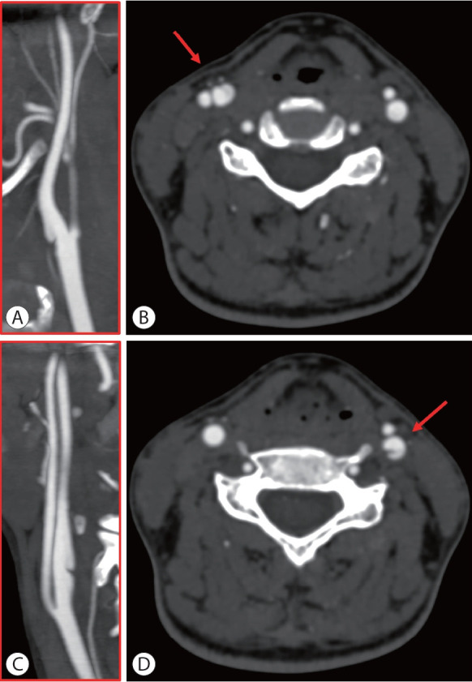
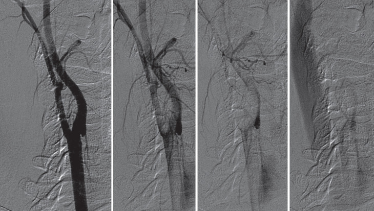
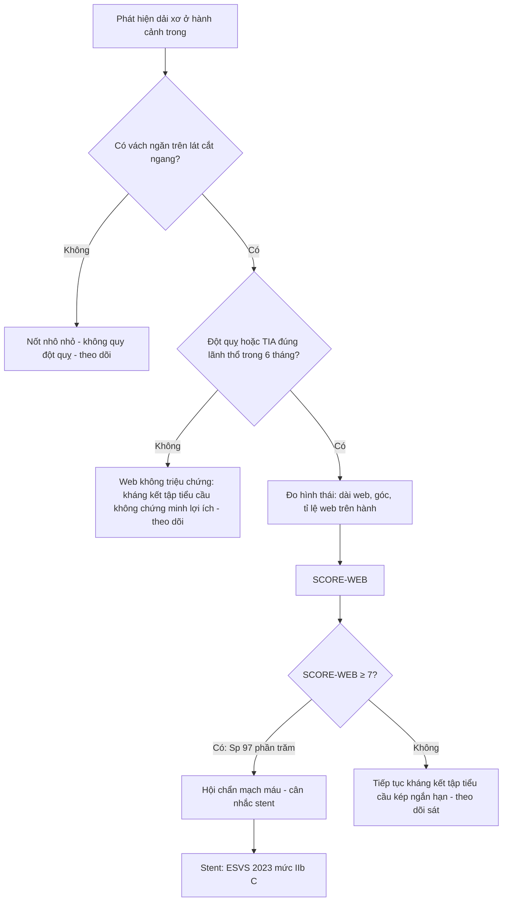
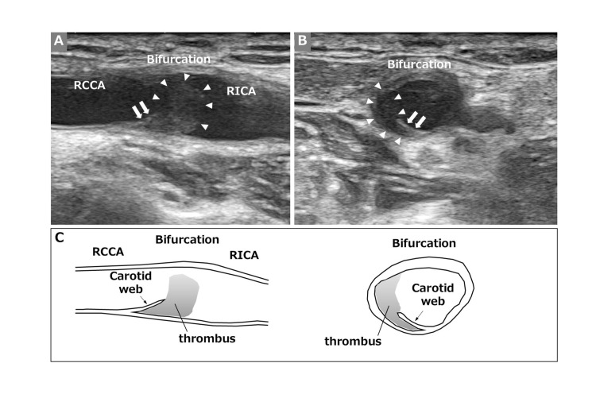
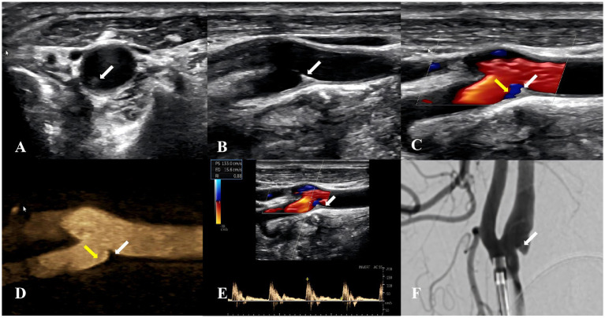

# 270 — Carotid web: dải xơ mặt sau hành cảnh trong ở người trẻ đột quỵ / Carotid web (intimal fibromuscular dysplasia of the carotid bulb)

**Tags:** `pattern:dai-xo-long-mach` `pattern:septum` `pattern:o-ur` `pattern:nhoi-mau-thuyen-tac` `pattern:huyet-khoi` `vung:dong-mach-canh` `vung:dau-co` `vung:nao` `score:SCORE-WEB` `protocol:CTA-co-can-quang` `protocol:DSA` `protocol:SA-Doppler` `protocol:MRI-mang-mach` `incidentaloma:carotid-web`

**Mức chắc chắn (certainty):** tổng hợp y văn (literature synthesis) — 1 tổng quan có bảng ngưỡng và hình CTA/DSA/US/MRI (*J Stroke* 2025, PMC12152460, CC BY-NC), 1 đoàn hệ 48 ca chẩn đoán bằng DSA (*Front Neurol* 2026, PMC13470664, CC BY), 1 đoàn hệ 9.220 ca CTA (*Front Neurol* 2026, PMC13318593, CC BY), 1 thang điểm SCORE-WEB 126 tổn thương (*Front Neurol* 2026, PMC13193918, CC BY), 1 đoàn hệ tiến cứu 105 ca web không triệu chứng (*Front Neurol* 2026, PMC13683218, CC BY), 1 ca "huyết khối nằm trên web" (*Cureus* 2024, PMC11584331, CC BY) và 1 nghiên cứu siêu âm đa phương thức (*Front Neurol* 2026, PMC13341435, CC BY). **Không có ca nguyên văn của nhóm** — 4 ca trong quiz là **ca công bố, lấy nguyên văn từ bài gốc**.

> **Câu chốt:** carotid web không phải "mảng xơ vữa nhỏ" mà là **một dải xơ bẩm sinh/mắc phải (~1 mm) bắc từ mặt sau hành cảnh trong**, tạo **túi ứ** — nơi máu xoáy, đọng, sinh huyết khối và bắn cục máu lên não. Ba con số phải thuộc: web hiện diện ở **~1,2%** người bị đột quỵ nói chung nhưng **9,58%** đột quỵ thể ẩn (ESUS) và **13%** ở người **< 60 tuổi** đột quỵ thể ẩn; tỉ lệ tái phát đột quỵ **17% trong 2 năm** so với **3%** ở người không có web (**HR 5,0**) — và **35,3% web bị bỏ sót ngay trong lúc lấy huyết khối**.

## 1. Tổng quan bệnh học – cơ chế hình ảnh

### 1.1 Bệnh học: xơ hóa NỘI MẠC, không phải mảng xơ vữa

- Web là thể **loạn sản cơ xơ (fibromuscular dysplasia, FMD) típ nội mạc (intimal FMD)** — khác hẳn thể **trung mạc "chuỗi hạt" (medial FMD)** thường gặp ở đoạn xa ICA cổ. Mô bệnh của 9 ca (dẫn trong PMC12152460): **tăng sinh nội mạc khu trú, lệch một bên**, gồm **tế bào hình thoi (cơ trơn mạch máu di chuyển vào nội mạc)** nằm trong **chất nền ngoại bào lỏng, nhiều nhầy**; **6/9 ca** có **mất tế bào cơ trơn trung mạc** thay bằng **chất nhầy** ngay dưới web — tức tổn thương **ăn sâu qua trung mạc**, không chỉ là "nếp gấp nội mạc".
- **Vì sao có huyết khối:** **3/9 ca** có **huyết khối mới bám trên web**, **1/9** có **huyết khối cũ nằm trong khối tăng sinh nội mạc**. Huyết khối lấy từ động mạch nội sọ ở bệnh nhân web có thành phần **fibrin – tiểu cầu – hồng cầu (6–46% thể tích)**, **thâm nhiễm bạch cầu**, và **không có khe cholesterol** — tức huyết khối **động mạch–động mạch**, không phải mảnh xơ vữa.
- **Vì sao đậm độ trên CT lại "nhạt":** web là **mô xơ non, nhiều nước, không vôi hóa, không mỡ, không xuất huyết** → trên CTA là **dải giảm đậm độ mảnh (~1 mm)**, **KHÔNG vôi hóa**; trên MRI T1 không tăng như mỡ, không có tín hiệu máu bán cấp. Đây là điểm khác gốc với **mảng xơ vữa** (vôi hóa, lõi mỡ, xuất huyết trong mảng) — và cũng là lý do web **không thấy trên X-quang/DUS thường quy** nếu không nhìn đúng mặt phẳng.
- **Vì sao dòng máu sinh huyết khối:** web chia lòng mạch thành **lòng thật + túi (pouch)**. Mô phỏng động học dòng (CFD) và 4D-flow cho thấy trong túi có **vùng xoáy, ứng suất trượt thành mạch thấp (low WSS) và chỉ số trượt dao động cao (high OSI)** — đúng điều kiện hình thành huyết khối tĩnh mạch kiểu Virchow. Hệ quả thực hành: **DSA thì tĩnh mạch vẫn còn cản quang đọng trong túi** khi tĩnh mạch cảnh đã đầy thuốc — dấu hiệu **ứ trệ** chứng minh túi là nơi sinh huyết khối, thấy được **ngay cả khi hẹp rất nhẹ**.

*Hai bên động mạch cảnh của cùng bệnh nhân. (A, C) MIP/MPR mặt phẳng cắt dọc: **dải xơ mảnh nhô vào lòng** ở mặt sau hành cảnh trong, vị trí khác nhau hai bên. (B, D) Lát cắt ngang nguồn: **vạch mảnh chia đôi lòng mạch** (mũi tên đỏ) — "dấu hiệu hai lòng" giả. Nguồn: Zedde M et al., *J Stroke* 2025 (PMC12152460), CC BY-NC.*

### 1.2 Vì sao web bị bỏ sót — vật lý của mặt phẳng cắt

- Web chỉ là **một lá mỏng ~1 mm nằm ở mặt sau hành cảnh**, nơi dòng cản quang **xoáy và hòa trộn mạnh nhất**. Trên **lát cắt ngang đơn thuần**, lá mỏng có thể **nằm trong mặt phẳng lát cắt** (partial-volume) → biến mất; trên **mặt phẳng cắt dọc đơn thuần**, lá mỏng **chồng lên thành mạch**. Vì vậy tiêu chuẩn thực hành là **phải thấy trên CẢ hai mặt phẳng** (dọc + ngang nguồn), và **chỉ khi có vách ngăn (septum) trên lát ngang mới gọi là web**.
- **Độ tin cậy giữa người đọc** của CTA cho web là **κ 0,78–0,93**; CTA với DSA **κ 0,92**, nhưng **siêu âm với CTA chỉ κ 0,633** — nghĩa là CTA là cửa chính, siêu âm là cửa phụ.
- **"Tổn thương nhô nhỏ" ≠ web:** phân tích phụ của MR CLEAN tách riêng các **nốt nhô nhỏ không có vách ngăn** và thấy chúng **phân bố đều ở bên có và không có triệu chứng** → **không liên quan đột quỵ**. Đây là lý do phải **đo và mô tả hình thái**, không chỉ "có/không".

*Bơm động mạch cảnh chung, chụp nghiêng, từ thì động mạch (trái) sang thì tĩnh mạch (phải). Khi **tĩnh mạch cảnh đã đầy cản quang**, **túi của web vẫn còn ngấm** — bằng chứng trực tiếp của **ứ trệ dòng** trong túi, cơ chế sinh huyết khối. Nguồn: Zedde M et al., *J Stroke* 2025 (PMC12152460), CC BY-NC.*

### 1.3 Số liệu định lượng phải thuộc

| Đại lượng | Con số | Nguồn |
|---|---|---|
| Tỉ lệ web cùng bên ở người đột quỵ trên lều | **~1,2%** | PMC12152460 |
| Tỉ lệ web ở đột quỵ thể ẩn (ESUS) trên lều — gộp | **9,58%** (KTC 5,62–15,85) | PMC12152460 |
| Tỉ lệ web gộp ở đột quỵ thể ẩn **< 60 tuổi** (3.192 bệnh nhân) | **13%** (7–22%), I² = 66,1% | PMC12152460 |
| Nguy cơ tương đối web **cùng bên** so với đối bên | **RR 2,5** (1,5–4,2); ở người trẻ thể ẩn **3,0** (1,6–5,8) | PMC12152460 |
| Web **đối bên** (không triệu chứng) | **RR 1,50** (0,94–2,40) — **không** kết luận là nguyên nhân | PMC12152460 |
| MR CLEAN/MR CLEAN Registry: web có triệu chứng trên CTA lúc vào | **30/3.439 (0,87%)**; web không triệu chứng **6/3.438 (0,17%)** | PMC12152460 |
| Tái phát đột quỵ **2 năm** ở web cùng bên so với không web | **17% (5/30) vs 3% (5/168)**; **HR 5,0** (1,4–17,3); **HR hiệu chỉnh 4,9** | PMC12152460 |
| Tái phát **cùng bên** | **4/5** ca tái phát; **HR 9,9** (1,8–54,2) | PMC12152460 |
| CAROWEB (202 ca web có triệu chứng) | tuổi **50,8 ± 12,2**; nữ **62,9%**; đột quỵ **91,6%**; tắc mạch lớn nội sọ **71,8%**; nhồi máu mạn cùng bên **47,5%** | PMC12152460 |
| Web **bị bỏ sót trong lúc lấy huyết khối** (CAROWEB) | **30/85 = 35,3%** | PMC12152460 |
| Điều trị dự phòng cấp hai trong CAROWEB | can thiệp **55,6%** (stent 80, mổ 30); can thiệp liên quan **nhồi máu mạn cùng bên** **OR 4,24** (1,27–14,2) | PMC12152460 |
| DSA 48 ca: huyết khối dưới web | **22/48 = 45,83%**; đột quỵ thiếu máu cấp **18,75%**; web hai bên **3/48** | PMC13470664 |
| DSA 48 ca: tái phát cùng bên | thuốc đơn thuần **1/34**; can thiệp nội mạch **0/6**; mổ **0/1** (cỡ mẫu nhỏ, không suy ra nhân–quả) | PMC13470664 |
| CTA 9.220 ca: tỉ lệ web | **0,37% (34 ca/42 web)**; **88,1% tại chỗ chia đôi động mạch cảnh chung**; hẹp nhẹ 1–30% **64,7%** | PMC13318593 |
| CTA 9.220 ca: đường kính lòng tại web — nhóm nhồi máu vs không | **8,97 ± 2,34 vs 6,80 ± 1,90 mm** (p = 0,008) | PMC13318593 |
| Ngưỡng hình thái dự báo có triệu chứng | dài **≥ 3,1 mm**: Se **78,6%**/Sp **80,6%**, **OR 15,2**; tỉ lệ web/hành **≥ 0,50**: Se **85,7%**/Sp **83,3%**, **OR 30,0**; góc **≤ 90,1°**: **OR 5,00** | PMC12152460 |
| SCORE-WEB (0–11 điểm, 126 tổn thương) | **AUC 0,824**; **≥ 7 điểm**: Se **54%**/Sp **97%**, PPV **97,4%**/NPV **44,4%** | PMC13193918 |
| Kháng kết tập tiểu cầu ở web **không triệu chứng** (105 ca, 31 tháng) | đột quỵ **3,51 vs 5,16/100 người–năm**; **HR 0,755** (0,215–2,653; p = 0,642) → **không chứng minh lợi ích** | PMC13683218 |
| Khuyến cáo can thiệp ở web có triệu chứng | **ESVS 2023: mức IIb, bằng chứng C** (stent so với thuốc) | PMC12152460 |

## 2. Mẫu hình + chẩn đoán phân biệt theo vị trí (Gamut)

- **Cách đọc:** trước khi gọi "carotid web", trả lời **4 câu**: **(1) tổn thương ở mặt nào của hành cảnh — sau hay trước/bên? (2) có vách ngăn chia đôi lòng trên lát ngang không? (3) có vôi hóa/lõi mỡ không? (4) có ứ cản quang trong túi ở thì muộn không?**
- **Gamut theo vị trí (từ chỗ chia đôi ra xa):**
  - **Hành cảnh trong, mặt sau, sát chỗ chia đôi** → **carotid web** (vị trí điển hình; 88,1% nằm ngay chỗ chia đôi theo PMC13318593), **mảng xơ vữa** (thường mặt sau nữa, nhưng có vôi hóa/lõi mỡ), **loét mảng xơ vữa** (túi rỗng, bờ nham nhở, vôi hóa quanh).
  - **Hành cảnh trong, mặt trước/bên** → mảng xơ vữa non, **nốt nhô nhỏ không phải web** (không có vách ngăn trên lát ngang; MR CLEAN: không liên quan đột quỵ).
  - **ICA cổ đoạn xa, hình chuỗi hạt** → **FMD thể trung mạc**; **đoạn dài, nhẵn, không vôi, trong trường xạ** → **hẹp do xạ** ([260](../260-hep-dong-mach-canh-do-xa/lesson.md)).
  - **Nón hẹp dài rồi tắc (string sign) hoặc vạt nội mạc** → **bóc tách động mạch cảnh**; có **huyết khối trong giả lòng**.
  - **Dải mảnh + khối giảm đậm độ di động trong lòng** → **huyết khối nằm trên web** hoặc **huyết khối tự do** — bẫy kinh điển ([PMC11584331](https://pmc.ncbi.nlm.nih.gov/articles/PMC11584331/)).

## 3. Bảng so sánh phân biệt (ma trận đối chiếu)

| Thực thể (entity) | Hình ảnh điển hình (CTA / DSA / MRI / SA) | Chốt vào (rule-in) | Chốt loại (rule-out) | Gợi ý xác nhận |
|---|---|---|---|---|
| **Carotid web (FMD nội mạc)** | Dải mảnh **~1 mm** mặt **sau** hành cảnh, **không vôi**, nhô vào lòng; lát ngang có **vách ngăn chia đôi lòng**; DSA thì tĩnh mạch **còn đọng cản quang trong túi** | **Vách ngăn trên lát cắt ngang + dải trên mặt phẳng dọc**, cùng vị trí; **không vôi hóa**; **ứ trệ thì muộn** | **Không có vách ngăn trên lát ngang** → chỉ là nốt nhô nhỏ, **không quy đột quỵ**; không vôi hóa **không loại** web | CTA 2 mặt phẳng + DSA khi cần can thiệp; MRI thành mạch (dấu "van", ứ cản quang) |
| **Mảng xơ vữa** | Dày thành **không đều**, **vôi hóa**, lõi mỡ, có thể loét; thường ở người **> 50 tuổi** có yếu tố nguy cơ | **Vôi hóa + lõi mỡ + tái tạo dương (positive remodeling)** | **Không vôi, dải mảnh đơn độc, bệnh nhân trẻ không yếu tố nguy cơ** → nghĩ web | CTA đa thì; siêu âm B-mode thấy vôi hóa/dày thành; MRI mảng xơ vữa |
| **Loét mảng xơ vữa (ulcer)** | **Túi rỗng** trong mảng dày, bờ nham nhở, **hay có vôi quanh miệng túi**; có thể giả "móc câu" | **Túi nằm TRONG mảng dày có vôi**, miệng túi rộng, bờ không đều | **Dải mảnh + thành mạch mỏng xung quanh** → không phải loét | Phân tích phổ đậm độ, CTA đa thì; đối chiếu MRI |
| **Bóc tách động mạch cảnh** | **Vạt nội mạc** + **hai lòng** (thật/giả), nón hẹp dài, **huyết khối trong giả lòng**; đau cổ + Horner | **Hai lòng có huyết khối trong giả lòng**, tổn thương **dài**, hẹp lan tỏa | **Dải mảnh khu trú một điểm, thành mạch xung quanh mỏng, không huyết khối giả lòng** | MRI T1 fat-sat thành mạch: **huyết khối trong vách tăng tín hiệu**; CTA theo dõi |
| **FMD thể trung mạc ("chuỗi hạt")** | Nhiều chỗ hẹp–giãn xen kẽ **đoạn xa ICA cổ**, thường **hai bên**, nữ trung niên | **≥ 2 chỗ giãn xen kẽ**, tổn thương **dài > 2 cm** | **Một dải mảnh đơn độc ở hành cảnh** → không phải chuỗi hạt | DSA/CTA toàn bộ trục cảnh–sống; tầm soát động mạch thận |
| **Hẹp do xạ** | Hẹp **dài, nhẵn, ít vôi**, đúng trường chiếu, tiềm tàng **> 1 năm** | **Tiền sử xạ cổ + tổn thương dài đúng trường chiếu** | **Dải mảnh khu trú, không tiền sử xạ** | Đối chiếu bản đồ liều; xem [260](../260-hep-dong-mach-canh-do-xa/lesson.md) |
| **Huyết khối nằm trên web (lodged thrombus)** | **Khối giảm đậm độ di động** trong lòng, có thể **che mất web**; CTA trước đó chỉ "hẹp < 50%" | **Web lộ ra sau khi huyết khối tan/lấy đi**, hoặc **dải mảnh thấy ở mặt phẳng khác** | **Chỉ thấy khối, không thấy dải** → chụp lại sau 1–4 tuần hoặc sau lấy huyết khối | Siêu âm lặp lại (khối di động), CTA/DSA sau can thiệp |

- **Ảnh ghép đối chiếu:** không tạo composite cho bài này vì các ca **khác modality và khác bệnh nhân**; ghép sẽ gợi ý so sánh không có thật.

## 4. Protocol chụp + hệ phân độ/điểm chuẩn hóa

### 4.1 Protocol

- **CTA cổ–não (đầu tay):** đầu thu **≥ 64 dãy**, lát **0,625–1 mm**, bước **0,5**, **80–120 kV**, bơm **50–70 mL** cản quang **350–370 mgI/mL** ở **4–5 mL/giây**, bắt đầu khi đạt ngưỡng **100–150 HU** ở quai động mạch chủ; **tái tạo MPR mặt phẳng cắt dọc nghiêng (sagittal oblique)** dọc trục cảnh **+ lát cắt ngang nguồn 1 mm** — **bắt buộc cả hai**.
- **Đo trên CTA (mm, mặt phẳng cắt dọc):** **chiều dài web** (từ đỉnh tới chân), **độ dày web**, **góc trước web (pre-web angle)**, **diện tích túi**, **đường kính hành cảnh** và **ICA xa** → tính **tỉ lệ web/hành**.
- **MRI thành mạch (vessel wall MRI):** T1 **Dixon** + **PD black-blood** ± T1 sau tiêm — thấy web như **cấu trúc mảnh tăng tín hiệu** trong lòng; dấu **"van"** và **ứ cản quang** trong túi; phát hiện web **gấp 3 lần** so với MRA (dẫn trong PMC12152460).
- **Siêu âm Doppler:** đầu dò **tuyến tính ≥ 9 MHz**, mặt phẳng cắt dọc **và** ngang; web là **vách tăng hồi âm** nhô vào lòng, **dòng đảo chiều trong túi** trên Doppler màu; **giới hạn: κ với CTA chỉ 0,633** — âm tính không loại trừ.
- **DSA:** tiêu chuẩn vàng khi **còn nghi ngờ** hoặc **đã quyết định can thiệp**; chụp **nghiêng + AP**, **đến thì tĩnh mạch** để thấy **ứ trệ trong túi**.

### 4.2 Phân tầng bằng SCORE-WEB (0–11 điểm) và quyết định

- **Ngưỡng hình thái đơn lẻ** (dùng khi không tính điểm): **dài ≥ 3,1 mm** (OR 15,2), **tỉ lệ web/hành ≥ 0,50** (OR 30,0), **góc ≤ 90,1°** (OR 5,00) — các ngưỡng này đến từ **một phân tích hồi cứu**, chưa được kiểm chứng tiến cứu.
- **SCORE-WEB ≥ 7** có **độ đặc hiệu 97%** nhưng **độ nhạy chỉ 54%** → dùng để **chốt can thiệp**, **không dùng để loại** web nguy cơ thấp; **NPV 44,4%** nghĩa là điểm thấp **vẫn có thể có triệu chứng**.

## 5. Biến thể bình thường và cạm bẫy

- **"Nốt nhô nhỏ" ở hành cảnh:** rất hay gặp, **không có vách ngăn** trên lát ngang, **phân bố đều hai bên** ở MR CLEAN → **không phải web, không quy đột quỵ**. Đừng đo, đừng can thiệp.
- **Huyết khối nằm trên web che mất web:** ca của PMC11584331 — CTA **1 năm trước** chỉ ghi "hẹp < 50% ở mặt sau hành cảnh"; lần này CTA/DSA chỉ thấy **bất thường nhẹ**, nhưng **siêu âm sau lấy huyết khối** lộ **vách màng + huyết khối đọng**. Bài học: **sau lấy huyết khối phải chụp lại**, và **web bị bỏ sót 35,3% ngay trong lúc can thiệp**.
- **Túi loét của mảng xơ vữa giả "móc câu":** bờ nham nhở, **vôi hóa quanh túi**, thành mạch dày; web thì **thành mạch mỏng, không vôi**. Đừng đọc "có túi" là web.
- **Ứ cản quang do hòa trộn (mixing) ở hành cảnh:** có thể giả túi trên CTA; bằng chứng thật là **ứ còn lại ở thì tĩnh mạch trên DSA**, hoặc **dòng đảo chiều trong túi trên siêu âm màu**.
- **Web đối bên ở bệnh nhân đột quỵ:** **RR 1,50 (0,94–2,40)** — **không** được lấy web đối bên làm nguyên nhân; phải tìm nguồn tắc mạch khác (rung nhĩ, mảng xơ vữa, bóc tách).
- **Satisfaction of search:** đã thấy web rồi **ngừng đọc mạch nội sọ** — luôn đọc **toàn bộ CTA đầu** để tìm **tắc mạch lớn** (CAROWEB: **71,8%** có LVO) và **nhồi máu mạn cùng bên** (47,5%).
- **Không dùng "hẹp nhẹ" để loại web:** **64,7%** web chỉ gây hẹp **1–30%** theo NASCET (PMC13318593) — web gây tắc mạch **không** qua cơ chế hẹp lòng.

## 6. Tự lượng giá — Blind Quiz ngay trên trang tĩnh

**Ca 1 — Nam 42 tuổi, đột quỵ nhồi máu bán cầu phải, không rung nhĩ, không tăng huyết áp, siêu âm tim bình thường. CTA cổ được tái tạo dưới đây.**

- Gợi ý lâm sàng: người trẻ, không yếu tố nguy cơ xơ vữa, nhồi máu vỏ não một lãnh thổ.
- Câu hỏi: Dấu hiệu chính trên (A) và (B) là gì? Vì sao phải xem cả lát cắt ngang? Ba chẩn đoán phân biệt và một dấu hiệu loại bóc tách?

<b>Bấm để hiện đáp án (findings + chẩn đoán)</b>

- Dấu hiệu: (A) **dải mảnh nhô vào lòng từ mặt sau hành cảnh trong**, không vôi hóa; (B) **vạch mảnh chia đôi lòng** trên lát cắt ngang (mũi tên đỏ) — **vách ngăn**.
- Chẩn đoán: **carotid web** (FMD nội mạc) — nguyên nhân tắc mạch–động mạch ở người trẻ.
- Vì sao: web chỉ là **lá mỏng ~1 mm**, có thể **nằm trong mặt phẳng lát cắt** ở một hướng → phải thấy **cả mặt phẳng dọc và lát ngang nguồn**.
- Loại bóc tách: **không có huyết khối trong giả lòng, không hẹp dài lan tỏa, thành mạch quanh web mỏng**.
- Nguồn ảnh: Zedde M et al., *J Stroke* 2025 (PMC12152460), CC BY-NC.

**Ca 2 — Nữ 35 tuổi, TIA tay phải 3 lần trong 2 tuần. DSA động mạch cảnh trái dưới đây, chụp từ thì động mạch đến thì tĩnh mạch.**

- Câu hỏi: Ở khung nào còn cản quang bất thường, và bất thường đó nằm ở đâu? Nó chứng minh cơ chế gì? Có cần đo mức hẹp không?

<b>Bấm để hiện đáp án (findings + chẩn đoán)</b>

- Dấu hiệu: **túi ở mặt sau hành cảnh trong vẫn còn ngấm cản quang ở thì tĩnh mạch** (khung phải), khi tĩnh mạch cảnh đã đầy thuốc.
- Chẩn đoán: **carotid web có ứ trệ trong túi** — dấu hiệu **sinh huyết khối tại chỗ**.
- Ý nghĩa: mức hẹp **không phản ánh nguy cơ** (64,7% web chỉ hẹp 1–30%); nguy cơ đến từ **ứ trệ → huyết khối → tắc mạch**.
- Nguồn ảnh: Zedde M et al., *J Stroke* 2025 (PMC12152460), CC BY-NC.

**Ca 3 — Nam 38 tuổi, đột quỵ tái phát sau lấy huyết khối. Siêu âm cảnh sau thủ thuật và sơ đồ giải thích dưới đây.**

- Câu hỏi: Cấu trúc mũi tên trắng là gì, khối mũi tên đứt là gì? Vì sao CTA trước đó chỉ đọc "hẹp nhẹ"? Xử trí tiếp theo?

<b>Bấm để hiện đáp án (findings + chẩn đoán)</b>

- Dấu hiệu: **vách màng tăng hồi âm** nhô vào lòng (mũi tên trắng) + **huyết khối giảm hồi âm đọng trong túi** (mũi tên đứt); sơ đồ (C) minh họa web + huyết khối.
- Chẩn đoán: **carotid web có huyết khối nằm trên** — web bị huyết khối **che lấp** trên CTA trước đó.
- Vì sao: huyết khối **cùng đậm độ/tín hiệu** với web và lòng mạch → chỉ **siêu âm** thấy khối di động; sau khi huyết khối được lấy đi, web mới lộ.
- Xử trí: **chụp lại sau lấy huyết khối**, đo hình thái, hội chẩn **stent** nếu web có triệu chứng; không bỏ sót web khi đang can thiệp.
- Nguồn ảnh: Yamaguchi Y et al., *Cureus* 2024 (PMC11584331), CC BY.

**Ca 4 — Nữ 55 tuổi, tình cờ phát hiện web khi chụp CTA vì đau đầu, không có triệu chứng thần kinh khu trú. Siêu âm đa phương thức dưới đây.**

- Câu hỏi: Mô tả web trên B-mode, Doppler màu và CEUS. Có chỉ định can thiệp không, dựa trên bằng chứng nào?

<b>Bấm để hiện đáp án (findings + chẩn đoán)</b>

- Dấu hiệu: **vách màng tăng hồi âm** ở mặt sau hành cảnh (A, B); **dòng đảo chiều trong túi** trên Doppler màu (C, mũi tên); **tăng tưới trong túi** trên CEUS (D); phổ Doppler (E) và DSA đối chiếu (F).
- Chẩn đoán: **carotid web không triệu chứng**.
- Xử trí: **không can thiệp mặc định** — đoàn hệ 105 ca web không triệu chứng: đột quỵ **3,51 vs 5,16/100 người–năm** với/không kháng kết tập tiểu cầu, **HR 0,755 (0,215–2,653)** → **chưa chứng minh lợi ích**; theo dõi và kiểm soát yếu tố nguy cơ.
- Cạm bẫy: **âm tính trên siêu âm không loại trừ** (κ với CTA 0,633) → vẫn cần CTA 2 mặt phẳng.
- Nguồn ảnh: Dai C et al., *Front Neurol* 2026 (PMC13341435), CC BY.

## Bài liên quan chéo
- [260 – Bệnh mạch cảnh do xạ đầu cổ (RICS)](../260-hep-dong-mach-canh-do-xa/lesson.md) (hẹp dài–nhẵn–ít vôi, phân biệt với web)
- [262 – Bệnh mạch máu lớn do xạ (moyamoya)](../262-benh-mach-mau-lon-do-xa-tri-moyamoya/lesson.md)
- [263 – Hội chứng vỡ mạch cảnh sau xạ (CBS)](../263-hep-dong-mach-canh-ngoai-so-do-xa/lesson.md)
- [265 – Ngộ độc khí cười: tủy sau mất myelin](../265-ngo-doc-khi-cuoi-tuy/lesson.md) (người trẻ đột quỵ/tổn thương thần kinh không do xơ vữa)
- [207 – Phình mạch nội sọ chưa vỡ](../207-phinh-mach-noi-so-chua-vo/lesson.md) (bối cảnh can thiệp mạch não)

## Ảnh
- 4 ảnh; nguồn và giấy phép từng ảnh trong `images/CREDITS.md`.
- Không tạo ảnh ghép: bốn ảnh thuộc **bốn bệnh nhân, ba modality khác nhau** (`CC BY-NC` và `CC BY`) — ghép sẽ tạo so sánh không có thật; ảnh giữ **nguyên bản, không crop**.
- Không có ảnh giải phẫu bệnh open-access của web trong bộ sưu tập đã quét → bài **không bịa ảnh mô bệnh**, mô tả bằng số liệu từ bài gốc.

> Không dùng để chẩn đoán độc lập khi chưa có người hướng dẫn.
