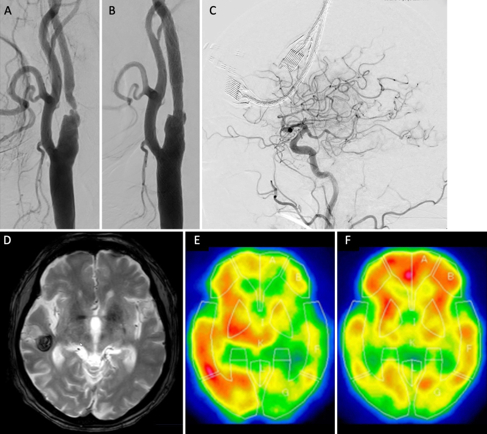
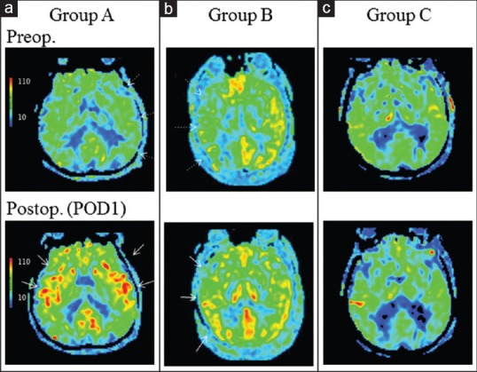
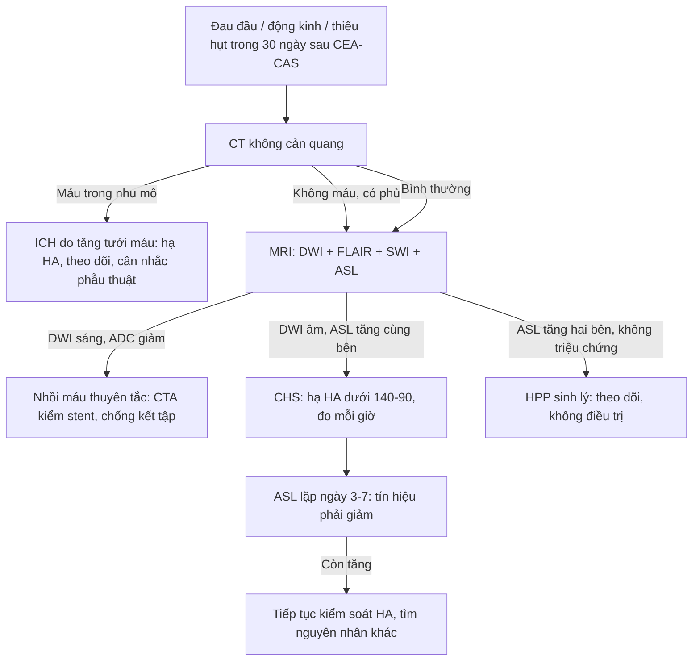
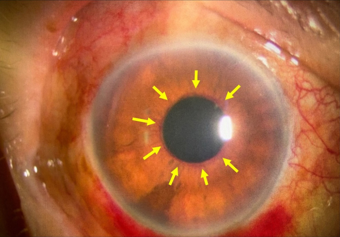
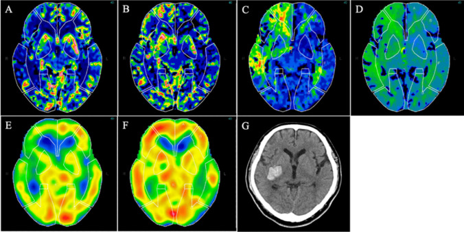

# 271 — Hội chứng tăng tưới máu não sau can thiệp cảnh / Cerebral hyperperfusion syndrome (CHS) after carotid revascularization

**Tags:** `pattern:tang-tuoi-mau-cua` `pattern:phu-nao-vung` `pattern:xuat-huyet-nao` `vung:nao` `vung:dong-mach-canh` `vung:mat` `score:Bouri` `protocol:CTP` `protocol:ASL` `protocol:TCD` `protocol:MRI-so-nao` `protocol:CTA-co-can-quang`

**Mức chắc chắn (certainty):** tổng hợp y văn (literature synthesis) — 1 tổng quan kỹ thuật TCD có bảng ngưỡng (*Front Neurol* 2023, PMC10423829, CC BY), 1 phân tích gộp 158.624 người (*Arch Med Sci* 2025, PMC12703609, CC BY-NC-SA), 1 ca + tổng quan hệ thống về CHS khi huyết áp thấp (*Life* 2024, PMC11595517, CC BY), 1 nghiên cứu ASL 32 ca sau bóc nội mạc cảnh (*Surg Neurol Int* 2016, PMC5234294, CC BY-NC-SA), 1 nghiên cứu CTP dự báo 46 ca (*Acta Neurochir* 2025, PMC12106584, CC BY), 1 ca CHS muộn 15 ngày (*Ann Afr Med* 2026, PMC13638182, CC BY-NC-SA), 1 ca động kinh liên tục (*Cureus* 2021, PMC8776524, CC BY) và 1 ca CHS che lấp glôcôm tân mạch (*J Neurosurg Case Lessons* 2025, PMC12749092, CC BY-NC-ND). **Không có ca nguyên văn của nhóm** — 3 ca trong quiz là **ca công bố, lấy nguyên văn từ bài gốc**.

> **Câu chốt:** CHS không phải "chảy máu do ống thông" mà là **mất tự điều hòa mạch não sau khi mở hẹp** — máu tuôn vào vùng vừa được tái thông **tỷ lệ thuận với huyết áp**, làm **phù vận mạch** rồi **vỡ mao mạch**. Ba con số phải thuộc: CHS sau bóc nội mạc cảnh (CEA) **1,9%** và sau đặt stent (CAS) **1,16–1,2%**; xuất huyết não (ICH) do tăng tưới máu **0,37%** sau CEA và **0,51–0,74%** sau CAS; **khi đã có ICH, tử vong 40–75%**. Và một bẫy: **tăng tưới máu KHÔNG triệu chứng gặp tới 12,5% sau CEA (68,8% nếu tính cả hai bên trên ASL)** — hình ảnh tăng tưới máu **một mình không phải** là hội chứng.

## 1. Tổng quan bệnh học – cơ chế hình ảnh

### 1.1 Bệnh học: mạch máu mất khả năng CO LẠI, không phải "máu nhiều"

- Trong hẹp cảnh mạn tính, **áp lực tưới máu phía sau hẹp giảm** → tiểu động mạch **giãn tối đa** để giữ lưu lượng (cơ chế tự điều hòa, autoregulation). Giãn tối đa kéo dài → **rối loạn chức năng nội mô** và **mất trương lực co** của tiểu động mạch.
- Khi mở hẹp (CEA/CAS), **áp lực đột ngột tăng** nhưng mạch **không co lại được** → lưu lượng não (CBF) **tuyến tính với huyết áp động mạch** thay vì hằng định. Đây là lý do **kiểm soát huyết áp là biện pháp duy nhất có bằng chứng** và cũng là lý do **hạ huyết áp làm hết triệu chứng**.
- **Chuỗi mô học:** áp lực mao mạch tăng → **vỡ hàng rào máu–não (BBB)** → dịch giàu protein thoát ra **khoảng kẽ** = **phù vận mạch (vasogenic edema)** → nếu áp lực tiếp tục tăng: **xuất huyết điểm (petechiae)** ở điểm nối chất xám–chất trắng rồi **xuất huyết ổ (ICH)**.
- **Vì sao ICH hay ở hạch nền – thùy thích (temporal) – đồi thị:** các nhánh **xuyên sâu** chịu áp lực trực tiếp, ít được "bảo vệ" bởi trương lực giao cảm của hệ thần kinh tự chủ trên thành mạch vỏ não; vùng **chia nước (watershed)** là nơi giãn mạch tối đa nhiều nhất trước mổ. Hai ca trong bài này vỡ đúng **hạch nền phải** và **thùy thích phải** (xem quiz) — đây là **suy luận cơ chế**, không phải số liệu đo.

### 1.2 Vì sao hình ảnh trông như vậy (vật lý ASL – CTP – DWI)

- **ASL (arterial spin labeling):** dùng **nước trong máu động mạch được đánh dấu từ tính** làm chất đánh dấu nội sinh; sau thời gian chờ (post-labeling delay, PLD) chụp ảnh não. Tín hiệu **tăng = nhiều nước "đã đánh dấu" đến trong thời gian PLD** = **lưu lượng tăng**, không phải rò thuốc. Vì không cần thuốc cản quang, ASL **lặp lại được ngay tại giường** để theo dõi — đúng nhu cầu CHS (diễn tiến vài giờ đến vài ngày). Nghiên cứu 32 ca sau CEA: **ngày 1 sau mổ (POD1) 22/32 (68,8%) tăng tín hiệu HAI BÊN**, **4/32 (12,5%) tăng một bên**, **6/32 (18,8%) không đổi**; **3 ca (9,4%) có CHS lâm sàng**; tín hiệu **hết sau 8–14 ngày**.
- **CTP (CT perfusion):** theo **nguyên lý thể tích trung tâm, CBF = CBV / MTT**. Trước mổ, vùng "kiệt dự trữ" có **CBV tăng (giãn mao mạch bù)** và **MTT/TTP kéo dài**; đây là **dấu hiệu dự báo** chứ không phải chẩn đoán. Sau mổ, tăng tưới máu thật biểu hiện **CBF/CBV tăng, MTT/TTP NGẮN lại** — ngược hoàn toàn với thiếu máu (MTT/TTP dài, CBF giảm).
- **DWI/ADC:** phù vận mạch là **dịch ngoài tế bào** → khuếch tán **không bị hạn chế** (DWI không sáng, ADC **tăng**). Vì vậy **DWI âm không loại trừ tổn thương** — nó loại trừ **nhồi máu mới**. Ca CHS muộn 15 ngày: FLAIR tăng tín hiệu vùng thùy thích–đỉnh, **không hạn chế khuếch tán, không xuất huyết**, hồi phục hoàn toàn trên MRI sau **2 tháng**.
- **T2/FLAIR:** phù vận mạch giàu nước tự do → **tăng tín hiệu**, **xóa rãnh não (sulcal effacement)**, **không theo lãnh thổ mạch** (khác nhồi máu), thường **lan ra cả chất trắng dưới vỏ**.
- **SWI/GRE:** **xuất huyết điểm dạng "rắc tiêu"** ở điểm nối xám–trắng là dấu sớm của vỡ BBB, xuất hiện **trước** khi CT thấy máu.

### 1.3 Dịch tễ và thời điểm — ngưỡng định lượng

| Biến số | Số liệu | Nguồn |
|---|---|---|
| CHS sau CEA (13 nghiên cứu, 4.689 ca) | **1,9%**; tăng tưới máu không triệu chứng **12,5%**; ICH **0,37%** | PMC10423829 |
| CHS sau CAS (9 nghiên cứu, 4.446 ca) | **1,16%**; ICH **0,74%** | PMC10423829 |
| CHS sau CAS, gộp 33 nghiên cứu > 8.000 ca | **4,6%**, thời gian từ thủ thuật đến triệu chứng **trung bình 12 giờ** | PMC11595517 |
| CHS sau CAS, trung bình gia quyền 65 bài | **1,2%** (0,0–37,7%); ICH **0,51%** (0–9,3%) | PMC11595517 |
| Tử vong khi CHS có ICH | **40–75%**; khoảng **30%** sống sót còn di chứng | PMC11595517, PMC8776524 |
| Thay đổi huyết áp sau CEA | **~2/3** bệnh nhân trong **24 giờ** đầu; tăng HA sau mổ tới **56%** | PMC11025470 |
| CHS sau CEA HAI BÊN | **2,2%**, tất cả có xuất huyết trong **30 ngày** | PMC11025470 |

- **Thời điểm:** đa số trong **tuần đầu** (thường **24–72 giờ**), nhưng tiêu chuẩn Bouri tính **trong 30 ngày**; đã có ca khởi phát **ngày 15**. Vì vậy **theo dõi huyết áp không được dừng ở ngày 3**.
- **Yếu tố nguy cơ (phân tích gộp 10 nghiên cứu, 158.624 người):** đái tháo đường **OR 3,16**; tiền sử đột quỵ **OR 2,51**; bệnh mạch vành **OR 1,69**; mức hẹp **OR 1,08 mỗi 1%**; **mổ trong vòng 2 tuần sau triệu chứng OR 3,78**; **tuần hoàn bàng hệ tốt là yếu tố bảo vệ OR 0,20**. Tăng HA **sau mổ** không đạt ý nghĩa trong gộp này (OR 2,81; p = 0,35) nhưng là yếu tố nguy cơ kinh điển trong các đoàn hệ (SBP **> 180 mmHg**).
- **Vì sao mổ sớm lại nguy hiểm:** não vừa bị nhồi máu mất tự điều hòa mạnh nhất; **bàng hệ tốt (OR 0,20)** chứng minh vai trò "giảm áp lực truyền" — điều này cũng giải thích **hẹp đối bên ≥ 70%** là yếu tố nguy cơ.

## 2. Mẫu hình + chẩn đoán phân biệt theo vị trí (gamut)

- **Mẫu hình gốc:** sau tái thông cảnh **0–30 ngày**, bệnh nhân **đau đầu dữ dội cùng bên** ± **động kinh cục bộ** ± **thiếu hụt thần kinh khu trú**, hình ảnh **tăng tưới máu bán cầu cùng bên** ± **phù** ± **xuất huyết**. Ba thành tố **lâm sàng – tưới máu – thời điểm** phải khớp; thiếu một thành tố thì **chưa gọi hội chứng**.

**Gamut theo vị trí tổn thương:**

| Vị trí | Thể bệnh | Vì sao ở đó |
|---|---|---|
| Vỏ – dưới vỏ vùng chia nước (watershed) | Phù vận mạch đơn thuần, hồi phục | Nơi giãn mạch tối đa trước mổ, dễ mất tự điều hòa nhất |
| Hạch nền – đồi thị | ICH do tăng tưới máu | Nhánh xuyên sâu chịu áp lực trực tiếp, ít bảo vệ giao cảm |
| Thùy thích – thùy đỉnh | ICH + phù, hay gây bán manh | Vỏ thùy thích mỏng, nhánh xuyên dài; ca PMC12749092 vỡ thùy thích phải |
| Toàn bộ hai bán cầu | Tăng tín hiệu ASL hai bên, thường **không triệu chứng** | Phản ứng tăng lưu lượng toàn não sau khi bỏ hẹp; **đừng đọc là bệnh** |
| Hốc mắt – mắt | CHS "che lấp" glôcôm tân mạch ở bệnh nhân thiếu máu mắt | Tái thông làm tăng áp lực tưới máu mắt ở mắt đã thiếu máu mạn |

**Gamut theo thời gian:** **< 24 giờ** = tăng tưới máu (HPP) thường không triệu chứng → **1–7 ngày** = đau đầu/động kinh/phù → **7–30 ngày** = thể muộn (đã ghi nhận ngày 15) → **sau 30 ngày** không còn gọi CHS, phải tìm nguyên nhân khác.

**Gợi nhớ ISCHE (5 hàng phân biệt bắt buộc):** **I**schemic (thuyên tắc sau CAS), **S**eizure-related (tăng tưới máu sau cơn), **C**ontrast encephalopathy (bệnh não do cản quang), **H**emorrhage khác nguồn (tăng HA, thuốc kháng đông), **E**ncephalopathy (PRES, chuyển hóa).

## 3. Bảng so sánh phân biệt (ma trận đối chiếu)

| Thực thể (entity) | Hình ảnh điển hình | Chốt vào (rule-in) | Chốt loại (rule-out) | Gợi ý xác nhận |
|---|---|---|---|---|
| **CHS — phù vận mạch** | T2/FLAIR tăng tín hiệu **một bán cầu cùng bên**, xóa rãnh não, **không theo lãnh thổ**, DWI **âm**, ADC **tăng**; ASL/CTP **tăng CBF** cùng vùng | **Đau đầu cùng bên + ASL tăng cùng bên + DWI âm trong 30 ngày sau tái thông** | **DWI sáng/ADC giảm** → nhồi máu; **tăng tín hiệu hai bên đối xứng không triệu chứng** → HPP sinh lý | ASL lặp lại ngày 3–7 (phải giảm); hạ HA thì triệu chứng giảm |
| **CHS — ICH do tăng tưới máu** | Ổ máu **hạch nền/thùy thích** cùng bên, có thể kèm phù quanh; **SPECT/ASL tăng tưới máu bán cầu** | **Máu trong nhu mô + tăng tưới máu bán cầu cùng bên + không có nguồn chảy máu khác** | Máu **dưới nhện** đơn thuần, máu do **coil/stent rách mạch**, tăng HA đơn thuần không tăng tưới máu | SPECT ngày 9 (đã hết tăng) xác nhận thể tăng tưới máu; CTA loại trừ giả phình |
| **Nhồi máu do thuyên tắc sau CAS** | Nhiều ổ **DWI sáng/ADC giảm** theo lãnh thổ, **không tăng ASL** (hoặc giảm), thường **không đau đầu** | **DWI dương tính + thiếu hụt khu trú không đau đầu** | **DWI âm + ASL tăng** → không phải thuyên tắc | MRI DWI trong 24 giờ đầu; CTA/DUS kiểm tra stent |
| **Tăng tưới máu sau cơn động kinh (post-ictal)** | Vỏ não tăng tín hiệu ASL/CTP **theo vùng vỏ của cơn**, có thể phù nhẹ, DWI âm | **Động kinh trước hình ảnh + tăng tưới máu khu trú vỏ** | Tăng tưới máu **bán cầu rộng + đau đầu cùng bên sau tái thông** → CHS | EEG; ASL hết sau vài ngày; bệnh sử thời điểm |
| **Bệnh não do cản quang (CIE)** | CT **tăng đậm độ vỏ não** thoáng qua, phù lan tỏa, mù vỏ; tự hết | **Triệu chứng sau bơm cản quang, CT tăng đậm độ vỏ, hết trong 24–72 giờ** | **Đậm độ không mất khi chụp lại** → xuất huyết thật | CT lặp lại sau 24 giờ; MRI loại trừ nhồi máu |
| **PRES** | Phù **hai bên, đối xứng, ưu thế chẩm–đỉnh**, DWI âm | **Hai bên + tăng HA nặng/thai sản giật/thuốc ức chế miễn dịch** | **Một bán cầu, sau tái thông cảnh** → CHS | ASL tăng hai bên; MRI theo dõi |

*Ca 74 tuổi hẹp cảnh trong phải 95% (NASCET), đặt stent ngày 0. (A–C) Chụp mạch trước/trong/sau can thiệp. (D) **MRI ngày 1: ổ xuất huyết thùy thích phải** (vòng tối, mũi tên). (E) **SPECT ngày 1: tăng tưới máu bán cầu phải** (màu nóng). (F) **SPECT ngày 9: đã hết tăng tưới máu.** Nguồn: Dowaki R et al., *J Neurosurg Case Lessons* 2025 (PMC12749092), CC BY-NC-ND 4.0 — ảnh nguyên bản, không cắt/ghép.*

### Ba dấu hiệu chốt trên hình ảnh (đọc theo thứ tự)

1. **ASL/CTP tăng CBF ở bán cầu CÙNG BÊN** — dấu hiệu trung tâm, nhưng phải có **triệu chứng** mới là hội chứng.
2. **Phù không theo lãnh thổ + DWI âm** — phân biệt với nhồi máu; phù vận mạch có thể **lan qua đường giữa** (khác nhồi máu).
3. **Xuất huyết điểm trên SWI hoặc ổ máu hạch nền/thùy thích** — bậc thang nặng lên của cùng một cơ chế, **không phải biến chứng "khác"**.

*ASL một lát cắt (PLD 1,5 giây), hàng trên trước mổ, hàng dưới ngày 1 sau mổ. (a) Nhóm A: trước mổ **giảm tín hiệu bán cầu bệnh**, sau mổ **tăng HAI BÊN** (68,8% số ca). (b) Nhóm B: tăng **chỉ bán cầu được mổ** (12,5%). (c) Nhóm C: **không tăng** (18,8%). Thang màu: xanh = thấp, đỏ = cao. Nguồn: Shimogawa T et al., *Surg Neurol Int* 2016 (PMC5234294), CC BY-NC-SA 4.0.*

## 4. Protocol chụp + hệ phân độ/điểm chuẩn hóa

### 4.1 Trước can thiệp — chọn người có nguy cơ (dự báo, không chẩn đoán)

- **CTP (phương pháp ước lượng Bayes)** ở bệnh nhân hẹp nặng: **tỉ lệ CBV ≥ 1,085** (Se **100%**, Sp **83,3%**, NPV **100%**); **MTT ≥ 1,096** (Se 100%, Sp 76,2%); **TTP ≥ 1,098** (Sp 100%); **CBF ≤ 0,900** (Se 75%, Sp 83,3%). Trong 46 ca, nhóm tăng tưới máu có **CBV 1,25 vs 1,02** (p = 0,001), **MTT 1,31 vs 1,05** (p = 0,003), **TTP 1,10 vs 1,02** (p = 0,011). Lưu ý: sau hiệu chỉnh đa so sánh, ý nghĩa **mất** (p hiệu chỉnh 0,07) — dùng như **tín hiệu**, không phải tiêu chuẩn.
- **SPECT nghỉ + acetazolamide** (nếu có): chỉ số bất đối xứng trước mổ **AI ≤ 0,937** dự báo tăng tưới máu (Se 100%, Sp 71,4%).
- **ASL** làm **đường cơ sở** nếu máy MRI sẵn có — rẻ hơn SPECT và lặp lại được.

### 4.2 Sau can thiệp — theo dõi và ngưỡng xử trí

- **Huyết áp:** mục tiêu **< 140/90 mmHg**; nhóm nguy cơ cao (hẹp > 90%, hẹp đối bên ≥ 70%, nhồi máu gần đây, bàng hệ kém) **< 120/80 mmHg**; tránh **SBP > 180 mmHg**; phác đồ sau CAS của một trung tâm giữ **SBP 110–140 mmHg** bằng nicardipine, đo **mỗi giờ trong 24 giờ đầu**, **mỗi 4 giờ ngày 2–3**, sau đó **3 lần/ngày**; duy trì đến khi CBF bình thường trên ASL/SPECT.
- **TCD:** tăng **vận tốc trung bình ĐM não giữa (MCA) > 100%** so với trước mổ là định nghĩa huyết động kinh điển, nhưng **PPV chỉ 8–18%** khi đo trong mổ; đo **1 giờ sau** có PPV **cao hơn > 3 lần**; **đo 24 giờ: nếu tăng < 100% thì NPV 99%** (gần như loại trừ CHS). **Chỉ số vận tốc–huyết áp VBI ≥ 2**: Se **83,3%**, PPV **62,5%**. Không có cửa sổ thái dương ở **10–15%** bệnh nhân.
- **Khi có triệu chứng:** **CT không cản quang** trước (loại trừ máu, phù) → **CTA** (stent thông? giả phình? bóc tách?) → **MRI DWI + FLAIR + SWI + ASL** → **CTP/SPECT** nếu còn phân vân. Không chờ đủ bộ xét nghiệm mới hạ huyết áp.

### 4.3 Tiêu chuẩn Bouri 2011 (4 điều kiện, dùng để gọi "hội chứng")

1. Xảy ra **trong 30 ngày** sau CEA/CAS.
2. **Bằng chứng hình ảnh tăng tưới máu** (ASL/CTP/SPECT/TCD) hoặc phù/xuất huyết phù hợp.
3. **Triệu chứng mới:** đau đầu, động kinh, liệt nửa người, **GCS < 15**.
4. **Loại trừ** nhồi máu mới, tắc mạch cảnh, nguyên nhân chuyển hóa/sinh lý khác.

## 5. Biến thể bình thường và cạm bẫy

- **Tăng tín hiệu ASL hai bên là bình thường sau CEA (68,8%)** — phản ứng tăng lưu lượng toàn não, **không phải CHS**. Chỉ gọi CHS khi **có triệu chứng**; tăng tín hiệu **một bên** (12,5%) cũng thường không triệu chứng.
- **ASL tăng tín hiệu không tương quan với tình trạng huyết động trước mổ** (p = 0,2062 trong 32 ca) → **không dùng ASL trước mổ để "tiên lượng chắc chắn"**, và **không suy ra "không tăng thì không nguy cơ"**.
- **Ổ nhồi máu CŨ hiện thành "khuyết tưới máu" nằm trong bán cầu đang tăng tưới máu** — trên ASL, vùng nhồi máu cũ tương phản rõ vì nền xung quanh sáng lên; **đừng gọi là nhồi máu mới** (ca 23 của PMC5234294).
- **Huyết áp thấp KHÔNG loại trừ CHS:** ca 67 tuổi **huyết áp bình thường, tụt HA sau CAS** vẫn mắc CHS (phù + phục hồi hoàn toàn). Cơ chế gồm **rối loạn chức năng nội mô và tái tưới máu đột ngột**, không chỉ tăng HA.
- **CHS muộn:** khởi phát **ngày 15** với **động kinh cục bộ toàn hóa**, FLAIR tăng tín hiệu **không hạn chế khuếch tán**; hạ HA xuống **< 120/70** thì bán manh hết trong **3 ngày**, MRI sạch sau **2 tháng**. Đừng đóng hồ sơ theo dõi sau ngày 3.
- **Bẫy "đậm độ trên CT":** cản quang tồn tại (contrast staining) sau can thiệp gây **tăng đậm độ vỏ não** và tự mất trong **24–72 giờ**; chụp CT lặp lại trước khi kết luận xuất huyết.
- **Bẫy "động kinh do CHS" hay "CHS do động kinh":** cả hai cùng tồn tại — cơn động kinh làm tăng tưới máu, và tăng tưới máu gây cơn. Chốt bằng **thời điểm so với can thiệp + ASL bán cầu cùng bên + hết sau hạ HA**, không bằng một lần chụp.
- **Cạm bẫy mặt cắt:** phù vận mạch **lan qua đường giữa và qua bao trong** (không theo lãnh thổ); nhồi máu **dừng ở ranh giới lãnh thổ**. Trên CT, phù **xóa rãnh não nhưng không xóa bể đáy** ở thể nhẹ — đừng chờ dấu hiệu muộn.
- **Mắt:** ở bệnh nhân **thiếu máu mắt (OIS)** hoặc **đã mổ đục thủy tinh thể**, tái thông cảnh có thể làm **glôcôm tân mạch bùng phát** và **mù không hồi phục** trong khi CHS được kiểm soát; đau đầu kéo dài **sau khi HA đã ổn** phải soi đèn khe tìm **tân mạch mống mắt (rubeosis iridis)** — khám mắt **trước và sau** can thiệp.

*Cùng bệnh nhân với ảnh trên: **ngày 10 sau CAS**, đèn khe thấy **mạch máu nhỏ li ti trên mặt trước mống mắt** (mũi tên) = **rubeosis iridis**, tiến triển thành glôcôm tân mạch, thị lực mất không hồi phục dù CHS đã ổn định. Nguồn: Dowaki R et al., *J Neurosurg Case Lessons* 2025 (PMC12749092), CC BY-NC-ND 4.0.*

## 6. Tự lượng giá — Blind Quiz

**Ca 1 — Nam 74 tuổi, hẹp cảnh trong phải 95% (NASCET), đặt stent. Ngày 1: đau đầu dữ dội bên phải.**

- Gợi ý lâm sàng: trước mổ có **phù võng mạc do thiếu máu** và vài ổ DWI rải rác bán cầu phải; sau can thiệp huyết áp được kiểm soát.
- Câu hỏi: (1) Ổ bất thường ở thùy thích phải trên T2 là gì? (2) SPECT ngày 1 và ngày 9 nói gì? (3) Ba chẩn đoán phân biệt và dấu hiệu chốt?

<b>Bấm để hiện đáp án (findings + chẩn đoán)</b>

- **Findings:** (D) ổ **giảm tín hiệu có viền** ở **thùy thích phải** = **xuất huyết trong nhu mô**; (E) **SPECT ngày 1 tăng tưới máu bán cầu phải**; (F) **SPECT ngày 9 đã hết**.
- **Chẩn đoán:** **CHS có ICH do tăng tưới máu** — phù/xuất huyết xảy ra vì mạch mất khả năng co sau khi mở hẹp, lưu lượng tỉ lệ với huyết áp.
- **Phân biệt:** nhồi máu thuyên tắc (DWI sáng, ASL giảm), ICH do tăng HA đơn thuần (không tăng tưới máu bán cầu), vỡ mạch do dụng cụ (CTA có giả phình).
- **Điểm "ăn tiền":** ảnh **ngày 9 hết tăng tưới máu** là bằng chứng hồi phục tự điều hòa — động lực học quan trọng hơn một lần chụp.
- **Diễn biến dạy học:** ngày 10 xuất hiện **tân mạch mống mắt**, glôcôm tân mạch, mù không hồi phục — CHS ổn định **không** bảo vệ được mắt.
- Nguồn: Dowaki R et al., *J Neurosurg Case Lessons* 2025 (PMC12749092), CC BY-NC-ND 4.0.

**Ca 2 — Bệnh nhân bóc nội mạc cảnh (CEA). So sánh ASL trước mổ và ngày 1.**

- Gợi ý: bệnh nhân không có thiếu hụt mới; DWI ngày 1 không thấy ổ nhồi máu mới.
- Câu hỏi: (1) Nhóm (a), (b), (c) khác nhau ở đâu? (2) Có phải tất cả đều là CHS? (3) Theo dõi tiếp thế nào?

<b>Bấm để hiện đáp án (findings + chẩn đoán)</b>

- **Findings:** (a) trước mổ giảm tín hiệu bán cầu bệnh, **sau mổ tăng cả hai bên**; (b) tăng **chỉ bán cầu mổ**; (c) **không tăng**.
- **Chẩn đoán:** **tăng tưới máu (hyperperfusion phenomenon)** — chỉ **3/32 ca (9,4%)** có hội chứng lâm sàng; **68,8% tăng hai bên** và **12,5% tăng một bên** nhưng **không triệu chứng**.
- **Bài học:** **hình ảnh tăng tưới máu ≠ CHS**; chẩn đoán cần **triệu chứng + thời điểm**. Tín hiệu tự hết sau **8–14 ngày**.
- **Theo dõi:** hạ HA theo ngưỡng, ASL lặp lại; nếu xuất hiện đau đầu/động kinh → chuyển sang phác đồ CHS.
- Nguồn: Shimogawa T et al., *Surg Neurol Int* 2016 (PMC5234294), CC BY-NC-SA 4.0.

**Ca 3 — Nam 65 tuổi hẹp cảnh trong phải, CTP trước can thiệp, rồi đặt stent. Ngày 3: liệt nửa người trái.**

- Gợi ý: trước mổ CTP cho **CBF 0,83; CBV 1,24; MTT 1,31; TTP 1,10**; SPECT nghỉ AI **0,88**; sau mổ AI **1,17**.
- Câu hỏi: (1) Bản đồ nào là CBV, bản đồ nào là MTT? (2) Tổ hợp CTP trước mổ nói gì về nguy cơ? (3) Ngày 3 trên CT là gì và vì sao đúng dự báo?

<b>Bấm để hiện đáp án (findings + chẩn đoán)</b>

- **Findings:** (A) CBF **giảm** bán cầu phải; (B) CBV **tăng**; (C) MTT **kéo dài**; (D) TTP **tăng**; (E) SPECT trước mổ **giảm** (AI 0,88); (F) SPECT sau mổ **tăng** (AI 1,17); (G) **CT ngày 3: ổ máu hạch nền phải**.
- **Chẩn đoán:** **tăng tưới máu (HPP) dự báo trước mổ → CHS có ICH ngày 3**. Tổ hợp **CBV tăng + MTT/TTP kéo dài** = mạch đã giãn tối đa, kiệt dự trữ; ngưỡng **CBV ≥ 1,085** có **NPV 100%** trong loạt này.
- **Vì sao đúng dự báo:** mạch không còn khả năng co → sau khi mở hẹp, áp lực truyền thẳng vào nhánh xuyên sâu hạch nền → vỡ.
- **Phân biệt:** nhồi máu hạch nền (DWI sáng, không tăng tưới máu), ICH do tăng HA (không có kiểu CTP này).
- Nguồn: Yamamoto H et al., *Acta Neurochir* 2025 (PMC12106584), CC BY 4.0.

## Bài liên quan chéo
- [270 – Carotid web](../270-carotid-web/lesson.md) (nguyên nhân đột quỵ ở người trẻ; cùng bàn về "hai lòng" trên CTA)
- [260 – Hẹp động mạch cảnh do xạ](../260-hep-dong-mach-canh-do-xa/lesson.md) (hẹp nặng, can thiệp, nguy cơ tái hẹp)
- [211 – Đột quỵ não](../211-dot-quy-nao/lesson.md) (DWI/ADC, lãnh thổ mạch)
- [234 – Tăng áp lực nội sọ theo dõi đa phương thức](../234-tang-ap-luc-noi-so-theo-doi-da-phuong-thuc-nhi/lesson.md)
- [262 – Bệnh mạch máu lớn do xạ trị não](../262-benh-mach-mau-lon-do-xa-tri-moyamoya/lesson.md) (hẹp mạn, bàng hệ, nguy cơ tái tưới máu)
- [444 – Tắc mạch võng mạc](../444-tac-mach-vong-mac/lesson.md) (thiếu máu mắt — nền của glôcôm tân mạch sau tái thông)
- [1782 – Phình mạch trong moyamoya](../1782-phinh-mach-trong-moyamoya/lesson.md) (tăng tưới máu sau bypass)

## Ảnh
- `271_chs_MRI-SPECT_PMC12749092.jpg` — MRI T2 + SPECT ngày 1 và ngày 9, ca CHS có ICH thùy thích. CC BY-NC-ND 4.0 (nguyên bản).
- `271_chs_ruoi-mat_PMC12749092.jpg` — đèn khe ngày 10: tân mạch mống mắt. CC BY-NC-ND 4.0 (nguyên bản).
- `271_chs_ASL-CEA_PMC5234294.jpg` — ASL trước/sau CEA ở 3 nhóm. CC BY-NC-SA 4.0.
- `271_chs_CTP_PMC12106584.jpg` — CTP trước CAS + SPECT + CT ngày 3. CC BY 4.0.
- Không tạo **ảnh ghép** cho bài này: 2 trong 4 ảnh là **CC BY-NC-ND** (không được tạo tác phẩm phái sinh); các ảnh còn lại khác bệnh nhân/chuỗi xung nên ghép sẽ sai nguyên tắc "cùng chuỗi xung đặt cạnh nhau".

> Không dùng để chẩn đoán độc lập khi chưa có người hướng dẫn.
