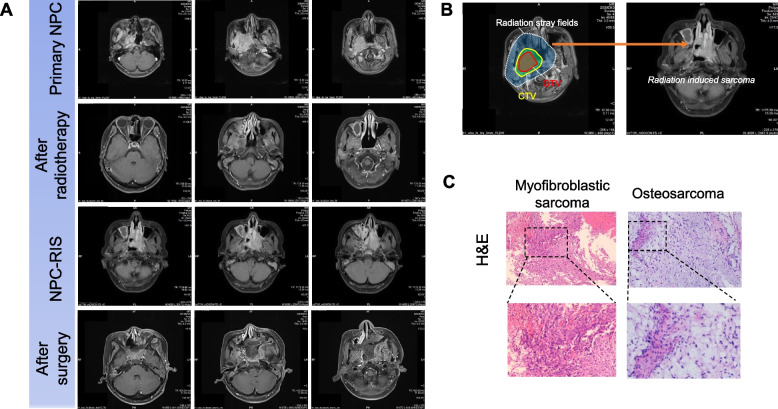
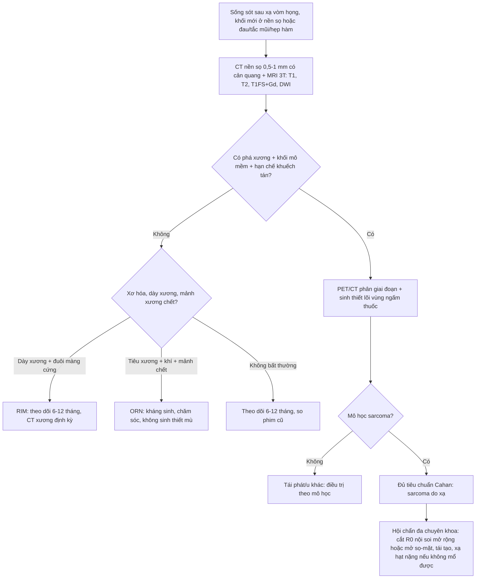
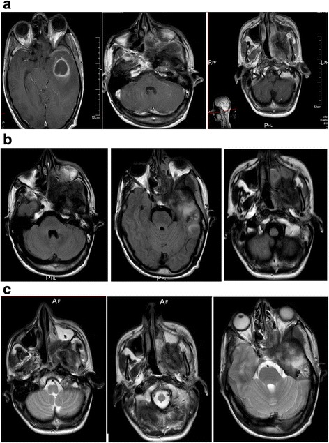

# 272 — Sarcoma xương nền sọ do xạ / Radiation-induced sarcoma (RIS) of the skull base

**Tags:** `pattern:pha-xuong` `pattern:u-xuong` `pattern:mo-mem` `pattern:trong-truong-chieu` `pattern:xam-lan-xuong` `pattern:ngam-thuoc-khong-deu` `pattern:di-len` `vung:nen-so` `vung:so-mat` `vung:xuong-mat` `vung:dau-co` `protocol:CT-xuong` `protocol:MRI` `protocol:DWI` `protocol:PET-CT` `score:Cahan` `incidentaloma:khong`

**Mức chắc chắn (certainty):** tổng hợp y văn (literature synthesis) — 1 đoàn hệ 7 ca sarcoma nền sọ sau xạ vòm họng có đối chứng (Peng 2026), 1 tổng quan hệ thống 560 ca sarcoma đầu–cổ do xạ (RISHN 2021), 1 loạt 45 ca osteosarcoma xương hàm sau xạ vòm họng (RIOSM 2016) và 1 ca nguyên văn có ảnh (Echchikhi 2016). Nguyên lý chung của sarcoma do xạ đã có ở [384](../384-sarcoma-do-xa-sau-xa-tri-nguc/lesson.md) — bài này **chỉ đi sâu phần nền sọ**.

**Nguồn có PMCID (tên tác giả đã đối chiếu):**
- Peng Z, Shuai M, Zhang L, Wang X, Lu S, Zeng Z, Xiong W, Jiang W, Wang Y, *BMC Surg* 2026 — **PMC13113481**, **CC BY-NC-ND 4.0**.
- Echchikhi Y, Loughlimi H, Touil A, Kebdani T, Benjaafar N, *J Med Case Rep* 2016 — **PMC5133737**, **CC BY 4.0**.

**Nguồn chỉ dùng số liệu:** Coca-Pelaz A et al., *Adv Ther* 2021 (PMID 33184778, RISHN 560 ca); Liao LQ et al., *Chin J Cancer* 2016 (PMID 27729091, RIOSM 45 ca); Kim KS et al., *Cancer Res Treat* 2016 (PMID 27004955, RIS 15 năm một trung tâm).

> **Câu chốt:** trong vùng nền sọ đã xạ, **một khối phá xương mới sau 10–20 năm KHÔNG phải "tái phát vòm họng"** cho đến khi chứng minh ngược. Ba con số phải thuộc: **(1)** sarcoma nền sọ sau xạ vòm họng có **sống 2 năm 0%** và **5 năm 0%** — so với **44,5%/39,1%** ở tái phát vòm họng và **93,6%/82,4%** ở NPC T3–T4 nguyên phát (Peng 2026); **(2)** khoảng **disease-free 18,3 năm** ở sarcoma so với **5,6 năm** ở tái phát (p < 0,0001) và **tuổi lúc xạ 30,0 vs 45,5** (p < 0,05); **(3)** ổ sinh u nằm **NGOÀI vùng liều cao của khối u nguyên phát nhưng TRONG trường chiếu** — vì vậy "cách xa chỗ u cũ" là **dấu hiệu ủng hộ sarcoma**, không phải dấu hiệu loại trừ.

## 1. Tổng quan bệnh học – cơ chế hình ảnh

### 1.1 Vì sao nền sọ là nơi "trả giá" của xạ vòm họng

- **Liều cao nhất, xương mỏng nhất, phẫu thuật khó nhất.** Phác đồ IMRT vòm họng đưa **GTVnx 69,96–73,92 Gy trong 30–33 phân đoạn** (2,12–2,24 Gy/phân đoạn), CTV1 **60,06 Gy**, cổ dự phòng **48–54 Gy** (Peng 2026). Nền sọ — thân xương bướm, mỏm chân bướm, xương thái dương — nằm **ngay sau vòm họng**, nhận liều cao trong **thể tích nhỏ nhưng mô xương mỏng, ít mạch**.
- **Mô xương là mô "sống chậm" nhưng có tế bào gốc trung mô.** Tia xạ gây **đứt sợi đôi DNA**, chọn lọc dòng tế bào **mất TP53/RB1**, tái sắp xếp nhiễm sắc thể; mô xơ–giảm mạch sau xạ vẫn tiếp tục tái tạo và viêm mạn, tạo **vi môi trường thuận lợi cho chuyển dạng trung mô**. Vì chu kỳ tái tạo chậm, **phải nhiều năm** mới đủ đột biến — đây là lý do **tiềm tàng 10–20 năm**, không phải 1–2 năm.
- **TẠI SAO tổn thương "ác tính" trên hình ảnh:** sarcoma là **mô tế bào dày đặc, giàu mạch, thiếu vỏ** → CT thấy **khối mô mềm 30–50 HU ngấm thuốc không đồng nhất**, **phá vỏ xương**, **phản ứng màng xương**, **vôi hóa dạng osteoid**; MRI thấy **T1 thấp, T2 cao không đồng nhất, ngấm thuốc mạnh**, **hạn chế khuếch tán** (ADC thấp do tăng độ đặc tế bào). Xơ hóa sau xạ thì **nghèo tế bào, nghèo mạch** → **T2 thấp, không ngấm, không to lên**.
- **TẠI SAO "vôi hóa" không loại trừ ác tính:** **osteosarcoma** sản xuất **chất nền osteoid** — trên CT là các **đám vôi hóa mây/không định hình**, không phải vôi hóa đều kiểu lành tính. Thấy vôi hóa trong khối phá xương phải nghĩ **osteosarcoma**, không được gọi là "di tích xơ".

### 1.2 "Ổ sinh u ở rìa trường chiếu" — điểm khác biệt cốt lõi

- Trong 7 ca sarcoma nền sọ, **tất cả** khởi phát ở nền sọ, **tất cả** bệnh nhân ban đầu là **T3–T4**, và vị trí tổn thương gồm **mỏm chân bướm, cơ chân bướm trong, cơ chân bướm ngoài, thân xương bướm**. Mô bệnh chủ yếu **fibrosarcoma và osteosarcoma** (Peng 2026).
- **Nghịch lý cần nhớ:** trung tâm sinh u nằm **ngoài vùng liều cao của GTV** nhưng **trong trường chiếu** (thường ở **rìa/vùng liều thấp hơn**). Điều này khớp với mô hình **"vùng đệm liều trung bình"**: đủ liều gây đột biến, chưa đủ liều diệt tế bào — và khớp với quan sát **tuổi lúc xạ càng trẻ càng nguy cơ**.
- **Hệ quả thực hành:** khi đọc phim theo dõi, **không được chỉ nhìn ổ u cũ**. Phải quét **toàn bộ thể tích đã xạ**, đặc biệt **rìa trường** và các hốc tự nhiên (xoang bướm, hố chân bướm–khẩu cái, hố sọ giữa).
- **Phản biện (cửa 3):** bài gốc mô tả **không thống nhất** giữa phần Phương pháp ("ngoài vùng liều cao") và phần Kết quả ("trong hoặc ở rìa vùng liều cao") — có thể do **định nghĩa "vùng liều cao" khác nhau** (GTV so với PTV). Trong bài này, cách hiểu an toàn là: **trong trường chiếu, nhưng không nhất thiết trùng ổ u nguyên phát**.

### 1.3 Số liệu định lượng phải thuộc

| Đại lượng | Con số | Nguồn |
|---|---|---|
| Tần suất sarcoma đầu–cổ do xạ (gộp 64 bài, 560 ca) | **0,15%**; liều xạ trung bình **62 Gy**; tiềm tàng trung bình **11,1 năm** | RISHN 2021, PMID 33184778 |
| Vị trí hay gặp nhất trong RISHN | **vùng mũi–xoang**; **osteosarcoma** đứng đầu, rồi **fibrosarcoma** | RISHN 2021 |
| Tử vong do sarcoma đầu–cổ do xạ | **40,7%** chết vì bệnh, trung bình **13,9 tháng** sau chẩn đoán | RISHN 2021 |
| Sarcoma nền sọ sau xạ vòm họng | **7 ca**; **71% nam**; tuổi trung bình lúc chẩn đoán sarcoma **48,2** | Peng 2026, PMC13113481 |
| Tuổi lúc xạ ban đầu | **30,0 (26–62)** vs **45,5 (24–75)** ở tái phát vòm họng, p < 0,05 | Peng 2026 |
| Khoảng không bệnh (xạ → bệnh mới) | **18,29 năm** vs **5,59 năm** ở tái phát, p < 0,0001 | Peng 2026 |
| Sống 2 năm / 5 năm | **0% / 0%** (sarcoma) · **44,5% / 39,1%** (tái phát) · **93,6% / 82,4%** (NPC T3–T4) | Peng 2026 |
| Nguy cơ tử vong so với tái phát / NPC nguyên phát | **HR 10,66** (p = 0,014) / **HR 18,82** (p < 0,001) | Peng 2026 |
| Tần suất RIS sau xạ vòm họng (trích dẫn trong bài) | **~0,16%** | Peng 2026 |
| Osteosarcoma xương hàm sau xạ vòm họng | **0,084% (47/53.760)**; sống 1/2/3 năm **53,3 / 35,6 / 13,5%**; **tất cả đều tử vong** | RIOSM 2016, PMID 27729091 |
| Tỉ lệ cắt được diện mô học âm | **24/39 (61,5%)** cắt sạch đại thể; **38,5%** còn diện dương | RIOSM 2016 |
| Ca nền sọ đơn lẻ | tiềm tàng **11 năm**, hóa trị đơn thuần, tử vong sau **3 chu kỳ** | Echchikhi 2016, PMC5133737 |

- **Đọc con số cho đúng:** "0% sống 5 năm" đến từ **7 ca** — không dùng làm tiên lượng cá nhân tuyệt đối, nhưng đủ để nói **đây là biến cố gần như luôn tử vong** khi không cắt được R0. Con số **0,15–0,16%** nghe nhỏ, nhưng nhân với **hàng trăm nghìn người sống sót sau xạ vòm họng** thì là **hàng nghìn ca** trên toàn cầu.

## 2. Mẫu hình + chẩn đoán phân biệt theo vị trí (gamut)

### 2.1 Mẫu hình hình ảnh

- **Khối mô mềm + phá xương**, thường **bờ không rõ**, **vùng chuyển tiếp rộng** (Lodwick II–III), **phá vỡ vỏ xương**, **phản ứng màng xương** (tia/PNT), **thành phần trong xương và ngoài xương**.
- **Chất nền:** osteosarcoma → **vôi hóa mây/osteoid**; chondrosarcoma → **vôi hóa vòng cung**; fibrosarcoma/UPS → **không có chất nền**, mô mềm chiếm ưu thế.
- **MRI:** T1 **đồng–thấp tín hiệu**, T2 **cao không đồng nhất**, **ngấm thuốc mạnh và không đều**, **hoại tử trung tâm**, **DWI hạn chế**.
- **Vị trí hay gặp sau xạ vòm họng:** **mỏm chân bướm – hố chân bướm–khẩu cái – thân xương bướm – xoang bướm**, lan vào **hố sọ giữa**, **khe ổ mắt**, **hốc mũi sau**.

### 2.2 Gamut theo vị trí nền sọ

| Vị trí | Gamut chính |
|---|---|
| **Thân xương bướm / xoang bướm** | Sarcoma do xạ · tái phát vòm họng · di căn xương · chordoma · u màng não en plaque · viêm xương nền sọ |
| **Mỏm chân bướm – cơ chân bướm** | Sarcoma do xạ (fibrosarcoma) · u lan theo dây V3 · u cơ vân · di căn · hoại tử xương hàm lan lên |
| **Xương thái dương / ống tai ngoài** | Sarcoma do xạ · ung thư biểu mô ống tai · viêm tai xương chũm · di căn · u hạt |
| **Xương hàm trên/hàm dưới** | Osteosarcoma do xạ · SCC xương ổ răng · hoại tử xương do xạ (ORN) · viêm tủy xương · di căn |
| **Hố sọ giữa / lỗ rách** | Sarcoma lan từ nền sọ · u lan theo dây · schwannoma · meningioma |

### 2.3 Gamut theo hình thái phá xương

- **Phá xương + khối mô mềm lớn, tiến triển nhanh** → sarcoma, di căn, u lan.
- **Phá xương + mảnh xương chết + khí trong mô, không khối** → ORN/viêm tủy xương.
- **Dày xương + đuôi màng cứng + ngấm thuốc đồng nhất** → u màng não do xạ (RIM — bài 264).
- **Tiêu xương nhiều ổ, không phản ứng màng xương, bệnh ung thư đã biết** → di căn.
- **Xương "kính mờ" + vỏ xương dày, không khối mềm** → loạn sản sợi (fibrous dysplasia).

## 3. Bảng so sánh phân biệt (ma trận đối chiếu)

| Thực thể (entity) | Hình ảnh điển hình (CT/MRI) | Chốt vào (rule-in) | Chốt loại (rule-out) | Gợi ý xác nhận |
|---|---|---|---|---|
| **Sarcoma nền sọ do xạ (osteosarcoma)** | Khối **phá xương + mô mềm**, **vôi hóa mây/osteoid**, vùng chuyển tiếp rộng, **ngấm thuốc không đều**, **DWI hạn chế** | **Trong trường chiếu + tiềm tàng ≥ 5 năm (thường 10–20) + mô học sarcoma khác u cũ + phá xương** | Có **dày xương đơn thuần + đuôi màng cứng** (RIM); **mảnh xương chết + khí, không khối** (ORN) | **Sinh thiết lõi vùng ngấm thuốc**; CT xương 0,5–1 mm; MRI + DWI; PET/CT giai đoạn |
| **Sarcoma do xạ (fibrosarcoma/UPS)** | **Mô mềm chiếm ưu thế**, ít/không vôi hóa, T2 cao, ngấm mạnh, **phá vỏ muộn** | **Khối mô mềm mới trong trường xạ, không chất nền, mô học trung mô** | Có chất nền sụn/xương rõ → nghĩ chondro/osteosarcoma | Sinh thiết + IHC; MRI mô mềm |
| **Tái phát ung thư vòm họng** | Khối **tại đúng ổ u cũ/hố vòm họng**, **T2 trung tính**, ngấm thuốc vừa, **ADC thấp**, **FDG dương** | **Cùng vị trí u nguyên phát + khoảng không bệnh ngắn (trung vị ~5 năm) + mô học carcinom** | **Khác vị trí u cũ + tiềm tàng > 10 năm + phá xương/mô học sarcoma** → không phải tái phát | MRI + DWI; PET/CT; **sinh thiết có IHC** (p40/p63 dương ở carcinom) |
| **U màng não do xạ (RIM)** | Khối **ngoài trục dựa màng cứng**, **ngấm thuốc đồng nhất**, **dural tail**, **dày xương dưới u**, có thể vôi hóa | **Dày xương + đuôi màng cứng + không phá vỏ + mô học meningioma** | **Phá xương + khối mô mềm + không đuôi màng cứng** → không phải RIM | MRI T1FS+Gd; CT xương; theo dõi 6–12 tháng |
| **Hoại tử xương do xạ (ORN)** | **Tiêu xương loang lổ, mảnh xương chết (sequestrum), khí trong mô**, dày màng xương, **không khối mô mềm thực sự** | **Đau + lộ xương/khí + tiêu xương trong vùng xạ, không khối** | **Có khối mô mềm ngấm thuốc, hạn chế khuếch tán, to lên** → không phải ORN đơn thuần | CT xương; MRI; CRP/BC; **sinh thiết khi có khối** |
| **Di căn xương nền sọ** | **Nhiều ổ tiêu xương**, không phản ứng màng xương, có thể mô mềm, **ngấm thuốc**, bệnh ung thư đã biết | **Nhiều ổ + bệnh nguyên phát đã biết + tiến triển nhanh** | **Một ổ đơn độc trong trường xạ, tiềm tàng > 5 năm** → nghiêng sarcoma | PET/CT; sinh thiết; xét nghiệm mô học so với u cũ |
| **Loạn sản sợi (fibrous dysplasia)** | Xương **"kính mờ"**, vỏ dày, **không khối mô mềm**, bờ rõ, có thể tăng tín hiệu T2 | **Kính mờ + vỏ xương nguyên + không phá vỏ + không khối** | **Phá vỏ + khối mô mềm + hạn chế khuếch tán** → không phải loạn sản sợi | CT xương; MRI; theo dõi |
| **Viêm tủy xương nền sọ** | Tiêu xương + **ngấm thuốc màng xương**, phù mô mềm, có thể ổ áp-xe, **không vôi hóa osteoid** | **Sốt/đau + CRP tăng + ngấm thuốc lan tỏa, cấy dương** | **Khối đặc hạn chế khuếch tán + vôi hóa osteoid** → không phải viêm | CRP/BC, cấy máu/mô; MRI; sinh thiết nếu không điển hình |

*Ba phần của một bài: **(A)** MRI cùng bệnh nhân qua 4 mốc — u vòm họng nguyên phát, sau xạ, **sarcoma nền sọ mới**, sau mổ; **(B)** chồng trường chiếu (đường cam) lên vị trí sarcoma — tổn thương **trong trường chiếu nhưng lệch khỏi ổ u cũ**; **(C)** H&E: **fibrosarcoma** và **osteosarcoma**. Nguồn: Peng Z et al., BMC Surg 2026 (PMC13113481, Fig. 2), CC BY-NC-ND 4.0 — nguyên bản, không crop.*

### 3.1 Ba câu hỏi quyết định trên phim

1. **Có phá xương thật không?** Sarcoma **phá vỏ, vùng chuyển tiếp rộng**; RIM **dày xương**, ORN **tiêu xương + mảnh chết + khí**.
2. **Có khối mô mềm ngấm thuốc, hạn chế khuếch tán không?** Có khối đặc + **ADC thấp** → phải **sinh thiết**, không theo dõi.
3. **Vị trí so với ổ u cũ và trường chiếu?** **Lệch khỏi ổ u cũ nhưng trong trường** + **tiềm tàng > 10 năm** → **sarcoma**; **đúng ổ u cũ + < 5 năm** → **tái phát**.

## 4. Protocol chụp + tiêu chuẩn chẩn đoán

### 4.1 Trình tự hình ảnh

- **CT nền sọ có cản quang, cửa sổ xương + mô mềm, lát 0,5–1 mm** — đây là **modality đầu tay**: thấy **vôi hóa osteoid**, **vùng chuyển tiếp**, **phá vỏ**, **mảnh xương chết**, và **mối liên quan với ống thần kinh, lỗ nền sọ, động mạch cảnh trong**.
- **MRI 3T nền sọ**: T1W, T2W, **T1FS+Gd** (đa bình diện), **DWI/ADC**, **3D CISS** cho dây và màng; đánh giá **thành phần mô mềm**, **xâm lấn hốc mắt – xoang – hố sọ**, **lan theo dây thần kinh**.
- **PET/CT FDG** để **phân giai đoạn và tìm di căn**, không dùng đơn thuần để chẩn đoán: **ORN, viêm, xơ hóa hoạt động** đều có thể tăng FDG; sarcoma độ thấp có thể FDG thấp.
- **Sinh thiết lõi dưới CT** — lấy **vùng mô đặc ngấm thuốc**, tránh trung tâm hoại tử, đủ mẫu cho **IHC + phân tử**; **không sinh thiết mù** ổ xơ hóa không có khối.
- **Đối chiếu phim cũ là bắt buộc**: chứng minh tổn thương **không có trước xạ** (tiêu chuẩn Cahan), và đo **tốc độ phát triển**.

### 4.2 Tiêu chuẩn Cahan (1948) và bản sửa đổi

1. **Sarcoma phát sinh trong trường chiếu xạ** (với nền sọ: trong thể tích đã xạ, kể cả rìa trường).
2. **Khoảng tiềm tàng dài** — Cahan gốc yêu cầu **≥ 4 năm**, nhiều nhóm hiện dùng **≥ 5 năm**; thực tế RISHN trung bình **11,1 năm**, sarcoma nền sọ sau NPC **18,3 năm**.
3. **Mô học khác u nguyên phát** (carcinom vòm họng → sarcoma trung mô).
4. **Có bằng chứng mô bệnh học của sarcoma**.
5. **Bản sửa đổi Cahan–Arlen:** không có **bệnh nền sinh sarcoma** (PDB, NF1, retinoblastoma, xạ trị trước đó vì sarcoma) và **không phải di căn** của u khác.

### 4.3 Sơ đồ quyết định theo dõi sau xạ vòm họng

### 4.4 Điều trị và theo dõi (ảnh hưởng cách đọc phim)

- **Cắt R0 là yếu tố tiên lượng mạnh nhất.** Trong sarcoma nền sọ, **6/7 ca được mổ** (85,7%), nhưng đường mổ phụ thuộc **lan vào hố sọ – hốc mắt – động mạch cảnh**; chọn **nội soi qua mũi mở rộng** hoặc **mổ sọ–mặt kết hợp**, có **định vị neuronavigation**, đánh giá diện cắt **frozen section**, tái tạo bằng **vạt niêm mạc cuống mạch/cân đùi** (Peng 2026).
- **Xạ lại bằng photon rất hạn chế** vì liều cộng dồn đã cao; **xạ hạt nặng (proton/carbon)** là lựa chọn khi không mổ được hoặc còn diện dương, nhờ **đỉnh Bragg** giảm liều mô lành.
- **Theo dõi sau mổ:** MRI nền sọ + vòm họng **mỗi 3 tháng trong 2 năm đầu**, sau đó **mỗi 6 tháng**; đánh giá **diện cắt, tái phát tại chỗ, di căn phổi** (Peng 2026).
- **Sống còn:** RIOSM có **1/2/3 năm 53,3 / 35,6 / 13,5%**; sarcoma nền sọ **0% ở 2 năm** — nghĩa là **chẩn đoán sớm là biến số duy nhất còn can thiệp được**.

## 5. Biến thể bình thường và cạm bẫy

- **"Cách xa ổ u cũ" bị đọc là "không thể do xạ":** sai. Sarcoma sinh ở **rìa trường chiếu**, không trùng ổ u; đây là **dấu hiệu ủng hộ** sarcoma.
- **Tiềm tàng quá dài → bệnh nhân rơi khỏi theo dõi.** Sau **10–20 năm**, bệnh nhân được coi là "khỏi"; khối mới bị quy cho **viêm xoang, đau răng, thoái hóa**. Cần lịch theo dõi **suốt đời** ở người sống sót xạ vòm họng.
- **Tái phát vòm họng "che" sarcoma:** trong theo dõi NPC, mắt chỉ nhìn **hố vòm họng**; sarcoma ở **mỏm chân bướm/xoang bướm** nằm ngoài vùng nhìn quen thuộc → **satisfaction of search**. Luôn quét **toàn bộ trường chiếu**.
- **ORN và sarcoma cùng tồn tại:** ORN **có thể** là nền của sarcoma; **khối mô mềm trong ổ ORN** phải sinh thiết, không được gọi là "hoại tử".
- **PET dương tính giả:** viêm xoang, ORN, xơ hóa hoạt động, sau mổ — **không chẩn đoán sarcoma bằng PET**; và **sarcoma độ thấp có thể FDG thấp**.
- **Sinh thiết trúng hoại tử:** kết quả "mô hoại tử, không tế bào" **không loại trừ** sarcoma; lấy **vùng ngấm thuốc ngoại vi**, có thể lặp.
- **Vôi hóa bị đọc là lành:** **vôi hóa mây trong khối phá xương = osteoid**, không phải di tích xơ.
- **Nhầm RIM với sarcoma:** RIM **dày xương + đuôi màng cứng + ngấm đồng nhất**; sarcoma **phá xương + khối mô mềm + ngấm không đều**. Điều trị khác hoàn toàn (bài 264).
- **Artifact kim loại sau mổ/tái tạo:** gây tối tín hiệu và "khối giả"; dùng **SEMAC/MAVRIC**, CT khi cần.
- **Xạ lành tính cũng gây sarcoma:** đừng bỏ qua tiền sử xạ **u máu, nang xương, tuyến giáp** khi hỏi bệnh.

## 6. Tự lượng giá — Blind Quiz

**Ca 1 — Nam trưởng thành, 11 năm trước xạ trị ung thư vòm họng (carcinoma không biệt hóa); nay đau đầu, đau mặt, nhìn đôi; MRI thấy khối nền sọ phá xương lan vào hố sọ giữa.**

- Gợi ý: không sốt, không chảy mủ; nội soi vòm họng sạch; khối ở **mỏm chân bướm–xương thái dương**, không đúng ổ u cũ.
- Câu hỏi: Ba chẩn đoán phân biệt? Dấu hiệu nào **loại tái phát vòm họng**? Bước tiếp theo?

<b>Bấm để hiện đáp án (findings + chẩn đoán)</b>

- **Findings:** khối **phá xương bướm và phần vảy xương thái dương**, **thành phần mô mềm** lan vào hố sọ giữa, **tín hiệu T1 thấp – T2 cao không đồng nhất**, **ngấm thuốc mạnh không đều**, có **ổ hoại tử**; không có đuôi màng cứng.
- **Chẩn đoán:** **sarcoma xương nền sọ do xạ** (osteosarcoma) — tiềm tàng **11 năm**, khác vị trí u vòm họng nguyên phát.
- **Phân biệt:** tái phát vòm họng (loại: **khác vị trí, phá xương, tiềm tàng dài, không khối ở hố vòm họng**), RIM (loại: **không dày xương/không đuôi màng cứng**), ORN (loại: **có khối mô mềm đặc, không mảnh xương chết/khí**).
- **Bước tiếp theo:** **sinh thiết lõi vùng ngấm thuốc** (không lấy trung tâm hoại tử) + **PET/CT** phân giai đoạn + hội chẩn nền sọ; **không chờ theo dõi**.
- Nguồn ảnh: Echchikhi Y et al., J Med Case Rep 2016 (PMC5133737, Fig. 1), CC BY 4.0.

**Ca 2 — Bệnh nhân trong đoàn hệ sarcoma nền sọ: xạ vòm họng nhiều năm trước; phát hiện khối mới khi MRI theo dõi định kỳ, chưa có triệu chứng mới.**

- Gợi ý: bệnh nhân không triệu chứng mới; phát hiện khi chụp định kỳ; khối nằm **lệch khỏi hố vòm họng**, sát **mỏm chân bướm**.
- Câu hỏi: Mốc nào tổn thương **mới xuất hiện**? Vì sao khối này **không phải tái phát**? Cần làm gì trước khi mổ?

<b>Bấm để hiện đáp án (findings + chẩn đoán)</b>

- **Findings (panel A):** hàng 1 = **NPC nguyên phát**; hàng 2 = **sau xạ**, u teo và xơ hóa; hàng 3 = **sarcoma nền sọ mới** (khối phá xương, xâm lấn cơ chân bướm, lan hố sọ giữa); hàng 4 = **sau mổ**, khoang mổ và tái tạo.
- **Vì sao không phải tái phát:** khối **không nằm ở hố vòm họng**, mà ở **mỏm chân bướm/thân xương bướm**; **tiềm tàng nhiều năm**; **mô học sarcoma** (panel C) khác carcinom vòm họng.
- **Trước khi mổ:** **sinh thiết xác nhận mô học**, **PET/CT** loại di căn, **CTA/MRA** đánh giá động mạch cảnh trong và xoang hang, **đánh giá thính lực/thị lực/dây sọ**, hội chẩn đa chuyên khoa.
- **Bài học:** theo dõi **định kỳ bằng MRI toàn trường chiếu** phát hiện được sarcoma **trước triệu chứng** — đây là cơ hội duy nhất để cắt R0.
- Nguồn ảnh: Peng Z et al., BMC Surg 2026 (PMC13113481, Fig. 2A và 2C), CC BY-NC-ND 4.0.

**Ca 3 — Cùng bệnh nhân Ca 2: bản đồ liều cho thấy khối mới nằm ở đâu so với trường chiếu?**

- Gợi ý: đường cam = trường chiếu; vùng đỏ = PTV liều cao; vùng xanh = CTV.
- Câu hỏi: Vị trí ổ sarcoma so với **tâm u cũ** và so với **trường chiếu**? Điều này gợi ý gì về cơ chế?

<b>Bấm để hiện đáp án (findings + chẩn đoán)</b>

- **Findings (panel B):** ổ sarcoma nằm **trong trường chiếu** nhưng **lệch khỏi tâm u nguyên phát**, ở vùng **liều trung bình–thấp hơn** (rìa PTV/CTV).
- **Ý nghĩa cơ chế:** khớp mô hình **"vùng đệm liều"** — đủ gây **đứt DNA và bất ổn định gen** nhưng **không đủ diệt tế bào**, nên tế bào trung mô sống sót tích lũy đột biến trong **nhiều năm**.
- **Hệ quả lâm sàng:** **không được chỉ đọc ổ u cũ**; phải đọc **toàn bộ thể tích đã xạ**, đặc biệt **rìa trường** và các hốc lân cận.
- **Lưu ý:** "ngoài vùng liều cao" **không** đồng nghĩa "ngoài trường chiếu" — đây là câu dễ hiểu sai nhất khi đọc bài gốc.
- Nguồn ảnh: Peng Z et al., BMC Surg 2026 (PMC13113481, Fig. 2B), CC BY-NC-ND 4.0.

## Bài liên quan chéo

- [200 – Tổng quan Hệ Thần kinh](../200-tong-quan-he-than-kinh/lesson.md)
- [264 – U màng não do xạ (RIM)](../264-u-mang-nao-do-xa/lesson.md) (cùng trường chiếu, **dày xương** thay vì **phá xương**)
- [384 – Sarcoma do xạ sau xạ trị ngực](../384-sarcoma-do-xa-sau-xa-tri-nguc/lesson.md) (nguyên lý chung RIS, Cahan, sinh thiết)
- [253 – Viêm xương nền sọ giữa không do tai](../253-viem-xuong-nen-so-giua-khong-do-tai/lesson.md)
- [269 – Xạ lại tủy sống](../269-xa-lai-tuy-song/lesson.md) (ngưỡng liều cộng dồn khi cân nhắc xạ lại)
- [330 – Tiếp cận u xương và "don't touch"](../330-tiep-can-u-xuong-va-dont-touch/lesson.md)
- [204 – Hoại tử phóng xạ sau xạ trị u não](../204-hoai-tu-phong-xa-sau-xa-tri-u-nao/lesson.md)

## Ảnh

- `272_sarcoma-nen-so_MRI_PMC13113481.jpg` — Fig. 2: (A) chuỗi MRI 4 mốc từ NPC nguyên phát → sau xạ → sarcoma nền sọ → sau mổ; (B) tương quan trường chiếu và ổ sarcoma; (C) H&E fibrosarcoma và osteosarcoma (Peng Z et al., BMC Surg 2026, PMC13113481, **CC BY-NC-ND 4.0**, nguyên bản, không crop).
- `272_osteosarcoma-nen-so_MRI_PMC5133737.jpg` — Fig. 1: MRI khối xâm lấn xương bướm và xương thái dương, tín hiệu không đồng nhất, ngấm thuốc (Echchikhi Y et al., J Med Case Rep 2016, PMC5133737, **CC BY 4.0**).

> Không dùng để chẩn đoán độc lập khi chưa có người hướng dẫn.
