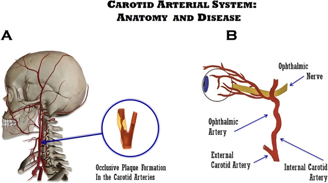
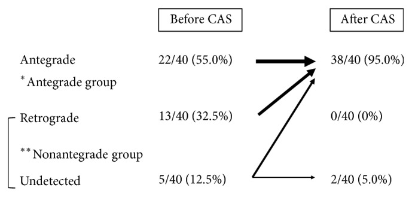
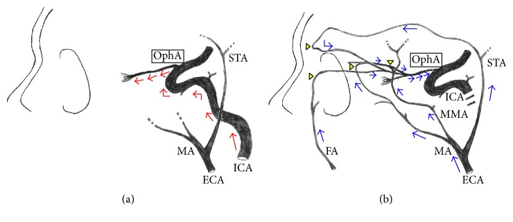
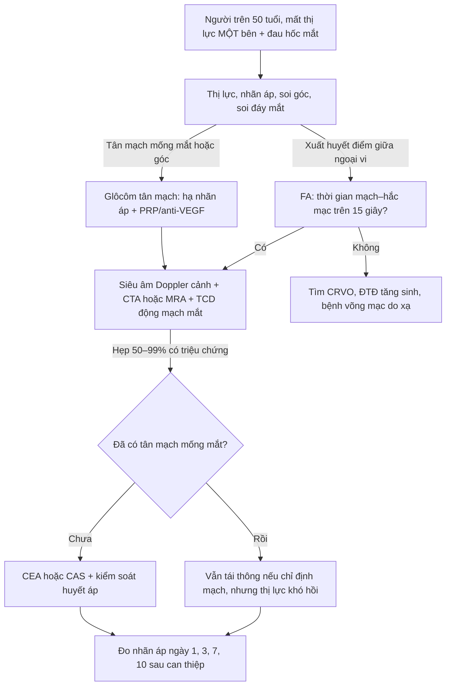
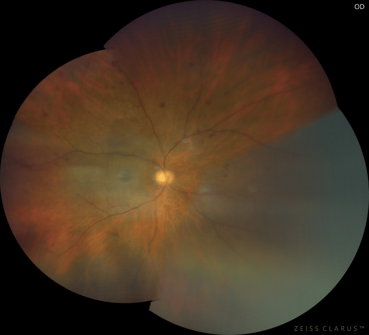
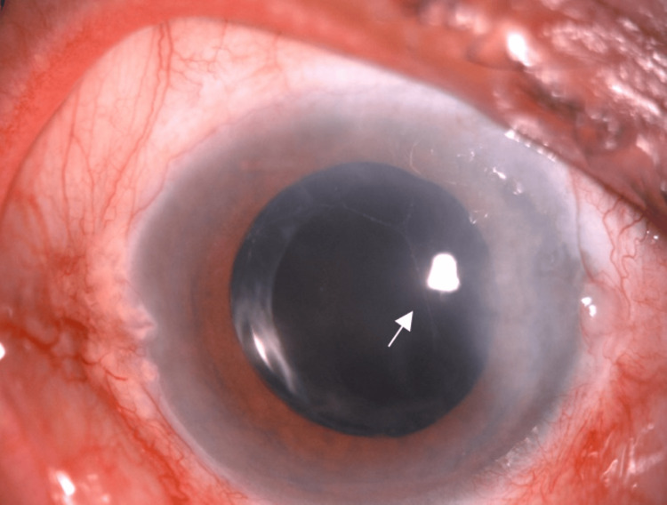
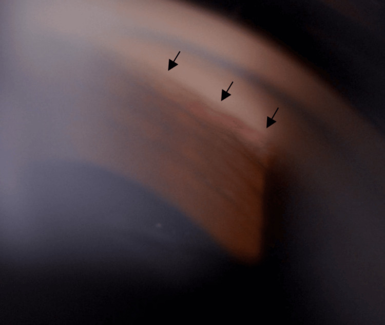
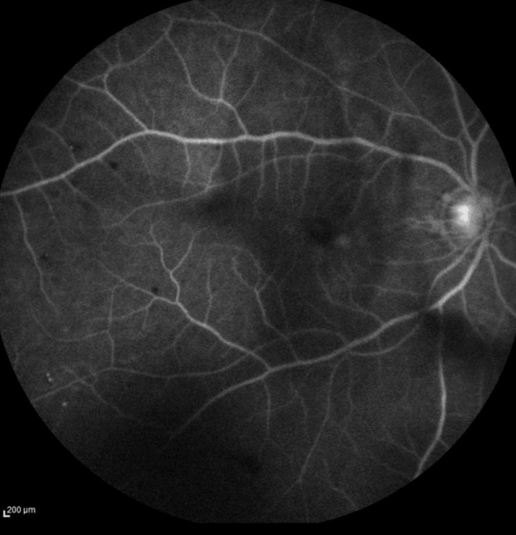

# 274 — Thiếu máu mắt (OIS) và glôcôm tân mạch sau tái thông động mạch cảnh / Ocular ischemic syndrome and neovascular glaucoma after carotid revascularization

**Tags:** `pattern:thieu-mau-vong-mac` `pattern:xuat-huyet-diem` `pattern:tan-mach-mong-mat` `pattern:glocom-tan-mach` `vung:mat` `vung:dong-mach-canh` `protocol:FA` `protocol:SA-Doppler` `protocol:CTA-co-can-quang` `protocol:TCD` `protocol:OCT`

**Mức chắc chắn (certainty):** tổng hợp y văn (literature synthesis) — 1 tổng quan hệ thống kê về OIS và bệnh cảnh cảnh (*Front Ophthalmol* 2026, PMC12890682, CC BY 4.0), 1 đoàn hệ 260 bệnh nhân hẹp cảnh trong ≥ 70% có mô hình dự báo OIS (*Int Ophthalmol* 2025, PMC12049290, CC BY-NC-ND), 1 nghiên cứu 40 tổn thương trước–sau đặt stent cảnh đo hướng dòng động mạch mắt trên DSA (*J Ophthalmol* 2016, PMC5192319, CC BY), 1 ca OIS kèm glôcôm tân mạch có ảnh đáy mắt–FFA–gonioscopy (*Cureus* 2025, PMC12126846, CC BY 4.0) và 1 ca glôcôm tân mạch MẮT ĐỐI BÊN ngày 3 sau bóc nội mạc cảnh (*J Vasc Surg Cases Innov Tech* 2018, PMC6012985, CC BY-NC-ND 4.0). **Không có ca nguyên văn của nhóm** — 3 ca trong quiz là **ca công bố, lấy nguyên văn từ bài gốc**.

> **Câu chốt:** OIS không phải "mắt thiếu máu thoáng qua" mà là **mắt bị tụt áp lực tưới máu mạn tính** vì hẹp cảnh, và **glôcôm tân mạch (NVG) là mốc không quay lại được**. Ba số phải thuộc: OIS **7,5 ca/triệu người/năm** nhưng **tử vong 5 năm 40%** (tim rồi đột quỵ) và **58% thị lực < đếm ngón tay sau 1 năm**; trong **260 bệnh nhân hẹp cảnh trong ≥ 70%**, **46,2% có OIS** và **23,3% trong số đó đã có tân mạch mống mắt**; **dòng động mạch mắt ĐẢO NGƯỢC** gặp **36,7% (44/120)** ở nhóm OIS so với **11,4% (16/140)** nhóm chứng. Và cạm bẫy lớn nhất: **tái thông cảnh có thể làm glôcôm tân mạch bùng lên** — đã có **12 ca sau bóc nội mạc cảnh**, có ca **ngày 3 sau mổ, nhãn áp 35 mmHg**.

## 1. Tổng quan bệnh học – cơ chế hình ảnh

### 1.1 Vì sao mắt chịu hẹp cảnh 90% mà vẫn có ca OIS khi hẹp 25%

- **Giải phẫu:** động mạch mắt (ophthalmic artery, OA) là **nhánh nội sọ đầu tiên của động mạch cảnh trong (ICA)**; áp lực tưới máu mắt phụ thuộc áp lực OA, mà OA lại được nuôi **xuôi dòng từ ICA** và **ngược dòng từ các nhánh động mạch cảnh ngoài (ECA)** qua động mạch trên ổ mắt, động mạch mặt, động mạch hàm trong, động mạch màng não giữa.

*(A) Mảng xơ vữa làm hẹp lòng động mạch cảnh; (B) động mạch mắt là nhánh của ICA — vị trí giải thích vì sao hẹp cảnh gây thiếu máu nhãn cầu. Nguồn: Ávila-Figueroa et al., Front Ophthalmol 2026, PMC12890682, CC BY 4.0.*

- **Sinh lý bệnh:** khi ICA hẹp dần, **tiểu động mạch võng mạc giãn tối đa** để giữ lưu lượng (tự điều hòa). Khi dự trữ giãn cạn, lưu lượng **tuyến tính với áp lực tưới máu** — đúng cơ chế của CHS (bài 271) nhưng ở mắt biểu hiện bằng **thiếu máu mạn** thay vì phù–xuất huyết não.
- **Ngưỡng:** hẹp **≥ 90%** là mức thường gặp trong OIS và **50% ca có tắc hoàn toàn ICA** cùng bên; nhưng **hẹp < 50% vẫn gây OIS nếu tuần hoàn bàng hệ kém** (Mendrinos), và ca trong quiz dưới đây chỉ hẹp **25%** trên CTA. Vì vậy **mức hẹp một mình không loại trừ OIS** — phải đọc **hướng dòng OA + tuần hoàn bàng hệ**.
- **Số liệu đoàn hệ 260 ca hẹp ≥ 70%** (OIS 120, chứng 140): hẹp/tắc ICA cùng bên **OR 2,749 (1,393–5,422)**; **mảng xơ KHÔNG ỔN ĐỊNH cùng bên OR 9,229 (4,110–20,721)**; **dòng OA bất thường OR 3,807 (1,899–7,631)**; **hẹp nặng tuần hoàn TRƯỚC đối bên OR 3,404 (1,716–6,749)**; **tăng huyết áp là yếu tố bảo vệ OR 0,388 (0,177–0,847)**. Mô hình dự báo OIS **AUC 0,834 (0,784–0,885)**, độ nhạy **81,3%**, độ đặc hiệu **67,8%**.
- **Ai dễ có tân mạch mống mắt (NVI):** trong 120 ca OIS, **28 ca (23,3%) có NVI**; **đái tháo đường OR 4,710 (1,475–15,042)** và **OA đảo ngược OR 2,712 (1,079–6,816)**; mô hình NVI **AUC 0,724**. Tức **thiếu máu mạn + ĐTĐ = mắt đã đi qua điểm không hồi phục**.

### 1.2 Vì sao hình ảnh trông như vậy — vật lý FA, Doppler và OCT

- **FA (fluorescein angiography) đo DÒNG CHẢY, không đo mạch máu:** fluorescein đi theo huyết tương, nên **thời gian xuất hiện** phản ánh thời gian vận chuyển. Ba ngưỡng dùng để chẩn đoán OIS: **mạch–hắc mạc (arm-to-choroid) > 15 giây**, **mạch–võng mạc (arm-to-retina) > 18 giây**, **thời gian động–tĩnh mạch (AV transit) > 11 giây**. Trong tổng quan: **chậm đổ đầy hắc mạc 60%**, **AV > 11 giây là dấu nhạy nhất (95%)** nhưng **kém đặc hiệu nhất**, **ngấm muộn thành mạch 85%**, **phù hoàng điểm muộn 17%**; ca minh họa có **AV 20 giây** và **mất mao mạch ngoại vi**.
- **Vì sao chậm đổ đầy hắc mạc lại đặc hiệu:** hắc mạc được nuôi bởi **động mạch mi sau** (từ OA), một hệ **áp lực thấp, lưu lượng cao**; khi OA tụt áp, hắc mạc mất đổ đầy **từng mảng** trước khi võng mạc mất — khác CRVO, nơi **đổ đầy hắc mạc bình thường** và bệnh nằm ở tĩnh mạch võng mạc.
- **Xuất huyết điểm giữa ngoại vi (mid-peripheral dot-blot):** máu ứ ở **đám rối mao mạch sâu** do tăng áp tĩnh mạch + thiếu oxy thành mạch; vị trí **giữa ngoại vi** (không lan tới hậu cực) là dấu phân biệt với ĐTĐ tăng sinh (xuất huyết rải rác cả hậu cực, kèm vi phình mạch).
- **Tân mạch mống mắt/góc:** thiếu máu đoạn sau làm **VEGF tăng** (yếu tố sinh mạch); mạch mới mọc trên **mống mắt và góc tiền phòng** rồi **bít đường thoát thủy dịch** → nhãn áp tăng.
- **Nhãn áp có thể BÌNH THƯỜNG hoặc THẤP:** thể mi (ciliary body) thiếu máu làm **giảm sản xuất thủy dịch** — nhưng **50% ca OIS vẫn tăng nhãn áp**, thường vì NVG. Vì vậy **nhãn áp bình thường không loại trừ OIS**, và **nhãn áp thấp ở mắt đau/mờ phải nghĩ thiếu máu thể mi**.
- **Siêu âm Doppler cảnh (DUS):** độ nhạy **94%**, độ đặc hiệu **92%** cho hẹp **60–99%**; đo **PSV, EDV, tỉ số S/D, chỉ số sức cản**; là **bước đầu tiên** theo hướng dẫn ESVS 2023 vì rẻ, không xâm lấn — nhưng **phụ thuộc người làm** và **đánh giá thấp mảng vôi hóa nặng**.
- **Hướng dòng OA trên DSA/TCD:** bình thường **xuôi dòng từ ICA**; khi ICA hẹp nặng, OA nhận máu **ngược từ ECA** để nuôi não → **dòng đảo ngược**, làm mắt bị "ăn cắp" máu. Trong 40 tổn thương trước đặt stent: **xuôi dòng 22/40 (55,0%)**, **đảo ngược 13/40 (32,5%)**, **không thấy 5/40 (12,5%)**; sau stent **38/40 (95,0%) xuôi dòng, 0 đảo ngược**. Lưu lượng đầu thị (laser speckle) tăng từ **16,7 ± 4,8 lên 18,5 ± 4,8** đơn vị (p = 0,003) ở bên can thiệp, bên đối diện không đổi (p = 0,22).

*Trước stent: xuôi dòng **55,0%**, đảo ngược **32,5%**, không thấy **12,5%**. Sau stent: xuôi dòng **95,0%**, đảo ngược **0%** — tái thông "sửa" được hướng dòng nhưng không sửa được tân mạch đã hình thành. Nguồn: Ishii et al., J Ophthalmol 2016, PMC5192319, CC BY.*

*Trái (a): động mạch mắt nhận máu xuôi dòng từ động mạch cảnh trong (ICA). Phải (b): khi ICA hẹp nặng, máu đi ngược từ động mạch cảnh ngoài (ECA) qua các nhánh nối (động mạch trên ổ mắt, mặt, hàm trong, màng não giữa) vào động mạch mắt — đúng cơ chế "mắt bị ăn cắp máu". Nguồn: Ishii et al., J Ophthalmol 2016, PMC5192319, CC BY.*

### 1.3 Vì sao TÁI THÔNG cảnh lại có thể làm bùng glôcôm tân mạch

- **Trước mổ, mắt đã có tân mạch và/hoặc thể mi thiếu máu:** mạch mới bít góc kín nhưng **sản xuất thủy dịch còn thấp** vì thể mi "đói" — nhãn áp có thể **bình thường hoặc thấp**.
- **Sau khi mở hẹp, áp lực tưới máu tăng đột ngột:** thể mi **hồi phục sản xuất thủy dịch nhanh hơn** khả năng thoát qua góc đã bị tân mạch bít → **nhãn áp tăng vọt**. Đây là cơ chế được mô tả trong ca **bóc nội mạc cảnh (CEA) phải ở bệnh nhân tắc ICA trái + hẹp 80% phải**: mắt trái (đối bên) đỡ đau và nhìn tốt hơn ngay sau mổ, rồi **ngày 3 đau lại, thị lực từ 6/60 xuống đếm ngón tay, giác mạc phù, nhãn áp 35 mmHg**, giảm còn **14 mmHg** sau thuốc hạ nhãn áp + corticoid.
- **Tân mạch đã hình thành thì không "tan" theo dòng máu:** tái thông cải thiện **triệu chứng thiếu máu** nhưng **không đảo ngược** mạng mạch mới trong góc; vì vậy **can thiệp chỉ có lợi về thị lực khi làm TRƯỚC khi có tân mạch mống mắt/glôcôm** (tổng quan nêu rõ).
- **Bằng chứng dịch tễ:** NVG sau CEA **cực hiếm** — tổng quan của Ng et al. chỉ **12 ca** được ghi nhận, **tất cả cùng bên can thiệp**; ca nêu trên là ca **đối bên** đầu tiên. Có ca NVG sau **đặt stent cảnh (CAS)** và ca NVG bị **che lấp bởi hội chứng tăng tưới máu** (bài 271: **ngày 10 sau CAS, mù không hồi phục**).
- **Hệ quả thực hành:** mọi bệnh nhân có **triệu chứng mắt + hẹp cảnh** phải **khám mắt trước can thiệp** (thị lực, nhãn áp, gonioscopy) và **đo nhãn áp ngày 1, 3, 7, 10 sau can thiệp** — nhất là khi **đã có tân mạch** hoặc **đau hốc mắt**.

## 2. Mẫu hình + chẩn đoán phân biệt theo vị trí (Gamut)

- **Theo đoạn bị thiếu máu:**
  - **Đoạn trước (anterior segment):** tân mạch mống mắt/góc, **viêm tiền phòng (flare + tế bào)**, phù giác mạc, đồng tử **giãn cố định hoặc bán giãn** do thiếu máu cơ thể mi, đục thể thủy tinh; đau hốc mắt **40%**.
  - **Đoạn sau (posterior segment):** **xuất huyết điểm giữa ngoại vi 80%**, động mạch hẹp–tĩnh mạch giãn, **vi phình mạch**, **điểm đỏ anh đào 12%** (thường do thuyên tắc động mạch trung tâm võng mạc đi kèm), phù hoàng điểm, teo thị.
  - **Cả hai:** thể "toàn nhãn cầu" — tiên lượng xấu nhất, thường đã có NVG.
- **Theo mẫu hình "bệnh võng mạc KHÔNG ĐỐI XỨNG":** OIS · tắc tĩnh mạch võng mạc trung tâm (CRVO) · bệnh võng mạc ĐTĐ tăng sinh (PDR) một bên · bệnh võng mạc do xạ · hội chứng thiếu máu cục bộ mắt sau phẫu thuật chiết quang.
- **Theo nguyên nhân gây NVG (95% do thiếu máu võng mạc):** **ĐTĐ tăng sinh 33%**, **CRVO thiếu máu 33%**, **OIS 13%**, còn lại: tắc động mạch trung tâm võng mạc, u nội nhãn, bong võng mạc mạn.
- **Theo nguyên nhân hẹp cảnh (gamut mạch):** xơ vữa (thường gặp nhất) · **bóc tách cảnh** (bài 1773) · **Takayasu** (nữ trẻ, hẹp dài–nhẵn) · **viêm mạch tế bào khổng lồ (GCA)** (tuổi > 50, đau đầu, hàm đi khập khiễng) · **xơ hóa do xạ cổ** (bài 260) · **carotid web** (bài 270).
- **Gợi nhớ 5 câu hỏi trước khi gọi OIS:** (1) mất thị lực **một bên, từ từ**? (2) **đau hốc mắt** cùng bên? (3) **xuất huyết điểm giữa ngoại vi**? (4) **tân mạch mống mắt/góc**? (5) **FA chậm đổ đầy hắc mạc**? — 3/5 là đủ chỉ định siêu âm Doppler cảnh.

## 3. Bảng so sánh phân biệt (ma trận đối chiếu)

| Thực thể (entity) | Hình ảnh điển hình | Chốt vào (rule-in) | Chốt loại (rule-out) | Gợi ý xác nhận |
|---|---|---|---|---|
| **OIS do hẹp cảnh** | Xuất huyết điểm **giữa ngoại vi**, động mạch hẹp–tĩnh mạch giãn, tân mạch mống mắt/góc, **chậm đổ đầy hắc mạc từng mảng** | **AV > 11 giây + arm-to-choroid > 15 giây**; **dòng OA đảo ngược**; hẹp ICA cùng bên ≥ 70% hoặc tắc | Đổ đầy hắc mạc bình thường + không đảo dòng OA → tìm nguyên nhân khác | DUS cảnh, CTA/MRA, TCD OA, FA |
| **CRVO thiếu máu** | Xuất huyết **bốn góc phần tư**, tĩnh mạch giãn ngoằn ngoèo, phù gai, **đổ đầy hắc mạc bình thường**, không đảo dòng OA | **Xuất huyết lan rộng tới hậu cực** + tĩnh mạch giãn; OCT dày hoàng điểm | **Chậm đổ đầy hắc mạc + đảo dòng OA** → OIS chứ không phải CRVO | FA, OCT, siêu âm cảnh |
| **PDR** | Vi phình mạch, xuất huyết **rải rác cả hậu cực**, tân mạch đĩa/võng mạc, **đổ đầy hắc mạc bình thường** | **Tiền sử ĐTĐ + tân mạch đĩa**; OCT có phù hoàng điểm ĐTĐ | Một bên, không ĐTĐ, xuất huyết chỉ giữa ngoại vi → nghĩ OIS | FA, OCT, HbA1c, siêu âm cảnh |
| **Tắc động mạch trung tâm võng mạc (CRAO)** | Võng mạc trắng đục, **điểm đỏ anh đào**, đổ đầy **rất chậm hoặc không** | **Mất thị lực đột ngột vài giây–phút** + điểm đỏ anh đào | Đau mạn tính từng đợt + xuất huyết điểm → OIS | FA, siêu âm cảnh, siêu âm tim |
| **Viêm mạch (Takayasu / GCA)** | Hẹp dài–nhẵn, thành mạch dày, **không vôi hóa**; GCA có thể tắc động mạch mi sau | **Tuổi > 50 + ESR/CRP tăng + đau hàm** (GCA); nữ trẻ + mạch không bắt (Takayasu) | Hẹp có vôi hóa tại hành cảnh → xơ vữa | CRP/ESR, CTA/MRA, PET-CT |
| **Bệnh võng mạc do xạ** | Tổn thương **trong trường chiếu**, thiếu máu mao mạch, xuất huyết, tân mạch muộn | **Tiền sử xạ đầu cổ trong 6–24 tháng** + tổn thương dừng ở bờ trường chiếu | Tổn thương ngoài trường xạ → không phải do xạ | So sánh bản đồ liều, FA, OCT |

- **Ảnh ghép đối chiếu:** không tạo ảnh ghép cho bài này vì các ảnh thuộc **3 bệnh nhân khác nhau, khác modality** (đáy mắt, FFA, DSA, sơ đồ) — ghép cạnh nhau dễ gợi ý sai là một ca; ảnh giữ nguyên bản, đặt riêng.

## 4. Protocol chụp + hệ phân độ và xử trí

### 4.1 Khám mắt tối thiểu (trước mọi can thiệp cảnh)

- **Thị lực có kính**, **nhãn áp hai mắt**, **soi góc (gonioscopy) hai mắt** — không có soi góc thì **bỏ sót tân mạch góc tới 100%** ở ca góc mở; **soi đáy mắt giãn đồng tử**; **chiếu sáng mạnh** tìm **amaurosis do ánh sáng**.
- **FA** khi nghi OIS: ghi **thời gian mạch–hắc mạc, mạch–võng mạc, AV**, tìm **mất mao mạch ngoại vi**, **ngấm muộn thành mạch**, phù hoàng điểm.
- **OCT/EDI-OCT:** phù hoàng điểm, teo võng mạc, **hắc mạc mỏng** ở vùng thiếu máu mạn (định lượng độ dày hắc mạc dưới hoàng điểm theo tuổi–trục nhãn cầu); **OCTA** đánh giá mật độ mao mạch.

### 4.2 Chẩn đoán nguyên nhân mạch

- **DUS cảnh** trước (Se 94%, Sp 92% cho hẹp 60–99%); **CTA hoặc MRA** xác nhận mức hẹp, mảng xơ, tuần hoàn bàng hệ; **TCD** đo hướng/ vận tốc dòng OA. Theo **NASCET**: nhẹ < 50%, trung bình 50–69%, nặng 70–99%, tắc 100%.
- **Không dùng chụp mạch xâm lấn chỉ để chẩn đoán** vì nguy cơ đột quỵ do thủ thuật.
- **Tầm soát nguyên nhân khác:** HbA1c, lipid, CRP/ESR (GCA nếu > 50 tuổi), huyết áp, ECG và siêu âm tim nếu có thuyên tắc.

### 4.3 Xử trí mắt trước và sau tái thông

- **Chưa có tân mạch:** **PRP (quang đông toàn võng mạc)** khi có tân mạch mống mắt/võng mạc; **anti-VEGF nội nhãn** kiểm soát tân mạch và phù hoàng điểm; **thuốc hạ nhãn áp tại chỗ** (chẹn beta, đồng vận alpha-2, ức chế carbonic anhydrase); **TRÁNH prostaglandin, pilocarpine và kháng cholinergic** vì gây viêm.
- **Đã có NVG:** phẫu thuật lọc (trabeculectomy) hoặc **van dẫn lưu** (Ahmed) khi nhãn áp không đáp ứng; **tiêm anti-VEGF trước mổ** để giảm nguy cơ chảy máu; **corticoid tại chỗ + liệt thể mi** để kiểm soát viêm và dính mống mắt.
- **Tái thông cảnh:** **CEA/CAS** cho hẹp **50–99% có triệu chứng** hoặc **60–99% không triệu chứng**; CEA + aspirin giảm đột quỵ 2 năm **9% so với 26%** ở nhóm chỉ aspirin. Tái thông **cải thiện thị lực ở 60%** ca OIS mạn, **hết cơn amaurosis**, và **đảo ngược dòng OA** — nhưng **chỉ có lợi khi chưa có tân mạch/glôcôm**.
- **Theo dõi sau can thiệp:** nhãn áp + soi góc **ngày 1, 3, 7 và 10**; cảnh báo bệnh nhân **đau hốc mắt, nhìn mờ, buồn nôn, đau đầu** là dấu hiệu cấp cứu; nếu nhãn áp tăng, điều trị như NVG và **không chờ** vì thị lực mất nhanh.

### 4.4 Phân độ thực hành (không có RADS cho mắt–cảnh)

- **Bậc 1 — OIS chưa tân mạch:** triệu chứng thiếu máu ± xuất huyết điểm, **chưa có NVI**, nhãn áp bình thường → **tái thông là ưu tiên**, tiên lượng thị lực tốt nhất.
- **Bậc 2 — OIS có tân mạch, góc còn mở:** NVI/góc **chưa dính**, nhãn áp còn kiểm soát → **PRP ± anti-VEGF + tái thông**, theo dõi sát góc.
- **Bậc 3 — NVG dính góc, nhãn áp cao:** đau, giác mạc phù, **nhãn áp 35–52 mmHg** trong các ca minh họa → **hạ nhãn áp + phẫu thuật dẫn lưu**, thị lực thường **< đếm ngón tay**; tái thông không cứu được thị lực đã mất.

## 5. Biến thể bình thường và cạm bẫy

- **Hẹp nhẹ KHÔNG loại trừ OIS:** ca minh họa hẹp **25%** trên CTA, **36% và 47%** trên Doppler hai bên, vẫn có **NVG nhãn áp 52 mmHg** — vì tuần hoàn bàng hệ kém. Đừng đợi "hẹp ≥ 70%" mới nghĩ OIS.
- **Nhãn áp bình thường hoặc thấp:** thiếu máu thể mi giảm sản xuất thủy dịch; **đừng loại trừ NVG chỉ vì nhãn áp 14–16 mmHg** ở mắt đã có tân mạch góc.
- **Bỏ sót tân mạch góc:** mống mắt có thể chỉ **vài sợi mảnh**; phải **soi góc 360°** và **soi góc mắt đối bên**. Tân mạch mống mắt **không triệu chứng** ở giai đoạn đầu.
- **Nhầm với CRVO:** CRVO có **xuất huyết lan tới hậu cực + tĩnh mạch giãn**; OIS có **xuất huyết giữa ngoại vi + chậm đổ đầy hắc mạc**. Điều trị ngược nhau (CRVO: anti-VEGF/tiêm; OIS: tái thông cảnh).
- **Sau tái thông, đừng quy mọi đau mắt là "bình thường sau mổ":** NVG có thể xuất hiện **ngày 3** hoặc **ngày 10** (bài 271), kèm **đau đầu, buồn nôn** — dễ nhầm với CHS hoặc đau đầu sau gây tê.
- **Thuốc làm nặng:** **prostaglandin** và **pilocarpine** gây viêm tiền phòng ở mắt thiếu máu; tránh dùng trước khi kiểm soát viêm.
- **Sai lầm "chỉ khám mắt, không khám cảnh":** OIS là **dấu hiệu của bệnh mạch máu hệ thống** — **40% tử vong trong 5 năm**; phải chuyển **thần kinh/mạch máu** ngay, không chỉ theo dõi mắt.

## 6. Tự lượng giá — Blind Quiz

**Ca 1 — Nam 72 tuổi, mờ mắt phải 6 tháng, nặng 2 tháng, đau đầu thái dương từng cơn. Thị lực 6/60, nhãn áp 52 mmHg. Nhìn ảnh đáy mắt, mô tả trước.**

- Câu hỏi: Có mấy loại tổn thương? Vì sao nhãn áp lại cao? Ba chẩn đoán phân biệt và một thăm dò chốt?

<b>Bấm để hiện đáp án (findings + chẩn đoán)</b>

- **Dấu hiệu:** gai thị lõm **CDR 0,7**, nhiều **xuất huyết điểm (dot-blot)** ở **vùng giữa ngoại vi** bốn góc phần tư, **động mạch võng mạc hẹp**, tĩnh mạch giãn nhẹ; không thấy tân mạch đĩa.
- **Chẩn đoán:** **OIS** kèm **NVG** — soi góc cho thấy **tân mạch gần 360°**, tiền phòng có **tế bào 1+ và fibrin**, **FA có AV 20 giây** và mất mao mạch ngoại vi.
- **Vì sao nhãn áp 52:** tân mạch bít góc làm giảm thoát thủy dịch, cộng viêm tiền phòng.
- **Ba phân biệt:** CRVO thiếu máu, PDR, tắc động mạch trung tâm võng mạc; **FA (chậm đổ đầy hắc mạc)** là thăm dò chốt hướng OIS.
- **Đối chiếu ảnh:** xem thêm ảnh tiền phòng và góc dưới đây.
- **Điều trị trong ca gốc:** PRP + thuốc hạ nhãn áp tại chỗ/toàn thân + corticoid–liệt thể mi + **Ahmed ClearPath 250**; sau 7 tháng **6/12, nhãn áp 10 mmHg**, tân mạch thoái triển nhưng **gai thị nhợt, ám điểm mũi dưới tồn tại**.
- **Nguồn:** Zainuddin et al., Cureus 2025;17:e83336, PMC12126846, CC BY 4.0.

*Hai ảnh cùng bệnh nhân ca 1: tiền phòng có fibrin (mũi tên trắng) và góc có tân mạch (mũi tên đen). Nguồn: PMC12126846, CC BY 4.0.*

**Ca 2 — Cùng bệnh nhân, FFA thì muộn. Nhìn ảnh, trả lời trước khi mở đáp án.**

- Câu hỏi: Dấu hiệu nào trên FFA phân biệt OIS với CRVO? Con số thời gian nào được dùng để chẩn đoán?

<b>Bấm để hiện đáp án</b>

- **Dấu hiệu:** **mất mao mạch (capillary fallout) lan rộng ở ngoại vi**, bờ hoàng điểm còn tưới máu; không có xuất huyết lan tới hậu cực như CRVO.
- **Ngưỡng:** **arm-to-choroid > 15 giây**, **arm-to-retina > 18 giây**, **AV > 11 giây**; ca này **AV 20 giây**. **Chậm đổ đầy hắc mạc từng mảng** là dấu **đặc hiệu nhất**, gặp **60%** ca OIS; **AV > 11 giây** nhạy **95%** nhưng kém đặc hiệu.
- **Vì sao:** hắc mạc do động mạch mi sau (áp lực thấp) nên mất đổ đầy trước; CRVO tổn thương ở tĩnh mạch, hắc mạc vẫn đổ đầy bình thường.
- **Nguồn:** PMC12126846, CC BY 4.0; ngưỡng theo PMC12890682.

**Ca 3 — Nam 69 tuổi, tắc động mạch cảnh trong trái, hẹp 80% cảnh trong phải, mắt trái có OIS. Mổ bóc nội mạc cảnh PHẢI. Ngày 3 sau mổ: đau mắt trái, thị lực từ 6/60 xuống đếm ngón tay, giác mạc phù, nhãn áp 35 mmHg.**

- Câu hỏi: Vì sao glôcôm tân mạch xuất hiện ở **mắt ĐỐI BÊN** sau mổ? Xử trí ngay và theo dõi gì?

<b>Bấm để hiện đáp án</b>

- **Cơ chế:** mắt trái được nuôi bàng hệ **từ hệ cảnh phải**; khi mở hẹp cảnh phải, **áp lực tưới máu mắt trái tăng đột ngột** → thể mi **tăng sản xuất thủy dịch** trong khi góc đã có tân mạch → **nhãn áp tăng**. Đây là **ca đối bên đầu tiên**; **12 ca trước đều cùng bên**.
- **Xử trí:** thuốc hạ nhãn áp tại chỗ + **acetazolamide uống**, **corticoid tại chỗ**; trong ca gốc nhãn áp về **14 mmHg ngày hôm sau**, đau và nhìn cải thiện.
- **Theo dõi:** nhãn áp và soi góc **ngày 1, 3, 7, 10** sau mọi can thiệp cảnh ở bệnh nhân có tiền sử OIS; khám mắt **trước** can thiệp để biết nhãn áp nền và tân mạch.
- **Bài học:** tái thông cứu được mắt **trước khi** tân mạch hình thành; khi đã có tân mạch, **tái thông vẫn có thể làm glôcôm nặng thêm**.
- **Nguồn:** Radojcic et al., J Vasc Surg Cases Innov Tech 2018;4:112–114, PMC6012985, CC BY-NC-ND 4.0; ca NVG sau CAS ngày 10: bài 271.

## Bài liên quan chéo

- [271 – Hội chứng tăng tưới máu não sau can thiệp cảnh](../271-hoi-chung-tang-tuoi-mau-nao/lesson.md) (ca NVG ngày 10 sau CAS, mù không hồi phục)
- [270 – Carotid web](../270-carotid-web/lesson.md) (nguyên nhân hẹp cảnh ở người trẻ)
- [1773 – Bóc tách động mạch cảnh cổ](../1773-boc-tach-dong-mach-canh-co/lesson.md) (nguyên nhân OIS không do xơ vữa)
- [260 – Bệnh mạch cảnh do xạ đầu cổ](../260-hep-dong-mach-canh-do-xa/lesson.md) (hẹp cảnh sau xạ)
- [400 – Tổng quan Mắt & thị giác](../400-tong-quan-mat-thi-giac/lesson.md)

> Không dùng để chẩn đoán độc lập khi chưa có người hướng dẫn.
