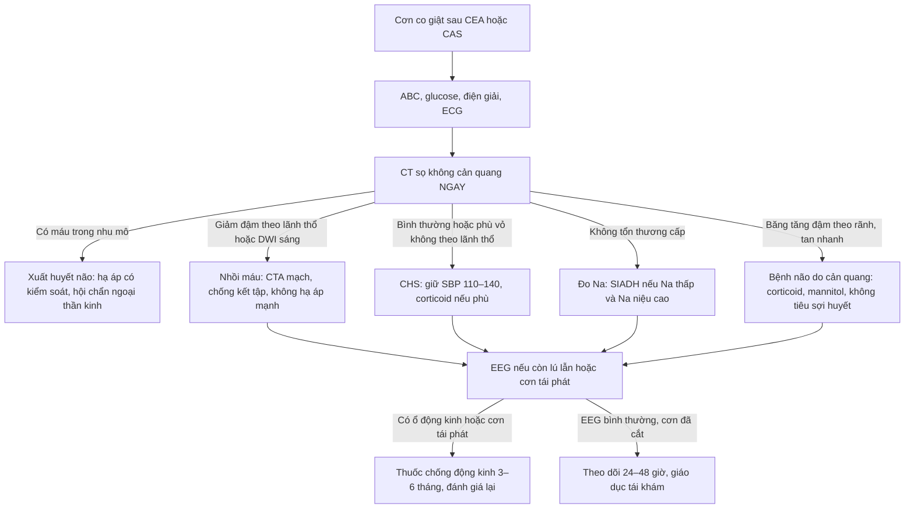
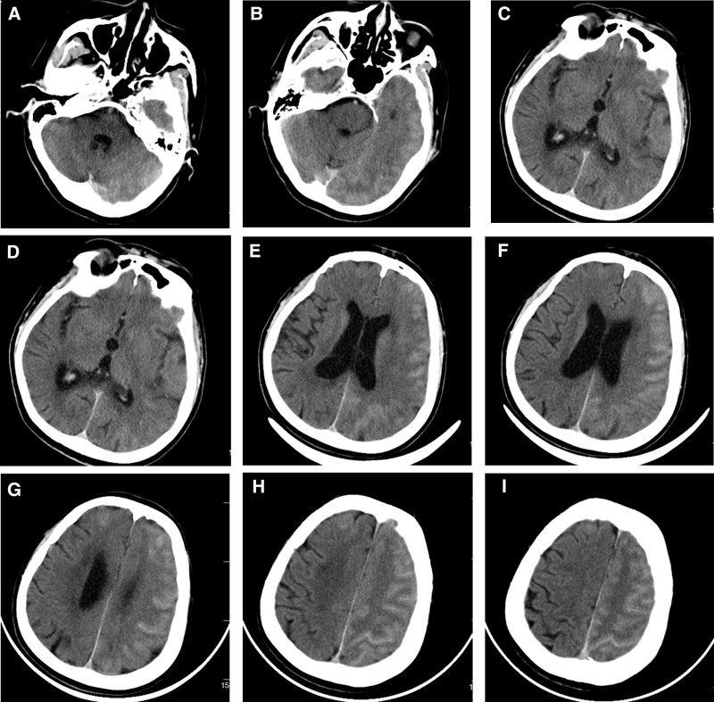
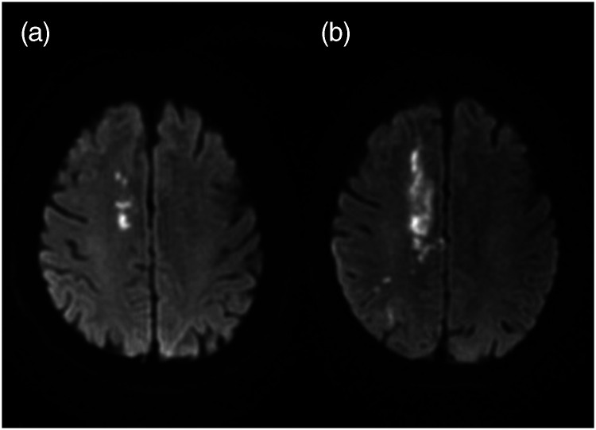
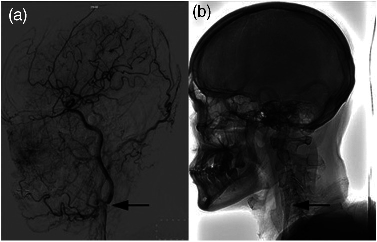
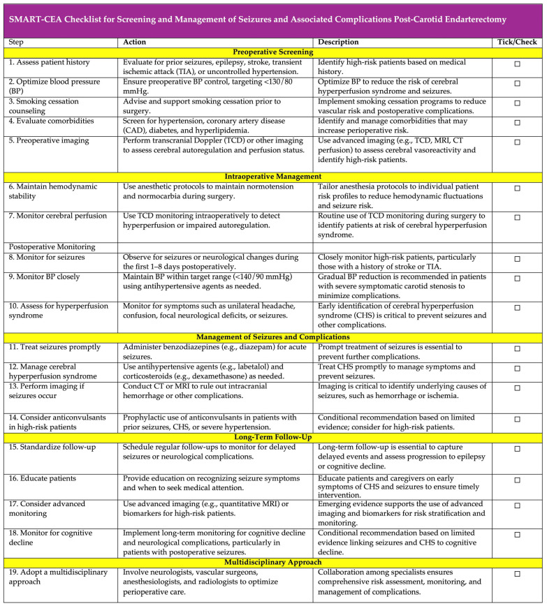

# 275 — Động kinh sau bóc nội mạc hoặc đặt stent động mạch cảnh / Seizures after carotid endarterectomy and stenting

**Tags:** `pattern:dong-kinh` `pattern:phu-nao-vung` `pattern:nhoi-mau-nao` `pattern:xuat-huyet-nao` `vung:nao` `vung:dong-mach-canh` `protocol:CT-so-nao` `protocol:MRI-so-nao` `protocol:DWI` `protocol:EEG` `protocol:TCD`

**Mức chắc chắn (certainty):** tổng hợp y văn (literature synthesis) — 1 phân tích gộp **20 nghiên cứu / 69.479 bệnh nhân** về động kinh sau bóc nội mạc cảnh (*Diagnostics* 2025, PMC11840276, CC BY 4.0), 1 ca bệnh não do cản quang sau đặt stent cảnh có CT–MRI (*Medicine* 2025, PMC11835061, CC BY 4.0), 1 ca trạng thái động kinh sau đặt stent vì carotid web (*J Int Med Res* 2025, PMC12580545, CC BY-NC 4.0), 1 ca hạ natri máu nặng sau bóc nội mạc cảnh (*Clin Case Rep* 2021, PMC8643490, CC BY-NC-ND 4.0) và 1 ca động kinh cục bộ liên tục do CHS sau đặt stent (*Cureus* 2023, PMC10767296). **Không có ca nguyên văn của nhóm** — 3 ca trong quiz là **ca công bố, lấy nguyên văn từ bài gốc**.

> **Câu chốt:** cơn động kinh sau tái thông cảnh **không phải một chẩn đoán** mà là **triệu chứng của 6 nguyên nhân có điều trị ngược nhau**. Ba số phải thuộc: gộp **20 nghiên cứu / 69.479 ca**, động kinh sau bóc nội mạc cảnh **1% (0–2%)**, nhưng **nghiên cứu tiên cứu 2%** và **khoảng dao động 0,01–13%**; **93% ca có cơn từng tăng huyết áp trước mổ**; **tăng tưới máu (bất kỳ) 10%** trong khi **CHS có triệu chứng chỉ 1,9% sau CEA**. Và điều tối quan trọng: **bắt buộc chụp CT sọ không cản quang trước khi tăng thuốc chống động kinh** — vì **xuất huyết não do tăng tưới máu có tử vong 40–75%**, còn **bệnh não do cản quang** thì **tự hết trong 24–48 giờ** nếu không can thiệp sai.

## 1. Tổng quan bệnh học – cơ chế hình ảnh

### 1.1 Vì sao tái thông cảnh lại gây cơn động kinh

- **Mất tự điều hòa mạch não:** vùng não sau hẹp mạn tính đã **giãn tiểu động mạch tối đa**; khi mở hẹp, **lưu lượng tăng > 100%** so với nền (định nghĩa tăng tưới máu) → **vỡ hàng rào máu–não** → phù vận mạch → **tế bào thần kinh trong vùng phù bị kích thích** = cơn động kinh, có thể tiến tới **xuất huyết ổ**.
- **Cơ chế thứ hai — thiếu máu:** cục xơ vỡ hoặc huyết khối di chuyển trong lúc can thiệp → **nhồi máu vỏ–dưới vỏ** → cơn động kinh cục bộ, thường kèm **khiếm khuyết thần kinh khu trú**.
- **Cơ chế thứ ba — thẩm thấu:** **bệnh não do cản quang (contrast-induced encephalopathy, CIE)** xảy ra khi cản quang **qua được hàng rào máu–não bị vỡ** và **thấm vào vỏ não**; cản quang độc với tế bào thần kinh → **co giật, mù vỏ não, lú lẫn, liệt nửa người**, hồi phục **24–48 giờ**.
- **Cơ chế thứ tư — natri:** sau mổ cổ, **SIADH** do tăng ADH (tổn thương thanh mạc cảnh, giảm tín hiệu áp lực từ xoang cảnh) → hạ natri → **lú lẫn, co giật**. Y văn chỉ có **3 ca hạ natri đáng kể sau CEA** trước ca báo cáo; ca nặng nhất **Na 109 mmol/L**.
- **Cơ chế thứ năm — xuất huyết:** tăng tưới máu nặng → **xuất huyết não (ICH)**; đây là nguyên nhân **chết người** và là lý do **phải chụp CT trước mọi xử trí khác**.

### 1.2 Số liệu định lượng phải nhớ

- **Tần suất sau CEA:** gộp **20 nghiên cứu / 69.479 bệnh nhân** = **1% (95% CI 0–2%; I² = 93,52)**; **nghiên cứu tiên cứu 2% (0–4%; I² = 76,34)** so với **hồi cứu 0% (0–1%; I² = 91,51)**; dao động từng nghiên cứu **0,01–13%**. Tuổi trung bình **67,7**; **tăng huyết áp 71,9%**, bệnh mạch vành **23%**.
- **Thời gian theo dõi:** **1–8 ngày** sau mổ (một nghiên cứu tới **14 ngày**) — nghĩa là **cơn muộn sau 1 tuần có thể bị bỏ sót** trong các nghiên cứu này.
- **Tăng huyết áp trước mổ:** gặp ở **93% (85–98%)** bệnh nhân có cơn sau CEA (Mỹ **95%**, châu Âu **90%**, châu Á **60%**); **OR 2,71 (0,78–9,41)** — xu hướng tăng nguy cơ nhưng **không có ý nghĩa thống kê**, **I² = 0%**.
- **Tăng tưới máu:** gộp **10% (5–16%; I² = 97,43)** ở **10.868 bệnh nhân** (11 nghiên cứu), nhưng **CHS có triệu chứng chỉ 1,9% sau CEA** và **1,16–1,2% sau CAS**; **ICH do tăng tưới máu 0,37% sau CEA / 0,51–0,74% sau CAS**, **tử vong khi có ICH 40–75%** (bài 271).
- **CAS:** chưa có phân tích gộp riêng về động kinh; dữ liệu chủ yếu là **ca báo cáo** (trạng thái động kinh, động kinh cục bộ liên tục, CIE).
- **CIE:** **rất hiếm** — bài tổng quan ca không nêu được tỉ lệ chính xác; đặc điểm nhận diện quan trọng hơn con số: **CT có đường băng tăng đậm trong rãnh cuộn não**, **đậm độ bằng lòng mạch**, **không choán chỗ**, **tan nhanh**.
- **Hạ natri sau CEA:** **3 ca** đã báo cáo trước đây; ca mới: nữ 73 tuổi, **POD 4**, **Na 109**, **Na niệu 83**, **urê máu 10 mg/dL**, **acid uric 1,5**, **osm máu 224**, **osm niệu 405** → **SIADH**; bù **100 mL NaCl 3%** → Na **115** sau ~4 giờ, **119** sau 24 giờ, ra viện **129 mmol/L**.
- **Động kinh cục bộ liên tục (epilepsia partialis continua):** nam 76 tuổi, **ngày 4 sau CAS**, cơn giật tay trái **còn ý thức**, **EEG bán cầu phải có nhịp theta/delta lặp lại tới 40 giây**, **DWI/CT âm tính** (chỉ có ổ nhồi máu cũ); cần **levetiracetam 500 mg × 2/ngày + oxcarbazepine 600 mg × 2/ngày**, tăng **levetiracetam 1.000 mg × 2/ngày + lacosamide 100 mg × 2/ngày** mới cắt cơn.

### 1.3 Vì sao hình ảnh trông như vậy

- **CT không cản quang:** máu tươi **60–80 HU**, vôi **> 100 HU**, cản quang **80–300 HU**. Trong CIE, cản quang trong rãnh có **đậm độ tương đương lòng mạch**, **bờ theo rãnh cuộn não**, **không tạo khối**, và **biến mất sau 24–48 giờ** — khác máu dưới nhện (đậm độ cao hơn, thường có máu trong bể nền).
- **DWI/ADC:** nhồi máu cấp = **DWI sáng + ADC giảm** ngay từ **vài phút**; phù vận mạch do tăng tưới máu = **DWI âm hoặc chỉ sáng nhẹ + ADC tăng**. Đây là cách phân biệt **CHS** với **nhồi máu thuyên tắc** trong 24 giờ đầu.
- **Phù vận mạch** làm **T2/FLAIR tăng tín hiệu vỏ–dưới vỏ**, **không theo lãnh thổ mạch**; nhồi máu theo **lãnh thổ** (MCA/ACA/PCA) và có **bờ rõ theo mạch**.
- **EEG:** cơn cục bộ có **sóng nhọn/theta–delta lặp lại** ở bán cầu tổn thương; **EEG bình thường không loại trừ** cơn đã tự hết, nhưng **EEG là bắt buộc** khi bệnh nhân **còn lú lẫn sau cơn** để tìm **trạng thái động kinh không co giật (NCSE)**.

## 2. Mẫu hình + chẩn đoán phân biệt theo thời điểm (Gamut)

- **< 24 giờ sau can thiệp:** **CIE** (1 giờ sau stent, lú lẫn/aphasia/co giật, CT có băng tăng đậm rãnh) · **nhồi máu thuyên tắc** (khiếm khuyết khu trú, DWI sáng) · **CHS sớm** (đau đầu cùng bên, huyết áp cao) · **xuất huyết** (đau đầu dữ dội, CT máu).
- **1–7 ngày:** **CHS** (đỉnh 1–7 ngày) · **ICH do tăng tưới máu** · **nhồi máu tiến triển** (như ca carotid web: cơn ngày 13, ổ nhồi máu lớn thêm) · **SIADH/hạ natri** (POD 4 trong ca minh họa) · **động kinh cục bộ liên tục** (ngày 4 sau CAS).
- **> 7 ngày:** **CHS muộn** (đã ghi nhận **ngày 15**) · **động kinh sau nhồi máu** (muộn hơn, do sẹo) · **tái hẹp/tắc stent**.
- **Theo kiểu cơn:** cơn cục bộ vận động (tay/mặt) · **động kinh cục bộ liên tục** (giật liên tục một vùng, còn ý thức) · cơn toàn thể hóa thứ phát · **trạng thái động kinh** (> 5 phút hoặc nhiều cơn không hồi phục) · **NCSE** (lú lẫn kéo dài, không giật).
- **Theo hình ảnh:** CT bình thường · **băng tăng đậm trong rãnh** (CIE) · **ổ giảm đậm theo lãnh thổ** (nhồi máu) · **ổ tăng đậm trong nhu mô** (ICH) · **phù vỏ–dưới vỏ không theo lãnh thổ** (CHS).
- **Gợi nhớ 6 nguyên nhân "CIE-CHS-ICH-INF-Na-EPI":** **C**ontrast (CIE) · **H**yperperfusion (CHS) · **I**CH · **I**nfarct · **Na** (SIADH) · **EPI**lepsy cũ.

## 3. Bảng so sánh phân biệt (ma trận đối chiếu)

| Thực thể (entity) | Hình ảnh điển hình | Chốt vào (rule-in) | Chốt loại (rule-out) | Gợi ý xác nhận |
|---|---|---|---|---|
| **CHS có cơn động kinh** | Phù vỏ–dưới vỏ cùng bên, **DWI âm/ADC tăng**, có thể xuất huyết điểm | **Đau đầu cùng bên + huyết áp tăng + DWI âm** trong **1–7 ngày** | **DWI sáng/ADC giảm theo lãnh thổ** → nhồi máu, không phải CHS | ASL/CTP, TCD, theo dõi huyết áp |
| **Nhồi máu thuyên tắc** | Ổ **DWI sáng + ADC giảm** theo lãnh thổ, có thể nhiều ổ | **Khiếm khuyết khu trú đột ngột + DWI dương tính** | **DWI âm + phù lan tỏa** → không phải nhồi máu | MRI DWI/ADC, CTA mạch |
| **Bệnh não do cản quang (CIE)** | **Băng tăng đậm theo rãnh cuộn não**, đậm độ bằng lòng mạch, **không choán chỗ**, tan sau 24–48 giờ | **Khởi phát 1–2 giờ sau bơm cản quang + CT băng rãnh + hồi phục nhanh** | **Máu thật (đậm độ cao hơn, không tan) hoặc DWI sáng lớn** | CT lặp lại sau 24 giờ, MRI |
| **Xuất huyết não do tăng tưới máu** | Ổ **tăng đậm trong nhu mô** ± phù, thường hạch nền/thùy | **Đau đầu dữ dội + nôn + CT có máu** | CT không có máu → loại ICH | CT không cản quang cấp cứu |
| **Hạ natri/SIADH sau mổ** | Não **không có tổn thương cấp**; có thể phù não lan tỏa | **Na < 130 + Na niệu > 30 + osm máu thấp + acid uric thấp** | **Na bình thường** → loại trừ | Điện giải, osm máu/niệu, cortisol, TSH |
| **Động kinh do sẹo cũ/epilepsy** | Ổ **nhồi máu/xuất huyết cũ**, teo cục bộ, không phù mới | **Tiền sử cơn + tổn thương cũ trên MRI + EEG ổ động kinh** | **Tổn thương mới cấp** → tìm nguyên nhân khác | MRI có/không cản quang, EEG |

- **Ảnh ghép đối chiếu:** không tạo ảnh ghép vì các ảnh thuộc **4 bệnh nhân khác nhau**; ảnh giữ nguyên bản, đặt riêng.

## 4. Protocol xử trí + theo dõi

### 4.1 Cấp cứu tại giường (làm song song, không chờ)

- **ABC, đường huyết mao mạch, điện giải (Na, Ca, Mg), khí máu, ECG**; hỏi **thuốc hạ áp/thiazide** đang dùng.
- **CT sọ không cản quang NGAY** — mục tiêu số một là **loại trừ ICH** trước khi dùng thuốc chống động kinh hoặc hạ áp mạnh.
- **Đo huyết áp hai tay**, đặt monitor; nếu **SBP > 180 mmHg** → hạ áp **từ từ** bằng **labetalol** (tránh tụt nhanh gây nhồi máu vùng ranh giới).
- **Đặt nội khí quản** nếu trạng thái động kinh kéo dài hoặc tụt oxy; **theo dõi sát khi dùng benzodiazepine** vì ca trạng thái động kinh đã **tụt SpO₂ < 90%** sau diazepam.

### 4.2 Thuốc và ngưỡng

- **Cắt cơn cấp:** **benzodiazepine** (diazepam 10 mg TM hoặc midazolam) là bước đầu; nếu không cắt → **thuốc chống động kinh đường TM**.
- **Thuốc chống động kinh:** **valproate 20 mg/kg TM rồi 20 mg/kg/ngày** (ca trạng thái động kinh dùng và cắt cơn) hoặc **levetiracetam 500 mg × 2/ngày**; nếu còn cơn → tăng **1.000 mg × 2/ngày**, thêm **oxcarbazepine 600 mg × 2/ngày** hoặc **lacosamide 100 mg × 2/ngày**.
- **CHS:** hạ huyết áp có kiểm soát, **giữ SBP 110–140 mmHg** (bài 271); **corticoid** (dexamethasone) khi có phù não; **không hạ áp quá nhanh**.
- **CIE:** **ngừng cản quang**, **corticoid + mannitol + albumin**, theo dõi 24–48 giờ; **không dùng thrombolysis** vì chẩn đoán nhầm thành nhồi máu (ca gốc đã dùng urokinase/tirofiban trước khi loại trừ).
- **SIADH:** **NaCl 3% 100 mL bolus** khi có triệu chứng thần kinh; mục tiêu **tăng 6–10 mmol/L trong 24 giờ đầu**, sau đó **hạn chế nước 1 L/ngày**, **ngừng thiazide**, xét **urea** nếu cần; **không sửa quá nhanh** (nguy cơ hủy myelin thẩm thấu).
- **Thời gian dùng thuốc:** **chưa có khuyến cáo riêng cho cơn sau tái thông cảnh**; thực hành hợp lý là **3–6 tháng** nếu cơn do nguyên nhân thoáng qua (CIE, CHS, hạ natri đã sửa) rồi đánh giá lại; **dài hơn** nếu có **tổn thương cấu trúc** (nhồi máu/xuất huyết) hoặc **EEG còn ổ động kinh**. Ghi rõ đây là **suy luận thực hành**, không phải bằng chứng thử nghiệm.
- **Lái xe/trở lại làm việc:** chưa có quy định riêng cho cơn sau can thiệp cảnh; khuyên **không lái xe cho tới khi được thần kinh đánh giá** và **không còn cơn khi đang dùng thuốc**.

### 4.3 Theo dõi sau can thiệp (theo SMART-CEA)

- **Sàng lọc trước mổ:** tiền sử cơn động kinh, TIA/đột quỵ, tăng huyết áp, hút thuốc; **tối ưu huyết áp < 140/90 mmHg** trước mổ.
- **Theo dõi trong mổ:** TCD phát hiện tăng vận tốc MCA; giữ **normotension–normocarbia**.
- **Sau mổ:** theo dõi **1–8 ngày** (SMART-CEA), đo huyết áp và tri giác mỗi **1–4 giờ** trong 24 giờ đầu; **đau đầu + tăng huyết áp + lú lẫn** = báo động CHS.
- **Giáo dục bệnh nhân:** đau đầu dữ dội, nôn, nhìn mờ, co giật, yếu tay chân → **cấp cứu ngay**.

### 4.4 Phân tầng thực hành (không có RADS cho biến chứng này)

- **Bậc 1 — cơn đơn lẻ, CT sạch, điện giải bình thường:** quan sát 24 giờ, không nhất thiết dùng thuốc dài ngày.
- **Bậc 2 — cơn tái phát hoặc EEG có ổ:** dùng thuốc chống động kinh, tìm nguyên nhân (MRI DWI, CTA, Na).
- **Bậc 3 — trạng thái động kinh/NCSE:** nhập ICU, benzodiazepine + thuốc TM, **đặt nội khí quản nếu cần**, EEG liên tục.
- **Bậc 4 — có ICH:** ưu tiên sống còn, hạ áp và hội chẩn ngoại thần kinh; **không chờ EEG**.

## 5. Biến thể bình thường và cạm bẫy

- **Coi mọi cơn sau mổ là CHS:** sai lầm chết người — **ICH 0,37–0,74%** nhưng **tử vong 40–75%**, và **CIE/hạ natri** cần điều trị hoàn toàn khác. **CT trước, kết luận sau.**
- **Nhầm CIE với nhồi máu và dùng tiêu sợi huyết:** ca gốc đã dùng **urokinase + tirofiban** trước khi loại trừ; CIE tự hết trong **48 giờ** với corticoid–mannitol. **Băng tăng đậm trong rãnh + DWI chỉ có điểm nhỏ không giải thích triệu chứng = CIE.**
- **Nhầm liệt Todd với nhồi máu mới:** ca carotid web cho thấy **ổ nhồi máu lớn thêm sau cơn**, không phải Todd; **MRI lặp lại** quyết định.
- **Bỏ sót NCSE:** bệnh nhân **lú lẫn kéo dài không giật** sau mổ — **EEG** là chìa khóa; CT sạch không loại trừ.
- **Hạ natri do thiazide + SIADH:** ngừng **chlorthalidone**, không chỉ truyền muối; **sửa Na 6–10 mmol/L/24 giờ**.
- **Dùng thuốc chống động kinh dự phòng cho mọi ca:** SMART-CEA chỉ khuyến cáo **có điều kiện** ở người **có tiền sử cơn, CHS hoặc tăng huyết áp nặng**; dự phòng đại trà không có bằng chứng.
- **Hạ huyết áp quá tay:** tụt nhanh có thể gây **nhồi máu vùng ranh giới**; hạ **từ từ**, theo dõi tri giác.

## 6. Tự lượng giá — Blind Quiz

**Ca 1 — Nữ 65 tuổi, đặt stent cảnh trái (hẹp 80%) với 150 mL iodixanol. Một giờ sau: lú lẫn, aphasia, yếu tay phải. Nhìn CT, mô tả trước.**

- Câu hỏi: Đậm độ trong rãnh là máu hay cản quang? Vì sao? Bước tiếp theo và điều trị?

<b>Bấm để hiện đáp án (findings + chẩn đoán)</b>

- **Dấu hiệu:** nhiều **đường băng tăng đậm (striped hyperdensity)** trong rãnh cuộn não **bán cầu trái**, một phần rãnh trán phải, liềm não và lều tiểu não; **phù nhu mô** cùng bên; **không choán chỗ**, **đậm độ bằng lòng mạch**.
- **Chẩn đoán:** **bệnh não do cản quang (CIE)** — cản quang thấm qua hàng rào máu–não bị vỡ, không phải máu.
- **Vì sao không phải máu:** đậm độ **tương đương lòng mạch**, **theo rãnh**, **tan nhanh** trên CT lặp lại; **không có khối**; DWI chỉ có **một điểm nhỏ ở thùy đỉnh trái**, **không giải thích** triệu chứng.
- **Điều trị:** **methylprednisolone 40 mg + albumin 10 g + mannitol 150 mL**, **ngừng tiêu sợi huyết/tirofiban**; triệu chứng **hết hoàn toàn ngày 2**.
- **Bài học:** CT sớm + **so đậm độ với lòng mạch** + **chụp lại** phân biệt CIE với xuất huyết; **không tiêu sợi huyết** khi chưa loại trừ CIE.
- **Nguồn:** Qi et al., Medicine 2025;104:e41473, PMC11835061, CC BY 4.0.

**Ca 2 — Nam 70 tuổi, nhồi máu trán phải, DSA có carotid web, đặt stent cảnh phải ngày 13. Sau stent: cứng chân trái từng cơn > 10 phút, sau đó yếu chân trái độ 0 kéo dài > 48 giờ.**

- Câu hỏi: Cơn cứng chân là do CHS, Todd hay nhồi máu tiến triển? Vì sao? Xử trí thuốc?

<b>Bấm để hiện đáp án (findings + chẩn đoán)</b>

- **Dấu hiệu:** DWI (a) trước: **nhồi máu dưới vỏ trán phải**; (b) sau cơn: **ổ nhồi máu LAN RỘNG**, khớp **lãnh thổ động mạch não trước**.
- **Chẩn đoán:** **trạng thái động kinh cục bộ (tonic status) do nhồi máu tiến triển**, không phải CHS (huyết áp ổn định) và **không phải liệt Todd** (yếu kéo dài > 48 giờ, ổ nhồi máu lớn thêm).
- **Xử trí:** **diazepam 10 mg** cắt cơn nhưng **tụt SpO₂ < 90%** → ngừng; chuyển **valproate 20 mg/kg TM + 20 mg/kg/ngày**, sau đó **levetiracetam 0,5 g × 2/ngày + valproate 0,5 g × 2/ngày**; phục hồi **mRS 1 sau 3 tháng**, không tái phát cơn.
- **Bài học:** **cơn + khiếm khuyết kéo dài = chụp MRI lặp lại**, đừng gọi Todd; **benzodiazepine có thể gây suy hô hấp**, chuẩn bị đường thở.
- **Nguồn:** Jing et al., J Int Med Res 2025;53:3000605251386171, PMC12580545, CC BY-NC 4.0.

*Cùng bệnh nhân ca 2: web (mũi tên) biến mất sau stent — nguyên nhân hẹp đã xử lý, nhưng nhồi máu vẫn tiến triển. Nguồn: PMC12580545, CC BY-NC 4.0.*

**Ca 3 — Không có ảnh: một đồng nghiệp hỏi "cơn sau bóc nội mạc cảnh hiếm không, và có phải do tăng tưới máu?".**

- Câu hỏi: Trả lời bằng 4 con số và 1 việc phải làm trước khi kê thuốc.

<b>Bấm để hiện đáp án</b>

- **1%** (0–2%) gộp **20 nghiên cứu / 69.479 ca**; **2%** ở nghiên cứu tiên cứu; **93%** ca có cơn **từng tăng huyết áp**; **10%** tăng tưới máu nhưng **chỉ 1,9%** CHS có triệu chứng.
- **OR tăng huyết áp trước mổ 2,71 (0,78–9,41)** — xu hướng, **không có ý nghĩa**.
- **Việc phải làm trước khi kê thuốc:** **CT sọ không cản quang** loại trừ **xuất huyết** (tử vong 40–75%) và **CIE** (tự hết 24–48 giờ).
- **Nguồn:** Rajesh et al., Diagnostics 2025;15(1):6, PMC11840276, CC BY 4.0.

### Checklist SMART-CEA (dùng khi đi buồng)

*Bảng 19 bước: huyết áp mục tiêu **< 140/90 mmHg**, theo dõi **1–8 ngày**, benzodiazepine khi có cơn, CT khi có cơn, corticoid khi phù, thuốc chống động kinh dự phòng **có điều kiện**. Nguồn: Rajesh et al., Diagnostics 2025, PMC11840276, CC BY 4.0.*

## Bài liên quan chéo

- [271 – Hội chứng tăng tưới máu não sau can thiệp cảnh](../271-hoi-chung-tang-tuoi-mau-nao/lesson.md) (CHS, ICH do tăng tưới máu, ca NVG sau CAS)
- [211 – Đột quỵ não](../211-dot-quy-nao/lesson.md) (nhồi máu thuyên tắc, DWI/ADC)
- [3027 – Xuất huyết thùy não do CAA](../3027-xuat-huyet-thuy-caa-nguoi-gia/lesson.md) (phân biệt xuất huyết não)
- [270 – Carotid web](../270-carotid-web/lesson.md) (nguyên nhân hẹp cảnh ở người trẻ, ca quiz 2)
- [1755 – Hạ natri sau mổ vùng trên yên (SIADH vs CSWS)](../1755-csws/lesson.md)

> Không dùng để chẩn đoán độc lập khi chưa có người hướng dẫn.
