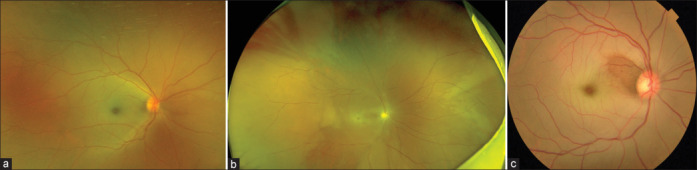
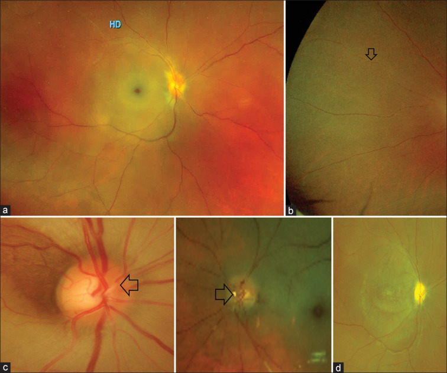
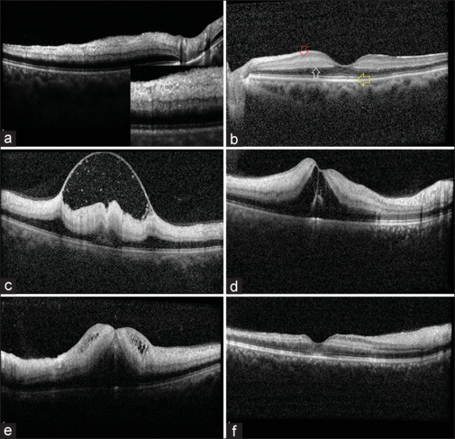
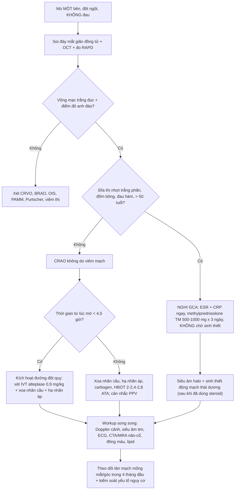
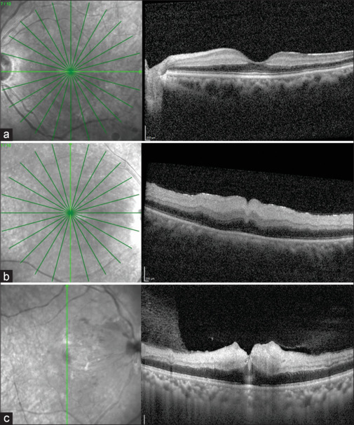
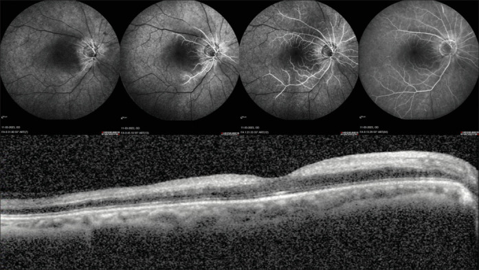

# 276 — Tắc động mạch trung tâm võng mạc cấp (CRAO): điểm đỏ anh đào và cửa sổ vài GIỜ / Acute central retinal artery occlusion

**Tags:** `pattern:tac-mach-vong-mac` `pattern:nhoi-mau-vong-mac` `pattern:phu-vong-mac` `vung:vong-mac` `vung:mat` `vung:dong-mach-canh` `score:CRAO-OCT-staging` `protocol:OCT` `protocol:FFA` `protocol:SA-Doppler` `protocol:CTA-co-can-quang` `protocol:MRI-DWI`

**Mức chắc chắn (certainty):** tổng hợp y văn (literature synthesis) — 1 bài tổng quan cập nhật về CRAO có 6 hình chuẩn (*Indian J Ophthalmol* 2024;72:945–955, PMC11329807, CC BY-NC-SA 4.0), 1 tổng quan về tiêu sợi huyết tĩnh mạch trong CRAO (*Cureus* 2023, PMC10348395, CC BY 4.0) và 1 đoàn hệ nguy cơ đột quỵ sau tắc mạch mắt (*J Am Heart Assoc* 2019, PMC6405587, CC BY-NC-ND 4.0). **Không có ca nguyên văn của nhóm** — 3 ca trong quiz là **ảnh minh họa lấy nguyên văn từ bài gốc**, không phải bệnh nhân của nhóm.

> **Câu chốt:** CRAO **không phải "mờ mắt do tuổi"** mà là **nhồi máu võng mạc trong, tức một thể đột quỵ**: tế bào võng mạc chết sau **~97 phút** thiếu máu, cửa sổ cứu được ước tính **4–6 giờ**, và **> 80% bệnh nhân vào viện với thị lực đếm ngón tay hoặc kém hơn**, **< 20% hồi phục thị lực chức năng**. Ba số phải thuộc: **1–2 ca/100.000 dân/năm**, nguy cơ đột quỵ não **gấp tới 10 lần trong 3,5 năm đầu** (đỉnh là **vài ngày đầu**), và **32,3% bệnh nhân CRAO đã có đột quỵ có triệu chứng TRƯỚC khi mắt mờ** — nghĩa là mắt là **cửa sổ nhìn vào bệnh mạch máu hệ thống**, không phải bệnh của riêng mắt.

## 1. Tổng quan bệnh học – cơ chế hình ảnh

### 1.1 Vì sao đúng động mạch này lại dễ tắc: giải phẫu + dịch tễ

- **Giải phẫu:** động mạch trung tâm võng mạc (central retinal artery, CRA) là **nhánh đầu tiên của động mạch mắt (ophthalmic artery)**, chạy **một đoạn dài và hẹp trong bao thần kinh thị** rồi mới chui vào đĩa thị để chia 4 nhánh. Khác với **động mạch mi (ciliary arteries)** nuôi hắc mạc, CRA **gần như không có vòng nối** với các nhánh khác của động mạch mắt — nên **tắc là nhồi máu ngay**, không có đường vòng.
- **Vì sao thuyên tắc hay từ cảnh–tim:** mảng xơ ở **động mạch cảnh trong cùng bên** hoặc ở **van tim** là nguồn chính; ngoài ra còn **thrombus tại chỗ**, co thắt trên nền mạch đã hẹp, và ở người trẻ là **bệnh tăng đông** (yếu tố V Leiden, prothrombin, tăng homocysteine, kháng thể kháng phospholipid), **bệnh hồng cầu hình liềm**, **đa u tủy**, **SLE**, **bệnh Behçet**; **GCA** ở người > 50 tuổi là nguyên nhân **bắt buộc phải loại trừ**.
- **Dịch tễ và tiên lượng sống:** **1–2 ca/100.000 dân/năm**, tuổi trung bình **đầu 60**, **< 2% hai bên**, nam nhiều hơn nữ nhẹ. Tuổi thọ trung bình sau CRAO **5,5 năm** so với **15,4 năm** ở người cùng tuổi không bị — vì chết do **tim và đột quỵ**, không do mắt.

### 1.2 Vì sao võng mạc TRẮNG mà điểm vàng lại ĐỎ: vật lý ánh sáng + mô học

- **Võng mạc trắng đục (retinal whitening):** khi CRA tắc, **lớp võng mạc trong** (do CRA nuôi) thiếu oxy → **phù nội bào tế bào hai cực, tế bào ngang, tế bào amacrine** → tế bào căng, mất trong suốt, **tán xạ ánh sáng trắng** khi soi đáy mắt. Đục **lan tỏa cả cực sau**, đậm nhất ở vùng dày nhất của võng mạc.
- **Điểm đỏ anh đào (cherry-red spot):** **hõm trung tâm (foveola) KHÔNG có lớp võng mạc trong** — vùng này chỉ còn tế bào cảm thụ + biểu mô sắc tố, và được nuôi bởi **hắc mạc (động mạch mi)** nên **vẫn tưới máu bình thường**. Khi võng mạc quanh hõm trắng đục, **hắc mạc đỏ thẫm lộ ra qua hõm mỏng** → thành "điểm đỏ". Vì vậy điểm đỏ anh đào **không phải tổn thương**, mà là **phần võng mạc còn lành duy nhất** — nguyên tắc này giải thích luôn vì sao **bảo tồn động mạch mi–võng mạc (cilioretinal sparing)** lại cứu được thị lực trung tâm.
- **Box-carring (phân đoạn cột máu):** dòng máu chảy cực chậm, hồng cầu **kết chuỗi (rouleaux)** ngăn cách bởi huyết tương → cột máu **đứt quãng từng đoạn** trong động mạch nhỏ.
- **Thời gian chịu đựng:** võng mạc chịu thiếu máu **tới ~97 phút** trước khi tế bào chết không hồi phục; sau đó tái tưới máu còn gây **tổn thương tái tưới máu** (gốc oxy hoạt tính + bạch cầu xâm nhập) — giải thích các hình ảnh **bong lớp giới hạn trong, nang trong võng mạc, bong thanh dịch** trên OCT muộn.
- **Hệ quả điều trị:** mọi can thiệp chỉ có nghĩa **trong vài giờ**. Không có ngưỡng "chờ ổn định" — CRAO là **cấp cứu ngang đột quỵ não**.

### 1.3 Vì sao OCT thấy đúng những gì nó thấy (và tại sao OCT sớm hơn đáy mắt)

- **Cấp:** **tăng phản xạ lớp võng mạc trong** + **che bóng lớp võng mạc ngoài**. Tăng phản xạ vì tế bào phù làm **chiết suất mô tăng**, mặt phân cách quang học bị xóa; che bóng vì lớp trong đục chặn ánh sáng tới lớp ngoài.
- **Dấu "mạch rỗng" (empty vessel sign):** lòng mạch **không còn máu** → trên OCT là **khoang bầu dục nằm dọc trong lớp võng mạc**, **thành trên–dưới tăng phản xạ**, **lòng giảm phản xạ**, **ít che bóng phía sau**. Đây là bằng chứng **trực tiếp** của tắc, có thể thấy **trước khi đáy mắt trắng rõ**.
- **Màng giới hạn giữa nổi (prominent middle limiting membrane, p-MLM):** màng giới hạn giữa nằm ở **bờ trong lớp rối ngoài**, nơi có **synapse tế bào hai cực**; phù synapse làm màng này **thành một đường tăng phản xạ rõ**. p-MLM gặp ở **CRAO nhẹ–trung bình** và **mất đi ở thể nặng** (vì lớp trong đã mất cấu trúc) — nên nó là dấu của **thiếu máu chưa hoàn toàn**.
- **Tăng phản xạ biểu mô sắc tố ở hõm:** khi lớp trong dày đục và che bóng, **biểu mô sắc tố dưới hõm trông sáng hơn** vùng xung quanh — đây là **tương ứng OCT của điểm đỏ anh đào**.
- **Mạn:** lớp trong **mỏng teo nhưng còn phân lớp** (khác nhồi máu hoại tử mất phân lớp); lớp ngoài **không bị ảnh hưởng** vì do hắc mạc nuôi.

### 1.4 Vì sao FFA và siêu âm Doppler lại là hai câu chuyện khác nhau

- **FFA đo THỜI GIAN vận chuyển, không đo "mạch máu"**: fluorescein đi cùng huyết tương nên **thời gian xuất hiện** phản ánh tốc độ dòng. Trong CRAO: **thời gian mạch–võng mạc kéo dài**, **đổ đầy chậm từng đoạn**, và **hiện tượng "không tái thông" (no re-flow)** — vùng mao mạch trung tâm hoàng điểm **không đầy thuốc dù mạch chính đã thông**, do **võng mạc phù chèn ép mao mạch**.
- **Vì sao "CRAO mà vẫn còn tưới máu" là bình thường:** đa số mắt CRAO **không tắc hoàn toàn** — FFA cho thấy **dòng chảy chậm + tưới máu tồn dư**. Vì vậy **"mạch còn đầy thuốc" KHÔNG loại trừ CRAO**; cái quyết định là **thời gian** và **vùng không tưới máu**.
- **Điểm sáng tăng huỳnh quang thì giữa (mid-phase hyperfluorescent spots, MPHS):** các **chấm sáng nhỏ ở cực sau** xuất hiện thì giữa, do **kết chuỗi hồng cầu**; gặp ở CRAO **trung bình–nặng**, mất khi tái thông.
- **Siêu âm Doppler cảnh (DUS):** trả lời câu hỏi **"thuyên tắc từ đâu"** — hẹp/tắc động mạch cảnh trong cùng bên, mảng xơ loét. **Nhưng mức hẹp cảnh KHÔNG dự báo nguy cơ đột quỵ**: trong đoàn hệ 83 mắt (31 CRAO, 35 BRAO, 17 OIS), **độ hẹp cảnh cùng bên không dự báo được đột quỵ** ở nhóm CRAO+BRAO (**P = 0,18**), trong khi mô hình dự báo đúng **82,4%** ca đột quỵ ở nhóm OIS (**P = 0,005**). Bài học: **vẫn phải tầm soát cảnh–tim, nhưng đừng trấn an vì "cảnh chỉ hẹp nhẹ"**.

### 1.5 Nguy cơ đột quỵ: con số quyết định việc chuyển tuyến

- **Trước khi mắt mờ:** **32,3%** bệnh nhân CRAO, **11,4%** BRAO và **41,2%** OIS **đã có đột quỵ bán cầu có triệu chứng**. Tức gần **1/3** ca CRAO đến viện **sau một cơn đột quỵ chưa được chẩn đoán đúng**.
- **Sau khi mắt mờ:** trong 3 năm, thêm **4,8%** (CRAO), **12,9%** (BRAO), **40%** (OIS) bị đột quỵ bán cầu.
- **Nguy cơ tương đối:** tới **10 lần** dân số chung trong **3,5 năm đầu**, **cao nhất trong vài ngày đầu** và có thể **kéo dài cả thập kỷ**.
- **Hệ quả thực hành:** CRAO = **"đột quỵ mắt"** → **chuyển đơn vị đột quỵ ngay**, không phải hẹn khám mắt 1 tuần.

## 2. Mẫu hình + chẩn đoán phân biệt theo vị trí (Gamut)

- **Mẫu hình chốt:** **mất thị lực MỘT bên, ĐỘT NGỘT, KHÔNG ĐAU** + **võng mạc trắng đục lan tỏa cực sau** + **điểm đỏ anh đào** + **động mạch nhỏ, box-carring** ± **RAPD**.
- **Gamut theo "vùng trắng" (rất thực dụng):**
  - **Trắng TOÀN cực sau + điểm đỏ anh đào:** CRAO (không viêm mạch) · CRAO do viêm mạch (GCA) · CRAO + CRVO kết hợp · tắc động mạch mắt (ophthalmic artery occlusion — thị lực **kém hơn cả cảm giác sáng**, đĩa nhợt, hắc mạc cũng thiếu máu).
  - **Trắng MỘT VÙNG theo lãnh thổ nhánh:** tắc nhánh động mạch võng mạc (BRAO) — **mảng Hollenhorst** ở chỗ chia nhánh.
  - **Trắng QUANH hõm nhưng hõm còn hồng + thị lực trung tâm CÒN:** CRAO **bảo tồn động mạch mi–võng mạc**.
  - **Không trắng, chỉ đốm trắng ngoại vi + xuất huyết:** Purtscher/Purtscher-like (chấn thương, viêm tụy cấp, suy thận, DIC, TTP) · PAMM (nhồi máu lớp giữa — xem dưới).
  - **Trắng đục + xuất huyết nhiều + tĩnh mạch giãn:** **CRAO + CRVO kết hợp** — tỉ lệ **tân mạch rất cao**, tiên lượng xấu nhất.
- **Gamut theo cơ chế (để chọn xét nghiệm):**
  - **Thuyên tắc từ cảnh:** mảng xơ, hẹp cảnh trong, **carotid web**, bóc tách cảnh.
  - **Thuyên tắc từ tim:** rung nhĩ, van tim, **viêm nội tâm mạc**, u nhầy nhĩ, **PFO** ở người trẻ.
  - **Tại chỗ/co thắt:** xơ vữa CRA, co thắt mạch, sau phẫu thuật dài tư thế sấp, **chèn ép nhãn cầu** (hôn mê, mê), **thuốc làm đầy mạch máu (filler) vùng gian mày–rãnh mũi má**.
  - **Tăng đông/viêm mạch:** yếu tố V Leiden, prothrombin, homocysteine, kháng phospholipid, hồng cầu hình liềm, đa u tủy, SLE, Behçet, **GCA**.
- **Gợi nhớ 3 câu hỏi lọc trước khi gọi CRAO:** (1) **một bên, đột ngột, không đau?** (2) **trắng đục có bờ theo vùng hay toàn cực sau?** (3) **đĩa thị có nhợt trắng phấn kèm đốm bông, hay bệnh nhân > 50 tuổi có đau đầu/đau hàm?** — nếu (3) dương tính, **đây là GCA, không phải CRAO thường**.

*(a) CRAO **không do viêm mạch** — võng mạc trắng đục + điểm đỏ anh đào, đĩa thị không phù. (b) CRAO **do viêm mạch (GCA)** — thêm **phù/nhợt đĩa thị** vì kèm thiếu máu thần kinh thị trước. (c) CRAO **bảo tồn động mạch mi–võng mạc** — một "đảo" võng mạc còn hồng ở bờ thái dương hõm, thị lực trung tâm giữ được. Nguồn: Venkatesh R et al., Indian J Ophthalmol 2024;72:945–955, PMC11329807, CC BY-NC-SA 4.0 (nguyên bản, không crop).*

*(a) Võng mạc trắng đục + **điểm đỏ anh đào**. (b) **Box-carring** — cột máu đứt đoạn (mũi tên). (c) **Thuyên tắc trong lòng động mạch** (mũi tên). (d) Thể **mạn**: đĩa thị nhợt, động mạch teo nhỏ, biến đổi hoàng điểm. Nguồn: PMC11329807, CC BY-NC-SA 4.0 (nguyên bản).*

## 3. Bảng so sánh phân biệt (ma trận đối chiếu)

| Thực thể (entity) | Hình ảnh điển hình | Chốt vào (rule-in) | Chốt loại (rule-out) | Gợi ý xác nhận |
|---|---|---|---|---|
| **CRAO không do viêm mạch** | Trắng đục **toàn cực sau** + **điểm đỏ anh đào** + box-carring; **đĩa thị KHÔNG phù**; thuyên tắc thấy được **20%** | **Mù một bên đột ngột không đau + trắng đục quanh hõm + OCT tăng phản xạ lớp trong** | Đĩa nhợt trắng phấn + đốm bông + > 50 tuổi có đau hàm → **CRAO do GCA** | OCT (dấu mạch rỗng), FFA chậm đổ đầy, DUS cảnh + siêu âm tim |
| **CRAO do viêm mạch (GCA)** | CRAO **+ phù/nhợt đĩa thị** (AAION kèm), **đốm bông**, có thể **hai bên**; FA **chậm đổ đầy hắc mạc 45–60 giây** | **> 50 tuổi + đau đầu mới/đau hàm + ESR/CRP cao + đĩa nhợt trắng phấn** | Trắng đục thuần + đĩa hồng bình thường + không triệu chứng hệ thống → không phải GCA | **ESR/CRP cấp cứu**, siêu âm halo, sinh thiết thái dương — **steroid NGAY, không chờ** |
| **CRAO bảo tồn động mạch mi–võng mạc** | **Đảo võng mạc hồng** ở bờ hõm (lãnh thổ nhánh mi–võng mạc), phần còn lại trắng | **Thị lực trung tâm CÒN tốt** dù võng mạc trắng; FFA thấy **vùng tưới máu bảo tồn** | Thị lực tốt + **không có vùng trắng nào** → không phải CRAO | FFA là cách **duy nhất** vẽ rõ ranh giới vùng bảo tồn |
| **BRAO (tắc nhánh)** | Trắng **một vùng theo lãnh thổ nhánh**, thường **kèm mảng Hollenhorst vàng óng** ở chỗ chia | **Khuyết thị trường tương ứng vùng trắng + mảng thuyên tắc thấy được** | Trắng toàn cực sau + điểm đỏ anh đào → CRAO | Soi đáy mắt giãn đồng tử, FFA, cùng workup nguồn thuyên tắc |
| **Tắc động mạch mắt (ophthalmic artery occlusion)** | Trắng đục **toàn cực sau** + **đĩa nhợt** + **hắc mạc cũng thiếu máu** (không còn "điểm đỏ" rõ) | **Thị lực KÉM HƠN cả cảm giác sáng** + đĩa nhợt + mạch hắc mạc chậm | Còn cảm giác sáng + điểm đỏ anh đào rõ → CRAO | FFA (hắc mạc không đổ đầy), DUS cảnh, CTA |
| **CRAO + CRVO kết hợp** | Trắng đục **+ xuất huyết nhiều + tĩnh mạch giãn ngoằn ngoèo** | **Đồng thời dấu tắc động mạch và tắc tĩnh mạch** | Chỉ trắng, không xuất huyết → CRAO đơn thuần | FFA + OCT; **theo dõi tân mạch sát vì tỉ lệ rất cao** |
| **OIS (thiếu máu mắt mạn)** | Xuất huyết điểm **giữa ngoại vi**, động mạch hẹp–tĩnh mạch giãn, **tân mạch mống mắt/góc**, đau hốc mắt | **Mất thị lực từ từ + đau + tân mạch góc + FA chậm đổ đầy hắc mạc từng mảng** | Mù **đột ngột** + trắng đục + điểm đỏ anh đào → CRAO | Xem bài 274 (OIS) |
| **PAMM / Purtscher** | **Dải tăng phản xạ lớp giữa** trên OCT (PAMM) hoặc **đốm trắng quanh đĩa + xuất huyết** (Purtscher) | **PAMM: dải lớp giữa + thị lực thường còn khá**; **Purtscher: bối cảnh chấn thương/viêm tụy/suy thận** | Trắng đục toàn lớp trong + điểm đỏ anh đào → CRAO | OCT (PAMM), hỏi bệnh sử chấn thương/viêm tụy |

- **Không tạo ảnh ghép cho bài này:** 5 ảnh thuộc **nhiều bệnh nhân, nhiều modality** (đáy mắt màu, OCT, FFA) và bài gốc là **CC BY-NC-SA** — ghép sẽ tạo tác phẩm phái sinh phải chia sẻ cùng giấy phép, không cần thiết. Ảnh giữ **nguyên bản, đặt riêng**.

## 4. Protocol chụp + hệ phân độ và xử trí

### 4.1 Phân độ CRAO cấp trên OCT (thang dùng trong thực hành, không có RADS cho mắt)

| Độ | Đục lớp giữa ± lớp trong | Dày lớp võng mạc trong | Mất phân lớp lớp trong | Ý nghĩa |
|---|---|---|---|---|
| **Nhẹ** | Có | **Không** | **Không** | Thiếu máu chưa hoàn toàn; **p-MLM** còn thấy → khả năng hồi phục cao hơn |
| **Trung bình** | Có | **Có** | **Không** | Phù lan sang lớp trong, còn phân lớp → còn "khung" để hồi phục |
| **Nặng** | Có | **Có** | **Có** | **Mất phân lớp** = hoại tử; tiên lượng thị lực xấu, **PPV + tPA tại chỗ ít hiệu quả** |

- **Bắt buộc đo:** độ dày võng mạc trung tâm (CMT), tìm **dấu mạch rỗng**, **p-MLM**, **bong lớp giới hạn trong**, **nang trong võng mạc**, **bong thanh dịch**.
- **Cảnh báo OCTA:** ở CRAO cấp nặng (tăng phản xạ + mất phân lớp) và CRAO mạn (mỏng nhiều), **phần mềm tự động phân lớp SAI** → không đọc mật độ mao mạch như số thật.

*(a) **Dấu mạch rỗng** (mũi tên trắng) — lòng mạch không máu. (b) **p-MLM** (mũi tên đỏ) + **tăng phản xạ biểu mô sắc tố ở hõm** (mũi tên vàng) — tương ứng OCT của điểm đỏ anh đào. (c) **Bong lớp giới hạn trong**. (d) **Nang trong võng mạc + bong thanh dịch nông**. (e) **Hoại tử lớp võng mạc trong**. (f) **Teo mỏng lớp trong ở thể mạn**. Nguồn: PMC11329807, CC BY-NC-SA 4.0 (nguyên bản).*

### 4.2 Workup hệ thống (làm song song, không chờ — bảng 1 của bài gốc)

- **Bắt buộc:** **ESR + CRP** (> 50 tuổi, hoặc bất kỳ ai có đĩa nhợt/đau đầu/đau hàm) · **công thức máu + phết máu ngoại vi** · **đường huyết, lipid, HbA1c** · **đông máu (PT/aPTT, fibrinogen)** · **điện tâm đồ** · **siêu âm tim (TT/TEE)** · **siêu âm Doppler cảnh** · **CTA/MRA não–cổ**.
- **Theo bối cảnh:** **cấy máu** (nghi viêm nội tâm mạc) · **homocysteine, yếu tố V Leiden, prothrombin, kháng thể kháng phospholipid, protein C/S** (người trẻ, không yếu tố nguy cơ) · **điện di protein huyết thanh** (đa u tủy) · **Hb điện di** (hồng cầu hình liềm) · **ANA/ANCA, QuantiFERON, X-quang ngực** (viêm mạch/lao).
- **Đừng quên bệnh sử "cơ học":** nằm sấp kéo dài khi mổ, hôn mê đè mắt, **tiêm filler vùng gian mày–mũi má**, dùng cocaine.

### 4.3 Xử trí theo cửa sổ thời gian

- **Cửa sổ:** **4–6 giờ** từ lúc bắt đầu mờ (ước tính, chưa được định nghĩa chắc chắn); **tế bào chết sau ~97 phút**.
- **Trong cửa sổ — các biện pháp "cơ học" (bằng chứng yếu, nhưng rẻ và ít hại):**
  - **Xoa nhãn cầu:** đặt kính tiếp xúc 3 gương **10 giây** gây tắc/ngưng dòng động mạch rồi **thả 5 giây**, lặp lại — mục tiêu **di chuyển thuyên tắc ra ngoại vi**.
  - **Hạ nhãn áp cấp:** **chọc tiền phòng (anterior chamber paracentesis)**, **acetazolamide TM**, **chẹn beta tại chỗ**, **mannitol** — giảm nhãn áp → tăng áp lực tưới máu qua CRA.
  - **Carbogen (95% O₂ + 5% CO₂)** hoặc thở lại khí thở ra trong túi giấy (tăng CO₂ gây giãn mạch).
  - **Bằng chứng phản biện:** gộp nhiều biện pháp cho **hồi phục thị lực 7,4%** so với **17,7%** ở diễn tiến tự nhiên (meta-analyses); **chọc tiền phòng ± carbogen không có lợi** trong 2 phân tích hồi cứu bất kể thời điểm. ⇒ **không được coi là điều trị đã chứng minh**.
- **Tiêu sợi huyết tĩnh mạch (IVT) — bằng chứng mới nhất:**
  - **Liều như đột quỵ:** alteplase **0,9 mg/kg (tối đa 90 mg)**, **10% bolus trong 1 phút**, phần còn lại truyền 1 giờ; **cửa sổ 4,5 giờ**.
  - **Kết quả:** Schrag (9 nghiên cứu, 147 bệnh nhân) — **34 ca được IVT < 4,5 giờ, 17 ca (50%) hồi phục thị lực chức năng**; Grory (238 bệnh nhân, gộp) — **67 ca < 4,5 giờ, hồi phục 37,3%**; Dumitrascu (111 ca) — **không ca nào < 4,5 giờ bị xuất huyết nội sọ có triệu chứng hay xuất huyết mắt**.
  - **Nhưng:** Cochrane 2023 (**6 RCT, 223 người bệnh**) **không đưa ra được khuyến cáo mạnh** (bằng chứng chắc chắn thấp, thiết kế không đồng nhất); AHA 2021 chỉ nói **"có thể hiệu quả"**; chỉ **5,8%** bệnh nhân CRAO thực tế được IVT; trong **9.511 lượt telestroke** chỉ **49 (0,51%)** là lý do mắt và **không ca nào được IVT**.
- **Tiêu sợi huyết ĐỘNG MẠCH (IAT):** Biousse — **249 bệnh nhân, 87 (34,9%) cải thiện ≥ 4 dòng Snellen**; **RCT duy nhất (Schumacher) dừng sớm** vì **1 ca xuất huyết não + 1 ca xuất huyết tiểu não** và **không khác biệt có ý nghĩa**. Nguy cơ **bóc tách động mạch** + lợi ích thấp ⇒ **không khuyến cáo thường quy**.
- **Oxy cao áp (HBOT):** khởi đầu **2 ATA × 90 phút**; nếu **không cải thiện sau 30 phút** → **2,4 ATA**; không cải thiện → **2,8 ATA** rồi dừng. Cơ chế: oxy hòa tan trong huyết tương nuôi võng mạc **qua hắc mạc** trong lúc chờ tái thông tự nhiên.
- **Nd:YAG phá thuyên tắc:** chỉ áp dụng được khi **thấy thuyên tắc**, mà **chỉ 17%** ca có thuyên tắc nhìn thấy ⇒ **không phải điều trị thường quy** (meta 61 bệnh nhân, có **87% cải thiện một phần**, trong đó 14 ca CRAO).
- **Cắt dịch kính (PPV) ± tPA tại chỗ:** hạ nhãn áp trong mổ để tăng áp lực tưới máu — ví dụ **IOP < 3 mmHg trong 3 phút, ngưng tưới 6 phút, nâng huyết áp tới 165/100 mmHg trong 6 phút**; PPV + kim 47G bơm **0,4 mL tPA ở 30 psi** cải thiện thị lực ở **CRAO không hoàn toàn/không toàn bộ** (khởi phát trung bình **37,8 giờ**, 26–48 giờ) nhưng **không cải thiện ở CRAO toàn bộ**. Chỉ làm ở nơi có phẫu thuật viên dịch kính–võng mạc kinh nghiệm.
- **Nếu là GCA (CRAO do viêm mạch):** **methylprednisolone TM 500–1.000 mg/ngày × 3 ngày**, sau đó **prednisone liều cao 3 ngày** rồi giảm dần; **aspirin 75 mg/ngày** (British Society for Rheumatology); **tocilizumab** là điều trị đầu tay phối hợp cho bệnh nền — **không chờ sinh thiết**.

### 4.4 Theo dõi sau cấp cứu (phần dễ bị bỏ nhất)

- **Tân mạch mống mắt (ONV) sau CRAO: 3,0–18,8%**, có thể xuất hiện **ngay ngày đầu** và **tới 2 năm sau**; vì vậy **soi mống mắt + soi góc mỗi lần khám, đặc biệt trong 4 tháng đầu** (khuyến cáo Rudkin). Có tân mạch → **PRP ± anti-VEGF**, xử trí như glôcôm tân mạch (bài 274).
- **Di chứng mạn (đo trên ảnh đáy mắt):** **teo đĩa thị 91%**, **động mạch teo nhỏ 58%**, **tuần hoàn bàng hệ mi–võng mạc 18%**, **biến đổi biểu mô sắc tố hoàng điểm 11%**.
- **Thị lực:** **> 80%** vào viện với **đếm ngón tay hoặc kém hơn**; **< 20%** hồi phục thị lực chức năng. **Đừng hứa hồi phục** — hãy hứa **tầm soát để cứu não và mắt còn lại**.

## 5. Biến thể bình thường và cạm bẫy

- **"Mạch còn đầy thuốc" không loại trừ CRAO:** đa số ca **không tắc hoàn toàn**; FFA thấy **dòng chậm + tưới máu tồn dư**. Chốt là **thời gian vận chuyển** và **vùng không tưới máu**, không phải "mạch có/hết".
- **Thị lực còn đọc được vẫn có thể là CRAO:** **động mạch mi–võng mạc hiện diện ở tới 25–30% mắt** (bài gốc: bảo tồn 14% số ca CRAO) → thị lực trung tâm giữ được. **Không vì "còn thấy chữ" mà loại CRAO** khi võng mạc đã trắng quanh hõm.
- **Đáy mắt có thể BÌNH THƯỜNG trong giờ đầu** (nhất là CRAO thoáng qua) — **OCT nhạy hơn đáy mắt**: tìm **dấu mạch rỗng** và **p-MLM** trước khi có trắng đục rõ.
- **Điểm đỏ anh đào KHÔNG đặc hiệu:** còn gặp ở **bệnh Tay–Sachs, Niemann–Pick, sialidosis, viêm võng mạc sắc tố**, và ở **mắt có hắc mạc đậm màu bẩm sinh** — nhưng các bệnh này **không có võng mạc trắng đục cấp + mù đột ngột**. **Bối cảnh thời gian** là chốt.
- **Nhầm CRAO với CRVO:** CRVO có **xuất huyết lan rộng + tĩnh mạch giãn**, CRAO có **trắng đục + động mạch nhỏ**. Khi có **cả hai** (CRAO + CRVO) thì **tỉ lệ tân mạch rất cao** — phải theo dõi góc sát hơn.
- **Bỏ sót GCA vì "đã có chẩn đoán CRAO":** thêm **steroid liều cao** không gây hại đáng kể trong vài ngày, còn **bỏ sót GCA làm mù mắt thứ hai trong vòng 1 tuần**. Ở **mọi bệnh nhân > 50 tuổi**, **ESR/CRP + câu hỏi đau hàm/đau đầu là bắt buộc**.
- **Cạm bẫy "mắt chỉ là chuyện của mắt":** **32,3%** đã có đột quỵ trước đó và **4,8%** sẽ bị trong 3 năm — **không chuyển tuyến đột quỵ là bỏ sót chính**.
- **Cạm bẫy OCTA:** phần mềm tự phân lớp sai ở CRAO nặng/mạn → **không dùng số mật độ mao mạch tự động để kết luận**.
- **Cạm bẫy thủ thuật:** chọc tiền phòng ở mắt **đang dùng kháng đông** hoặc **mắt có tiền phòng nông** có nguy cơ chảy máu/tổn thương thể thủy tinh — cân nhắc, và **không dùng prostaglandin/pilocarpine** nếu kèm thiếu máu mạn (bài 274).

## 6. Tự lượng giá — Blind Quiz

**Ca 1 — Nam 68 tuổi, đang xem tivi thì mờ mắt phải đột ngột, không đau. Thị lực đếm ngón tay. Nhìn ảnh đáy mắt, mô tả trước khi mở đáp án.**

- Câu hỏi: Dấu hiệu chính? Vì sao hõm trung tâm vẫn đỏ? Ba chẩn đoán phân biệt và **hai việc phải làm trong 30 phút đầu**?

<b>Bấm để hiện đáp án (findings + chẩn đoán)</b>

- **Dấu hiệu:** võng mạc **trắng đục lan tỏa cực sau**, **điểm đỏ anh đào** ở hõm, **động mạch nhỏ**, **box-carring** (cột máu đứt đoạn), có thể thấy **thuyên tắc trong lòng mạch** ở chỗ chia.
- **Vì sao hõm còn đỏ:** hõm **không có lớp võng mạc trong** và được **hắc mạc (động mạch mi)** nuôi → vẫn tưới máu; hắc mạc đỏ lộ qua phần võng mạc mỏng, trong khi võng mạc quanh đó phù đục.
- **Chẩn đoán:** **CRAO không do viêm mạch**.
- **Ba phân biệt:** CRAO do **GCA** (đĩa nhợt trắng phấn + đau hàm), **OIS** (mạn, đau, xuất huyết điểm giữa ngoại vi), **CRAO + CRVO** (xuất huyết nhiều + tĩnh mạch giãn).
- **Hai việc trong 30 phút:** (1) **kích hoạt đường đột quỵ** để xét **IVT < 4,5 giờ**; (2) **ESR/CRP + hỏi đau hàm/đau đầu** để loại GCA (nếu nghi → **methylprednisolone TM ngay**).
- **Nguồn:** Venkatesh R et al., Indian J Ophthalmol 2024;72:945–955, PMC11329807, CC BY-NC-SA 4.0.

**Ca 2 — Cùng bệnh cảnh, OCT hoàng điểm ở 3 mức độ. Nhìn 3 panel, xếp độ nặng và nói panel nào tiên lượng xấu nhất.**

- Câu hỏi: Ba tiêu chí phân độ là gì? Panel nào **mất phân lớp lớp trong**? Vì sao mất phân lớp lại quan trọng?

<b>Bấm để hiện đáp án</b>

- **Ba tiêu chí:** (1) **đục lớp giữa ± lớp trong**, (2) **dày lớp võng mạc trong**, (3) **mất phân lớp lớp trong**.
- **Xếp độ:** (a) **nhẹ** — đục lớp giữa ± lớp trong, **không dày, không mất phân lớp**; (b) **trung bình** — tăng phản xạ lớp trong + **dày**, **còn phân lớp**; (c) **nặng** — tăng phản xạ + dày + **mất phân lớp** (hoại tử).
- **Vì sao quan trọng:** **mất phân lớp = hoại tử không hồi phục**; các can thiệp muộn (PPV + tPA tại chỗ) **chỉ cải thiện ở CRAO không hoàn toàn/không toàn bộ**, **không cải thiện ở CRAO toàn bộ**. Đây là lý do **OCT phải làm ngay**, không chờ.
- **Nguồn:** PMC11329807, CC BY-NC-SA 4.0.

**Ca 3 — Bệnh nhân 72 tuổi, mờ mắt 5 giờ, đã xoa nhãn cầu và chọc tiền phòng ở tuyến trước. FFA thì sớm–muộn + OCT. Nhìn ảnh, trả lời trước.**

- Câu hỏi: Hiện tượng gì trên FFA? Nó có nghĩa **mạch chưa thông** không? Điều đó thay đổi xử trí thế nào?

<b>Bấm để hiện đáp án</b>

- **Dấu hiệu:** các thì FFA cho thấy **vùng mao mạch trung tâm hoàng điểm không đầy fluorescein** dù mạch chính đã có dòng — **hiện tượng "không tái thông" (no re-flow)**; OCT kèm theo: **lớp võng mạc trong tăng phản xạ và dày**.
- **Cơ chế:** **võng mạc phù chèn ép mao mạch** trung tâm; không phải huyết khối còn nguyên. Vì vậy **"không tái thông" KHÔNG có nghĩa là mạch chưa mở**.
- **Thay đổi xử trí:** **không** thêm thuốc tiêu sợi huyết vì "mạch chưa thông"; chuyển sang **theo dõi tân mạch + phục hồi chức năng + kiểm soát yếu tố nguy cơ**, và **đánh giá lại thời điểm** — can thiệp muộn sau 6 giờ không còn cửa sổ.
- **Nguồn:** PMC11329807, CC BY-NC-SA 4.0.

## Bài liên quan chéo

- [444 – Tắc mạch võng mạc: CRVO/BRVO vs CRAO](../444-tac-mach-vong-mac/lesson.md) (ma trận phân biệt tắc tĩnh mạch – động mạch)
- [435 – GCA & AAION vs NAION](../435-gca-va-naion-aion/lesson.md) (CRAO **do viêm mạch**: steroid ngay, halo sign, sinh thiết thái dương)
- [274 – Thiếu máu mắt (OIS) và glôcôm tân mạch](../274-thieu-mau-mat-ois/lesson.md) (thể thiếu máu **mạn**, tân mạch mống mắt, tái thông cảnh)
- [453 – Bệnh võng mạc tăng huyết áp và thiếu máu](../453-benh-vong-mac-tang-huyet-ap-va-thieu-mau/lesson.md) (nền mạch máu, xuất huyết – đốm bông)
- [211 – Đột quỵ não](../211-dot-quy-nao/lesson.md) (cùng nguồn thuyên tắc, cùng đường xử trí cấp cứu)
- [400 – Tổng quan Mắt & thị giác](../400-tong-quan-mat-thi-giac/lesson.md)

## Ảnh

- `276_crao_the-loai_PMC11329807.jpg` — Fig. 1 (ba thể CRAO).
- `276_crao_day-mat-dien-hinh_PMC11329807.jpg` — Fig. 2 (cherry-red, box-carring, thuyên tắc, thể mạn).
- `276_crao_OCT-do-nang_PMC11329807.jpg` — Fig. 3 (phân độ OCT nhẹ/trung bình/nặng).
- `276_crao_OCT-dau-hieu_PMC11329807.jpg` — Fig. 4 (mạch rỗng, p-MLM, bong lớp giới hạn trong, nang, hoại tử, teo mạn).
- `276_crao_FFA_PMC11329807.jpg` — Fig. 5 (không tái thông trên FFA + OCT).
- Tất cả: Venkatesh R, Joshi A, Maltsev D, Munk M, Prabhu V, Bavaskar S, Mangla R, Ruamviboonsuk P, Chhablani J. *Indian J Ophthalmol* 2024;72(7):945–955, **PMC11329807**, **CC BY-NC-SA 4.0** — **nguyên bản, không crop, không ghép**. Chi tiết trong `images/CREDITS.md`.

> Không dùng để chẩn đoán độc lập khi chưa có người hướng dẫn.
