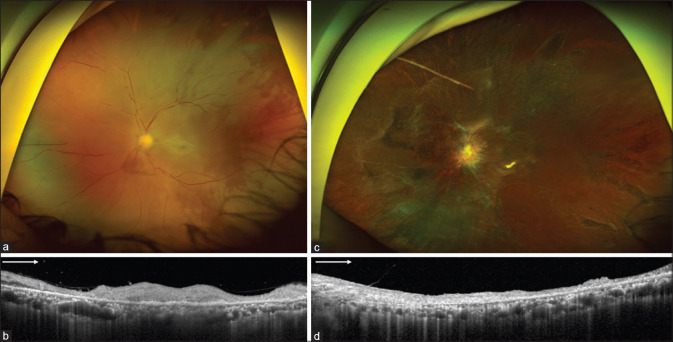
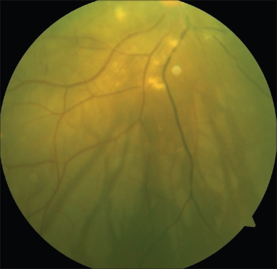
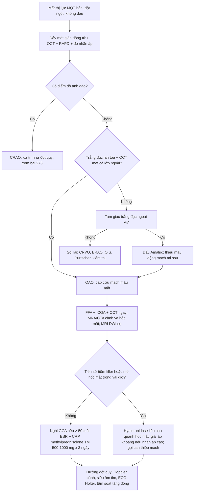
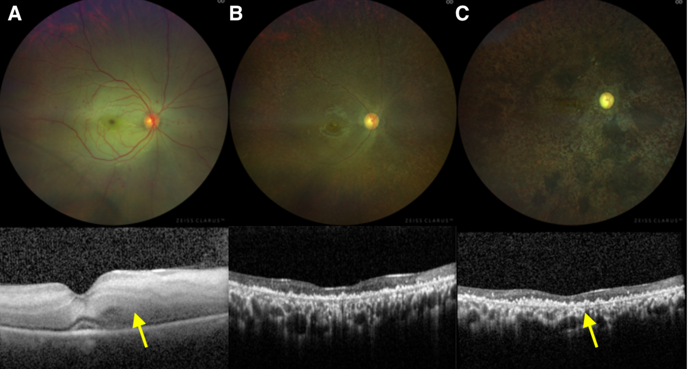
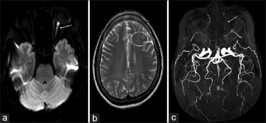
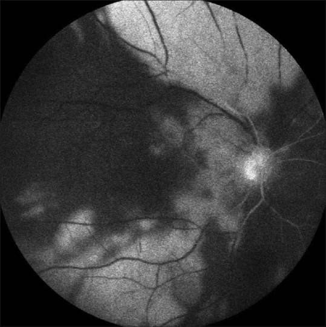

# 278 — Tắc động mạch mắt (OAO): mất CẢ võng mạc và hắc mạc, nên KHÔNG có điểm đỏ anh đào / Ophthalmic artery occlusion

**Tags:** `pattern:tac-mach-vong-mac` `pattern:nhoi-mau-vong-mac` `pattern:thieu-mau-hac-mac` `vung:vong-mac` `vung:hac-mac` `vung:than-kinh-thi` `vung:tien-phong` `vung:mat` `vung:dong-mach-canh` `protocol:OCT` `protocol:FFA` `protocol:ICGA` `protocol:CTA-co-can-quang` `protocol:MRA` `protocol:MRI-DWI`

**Mức chắc chắn (certainty):** tổng hợp y văn (literature synthesis) — 1 bài tổng quan về tắc động mạch võng mạc (*Medicina* 2024, **PMC11052062**, CC BY 4.0), 2 **ca nguyên văn** về OAO (*Indian J Ophthalmol* 2020, **PMC7774192**, CC BY-NC-SA 4.0; *Indian J Ophthalmol* 2017, **PMC5678308**, CC BY-NC-SA 4.0) và 1 ca hội chứng khoang hốc mắt gây OAO (*Indian J Ophthalmol Case Rep* 2021, **PMC8312523**, CC BY-NC-SA 4.0). Các ca được **dẫn nguyên văn**, không phải bệnh nhân của nhóm.

> **Câu chốt:** OAO **không phải "CRAO nặng hơn"** — nó là nhồi máu **toàn bộ lãnh thổ động mạch mắt**: võng mạc trong (động mạch trung tâm võng mạc), **hắc mạc** (động mạch mi), **thần kinh thị** và thường cả **đoạn trước nhãn cầu**. Ba số phải thuộc: **0,85–2 ca/100.000 dân/năm** cho tắc động mạch võng mạc nói chung, trong đó CRAO khoảng **1/100.000**, **< 2%** hai bên; thời gian chịu thiếu máu của võng mạc chỉ **~90 phút** (cửa sổ tái tưới máu **tới 6 giờ**); và **52%** ca có nguồn thuyên tắc tim trên siêu âm (**van hai lá 26% · van động mạch chủ 38% · cả hai 36%**).

## 1. Tổng quan bệnh học – cơ chế hình ảnh

### 1.1 Giải phẫu: một động mạch, ba vùng đất

- **Động mạch mắt (ophthalmic artery)** là **nhánh đầu tiên của động mạch cảnh trong**, chui qua ống thị rồi tách: **động mạch trung tâm võng mạc (CRA — nhánh đầu tiên)**, **động mạch mi sau dài (2)** và **mi sau ngắn (~10–15)**, các nhánh cơ, lệ, trên ổ mắt, sàng trước–sau, mi, sống mũi và trên rãnh trán.
- Hệ quả: **CRA nuôi võng mạc trong**; **động mạch mi nuôi hắc mạc, biểu mô sắc tố và đoạn trước nhãn cầu** (mống mắt, thể mi). Vì vậy tắc **CRA** chỉ mất **một tầng**; tắc **động mạch mắt** mất **mọi tầng**.
- **Đường thuyên tắc ngắn:** động mạch mắt là nhánh **đầu tiên** của cảnh trong, nên mảng xơ ở cảnh cùng bên hoặc cục huyết khối từ tim đi **thẳng** vào mắt, không qua mao mạch nào lọc bớt.

### 1.2 Vì sao KHÔNG có điểm đỏ anh đào — nguyên lý quan trọng nhất của bài

- Trong **CRAO** (bài 276), hõm trung tâm **không có võng mạc trong** và được nuôi bởi **hắc mạc**; hắc mạc vẫn tưới máu → đỏ thẫm **lộ ra** qua vùng võng mạc quanh hõm đang trắng đục → "điểm đỏ anh đào".
- Trong **OAO**, **động mạch mi cũng bị tắc** → hắc mạc **không còn tưới máu** → không còn "nền đỏ" để lộ ra → **mất điểm đỏ anh đào**. Đây là **dấu hiệu phân biệt tại giường bệnh**: *trắng đục lan tỏa mà KHÔNG có điểm đỏ + thị lực rất kém* → nghĩ OAO, không phải CRAO.
- Vì sao trắng đục **rộng và đậm hơn** CRAO: tổn thương phối hợp **lớp trong (phù tế bào do thiếu máu CRA)** và **lớp ngoài/biểu mô sắc tố (thiếu máu hắc mạc)** → mất cả bộ lọc ánh sáng lẫn lớp tán xạ.

### 1.3 Vì sao OCT thấy mất CẢ lớp trong và lớp ngoài

- **CRAO:** tăng phản xạ + dày **lớp trong**, lớp ngoài còn nguyên (được hắc mạc nuôi) → **mất phân lớp lớp trong nhưng lớp ngoài giữ được** ở giai đoạn muộn.
- **OAO:** cả hai nguồn nuôi cùng mất → OCT cấp có **tăng phản xạ lớp trong + dải giảm phản xạ lớp ngoài** (ca Amalric: "tăng phản xạ lớp trong võng mạc với dải giảm phản xạ ở lớp ngoài"), và ca sau tiêm filler cho thấy **mất toàn bộ các lớp võng mạc** ngay lần đầu. Về muộn: **teo cả võng mạc và hắc mạc** — hắc mạc teo là dấu **hiếm gặp ở CRAO** nhưng **đặc trưng của OAO**.
- Hệ quả thực hành: **OCT một mình không phân biệt được** nếu chỉ nhìn "lớp trong tăng phản xạ"; phải đọc **có/không tổn thương lớp ngoài – hắc mạc** và đối chiếu **màu đáy mắt + điểm đỏ anh đào**.

### 1.4 Vì sao đoạn trước nhãn cầu cũng bị — và vì sao dễ chẩn đoán nhầm viêm màng bồ đào

- Động mạch mi sau dài và các nhánh cơ nuôi **mống mắt – thể mi – tiền phòng**. Khi tắc, xuất hiện **phù giác mạc, tinh thể giả viêm ở nội mô (KP), flare 1+, tế bào 1+**, nhãn áp **có thể tăng hoặc giảm** — ca Amalric: **28 mmHg ở mắt bệnh so với 8 mmHg mắt lành**.
- Vì vậy bệnh cảnh "**mắt đỏ, đau, thị lực mất, tiền phòng có tế bào**" rất dễ bị gọi là **viêm màng bồ đào cấp** và điều trị bằng steroid — trong khi thực chất là **thiếu máu đoạn trước**. Dấu hiệu dẫn đường: **da vùng tiêm hoại tử** (nếu do filler), **đồng tử giãn không đáp ứng**, **RAPD dương tính**, và **đáy mắt trắng đục không điểm đỏ**.

### 1.5 Nguyên nhân và số liệu dịch tễ

| Nhóm nguyên nhân | Số liệu / cơ chế |
|---|---|
| Thuyên tắc từ cảnh | Mảng xơ cảnh trong **nặng ở tới 40%** bệnh nhân tắc động mạch võng mạc cấp; **> 90%** ca **nhiều thuyên tắc** có tắc cảnh cùng bên nặng, **40%** hẹp hoàn toàn |
| Thuyên tắc từ tim | Siêu âm tim phát hiện nguồn ở **52%**: van hai lá **26%**, van động mạch chủ **38%**, cả hai **36%**; **2%** có lỗ bầu dục thông |
| Viêm mạch | **1–5%** tổng số, chủ yếu **GCA**; phải loại trừ ở **mọi bệnh nhân > 50 tuổi** |
| Tăng đông | Hội chứng kháng phospholipid, tăng homocysteine, bệnh tăng sinh tủy (ca **tăng tiểu cầu tiên phát** biểu hiện bằng OAO) |
| **Do thủ thuật** | Tiêm **filler** vùng gian mày/mũi, **hội chứng khoang hốc mắt** sau mổ sọ, nút mạch/tiêm quanh hốc mắt |
| Co mạch / khác | Migraine, cocain, tụt huyết áp, chấn thương hốc mắt |

- **Filler:** nhóm filler **vĩnh viễn/bán vĩnh viễn gây biến chứng thị giác 71,4%** trong một tổng quan 2015; **hoại tử da gặp 69%** với acid hyaluronic so với **23%** với mỡ tự thân; **mỡ tự thân** có tiên lượng thị giác xấu hơn và **nhồi máu não phối hợp nhiều hơn**. Vùng **gian mày** nguy hiểm vì mạch **trên rãnh trán – trên ổ mắt** nằm nông và **tuần hoàn bàng hệ hạn chế**.
- **Hội chứng khoang hốc mắt (OCS):** ca sau mổ sọ trán — nhãn áp **53 mmHg**, lồi mắt, **liệt vận nhãn hoàn toàn**, thị lực **HM → LP → NLP** trong vài giờ; giải áp bằng **cắt góc mi dưới + cắt dây chằng mi dưới** không cứu được mắt.

## 2. Mẫu hình + chẩn đoán phân biệt theo cơ chế (Gamut)

- **Mẫu hình 1 — toàn bộ võng mạc trắng đục, KHÔNG điểm đỏ, mạch máu đứt đoạn (box-carring):** OAO do thuyên tắc cảnh/tim, do filler.
- **Mẫu hình 2 — trắng đục từng **tam giác** ở vùng ngoại vi (đáy tam giác hướng ra xích đạo, đỉnh hướng về cực sau):** **dấu Amalric** — thiếu máu **động mạch mi sau**; khi kèm trắng đục cực sau → đã tiến tới OAO.
- **Mẫu hình 3 — mắt đỏ đau, tiền phòng có tế bào, nhãn áp lệch hai mắt, đồng tử giãn:** thiếu máu **đoạn trước** trong OAO.
- **Mẫu hình 4 — kèm nhồi máu thần kinh thị (DWI sáng dọc thị giác) và nhồi máu não nhiều ổ:** "mắt là cửa sổ của não" — cùng nguồn thuyên tắc.
- **Gamut theo nguyên nhân:** thuyên tắc cảnh ↔ thuyên tắc tim ↔ viêm mạch (GCA) ↔ tăng đông ↔ **thủ thuật** (filler, OCS, nút mạch) ↔ co mạch.
- **Mnemonic 5T:** **T**hrombus/embolus (cảnh–tim), **T**emporal arteritis (GCA), **T**hrombophilia, **T**rauma/thủ thuật (filler, OCS), **T**one (co mạch, tụt áp).

## 3. Bảng so sánh phân biệt (ma trận đối chiếu)

| Thực thể (entity) | Hình ảnh điển hình | Chốt vào (rule-in) | Chốt loại (rule-out) | Gợi ý xác nhận |
|---|---|---|---|---|
| **OAO** | Trắng đục **lan tỏa cả cực sau + ngoại vi**, **KHÔNG điểm đỏ anh đào**, tam giác Amalric, OCT **mất cả lớp trong và lớp ngoài**, FFA chậm cả tuần hoàn võng mạc **và hắc mạc** | **Không có điểm đỏ + trắng đục rộng + OCT mất lớp ngoài + thiếu máu đoạn trước** | Có điểm đỏ anh đào rõ → nghĩ CRAO; hắc mạc còn tưới máu trên ICGA → không phải OAO toàn bộ | MRA/CTA: **động mạch mắt không hiện**; đoạn trước: KP, flare, IOP lệch |
| CRAO (bài 276) | Trắng đục cực sau + **điểm đỏ anh đào**, OCT **chỉ lớp trong**, hắc mạc còn tưới máu | **Điểm đỏ anh đào + tổn thương OCT giới hạn lớp trong** | Trắng đục cả ngoại vi + mất lớp ngoài → OAO | FFA: hắc mạc đổ đầy bình thường |
| BRAO | Trắng đục **một vùng theo nhánh**, có thể thấy thuyên tắc trong lòng mạch, thị trường khuyết góc phần tư | **Khu trú theo lãnh thổ một nhánh + thuyên tắc nhìn thấy** | Trắng đục toàn cực sau → CRAO/OAO | FFA: mạch nhánh không đổ thuốc |
| Tắc động mạch mi sau (Amalric) | **Tam giác trắng đục**, FFA: tam giác **tăng huỳnh quang từ ~1 phút, rò muộn**; ICGA: **chậm đổ thuốc hắc mạc nhưng KHÔNG thấy tam giác** | **Tam giác điển hình + ICGA không tương ứng** | Tam giác trên ICGA → nghĩ tổn thương hắc mạc thực thể khác | FFA + ICGA đồng thời |
| OIS (bài 274) | Thể **mạn**: xuất huyết, tân mạch mống mắt/góc, đau; FFA chậm tưới máu toàn nhãn | **Tân mạch mống mắt + hẹp cảnh ≥ 70%** | Khởi phát cấp, trắng đục rực → OAO | Doppler cảnh, FFA |
| AION (bài 435) | **Phù đĩa thị nhợt từng phần**, thị trường khuyết **cao (altitudinal)**, không trắng đục cực sau | **Phù đĩa thị + khuyết thị trường cao** | Trắng đục võng mạc lan tỏa → tắc động mạch | Đĩa thị, thị trường, ESR/CRP nếu > 50 tuổi |
| Viêm màng bồ đào cấp | Tế bào tiền phòng, KP, dính mống mắt; đáy mắt có thể bình thường | **Tế bào tiền phòng + phản ứng mống mắt** | **Thị lực mất đột ngột + RAPD + đáy mắt trắng đục** → không phải viêm đơn thuần | Soi đáy mắt giãn đồng tử, OCT, FFA |

*Bệnh nhân nữ 51 tuổi, tiêm acid hyaluronic vùng gian mày, mất thị lực NGAY sau tiêm. (a) Ảnh tiếp xúc siêu rộng: trắng đục võng mạc, phù đĩa thị, mạch máu teo nhỏ và box-carring, **không có điểm đỏ anh đào**. (b) OCT: **mất toàn bộ các lớp võng mạc**. (c, d) Sau 6 tháng: teo – xơ hóa lan tỏa, mạch "ma" (ghost vessels), OCT teo toàn bộ. Nguồn: Cho HH, Ma DJ, Kim MS, Cho IH. Indian J Ophthalmol 2020;68:2512 — PMC7774192, **CC BY-NC-SA 4.0**, ảnh nguyên bản.*

### Dấu hiệu Amalric — cách đọc đúng

- **Amalric mô tả tam giác trắng đục** ở bệnh nhân **tắc động mạch mi sau**; mô hình thực nghiệm bằng **đốt động mạch mi sau** tái tạo đúng tổn thương này.
- Hình học: **đáy tam giác hướng ra xích đạo, đỉnh hướng về cực sau** — ngược với "nan hoa" của bệnh võng mạc tăng huyết áp.
- Nghịch lý cần nhớ: trên **FFA** tam giác **tăng huỳnh quang từ khoảng 1 phút và rò ở thì muộn**, nhưng trên **ICGA** (nhìn hắc mạc) **KHÔNG thấy** — nghĩa là tổn thương **không nằm ở hắc mạc** mà ở **lớp võng mạc ngoài / biểu mô sắc tố** do thiếu máu hắc mạc gây ra; ICGA chỉ cho thấy **chậm đổ thuốc mạch hắc mạc lớn**.

*Mắt phải: box-carring động mạch, tĩnh mạch ứ, trắng đục cực sau **không có điểm đỏ anh đào**, và các **tam giác trắng đục** ở ngoại vi trên/dưới/thái dương. Thị lực **NLP**. Nguồn: Hande P, Sinha B, Nayak S, Srinivasan S, Shetty J. Indian J Ophthalmol 2017;65:1033 — PMC5678308, **CC BY-NC-SA 4.0**, ảnh nguyên bản.*

## 4. Protocol chụp + xử trí cấp cứu

### 4.1 Chẩn đoán hình ảnh theo thứ tự

1. **Đáy mắt giãn đồng tử + chụp ảnh siêu rộng (UWF):** trắng đục có/không điểm đỏ; tìm **tam giác Amalric**, xuất huyết, thuyên tắc nhìn thấy.
2. **SD-OCT hoàng điểm:** xác định **lớp nào mất** — chỉ lớp trong (CRAO) hay **cả lớp trong + lớp ngoài** (OAO); đo độ dày trung tâm.
3. **FFA:** **thời gian tay–võng mạc kéo dài**, **hắc mạc không đổ đầy**, tam giác tăng huỳnh quang rò muộn; ca Amalric: động mạch mi–võng mạc đổ thuốc ở **57 giây** nhưng phần lớn võng mạc **không tưới máu**.
4. **ICGA:** chậm đổ thuốc hắc mạc; **không** thấy tam giác → loại tổn thương hắc mạc thực thể.
5. **MRA/CTA cảnh–não + hốc mắt:** tìm **động mạch mắt không hiện được**, hẹp/tắc cảnh trong, giả phình; ca filler: **động mạch mắt, trên ổ mắt và trên rãnh trán đều không thấy** trên MRA.
6. **MRI sọ có DWI:** nhồi máu **thần kinh thị** (DWI sáng dọc thị giác) và **nhồi máu não nhiều ổ**. Trong đoàn hệ 213 bệnh nhân tắc mạch mắt, **23% có nhồi máu não** dù **90% không có triệu chứng thần kinh**; ở 77 bệnh nhân CRAO, **14% có đột quỵ**, **5 ca trong vòng 1 tháng**.

### 4.2 Xử trí — cùng nguyên lý với CRAO nhưng tiên lượng xấu hơn

- **Tư thế nằm ngửa**, **xoa nhãn cầu 10–15 giây ép / thả, lặp 3–5 phút** (làm giãn động mạch và dao động nhãn áp, có thể đẩy thuyên tắc ra ngoại vi).
- **Hạ nhãn áp:** apraclonidine 1%, timolol 0,5%, **acetazolamide TM 500 mg**, mannitol/glycerol nếu cần nhanh. **Chọc tiền phòng: không chứng minh có lợi** (Atebara; Fieß) và có nguy cơ **hạ nhãn áp, viêm nội nhãn**.
- **Carbogen 5% CO₂ / 95% O₂** và **liệu pháp oxy cao áp (HBOT)**: nếu bắt đầu **trong 8 giờ**, một chuỗi ca báo **83% cải thiện thị lực** — hợp lý vì oxy khuếch tán từ hắc mạc nuôi lớp ngoài, nhưng **ở OAO hắc mạc không tưới máu** nên kỳ vọng thấp hơn.
- **Tiêu sợi huyết TM/động mạch**: chỉ bàn trong **đơn vị đột quỵ**, không có RCT dương tính (xem bài 276); **không được chậm trễ workup nguyên nhân**.
- **Nghi GCA:** **methylprednisolone 500–1.000 mg/ngày × 3 ngày** rồi prednisone liều cao; **aspirin 75 mg/ngày**; **không chờ sinh thiết** (bài 435).
- **Filler:** **hyaluronidase** liều cao quanh hốc mắt/đường đi mạch càng sớm càng tốt; ca dưới đây **không dùng vì đã 1 tuần** — nhấn mạnh **cửa sổ vài giờ**.
- **OCS:** **cắt góc mi + cắt dây chằng mi dưới** giải áp; đo nhãn áp **ngay** ở mọi ca mù sau mổ/mê ở tư thế sấp.
- Theo dõi muộn: **tân mạch mống mắt/góc** (tới **18%** sau CRAO; OAO thường cao hơn) → khám lại **4 tháng đầu**, soi góc, nhãn áp; **teo nhãn** là kết cục của OAO nặng.

## 5. Biến thể bình thường và cạm bẫy

- **Bảo tồn động mạch mi–võng mạc** (gặp ở **14%** theo Hayreh, tới **30%** mắt có nhánh này) giữ được thị lực trung tâm **trong CRAO** — nhưng **không cứu được trong OAO** vì chính động mạch mi cũng tắc. Thấy "vùng hoàng điểm hồng" không loại trừ OAO.
- **Điểm đỏ anh đào "mất"** có thể do **đục thủy tinh thể dày** hoặc **xuất huyết dịch kính** che — đừng kết luận OAO chỉ vì không thấy điểm đỏ; ngược lại, đừng bỏ OAO khi "không thấy điểm đỏ" mà không giải thích.
- **Tam giác Amalric** dễ bị đọc là **đốm bông (cotton wool spots)**: đốm bông nhỏ, bờ tua, nằm dọc bó sợi thần kinh; tam giác **lớn, hình học rõ, đáy ra ngoại vi**. FFA/ICGA phân định.
- **Thiếu máu đoạn trước** bị chẩn đoán nhầm **viêm màng bồ đào** → steroid làm chậm chẩn đoán mạch máu; luôn đo **RAPD** và **nhãn áp hai mắt**, tìm **hoại tử da** vùng tiêm.
- **Filler vùng gian mày/mũi**: mạch nông, bàng hệ ít; **đau dữ dội ngay khi tiêm + mờ mắt + hoại tử da** là bộ ba phải hành động trong **giờ**, không phải "theo dõi 24 giờ".
- **OCS sau mổ sọ/mổ dài tư thế sấp**: mắt có thể **bình thường lúc mở mắt** rồi xấu trong **1 giờ**; **nhãn áp 53 mmHg** là chốt. Không giải áp kịp → **NLP vĩnh viễn**.
- **Sai lầm hệ thống:** điều trị mắt xong mà **không tìm nguồn** (cảnh, tim, GCA, tăng đông) → bỏ sót **đột quỵ não** trong vài ngày đầu.

*(A) Tuần 1: phù võng mạc lan tỏa, mờ các lớp. (B) Tháng 2: võng mạc mỏng dần. (C) Tháng 3: **teo võng mạc và hắc mạc**, biến đổi sắc tố dạng lốm đốm (mũi tên) — dấu **teo hắc mạc** đặc trưng của OAO, khác CRAO. Nguồn: DeMaria L, Tran AQ, Tooley AA, Abdelhakim A, Belinsky I, Kim E. Indian J Ophthalmol Case Rep 2021;1:280 — PMC8312523, **CC BY-NC-SA 4.0**, ảnh nguyên bản.*

## 6. Tự lượng giá — Blind Quiz ngay trên trang tĩnh

**Ca 1 — Nữ 51 tuổi, tiêm filler vùng gian mày, mất thị lực ngay sau tiêm.**

- Gợi ý lâm sàng: da sống mũi và trán **hoại tử**; nhãn áp **17 mmHg**; **RAPD dương tính**; đoạn trước "bình thường".
- Câu hỏi: Vì sao **không có điểm đỏ anh đào**? OCT khác CRAO ở đâu? Cần chụp gì để chứng minh tắc ở đâu?

<b>Bấm để hiện đáp án</b>

- Dấu hiệu: trắng đục võng mạc lan tỏa, phù đĩa thị, mạch teo + box-carring, **không điểm đỏ anh đào**; OCT **mất toàn bộ các lớp** (cả lớp ngoài). Sau 6 tháng: teo – xơ hóa, mạch ma.
- Chẩn đoán: **tắc động mạch mắt do filler** — hắc mạc cũng thiếu máu nên không có "nền đỏ" của hõm; lớp ngoài chết vì hắc mạc không tưới máu.
- Chứng minh: **MRA** — động mạch mắt, trên ổ mắt, trên rãnh trán **không hiện**; **MRI DWI** — nhồi máu **thần kinh thị** + **nhồi máu não nhiều ổ**; **FFA** chậm cả tuần hoàn võng mạc và hắc mạc.
- Đối chiếu ảnh MRI:

- Nguồn: Cho HH, Ma DJ, Kim MS, Cho IH. *Indian J Ophthalmol* 2020;68:2512 — PMC7774192, CC BY-NC-SA 4.0.

**Ca 2 — Nam 75 tuổi, mù đột ngột 5 ngày, tiền sử hút thuốc 40 năm, claudication cách đây 1 tháng.**

- Gợi ý: thị lực **NLP**; tiền phòng có **KP, flare 1+, tế bào 1+**; nhãn áp **28 mmHg** (mắt lành 8 mmHg).
- Câu hỏi: Ba dấu hiệu trên ảnh? Vì sao tiền phòng có tế bào? Dấu này tên gì và nói lên điều gì về mạch máu?

<b>Bấm để hiện đáp án</b>

- Dấu hiệu: box-carring, tĩnh mạch ứ, trắng đục cực sau **không điểm đỏ**, và **ba tam giác trắng đục** ngoại vi (đáy ra xích đạo, đỉnh về cực sau) = **dấu Amalric** (thiếu máu động mạch mi sau).
- Tiền phòng có tế bào = **thiếu máu đoạn trước** (động mạch mi nuôi mống mắt – thể mi), không phải viêm màng bồ đào nguyên phát; nhãn áp lệch **20 mmHg** giữa hai mắt cũng là dấu hiệu.
- FFA: **tay–võng mạc kéo dài**, động mạch mi–võng mạc đổ thuốc ở **57 giây**, phần lớn võng mạc **không tưới máu**; tam giác **tăng huỳnh quang ~1 phút, rò muộn**; **ICGA không thấy tam giác** nhưng chậm đổ thuốc hắc mạc.

- Nguồn: Hande P, Sinha B, Nayak S, Srinivasan S, Shetty J. *Indian J Ophthalmol* 2017;65:1033 — PMC5678308, CC BY-NC-SA 4.0.

**Ca 3 — Nữ 32 tuổi, sau mổ sọ trán 8 giờ, mở mắt thấy mờ rồi mất thị lực trong 1 giờ, lồi mắt, liệt vận nhãn.**

- Gợi ý: nhãn áp **53 mmHg**, RAPD mạnh, đĩa thị còn tưới máu; đã cắt góc mi + cắt dây chằng mi dưới và dùng methylprednisolone **1 g × 3 ngày**.
- Câu hỏi: Cơ chế gây tắc? Vì sao vẫn **NLP**? Ảnh tháng 3 cho thấy tầng nào bị teo và vì sao đó là chìa khóa phân biệt với CRAO?

<b>Bấm để hiện đáp án</b>

- Cơ chế: **hội chứng khoang hốc mắt** — vạt cân cơ kéo + tư thế đầu nghiêng → ứ tĩnh mạch hốc mắt, tăng áp lực trong ổ mắt, **chèn ép động mạch mắt ở đỉnh hốc mắt**. Cơ chế gián tiếp (tăng áp lực), không phải thuyên tắc.
- Vì sao NLP: tổn thương **thần kinh thị + võng mạc + hắc mạc** cùng lúc; giải áp muộn (sau khi đã thiếu máu > ngưỡng chịu đựng).
- Ảnh C: **teo võng mạc VÀ teo hắc mạc** (lốm đốm sắc tố) — dấu **hai tầng** này là chìa khóa của OAO; CRAO chỉ teo lớp trong, hắc mạc nguyên.
- Nguồn: DeMaria L, Tran AQ, Tooley AA, Abdelhakim A, Belinsky I, Kim E. *Indian J Ophthalmol Case Rep* 2021;1:280 — PMC8312523, CC BY-NC-SA 4.0.

## Bài liên quan chéo

- [276 – Tắc động mạch trung tâm võng mạc (CRAO)](../276-tac-dong-mach-trung-tam-vong-mac/lesson.md) (thể **một tầng**: điểm đỏ anh đào, OCT chỉ lớp trong)
- [274 – Thiếu máu mắt (OIS) và glôcôm tân mạch](../274-thieu-mau-mat-ois/lesson.md) (thể **mạn** của cùng lãnh thổ)
- [444 – Tắc mạch võng mạc: CRVO/BRVO vs CRAO](../444-tac-mach-vong-mac/lesson.md) (ma trận tắc tĩnh mạch – động mạch)
- [435 – GCA và AAION vs NAION](../435-gca-va-naion-aion/lesson.md) (nguyên nhân viêm mạch, steroid ngay)
- [453 – Bệnh võng mạc tăng huyết áp và thiếu máu](../453-benh-vong-mac-tang-huyet-ap-va-thieu-mau/lesson.md) (nền mạch máu, đốm bông)
- [441 – OCT hoàng điểm](../441-OCT-hoang-diem/lesson.md) (đọc phân lớp để phân biệt lớp trong – lớp ngoài)
- [211 – Đột quỵ não](../211-dot-quy-nao/lesson.md) (cùng nguồn thuyên tắc, cùng đường xử trí)
- [400 – Tổng quan Mắt & thị giác](../400-tong-quan-mat-thi-giac/lesson.md)

## Ảnh

- `278_oao_day-mat-OCT_PMC7774192.jpg` — Fig. 1 (UWF + OCT cấp và 6 tháng, ca filler).
- `278_oao_MRI-MRA_PMC7774192.jpg` — Fig. 2 (DWI thần kinh thị, FLAIR nhồi máu não, MRA mất động mạch mắt).
- `278_oao_amalric_day-mat_PMC5678308.jpg` — Fig. 3 (dấu Amalric).
- `278_oao_amalric_FFA_PMC5678308.jpg` — Fig. 5 (FFA thì muộn: tam giác tăng huỳnh quang, rò).
- `278_oao_teo-hac-mac_PMC8312523.jpg` — Fig. 3 (OAO do OCS: phù tuần 1 → teo võng mạc + hắc mạc tháng 3).
- Tất cả **nguyên bản, không crop, không ghép** (CC BY-NC-SA 4.0 không cho tạo tác phẩm phái sinh trong repo này). Chi tiết tác giả + giấy phép: `images/CREDITS.md`.

> Không dùng để chẩn đoán độc lập khi chưa có người hướng dẫn.
