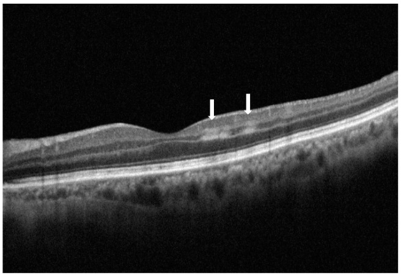
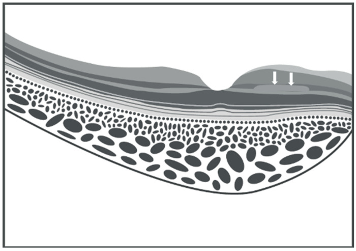
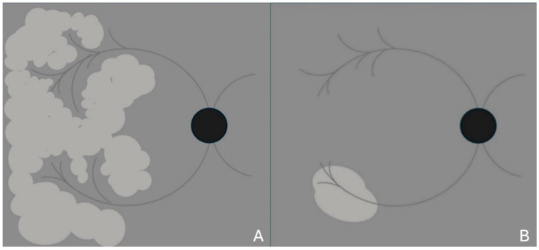
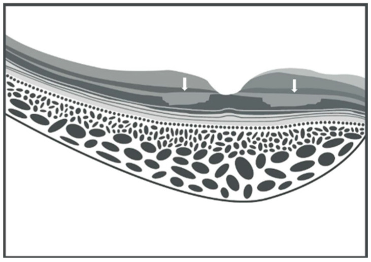
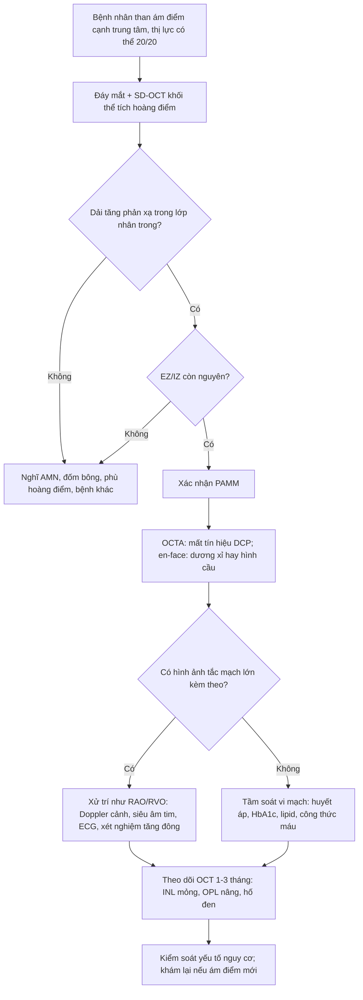
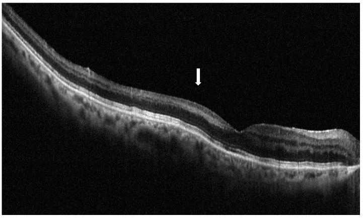

# 279 — PAMM: nhồi máu lớp giữa hoàng điểm (paracentral acute middle maculopathy) — tổn thương "vô hình" trên đáy mắt

**Tags:** `pattern:nhoi-mau-lop-giua` `pattern:tac-mach-vong-mac` `pattern:phu-vong-mac` `pattern:am-diem` `vung:hoang-diem` `vung:vong-mac` `vung:mat` `score:PAMM` `protocol:OCT` `protocol:OCTA` `protocol:FFA` `protocol:SA-Doppler`

**Mức chắc chắn (certainty):** tổng hợp y văn (literature synthesis) — 1 bài tổng quan hệ thống (*Vision* 2025;9:19, **PMC11946784**, CC BY 4.0) + số liệu đối chiếu từ 1 tổng quan tắc động mạch võng mạc (*Medicina* 2024, **PMC11052062**, CC BY 4.0). Ca trong quiz là **ảnh minh họa nguyên văn** của bài tổng quan, **không phải bệnh nhân của nhóm**.

> **Câu chốt:** PAMM là **nhồi máu lớp nhân trong (INL)** do **giảm tưới máu đám rối mao mạch sâu (DCP)** — không phải bệnh của một mạch lớn, mà là **dấu hiệu của cả một chuỗi thiếu máu võng mạc**. Ba số phải thuộc: PAMM gặp ở **19,44%** mắt tắc động mạch võng mạc (**22,38%** trong CRAO, **100%** trong tắc động mạch mi–võng mạc đơn thuần); PAMM **tồn tại dưới dạng "đã tan" (resolved PAMM/RIPL)** ở **71,1%** mắt BRVO và **71,4%** mắt CRVO so với **19,3%** người khỏe; và **thị lực thường còn 20/20** dù bệnh nhân có **ám điểm cạnh trung tâm** — nên **bỏ sót là chuyện thường**.

## 1. Tổng quan bệnh học – cơ chế hình ảnh

### 1.1 Vì sao đúng LỚP NHÂN TRONG lại chết: vùng nước chia

- **PAMM** được Sarraf và cộng sự đặt tên năm **2013**, khi nhận ra các dải tăng phản xạ **trong lớp nhân trong (inner nuclear layer, INL)** trên OCT — trước đó những vùng này được mô tả trên đáy mắt là **mảng trắng quanh tĩnh mạch (Paques' plaques)** trong CRVO.
- **Giải phẫu mạch máu quyết định vị trí:** võng mạc có **3 đám rối mao mạch** — nông (SCP), trung gian (ICP) và **sâu (DCP)**. **SCP có nguồn cấp song song và nối tiếp** nên chịu được thay đổi áp lực; **DCP KHÔNG có nhánh động mạch đi thẳng từ SCP xuống**, chỉ được cấp qua **ICP**, và **chỉ được nuôi bằng các tiểu động mạch nhỏ hơn hẳn tĩnh mạch dẫn lưu**.
- **Mô hình Krogh cylinder:** vùng **giữa hai nguồn** (đầu tận của tuần hoàn hắc mạc và tuần hoàn võng mạc) là **watershed zone** — nơi **áp lực oxy thấp nhất** về mặt sinh lý và **nhạy nhất với tụt tưới máu**. Thêm vào đó, **tế bào ngang (horizontal cells)** ở lớp giữa có **nhu cầu chuyển hóa cao** → INL là "điểm yếu" của võng mạc.
- Hệ quả: **chỉ cần giảm lưu lượng nhẹ, thoáng qua** (co mạch, tụt áp, tăng áp tĩnh mạch, thuyên tắc nhỏ) là đủ gây **nhồi máu INL**, trong khi **lớp trong vẫn nguyên** — vì thế **không có trắng đục võng mạc kiểu CRAO**.

### 1.2 Vì sao đáy mắt "bình thường" mà OCT lại bất thường

- Trắng đục võng mạc trên đáy mắt cần **phù lớp trong (RNFL – tế bào hạch)** làm **tán xạ ánh sáng**. Trong PAMM, **lớp trong không phù**, tổn thương nằm **sâu trong INL** → **không tạo mảng trắng rõ** (suy luận từ giải phẫu; bài tổng quan ghi nhận đáy mắt **thường bình thường**, đôi khi chỉ có **vùng xám nhạt khó thấy**, và các mảng này **trắng hơn, ít bờ tua hơn đốm bông**).
- Vì vậy **OCT là phương tiện chẩn đoán**, không phải đáy mắt: **SD-OCT phân giải ~3–5 µm**, đủ thấy dải tăng phản xạ **dày vài chục µm** trong INL.
- Triệu chứng: **một hoặc nhiều ám điểm cạnh trung tâm**, mô tả là "**điểm xám cố định**", nhìn mờ nhẹ, khó lấy nét; **thị lực có thể 20/20**. **Lưới Amsler** và **vi phẫu trường (microperimetry)** phát hiện ám điểm tương ứng.

### 1.3 Diễn tiến OCT: từ dải tăng phản xạ đến teo INL

| Giai đoạn | OCT | Vì sao |
|---|---|---|
| **Cấp** | **Dải tăng phản xạ trong INL**, ranh giới rõ, **EZ/IZ còn nguyên** | Phù nội bào + chiết suất mô tăng khi tế bào thiếu oxy |
| **Cấp, thể "skip"** | Nhiều dải rời rạc, **bỏ đoạn** dọc INL | Tắc nhánh tiểu động mạch **thoáng qua** rồi tái thông; vùng tưới xen kẽ vùng không |
| **Đã tan (resolved PAMM / RIPL)** | **INL mỏng + OPL nâng cao**, bề mặt lớp giữa **dạng gợn sóng** | Tế bào chết → mô xơ teo, co kéo lớp lân cận |
| **Mạn** | **"Hố đen" (black holes)** trên ảnh en-face, giảm mật độ DCP trên OCTA | Mất mô + mất tưới máu DCP không hồi phục |

*SD-OCT nhát cắt ngang mắt trái: hai dải tăng phản xạ **chủ yếu trong lớp nhân trong** ở vùng cạnh trung tâm phía thái dương (mũi tên trắng) — thể **"skip" PAMM**; các lớp ngoài (EZ/IZ) **còn nguyên**. Nguồn: Fumi D, Ruggeri F, Fasciolo D, Antonello E, Burtini G, Abdolrahimzadeh S. Vision 2025;9:19 — PMC11946784, **CC BY 4.0**.*

### 1.4 Vì sao PAMM là "đèn báo" chứ không phải bệnh riêng lẻ

- PAMM xuất hiện trong **tắc tĩnh mạch (CRVO/BRVO)**, **tắc động mạch (CRAO/BRAO/tắc động mạch mi–võng mạc)**, **bệnh võng mạc đái tháo đường**, **bệnh võng mạc tăng huyết áp**, **hội chứng thiếu máu mắt**, sau **phẫu thuật mắt**, **chấn thương**, **thuốc co mạch**, **nhiễm trùng/huyết khối** và bệnh hệ thống (thiếu máu, tăng đông, bệnh hồng cầu hình liềm).
- **"Thác thiếu máu võng mạc" (retinal ischemic cascade):** PAMM có thể là **dấu hiệu sớm nhất**, xuất hiện **trước** khi có hình ảnh RVO/RAO rõ — nên gặp PAMM phải **tìm nguyên nhân**, không dừng ở mô tả.

## 2. Mẫu hình + chẩn đoán phân biệt theo hình thái (Gamut)

- **Thể tiểu động mạch (arteriolar) — "skip"/dạng dương xỉ (fern-like):** nhiều ổ nhỏ, bờ tua, **quanh tĩnh mạch**, thường do **tắc tiểu động mạch thoáng qua**; tiên lượng thị lực **tốt hơn**.
- **Thể hình cầu lan tỏa (globular):** một ổ lớn, bờ tròn, lan **theo chiều ngang** trong INL; gặp trong **CRVO** hoặc thiếu máu **nặng/kéo dài**; thị lực **xấu hơn**.
- **Thể phối hợp:** tổn thương lan cả **lớp trong** khi thiếu máu nặng (gần giống CRAO khu trú).
- **Gamut theo nguyên nhân:** tĩnh mạch (RVO) → động mạch (CRAO/BRAO/CILRAO) → vi mạch (đái tháo đường, tăng huyết áp, xạ trị, hồng cầu hình liềm) → thủ thuật/thuốc → hệ thống (tụt áp, sốc, thiếu máu, tăng đông).
- **Mẹo nhớ 3 tầng:** *Đáy mắt bình thường + ám điểm cạnh trung tâm + OCT dải INL* → nghĩ **PAMM**, rồi hỏi **"tĩnh mạch, động mạch, hay vi mạch?"**.

## 3. Bảng so sánh phân biệt (ma trận đối chiếu)

| Thực thể (entity) | Hình ảnh điển hình | Chốt vào (rule-in) | Chốt loại (rule-out) | Gợi ý xác nhận |
|---|---|---|---|---|
| **PAMM** | **Dải tăng phản xạ TRONG INL**, **EZ/IZ nguyên**, đáy mắt thường bình thường, ám điểm cạnh trung tâm | **Tăng phản xạ INL + EZ/IZ còn nguyên + không trắng đục** | Tổn thương **OPL/ONL** + **EZ/IZ đứt** → AMN; trắng đục lan tỏa → CRAO | SD-OCT + OCTA (mất tín hiệu DCP); en-face: dương xỉ/hình cầu |
| AMN (acute macular neuroretinopathy) | Tổn thương **lớp rối ngoài (OPL) và lớp nhân ngoài (ONL)**, **đứt EZ/IZ**, ám điểm hình **cánh hoa/bầu dục** | **Đứt EZ/IZ + tổn thương lớp ngoài** | Chỉ INL, EZ/IZ nguyên → PAMM | SD-OCT nhát cắt qua ám điểm; NIR |
| CRAO (bài 276) | **Trắng đục lan tỏa + điểm đỏ anh đào**, OCT tăng phản xạ **cả lớp trong**, thị lực ≤ đếm ngón tay | **Trắng đục + điểm đỏ + thị lực rất kém** | Chỉ một dải INL, đáy mắt bình thường → PAMM | Đáy mắt + OCT; FFA chậm tưới máu |
| BRAO | Trắng đục **khu trú theo nhánh** + khuyết thị trường góc phần tư | **Khu trú theo lãnh thổ nhánh** | Nhiều ổ nhỏ cạnh trung tâm → PAMM | FFA: nhánh không đổ thuốc |
| Đốm bông (cotton wool spot) | Mảng trắng **bờ tua theo bó sợi thần kinh**, ở **lớp sợi thần kinh** | **Tăng phản xạ RNFL** trên OCT, bờ tua | Tăng phản xạ **INL**, bờ nhẵn → PAMM | OCT: định vị lớp; đáy mắt |
| Phù hoàng điểm đái tháo đường | Dày võng mạc, **nang**, xuất huyết/vi phình mạch, mất phản xạ hõm | **Nang + dày võng mạc + vi phình mạch** | Chỉ dải INL mảnh, không nang → PAMM | OCT, FFA; HbA1c |
| Purtscher | Nhiều mảng trắng quanh đĩa thị **sau chấn thương/viêm tụy**, kèm xuất huyết | **Bối cảnh chấn thương + nhiều mảng quanh đĩa** | Ổ cạnh trung tâm đơn độc → PAMM | Bệnh sử; OCT |

*Sơ đồ: tổn thương dạng dải trong **lớp nhân trong** (mũi tên trắng); giai đoạn muộn lớp này **mỏng đi** và **lớp rối ngoài nâng cao** — "gợn sóng" lớp giữa là dấu của PAMM đã tan. Nguồn: Fumi D và cs., Vision 2025;9:19 — PMC11946784, CC BY 4.0.*

### Phân biệt 3 hình thái trên ảnh en-face

- **Dương xỉ (fern-like):** các nhánh tỏa ra từ **vùng quanh tĩnh mạch**, giống lá dương xỉ — thể **nhẹ, thoáng qua**.
- **Hình cầu (globular):** đám **tròn, đặc**, lan rộng theo chiều ngang — thể **nặng**, liên quan thiếu máu kéo dài/CRVO.
- **Kết hợp:** vùng hình cầu ở trung tâm + nhánh dương xỉ ngoại vi; tiên lượng **trung gian**.

*Sơ đồ en-face: (A) **dương xỉ** — nhiều nhánh nhỏ tỏa từ vùng quanh tĩnh mạch; (B) **hình cầu** — đám tròn đặc lan rộng. Hình thái **hình cầu** đi kèm thị lực xấu hơn. Nguồn: Fumi D và cs., Vision 2025;9:19 — PMC11946784, CC BY 4.0.*

*Sơ đồ **AMN**: tổn thương tăng phản xạ ở **lớp rối ngoài** và **lớp nhân ngoài** (mũi tên), kèm **đứt đoạn EZ/IZ** — ngược lại PAMM chỉ ở INL và giữ nguyên EZ/IZ. Nguồn: Fumi D và cs., Vision 2025;9:19 — PMC11946784, CC BY 4.0.*

## 4. Protocol chụp + theo dõi

### 4.1 Chùm hình ảnh tối thiểu

1. **SD-OCT hoàng điểm** (nhát cắt ngang + **khối thể tích** đủ dày để không bỏ sót thể "skip"): định vị tổn thương **trong INL**, kiểm tra **EZ/IZ**.
2. **OCTA:** mất tín hiệu dòng chảy ở **DCP** (đôi khi cả SCP); ở thể đã tan có thể **tái tưới máu** → OCTA **không đủ** để loại trừ PAMM cũ.
3. **En-face OCT:** xác định hình thái **dương xỉ / hình cầu / hố đen**.
4. **NIR (hồng ngoại):** vùng **xám nhạt cạnh trung tâm** tương ứng (có ca không thấy gì).
5. **FAF:** có thể **giảm huỳnh quang dạng dương xỉ**; **FFA thường bình thường** — chỉ **giảm huỳnh quang nhẹ** tương ứng, và **không phân biệt được DCP với ICP**.
6. **FFA/Doppler cảnh** khi nghi **RAO** hoặc có **thuyên tắc nhìn thấy**; **FFA** vẫn cần để phát hiện **RVO, bệnh võng mạc đái tháo đường** nền.

### 4.2 Xét nghiệm nguyên nhân (PAMM là dấu hiệu, không phải chẩn đoán cuối)

- **Huyết áp**, **HbA1c/glucose**, **lipid**, **công thức máu**, **đông máu/tầm soát tăng đông** nếu trẻ hoặc tái phát.
- **ECG** (rung nhĩ), **siêu âm tim** nếu nghi nguồn thuyên tắc; **siêu âm Doppler cảnh** nếu kèm hình ảnh RAO hoặc bệnh nhân > 50 tuổi.
- **Tầm soát bệnh hệ thống** khi PAMM ở người trẻ không có yếu tố nguy cơ: bệnh tự miễn, nhiễm trùng, bệnh tăng sinh tủy.

### 4.3 Theo dõi

- **Lâm sàng:** lưới Amsler tại nhà, đo **vi phẫu trường** nếu có; thị lực **không phản ánh** mức tổn thương.
- **OCT lặp 1–3 tháng:** xác nhận **INL mỏng + OPL nâng** (resolved PAMM); nếu tổn thương **lan ra lớp trong** hoặc xuất hiện **phù/xuất huyết** → tìm **RVO/RAO** tiến triển.
- **Số liệu tiên lượng:** PAMM **đi kèm RAO** có **thị lực tốt hơn** RAO không kèm PAMM (88 mắt: 58 CRAO, 30 BRAO, 52 có PAMM) — giả thuyết là cơ chế **tự điều chỉnh lưu lượng** của tiểu động mạch tận; nhưng PAMM **hình cầu** hoặc lan lớp trong thì **xấu hơn**.

## 5. Biến thể bình thường và cạm bẫy

- **Bỏ sót vì chụp quá mỏng:** thể **"skip"** gồm nhiều dải rời rạc — **một nhát cắt đơn** có thể đi qua khe giữa hai dải → luôn chụp **khối thể tích** hoặc nhiều nhát cắt song song qua vùng ám điểm.
- **Gọi nhầm là "bình thường":** đáy mắt bình thường + thị lực 20/20 là **bộ đôi đánh lừa** điển hình; hỏi **ám điểm** và làm **Amsler**.
- **PAMM đã tan bị đọc là teo không rõ nguyên nhân:** **INL mỏng + OPL nâng** là dấu **di chứng**, không phải bệnh mới; ở người già, tăng huyết áp, hút thuốc có thể gặp **19,3%** người khỏe — nhưng ở mắt bạn của bệnh nhân RVO, tỷ lệ **cao hơn hẳn** (71,1% BRVO, 71,4% CRVO).
- **Đối chiếu PAMM – AMN:** cùng bệnh cảnh ám điểm cạnh trung tâm, nhưng **AMN tổn thương lớp ngoài + đứt EZ/IZ**, ám điểm hình **cánh hoa**; PAMM **trong INL, EZ/IZ nguyên**. Có ca **phối hợp cả hai** — không loại trừ nhau.
- **FFA bình thường không loại trừ PAMM:** FFA **không phân biệt được DCP/ICP**; tương tự **OCTA ở thể đã tan** có thể thấy tưới máu đã hồi phục.
- **Quy kết nguyên nhân quá vội:** PAMM sau **COVID/vaccine** đã được báo cáo nhưng phần lớn là **ca lẻ, không chứng minh nhân quả** — ưu tiên tìm **nguyên nhân mạch máu phổ biến** (tăng huyết áp, đái tháo đường, RVO) trước.
- **Nghịch lý tiên lượng:** thấy PAMM trong CRAO **không phải dấu xấu** — nhóm có PAMM kèm theo có **thị lực tốt hơn**; đừng dùng sự hiện diện của PAMM để tiên lượng nặng.

*SD-OCT mắt phải ở bệnh nhân có tiền sử **tắc nhánh tĩnh mạch võng mạc**: tổn thương PAMM **kéo dài** theo chiều ngang, lớp nhân trong **mỏng** kèm **lớp rối ngoài nâng cao** — dấu hiệu của PAMM đã tan (resolved PAMM/RIPL). Nguồn: Fumi D và cs., Vision 2025;9:19 — PMC11946784, CC BY 4.0.*

## 6. Tự lượng giá — Blind Quiz ngay trên trang tĩnh

**Ca 1 — Nam 62 tuổi, đái tháo đường type 2, than "một điểm xám cố định" cạnh trung tâm mắt trái 3 ngày; thị lực 20/25.**

- Câu hỏi: Tổn thương nằm ở **lớp nào**? Vì sao đáy mắt không trắng như CRAO? Cần chụp thêm gì và hỏi gì để tìm nguyên nhân?

<b>Bấm để hiện đáp án</b>

- Dấu hiệu: **hai dải tăng phản xạ rời rạc trong lớp nhân trong** ở vùng cạnh trung tâm phía thái dương; **EZ/IZ còn nguyên** → thể **"skip" PAMM**.
- Vì sao không trắng: tổn thương **sâu trong INL**, **lớp trong (RNFL/hạch) không phù** nên không tán xạ ánh sáng thành mảng trắng; đáy mắt có thể bình thường.
- Việc cần làm: **OCTA** (mất tín hiệu DCP), **en-face** (dương xỉ/hình cầu), **HbA1c, huyết áp, lipid**, **FFA** để tìm RVO/bệnh võng mạc đái tháo đường; hỏi **ám điểm** bằng lưới Amsler.
- Nguồn: Fumi D và cs., Vision 2025;9:19 — PMC11946784, CC BY 4.0.

**Ca 2 — Nữ 58 tuổi, CRVO cấp, OCT có dải tăng phản xạ dài theo chiều ngang; ảnh en-face cho hai kiểu hình thái.**

- Câu hỏi: Hình thái nào tiên lượng **tốt hơn**? Vì sao **thể hình cầu** đi với thị lực xấu hơn? Có cần điều trị đặc hiệu cho PAMM không?

<b>Bấm để hiện đáp án</b>

- (A) **dương xỉ** = thể **tiểu động mạch**, tổn thương thoáng qua, **tiên lượng tốt hơn**; (B) **hình cầu** = lan rộng theo chiều ngang, thiếu máu **nặng/kéo dài**, thị lực **xấu hơn**.
- Thể hình cầu lan rộng có thể **tiến triển sang lớp trong** (thiếu máu cả võng mạc trong) — đó là lý do tiên lượng kém, không phải bản thân "hình cầu".
- **Không có điều trị đặc hiệu cho PAMM**: điều trị **nguyên nhân** (kiểm soát huyết áp/đường huyết, xử trí CRVO, phát hiện RAO) và theo dõi; PAMM là **dấu hiệu**, không phải đích điều trị.
- Nguồn: Fumi D và cs., Vision 2025;9:19 — PMC11946784, CC BY 4.0.

**Ca 3 — Nam 70 tuổi, tiền sử BRVO 2 năm, khám định kỳ không triệu chứng; OCT thấy lớp giữa "gợn sóng".**

- Câu hỏi: Đây là tổn thương **cấp hay mạn**? Dấu OCT nào chốt? Vì sao phải khám **mắt còn lại** và tầm soát tim mạch?

<b>Bấm để hiện đáp án</b>

- **Mạn**: **INL mỏng** + **OPL nâng cao** tạo bề mặt **gợn sóng** = **resolved PAMM/RIPL**; không còn dải tăng phản xạ cấp.
- Đây là **di chứng**, nhưng số lượng RIPL **tương quan với nguy cơ tim mạch**: nhóm bệnh tim mạch có **2,8** tổn thương so với **0,8** ở nhóm chứng, và tăng theo **thang nguy cơ xơ vữa 10 năm**.
- Mắt còn lại của bệnh nhân RVO có **tỷ lệ RIPL cao hơn hẳn** người khỏe (71,1% BRVO, 71,4% CRVO so với 19,3%) → khám mắt lành + tầm soát **huyết áp, đường huyết, lipid, tim mạch**.
- Nguồn: Fumi D và cs., Vision 2025;9:19 — PMC11946784, CC BY 4.0.

## Bài liên quan chéo

- [276 – Tắc động mạch trung tâm võng mạc (CRAO)](../276-tac-dong-mach-trung-tam-vong-mac/lesson.md) (PAMM là **dấu tiên lượng tốt** khi kèm CRAO)
- [278 – Tắc động mạch mắt (OAO)](../278-tac-dong-mach-mat/lesson.md) (thiếu máu **hai tầng**: mất cả lớp ngoài)
- [444 – Tắc mạch võng mạc: CRVO/BRVO vs CRAO](../444-tac-mach-vong-mac/lesson.md) (nguyên nhân thường gặp nhất của PAMM)
- [443 – Bệnh võng mạc đái tháo đường](../443-vong-mac-dai-thao-duong/lesson.md) (PAMM là dấu vi mạch sớm)
- [453 – Bệnh võng mạc tăng huyết áp và thiếu máu](../453-benh-vong-mac-tang-huyet-ap-va-thieu-mau/lesson.md) (đốm bông – phân biệt)
- [441 – OCT hoàng điểm](../441-OCT-hoang-diem/lesson.md) (đọc phân lớp INL/OPL/EZ)
- [274 – Thiếu máu mắt (OIS)](../274-thieu-mau-mat-ois/lesson.md) (bệnh cảnh thiếu máu mạn, tân mạch)
- [400 – Tổng quan Mắt & thị giác](../400-tong-quan-mat-thi-giac/lesson.md)

## Ảnh

- `279_pamm_skip-OCT_PMC11946784.jpg` — Fig. 1 (PAMM thể "skip", SD-OCT thật).
- `279_pamm_OCT-so-do_PMC11946784.jpg` — Fig. 2 (sơ đồ dải INL và tiến triển teo).
- `279_pamm_enface-so-do_PMC11946784.jpg` — Fig. 4 (en-face: dương xỉ vs hình cầu).
- `279_pamm_AMN-doi-chieu_PMC11946784.jpg` — Fig. 5 (sơ đồ AMN — đối chiếu).
- `279_pamm_resolved-OCT_PMC11946784.jpg` — Fig. 6 (resolved PAMM trên BRVO).
- Tất cả từ **PMC11946784**, **CC BY 4.0** — ảnh **nguyên bản, không crop**; chi tiết tác giả trong `images/CREDITS.md`.

> Không dùng để chẩn đoán độc lập khi chưa có người hướng dẫn.
