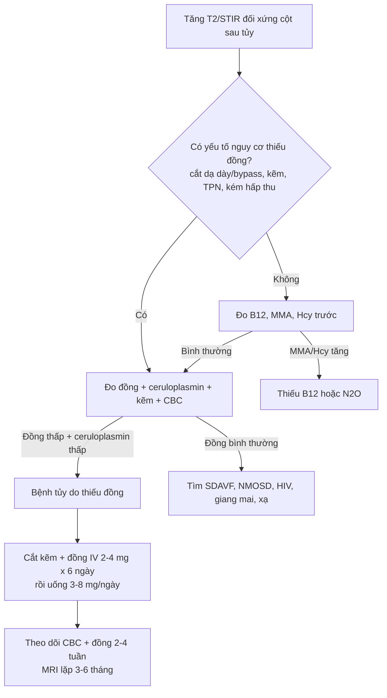
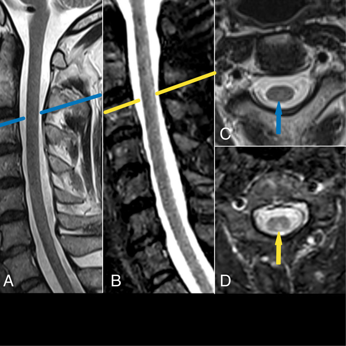
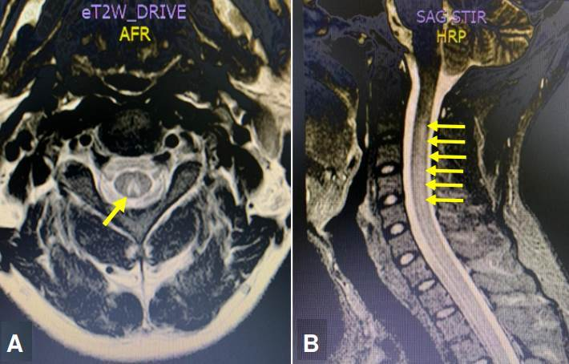
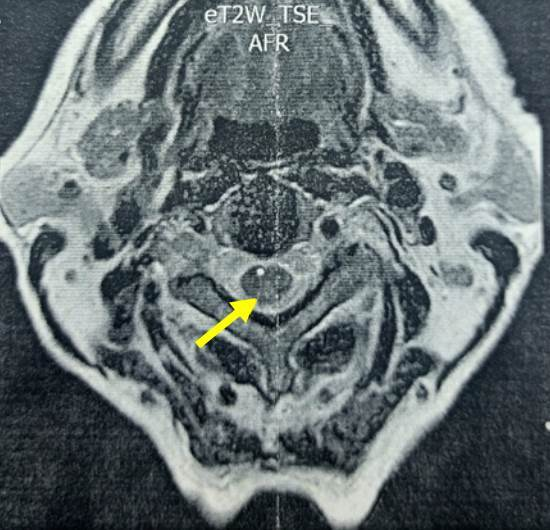

# 280 — Bệnh tủy do thiếu đồng: kẻ bắt chước hoàn hảo của thiếu B₁₂ và N₂O / Copper deficiency myelopathy

**Tags:** `pattern:tang-t2-doi-xung` `pattern:chuyen-hoa` `pattern:myelin` `vung:tuy-song` `vung:cot-sau` `protocol:MRI-T2` `protocol:MRI-STIR` `protocol:xet-nghiem-dong`
**Mức chắc chắn (certainty):** tổng hợp y văn (literature synthesis) — một tổng quan 55 ca từ y văn (PMC3691478), một loạt 3 ca có ảnh MRI (PMC10503487), một ca nguyên văn 2026 có ảnh T2 âm tính/STIR dương tính (PMC13470934), và các ca bổ trợ về xét nghiệm – điều trị (PMC10733163, PMC12144283). Phần **cơ chế vật lý T2/STIR** là suy luận từ nguyên lý chuỗi xung, đã ghi rõ.

> **Vì sao bài này quan trọng:** đây là nguyên nhân **chữa được** của một hội chứng tủy mà hình ảnh **giống hệt** thiếu vitamin B₁₂ và ngộ độc khí cười (N₂O) — nhưng **điều trị khác hoàn toàn** (bổ sung đồng, không phải B₁₂). Bệnh nhân thường đã được gọi là **"thiếu B₁₂"**, **"MDS"**, hoặc **"bệnh tủy không rõ nguyên nhân"** trong nhiều tháng; trong ca 2026, chẩn đoán trễ **gần 1 năm** và bệnh nhân **phải ngồi xe lăn**. Bỏ sót = **tổn thương thần kinh không hồi phục**, vì phần thần kinh **chỉ hồi phục một phần** dù bổ sung đúng.

## 1. Tổng quan bệnh học – cơ chế hình ảnh – vì sao "chữ V ngược" và vì sao kèm thiếu máu

### 1.1. Đồng là kim loại của chuỗi hô hấp tế bào, không phải "vi chất phụ"

- Đồng là **nhóm ngoại (prosthetic group)** của **cytochrome c oxidase (phức hợp IV)** — enzyme cuối chuỗi vận chuyển điện tử; thiếu đồng → **giảm ATP**, **stress oxy hóa** (Cu/Zn-superoxide dismutase), và **rối loạn tổng hợp myelin**. Vì vậy tổn thương giống **thoái hóa tủy kết hợp bán cấp (subacute combined degeneration, SCD)** do thiếu B₁₂: cùng là **myelin bị tổn thương do thiếu năng lượng**, không phải do viêm.
- Đồng còn là cofactor của **ceruloplasmin/hephaestin (ferroxidase)** — cần để **đưa sắt ra khỏi tế bào**. Thiếu đồng → sắt bị "nhốt" trong đại thực bào/tế bào ruột → **thiếu máu** dù sắt dự trữ bình thường, và **giảm bạch cầu trung tính** do rối loạn sinh tủy. Đây là lý do bộ ba kinh điển: **thiếu máu + giảm bạch cầu + bệnh tủy** (PMC5637704).

### 1.2. Vì sao cột sau, vì sao cổ–ngực, vì sao "chữ V ngược"

- **Cột sau (dorsal columns)** chứa **fasciculus gracilis** (sợi từ chi dưới, nằm trong) và **fasciculus cuneatus** (chi trên, nằm ngoài). Đây là các **sợi có myelin dày, dài nhất, tiêu thụ năng lượng cao nhất** của tủy → **dễ tổn thương nhất** khi thiếu năng lượng do thiếu đồng (giống B₁₂). Tổn thương → mất **cảm giác bản thể (proprioception)** và **rung âm thoa** → **thất điều cảm giác (sensory ataxia)**, **Romberg dương**, đi lại như người say.
- **TẠI SAO tăng tín hiệu trên T2:** mất myelin + **phù nội myelin (intramyelinic edema)** làm **tăng nước tự do** trong mô → **T2 kéo dài** → tín hiệu sáng. Trên mặt cắt **axial**, hai bó cột sau nằm sát nhau ở phía sau tủy, tạo hình **chữ V mở ra sau ("inverted V")** — dấu hiệu **không đặc hiệu cho nguyên nhân**, chỉ định vị **cột sau**.
- **TẠI SAO STIR quan trọng hơn T2 thường:** STIR (short tau inversion recovery, TI ~150 ms) **triệt tiêu mỡ** (mô mỡ có T1 ngắn), nên **nước bệnh lý nổi bật** trên nền tủy/mỡ bị triệt tiêu; độ tương phản với **phù nhẹ** cao hơn T2-TSE. Ca 2026 cho thấy đúng điều này: **T2-TSE sagittal âm tính**, chỉ **STIR** mới thấy **dải tăng tín hiệu hình tam giác** ở cột sau cổ–ngực trên (PMC13470934). **Hệ quả thực hành: MRI T2 âm tính KHÔNG loại trừ bệnh tủy do thiếu đồng.**
- **TẠI SAO tổn thương thường ở cổ–ngực:** đoạn cổ–ngực là nơi các bó cột sau dày nhất và có **khoảng cách chạy dài nhất từ thân tế bào**; tổn thương thường **lan dọc vài đốt**, không có khối, **không ngấm thuốc**, **không hạn chế khuếch tán** — khác nhồi máu tủy (DWI hạn chế, 2/3 trước, "owl's eyes").

### 1.3. Ngưỡng định lượng đã có (và chỗ còn trống)

| Thông số | Con số | Ý nghĩa thực hành | Nguồn |
|---|---|---|---|
| Tuổi khởi phát điển hình | **thập niên 5–6** | Người trẻ vẫn có, nhất là sau phẫu thuật giảm béo | PMC3691478 (55 ca) |
| Tỷ lệ nữ:nam | **3,6:1** | Nữ chiếm ưu thế rõ | PMC3691478 |
| Giảm tế bào máu (cytopenia) | **78%** ca | Thiếu máu thường gặp hơn giảm bạch cầu; có thể bị chẩn đoán nhầm **MDS** | PMC3691478 |
| MRI tủy bất thường | **47%** ca | **Hơn một nửa ca MRI thường quy bình thường** | PMC3691478 |
| Không tìm được nguyên nhân | **20%** ca | "Vô căn" vẫn phải điều trị thử | PMC3691478 |
| Đồng huyết thanh bình thường | **70–133 µg/dL** | Dưới ngưỡng này mới gợi ý; đơn vị µg/dL (không phải g/dL) | PMC10733163 |
| Ceruloplasmin bình thường | **21–37 mg/dL** | Giảm song song với đồng | PMC10733163 |
| Ca thiếu nặng | đồng **4 µg/dL**, ceruloplasmin **≤ 2 mg/dL** | Mức này gặp trong nuôi ăn tĩnh mạch kéo dài | PMC12144283 |
| Đồng trong nước tiểu | **thấp** (khác Wilson: cao) | Phân biệt với bệnh Wilson | PMC3691478 |
| Điều trị (ASMBS/ASPEN) | **2–4 mg đồng IV × 6 ngày**, sau đó **3–8 mg/ngày uống** | Bắt đầu ngay khi nghi, không chờ đủ xét nghiệm | PMC10503487 |
| Hồi phục huyết học | khoảng **3 tháng** | Thiếu máu/giảm bạch cầu đáp ứng tốt | PMC10503487 |
| Hồi phục thần kinh | **một phần**, đa số còn di chứng | Chẩn đoán sớm là yếu tố tiên lượng chính | PMC3691478, PMC10503487 |

- **Chỗ còn trống:** **không có tỷ lệ mắc chuẩn theo dân số**; các con số trên là **tỷ lệ trong nhóm ca đã báo**, không phải tỷ lệ quần thể. Ngưỡng đồng huyết thanh **khác nhau giữa phòng xét nghiệm** (70–133 so với 70–140 µg/dL) — luôn đọc theo khoảng tham chiếu của lab.

## 2. Mẫu hình + chẩn đoán phân biệt theo vị trí và bối cảnh (Gamut)

### 2.1. Gamut theo mẫu hình "tăng T2 đối xứng cột sau"

- **Thiếu đồng** (bài này): cổ–ngực, **chữ V ngược**, không ngấm, **kèm cytopenia** + yếu tố nguy cơ đường tiêu hóa/kẽm.
- **Thiếu B₁₂** (SCD): cùng hình ảnh; **B₁₂ máu có thể bình thường**, chốt bằng **MMA/Hcy tăng**.
- **Ngộ độc N₂O** (bài 265): cùng hình ảnh; **B₁₂ bình thường ở ~95%**, **Hcy/MMA tăng**, tiền sử dùng khí cười.
- **Bệnh tủy do HIV (vacuolar myelopathy)**: cột sau ± cột bên, **không ngấm**, HIV (+), CD4 thấp, thường kèm bệnh não.
- **Tabes dorsalis**: **teo** cột sau, T2 **thường không sáng** hoặc sáng mờ; giang mai huyết thanh (+), mất cảm giác sâu, **Argyl Robertson**.
- **SDAVF (dò động–tĩnh mạch màng cứng)**: tăng T2 **lan dài ≥ 3 đốt**, **flow void** quanh tủy, tăng tín hiệu **nón tủy**, ngấm thuốc màng tủy; nam lớn tuổi, tiến triển từ từ (bài 226).
- **NMOSD/viêm tủy**: **LETM ≥ 3 đốt**, tổn thương **trung tâm**, **dấu H**, area postrema; AQP4/MOG (+).
- **Tủy mềm do xạ**: trong **trường chiếu**, tiềm tàng **> 6 tháng**, T2 sáng dọc, không choán chỗ (bài 268).

### 2.2. Gamut theo yếu tố nguy cơ thiếu đồng (hỏi bệnh là chốt)

- **Phẫu thuật đường tiêu hóa trên**: cắt dạ dày, **bắc cầu dạ dày (gastric bypass)**, **sleeve gastrectomy** — đồng hấp thu ở **tá tràng/đoạn đầu hỗng tràng**.
- **Kẽm quá mức**: **kem dính răng giả chứa kẽm** (ca 2026: dùng **5 lần/ngày trong 25 năm**), viên kẽm liều cao, kẽm trong nuôi ăn.
- **Nuôi ăn tĩnh mạch không đủ đồng**, **kém hấp thu**, **bệnh celiac**, **bệnh viêm ruột**, **bariatric**.
- **Thừa sắt** (truyền máu nhiều, hemochromatosis) — sắt và đồng **cạnh tranh hấp thu**.
- **Thuốc**: một số phác đồ ung thư (chất tạo chelate), **kẽm** trong điều trị Wilson (làm thiếu đồng thứ phát).

### 2.3. Ba câu hỏi tại giường

1. **Có hội chứng cột sau không?** (mất bản thể/rung âm thoa, Romberg, thất điều, không yếu vận động nhiều).
2. **Có cytopenia không?** (thiếu máu ± giảm bạch cầu, không giải thích bằng nguyên nhân khác).
3. **Có yếu tố nguy cơ ăn/uống/kẽm/phẫu thuật không?** Nếu có **1 trong 3** → **đo đồng + ceruloplasmin + kẽm** trước khi kết luận "vô căn".

## 3. Bảng so sánh phân biệt (ma trận đối chiếu)

| Thực thể (entity) | Hình ảnh điển hình (MRI) | Chốt vào (rule-in) | Chốt loại (rule-out) | Gợi ý xác nhận |
|---|---|---|---|---|
| **Thiếu đồng** | T2/STIR tăng **đối xứng cột sau** cổ–ngực, "chữ V ngược" axial; không ngấm, không hạn chế khuếch tán | **Yếu tố nguy cơ (dạ dày/kẽm/TPN) + cytopenia + đồng huyết thanh thấp + ceruloplasmin thấp + đồng niệu thấp** | Đồng và ceruloplasmin **bình thường** + đồng niệu **cao** (nghĩ Wilson) | Đồng huyết thanh, ceruloplasmin, kẽm, CBC; đáp ứng huyết học sau bổ sung |
| **Thiếu B₁₂ (SCD)** | Cùng vị trí, cùng "chữ V"; có thể kèm cột bên | **MMA > 0,4 µmol/L** hoặc **Hcy > 15 µmol/L**; B₁₂ thấp **hoặc bình thường** | MMA và Hcy **bình thường** | B₁₂, folate, MMA, Hcy; đáp ứng sau B₁₂ |
| **Ngộ độc N₂O** | Cùng vị trí; **không ngấm**, không hạn chế khuếch tán | **Tiền sử dùng khí cười** + Hcy/MMA tăng, **B₁₂ bình thường ~95%** | Không phơi nhiễm N₂O | Hỏi kỹ (bóng cười, kem tươi); Hcy/MMA |
| **SDAVF** | Tăng T2 **lan dài** tủy ngực–nón, **flow void** quanh tủy, ngấm màng tủy | **Flow void + giãn tĩnh mạch quanh tủy + nam lớn tuổi tiến triển** | Không flow void, không giãn tĩnh mạch | MRI toàn tủy + MR angiography → **DSA** |
| **HIV vacuolar myelopathy** | Cột sau ± cột bên, teo nhẹ, không ngấm | **HIV (+)**, CD4 thấp, bệnh cảnh mạn | HIV (−) | HIV, CD4; loại trừ nguyên nhân khác |
| **Tabes dorsalis** | **Teo** cột sau, T2 thường **không sáng rõ** | **Huyết thanh giang mai (+)** + mất cảm giác sâu + Argyl Robertson | Huyết thanh (−) | VDRL/TPHA, CSF VDRL |
| **NMOSD/viêm tủy** | **LETM ≥ 3 đốt**, trung tâm, **dấu H**, area postrema | **AQP4/MOG (+)** + viêm tủy cấp/tái phát | Không LETM, không kháng thể | AQP4/MOG, CSF |

### 3.1. Dấu hiệu "chữ V ngược" — đọc thế nào

- **Axial T2** tại đốt tổn thương: hai chấm/dải sáng ở **phía sau tủy**, dính nhau ở đường giữa → hình **V mở ra sau**. Đây là **dấu định vị**, không phải dấu nguyên nhân: **B₁₂, N₂O, đồng, HIV, tabes** đều có thể cho hình này.
- **Sagittal STIR** là chuỗi **nhạy nhất** để thấy dải sáng dọc; nếu chỉ có T2-TSE, **có thể âm tính** (ca PMC13470934).
- **Bẫy**: tăng tín hiệu STIR do **dịch não tủy đập theo mạch (CSF flow artifact)** ở tủy cổ — luôn xác nhận bằng **axial** và bằng **hình dạng đối xứng cột sau**, không dựa một lát sagittal.

## 4. Protocol chụp + xét nghiệm + phác đồ điều trị

### 4.1. Protocol MRI

- **MRI toàn bộ tủy sống** (cổ + ngực + thắt lưng) **sagittal T2-TSE + STIR**, **axial T2** tại mọi mức có bất thường; **T1** để đánh giá teo/tín hiệu nền.
- **STIR là bắt buộc** khi nghi bệnh tủy chuyển hóa — không thay bằng T2 thường (độ nhạy thấp hơn với phù nhẹ).
- **Cản quang**: không thường quy; chỉ khi nghi viêm/u/SDAVF. Bệnh tủy do thiếu đồng **không ngấm**.
- **Không cần DWI** thường quy; nếu có, **không hạn chế khuếch tán** (khác nhồi máu tủy).
- Nếu MRI âm tính mà lâm sàng vẫn gợi ý → **chụp lại với STIR** sau 1–3 tháng hoặc chuyển tuyến có kinh nghiệm tủy.

### 4.2. Xét nghiệm tối thiểu (làm trước khi bổ sung)

| Nhóm | Xét nghiệm | Diễn giải |
|---|---|---|
| Đồng | **Đồng huyết thanh, ceruloplasmin** | Cả hai **cùng giảm**; ceruloplasmin là protein pha cấp nên có thể **giả tăng** khi viêm |
| Đối chiếu | **Đồng nước tiểu 24 giờ** | **Thấp** trong thiếu đồng; **cao** trong Wilson |
| Kẽm | **Kẽm huyết thanh** | Kẽm cao gợi ý nguyên nhân; **kẽm bình thường không loại trừ** phơi nhiễm kẽm |
| B₁₂ | **B₁₂, folate, MMA, Hcy** | Loại trừ/đồng thời phát hiện thiếu B₁₂ (hay gặp sau bariatric) |
| Máu | **CBC, hồng cầu lưới, sắt, ferritin** | Thiếu máu ± giảm bạch cầu; **không vội kết luận MDS** |
| Khác | HIV, giang mai huyết thanh, creatinin, men gan | Loại trừ các nguyên nhân khác trong gamut |
| DNT | Chỉ khi nghi viêm/nhiễm | Bệnh tủy do thiếu đồng: DNT **bình thường** hoặc protein tăng nhẹ |

### 4.3. Điều trị (theo ASMBS/ASPEN, qua PMC10503487)

- **Cắt nguồn kẽm** (kem dính răng, viên kẽm) và **sửa yếu tố nguy cơ** (chế độ ăn, TPN bổ sung đồng).
- **Đồng IV 2–4 mg/ngày × 6 ngày** nếu thiếu nặng/triệu chứng thần kinh; sau đó **đồng uống 3–8 mg/ngày** đến khi đồng huyết thanh về bình thường.
- Ca nhẹ/không có đường truyền: **đồng gluconate 2 mg/ngày** (ca PMC13470934) — theo dõi sát.
- **Theo dõi**: CBC + đồng huyết thanh sau **2–4 tuần**, rồi mỗi **3 tháng**; **MRI lặp sau 3–6 tháng** nếu có tổn thương ban đầu.
- **Tiên lượng**: huyết học hồi phục **~3 tháng**; **thần kinh hồi phục một phần**, di chứng thường gặp — **chẩn đoán sớm là yếu tố quyết định**.

## 5. Biến thể bình thường và cạm bẫy

- **MRI T2 âm tính không loại trừ**: **47%** ca trong tổng quan có MRI bình thường; ca 2026 có **T2-TSE âm tính** nhưng **STIR dương tính**. Không có STIR = chưa khảo sát đủ.
- **"Chữ V ngược" không phải của riêng thiếu đồng**: B₁₂, N₂O, HIV, tabes, thậm chí **tủy mềm do xạ** đều có thể; **không được chốt nguyên nhân chỉ bằng hình ảnh**.
- **Ceruloplasmin là protein pha cấp**: trong viêm/nhiễm, ceruloplasmin và đồng có thể **giả bình thường** → đo lại khi ổn định, và **luôn đo kẽm**.
- **Kẽm huyết thanh bình thường không loại trừ phơi nhiễm kẽm**: kẽm trong kem dính răng/supplement có thể đủ gây thiếu đồng mà kẽm máu không cao; **hỏi kỹ nguồn kẽm**.
- **Chẩn đoán nhầm MDS**: tủy đồ có **nguyên hồng cầu không bào, loạn sản**; ghép tủy cho "MDS" khi thực ra thiếu đồng là **sai lầm không hồi phục**. Luôn đo đồng trước khi kết luận MDS ở người có bệnh tủy.
- **Thiếu đồng + thiếu B₁₂ cùng lúc** sau phẫu thuật giảm béo: bổ sung một cái không cải thiện cái kia; **điều trị cả hai**.
- **Bổ sung đồng quá liều**: đau dạ dày, buồn nôn, tan máu (hiếm); **không dùng ở Wilson** (đồng đã thừa).
- **Bẫy "satisfaction of search"**: thấy tổn thương cột sau rồi dừng, bỏ sót **SDAVF** (có flow void) hoặc **NMOSD** (LETM + dấu H) — hai bệnh có điều trị hoàn toàn khác.

## 6. Tự lượng giá — Blind Quiz

**Ca 1 — Nam 51 tuổi, mất cảm giác bàn chân rồi mất thăng bằng, đi lại khó dần 1 năm. MRI tủy thường quy ban đầu âm tính. Nhìn 2 chuỗi xung dưới đây, mô tả trước khi mở đáp án.**

- Gợi ý lâm sàng: nam 51 tuổi, tê–mất bản thể hai chân, Romberg (+), **không yếu cơ rõ**, có tiền sử **đeo hàm giả sau nhổ răng 25 năm**.
- Câu hỏi: (1) Chuỗi nào thấy tổn thương? (2) Tổn thương ở **cột nào** của tủy? (3) 3 chẩn đoán phân biệt và xét nghiệm nào chốt?

<b>Bấm để hiện đáp án (findings + chẩn đoán)</b>

- **Findings:** (A) sagittal **T2-TSE** — tủy **không có tăng tín hiệu rõ**; (B) sagittal **STIR** — **dải tăng tín hiệu dọc cột sau** tủy cổ–ngực trên (mũi tên vàng); (C) axial T2 — chỉ gợi ý mờ, bị đánh giá là **giả ảnh**; (D) axial **STIR** — **tăng tín hiệu đối xứng cột sau** rõ.
- **Chẩn đoán:** **bệnh tủy do thiếu đồng (copper deficiency myelopathy)** — do **kem dính răng chứa kẽm dùng 5 lần/ngày trong 25 năm**; đồng huyết thanh và ceruloplasmin giảm, kẽm tăng. Điều trị: ngừng kẽm + **đồng gluconate 2 mg/ngày**; hồi phục **một phần** (đi lại được với hỗ trợ).
- **Vì sao T2 âm mà STIR dương:** STIR triệt tiêu mỡ và nhạy hơn với **nước tự do** tăng nhẹ trong phù nội myelin; đây là lý do **phải có STIR** khi nghi bệnh tủy chuyển hóa.
- **Nguồn ảnh:** *BMC Neurology* 2026;26:513 — PMC13470934, **CC BY 4.0**; chú thích gốc của tác giả.

**Ca 2 — Nữ 57 tuổi, tê–yếu hai chân, thất điều, thiếu máu và giảm bạch cầu nhẹ. Ảnh axial T2 và sagittal STIR:**

- Gợi ý lâm sàng: nữ 57 tuổi, tiền sử **xạ trị vùng chậu** (enterocolitis actinic), thiếu máu không đáp ứng sắt/B₁₂.
- Câu hỏi: Dấu hiệu trên axial T2 tên là gì? Vì sao phải đo **đồng niệu** bên cạnh đồng huyết thanh?

<b>Bấm để hiện đáp án (findings + chẩn đoán)</b>

- **Findings:** (A) axial T2 tủy cổ — **tăng tín hiệu đối xứng hai bó cột sau**, hình **"chữ V ngược"** (mũi tên vàng); (B) sagittal STIR — **dải tăng tín hiệu dọc** cột sau tủy cổ–ngực.
- **Chẩn đoán:** **bệnh tủy do thiếu đồng** trong loạt 3 ca (57–68 tuổi) sau **kém hấp thu**; đồng huyết thanh thấp, **đồng niệu thấp** (khác Wilson — đồng niệu cao), ceruloplasmin thấp.
- **Vì sao đo đồng niệu:** phân biệt **thiếu đồng** (đồng niệu thấp) với **bệnh Wilson** (đồng niệu cao) — hai bệnh có hướng điều trị **ngược nhau**.
- **Nguồn ảnh:** *Biomédica* 2023;43(2):171–180 — PMC10503487, **CC BY 4.0**; chú thích gốc (Figura 1).

**Ca 3 — Nam 60 tuổi, thiếu máu + giảm bạch cầu, được chuyển đến với chẩn đoán "MDS". Axial T2 tủy cổ:**

- Gợi ý lâm sàng: thiếu máu không giải thích, tủy đồ có **nguyên hồng cầu không bào**, không đáp ứng yếu tố kích thích.
- Câu hỏi: Có nên tiến hành ghép tủy ngay không? Cần làm gì trước?

<b>Bấm để hiện đáp án (findings + chẩn đoán)</b>

- **Findings:** axial T2 — **tăng tín hiệu đối xứng cột sau** (mũi tên vàng), phù hợp bệnh tủy chuyển hóa.
- **Chẩn đoán:** **thiếu đồng** — không phải MDS. **Không ghép tủy**; đo **đồng, ceruloplasmin, kẽm**, bổ sung đồng. Huyết học hồi phục **~3 tháng**; thần kinh chỉ hồi phục một phần.
- **Bài học:** "MDS" + bệnh tủy + không đáp ứng điều trị → **luôn đo đồng** trước khi đi đến ghép tủy.
- **Nguồn ảnh:** *Biomédica* 2023;43(2):171–180 — PMC10503487, **CC BY 4.0**; chú thích gốc (Figura 3).

## Bài liên quan chéo
- [200 – Tổng quan hệ Thần kinh](../200-tong-quan-he-than-kinh/lesson.md)
- [265 – Ngộ độc khí cười (N₂O): bất hoạt B₁₂, "chữ V ngược", B₁₂ bình thường 95%](../265-ngo-doc-khi-cuoi-tuy/lesson.md)
- [226 – Tủy mềm không chấn thương: nhồi máu tủy, SDAVF, NMOSD, tủy mềm do xạ](../226-tuy-mem-khong-chan-thuong-nhoi-mau-sdavf-nmo-xa/lesson.md)
- [215 – Mất myelin: MS, NMOSD & ADEM](../215-mat-myelin/lesson.md)
- [267 – Presyrinx: phù tủy hồi phục trước giãn tủy](../267-presyrinx-va-tuy-mem-hoi-phuc/lesson.md)

## Ảnh
- Tên file: `280_thieu-dong_MRI-*.jpg`; nguồn + giấy phép từng ảnh trong `images/CREDITS.md`.
- Không có ảnh hợp phép cho phần điều trị/xét nghiệm → dùng sơ đồ Mermaid thay vì ảnh ngoài nguồn.

> Không dùng để chẩn đoán độc lập khi chưa có người hướng dẫn.
